# B5 — Asteroseismology: weigh stars by their sound

**Stars ring like bells. Can we pick up the oscillations of red giants in Kepler photometry, and use
them to weigh and measure the stars?**

Yes. Turbulent convection near a star's surface excites sound waves that make the whole star vibrate,
and its brightness flickers by tens to hundreds of parts per million. Kepler watched for four years.
This project takes the raw Kepler light curves of 104 red giants, finds their oscillations with its
own code, and turns two numbers into each star's mass and radius:

* **νmax**, the frequency where the oscillations are strongest. It is set by the surface gravity:
  bigger, puffier stars ring at lower notes.
* **Δν**, the "large separation": the modes form a comb with this spacing, set by the time sound
  takes to cross the star, so it measures the mean density.

The same code is run on 25 years of the Sun seen as a star (SOHO/VIRGO), the reference point of every
scaling relation, and on the two Sun-like stars 16 Cyg A and B. The dipole modes of red giants also
reach into their cores, which tells hydrogen-shell-burning giants from helium-burning ones that look
identical from outside.

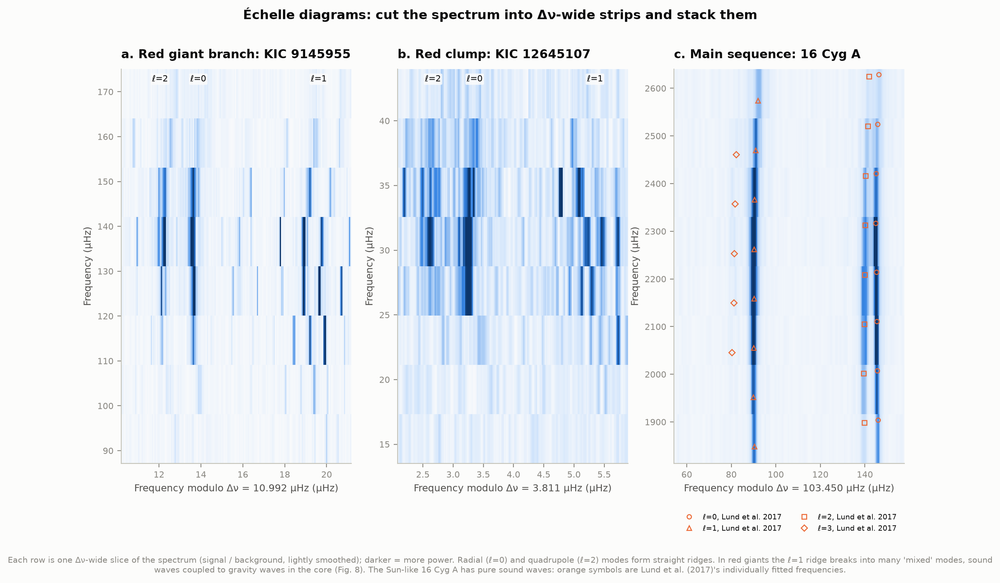

**Échelle diagrams**: the spectrum cut into Δν-wide strips and stacked. Radial (ℓ=0) and quadrupole
(ℓ=2) modes line up in straight ridges. In red giants the dipole (ℓ=1) ridge breaks up into "mixed
modes", sound waves coupled to gravity waves in the core. 16 Cyg A has only sound waves, and Lund et al.
(2017)'s individually fitted frequencies (orange) sit on our ridges.

**What we found, in short:**

- **Our blind measurements match the catalogues.** For 104 giants (νmax 6–211 µHz) our νmax is
  **+0.23 ± 0.09%** off APOKASC-3's consensus of ten pipelines with **1.0% scatter**, and Δν
  **−0.12 ± 0.05%** with **0.6% scatter**. That puts our pipeline in the middle of APOKASC-3's ten. The
  scatter is what our and their stated uncertainties predict (normalised scatter 0.97 for νmax).
- **Masses and radii.** On APOKASC-3's scale (their solar values and model corrections, our νmax and
  Δν) our masses are **+1.5%** off theirs with **3.3% scatter**, radii **+0.5%** with **1.4%**. On Yu
  et al. (2018)'s scale, mass +1.5% (5.9% scatter) and radius +0.6% (2.2%).
- **The Sun through the same code**: νmax☉ = **3142.6 ± 3.1 µHz**, Δν☉ = **134.990 ± 0.010 µHz**
  from 26 yearly spectra. This νmax☉ is 1.7% above the SYD pipeline's 3090 µHz, the value most papers
  use, and matches Kallinger et al. (2014)'s 3140 ± 4 µHz from the same kind of background model. The
  Sun's νmax also **follows the activity cycle**: it rises by **27 ± 7 µHz** from no sunspots to 170
  (Howe et al. 2020 found ~25 µHz in independent velocity data).
- **Seismic radii against Gaia.** With our own Sun as the reference and no corrections, radii come out
  **1.9 ± 0.7%** larger than radii from Gaia parallaxes on the red giant branch and **1.8 ± 0.6%** smaller
  in the clump. With the usual 3090 µHz instead, the red giant branch is **4.8%** too large. APOKASC-3's
  model and Gaia-calibrated corrections bring both groups to **1.00**.
- **Same surface, different cores.** Our own measurement of the gravity-mode period spacing ΔΠ₁ (41
  detections among the 63 giants where it is measurable) sorts the stars into hydrogen-shell burners
  (ΔΠ₁ ≈ 50–90 s) and helium-core burners (150–330 s). The classification agrees with APOKASC-3 and
  Yu et al. for **41 of 41** stars and with Vrard et al. (2016) for **29 of 29**. 28 of those 29 ΔΠ₁
  values agree with Vrard et al.'s within 2% (median difference +0.12%). Bedding et al. (2011)'s KIC
  6928997: **77.0 s**; they found 77.1.
- **Δν ∝ νmax^0.745 ± 0.006** across our giants. A fit to Yu et al.'s 16,094 gives the same, 0.739.
  The width of the relation is mostly a spread in mass.
- **16 Cyg A and B**: radii **1.205** and **1.094 R☉** from νmax and Δν alone, against **1.22 ± 0.02**
  and **1.12 ± 0.02 R☉** measured by interferometry. With the self-calibrated Sun the masses come out
  5% below detailed models (1.03 and 0.98 vs 1.08 and 1.04 M☉). With SYD's solar values they match to
  0.4% (1.084 and 1.038). See section 8.
- **You can hear them**: [`figures/audio/`](figures/audio/) holds the real light curves sped up 20
  million times. The smallest giant sings at 3 kHz (G7), the largest hums at 117 Hz (A♯2).

---

## Listen, and drag Δν yourself

Open **[`figures/star_sounds.html`](figures/star_sounds.html)** (offline, no libraries). Pick a star,
press play, and drag the large separation: the échelle diagram's ridges straighten only at the right Δν.
It covers ten giants from 6 to 154 µHz, the two showcase stars, the Sun and 16 Cyg A, plus a table of
all 104 results.

What you hear is the **measured** Kepler brightness, not a synthesis. It is band-passed around the
oscillation hump, which removes the low rumble of granulation and the hiss of photon noise, and sped
up by the same factor for every giant (2 × 10⁷), so their pitches compare honestly. One second of
sound is 231 days of starlight. Each clip is normalised to the same loudness, so loudness does
**not** compare between stars. The notes waver because the modes are stochastically excited: each
lives for days to weeks, a few tenths of a second once sped up.

| file | star | νmax | pitch |
|---|---|---|---|
| `kic6380975.wav` | red giant, 5.3 R☉ | 154 µHz | 3075 Hz (G7) |
| `kic6779699.wav` | red giant, 7.0 R☉ (Bedding et al. 2011) | 89 µHz | 1772 Hz (A6) |
| `kic12645107.wav` | red clump, 11 R☉ | 30 µHz | 600 Hz (D5) |
| `kic5785710.wav` | red giant, 16 R☉ | 15 µHz | 300 Hz (D4) |
| `kic8546146.wav` | red giant, 30 R☉ | 5.9 µHz | 117 Hz (A♯2) |
| `red_giant_ladder.wav` | ten giants, small to large: a descending scale | | |
| `sun.wav`, `16_cyg_a.wav` | the Sun (2008) and 16 Cyg A, sped up 10⁵ times | 3149 / 2214 µHz | 315 / 221 Hz |

---

## 1. From starlight to a spectrum

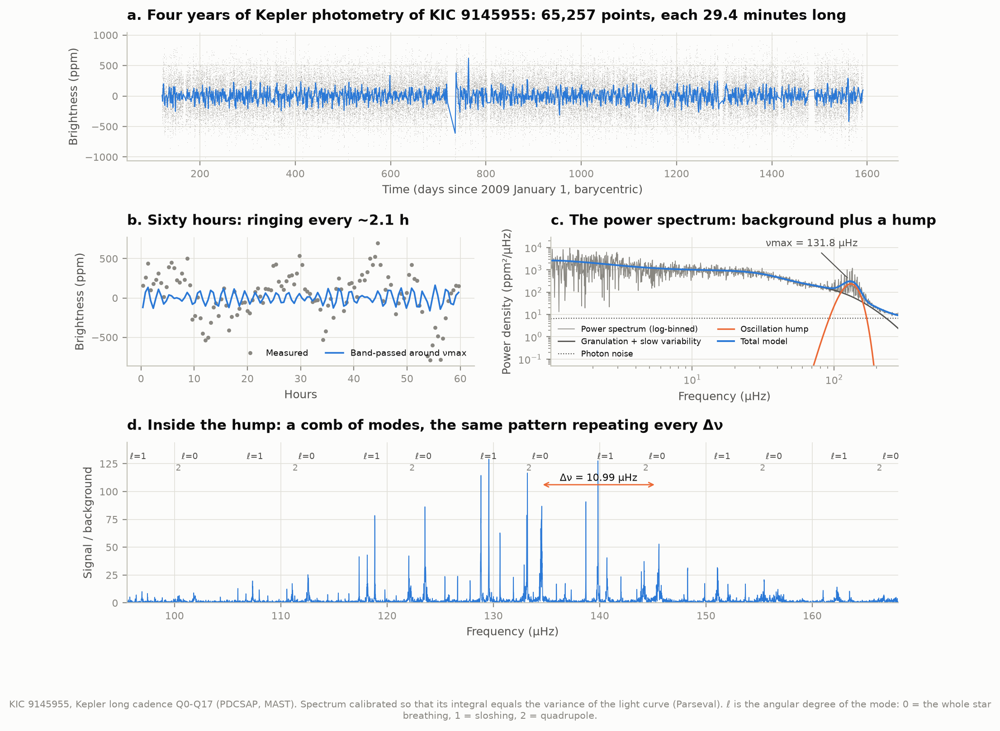

Four years of 30-minute Kepler photometry (a) show the star flickering by a few hundred ppm. Most
of that is **granulation**, convection cells boiling at the surface. The oscillations ride on top
(b, band-passed in blue). In the **power spectrum** (c) granulation is a broad background falling
towards high frequencies, and the oscillations are a hump on top of it at νmax. Zooming into the hump
(d) shows a regular comb of modes. Each ℓ is a different geometry of vibration: ℓ=0 is the whole star
breathing in and out, ℓ=1 sloshing from side to side, ℓ=2 a quadrupole. The comb repeats every Δν.

The spectrum is calibrated so that its integral equals the variance of the light curve (Parseval's
theorem; checked for every star to 10⁻⁵).

## 2. The bigger the star, the lower the note

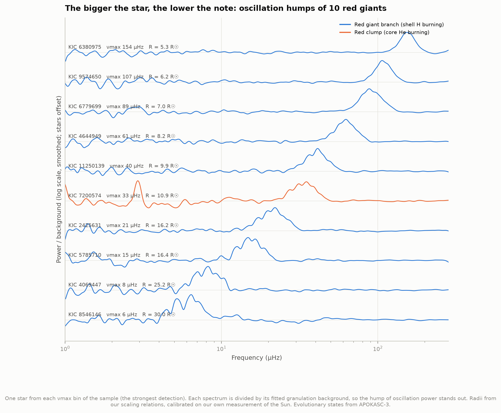

One giant from each νmax bin of the sample, each spectrum divided by its fitted granulation background.
The hump slides from 154 µHz (a 5 R☉ star, periods of ~2 hours) down to 6 µHz (30 R☉, ~2 days).
νmax scales with the surface gravity over the square root of the temperature, g/√Teff. At similar
masses, a star twice as big rings about four times lower.

## 3. Checked against the catalogues

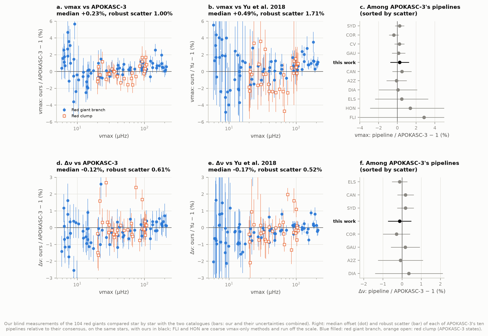

Our νmax and Δν are measured blind: the pipeline never sees a catalogue value (sample.py uses them only
to spread the random draw across νmax). Star by star, against the two big Kepler red-giant catalogues:

| | vs APOKASC-3 (consensus of 10 pipelines) | vs Yu et al. 2018 (SYD pipeline) |
|---|---|---|
| νmax, median offset | +0.23 ± 0.09% | +0.49 ± 0.20% |
| νmax, robust scatter | 1.00% | 1.71% |
| Δν, median offset | −0.12 ± 0.05% | −0.17 ± 0.05% |
| Δν, robust scatter | 0.61% | 0.52% |

Our median uncertainties are 0.8% in νmax and 0.3% in Δν (Yu et al.: 1.6% and 0.6%; APOKASC-3: 0.6%
and 0.6%). Divided by our and the catalogue's errors combined, the differences scatter by 0.97 (νmax)
and 0.78 (Δν) standard deviations: our error bars are realistic, perhaps slightly generous in Δν. On
the same 104 stars APOKASC-3's own ten pipelines scatter by 0.5–12% in νmax and 0.4–1.8% in Δν about
their consensus (panels c, f). Ours, at 1.0% and 0.6%, sits in the middle.

The oscillation amplitude per radial mode comes out 11% above Yu et al.'s, the granulation power 17%
above and the envelope width 8% below. These depend on how the background is modelled and are not used
for anything else. Comparing amplitudes needs care with conventions: SYD's power density is twice ours,
because there a mode's peak has area A² rather than A²/2.

## 4. The Δν–νmax relation

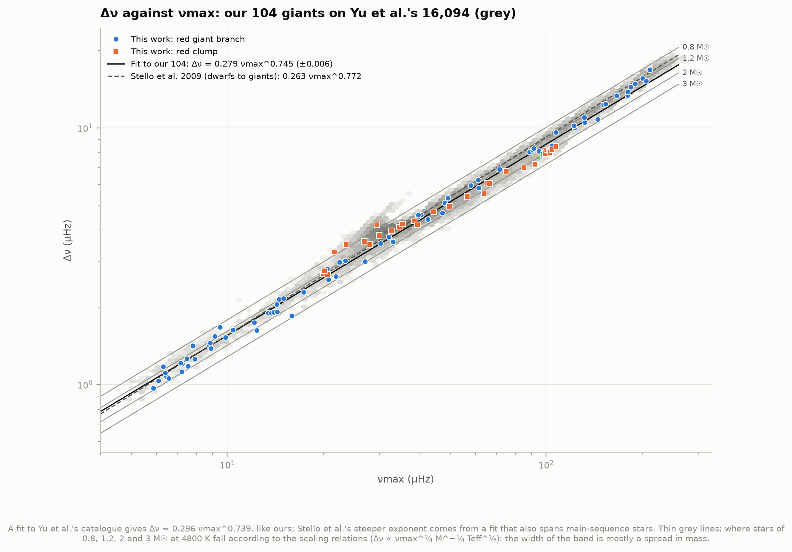

Δν = **0.279 νmax^0.745** (exponent ± 0.006) for our 104 giants. Our fit to Yu et al.'s 16,094 gives
0.296 νmax^0.739, the same within the errors. Stello et al. (2009)'s widely quoted 0.263 νmax^0.772
also spans main-sequence stars, which steepens it. The scaling relations predict
Δν ∝ νmax^¾ M^−¼ Teff^⅜, so at a given νmax heavier stars have smaller Δν. The thin lines show where
0.8, 1.2, 2 and 3 M☉ giants should fall: the width of the band is mostly a spread in mass. The orange
group at 90–110 µHz between the 2 and 3 M☉ lines is the secondary clump: stars massive enough to
ignite helium quietly, without a degenerate core.

## 5. Masses and radii

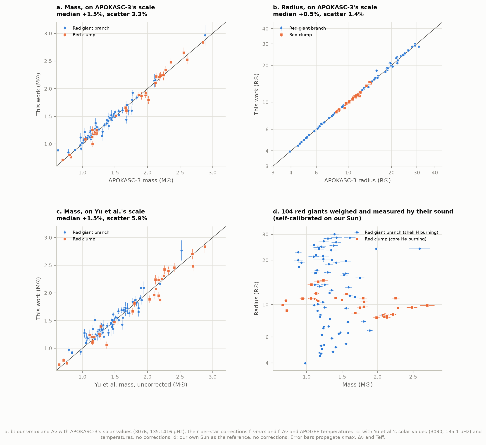

The scaling relations, both anchored on the Sun:

    R/R☉ = (νmax/νmax☉) (Δν/Δν☉)⁻² (Teff/Teff☉)^½
    M/M☉ = (νmax/νmax☉)³ (Δν/Δν☉)⁻⁴ (Teff/Teff☉)^3/2

Temperatures come from APOGEE spectra (via APOKASC-3). Because mass goes as νmax³ and Δν⁻⁴, a 1% error
in Δν is a 4% error in mass. The answer depends on which solar values and which corrections are used,
so we compute three versions:

| scale | solar values | corrections | result vs catalogue |
|---|---|---|---|
| **APOKASC-3** | 3076, 135.1416 µHz, 5772 K | their per-star f_νmax, f_Δν | mass +1.5% (scatter 3.3%), radius +0.5% (1.4%) vs APOKASC-3 |
| **Yu et al.** | 3090, 135.1 µHz, 5777 K, their Teff | none | mass +1.5% (5.9%), radius +0.6% (2.2%) vs their uncorrected values |
| **self-calibrated** | our Sun: 3142.6, 134.99 µHz, 5772 K | none | mass +0.1% (8.9%), radius +1.5% (4.2%) vs APOKASC-3 |

The mass offsets follow from the small νmax and Δν offsets (+0.2% and −0.1% → +1.2% in mass). The
corrections matter: f_Δν, from stellar models, accounts for red giants not being scaled-up Suns (APOKASC-3:
median **1.032 on the red giant branch** and **0.997 in the clump**, in their convention). Applied, they
lower red-giant-branch masses by 12% (f_Δν⁻⁴ = 0.88) and raise clump masses by 1%. Our self-calibrated
masses, which have no corrections, come out 2% above APOKASC-3's on the red giant branch and 6% below in
the clump: the higher solar νmax and the missing corrections partly cancel. Our typical uncertainty is 3%
in mass and 1.2% in radius. Panel d: the red clump sits at ~10–11 R☉ for low-mass stars; the more massive
secondary-clump stars (2–2.7 M☉) are smaller, ~8 R☉.

We reproduce APOKASC-3's tabulated masses from their own inputs to 0.01% (test_physics.py), which
pins down their conventions: the f factors multiply the observed νmax and Δν, and Teff☉ = 5772 K.

## 6. The Sun as the reference

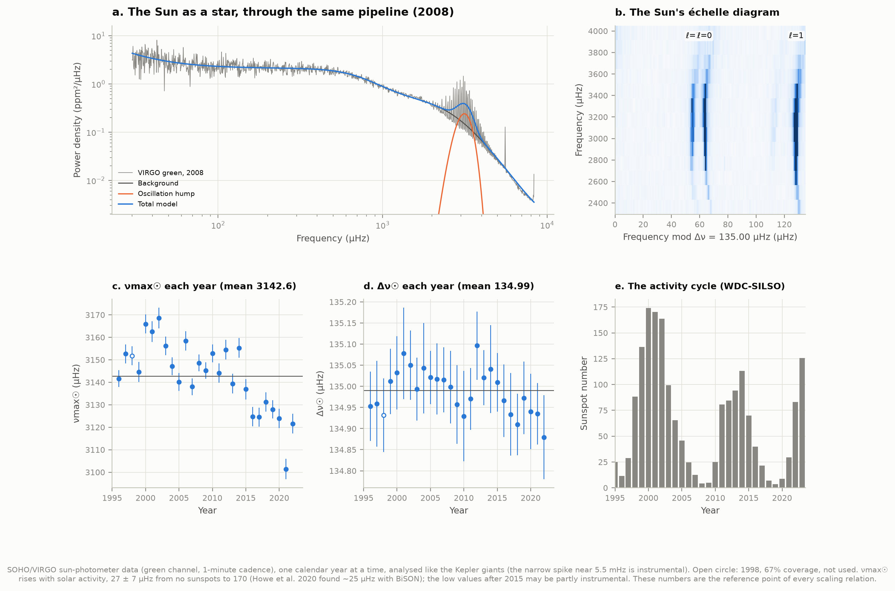

The Sun is the zero point of every scaling relation, and each pipeline measures it a little
differently: APOKASC-3's calibrations amount to effective solar values of 3043–3086 µHz for their
different method combinations, and the SYD pipeline uses 3090 µHz. A mass goes as νmax³, so a 2% difference in the solar value is 6% in every mass. We
therefore ran the same pipeline on the SOHO/VIRGO sun photometers, 1-minute photometry of the whole Sun
at 500 nm from 1996 to 2022, one calendar year at a time:

* **νmax☉ = 3142.6 ± 3.1 µHz** (26 years; year-to-year scatter 15.7 µHz) and **Δν☉ = 134.990 ±
  0.010 µHz**. Kallinger et al. (2014) fitted the same family of background models to one year of
  VIRGO green data and found 3140 ± 4 µHz. The SYD pipeline (Huber et al. 2011) finds 3090 ± 30 µHz.
  The difference is the background model, not the Sun: how the granulation is modelled moves the
  centre of the hump (Kallinger et al. 2014 found shifts of up to 6% between models).
* **The Sun's νmax follows its activity cycle**: +0.16 ± 0.04 µHz per sunspot (r = 0.55), i.e. **27 ± 7
  µHz** from no sunspots to the 170 of the 2000–2002 maximum (18 ± 6 µHz within cycle 23 alone). Howe et
  al. (2020) found ~25 µHz from BiSON velocity data. That is a 0.8% radius and 2.5% mass uncertainty for
  any star, whose activity phase is unknown. The low values after 2015 may be partly instrumental
  (the sun photometers age).
* A fully blind νmax search locked onto an instrumental hump near 5.5 mHz in 2016 (Huber et al. 2009
  mention a ~6 mHz artefact in VIRGO photometry), so for the Sun the search is limited to 1000–5000 µHz.

## 7. Do the radii agree with Gaia?

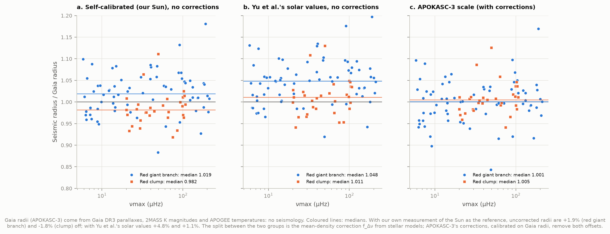

APOKASC-3 gives a radius for each star from its luminosity and temperature: Gaia DR3 parallax, 2MASS K
magnitude and APOGEE temperature, no seismology at all. Seismic/Gaia radius ratio, median:

| | red giant branch | red clump |
|---|---|---|
| self-calibrated (our Sun), no corrections | 1.019 ± 0.007 | 0.982 ± 0.006 |
| Yu et al.'s solar values, no corrections | 1.048 ± 0.006 | 1.011 ± 0.007 |
| APOKASC-3 scale, with their corrections | 1.001 ± 0.006 | 1.005 ± 0.005 |

The uncorrected scaling relations are good to about 2% in radius when calibrated on the Sun with the
same code, and to 5% with a borrowed solar value. The opposite signs for the two groups are the model
correction f_Δν (larger on the red giant branch). APOKASC-3's corrections were fitted to remove exactly
these offsets, so the bottom row is a consistency check rather than an independent test.

## 8. Same surface, different cores

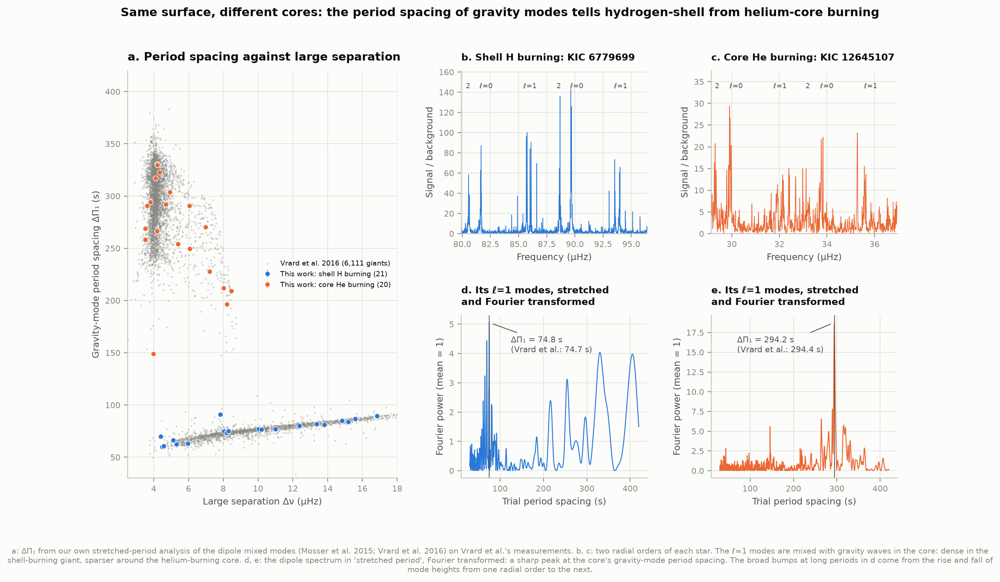

A red giant's dipole modes are **mixed**: sound waves in the envelope coupled to gravity waves in the
dense core. Pure gravity modes are evenly spaced in **period**, by ΔΠ₁, which depends on the core.
Hydrogen-shell-burning giants (red giant branch) have small, dense, degenerate helium cores and
ΔΠ₁ ≈ 50–90 s. Helium-core-burning giants (the red clump) have ΔΠ₁ ≈ 250–350 s. From the surface the two
look the same: same temperature, same radius, same luminosity. Bedding et al. (2011, Nature) were the
first to tell them apart this way.

We measure ΔΠ₁ with our own implementation of the "stretched period" method (Mosser et al. 2015; Vrard
et al. 2016). Mixing squeezes the periods near each pure pressure mode. A known function ζ undoes the
squeeze, after which the mixed modes are evenly spaced, and a Fourier transform of the stretched dipole
spectrum peaks at ΔΠ₁ (panels d, e). Two hypotheses are tried for each star: shell burning (45–130 s) and
core burning (130–420 s). A hypothesis counts only if it converges to a genuine peak inside its range,
and a detection needs the peak to stand 8 times above the mean Fourier power in that range.

* Attempted for the **63** giants with Δν ≥ 3.3 µHz. In more luminous giants the coupling is too weak
  for gravity-dominated modes to show, and Vrard et al.'s 6,111 stars all lie above ~3.3 µHz.
  **Detected in 41**: 21 shell burners, 20 core burners.
* **Classification**: 41/41 agree with APOKASC-3 and with Yu et al., 29/29 with Vrard et al. (2016).
* **ΔΠ₁ values**: 28 of the 29 stars that Vrard et al. also measured agree within 2% (median +0.12%,
  robust scatter 0.30%). The exception is KIC 7118721: 290.8 s vs 275.9 s, 5%. The coupling strength q
  agrees to +0.02 (scatter 0.04). Twelve of our detections are not in Vrard et al.'s table, among them
  KIC 9145955 (76.8 s) and KIC 12012758 (89.4 s).
* **Bedding et al. (2011)'s stars**: KIC 6779699, 74.8 s (Vrard et al.: 74.7); KIC 6928997, 77.0 s (Bedding
  et al.: 77.1). KIC 4902641, their helium burner, gives 146.6 s (Vrard et al.: 147.4) but stands only
  7.3× above the mean, just under our threshold, so it is not counted as a detection. At 2.6 M☉ it is a
  secondary-clump star.
* KIC 7200574 has a well-defined 149 s spacing (detection height 15), unusual for a clump star at Δν ≈ 4
  µHz, where most have ~300 s. Stretching with twice that value does not produce a peak, so it is not a
  harmonic. It may be a star just settling into core helium burning.
* Missed: 4 of Vrard et al.'s stars fall below our threshold. Three of them have nearly the right value
  anyway (67.4 vs 67.2 s, 146.6 vs 147.4 s, 294.8 vs 283.7 s). The fourth would have been wrong (KIC
  9574650, 49 vs 74 s; very weak coupling, q ≈ 0.05).

Synthetic mixed-mode spectra (in test_physics.py only) are recovered to < 1 s at 80, 250 and 300 s.

## 9. On B1's HR diagram

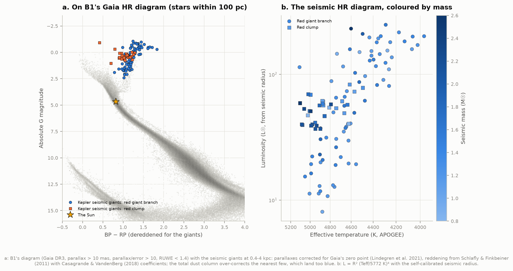

The seismic giants are 0.4–3.5 kpc away (median 1.4 kpc), far beyond B1's 100-parsec sample, so dust
matters: E(B−V) is 0.04–0.62 mag, median 0.11. Their Gaia magnitudes are corrected for distance (Gaia DR3
parallaxes with the Lindegren et al. 2021 zero-point correction) and reddening (Schlafly & Finkbeiner 2011
via IRSA, Casagrande & VandenBerg 2018 coefficients). They land on the red giant branch, which B1's local
sample barely populates, with the red clump around M_G ≈ 0.3. The full line-of-sight dust column
over-corrects the nearest few, which land too blue. Panel b is the HR diagram seismology gives directly:
luminosity from the seismic radius and the APOGEE temperature. The helium-burning clump is the knot at
40–80 L☉, and the more massive (darker) stars lie at higher temperature at a given luminosity.

## 10. Two suns: 16 Cyg A and B

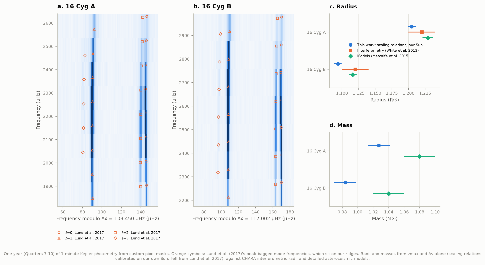

16 Cygni A and B are a wide pair of near-solar twins 21 pc away, bright enough (V ≈ 6) that Kepler observed
them through custom pixel masks at 1-minute cadence. Their five-minute-like oscillations are pure pressure
modes, so the échelle diagrams show four clean ridges, ℓ = 0–3, exactly where Lund et al. (2017)'s
peak-bagged frequencies sit. From one year of data (Quarters 7–10):

| | νmax (µHz) | Δν (µHz) | R, ours (R☉) | R, interferometry | M, ours (M☉) | M, models |
|---|---|---|---|---|---|---|
| 16 Cyg A | 2214 ± 4 (Lund: 2188) | 103.45 ± 0.11 | 1.205 ± 0.006 | 1.22 ± 0.02 | 1.03 ± 0.01 | 1.08 ± 0.02 |
| 16 Cyg B | 2588 ± 4 (Lund: 2561) | 117.00 ± 0.11 | 1.094 ± 0.005 | 1.12 ± 0.02 | 0.98 ± 0.01 | 1.04 ± 0.02 |

Interferometric radii: White et al. (2013, CHARA/PAVO). Masses: Metcalfe et al. (2015)'s detailed
modelling of individual frequencies. Our radii, from νmax and Δν alone, agree within 1.2% and 2.3% (0.7σ
and 1.3σ). The masses are 5% low. With SYD's solar values instead of our own, the same stars give
1.227 and 1.115 R☉ and **1.084 and 1.038 M☉**, matching the models to 0.4%. So for these Sun-like stars,
our VIRGO-based solar νmax looks ~1.7% too high relative to how the same code measures Kepler stars.
That is plausible: VIRGO observes at 500 nm and Kepler across 420–900 nm, so the granulation background
that the hump sits on differs. We did not resolve this; analysing VIRGO's red channel (862 nm) would test it.
For the red giants the self-calibrated scale works better (section 7).

---

## How it works

**Sample** ([sample.py](sample.py)). APOKASC-3 Gold stars (νmax and Δν agreed by 5+ pipelines, an APOGEE
spectrum, an evolutionary state) that Yu et al. also measured, with ≥ 15 quarters of data and Kepler
magnitude ≤ 12.5. Ten random stars (fixed seed) were drawn from each of ten log-spaced νmax bins between 5
and 230 µHz, half of them red clump where the bin has clump stars. The four literature showcase stars
were then added: 100 + 4 = 104 stars, 73 on the red giant branch and 31 in the clump by APOKASC-3's
classification.

**Light curves** ([lightcurves.py](lightcurves.py)). Kepler PDCSAP flux, cadences flagged by the
"default" quality mask dropped. Each quarter is divided by its median and by a Gaussian running mean (σ = 5
days for long cadence, 1 day for short cadence and the Sun). The running mean is a normalised convolution,
so gaps don't drag it down. Points beyond 4.5 robust σ are clipped. The filter's power transfer,
(1 − e^(−2π²σ²ν²))², is part of the background model; it is > 0.95 above 1 µHz.

**Spectrum** ([spectrum.py](spectrum.py)). A Lomb–Scargle periodogram (Kepler times are barycentric, so
not exactly evenly spaced), scaled to a single-sided power density with ∫PSD dν = variance.

**νmax** ([background.py](background.py)). The spectrum is averaged into 0.5%-wide logarithmic bins and
fitted by maximum likelihood (gamma statistics for averaged χ²₂ bins). The model is white noise + a slow
Lorentzian + two granulation "super-Lorentzians" (exponent 4) + a Gaussian hump. All but the white noise
are multiplied by the sinc² attenuation of 30-minute integrations and by the filter transfer. The search
is blind: 24 starting values of νmax from 3 to 270 µHz, the best four refined, the winner sampled with
emcee (32 walkers × 2000 steps). The slow component was added after Bedding's helium burner KIC 4902641
failed without it (νmax 9% low, envelope twice too wide): its strong low-frequency variability had used
up one of the two granulation components.

**Δν** ([deltanu.py](deltanu.py)). First the autocorrelation of the background-divided spectrum within a
few envelope widths of νmax, searched near the value νmax predicts (Stello et al. 2009) with Yu et al.'s
Gaussian weighting. The autocorrelation alone is biased in red-clump stars (+0.54%, scatter 1.1%), whose
broad, coupled dipole modes pull the peak; tests on synthetic spectra show the same. So Δν is then refined
by folding the spectrum on trial values (±5%) and matching it to the red-giant "universal pattern"
(Mosser et al. 2011): ℓ=0 and ℓ=2 ridges, a broad ℓ=1 ridge half an order away, a faint ℓ=3. The pattern's
phase ε is allowed within ±0.15 of Mosser et al.'s ε(Δν). This removes the clump bias (−0.12%, scatter
0.43%). Uncertainties come from refitting spectra perturbed with χ²₂ noise. For 16 Cyg and the Sun, to
which the red-giant pattern does not apply, the autocorrelation value is used.

**ΔΠ₁** ([period_spacing.py](period_spacing.py)): see section 8.

**Scaling relations** ([scaling.py](scaling.py)), Monte Carlo over the νmax posterior, Δν and Teff.

## Data and provenance

| data | source | size |
|---|---|---|
| Kepler long cadence, 104 giants, Q0–Q17 (1,759 files) | MAST, `archive.stsci.edu/missions/kepler/lightcurves/` | 0.70 GB |
| Kepler short cadence, 16 Cyg A and B, Q7–Q10 (custom apertures kplr1000xxxxx, 24 files) | MAST | 0.10 GB |
| SOHO/VIRGO SPM green channel, level 2, 1996–2023 | ESA SOHO Science Archive, mission-long files | 0.23 GB |
| Yu et al. 2018, ApJS 236, 42 | CDS J/ApJS/236/42 | 3 MB |
| APOKASC-3, Pinsonneault et al. 2025, ApJS 276, 69 (tables 4, 5, 9) | CDS J/ApJS/276/69 | 29 MB |
| Vrard et al. 2016, A&A 588, A87 | CDS J/A+A/588/A87 | 0.3 MB |
| Lund et al. 2017 (Kepler LEGACY), ApJ 835, 172 | CDS J/ApJ/835/172 | 0.3 MB |
| Gaia DR3 for the sample (by source_id) | ESA Gaia archive | < 1 MB |
| B1's Gaia DR3 sample (parallax > 10 mas) | hard-linked from [02-hr-diagram](../02-hr-diagram/) | (66 MB, not re-downloaded) |
| E(B−V), Schlafly & Finkbeiner 2011 | IRSA dust service | < 1 MB |
| Yearly sunspot number | WDC-SILSO, Royal Observatory of Belgium (hard-linked from [15-solar-cycles](../15-solar-cycles/)) | < 1 MB |

About **1.1 GB** downloaded in all (the spec estimated 0.1–1 GB; the Sun accounts for the difference).
Literature numbers used only for comparison are in [literature.py](literature.py), each with its source:
White et al. 2013 (16 Cyg radii), Metcalfe et al. 2015 (16 Cyg models), Stello et al. 2009 and Huber et
al. 2011 (Δν–νmax), Bedding et al. 2011, Kallinger et al. 2014 and Howe et al. 2020 (quoted here).

This research uses data from the Kepler mission (NASA Science Mission Directorate), SOHO (ESA/NASA, VIRGO
by the VIRGO team), Gaia (ESA, DPAC), APOGEE/SDSS, 2MASS, and the CDS (Strasbourg) and IRSA (Caltech/IPAC)
services.

## Caveats

* **The solar reference values are the biggest systematic.** The three scales in section 5 differ by
  up to 6% in mass. Ours (the Sun measured with our code) suits the red giants against Gaia (section 7)
  but makes 16 Cyg A and B 5% too light (section 10). No single choice is free of systematics at the
  2% level in νmax. The Sun's own νmax also moves by ~1% with the activity cycle.
* **No model corrections on the self-calibrated scale.** We did not compute f_Δν from stellar models;
  where corrections are applied, they are APOKASC-3's per-star values.
* **The sample is not a population.** Bright stars with long data sets were selected, and the random
  draw is stratified in νmax and evolutionary state, so the mass and radius distributions are not those of
  the Kepler field.
* **Evolutionary states** for colouring the figures come from APOKASC-3. Our own ΔΠ₁ classification
  (section 8) covers 41 stars and agrees with it in every case.
* **High νmax is out of reach.** Long cadence samples every 29.4 min (Nyquist 283 µHz). The sample stops
  at 211 µHz, and the hump of the highest-νmax stars is visibly damped by the integration (sinc², 0.65 at
  200 µHz), which the model includes.
* **The Gaia radii** are APOKASC-3's (MIST bolometric corrections, their extinction map), not our own.
  Their parallax zero point and temperature scale carry ~1–2% systematics of their own.
* **Dereddening** for the HR diagram uses the full line-of-sight dust column (the Bayestar 3D map's web
  service did not respond), which over-corrects the nearest giants.
* **Sounds** are normalised in loudness and band-passed, so they show pitch and texture, not amplitude.

## Reproduce

```bash
cd 48-asteroseismology
../.venv/bin/python run.py                 # download, analyse, draw (first run: ~1.1 GB, ~50 min)
../.venv/bin/python run.py --figures-only  # redraw figures, sounds and the explorer from the cache
../.venv/bin/python -m pytest test_physics.py -q   # 11 checks of the physics and the methods
```

The first run fits 104 giants (about 10 minutes on 6 cores), 27 years of the Sun (about 20 minutes on a busy
machine) and 16 Cyg A and B (3 minutes), then measures ΔΠ₁ from the cached spectra (5 minutes). Everything is
cached under `data/`: `data/results.json` (written by run.py) holds every number quoted here, and
`data/results_stars.csv` one row per star. Needs numpy, scipy, astropy, pandas, matplotlib, emcee, lightkurve
(for the 16 Cyg file search only), astroquery, gaiadr3-zeropoint and threadpoolctl from the shared venv.

## Files

| file | what it does |
|---|---|
| [run.py](run.py) | end to end |
| [fetch_data.py](fetch_data.py) | downloads and caches everything |
| [sample.py](sample.py) | the stratified random sample |
| [lightcurves.py](lightcurves.py), [spectrum.py](spectrum.py) | light curves and power spectra |
| [background.py](background.py), [deltanu.py](deltanu.py), [period_spacing.py](period_spacing.py) | νmax, Δν, ΔΠ₁ |
| [stars.py](stars.py), [sun.py](sun.py), [mainseq.py](mainseq.py) | the pipeline for giants, the Sun and 16 Cyg |
| [scaling.py](scaling.py), [analysis.py](analysis.py) | scaling relations and the ensemble comparisons |
| [catalogs.py](catalogs.py), [literature.py](literature.py) | the comparison catalogues and published numbers |
| [figures.py](figures.py), [sonify.py](sonify.py), [explorer.py](explorer.py) | figures, sounds, interactive page |
| [test_physics.py](test_physics.py) | tests: Parseval, apodization, filter transfer, APOKASC-3's conventions, ΔΠ₁ and Δν recovery |
