# B6: How old are the oldest stars?

**Globular clusters hold the Milky Way's oldest stars. How old are they, and are they younger than the universe that D1 and D3 measured?**

They are old, and the universe is (just) older. Fitting three independent sets of
stellar-evolution models to Hubble photometry of four clusters, with distances from Gaia and
Hubble, gives **M92 13.4 ± 0.8 Gyr, M15 12.8 ± 0.7 Gyr and NGC 6397 14.0 ± 1.0 Gyr** for the three
metal-poor clusters, and **11.4 ± 0.9 Gyr for the metal-rich 47 Tucanae**, which formed about
2 billion years later. Adding the ~0.2 Gyr the first clusters needed to form, the universe must be
at least **13.6 ± 0.8 Gyr** old. That fits D3's Planck age of 13.83 Gyr and D8's chronometers
(13.45 Gyr), but not comfortably the 12.5 Gyr that D1's Cepheid-calibrated H₀ = 73.5 implies in the
same ΛCDM model (1.3σ short). Read the other way, the oldest stars cap the Hubble constant at
**H₀ < 75.5 km/s/Mpc (95%)** for Planck's matter density. Without dark energy, they would need
H₀ < 48: that was the "age crisis" of the early 1990s.

The check against the literature holds: for M92, the spec's reference value is 13.80 ± 0.75 Gyr
(Ying et al. 2023). We get 13.42 ± 0.76 at Baumgardt & Vasiliev's distance, and 13.4–13.8 Gyr with
the same Dartmouth models at Ying et al.'s own distance and reddening.

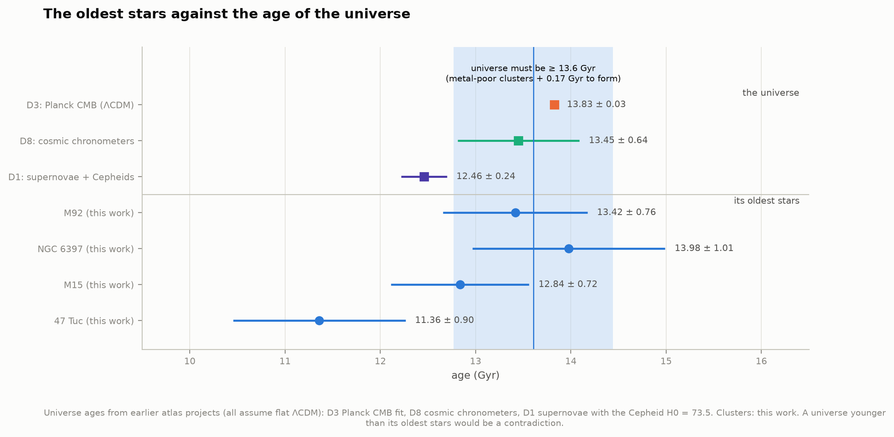

Data: the HST UV Legacy Survey of Galactic Globular Clusters (HUGS, 56 clusters, five filters). Models: MIST v2.5, BaSTI-IAC and
the Dartmouth database (DSED), all with the α-element enhancement these old stars have. An offline page,
[`figures/isochrone_explorer.html`](figures/isochrone_explorer.html), lets you fit the clusters by hand.

---

## Results

### The ages

Every age below comes from 1,000 Monte Carlo fits per cluster and isochrone set. Each draw takes
the distance, reddening, [Fe/H], [α/Fe] and the ridge line's statistical noise from their
uncertainties. The quoted value is the median, and the error the 16th–84th percentile range.
"Combined" is the mean of the three sets; its error adds their spread in quadrature to the typical
Monte Carlo width.

| Cluster | [Fe/H] | distance | MIST v2.5 | BaSTI-IAC | DSED | **Combined** |
|---|---|---|---|---|---|---|
| M92 (NGC 6341) | −2.31 | 8.50 kpc | 13.21 +0.69 −0.63 | 13.17 +0.57 −0.63 | 13.87 +0.71 −0.65 | **13.42 ± 0.76 Gyr** |
| NGC 6397 | −2.02 | 2.48 kpc | 13.75 +1.02 −0.99 | 13.60 +0.94 −0.83 | 14.58 +0.37 −0.95 † | **13.98 ± 1.01 Gyr** |
| M15 (NGC 7078) | −2.37 | 10.71 kpc | 12.60 +0.69 −0.62 | 12.62 +0.53 −0.57 | 13.29 +0.64 −0.61 | **12.84 ± 0.72 Gyr** |
| 47 Tuc (NGC 104) | −0.72 | 4.52 kpc | 11.17 +0.93 −0.78 | 11.55 +0.89 −0.88 | 11.36 +0.96 −0.86 | **11.36 ± 0.90 Gyr** |

† DSED's grid stops at 15 Gyr, and 38% of its NGC 6397 draws pile up there: that median is a lower
bound (figure 4).

The fits are good. With the model floor described under *How it works*, χ² is 2–89 for 48–78 ridge points, and
the best isochrone runs through the main sequence, turnoff, subgiant branch and lower giant
branch alike (figures 1 and 3). The models need a colour shift of −0.005 to −0.044 mag to match the
data. Brightness is never adjusted.

**The three model sets disagree in a consistent way.** DSED ages are 0.6–1.0 Gyr older than MIST
and BaSTI for the metal-poor clusters, which agree with each other to 0.2 Gyr. This is a property
of the models, not of the data: a synthetic 13.0 Gyr DSED cluster fitted with MIST or BaSTI comes
out 12.4–12.5 Gyr old (`test_physics.py`). DSED's subgiant branch is ~0.02–0.05 mag brighter at a
given age (figure 2). For 47 Tuc the three agree within 0.4 Gyr.

### What limits the ages

Each input varied alone, averaged over the three sets (figure 5):

| Cluster | distance | reddening | [Fe/H] | [α/Fe] | ridge noise | isochrone set | total |
|---|---|---|---|---|---|---|---|
| M92 | 0.38 | 0.35 | 0.30 | 0.27 | 0.03 | 0.39 | 0.76 |
| NGC 6397 | 0.39 | 0.64 | 0.38 | 0.30 | 0.04 | 0.53 | 1.01 |
| M15 | 0.33 | 0.33 | 0.27 | 0.25 | 0.03 | 0.39 | 0.72 |
| 47 Tuc | 0.37 | 0.35 | 0.52 | 0.48 | 0.01 | 0.19 | 0.90 |

(Gyr, 1σ.) No single term dominates. The spec expected distance to: a 0.1 mag distance error does
move the age by 1.15 Gyr (measured on a synthetic cluster), but Baumgardt & Vasiliev's distances
are now good to ~1%. We use their errors plus a 0.025 mag systematic floor (0.03 mag in all), worth
~0.35 Gyr. The reddening (A_F606W ≈ 2.8 × E(B−V)) matters as much, and for NGC 6397, behind
E(B−V) = 0.18, more. So does the composition: ±0.1 dex in [Fe/H] or [α/Fe] moves the turnoff as
much as ±0.3 Gyr does, and more at 47 Tuc's higher metallicity. Tens of thousands of stars pin the
ridge line itself to a few millimagnitudes, so its noise hardly matters.

### Checks against published ages

| Cluster | This work | Published |
|---|---|---|
| M92 | 13.42 ± 0.76 | **Ying et al. 2023: 13.80 ± 0.75** · Valcin et al. 2025: 13.07 ± 0.56 · VandenBerg et al. 2013: 12.75 |
| NGC 6397 | 13.98 ± 1.01 | Valcin et al. 2025: 13.08 ± 1.21 · VandenBerg et al. 2013: 13.00 · white-dwarf cooling (Hansen et al. 2007): 11.47 ± 0.24 |
| M15 | 12.84 ± 0.72 | Valcin et al. 2025: 13.74 ± 0.55 · VandenBerg et al. 2013: 12.75 |
| 47 Tuc | 11.36 ± 0.90 | eclipsing binaries (Thompson et al. 2020): 12.0 ± 0.5 · VandenBerg et al. 2013: 11.75 · Valcin et al. 2025: 12.92 ± 0.41 · white-dwarf cooling (Hansen et al. 2013): 9.9 ± 0.36 |

(VandenBerg et al. quote ±0.25 Gyr *relative* errors; their absolute uncertainty is ~±1.5 Gyr.
Hansen et al.'s ranges are 95% intervals, converted here to 1σ.)

**M92 and Ying et al. (2023).** Their 13.80 ± 0.75 Gyr comes from 20,000 Dartmouth (DSEP) model
sets with varied physics, fitted to the same ACS photometry, at their own main-sequence-fitting
distance modulus of 14.72 ± 0.04. That is 0.07 mag farther than Baumgardt & Vasiliev's 14.65,
which alone makes a cluster 0.8 Gyr younger. Refitting our ridge line with their distance:

| | at μ = 14.65, E(B−V) = 0.02 | at μ = 14.72, E = 0.02 | E = 0.01 | E = 0.00 |
|---|---|---|---|---|
| MIST | 13.25 | 12.37 | 12.70 | 13.05 |
| BaSTI | 13.19 | 12.34 | 12.67 | 13.00 |
| DSED | 13.95 | 13.10 | 13.44 | 13.76 |

Ying et al. preferred E(B−V) ≈ 0.005–0.025. With their models and inputs we land at 13.4–13.8 Gyr,
on top of their answer; MIST and BaSTI are ~0.7 Gyr younger at the same inputs.

**47 Tuc** sits between its two independent clocks: the eclipsing binaries (masses and radii of two
stars, 12.0 ± 0.5) and the white dwarfs (9.9 ± 0.4). **NGC 6397's** white-dwarf age (11.5 ± 0.2)
is 2.4σ below our turnoff age; that tension between the two methods is not new for this cluster,
and our NGC 6397 fit rests on a short subgiant branch (the field holds few evolved stars).

### Metal-rich 47 Tuc formed later

The three metal-poor clusters average 13.41 Gyr; 47 Tuc is younger by **2.0 Gyr** (1.6, 2.0 and
2.4 Gyr in BaSTI, MIST and DSED; Monte Carlo width ±1.0 Gyr each). The probability that it is
younger is 95–99% in every set. Hansen et al. (2013) found the same ~2 Gyr gap between 47 Tuc and
NGC 6397 from their white dwarfs. The metal-poor clusters formed first; 47 Tuc,
made from gas already enriched with iron, formed in the Milky Way's disc about 2 billion years
later (figure 6). (The metal-poor three did not all form in the Milky Way itself: by its orbit, M92
arrived with the Gaia-Enceladus dwarf galaxy; Massari et al. 2019.)

### Two generations in every cluster (chromosome maps)

The ultraviolet filters split each cluster's red giants into a first generation (1G, normal halo
composition) and a second (2G, enriched in nitrogen and sodium, depleted in oxygen and carbon),
exactly as Milone et al. (2017) found (figure 7). Fraction of first-generation stars:

| Cluster | This work | Milone et al. 2017 | RGB stars |
|---|---|---|---|
| M92 | 0.40 ± 0.07 | 0.30 ± 0.02 | 826 |
| NGC 6397 | 0.32 ± 0.12 | 0.35 ± 0.04 | 44 |
| M15 | 0.32 ± 0.04 | 0.40 ± 0.02 | 1,452 |
| 47 Tuc | 0.23 ± 0.01 | 0.175 ± 0.009 | 1,340 |

The maps look like theirs, and most clusters are ~70% second generation. The fractions agree only
to ~0.05–0.1. Milone et al. fit one Gaussian to the 1G peak of the rotated map, we fit a mixture
of Gaussians to all of it, and both depend on where the 1G/2G boundary falls in clusters where the
two blur together (M92, M15). NGC 6397's field holds only 44 usable giants. The turnoff ages are
not affected: the populations differ in light elements, which F606W and F814W barely see.

### The oldest stars and the age of the universe

The three metal-poor clusters give t_GC = 13.41 ± 0.83 Gyr; their errors are mostly shared
(models, distance scale), so the mean keeps the typical error. The first clusters formed at
redshift z > 11 (as Valcin et al. 2025 assume), 0.12–0.29 Gyr after the Big Bang for
z_f = 11–30. The universe must therefore be at least **13.61 ± 0.83 Gyr** old (5th percentile
12.24).

| Universe age (flat ΛCDM) | | vs the clusters |
|---|---|---|
| D3: Planck CMB | 13.825 ± 0.033 Gyr | +0.22 Gyr (+0.3σ): consistent |
| D8: cosmic chronometers | 13.45 ± 0.64 Gyr | −0.16 Gyr (−0.1σ): consistent |
| D1: supernovae + Cepheids, H₀ = 73.5 | 12.46 ± 0.24 Gyr | −1.15 Gyr (−1.3σ): the universe younger than its stars in 91% of draws |

The age of a flat ΛCDM universe scales as 1/H₀, so the clusters set an upper limit on H₀ (figure 9):

| Matter density | H₀ upper limit (95%) | median |
|---|---|---|
| Ωm = 0.30 | 77.0 | 69.3 |
| Ωm = 0.325 (D3) | 75.5 | 67.8 |
| Ωm = 0.332 ± 0.018 (D1) | 75.1 | 67.4 |
| Ωm = 1 (no dark energy) | 47.9 (median) | |

The clusters lean towards the CMB's H₀ in the Hubble tension, but at 1.3σ they do not settle it. For
comparison, Valcin et al. (2025) find t_GC = 13.39 ± 0.10 (stat) ± 0.23 (sys) Gyr from 69 clusters
and the age of the universe as 13.57 Gyr; their 2026 two-population analysis gives 13.61 ± 0.25 ± 0.23
for the metal-poor clusters, and t_U = 13.81 Gyr. Our 13.41 ± 0.83 and 13.61 ± 0.83 agree, with
larger errors from honest distances and three model sets instead of one.

**The 1990s age crisis, restaged.** In a universe without dark energy the age is 2/(3H₀):
9.7 Gyr for H₀ = 67.4 and 8.9 Gyr for 73.5. Clusters of 13.4 Gyr would need H₀ < 48. In the early
1990s, with clusters dated at 14–16 Gyr and H₀ measured at 70–80, this was a genuine contradiction.
Better (Hipparcos) distances made the clusters younger, and dark energy made the universe older.

### How robust are the ages?

Shifts from each set's own baseline (figure 11):

| Change | M92 | NGC 6397 | M15 | 47 Tuc |
|---|---|---|---|---|
| geometric distances only (Gaia parallax + kinematics) | +0.4 to +0.5 | +0.4 to +0.6 | +0.7 to +0.8 | −0.1 to +0.2 |
| subgiant point alone (Chaboyer et al. 1996 method) | −0.1 to −0.5 | −0.2 to −0.7 | −0.5 to −0.8 | −0.1 to +0.2 |
| no colour shift (model colours trusted) | −0.1 to −0.8 | −2.3 to −3.0 | −1.2 to −1.8 | −0.9 to −1.0 |
| fit region (MS 1–3 mag, RGB 0.5–2.5 mag) | ±0.2 | −0.5 to +0.1 | −0.3 to +0.1 | ±0.2 |
| model floor halved or doubled | < 0.05 | < 0.05 | < 0.05 | < 0.05 |
| helium Y = 0.275 instead of 0.247 (BaSTI) | −0.60 | −0.52 | −0.57 | −0.25 |

- **Distances without isochrones.** Baumgardt & Vasiliev's mean distances fold in literature values
  that include isochrone fits of the same clusters. Gaia parallaxes and the Gaia/HST kinematic
  distances alone (no stellar models) put M92 1.4%, NGC 6397 2.2% and M15 3.1% closer, making them
  0.4–0.8 Gyr older; for M92 and M15 this is within the geometric distances' own errors (3–3.5%).
- **The colour shift is essential.** Forcing the model colours makes the metal-poor clusters 1–3 Gyr
  younger, because a younger isochrone is bluer at the turnoff and absorbs the colour mismatch. The
  fitted shifts grow with reddening (−0.015 at E(B−V) = 0.02, −0.044 at 0.18). This points at the
  extinction law in colour: MIST's E(F606W−F814W)/E(B−V) = 1.17 for a turnoff star, against ~1.05–1.10
  for Cardelli or Fitzpatrick laws. The brightness extinction A_F606W = 2.82 E(B−V) agrees with those
  laws to 2%.
- **Helium.** Second-generation stars carry more helium, and helium-rich stars burn faster: with
  Y = 0.275 for *every* star instead of 0.247, the clusters look 0.25–0.6 Gyr younger. From the same
  HUGS photometry, Milone et al. (2018) find the second generation helium-richer by at most <0.01 to
  >0.10 (more in more massive clusters), and much less on average, so the real effect on the mean
  turnoff is a fraction of this test.

### Validation of the machinery

`test_physics.py` (all pass; run as a script, it prints each measured value):
- Interpolation in [Fe/H] across the 0.5 dex steps of MIST and DSED, checked on a held-out MIST node:
  0.001 mag at the subgiant point (0.004 with linear interpolation; ~0.01 Gyr). Interpolation in age
  across 2 Gyr gaps: 0.0004 mag.
- Synthetic ridge lines from isochrones of known age (labelled simulations) are recovered to
  < 0.01 Gyr; a 0.03 mag colour error in the models is absorbed by the colour shift, not the age; a
  0.1 mag distance error moves the age by 1.15 Gyr.
- The extinction ratios (A_F606W/E(B−V) = 2.82 for a turnoff star) and the ages of flat universes
  (against astropy) are as expected; the Harris and Baumgardt & Vasiliev readers return the published
  values.

## Extension: every cluster in the survey

`survey.py` runs the same machinery on all 56 globular clusters in HUGS: MIST with a 200-draw
Monte Carlo, plus single BaSTI and DSED fits for the model spread. The inputs are the same kind
throughout: Harris [Fe/H] and E(B−V), Baumgardt & Vasiliev distances, [α/Fe] = +0.4. 27 clusters
are flagged (`data/survey.json`). Reasons, several per cluster: the fit hits the 8 or 16 Gyr edge
of the age grid (15), E(B−V) ≥ 0.30 (11; the extinction law and patchy dust dominate there), a
colour shift above 0.06 mag (9), a split subgiant branch of Milone et al.'s "Type II" clusters (8;
one isochrone cannot describe two populations), or a poor fit (4). The quality gallery (figure 13)
shows why: the flagged bulge clusters are smeared by dust and field stars. That leaves **29 clean
clusters** (figure 12).

**Against published ages**, ours are systematically older: by +0.71 Gyr against VandenBerg et al.
(2013; 28 clusters, scatter 0.77 Gyr) and +0.63 Gyr against Valcin et al. (2025; 29 clusters,
scatter 1.08). An offset of this size is what a 0.06 mag difference in the distance scale, or the
model set, produces. VandenBerg et al. used their own horizontal-branch distances and the
Victoria–Regina models; Valcin et al. fitted the distance along with the age. Its exact source is
not pinned down here.

**Two branches in age–metallicity.** Between [Fe/H] = −1.7 and −1.0, the four clean clusters that
formed in the Milky Way's disc (Massari et al. 2019: NGC 6218, 6717, 6723, 6752) average 13.4 ±
0.6 Gyr. The six brought in by Gaia-Enceladus or the Helmi streams (NGC 288, 3201, 5272 = M3,
5904 = M5, 6205 = M13, 6981) average 12.2 ± 0.4 Gyr. The gap, 1.1–1.2 Gyr in each of the three model
sets, matches the published picture (Marín-Franch et al. 2009; Leaman et al. 2013; Massari et al.
2019): at a given iron content, small galaxies made their clusters later, because they enriched
their gas more slowly. With 4 + 6 clusters it is a 1.8σ result.

**No age spread among the metal-poor clusters.** The 16 clean clusters with [Fe/H] < −1.5 average
13.57 Gyr with a scatter of 0.69 Gyr, smaller than their typical error (0.98): consistent with one
burst of cluster formation at the earliest epoch, within our precision. The oldest-looking
(NGC 6681, 6093, 6809 at 14.6–14.7 ± 1.0 Gyr) are within 1σ of the universe's age; for them, and
for NGC 5053, DSED's grid edge at 15 Gyr also biases the model mean low.

**The clusters measure the extinction law's colour.** Across the 29 clean clusters, the fitted
colour shift grows with reddening: Δc = −0.010 ± 0.004 − (0.137 ± 0.033) × E(B−V), a 4σ slope.
Other selections give −0.08 to −0.18. Either MIST's colour excess E(F606W−F814W)/E(B−V) = 1.17
should be ~1.0–1.1, as the Cardelli and Fitzpatrick laws give, or the catalogue reddenings are
~10% too high. Schlafly & Finkbeiner (2011) found the SFD dust map, the basis of many such
reddenings, to be 14% high. The two readings move the colours alike but not the ages: if the
reddenings are high, the reddened clusters are older still than we find, by ~0.2 Gyr per 0.05 mag
of E(B−V). The intercept says the MIST colours are 0.010 mag too red at zero reddening, about 30 K
in temperature.

## Figures

| | |
|---|---|
| 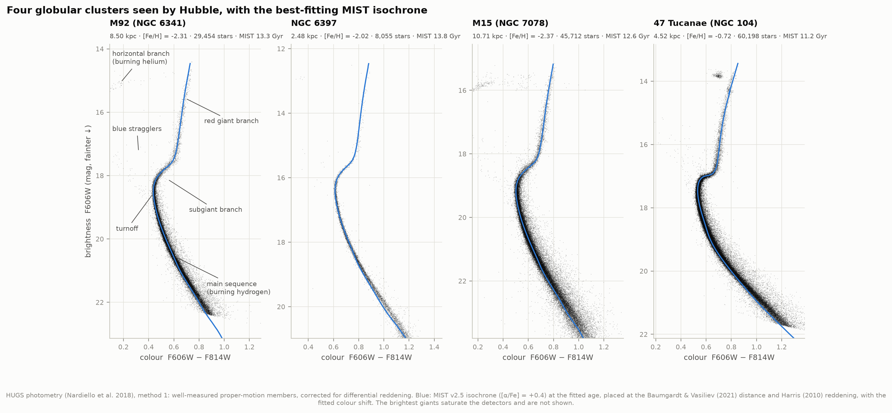 | **1. The four clusters.** Cleaned, dereddened HUGS colour–magnitude diagrams with the best MIST isochrone; the evolutionary phases labelled on M92. |
| 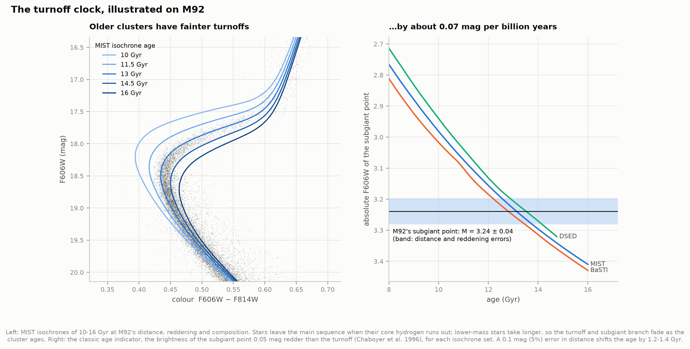 | **2. The turnoff clock.** Isochrones of 10–16 Gyr on M92; the subgiant point fades by ~0.07 mag per Gyr in all three model sets. |
| 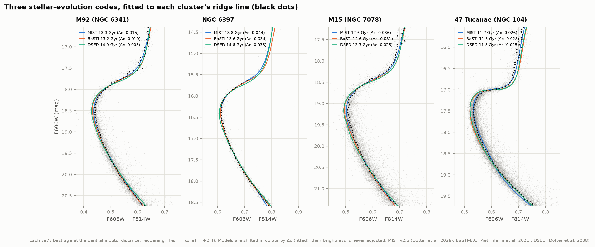 | **3. Three codes, one ridge line.** The best isochrone of each set on each cluster's ridge line. |
| 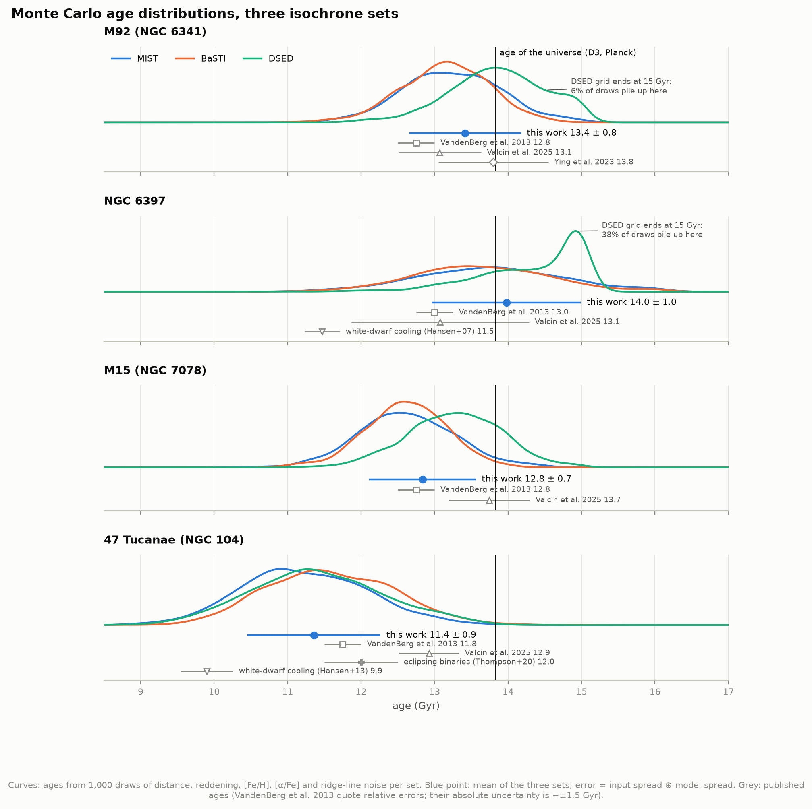 | **4. Age distributions** of the Monte Carlo, with published ages. |
| 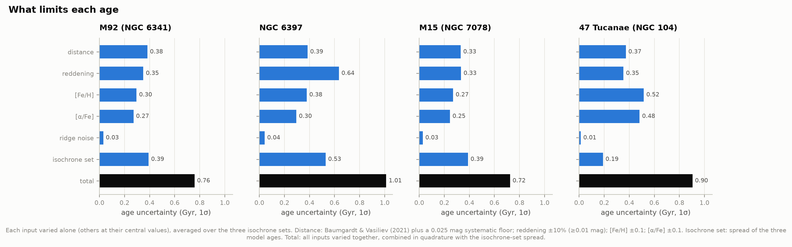 | **5. Error budget.** |
| 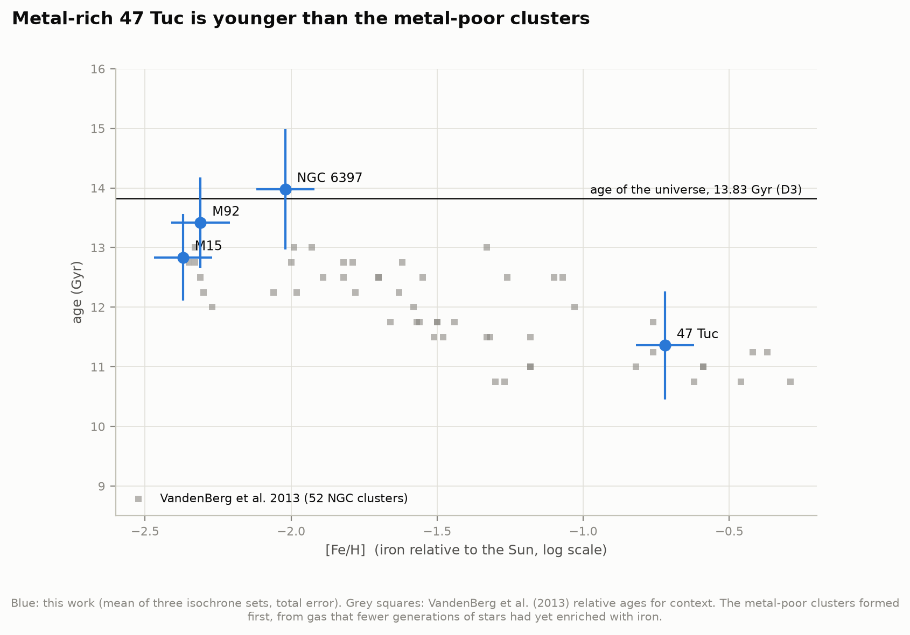 | **6. Age against metallicity**, with VandenBerg et al. (2013) for context. |
| 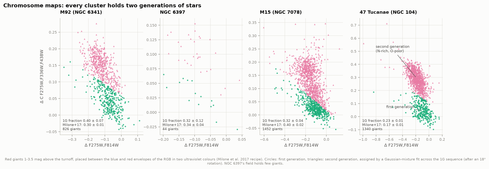 | **7. Chromosome maps**: first and second generation in each cluster. |
|  | **8. Timeline**: cluster ages against the universe's age from D1, D3 and D8. |
| 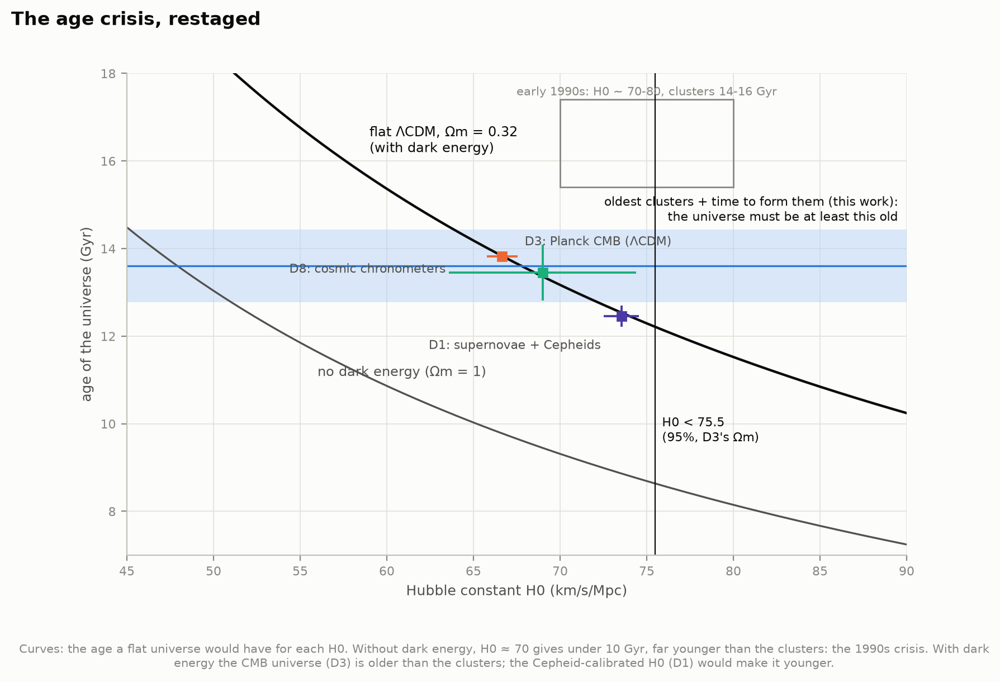 | **9. The age crisis**: universe age against H₀, with and without dark energy. |
| 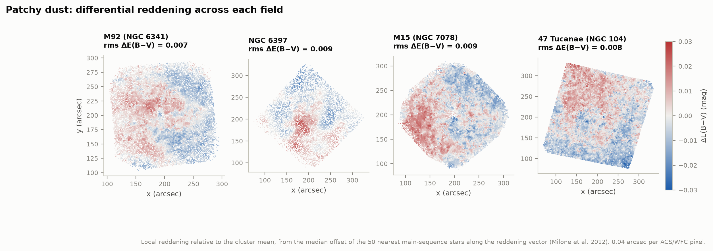 | **10. Differential reddening** maps across each field. |
| 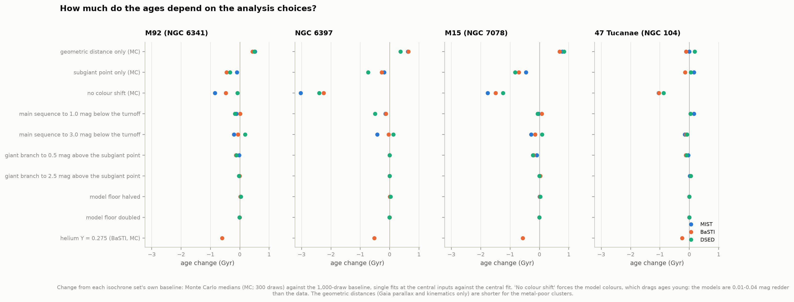 | **11. Robustness**: how the ages move with each analysis choice. |
| 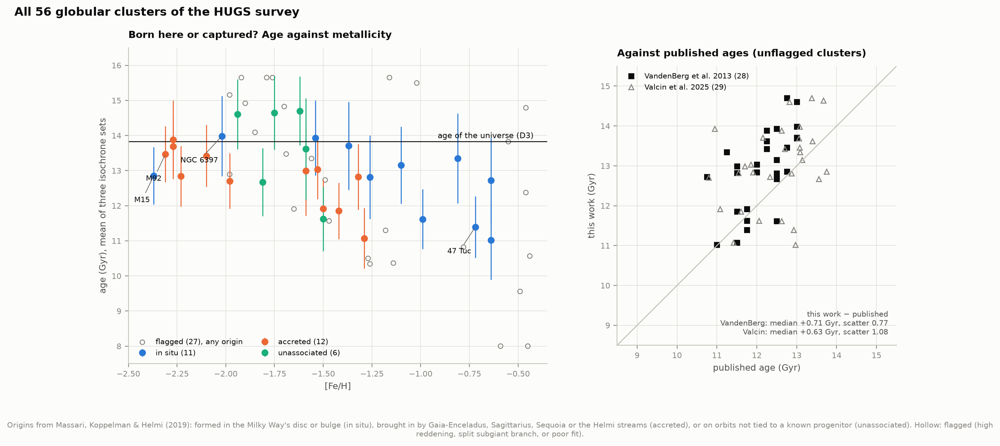 | **12. All 56 HUGS clusters**: age against [Fe/H] by origin, and against published ages. |
| 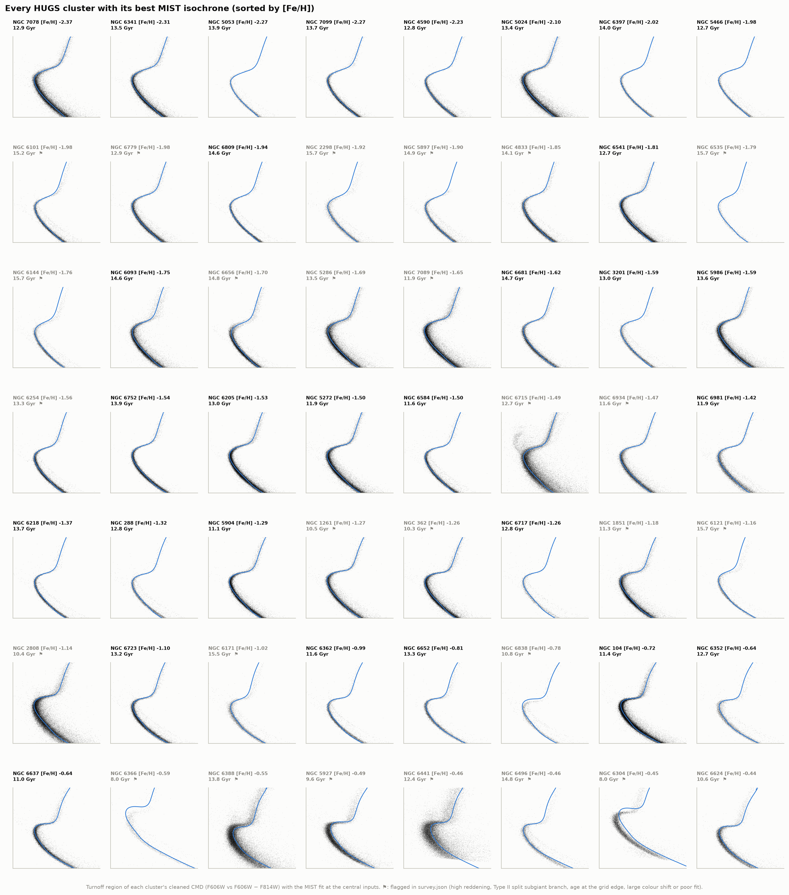 | **13. Quality gallery**: every cluster's turnoff region with its MIST fit; flagged clusters in grey. |

`figures/isochrone_explorer.html`: an offline page to fit the four clusters by hand. Sliders move
the age, distance, reddening, [Fe/H] and colour shift of a MIST isochrone over the stars, and a
small panel shows χ² against age for the chosen settings. Presets set our fit, the geometric
distance and, for M92, Ying et al.'s distance. Light and dark themes, phone-width layout.

## Background, in brief

**Why globular clusters are clocks.** A globular cluster is a ball of 10⁵–10⁶ stars that formed
together, with the same age and (nearly) the same composition. A star's life on the main sequence,
burning hydrogen in its core, lasts roughly 10 Gyr × (M/M☉)^−2.5: heavier stars run out first. As a
cluster ages, the heaviest stars still on the main sequence get lighter and fainter, so the
**turnoff** (where the main sequence bends over) creeps down and to the red. Just above it, the
**subgiant branch** carries stars whose cores have run dry; its brightness is the sharpest age
marker in the diagram.

**Isochrones.** A stellar-evolution code follows stars of every mass through their lives; an
isochrone ("same age") collects where all those stars are at one moment. To turn a model star's
temperature and luminosity into what Hubble measures, model atmospheres give the brightness in each
filter (bolometric corrections). Fitting isochrones of different ages to a cluster's
colour–magnitude diagram (CMD) reads off its age.

**The distance problem.** A turnoff's *apparent* brightness depends on age and on distance alike.
A cluster 5% farther away looks 0.1 mag fainter, exactly what 1.2 billion extra years would do. So
the distance must come from somewhere else (here: Gaia parallaxes and stellar motions, via
Baumgardt & Vasiliev 2021), and it dominates the error. The same holds, more weakly, for dust:
reddening dims the stars (by A_F606W ≈ 2.8 × E(B−V) for a turnoff star).

**Alpha elements.** Old halo stars and globular clusters have about 2.5× more oxygen, magnesium,
silicon and calcium per iron atom than the Sun ([α/Fe] ≈ +0.4), because they formed before Type Ia
supernovae (L5) delivered most of the iron. Oxygen matters most: more metals make the star more
opaque and its turnoff fainter at a given age. This is why the fit needs α-enhanced isochrones.

**Multiple populations.** Since ~2010, Hubble's ultraviolet photometry has shown that globular
clusters are not simple populations. A "second generation", typically 60–80% of the stars, carries
the products of hot hydrogen burning: more nitrogen, sodium and helium, less oxygen and carbon. The
HUGS filters were chosen for this: F275W covers OH molecular bands and F336W an NH band. The
populations differ in light elements but not, as far as the turnoff cares, in age.

**The age crisis.** In the early 1990s most cosmologists assumed a universe without dark energy, in
which the age is 2/(3H₀): 8–9 Gyr for H₀ = 70–80 km/s/Mpc. Globular clusters were dated at
14–16 Gyr. The crisis ended in 1997–98, when Hipparcos parallaxes moved the clusters farther away
(so younger) and supernovae revealed dark energy, which makes the universe older for the same H₀.

## How it works

1. **Clean photometry** (`catalog.py`, `photometry.py`). From each HUGS catalogue (photometric
   method 1, the best for stars this bright), keep proper-motion members (P ≥ 90%) that pass the
   survey team's quality cuts in F606W and F814W (Nardiello et al. 2018; see the notes below for two
   necessary adaptations).
2. **Differential reddening** (Milone et al. 2012). Dust in front of a cluster is patchy. Each star's
   offset from the main-sequence ridge line along the reddening direction, averaged over its 50
   nearest well-measured main-sequence neighbours, gives the local excess ΔE(B−V); removing it
   sharpens the sequences (figure 10). The cluster's *mean* reddening still comes from Harris.
3. **Ridge line** (`fiducial.py`). The centre of the sequence from 3.5 mag below the turnoff to the
   lower giant branch, traced in "natural" coordinates along the curve (adaptive bins of ≥ 25 stars,
   2.5σ-clipped medians), so the steep main sequence and the flat subgiant branch are treated alike.
4. **Isochrones** (`isochrones.py`). MIST v2.5, BaSTI-IAC and DSED, all α-enhanced, all on the same
   footing: interpolated at fixed evolutionary phase in age, [Fe/H] (quadratically where the grids
   step by 0.5 dex) and [α/Fe]. Each model star is dimmed by dust using the MIST
   bolometric-correction tables for its own temperature and gravity.
5. **Age fit** (`agefit.py`). Distance and reddening are *fixed* to the external values; the model
   isochrone is compared with the ridge line point by point along the ridge's normals (colour on the
   main and giant branches, brightness on the subgiant branch), from 2 mag below the turnoff to
   1.5 mag above the subgiant point. One colour shift is free (models' colours are uncertain at the
   0.01–0.03 mag level); brightness is never adjusted. A model floor of 0.01 mag in colour and
   0.02 mag in brightness is added to the ridge's statistical errors: with tens of thousands of
   stars the ridge is known far better than any model reproduces a whole diagram. The age minimising χ² is found by a coarse
   then a fine scan, with a parabola through the minimum.
6. **Monte Carlo** (`analysis.py`). 1,000 draws of distance, E(B−V), [Fe/H], [α/Fe] and the ridge
   noise per cluster and isochrone set; the spread of best ages is the uncertainty. Repeating with one
   input varied at a time gives the error budget; further runs test variants (geometric distances,
   the subgiant point alone, no colour shift, fit region, helium).
7. **Chromosome maps** (`chromosome.py`), **the age of the universe** (`cosmology.py`), and the
   optional **survey of all 56 clusters** (`survey.py`).

## Honest notes

**Ages are model ages.** Three stellar-evolution codes disagree by up to 1 Gyr for the same stars,
and their spread is in the error bars. What none of them varies is the physics inside each code
(convection, diffusion rates, nuclear rates, opacities), which Ying et al. (2023) sampled
20,000 times for M92 and found worth ±0.3 Gyr beyond distance and composition. Our errors therefore
include the *differences between* codes but not the uncertainty *within* each.

**The fit uses brightness and shape, not colour.** One free colour shift per fit makes the age
depend on how bright the subgiant branch is and on the shape of the turnoff region, not on the
models' absolute colours, which carry ~0.01–0.03 mag errors from the colour–temperature relation,
the treatment of convection and the extinction law. Without the shift the ages drop by up to
3 Gyr (see robustness). The flip side is that a real reddening error is only partly caught: the
shift absorbs its colour effect, but its 2.8× larger brightness effect enters the age, and that is
in the reddening term of the budget.

**Distances are partly circular.** Baumgardt & Vasiliev's mean distances average Gaia parallaxes,
Gaia and HST kinematic distances, their own subdwarf fits, star counts and a literature average.
The literature average includes isochrone fits of these clusters' CMDs. For M92 and M15, which are
too far for useful Gaia parallaxes, it dominates. The geometric-only variant avoids this and makes
those clusters 0.4–0.8 Gyr older.

**One reddening, one [α/Fe].** E(B−V) comes from Harris (2010), with ±10% (≥ 0.01 mag), and
[α/Fe] = +0.40 ± 0.10 for all four clusters. Valcin et al.'s fits suggest M92's [α/Fe] may be
lower (+0.2), which would make it ~0.5 Gyr older. NGC 6397's reddening (0.18) dominates its error.

**DSED stops at 15 Gyr.** For NGC 6397, 38% of the DSED draws hit that edge, so DSED's median is a
lower bound, and the combined NGC 6397 age is slightly underestimated (by ≲ 0.2 Gyr).

**Quality cuts needed two adaptations.** The survey team's recipe (Nardiello et al. 2018) rejects
stars whose photometric scatter is large for their magnitude. Stars bright enough to saturate the
long exposures are measured in one short exposure, so their scatter is recorded as 0, and the
recipe as written deletes the whole subgiant and giant branch; we apply the scatter cut only to
stars measured twice or more. The shape cut |RADXS| < 0.15 also removes the value −1, given to
~15% of stars, mostly blends in crowded centres, whose colours scatter twice as much.

**Differential reddening is anything spatial.** The correction (rms ΔE(B−V) = 0.007–0.009 mag)
removes patchy dust and any position-dependent photometric zero point alike. Only the *mean*
reddening enters the ages.

**The H₀ limit assumes flat ΛCDM.** So do the universe ages of D1, D3 and D8. The formation delay
(z_f uniform in 11–30) adds 0.12–0.29 Gyr; allowing GC formation as late as z = 6 would add 0.6 Gyr
to the bound.

**Spec deviations.** The spec named MIST v1.2 (Choi et al. 2016), which is scaled-solar only. Its
successor MIST v2.5 (Dotter et al. 2026) was released in February 2026 with [α/Fe] up to +0.6, and is
used instead. The second set the spec asked for is two (BaSTI-IAC and DSED). The download is
~2.1 GB, not 100–300 MB (MIST's α-enhanced ACS isochrones come as one 1.1 GB tarball; BaSTI adds
0.7 GB). The website's link to that tarball (`HST_ACSWF.txz`) is broken; the file is
`HST_ACS_WFC.txz`.

## Running it

```bash
cd 49-oldest-stars
../.venv/bin/python fetch_data.py         # ~2.1 GB into data/raw/ (MIST alone is 1.1 GB)
../.venv/bin/python run.py                # ~30-40 min on 6 cores: fits, Monte Carlo, figures
../.venv/bin/python run.py --figures-only # redraw from the cache (seconds)
../.venv/bin/python test_physics.py       # interpolation, extinction, cosmology, injection tests

# optional extension: every HUGS cluster (+2.6 GB to download; the fits take ~10 min)
../.venv/bin/python fetch_data.py --all
../.venv/bin/python survey.py
../.venv/bin/python survey.py --refresh   # redo flags and summary without refitting
../.venv/bin/python run.py --figures-only
```

Every measured result in this README comes from `data/results.json` and `data/survey.json` (both
rewritten by these commands) or from the printed output of `test_physics.py`; the text adds only
rule-of-thumb conversions (Gyr per magnitude, kelvin per colour). The first run builds the isochrone grids (streaming MIST's 8 GB of uncompressed isochrones once,
~2 minutes) and the cleaned photometry, both cached in `data/derived/`. After `fetch_data.py` the
whole pipeline runs offline. `B6_WORKERS` sets the number of worker processes (default 6).

### Files

| File | What it does |
|---|---|
| `config.py` | paths, URLs, cluster inputs and their uncertainties, published values for comparison |
| `fetch_data.py` | downloads and caches every input; `data/manifest.json` records sizes and SHA-256 |
| `catalog.py` | HUGS reader, quality cuts, membership, differential reddening, Harris and Baumgardt & Vasiliev tables |
| `isochrones.py` | MIST v2.5, BaSTI-IAC and DSED on one grid; EEP interpolation; extinction from MIST BC tables |
| `fiducial.py` | ridge lines in natural coordinates; turnoff and subgiant point |
| `photometry.py` | catalogue → clean, dereddened CMD and ridge line |
| `agefit.py` | the isochrone fit and its Monte Carlo |
| `analysis.py` | runs everything for the four clusters, in parallel |
| `chromosome.py` | chromosome maps and first-generation fractions |
| `cosmology.py` | ages of flat ΛCDM universes; the H₀ limit; D1/D3/D8 comparison |
| `literature.py` | published tables read from arXiv LaTeX sources |
| `survey.py` | extension: all 56 HUGS globular clusters |
| `figures.py`, `plotstyle.py` | the figures |
| `interactive.py` | writes `figures/isochrone_explorer.html` |
| `test_physics.py` | checks of the machinery |
| `run.py` | entry point |

## Data credits

- **HUGS**: Piotto et al. 2015, AJ 149, 91; Nardiello et al. 2018, MNRAS 481, 3382. Based on
  observations with the NASA/ESA Hubble Space Telescope (GO-13297, GO-12605, GO-12311, and GO-10775
  for F606W/F814W, Sarajedini et al. 2007), retrieved from MAST (DOI 10.17909/T9810F).
- **MIST v2.5**: Dotter et al. 2026 (ApJS, arXiv:2602.22012); Choi et al. 2016; Dotter 2016; MESA
  (Paxton et al. 2011–2019; Jermyn et al. 2023).
- **BaSTI-IAC**: Hidalgo et al. 2018, ApJ 856, 125; Pietrinferni et al. 2021, ApJ 908, 102.
- **DSED**: Dotter et al. 2008, ApJS 178, 89.
- **Distances**: Baumgardt & Vasiliev 2021, MNRAS 505, 5957. **Reddening, [Fe/H]**: Harris 1996
  (2010 edition).
- **Comparisons**: Ying et al. 2023, AJ 166, 18; VandenBerg et al. 2013, ApJ 775, 134; Valcin et al.
  2025 (JCAP; arXiv:2503.19481) and 2026 (arXiv:2603.04872); Hansen et al. 2007, ApJ 671, 380;
  Hansen et al. 2013, Nature 500, 51; Thompson et al. 2020, MNRAS 492, 4254; Milone et al. 2012,
  A&A 540, A16 and 2017, MNRAS 464, 3636 and 2018, MNRAS 481, 5098; Massari, Koppelman & Helmi
  2019, A&A 630, L4; Marín-Franch et al. 2009, ApJ 694, 1498; Leaman, VandenBerg & Mendel 2013,
  MNRAS 436, 122; Schlafly & Finkbeiner 2011, ApJ 737, 103; Hendricks et al. 2012, AJ 144, 25;
  Chaboyer et al. 1996, Science 271, 957.
