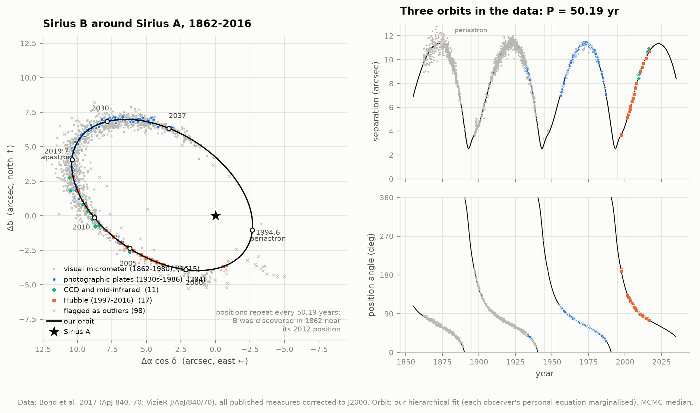
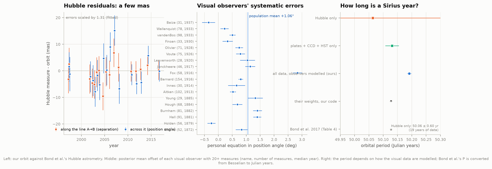
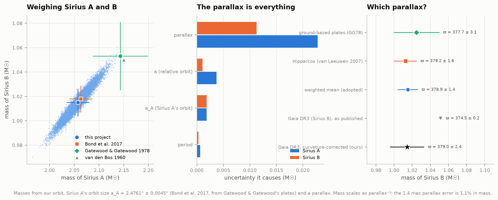
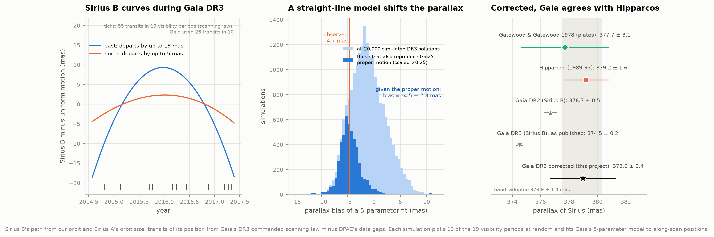
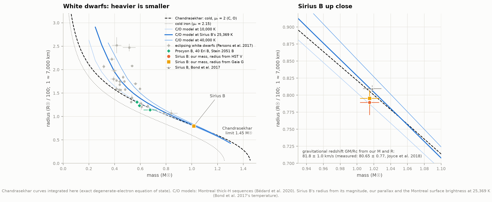
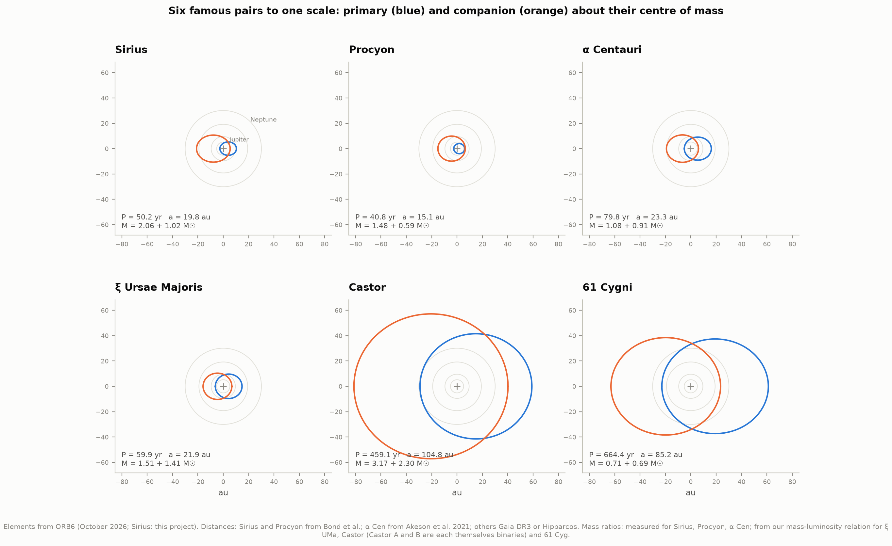
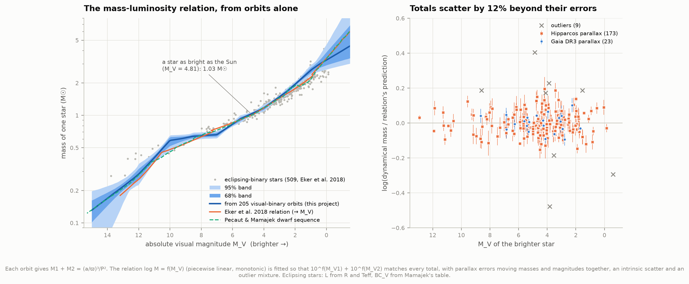
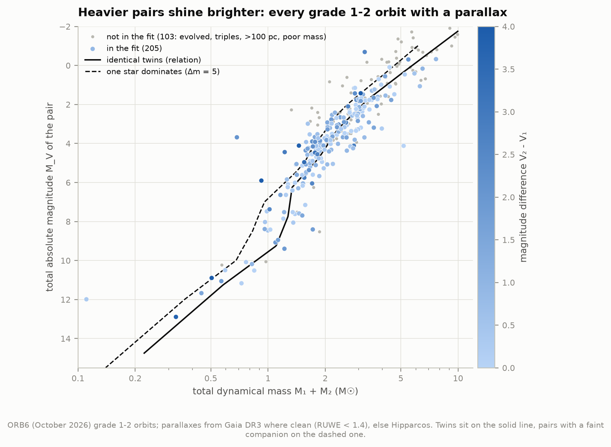
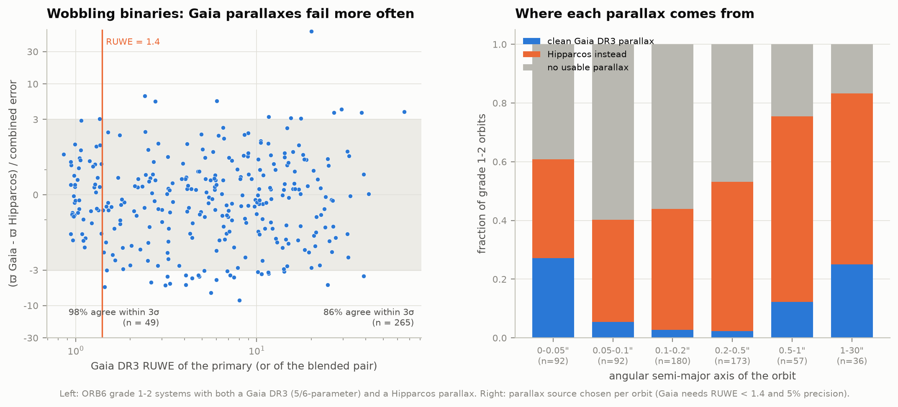

# M1 — Weigh stars with binary orbits: Sirius B and its cousins

**In 1844 Friedrich Bessel saw Sirius wobble across the sky and deduced an unseen companion. Can we
fit the orbit ourselves from 154 years of measurements, weigh both stars with Kepler's third law,
and watch the mass-luminosity relation of ordinary stars emerge from hundreds of double stars?**

Yes. From all **2,367 published measurements** of Sirius B's position relative to Sirius A
(1862-2016: visual micrometers, photographic plates, CCDs and Hubble), our own fit finds the
orbit from scratch, reproduces the published one exactly with its authors' weights, and then goes
further: it models every 19th- and 20th-century observer's personal systematic error. With the
system's parallax, Kepler's law gives

> **Sirius A: 2.057 ± 0.023 M☉   Sirius B: 1.015 ± 0.011 M☉**  (total 3.072 ± 0.034 M☉)

against 2.063 ± 0.023 and 1.018 ± 0.011 from Bond et al. (2017), from the same data. Sirius B
packs the Sun's mass into a ball the size of the Earth: from its brightness and temperature we find
a radius of **0.0079 R☉ (5,500 km)**, on the theoretical mass-radius relation of carbon-oxygen white
dwarfs, and the gravitational redshift these numbers predict, **81.8 ± 1.0 km/s**, matches the
80.65 ± 0.77 km/s measured with Hubble (Joyce et al. 2018).

Two findings go beyond the published analysis:

* **Gaia does see Sirius B, but its parallax is off by 4.5 mas.** Sirius A is too bright for
  Gaia, but Sirius B is in Gaia DR3 with a parallax of 374.5 ± 0.2 mas, 4.7 mas below Hipparcos's
  379.2 ± 1.6 for Sirius A. That alone would make both stars 3.6% heavier. We rebuilt Gaia's view
  of the star from its published scanning law: during DR3's 34 months Sirius B was curving along its
  orbit by up to 19 mas from a straight line, which Gaia's five-parameter model cannot follow. Fed
  through the same model, the curvature pulls the parallax down by **4.5 ± 2.3 mas** in the
  simulations that also reproduce Gaia's measured proper motion. Corrected, Gaia gives
  **379.0 ± 2.4 mas**, in agreement with Hipparcos.
* **How long is a Sirius year?** Bond et al.'s period, 50.128 ± 0.004 yr, depends on how much one
  trusts the visual observers. Letting each observer have his own bias (the "personal equation")
  gives 50.191 ± 0.007 yr; the photographic plates and Hubble alone give 50.131 ± 0.024 yr. The
  difference is 15 times Bond's quoted error but changes the masses by only 0.3%: the parallax,
  not the orbit, limits the weighing.

From the **630 best orbits** in the Sixth Catalog of Orbits of Visual Binary Stars (ORB6), we
weighed every pair with a good parallax and recovered the **mass-luminosity relation** from orbits
alone: a star as bright as the Sun weighs 1.03 ± 0.02 M☉, and the relation follows the
eclipsing-binary one (Eker et al. 2018) within a few per cent from F stars to M dwarfs, with two
local departures discussed below. Only one orbit in eleven has a clean Gaia parallax: close
binaries confuse Gaia's single-star model, and Hipparcos had to fill in.



---

## Results

### 1. The orbit of Sirius B, from scratch

**The data.** Bond et al. (2017) compiled every published measurement of Sirius B relative to
Sirius A, corrected each to the J2000 equator and for the system's motion through space, and
added their own Hubble astrometry (2,367 rows: 1,930 visual micrometer measures, 407 photographic,
11 CCD/mid-infrared, 19 Hubble). We checked their precession corrections against astropy's
rigorous precession: they agree to 0.02°.

**A blind start.** A visual orbit has seven elements (period P, time of periastron T,
eccentricity e, angular semi-major axis a, inclination i, node Ω, argument of periastron ω). For
any trial (P, e, T) the other four enter *linearly* through the Thiele-Innes constants, so a grid
over three numbers plus a linear solve finds the global best orbit with no prior knowledge. Using
only the plates, CCDs and Hubble, it lands at P = 50.13 yr, e = 0.592, a = 7.497″ (Bond et al.:
50.128, 0.591, 7.496).

**Replication.** With Bond et al.'s own adopted uncertainties and rejections, our least-squares
fit reproduces their Table 4 to the last digit (P differs by 0.0011 yr only because we count
Julian years and they counted Besselian years; χ²/ν = 1.000 by their construction).

**Our fit.** Visual double-star observers are notoriously biased, each in his own way. We fit the
orbit together with a model of the data's errors:

* micrometer errors that shrink with telescope aperture (as D^−0.33 ± 0.03) and over time
  (by a factor 0.63 per century), 0.30″ in separation and 1.4° in angle for a 0.5 m telescope
  in 1900;
* a **glare bias**: visual observers overestimate small separations, when Sirius B sits in
  Sirius A's glare (0.16 ± 0.03″ at 4″, growing as ρ⁻⁴; Bond et al. noted the effect);
* **personal equations**: each of the 117 visual observers and 10 photographic programmes has
  his own offset in angle and separation, drawn from a population and integrated out exactly
  (the likelihood of 2,318 measures with one correlated block per observer). Observers differ by
  0.91° in angle and 0.21″ in separation, and the population as a whole reads angles
  1.06 ± 0.12° too large;
* isotropic scatter for plates (0.064″) and CCDs (0.21″), a free scale on Hubble's quoted
  errors (1.31, i.e. χ²/ν ≈ 1.7, as Bond et al. found: 1.87);
* outliers flagged by a mixture model rather than by sigma clipping: 98 measures, 60 of which
  Bond et al. had also rejected.

An MCMC run (64 walkers × 12,000 steps; autocorrelation ~220 steps) gives:

| Element | This project | Bond et al. 2017 |
|---|---|---|
| Period P | 50.191 ± 0.007 yr (Julian) | 50.128 ± 0.004 yr (Besselian; = 50.127 Julian) |
| Semi-major axis a | 7.4948 ± 0.0039″ | 7.4957 ± 0.0025″ |
| Eccentricity e | 0.5914 ± 0.0006 | 0.5914 ± 0.0004 |
| Inclination i | 136.43 ± 0.06° | 136.34 ± 0.04° |
| Node Ω | 45.35 ± 0.11° | 45.40 ± 0.07° |
| Periastron argument ω | 149.23 ± 0.12° | 149.16 ± 0.08° |
| Periastron T | 1994.577 ± 0.008 | 1994.570 ± 0.006 (Julian) |

The inclination above 90° means Sirius B moves clockwise on the sky. The two stars were closest
in 1994.6 (3.1″ apart in the orbital plane, 8.1 au) and farthest in 2019.7 (11.9″, 31.5 au); the
semi-major axis, 19.8 au, is about Uranus's distance from the Sun.

### 2. How long is a Sirius year?



The Hubble measures fit our orbit to a few milliarcseconds (left). The middle panel shows the
**personal equations** of the 18 most prolific visual observers: Burnham, Barnard, Aitken, Struve
and the rest each read Sirius B's position angle differently, by up to 3°.

The period is where the models disagree (right): Bond et al.'s weights give 50.127 yr (Julian),
our full model 50.191 ± 0.007, the plates + Hubble alone 50.131 ± 0.024, and Hubble alone
50.06 ± 0.60 (19 years of data are not enough). The 19th-century data pin the period through
the timing of the 1894 and 1944 periastron passages, and how much they may be trusted decides
the fourth decimal. The quoted errors (0.004-0.007 yr) are smaller than this spread (0.06 yr):
the period is known to about 0.1%, not 0.01%. For the masses it hardly matters: a³/P² moves by
−0.3% to +0.5% between these fits.

### 3. Weighing Sirius A and B



Kepler's third law gives the total mass, M_A + M_B = (a/ϖ)³ / P², with ϖ the parallax (all
angles in arcseconds, P in years). The share of each star comes from Sirius A's own wobble about
the centre of mass: Gatewood & Gatewood (1978) measured it on Yerkes and Allegheny plates, and
Bond et al. refitted their positions with the new orbit, a_A = 2.4761 ± 0.0045″, so that
M_B / (M_A + M_B) = a_A / a = 0.330.

| Parallax | M_A + M_B | M_A | M_B |
|---|---|---|---|
| 378.9 ± 1.4 mas (Hipparcos + ground, adopted) | 3.072 ± 0.034 | 2.057 ± 0.023 | 1.015 ± 0.011 |
| 379.21 ± 1.58 (Hipparcos alone) | 3.065 ± 0.038 | 2.052 ± 0.026 | 1.013 ± 0.013 |
| 377.7 ± 3.1 (ground-based plates alone) | 3.103 ± 0.077 | 2.078 ± 0.052 | 1.025 ± 0.025 |
| Bond et al. 2017 | 3.081 ± 0.034 | 2.063 ± 0.023 | 1.018 ± 0.011 |
| Gatewood & Gatewood 1978 | 3.196 ± 0.083 | 2.143 ± 0.056 | 1.053 ± 0.028 |

**The parallax is everything**: its 0.37% error becomes 1.1% in mass (mass scales as ϖ⁻³) and
contributes 0.023 and 0.011 M☉ to the errors of A and B; the orbit's size, Sirius A's orbit and
the period together contribute less than a fifth of that (middle panel, as in Bond et al.'s
Table 7). A 1.4 mas parallax error is the width of a coin seen from 3,500 km.

### 4. Sirius B in Gaia DR3



Bond et al. expected that Gaia could not measure Sirius. Sirius A (G ≈ −1.4) is indeed absent,
but **Sirius B is in Gaia DR3** (source 2947050466531873024, G = 8.52, 10.6″ from A), with
ϖ = 374.49 ± 0.23 mas (374.51 after Gaia's zero-point correction). Gaia DR2 had 376.68 ± 0.45
for the same source (which Joyce et al. 2018 quote as "Sirius A"). Both are well below Hipparcos's
379.21 ± 1.58, and with DR3's parallax every mass above would rise by 3.6%. Which is right?

**Why Gaia's value is suspect.** Gaia DR3 fits every star with five numbers: position, parallax
and a constant proper motion. Sirius B was nowhere near uniform motion: in 2014-2017 it was
accelerating along its orbit at ~29 mas/yr², and over the 34 months of DR3 data its path departs
from a straight line by up to **19 mas** (left panel), eighty times the parallax error Gaia quotes.
Gaia flagged the star (RUWE 2.4, excess noise 1.5 mas), and it was observed in only 26 transits
grouped into 10 visibility periods, so a straight-line fit can trade part of the curvature for a
wrong parallax.

**A forward model.** ESA publishes Gaia's commanded scanning law (where both fields of view
pointed, every 10 s). It shows 55 transits over Sirius B's position in the DR3 window, in 19
visibility periods, after DPAC's data gaps are removed (Gaia's catalogue says 26 transits in 10
were used; which ones is not public). We moved Sirius B along our orbit, observed it along Gaia's
scan direction at each transit and fitted Gaia's five-parameter model:

* using all 55 transits, the fitted parallax is 1.5 mas too small;
* over 20,000 random choices of 10 of the 19 visibility periods, the bias ranges from −4.6 to
  +2.2 mas (16th-84th percentile);
* Gaia's **proper motion** carries the same imprint and does not depend on any parallax.
  Hipparcos measured the system's centre-of-mass motion, but only after subtracting Gatewood &
  Gatewood's orbit of Sirius A, whose 1994 periastron came 0.27 yr too early; we found that this
  leaks −19.5 mas/yr into Hipparcos's proper motion and removed it. Projected to 2016 with our
  orbit, Sirius B should move at (−468.3, −916.1) mas/yr; Gaia measured (−461.6, −914.5),
  an offset of (+6.8, +1.6) ± (1.7, 1.5) mas/yr;
* the simulations that reproduce that proper-motion offset have a parallax bias of
  **−4.5 ± 2.3 mas** (13% of all draws reproduce all three offsets at once).

Corrected for that bias, Gaia's parallax is **379.0 ± 2.4 mas**: it agrees with Hipparcos, and the
masses stand. Gaia DR4, with its epoch astrometry, should settle it.

### 5. Sirius B, the white dwarf



**Radius from brightness and temperature.** The Montreal model atmospheres give how much light a
square metre of a 25,369 K hydrogen atmosphere emits in each filter (the temperature is the
spectroscopic one quoted by Bond et al.). Sirius B's apparent brightness and its distance then fix
its surface area:

| Brightness used | Radius (R☉) | Luminosity (L☉) |
|---|---|---|
| V = 8.528 ± 0.05 (Hubble/STIS, Barstow et al. 2005) | 0.00790 ± 0.00018 (5,490 km) | 0.0233 ± 0.0011 |
| G = 8.524 (Gaia DR3) | 0.00796 ± 0.00011 | 0.0236 ± 0.0007 |
| V = 8.44 ± 0.06 (older ground-based estimate) | 0.00822 ± 0.00023 | 0.0252 ± 0.0014 |
| Bond et al. 2017 (Hubble absolute flux) | 0.008098 ± 0.000046 | 0.02448 ± 0.00033 |

**The mass-radius relation.** We integrated Chandrasekhar's equations ourselves: a star held up
only by cold, fully degenerate electrons (the exact relativistic equation of state). Heavier
white dwarfs are *smaller*, and none can exceed **1.45 M☉** (the Chandrasekhar limit, reached
here as the radius shrinks to zero; μₑ = 2 for helium, carbon or oxygen). Realistic carbon-oxygen
models at Sirius B's temperature (Montreal sequences, Bédard et al. 2020) predict 0.00810 R☉ for
our mass of 1.015 M☉; our photometric radii sit 2-2.5% (1.1-1.3σ) below it, Bond et al.'s on it.
An iron core (μₑ = 2.15) would be far too small, as Bond et al. also concluded. Procyon B,
40 Eridani B and Stein 2051 B (the other white dwarfs weighed directly) and 26 white dwarfs in
eclipsing binaries (Parsons et al. 2017) are shown for context.

**Gravity and redshift.** Our mass and radius give log g = 8.650 ± 0.016 (cgs; the spectroscopic
value is 8.59) and a gravitational redshift GM/(Rc) = **81.8 ± 1.0 km/s**, against the
**80.65 ± 0.77 km/s** Joyce et al. (2018) measured from Sirius B's Hα line: light climbing out of
the white dwarf loses energy as general relativity predicts (project N3's subject). The Montreal
cooling sequences put Sirius B's age as a white dwarf at **126 Myr**, the value Bond et al. found.

### 6. Six famous pairs, to one scale



| System | P (yr) | a (au) | Total mass (M☉) | Distance from | Mass ratio from |
|---|---|---|---|---|---|
| Sirius | 50.19 | 19.8 | 3.07 ± 0.03 | Bond et al. 2017 | Sirius A's orbit |
| Procyon | 40.84 | 15.1 | 2.07 ± 0.02 | Bond et al. 2015 | Procyon A's orbit (Girard et al. 2000) |
| α Centauri | 79.76 | 23.3 | 1.99 | Akeson et al. 2021 | Akeson et al. 2021 |
| ξ Ursae Majoris | 59.89 | 21.9 | 2.92 ± 0.04 | Gaia DR2 (ξ UMa B) | our mass-luminosity relation |
| Castor | 459 | 105 | 5.5 ± 1.0 | Hipparcos | our mass-luminosity relation |
| 61 Cygni | 664 | 85 | 1.40 ± 0.14 | Gaia DR3 (A and B) | our mass-luminosity relation |

Orbits from ORB6 (Sirius: ours). ξ UMa (the first binary orbit ever computed, by Félix Savary in
1827, published in the *Connaissance des Temps* for 1830) and Castor are quadruple systems: each "star" in these orbits is itself a spectroscopic binary, so their
totals weigh four stars. Gaia DR3 has no parallax for either star of ξ UMa (only two-parameter
solutions), so its DR2 parallax is used.

* **`figures/orbit_gallery.mp4`**: the six pairs moving together on one clock (12 years per
  second), to one scale, with the orbits of Jupiter to Neptune for comparison.
* **`figures/orbit_gallery.html`**: an interactive version (one file, works offline): play,
  pause and speed; the true orbit or the orbit as seen from Earth; both stars about their centre
  of mass or the companion around the primary as observers measure it; one scale for all or each
  panel fitted; light/dark.

### 7. The mass-luminosity relation, from orbits alone



**The sample.** ORB6 (October 2026) holds 4,051 orbits; 630 are graded 1 (definitive) or 2
(good). We found their stars in Gaia DR3 by position and took the best parallax available: Gaia's
own (both components where Gaia resolves the pair; RUWE < 1.4 and 5% precision required) for 55,
5 of them from Gaia's orbital solutions for the photocentre; Hipparcos (van Leeuwen 2007) for 282;
none for 293. Kepler's law weighs each pair; most totals lie between 1.0 and 6.5 M☉ (5th-95th
percentile).

**The fit.** An orbit weighs only the pair, but ORB6 lists each star's V magnitude. If every
main-sequence star follows one relation log M = f(M_V), then 10^f(M_V1) + 10^f(M_V2) must equal
each measured total. We fitted f (a monotonic, piecewise-linear curve) to 205 pairs within 100 pc
(no extinction correction needed), excluding evolved stars (from colour and spectral type), outer
orbits of triple systems, and masses worse than 20%. Parallax errors move each mass (as ϖ⁻³) and
its luminosities (as ϖ⁻²) together; the fit propagates that correlation, plus an intrinsic scatter
and an outlier mixture.

| M_V | Our mass (M☉) | Pecaut & Mamajek | Eker et al. 2018 |
|---|---|---|---|
| 1.0 (A star) | 2.63 ± 0.15 | 2.17 | 2.27 |
| 2.5 | 1.68 ± 0.07 | 1.68 | 1.60 |
| 4.0 | 1.17 ± 0.04 | 1.19 | 1.17 |
| 4.81 (the Sun) | **1.03 ± 0.02** | 1.00 | 1.00 |
| 5.5 | 0.93 ± 0.04 | 0.91 | 0.91 |
| 7.0 | 0.66 ± 0.03 | 0.73 | 0.76 |
| 8.5 | 0.64 ± 0.03 | 0.60 | 0.59 |
| 10.0 | 0.58 ± 0.05 | 0.46 | 0.48 |
| 12.0 | 0.28 ± 0.03 | 0.28 | 0.25 |
| 14.0 | 0.17 ± 0.02 | 0.17 | — |

From the F stars to the Sun's cousins and the mid-M dwarfs the binaries agree with the
eclipsing-binary relation (whose stars are shown in grey) to a few per cent. The totals scatter
about the relation by 12% beyond their errors, and 9 of 205 pairs (4%) are outliers. Two local
departures remain: A stars (M_V ≈ 1) come out ~20% heavier than the eclipsing binaries, and the
K/M dwarfs near M_V = 9-10 up to 25% heavier. Both rest on few pairs (22 and ~15), and both have
plausible culprits: unresolved third stars add mass but little light, and ORB6's V magnitudes
for faint companions are often converted from other bands.



Plotted as measured, the pairs fill the band between two lines: twins (equal stars) and pairs
whose companion is 5 magnitudes fainter. Heavier pairs shine brighter, steeply: around the Sun's
mass, a star twice as heavy is about ten times as bright in visible light.

### 8. Why Hipparcos still matters for binaries



Gaia DR3 treats every source as a single star moving uniformly. A binary with a period of years
wobbles during the 34-month baseline, and a pair closer than a few tenths of an arcsecond blends
into one image whose light centre shifts. The renormalised unit weight error (RUWE) flags both. Of 314 systems with
both a Gaia and a Hipparcos parallax, 98% of the clean ones (RUWE < 1.4) agree within 3σ, but
only 86% of the flagged ones. Only **a quarter** of the closest pairs (< 0.05″, which Gaia sees as
single, steady stars) and the widest (> 1″, resolved) have clean Gaia parallaxes, against 2-5% of
the pairs between 0.05″ and 0.5″ and 12% of those between 0.5″ and 1″. Gaia DR4's epoch astrometry
and orbit fits should change that.

---

## How it works

* **`orbits.py`**: Kepler's equation (Halley iteration), Campbell ↔ Thiele-Innes elements,
  positions, velocities and accelerations on the sky, Kepler's third law in solar units.
* **`orb6.py`**: the ORB6 reader. The catalogue's documented column layout is not respected for
  long periods in days and large errors, which spill into neighbouring columns (34 periods were
  read as 1,183 instead of 61,183 days before we noticed); each field now takes the token
  overlapping its columns most.
* **`sirius.py`**: the Sirius fits: blind Thiele-Innes search, replication, outlier screening
  (mixture model), the hierarchical model with each observer's personal equation marginalised
  (Sherman-Morrison per observer block), MCMC (`emcee`), alternative data choices, masses.
* **`gaia_sirius.py`**: transits of Sirius B in Gaia's DR3 scanning law, the five-parameter fit
  to simulated along-scan positions, random visibility-period subsets, the Hipparcos leak.
* **`whitedwarf.py`**: Chandrasekhar's structure equations, Montreal models, photometric radius,
  gravitational redshift.
* **`mlr.py`**: Gaia identification of ORB6 pairs, parallax choice (Gaia zero point of Lindegren
  et al. 2021 applied), dynamical masses, the mass-luminosity fit.
* **`analysis.py`** runs everything; **`figures.py`**, **`interactive.py`** and **`report.py`**
  draw and summarise; **`test_physics.py`** checks the pieces (11 tests: Kepler solver, element
  round trips, Bond's orbit predicting the 2016 Hubble measure to < 1 mas, Kepler's law in solar
  units, the ORB6 overflow lines, the Chandrasekhar limit, the block likelihood against a dense
  multivariate normal, the Gaia simulation's zero-orbit case, and more).

## Data

| Data | Source | Size |
|---|---|---|
| Sixth Catalog of Orbits of Visual Binary Stars (4,051 orbits) | `astro.gsu.edu/wds/orb6` (Hartkopf, Mason & Worley; GSU/USNO) | 1.1 MB |
| 2,367 measures of Sirius B, 1862-2016 | Bond et al. 2017, VizieR J/ApJ/840/70 | 0.4 MB |
| Gaia DR3: 633 ORB6 positions × 60″ (CDS XMatch); quality columns, NSS orbits, Hipparcos neighbours by source_id (ESA) | ESA Gaia archive, CDS | 23 MB |
| Gaia DR3 + DR2 rows of Sirius B, 61 Cyg and ξ UMa | ESA Gaia archive | < 0.1 MB |
| Gaia (E)DR3 commanded scanning law; DPAC astrometric data gaps | ESA (`cdn.gea.esac.esa.int`, `cosmos.esa.int`) | **570 MB** |
| Hipparcos, new reduction (van Leeuwen 2007); Hipparcos 1997 orbit of Sirius | VizieR I/311, I/239 | 9 MB |
| Detached eclipsing binaries (Eker et al. 2018) | VizieR J/MNRAS/479/5491 | 0.1 MB |
| Dwarf colour/temperature sequence (Pecaut & Mamajek, v2022.04.16) | E. Mamajek, Rochester | 0.06 MB |
| White dwarf models (Bédard et al. 2020; Table_DA) | Montreal group (`astro.umontreal.ca/~bergeron`) | 1.3 MB |
| TeX tables: Bond et al. 2015, 2017, 2017b; Joyce et al. 2018; Parsons et al. 2017; Eker et al. 2018; Akeson et al. 2021; Barstow et al. 2005 (PDF) | arXiv | 0.8 MB |

Everything except the scanning law (used only for the Sirius B parallax test) comes to 36 MB.
`data/manifest.json` records each file's URL, size, SHA-256 and date. Please cite the
catalogues and papers above when reusing the numbers; Gaia data: ESA/Gaia/DPAC.

## Caveats

* **Sirius A's orbit is adopted, not measured here.** The split into two masses uses Bond et al.'s
  a_A = 2.4761 ± 0.0045″, from Gatewood & Gatewood's 1917-1977 plates (not published in
  machine-readable form). The Gaia proper-motion test above is consistent with it but not
  independent of it.
* **The period depends on the error model** (section 2). Our quoted error (0.007 yr) is the
  statistical one within our model; the spread between reasonable models is 0.06 yr.
* **The Gaia DR3 correction is a model.** We cannot know which 26 transits Gaia used; the
  correction marginalises over plausible choices, weighted by how well they reproduce Gaia's proper
  motion. It shows that the DR3 parallax is not evidence against Hipparcos, not a new parallax.
* **Sirius B's radius** uses the published spectroscopic temperature (25,369 ± 46 K) and the
  Montreal model atmospheres; a 1% temperature error is ~0.7% in radius, and the two optical
  magnitudes disagree by 0.09 mag (4% in radius).
* **Mass-luminosity relation**: ORB6's component magnitudes are heterogeneous (some converted
  from speckle measurements in other bands); assumed errors of 0.05 mag are optimistic for faint
  companions. Hidden third stars bias masses up. Metallicity, which shifts M_V at fixed mass by
  up to ~1 mag for M dwarfs, is not modelled. The relation is in V, where these stars were
  measured; the eclipsing-binary comparison converts their bolometric luminosities with
  Mamajek's bolometric corrections.
* **Gallery mass ratios** for ξ UMa, Castor and 61 Cyg come from our relation applied to
  the catalogued magnitudes; ξ UMa and Castor are quadruples.

## Deviations from the atlas spec

* **Gaia DR3 does contain Sirius B.** The spec says stars as bright as Sirius need Hipparcos;
  true for Sirius A, but B is in DR3 with a biased parallax. We added the scanning-law test
  (section 4), which brings the download to ~0.6 GB (36 MB without it) instead of < 5 MB.
* **"Every grade 1-2 orbit with a good Gaia parallax"** would leave 55 of 630 systems and 26 in
  the mass-luminosity fit. We used Hipparcos for the rest (179 of the 205 fitted pairs) and show
  the Gaia-Hipparcos comparison instead.
* **B9 and B10 are not built yet**, so the eclipsing-binary relation is Eker et al.'s own data
  and the white dwarf context comes from published masses and radii.
* **ORB6 over https** works again (October 2026); the spec had found only http working.
* **Radius "from temperature and luminosity"**: we measure the radius from brightness, distance
  and temperature (the photometric method); the luminosity then follows from L = 4πR²σT⁴.

## Running it

```bash
cd astrophysics/50-binary-orbits
../.venv/bin/python run.py                 # fetch (~0.6 GB), fit, analyse, draw (~20 min first time)
../.venv/bin/python run.py --figures-only  # redraw from the cached analysis
../.venv/bin/python test_physics.py        # 11 checks
```

The first run downloads everything, runs the Sirius MCMC (~10 min), finds the Gaia transits
(~15 s), simulates 20,000 Gaia solutions (~1 min), fits the mass-luminosity relation (~2 min) and
renders the animation (~3 min). Expensive steps are cached in `data/cache/`; later runs take a
few minutes and work offline. Uses numpy, scipy, pandas, astropy, emcee, matplotlib and
`gaiadr3-zeropoint`; ffmpeg for the movie.

## Files

```
README.md            this file
config.py            paths, sources, constants, cuts
literature.py        published values (answer keys and the few adopted inputs)
fetch_data.py        downloads + manifest
orbits.py            orbit mathematics
orb6.py              ORB6 reader
sirius.py            the Sirius orbit fits and masses
gaia_sirius.py       Sirius B in Gaia DR3: scanning law and simulations
whitedwarf.py        Chandrasekhar relation, Montreal models, photometric radius
mlr.py               ORB6 x Gaia, dynamical masses, mass-luminosity fit
analysis.py          runs every step
figures.py           static figures and the animation
interactive.py       the interactive orbit gallery (HTML)
report.py            results.json and the printed summary
run.py               end-to-end driver
test_physics.py      checks
figures/             PNG + SVG figures, orbit_gallery.mp4, orbit_gallery.html
data/                raw downloads, caches, results.json, manifest.json (not committed)
```
