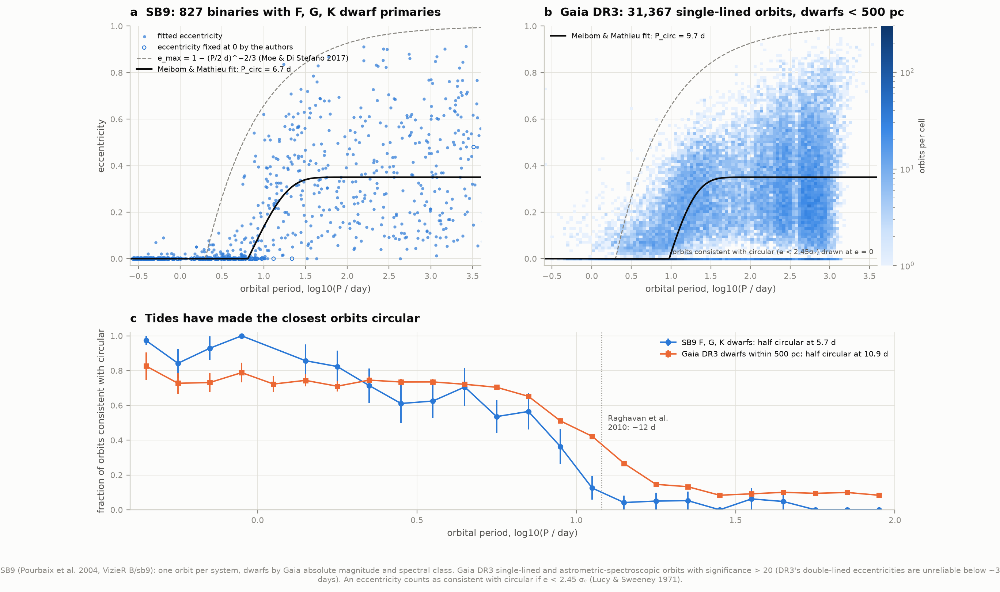
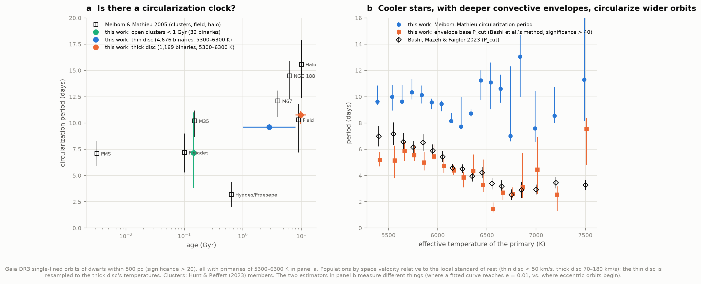
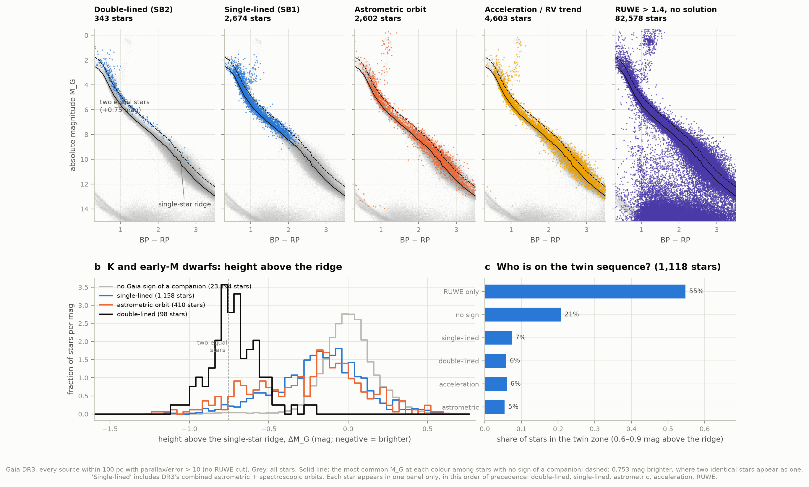
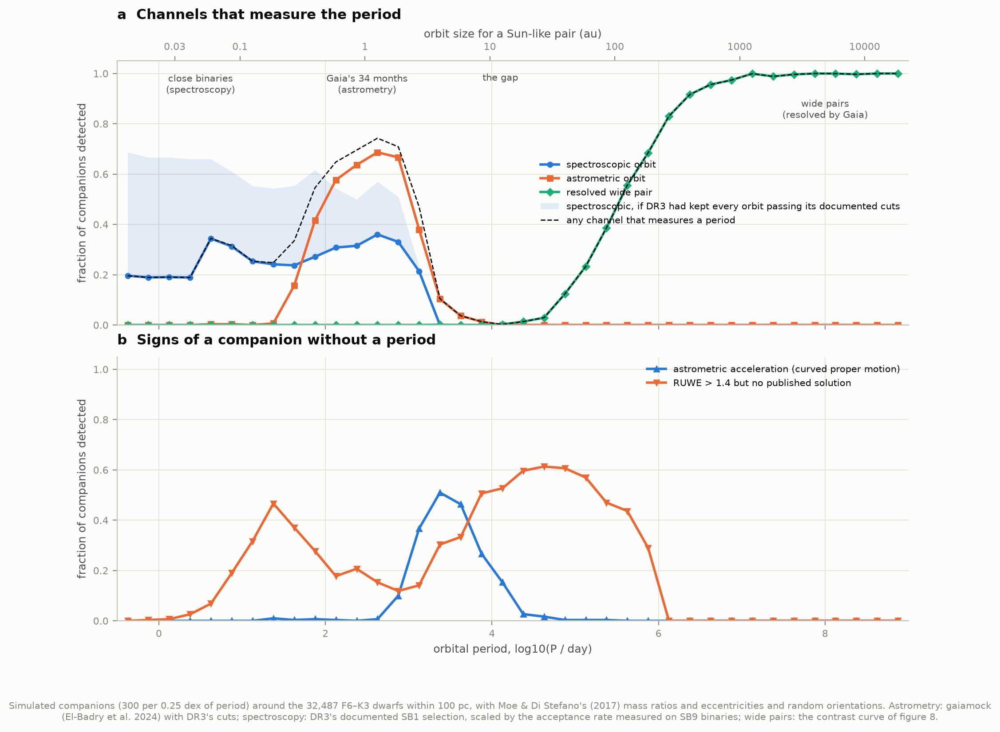
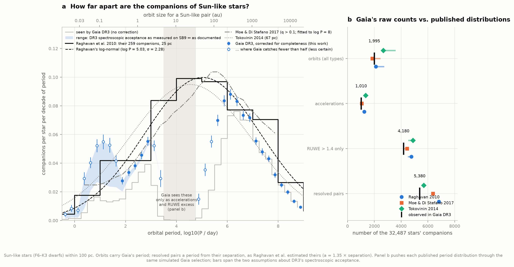
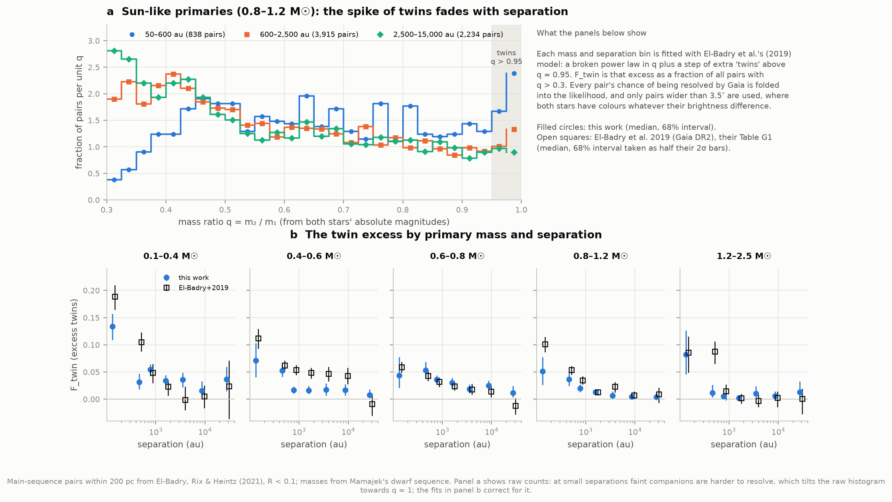
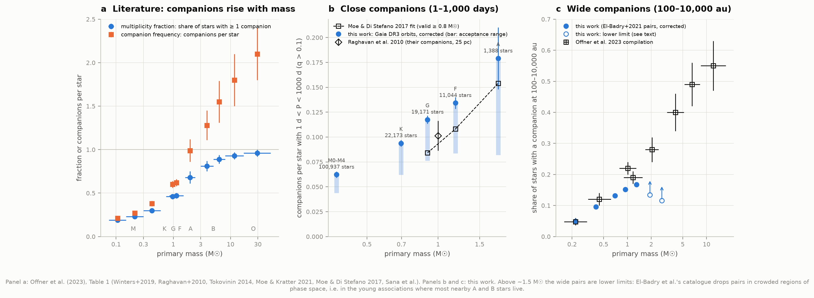
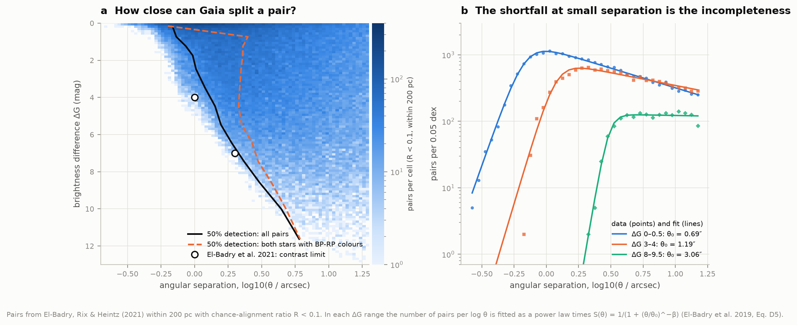

# M2 — How common are companions? A census of binary stars

**Is the Sun, alone, typical? How often do stars have companions, how far apart are they, and does
that depend on the star's mass? Can we rebuild the binary census from Gaia DR3's 813,687 non-single
stars and the classic spectroscopic catalogue, correcting for the companions each method cannot see?**

Mostly, yes. Of the **32,487 Sun-like stars (F6–K3 dwarfs) within 100 parsecs**, Gaia DR3 shows some
sign of a companion around **37.7%**: a spectroscopic or astrometric orbit, a curved path across the
sky, a poor fit as a single star, or a resolved partner. No single method sees more than a slice of the
range of orbits, so we simulated what Gaia could have detected — its real scanning law and noise for
every star, its documented selection cuts, and a correction measured on binaries whose orbits were
already known — and pushed the published distributions of companion periods through the same
simulation. **Gaia's raw counts in four independent channels agree with Moe & Di Stefano's (2017)
distribution to within 16%, and with Raghavan et al.'s (2010) to within ~25%**, including the
decade-long orbits Gaia can only see as accelerations and excess wobble. Corrected for completeness,
the companions of Sun-like stars follow the classic broad distribution from days to millions of years:
**0.10–0.14 companions per star with periods under ~9 years** (Raghavan: 0.14, Moe & Di Stefano: 0.12)
and **0.21 beyond ~150 years** (0.29 and 0.28; our shortfall matches the losses of the wide-binary
catalogue). Gaia cannot measure the periods in between.

So is the lonely Sun typical? Gaia's census is consistent with the classic answer that a little over half
of Sun-like stars are single (54% in Raghavan et al.'s survey, 60% in Moe & Di Stefano's synthesis): the
Sun's solitude is typical, but only just. (Gaia does not measure the single fraction itself: that needs
every star's complete set of companions, and the ~40% with a visible sign of one is a lower limit.)

Along the way:

* **Tides make close orbits circular.** In SB9 and in Gaia's 31,367 single-lined orbits of dwarfs within
  500 pc, orbits shorter than ~10 days are circular. With Meibom & Mathieu's (2005) estimator the
  circularization period of Gaia's dwarfs is **9.7 days** (their field value: 10.3). It falls with the
  star's temperature — stars with deeper convective envelopes circularize wider orbits — and our
  version of Bashi et al.'s (2023) estimator reproduces their trend from 5–6 days below 6,000 K to
  ~2.6 days at 6,700 K. At matched temperature the old thick disc is **not** distinguishable from the
  younger thin disc, so Gaia DR3 does not confirm the "circularization clock" among field stars.
* **63% of DR3's double-lined orbits shorter than 3 days have eccentricities beyond the physical
  envelope** (13% of single-lined ones): DR3's short-period SB2 eccentricities are not usable.
* **Each method sees different binaries.** Gaia's double-lined binaries sit 0.76 mag above the main
  sequence — on the "twin" sequence of pairs of equal stars — while its single-lined and astrometric
  binaries hug the single-star sequence: an equal twin's light centre and blended spectrum hardly move.
* **Gaia DR3 published orbits for only about half the known binaries it flagged as variable.** Of 1,276
  SB9 binaries inside DR3's spectroscopic selection box, our model of DR3's documented cuts predicts
  755 orbits; DR3 has 437. That matches the 54% survival Gosset et al. (2025) report for DR3's internal
  filtering, and it is the largest uncertainty of the census below 100 days.
* **Twins.** Among wide pairs, equal-mass "twins" (q > 0.95) are in excess at separations below ~1,000 au,
  fading outwards, as El-Badry et al. (2019) found — though our excess at the smallest separations is
  about half theirs, and we show one way their sample could have favoured twins.
* **Wide companions become more common from M dwarfs (4.9%) to Sun-like stars (15%)**, as surveys found;
  for A and B stars the Gaia pairs give only lower limits.

| Check | This work | Published |
|---|---|---|
| Raghavan et al.'s period distribution, refitted from their own Table 13 | log P = 5.03, σ = 2.28 (days) | 5.03, 2.28 |
| Gaia DR3 non-single-star solutions, by type; unique sources | identical in every type; 813,687 | Arenou et al. 2023, Table 1; 813,687 |
| Circularization period, field dwarfs | 9.7 d (9.6–9.9), Gaia; 6.7 ± 0.5 d, SB9 F–K dwarfs | 10.3 (+1.5/−3.1) d, Meibom & Mathieu 2005 |
| P_cut vs temperature (Bashi's estimator) | 5.2 d (5,300–5,500 K) → 2.6 d (6,700–6,800 K) | 7.0 → 2.6 d (Bashi et al. 2023) |
| Twin excess, Sun-like primaries, 1,000–2,500 au | F_twin = 0.013 | 0.013 (El-Badry et al. 2019) |
| Gaia raw counts vs Moe & Di Stefano's distribution (accelerations / RUWE-only) | 1,010 / 4,180 observed | 1,064 / 4,228–4,444 predicted |
| Wide-binary fraction, M dwarfs 0.15–0.3 M☉ | 4.9 ± 0.3% | 4.8 ± 1.2% (Winters et al. 2019) |
| Wide-binary fraction, Sun-like (100–10,000 au) | 15.2 ± 0.2% | 18.9% in Raghavan's own table (22% in Offner et al. 2023) |

---

## Results

### 1. Tides make the closest orbits circular



Two stars on a close orbit raise tides on each other. Tidal friction turns orbital energy into heat while
conserving angular momentum, and for a given angular momentum the lowest-energy orbit is a circle: close
binaries end up on circular orbits, and the longer the stars have had, the wider the orbits that have been
circularized (Zahn 1977; Meibom & Mathieu 2005).

**SB9** (panel a) is a century of radial-velocity orbits by many observers (Pourbaix et al. 2004). We keep
one orbit per system (best grade, then most recent) and identify each primary in Gaia DR3 by position and
magnitude, which lets us call a star a dwarf from its absolute magnitude, not only its spectral type: 827
F, G and K dwarfs. **Gaia DR3** (panel b) adds 31,367 orbits of main-sequence stars within 500 pc:
single-lined and combined astrometric-spectroscopic solutions with significance K/σ_K > 20, as Gosset et
al. (2025) advise for science (below ~40, DR3's single-lined orbits include spurious short-period, highly
eccentric solutions; Bashi et al. 2022). We leave out DR3's double-lined orbits: **63% of those shorter
than 3 days (650 stars) are "significantly" eccentric beyond the envelope e_max(P) where the two stars
would nearly touch at periastron**, against 13% of single-lined ones — their eccentricities are not
physical. Bashi et al. also used single-lined orbits only.

Both show the classic pattern: circular orbits up to ~10 days, then eccentricities spreading out to the
envelope set by the stars nearly touching at periastron. We measure the transition two ways:

* **Meibom & Mathieu's estimator**: fit e(P) = 0.35 (1 − e^(0.14 (P′ − P))) above P′ by least absolute
  deviation, and quote where the curve reaches e = 0.01. Eccentricities consistent with zero
  (e < 2.45 σ_e; Lucy & Sweeney 1971) are set to zero first — noise can only make a circle look
  elongated. SB9 F–K dwarfs: **6.7 ± 0.5 days**; Gaia DR3 dwarfs: **9.7 (9.6–9.9) days**, against
  10.3 (+1.5/−3.1) days for Meibom & Mathieu's field sample of G dwarfs (SB9's F stars, which
  circularize less far, pull its value down).
* **Half circular** (panel c): the period at which half the orbits are consistent with circular, from a
  logistic fit: 5.7 days (SB9) and 10.9 days (Gaia). SB9's curve has a plateau near 60–70% circular at
  2–7 days before falling between 8 and 12 days. Raghavan et al. put the limit at "about 12 days";
  Arenou et al. (2023) see the transition near 8 days.

DR3's spectroscopic pipeline almost never chooses a circular model (only 202 "SB1C" solutions among
181,529): genuinely circular orbits are published as eccentric with a small, noisy e of ~0.03–0.10. That
is why the per-orbit significance test matters.

### 2. The circularization clock: temperature and age



Meibom & Mathieu (2005) found the circularization period growing with age, from ~7 days in the youngest
clusters to 15 days among old halo binaries (panel a, open squares) — a clock, if it holds. Bashi, Mazeh &
Faigler (2023) found in Gaia DR3 a strong dependence on the primary's temperature instead, and none on age.
We test both with Gaia DR3:

* **Temperature** (panel b): with our implementation of Bashi et al.'s own estimator — the base P_cut of
  the upper envelope of significantly eccentric single-lined orbits, here those with significance > 40 —
  P_cut falls from 5.2–5.9 days below 6,000 K through 4.4–4.8 days at 6,000–6,200 K to 1.5–2.7 days at
  6,500–6,800 K, against their 7.0 → 2.6 days. Hotter stars have thinner convective envelopes, where
  tidal friction is weaker. (Our cool-star values are ~20% below theirs: their clean sample came from a
  logistic-regression classifier trained on LAMOST and GALAH velocities, ours from a significance cut.)
  Meibom & Mathieu's estimator, whose curve has a fixed shape, falls only from ~10 to ~8 days up to
  6,300 K and is erratic for hotter stars: one number cannot describe both where eccentric orbits begin
  and how fast eccentricities grow.
* **Age** (panel a): kinematics separate the young thin disc (space velocity < 50 km/s) from the old thick
  disc (70–180 km/s, ~10 Gyr). Restricted to 5,300–6,300 K and with the thin disc resampled to the thick
  disc's temperatures, the thick disc circularizes to **10.8 (9.9–11.2) days** and the thin disc to
  **9.6 (9.5–9.9) days** — but the half-circular periods go the other way, **11.0 (10.6–11.6)** and
  **11.8 (11.5–12.2) days**. Open-cluster members younger than 1 Gyr (Hunt & Reffert 2023; median
  140 Myr) in the same temperature range give 7.2 (3.8–11.0) days from only 32 binaries: the clusters'
  binaries bright enough for Gaia's spectrograph are mostly hotter stars. Without temperature matching
  (and with low-significance orbits included) the thick disc had looked 2 days longer; its stars are
  cooler. The 49 halo binaries (16 with P < 100 d) are too few to fit.

So Gaia DR3 confirms the temperature dependence and finds no robust age dependence among field stars of
the same temperature, siding with Bashi et al.; the steep cluster sequence of Meibom & Mathieu is neither
confirmed nor excluded, because DR3 has too few cluster binaries of Sun-like temperature.

### 3. Gaia's binaries on the HR diagram



An unresolved binary appears as one dot with the summed light of both stars: a faint companion adds
almost nothing, an identical twin doubles the light, 2.5 log₁₀ 2 = 0.753 mag brighter at the same colour
(B1 found this twin sequence at 0.75 ± 0.02 mag). Each of Gaia's channels has its own photometric
signature, because each needs a different kind of companion:

* **Double-lined binaries** need a companion bright enough to show its own lines: their median height
  above the single-star ridge is **0.76 mag** (Sun-like colours) and 0.73 mag (K and early M) — on the
  twin sequence.
* **Single-lined and astrometric binaries** need the light centre or the blended lines to move, which a
  bright companion prevents (for an exact twin the light centre is the centre of mass): median heights of
  0.17–0.32 mag, mostly faint companions.
* Among K and early-M dwarfs in the twin zone (0.6–0.9 mag above the ridge), **55%** have RUWE > 1.4 with
  no published solution and **21%** show no sign of a companion at all: Gaia's orbit pipelines cannot see
  most twins.

### 4. What each method can see



The heart of the census is knowing what Gaia could *not* have seen. For each 0.25 dex of orbital period
we gave 300 imaginary companions — mass ratios and eccentricities drawn from Moe & Di Stefano's fits,
random orientations — to real stars of the sample, and asked:

* **astrometric orbit / acceleration / RUWE excess**: `gaiamock` (El-Badry et al. 2024) simulates the
  along-scan positions Gaia measured with the real DR3 scanning law at the star's position, the published
  per-transit errors for its magnitude and the light centre's orbit, then runs DR3's cascade of
  single-star, acceleration and orbital fits with DR3's acceptance cuts (Halbwachs et al. 2023): orbits
  with significance > max(5, 158/√P), ϖ/σ > 20,000/P, σ_e < 0.079 ln P − 0.244, F2 < 25; accelerations
  only with significance > 20 in the final selection.
* **spectroscopic orbit**: our model of DR3's single-lined selection (Gosset et al. 2025): template
  temperature 3,875–8,125 K, G_RVS 5.5–12, ≥ 10 transits, a variable radial velocity (the renormalised
  goodness of fit, an N(0,1) statistic for constant stars, above 4), then significance ≥ 5, phases covered
  (no gap > 0.3), a confident period, P < 1.5 × the time span. Each star's RVS epochs are drawn from
  Gaia's scan times at its position, with its own number of transits and the per-transit precision of
  constant stars of its brightness (0.19 km/s at G_RVS = 5.6, 1.0 km/s at 10, 3.3 km/s at 11.6). Twins
  with blended lines show no velocity change; companions bright in the RVS band whose lines separate go
  to the double-lined route.
* **resolved pair**: the projected separation at a random moment, against Gaia's contrast curve (section 8).

Two cuts of DR3's spectroscopic pipeline cannot be simulated (the fit-quality and "efficiency" cuts), so we
**calibrated the spectroscopic model on SB9**: for 1,276 SB9 binaries inside DR3's selection box we
simulated Gaia's view of each known orbit. DR3 flags 95–97% of them as RV-variable, as the model says,
but published orbits for only 437 of the 755 the model predicts. For single-lined SB9 dwarfs the
acceptance is 31% below 3 days (rapidly rotating, tidally locked stars), 61–77% at 3–1,000 days for
e < 0.5, 40–57% for e > 0.5, and 24% for double-lined binaries. These efficiencies, with their spread,
are the largest uncertainty below 100 days, shown as a band in figures 4 and 5: SB9's binaries may be
harder for Gaia than typical field binaries (among our own sample's astrometric orbits, 69% also got a
spectroscopic solution, about what DR3's eligibility rules alone allow).

Gaia measures periods in two windows — up to ~8 years, and beyond ~10⁵ days as resolved pairs — with a
**gap between ~3,000 and ~56,000 days (5–33 au for a Sun-like pair)** where it catches fewer than one
companion in ten with a period, and sees the rest only as accelerations and excess RUWE (up to ~10⁶ days
it catches fewer than half).

### 5. The period distribution of companions to Sun-like stars



**Panel b** is the test: push each published distribution through the simulated Gaia and compare with
what DR3 actually found around these 32,487 stars.

| Channel | Observed | Raghavan 2010 | Moe & Di Stefano 2017 | Tokovinin 2014 |
|---|---|---|---|---|
| orbits (any type) | 1,995 | 2,109–2,690 | 1,848–2,399 | 2,663–3,534 |
| accelerations | 1,010 | 1,247 | 1,064 | 1,347 |
| RUWE > 1.4 only | 4,180 | 4,540–4,766 | 4,228–4,444 | 4,568–4,875 |
| resolved pairs (q > 0.1) | 5,380 | 6,816 | 6,376 | 5,679 |

(ranges: the two assumptions about DR3's spectroscopic acceptance.) Moe & Di Stefano's distribution
predicts Gaia's raw census best — within 6% for accelerations and RUWE excess, which probe exactly the
gap Gaia cannot resolve. Resolved pairs fall 5–21% short of all three, close to the ≤15% El-Badry et al.
estimate their catalogue's cleaning removed (overlapping pairs, i.e. resolved triples, and crowded fields).

**Panel a** inverts it: observed companions per period bin divided by the completeness. Where Gaia sees
more than half of the companions (filled points: 100–1,000 days and beyond ~3 × 10⁵ days) the corrected
frequencies follow Raghavan et al.'s own histogram and Moe & Di Stefano's fit. Below 100 days the
spectroscopic acceptance band spans a factor of ~2, and Raghavan's histogram and Moe & Di Stefano sit
inside it. Around 10⁵ days (30–70 au; open points) Gaia catches only 12–39% of companions and our
corrected values fall well below both — resolved pairs closer than ~1″ probably lose their parallaxes to
blending more often than the contrast curve, measured at larger separations, captures.

Integrated over the periods Gaia can measure, Sun-like stars have:

| Companions per star (q > 0.1) | This work | Raghavan 2010 | Moe & Di Stefano 2017 | Tokovinin 2014 |
|---|---|---|---|---|
| P < 3,000 d (a ≲ 5 au) | 0.099–0.143 | 0.139 | 0.124 | 0.18 |
| P > 56,000 d (a ≳ 33 au) | 0.205 | 0.29 | 0.28 | 0.25 |
| the gap, 3,000–56,000 d | not measured | 0.11 | 0.10 | 0.12 |
| all periods | 0.40–0.45 with the gap from Moe & Di Stefano | 0.54 (fit); 0.57 observed | 0.50 | 0.54 |

(The literature columns integrate each published log-normal or fit over the same ranges.) Close companions
agree with all three. Wide companions fall ~25% short: El-Badry et al.'s cleaning removes up to ~15% of
true pairs (resolved triples, crowded fields), and our corrections at 20–100 au are unreliable. Where Gaia
measures periods, the classic numbers hold up.

### 6. Mass ratios and the twin excess



Within a resolved pair both stars' masses come from their absolute magnitudes on Mamajek's dwarf
sequence, giving mass ratios good to ~2%. El-Badry et al. (2019) found an excess of near-equal "twins"
(q > 0.95) out to thousands of au, hinting that such pairs grew together from shared gas. We fit their
model — a broken power law in q plus a step of extra twins — in their 5 × 7 bins of primary mass and
separation, with each pair's detection probability inside the likelihood, and check the estimator by
injecting known twin fractions (recovered: 0.005 for 0, 0.03–0.055 for 0.05, 0.08–0.10 for 0.10).

The excess is clear at small separations and fades outward in every mass bin. For Sun-like primaries:
**F_twin = 0.051 (50–350 au), 0.037, 0.020, 0.013 (1,000–2,500 au), 0.007, 0.004**; El-Badry et al.:
0.101, 0.054, 0.035, 0.013, 0.023, 0.007. We agree within their 2σ errors in most bins but find about
half their excess at the smallest separations, and for 0.4–0.6 M☉ primaries we see no excess beyond
600 au where they found ~5%.

One effect we can see in Gaia's data could favour twins in close-pair samples: **below 2″, a pair keeps
BP−RP colours for both stars 62–69% of the time if the stars are within 0.25 mag of each other, but only
25% for 0.25–0.5 mag, 15–20% for 0.5–1 mag and 2–10% beyond** (above 2″ it is ~90% at any contrast).
For Sun-like stars, 0.25 mag is q ≈ 0.95. We therefore use only pairs wider than 3.5″, where colours are
complete; El-Badry et al. modelled colour-limited incompleteness as a smooth function of contrast in
DR2, and we cannot test here whether that captured this step.

### 7. Multiplicity against primary mass



The literature (panel a, Offner et al. 2023's compilation) shows multiplicity rising steeply with mass:
about a quarter of M dwarfs have companions, half of Sun-like stars, and nearly every O star — which has
on average two. Gaia measures two slices of this directly:

* **Close companions (1–1,000 days)**, corrected with the same detection model, for M to A dwarfs within
  100 pc (panel b). Corrected companions per star, with the range from DR3's spectroscopic acceptance:
  **0.044–0.062** for M0–M4 dwarfs (100,937 stars; Gaia's spectroscopy skips most M dwarfs, whose template
  temperatures are below 3,875 K, so astrometry carries them), **0.062–0.094** for K, **0.076–0.117** for G,
  **0.084–0.134** for F and **0.08–0.18** for A dwarfs (only 44 orbits among 1,388 stars). Close companions
  become more common with mass, and Moe & Di Stefano's fit (0.084, 0.108 and 0.154 for G, F and A
  primaries) falls inside every range where it applies.
* **The wide-binary fraction** — primaries with a resolved companion at 100–10,000 au (q > 0.1), the
  quantity Offner et al. tabulate (panel c): **4.9 ± 0.3%** for 0.15–0.3 M☉ (Winters et al.: 4.8 ± 1.2%),
  9.6% for 0.3–0.6 M☉ (12 ± 2%), 13.2% for 0.6–0.8 M☉, **15.2%** for 0.8–1.2 M☉ and 16.7% for
  1.2–1.6 M☉. Raghavan et al.'s own Table 13 gives 18.9% for Sun-like stars over the same range of
  projected separation (Offner et al.'s 22% matches Table 13 if one starts at 50 au). For A and B stars
  (13.7% and 11.4%, within 250 and 500 pc) we find far less than surveys (28% and 40%): these are lower
  limits, because El-Badry et al.'s catalogue removes pairs in crowded regions of phase space — the young
  associations where most nearby A and B stars live. The B-star fraction falls from 11% within 150 pc to 6%
  at 350–500 pc and is higher away from the Galactic plane, as that explanation predicts; the
  chance-alignment cut is not the cause (all but one candidate pair has R < 0.1).

### 8. How close can Gaia split a pair?



Resolved pairs are only complete beyond Gaia's resolution, which depends on the brightness difference.
Within a narrow range of ΔG the true number of pairs per log separation varies smoothly, so the shortfall
at small separations *is* the incompleteness: fitting a power law times S(θ) = 1/(1 + (θ/θ₀)^−β)
(El-Badry et al. 2019, Eq. D5) in 13 ranges of ΔG gives a 50% detection separation θ₀ of 0.69″ for
near-equal pairs, 1.19″ at ΔG = 3–4, 1.89″ at 6–7, 3.06″ at 8–9.5 and 6.0″ at 11–13 mag (β ≈ 6–12).
El-Badry et al. (2021) quote a contrast limit of ~4 mag at 1″ and ~7 mag at 2″: where detection starts,
just inside our 50% points.

### Interactive explorer

[`figures/binary_census.html`](figures/binary_census.html) — the period–eccentricity plane of Gaia DR3
and SB9 (hover an SB9 binary for its name and orbit) and the period distribution with the published
distributions to toggle; a single offline file that follows the light/dark setting.

---

## How it works

1. **Samples** (`samples.py`): every Gaia DR3 source with parallax > 10 mas (574,531), *no* RUWE cut —
   binaries are what a RUWE cut throws away — labelled with its DR3 two-body orbit (one per source; when
   DR3 gives two, combined > double-lined > single-lined > astrometric > eclipsing), acceleration,
   radial-velocity trend and VIM solutions, and El-Badry et al.'s resolved companions (R < 0.1). Sun-like
   stars: BP−RP 0.61–1.28 (F6V–K3V in Mamajek's sequence), within −1.25/+0.75 mag of the dwarf sequence,
   parallax/error > 10; secondaries of other sample stars are dropped (as Raghavan et al. dropped nine).
2. **Masses and fluxes** (`stellar.py`): Mamajek's dwarf sequence (version 2022.04.16) for mass ↔ M_G ↔
   colour; the RVS-band magnitude from a G_RVS − G_RP colour relation fitted to the sample's own DR3
   grvs_mag.
3. **Periods without orbits** (Raghavan et al.'s rule, `raghavan.py`, `analysis.observed_companions`):
   a = 10^0.13 × projected separation (Duquennoy & Mayor 1991), then Kepler's third law.
4. **Completeness** (`mocks.py`, `astrometric.py`, `spectro.py`, `completeness.py`): as in section 4;
   ~11,400 mock companions for the Sun-like sample and 3,200 per mass bin, cached.
5. **Circularization** (`pe.py`): Meibom & Mathieu's estimator by grid search (bootstrap errors), the
   half-circular period by a logistic fit, Bashi et al.'s envelope by maximum likelihood with their Fermi
   edge (δ = 0.09) and the normalisation integral in closed form.
6. **Wide pairs** (`wide.py`, `multiplicity.py`): contrast curve, twin MCMC (emcee, seeded through the
   sampler's own random state), wide-binary fractions with a completeness model for faint, close
   companions.

`test_physics.py` checks the machinery against known answers (17 tests: Kepler's law for the Earth and
Jupiter, the Sun's 12.5 m/s reflex velocity, the mass function, the twin blind spot, the Kepler solver,
Moe & Di Stefano's integrals and twin fractions, Katz et al.'s error formula, the F2 statistic, recovery of
a known circularization period, and more).

## Data

All retrieved 9 October 2026; `data/manifest.json` records queries, URLs, row counts and sizes.

* **Gaia DR3** (Gaia Collaboration, Vallenari et al. 2023), ESA archive: all sources with parallax
  > 10 mas, with Rybizki et al.'s (2022) `fidelity_v2`; all 443,205 two-body orbits, 338,215
  accelerations, 56,808 trend solutions, 870 VIM solutions and the `binary_masses` table, joined to
  `gaia_source`; B and A stars within 500 pc. Every table checked against a server-side count.
* **SB9** (Pourbaix et al. 2004), VizieR B/sb9: 4,079 systems, 5,099 orbits (the SB9 website timed out);
  Gaia counterparts via CDS xMatch with VizieR I/355.
* **Raghavan et al. 2010** (ApJS 190, 1), VizieR J/ApJS/190/1 (Tables 13 and 18).
* **El-Badry, Rix & Heintz 2021** (MNRAS 506, 2269), VizieR J/MNRAS/506/2269: pairs within 200 pc, and
  pairs within 500 pc with a primary brighter than G = 10.5.
* **Hunt & Reffert 2023** (A&A 673, A114), VizieR: cluster ages; members among DR3 orbits by CDS xMatch.
* **Mamajek's dwarf sequence** (Pecaut & Mamajek 2013, online version 2022.04.16) and **DEBCat**
  (Southworth 2015; downloaded for completeness, not used in the results).
* **gaiamock** (El-Badry et al. 2024, OJAp 7), GitHub commit `dd30fdb`, with its 49,152 scan-law files from
  the author's Box folder (286 MB zip, SHA-256 in `config.py`); GSL 2.8 built locally for its C kernel.
* Every literature value we compare against is in `literature.py`, read from the papers' arXiv sources
  with section, table or equation.

Please cite Gaia, SB9, El-Badry et al. and the papers above when reusing these results.

## Caveats

* **DR3's spectroscopic acceptance** is calibrated on SB9, a bright, heterogeneous catalogue; the
  corrected frequencies below 100 days carry a factor-of-two band for it.
* **The completeness model assumes Moe & Di Stefano's mass ratios and eccentricities.** Flat mass ratios
  or thermal eccentricities (p(e) = 2e) change the corrected companions per star by −9% and +7% below
  1,000 days and by ≤ 2% beyond 10⁵ days, and the forward-model predictions by up to 12% (orbits) and
  10% (RUWE excess).
* **Periods of resolved pairs** come from Raghavan et al.'s statistical rule a = 1.35 s, which smears the
  distribution by ~0.2 dex. Our corrected values at 30–70 au (completeness 12–39%) are unreliable.
* **Higher-order systems**: a star's companions are counted one by one; Gaia's solutions describe one
  orbit each (5,290 sources have separate astrometric and spectroscopic orbits; some are triples).
  El-Badry et al.'s catalogue drops resolved triples. We therefore report companions per star, not
  single/binary/triple fractions.
* **White-dwarf companions** are treated as main-sequence stars in the completeness model (they are ~5%
  of wide companions); brown-dwarf companions (q < 0.1) are excluded from the corrected census but can
  enter the observed orbit counts (rarely: the brown-dwarf desert).
* **Targeted-search and "alternative" astrometric orbits** (139 among the Sun-like stars) were accepted
  under rules gaiamock does not simulate and are left out of the corrected census.
* **Kinematic ages are coarse**: the thick-disc velocity window contains old thin-disc stars and the
  thin-disc window some old stars.

## Deviations from the atlas spec

* "54% single, 33% binary, 8% triple and 4% higher-order (Raghavan et al. 2010)" mixes two papers:
  Raghavan et al. observed 56/33/8/3% and give only the single fraction (54%) after their completeness
  correction; the 54:33:8:4:1 split (1–5+ stars) is Tokovinin's (2014) for F and G dwarfs within 67 pc.
  The 46% is Raghavan's completeness-corrected value (100 − 54); 44% were observed.
* SB9's own website timed out; VizieR's copy was used.
* Download ~0.7 GB (Gaia DR3 0.32 GB, gaiamock's scan files 0.29 GB — 0.99 GB unpacked — and VizieR
  0.05 GB), above the spec's 0.2–0.5 GB; ~1.7 GB on disk with the unpacked scan files and a local build of
  GSL.
* DEBCat is listed in the spec but not needed: masses come from the dwarf sequence and wide-pair
  photometry.
* Arenou et al. (2023) make no multiplicity-fraction comparison with Raghavan or Moe & Di Stefano, so the
  "check against" for Gaia DR3 multiplicity is their solution counts and their e–P transition (~8 days).

## Running it

```bash
cd 51-binary-census
../.venv/bin/python run.py                 # fetch (~0.7 GB, builds GSL), simulate, analyse, draw
../.venv/bin/python run.py --figures-only  # redraw from the cached analysis
../.venv/bin/python test_physics.py        # 17 checks with known answers
```

The first run simulates ~50,000 mock binaries (~39,000 of them through gaiamock's orbit fits) and the
twin and circularization bootstraps — about an hour on 6 cores on a busy machine; all are cached in
`data/cache/`, after which `run.py` takes a few minutes and runs offline.

## Files

| File | Purpose |
|---|---|
| `config.py`, `literature.py` | paths, sources, conventions; published values with their sources |
| `fetch_data.py`, `gaia_tap.py` | downloads (Gaia TAP in sky chunks, VizieR, xMatch, gaiamock, GSL) with a manifest |
| `samples.py`, `stellar.py`, `binaries.py` | the 100 pc sample and its labels; dwarf sequence; orbital physics |
| `sb9.py`, `raghavan.py` | SB9 made analysis-ready; Raghavan et al.'s Table 13 rebuilt |
| `pe.py` | period–eccentricity estimators |
| `mocks.py`, `astrometric.py`, `spectro.py`, `completeness.py` | mock companions and Gaia's three detection channels |
| `wide.py`, `multiplicity.py`, `hrd.py` | resolved pairs and twins; multiplicity vs mass; HR diagram |
| `analysis.py`, `figures.py`, `interactive.py`, `plotstyle.py` | the measurements, figures and the interactive page |
| `run.py`, `test_physics.py` | entry point; tests |
