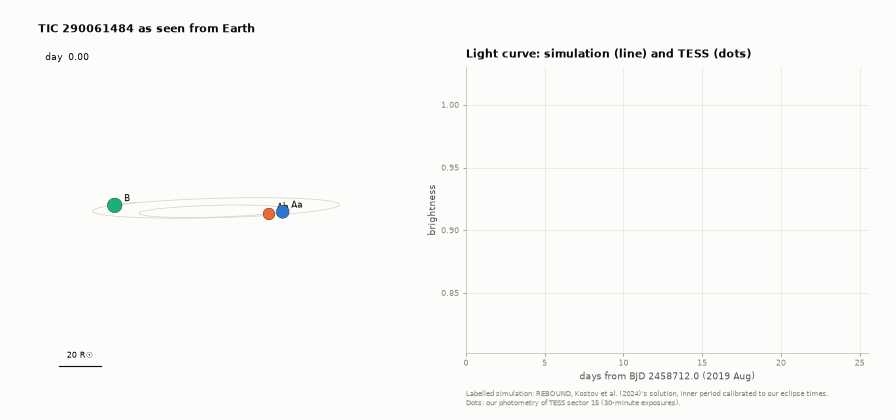
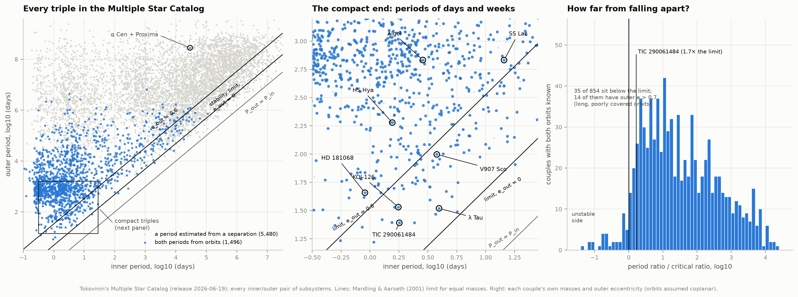
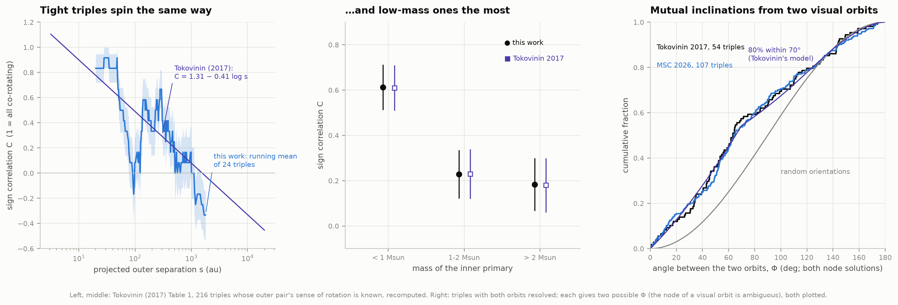
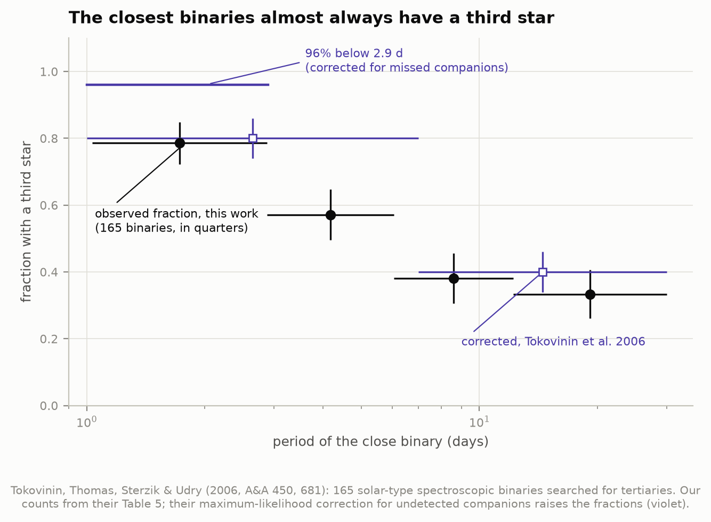
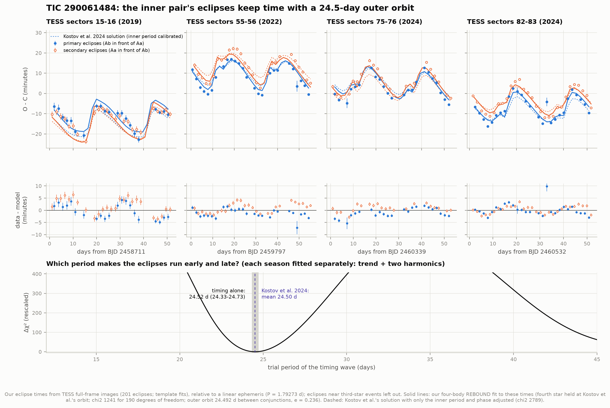
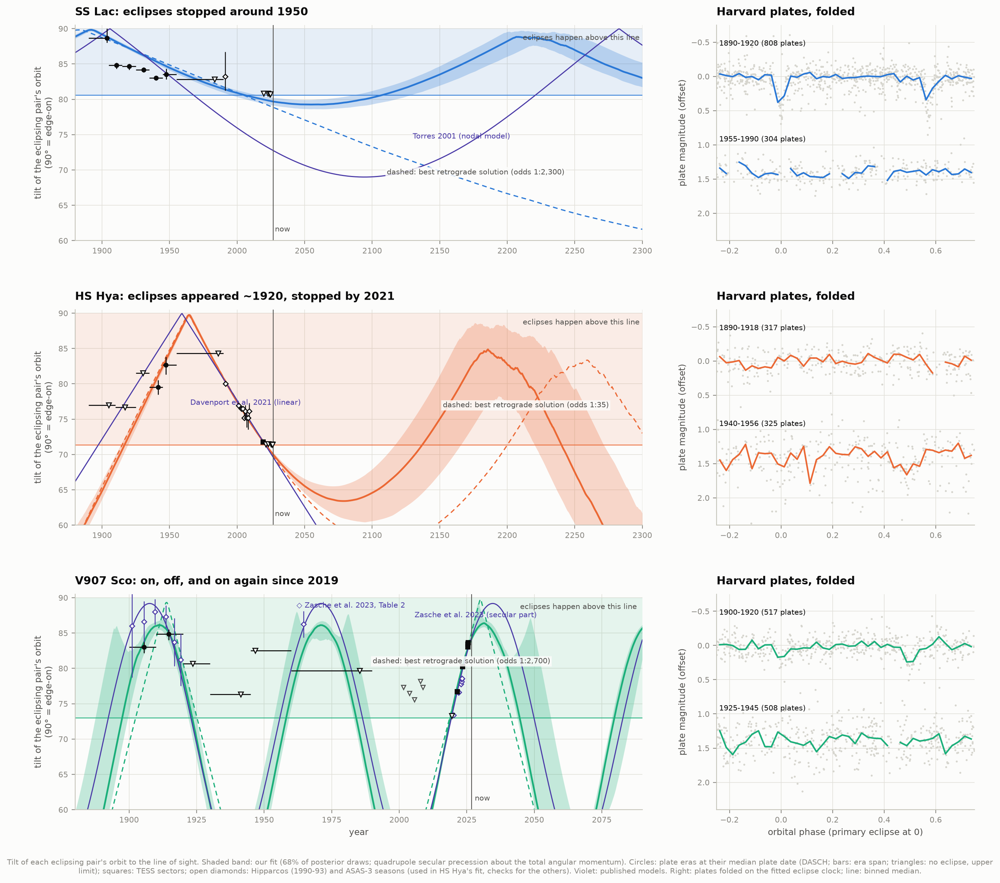
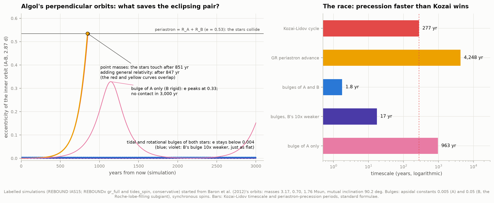
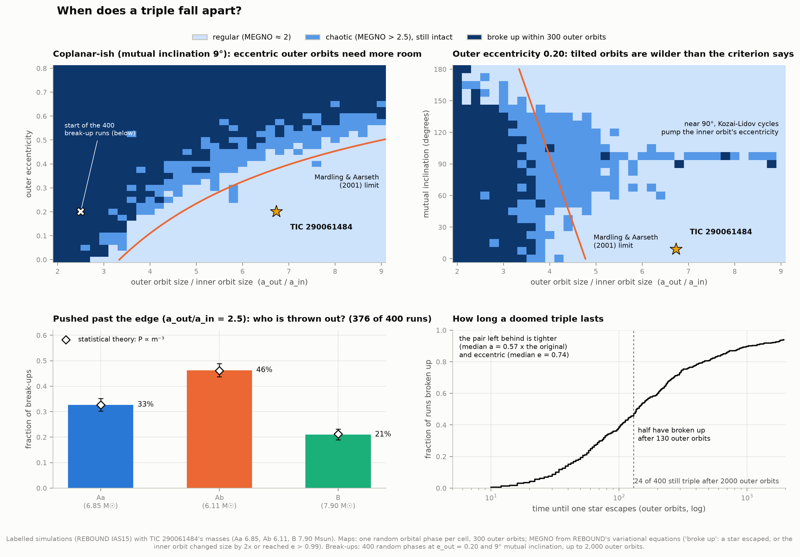
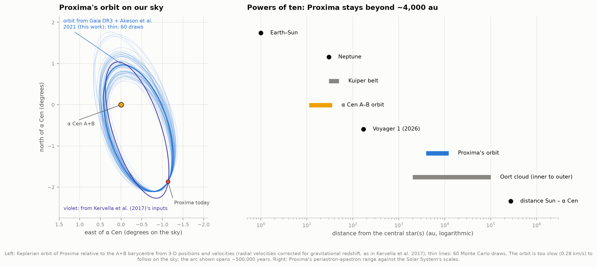
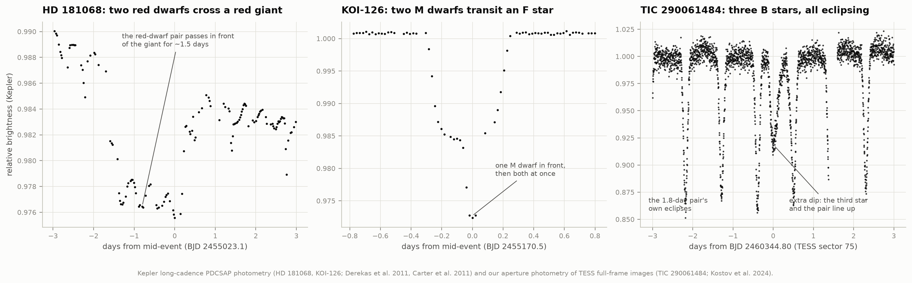

# M4 — Three suns: triple stars and the three-body problem

**About one star system in ten has three or more stars. How are triples built, and what keeps them from
flying apart? What does the third star do to the inner pair: can it tip the pair's orbit until its
eclipses switch off, or stretch it until the two stars collide? And can we watch all this in real
data?**

Yes, in several ways. The Multiple Star Catalog shows how triples are arranged, and that real ones keep
to the stability limit that simulations predict. In the most compact triple of massive stars known,
TIC 290061484, our own TESS eclipse timings show the inner pair running early and late in step with a
third star on a 24.5-day orbit. For three eclipsing binaries whose eclipses came and went over the
last century, the tilting orbits come out of a single fit to Harvard plates, Hipparcos, ASAS-3 and
TESS, and the fit says when their eclipses will return. Labelled simulations add the rest: Kozai–Lidov
cycles in Algol and what stops them, what happens when a triple is pushed past the stability limit,
and Proxima Centauri's half-million-year orbit around α Centauri.



*The keeper: TIC 290061484 as seen from Earth over 25 days in 2019 (MP4:
[`figures/tic290061484_three_suns.mp4`](figures/tic290061484_three_suns.mp4)). Labelled simulation:
REBOUND integrates the four stars on Kostov et al. (2024)'s solution, with the inner period
calibrated to our eclipse times; the three B stars are drawn to scale, nearer ones in front. Right:
the light curve computed from the simulated positions (line) and our photometry of TESS sector 15
(dots). Aa and Ab (1.8 days) eclipse each other twice an orbit. Star B swings around them every
24.5 days, and on day 16.5 it passes in front of Ab and then Aa: two small extra dips (1–2%), seen in
the data where the model puts them.*

**What we found:**

* **Triples respect the stability limit.** Of 854 inner/outer pairs in the 2026 Multiple Star Catalog
  with both orbits and all masses known, 819 lie above Mardling & Aarseth's (2001) limit. The 35 below
  it mostly have poorly covered, very eccentric outer orbits. TIC 290061484's period ratio is only 1.7
  times the limit; only one catalogued triple has a shorter outer period.
* **Tight triples spin the same way.** Our recount of Tokovinin's (2017) tables reproduces his result:
  for outer orbits within 50 au, 94% of triples have both orbits turning in the same sense, falling to
  random beyond ~1,000 au. In the 2026 catalogue, the 107 triples with two resolved orbits (twice
  Tokovinin's sample) fit the same picture: 80–85% of them are aligned within 70–80°.
* **The closest binaries almost always have a third star**: 33 of the 42 shortest-period binaries
  (P < 2.9 d) in Tokovinin et al.'s (2006) survey, against 14 of 42 above 12 days.
* **TIC 290061484's outer orbit, from timing alone.** We timed 201 eclipses in TESS full-frame images
  (2019–2024, median precision 0.65 min). The eclipses run up to 20 minutes early or late, repeating
  every **24.5 (24.3–24.7) days**, which is Kostov et al.'s outer period, found without any orbit model.
  A four-body REBOUND fit to the times matches them to 2.4 min rms, with B passing in front of the pair
  every **24.492 d** (Kostov et al.: 24.489 ± 0.004 d). Kostov et al.'s own solution fits our
  independent times to 3.3 min once its inner period is recalibrated (+0.12%, a code-to-code
  difference in osculating elements).
* **Eclipses that switch off and on**, fitted, not just simulated: a precessing-orbit model fitted to
  1,000–3,400 Harvard plates per star (1890–1990) and every TESS sector.
  * **V907 Sco** (eclipsing 1900–1920, 1963–1986 and since 2019): the inner orbit wobbles around the
    triple's total angular momentum every **60.7 (+2.4/−1.0) years**, tilted 27° to the outer orbit;
    eclipses stop in **2044.5 (+2.5/−1.5)** and return around 2080. Zasche et al. (2023): 63.5 yr,
    26°, 2049. Their forecast, made with data to 2022, trails the TESS tilts of 2023–2025 by 0.5–1.0°,
    the direction our faster wobble predicts.
  * **HS Hya** (eclipses appeared ~1920 and stopped in 2021): with Hipparcos and ASAS-3 in the fit, the
    orbit swept through edge-on in 1964. The wobble period is **530 (+70/−50) years**, the third
    star has 0.54 ± 0.04 M☉, and eclipses ended in **2021.0 ± 0.5** and return around **2132
    (+26/−18)**. A retrograde geometry (third star orbiting backwards, 713-year wobble, return ~2199)
    also fits, at odds of 1 to 35. It is Vokrouhlický & Zasche's (2022) retrograde solution; they
    found 700 ± 200 years, 0.56 M☉ and a return around 2200.
  * **SS Lac** (eclipsed until ~1950): the orbit was edge-on around 1891 and has tilted away at 0.095°
    a year since. The wobble takes **625 ± 22 years** (Torres 2001: 600), but its cone is narrow (the
    tilt swings only between 79° and 90°), so the eclipses faded rather than vanished. They stopped
    altogether around 2024 and should return around **2092 (+20/−17)**, a century before Torres's
    "shortly after 2200". Left free, the fit settled on a near-perpendicular geometry that fits the
    plates worse and that N-body integration shows to be impossible (the stars would collide).
* **What saves Algol.** Its two orbits are perpendicular, the worst case for Kozai–Lidov cycles: as
  point masses, the eclipsing pair is driven to collision within 850 years, and general relativity
  does not help. The stars' tidal and rotational bulges do: they turn the orbit's periastron every
  1.8 years, much faster than the 277-year Kozai cycle, and the eccentricity stays below 0.004.
* **Pushed past the limit.** Of 400 simulated triples with TIC 290061484's masses and the outer orbit
  squeezed below the limit, 376 break up within 2,000 outer orbits, half of them within 130. Which
  star escapes follows the statistical m⁻³ law (33/46/21% for Aa/Ab/B against 33/46/21% predicted),
  and the pair left behind is tighter and eccentric. Chaos maps find Mardling & Aarseth's limit accurate to ~15% for near-coplanar
  orbits, but near-perpendicular triples are unstable well beyond it: Kozai–Lidov again.
* **Proxima Centauri** is bound to α Centauri A+B on a 553 (+74/−55)-thousand-year orbit with
  eccentricity 0.49 (Kervella et al. 2017: 547 kyr, 0.50), never coming closer than ~4,000 au.

## Check against published results

| Check | This work | Published |
|---|---|---|
| TIC 290061484 outer period, from the timing wave alone | 24.52 (24.33–24.73) d | 24.498 ± 0.005 d mean (Kostov et al. 2024) |
| …from our four-body fit, time between B's conjunctions | 24.492 d | 24.489 ± 0.004 d (linear ephemeris) |
| …inner period (mean eclipse period, 2019–2024) | 1.792731 d | ~1.792 d |
| …outer eccentricity, timing-only fit | 0.236 ± 0.005 | 0.2011 |
| …mass of star B (inner pair held at 6.85 + 6.11 M☉) | 8.24 ± 0.12 M☉ | 7.90 M☉ |
| …mutual inclination | 10.8° (10.2° with the fourth star free) | 9.17° ± 0.4° |
| …Kostov et al.'s solution against our 201 eclipse times | 3.3 min rms (inner period recalibrated) | — |
| Proxima's orbit, Kervella et al.'s inputs: period | 553 (+74/−55) kyr | 547 (+66/−40) kyr (Kervella et al. 2017) |
| …eccentricity; semimajor axis | 0.49 (+0.11/−0.12); 8.7 (+0.8/−0.6) kau | 0.50 (+0.08/−0.09); 8.7 (+0.7/−0.4) kau |
| …periastron; apastron | 4.4 (+1.5/−1.2) kau; 13.0 (+0.2/−0.2) kau | 4.3 (+1.1/−0.9) kau; 13.0 (+0.3/−0.1) kau |
| …angle between Proxima's orbit and α Cen A–B's | 33° ± 7° | ~30° |
| Sign correlation of orbital spins, by primary mass (< 1, 1–2, > 2 M☉) | 0.61 ± 0.10, 0.23 ± 0.11, 0.18 ± 0.12 | 0.61 ± 0.10, 0.23 ± 0.11, 0.18 ± 0.12 (Tokovinin 2017) |
| …best "aligned fraction" model of 54 two-orbit triples | 80% within 70° | 80% within 70° (Tokovinin 2017) |
| Binaries with P < 2.9 d that have a third star (observed) | 33 of 42 (79%) | 96% after correcting for missed companions (Tokovinin et al. 2006) |
| V907 Sco: mutual inclination; wobble period | 27.2 (+2.3/−1.6)°; 60.7 (+2.4/−1.0) yr | 26.2 (24.0–28.8)°; 63.5 (60.9–66.8) yr (Zasche et al. 2023) |
| …end of the current eclipses; third star's mass | 2044.5 (+2.5/−1.5); 1.17 (+0.05/−0.07) M☉ | 2049; 1.06 (0.96–1.17) M☉ |
| HS Hya: wobble period; third star's mass | 530 (+70/−50) yr; 0.54 ± 0.04 M☉ | 700 ± 200 yr; 0.56 (0.47–0.68) M☉ (Vokrouhlický & Zasche 2022) |
| …mutual inclination; end of eclipses; their return | 46 ± 6°; 2021.0 ± 0.5; 2132 (+26/−18) | 50–65° (or 120–150°); 2021.1, 2195 (Davenport et al. 2021); ~2200 |
| …the retrograde alternative (odds 1:35) | 136 ± 6°; 713 (+59/−53) yr; 0.57 ± 0.04 M☉; return 2199 (+36/−29) | 120–150°; 700 ± 200 yr; 0.56 M☉; ~2200 |
| SS Lac: wobble period; tilt of the invariable plane | 625 ± 22 yr; 89.4 (+0.5/−1.0)° | 600 yr; 84° ± 10° (Torres 2001) |
| …tilt rate 1900–1950; edge-on | −0.095 ± 0.006°/yr; 1891.5 (+2.5/−3.0) | −0.144 ± 0.008°/yr; 1905.8 ± 1.5 |
| …mutual inclination; eclipses return | 15.0 ± 1.3°; 2092 (+20/−17) | 24–30°; shortly after 2200 |
| Ejection probabilities ∝ m⁻³ (Aa, Ab, B) | 0.33 ± 0.02, 0.46 ± 0.03, 0.21 ± 0.02 | 0.33, 0.46, 0.21 (Valtonen & Karttunen 2006) |
| Stability limit, coplanar circular orbits (a_out/a_in) | chaos ends at 2.8 | 3.3 (Mardling & Aarseth 2001) |

## Results

### 1. How triples are built



Andrei Tokovinin's [Multiple Star Catalog](http://www.ctio.noirlab.edu/~atokovin/stars/) (MSC, release
19 June 2026) lists 6,936 systems of three or more stars as a hierarchy of pairs: an inner pair, an
orbit that contains it, sometimes an orbit around that. Every pair of nested orbits is a "couple"; we
find 6,976 with both periods given: 1,496 with both from orbits, the rest with at least one estimated
from a separation (5,983 of them with all masses known as well). Inner and outer periods typically
differ by a factor of ~400. Of the 854 couples with both periods from orbits and all masses known,
only 2.7% have the outer period within 10 times the inner one.

How close can they be? Mardling & Aarseth (2001) derived a stability limit from the dynamics of the
three-body problem. For equal masses and circular, coplanar orbits the outer orbit must be at least
3.3 times the size of the inner one (a period ratio of about 4.7), and more if the outer orbit is
eccentric. The catalogue bears it out: of 854 couples with both orbits and all masses known, 819 lie
above the limit (right panel; each couple measured against its own limit). The 35 below it are not
systems about to fly apart. Fourteen have outer eccentricities above 0.7, and most of the rest have
outer orbits covered for only a fraction of their period, so the catalogued elements are uncertain.

TIC 290061484's period ratio is 1.7 times its limit. Its 24.6-day outer orbit is the second shortest
in the catalogue. The shortest, NSVS 3880869 (16.6 days), would be unstable with its catalogued outer
eccentricity of 0.56, which suggests that eccentricity is wrong.

### 2. Do the orbits line up?



If triples formed by capturing a third star, their orbits would point in random directions. If they
formed together from one rotating cloud or disc, the orbits would tend to share a plane and a sense of
rotation. Tokovinin (2017) measured this with a simple statistic. For a visual binary we see which way
the stars move around each other on the sky, clockwise or anticlockwise. For a triple where both orbits
are seen, C = (same sense − opposite sense) / total: 1 if all co-rotate, 0 if random.

From his Table 1 (216 triples) we recompute every number: C = 0.32 ± 0.06 overall, and by the inner
primary's mass 0.61 ± 0.10 (below 1 M☉), 0.23 ± 0.11 (1–2 M☉) and 0.18 ± 0.12 (above 2 M☉). These
match his values exactly. With separation, C falls from 0.89 ± 0.08 for outer orbits within 50 au
(mean angle between the orbits ~10°) to −0.3 ± 0.2 beyond 1,000 au. Our least-squares line,
C = 1.44 − 0.48 log s, is a little steeper than his 1.31 − 0.41 log s (left).

Where both orbits are fully known (54 triples, his Table 3), the angle Φ between them can be computed,
except that a visual orbit cannot tell which node is approaching, so each triple gives two possible Φ.
Tokovinin's model, "a fraction f of triples aligned within Φ0, the rest random", fits both node
solutions best at f = 80%, Φ0 = 70° in our hands too (ln L = −214.5 against −235.7 for random
orientations). The 2026 catalogue has 107 such triples; they give C = 0.48 ± 0.09 and f = 85%,
Φ0 = 80°, the same picture with twice the sample (right).

### 3. Close binaries almost always have a third star



Tokovinin et al. (2006) searched 165 solar-type spectroscopic binaries for distant companions. From
their Table 5, the fraction that has a third star falls from 79% (33 of 42) for periods below 2.9 days
to 33% (14 of 42) for periods of 12–30 days. Correcting for companions too faint or too close to
detect, they find 96% below 3 days. Binaries this tight probably did not form at their present
separation: as young stars they were larger than the orbit. A third star, through Kozai–Lidov cycles
plus tidal friction (section 6), is one of the leading ways to shrink them.

### 4. TIC 290061484: three suns, timed



TIC 290061484 (Kostov et al. 2024) is a triple of B stars, 6–8 times the Sun's mass, 1.5 kpc away in
Cygnus. Aa and Ab orbit each other every 1.8 days and eclipse; star B orbits the pair every 24.5 days
and also eclipses it, so all three stars eclipse each other: a triply eclipsing triple. A fourth
star, C, circles the three every ~9 years.

We measured the inner eclipses ourselves from TESS full-frame images: aperture photometry on image
cutouts for eight sectors (2019, 2022, 2024), a template for each sector's eclipse shape, and a time
for each of 201 eclipses (24 more, distorted by B passing in front, are left out). The median precision
is 0.65 minutes. Against a constant period (1.792731 days), the eclipses come up to 20 minutes early
or late (top row). This is the third star at work. Its gravity speeds up and slows down the pair's
orbit, and the pair is carried toward and away from us, changing the light travel time.

**The period without a model.** In each TESS season (two sectors, ~50 days) we fit the times with a
trend plus two harmonics of a trial period, and add up the misfit over the four seasons, letting each
season have its own phase so no cycles need counting across the gaps. The best period is **24.52 days
(24.33–24.73)** (bottom panel): the outer orbit, found from eclipse times alone.

**A four-body fit.** We then fitted the eclipse times with a REBOUND N-body model (IAS15 integrator,
light travel time included), starting from Kostov et al.'s orbits. Free: the inner period, phase,
eccentricity and argument of periastron; B's period, eccentricity, orientation and mass. The inner
masses and inclination stay at Kostov et al.'s values (timing alone barely constrains them), and
so does the fourth star, whose 9-year orbit our five years cannot pin down: freeing it improves the
fit (χ² 1,114 against 1,241) but leaves its period at 3,200 ± 6,400 days. The fit matches the times
to **2.4 minutes rms**. B passes in front of the pair every **24.492 days** on average (Kostov et al.:
24.489 ± 0.004). Its orbit has eccentricity 0.236 ± 0.005 (theirs 0.2011), B weighs 8.24 ± 0.12 M☉
(7.90), and the two orbits are 10.8° apart (9.17° ± 0.4°). The formal errors are small, but timing
alone cannot use what Kostov et al.'s photodynamical model also fits: the eclipse depths and shapes,
B's own eclipses, radial velocities. One difference shows it: in our fit, B's orbit is tilted 96.1° to
the sky (94.5° with the fourth star free; theirs 94.4°). At 96.1° B would miss the pair, yet TESS sees
it cross Ab and Aa in 2019 (keeper caption). B's own eclipses fix that tilt; eclipse timing alone
does not. We read the differences as what eclipse timing alone can do, not as a correction.

**Kostov et al.'s solution as a check.** Integrated as published, their elements put the inner
eclipses 0.12% too close together (1.7906 against 1.7927 days): after five years they would be off by
more than a day. This is a known code-to-code issue: "osculating" elements depend on the coordinates
and the integrator, and the eclipse period here depends steeply on the inner orbit's phase relative to
star B. With only the inner period (+0.12%) and phase (−47 s) adjusted, their solution fits all 201 of
our independent eclipse times to 3.3 minutes rms (dashed lines), with every sector's mean residual
within ±3.5 minutes.

Its outer orbit is only 1.4 times the smallest stable size for these masses and this eccentricity
(section 7; a period ratio 1.7 times the limit). It is about as compact as a stable triple can be.

### 5. Eclipses that come and go



When a third star's orbit is tilted to the inner pair's, the pair's orbit cannot stay put. Both orbits
precess around the triple's total angular momentum like a tilted spinning top, so the inner pair's
tilt to our line of sight changes over decades. Eclipses happen only while that tilt is close to
edge-on. For some binaries this has happened while astronomers watched. **SS Lac** eclipsed until the
1950s and has not since (Torres 2001). **HS Hya**'s eclipses deepened through the 20th century, then
faded and stopped in 2021 (Davenport et al. 2021; Vokrouhlický & Zasche 2022). **V907 Sco** eclipsed in
1899–1918 and 1963–1986, and started again in 2019 (Lacy et al. 1999; Zasche et al. 2023).

**One model for a century of data.** The model has the inner orbit precessing at the quadrupole
secular rate (Söderhjelm 1975), set by the masses, the two periods, the outer eccentricity and the
mutual inclination J. The free parameters are J, the invariable plane's tilt to the sky I, the
precession phase, the third star's mass, the eclipse ephemeris, and nuisance terms for the plates.
At every epoch it computes the full light curve of two limb-darkened stars, with the published radii
(fitted for SS Lac, which has none), temperatures and Claret's limb-darkening tables. The data:

* **Harvard plates** (DASCH data release 7): 3,391 plates of SS Lac, 1,063 of HS Hya and 1,365 of V907 Sco
  from 1890 to 1990, calibrated against APASS, with a mixture likelihood for the plates' outliers.
* **TESS** (2019–2026, every sector): for each sector, χ² as a function of the eclipse impact
  parameter from a fit of the full light curve, with a systematic floor (0.2–0.5° in tilt) for what
  the secular model leaves out.
* **Hipparcos** (1990–93) and **ASAS-3** (2001–2009): in HS Hya's fit; checks for the others.
* The outer orbit's spectroscopic size, which ties the third star's mass to the outer orbit's tilt.

Nested sampling (dynesty) explores everything at once. Then 300 posterior draws per solution were
integrated with REBOUND as full three-body systems, 1885–2030, to check that the secular model holds.
For HS Hya and V907 Sco it does: the inner orbits stay circular (no Kozai–Lidov growth), and the N-body
tilt follows the secular model to 0.05° (HS Hya) and 0.5° (V907 Sco, whose outer orbit is short and
eccentric) rms. For SS Lac it decided between solutions (below).

| | SS Lac | HS Hya | V907 Sco |
|---|---|---|---|
| Inner, outer period | 14.4 d, 679 d | 1.57 d, 190.5 d | 3.78 d, 142.0 d |
| Mutual inclination J | 15.0 ± 1.3° | 46 ± 6° | 27.2 (+2.3/−1.6)° |
| Wobble (nodal) period | 625 ± 22 yr | 530 (+70/−50) yr | 60.7 (+2.4/−1.0) yr |
| Third star's mass | 0.74 ± 0.04 M☉ | 0.54 ± 0.04 M☉ | 1.17 (+0.05/−0.07) M☉ |
| Tilt in 2026 (90° = edge-on) | 79.7 ± 0.6° (going away) | 70.0 ± 0.3° (going away) | 84.2 (+0.8/−0.3)° |
| Last eclipses ended | 2024 (+1.5/−2.5), too shallow for plates after ~1950 | 2021.0 ± 0.5 | 1984 (+2/−1.5) |
| Eclipses next end / return | return 2092 (+20/−17) | return 2132 (+26/−18) | end 2044.5 (+2.5/−1.5), return 2080 (+2/−1) |
| Other sense of motion (retrograde) | odds 1 : 2,300 | odds 1 : 35 | odds 1 : 2,700 |

**V907 Sco** agrees with Zasche et al. (2023) within the errors. Our wobble period is 4% shorter and the
current eclipses end 4.5 years earlier. The TESS sectors after their paper test this: rebuilding their
model from the published parameters and anchoring it to their own 2019–2022 tilts, it forecast 79.8°
for mid-2023 and 82.5–82.7° for 2025. TESS measured 80.3° and 83.1–83.6°. Part of the difference
(0.1°) is calibration (our 2021 tilt sits 0.13° above theirs), and part is real wiggle at the 142-day
outer period: the tilt changed by 0.56° within the 51 days of sectors 91–93, nearly three times the
average rate. Beyond that, the tilt is running ahead of the forecast, as a shorter period predicts.
ASAS-3 saw no eclipses in 2002–2009, when the model puts the tilt near 50°. The best retrograde
solution (J = 112°, a 235-year wobble) fits worse (best ln L 223 against 228), lacks the 1963–1986
eclipses Lacy et al. (1999) saw, and is disfavoured 2,700 to 1 (ln B = 7.9 ± 0.5).

**HS Hya** needed the ground data, and showed how easily a fit can settle in the wrong place. The
plates and TESS allow several quite different geometries, and single nested-sampling runs land in
different ones depending on the random seed:

| Run | Geometry found | Best ln L, plates + TESS | Best ln L, all data |
|---|---|---|---|
| plates + TESS, first run | B: J = 42°, I = 46°; the tilt peaked at ~82° in the 1960s and turned back | 37.2 | 33.9 |
| plates + TESS, rerun (new seed, 1,000 live points) | J = 143°, I = 36° | 34.9 | 19.1 |
| all data (+ Hipparcos, ASAS-3) | **A: J = 46°, I = 80°; swept through edge-on in 1964** | **39.1** | **37.5** |
| all data, prograde only (J < 90°) | B again | 37.6 | 33.7 |
| all data, retrograde only (J > 90°) | C: J = 136°, I = 67° | 38.1 | 36.0 |
| all data, rerun (new seed, 1,000 live points) | C (68% of samples) and B (32%) | 37.7 | 35.4 |

Hipparcos, which measured a tilt of 80.0° in 1991, rules out geometry B by Δχ² = 30. Geometry A fits
the plates and TESS better than anything the plates-only runs found, so those runs were trapped, not
the data ambiguous. The runs agree where they overlap: the evidences of B and C from the restricted
runs predict the all-data rerun's total and its 30:70 split between them (ln Z = −0.73 predicted,
−0.82 found). Only one run found A, but it is the best maximum of all, and it carries 96% of the
evidence (B 1%, C 3%).

Geometry C is Vokrouhlický & Zasche's (2022) retrograde solution: a 713-year wobble, 0.57 ± 0.04 M☉
for the third star, eclipses back around 2199. Prograde is favoured 35 to 1 (ln B = 3.6 ± 0.5). In
geometry A the third star has 0.54 ± 0.04 M☉ (Vokrouhlický & Zasche: 0.56) and the wobble takes 530
years (their 700 ± 200). The eclipses switched off in 2021.0 ± 0.5. The tilt keeps falling to ~63.5°
around 2077, then turns, and eclipses resume around **2132**: about 60 years before Davenport et al.'s
linear extrapolation, because the full model includes the turnaround. Both A and C pass the N-body
check (300 of 300 draws quiet; secular model good to 0.05° and 0.03° rms).

**SS Lac** taught a different lesson: a fit can look good and be physically impossible. Left free, it
lands on a near-perpendicular geometry (J = 101° ± 1°, invariable plane tilted 30° to the sky, a
2,300-year wobble; best ln L = 466). But at J = 101° the third star drives
Kozai–Lidov cycles (section 6) on a ~70-year timescale, and SS Lac's inner orbit is already eccentric
(e = 0.136). Integrated with REBOUND, every one of 300 posterior draws pumps the eccentricity to
0.92–1.0 between 1885 and 2030: the stars would collide. The secular model, which keeps the
eccentricity fixed, does not hold there, so that solution is excluded. Fitting only outside the
Kozai–Lidov window (J < 39.2° or > 140.8°), where the model is valid, finds a solution that also fits
the plates *better* (best ln L = 474), which the free run had simply missed. The orbits are 15.0 ±
1.3° apart, the triple's angular momentum lies almost in the plane of the sky (I = 89.4°), and the
third star has 0.74 ± 0.04 M☉. In REBOUND all 300 draws stay quiet, with the tilt within 0.11° rms of
the secular model. The retrograde alternative (J = 168°) is disfavoured 2,300 to 1, and Hipparcos's
1991 data agree (Δχ² = 0.8).

The wobble period, 625 ± 22 years, matches Torres (2001: 600), but the cone is narrower: the inner
orbit's normal circles 9.9° ± 0.8° from the total angular momentum, against his 15° ± 3°. So the tilt
falls more slowly, 0.095° a year in 1900–1950 against his 0.144°. The orbit was edge-on in 1891 (his
1905.8). Our fitted stellar radii are also larger (sum 0.164 ± 0.008 of the separation, against 0.146
from his light-curve solution), so eclipses continue down to a tilt of 80.6° instead of 81.6°. In
this solution the eclipses never stopped abruptly. They became too shallow for the plates after
about 1950, as observed, and stopped altogether around 2024 (in a third of the solutions, grazing
eclipses far too shallow to see go on until 2027–2041). TESS saw none in 2019–2024. The tilt
bottoms out at 79.4°, just below the limit, and climbs back: eclipses should return around **2092
(+20/−17)**. Torres expected "shortly after 2200"; the figure above shows both models. Taken era by
era, our plates are not smooth. The tilt drops from 89.0° (1904) to 84.8° (1911), then stays at
83.5–85.2° until 1948, a pattern no precessing orbit can follow. Differences between plate series
(telescopes, emulsions, calibration) evidently limit how precisely a century of photographic data
pins down the rate. The return of the eclipses will settle it.

The [interactive explorer](figures/triple_star_explorer.html) (one offline HTML file) lets you drag the
year from 1880 to 2300 and see each pair's orbit on the sky, its tilt history, and that year's light
curve.

### 6. Kozai–Lidov cycles, and what stops them



When a third star orbits at a steep angle to an inner pair, it does more than tilt the pair: over many
orbits it trades the pair's tilt for eccentricity and back (von Zeipel–Kozai–Lidov cycles). For
perpendicular orbits the eccentricity can approach 1. Algol is the famous test. Its eclipsing pair
(2.87 days) and its third star (680 days) orbit in planes 90.2° apart (Baron et al. 2012), yet Algol
has blinked steadily since antiquity.

Labelled simulations, all started from Baron et al.'s orbits (REBOUND IAS15):

* **Point masses**: the eccentricity grows from zero and the two stars touch (periastron < R_A + R_B)
  after **851 years**.
* **Plus general relativity** (REBOUNDx `gr_full`): no help; they touch after 847 years. GR turns the
  orbit's periastron once per 4,250 years, slower than the 277-year Kozai cycle.
* **Plus tidal and rotational bulges** (REBOUNDx `tides_spin`, conservative, synchronised spins): the
  eccentricity stays below 0.004 for 3,000 years, and that 0.004 is the bulges' own steady distortion
  of the orbit. The bulges turn the periastron every 1.8 years. The Kozai torque, which needs the
  orbit's orientation to stay put for centuries, averages away.
* **Robustness**: with the subgiant's bulge 10 times weaker (17 years per turn) the orbit stays circular
  too. With the bulge of A (the B8 dwarf) alone and B treated as rigid (963 years per turn), the
  eccentricity reaches 0.33, but the stars never touch in 3,000 years.

The race of timescales decides (right panel). Precession faster than the Kozai cycle wins. The same
physics plus tidal friction (not simulated here) shrinks wide pairs into the tight binaries of
section 3.

### 7. When does a triple fall apart?



Labelled simulations with TIC 290061484's masses (REBOUND IAS15). **Chaos maps** (top): for each outer
orbit size and eccentricity (left) or tilt (right) we integrate 300 outer orbits and compute MEGNO, a
chaos indicator that settles at 2 for regular motion and grows for chaotic motion. For near-coplanar
orbits, Mardling & Aarseth's limit tracks the chaotic edge to ~15%. Chaos ends at an orbit-size ratio
of 2.8 for circular orbits (limit 3.3), 4.2 at e = 0.2 (4.7), 6.0 at e = 0.3 (5.7) and 7.8 at e = 0.4
(7.0). Tilted triples are different. Around 90° the inner orbit is pumped by Kozai–Lidov cycles and
the motion is chaotic out to the edge of the map (ratio 9, against a limit of 4.1). Retrograde
triples, with the outer star orbiting backwards, are more stable than the limit says (2.4 against 3.3
at 180°).

**Past the edge** (bottom): 400 triples with the outer orbit squeezed to 2.5 times the inner one, below
the limit, each with random orbital phases. 376 break up within 2,000 outer orbits, half of them within
130. One star is thrown out and the other two stay as a tighter, eccentric binary (median semimajor
axis 0.57 of the original inner orbit, eccentricity 0.74). Who leaves follows the statistical theory
of three-body break-ups: escape probability proportional to m⁻³ (Valtonen & Karttunen 2006). The
lightest star, Ab (6.11 M☉), leaves in 46% of break-ups, Aa in 33%, and the heaviest, B (7.90 M☉), in
21%, matching the predicted 46/33/21% within the errors. Ab, the lightest, also leaves fastest.

### 8. Proxima's orbit, to scale



Proxima Centauri, the nearest star to the Sun, is 2.2° on the sky (13,000 au) from α Centauri A and B.
Kervella, Thévenin & Lovis (2017) showed it is bound to them. We redo their calculation from their
own inputs: positions, parallaxes, proper motions and radial velocities of Proxima and of the A+B
barycentre, the velocities corrected for gravitational redshift and convective blueshift. These become
3-D position and velocity vectors, and their differences give a Keplerian orbit, with 100,000 Monte
Carlo draws of the inputs. Proxima is 36–45 light-days nearer to us than α Cen (depending on the
parallaxes used), so we see it that much later in its orbit, which we correct for.

The orbit: bound in all draws (relative speed 0.28 ± 0.03 km/s against an escape speed of 0.54 km/s),
period **553 (+74/−55) thousand years**, eccentricity 0.49 ± 0.11, semimajor axis 8.7 kau, Proxima now
near apastron (13,000 au) and ~275,000 years from periastron (4,400 au). All of this matches Kervella
et al. Its orbit is tilted 33° ± 7° from the orbit of A and B (Kervella et al.: about 30°). With
today's data (Gaia DR3 for Proxima, Akeson et al. 2021's ALMA astrometry and masses for A and B) the
orbit is a little tighter: 495 (+51/−37) thousand years, eccentricity 0.51, semimajor axis 8.0 kau,
and 41° from A–B's orbit. Kervella et al.'s orientation angles (i, Ω, ω) are in a frame we could not
reproduce, so only frame-independent quantities are compared.

To scale (right panel): Proxima never comes closer to A and B than ~4,000 au, over 100 times Neptune's
distance from the Sun, inside the region where the Sun's inner Oort cloud lies.

### 9. A gallery of triply eclipsing triples



Systems where all three stars eclipse each other: HD 181068 (Derekas et al. 2011), a red giant
crossed by a pair of red dwarfs; KOI-126 (Carter et al. 2011), two M dwarfs transiting an F star,
first one and then both; and TIC 290061484 in TESS sector 75, where B lines up with the 1.8-day pair.
Kepler long-cadence light curves and our TESS photometry.

## How it works

1. **The catalogue** (`catalogs.py`, `architecture.py`). The MSC's component, subsystem and orbit tables
   are parsed and every subsystem is linked to the one that contains it. Each "couple" gets the inner and
   outer periods (orbits where available, otherwise estimated from the separation and masses), masses
   and outer eccentricity. Mardling & Aarseth's criterion uses the period-ratio form with each couple's
   own masses. Tokovinin's tables come from VizieR (`J/ApJ/844/103`, `J/A+A/450/681`), with the signs of
   rotation recomputed from the position-angle trends and checked against his (100% agreement).

2. **TESS photometry** (`tess_lc.py`, `etv.py`). TIC 290061484 and SS Lac/V907 Sco: 15×15-pixel
   full-frame-image cutouts from MAST's TESSCut; aperture photometry with a local background, the
   dilution by neighbours estimated from Gaia DR3. HS Hya: SPOC 2-minute PDCSAP light curves.
   TIC 290061484's eclipses are timed by fitting each one with that sector's own folded template
   (shift, depth scale and linear baseline). The template is centred on its point of symmetry, so the
   shifts are absolute times. Errors come from the χ² curvature, scaled by the reduced χ².

3. **The four-body model of TIC 290061484** (`tic290_nbody.py`). Kostov et al.'s Jacobi elements at
   BJD 2458711.0 become a REBOUND simulation in the sky frame (their argument-of-periastron conventions
   checked against their published conjunction times). Model eclipses are the minima of the
   sky-projected Aa–Ab separation, sampled every 1/120 of an orbit within TESS sectors and every 1/12
   between them, so every eclipse can be counted. The light travel time across the system is added,
   and each observed eclipse is paired with the model eclipse of the same cycle number. Least squares
   (SciPy TRF) with a forward-difference Jacobian, evaluated in parallel. **Integrator: IAS15.** We
   first used WHFast with `safe_mode = 0`, which turned out to accumulate errors of tens of minutes when
   every call ends on a shortened step. Our first fit was wrong and was redone.

4. **The precessing-orbit model** (`switching.py`, `eclipse_model.py`, `limb_darkening.py`). The inner orbit's
   normal precesses around the total angular momentum: the angle between them (ε_in) and the rate come from
   the quadrupole secular theory, and the tilt to the sky follows cos i = cos I cos ε − sin I sin ε cos h(t).
   Positions of the two stars on the sky come from the precessing orbit (with apsidal motion for SS Lac's
   eccentric orbit), and the light curve from limb-darkened spheres with a closed form for fully covered
   rings and Gauss–Legendre integration for partly covered ones (accurate to 10⁻⁵).

5. **Plates** (`dasch.py`). DASCH light curves through the public Starglass API, magnitudes on the APASS
   scale, with daschlab's standard quality cuts plus bad-plate, uncertain-date and multiple-exposure
   flags. Three comparison stars per field test the calibration. Per-plate-series zero points and a
   mixture likelihood (a fraction of plates drawn from a broad outlier distribution) keep bad plates
   from faking eclipses.

6. **TESS and ground profiles** (`switch_fit.py`). For each TESS sector, Hipparcos data set and ASAS-3
   season, the light curve is fitted with the eclipse model (baseline, ellipsoidal variation, timing
   free) on a grid of impact parameters. The resulting χ² curve is smoothed by a Gaussian penalty on
   a systematic offset (0.2–0.5° in tilt), standing in for what the secular model leaves out, and
   enters the global likelihood. A sector counts as a detection only if both halves of it show the
   eclipse.

7. **Nested sampling** (`switch_fit.py`). dynesty with 500 live points and random-slice moves, run to
   Δln Z = 0.2, checkpointed. Because single runs can be trapped in one of several maxima, each system
   was also fitted with the mutual inclination limited to the other sense of motion, HS Hya twice more
   with another seed and twice the live points, and SS Lac outside the Kozai–Lidov window only
   (section 5).

8. **N-body checks** (`switch_nbody.py`, `nbody.py`). For 300 posterior draws per system, the full
   three-body system is rebuilt in the sky frame from the fitted geometry, the outer orbit placed opposite
   the inner one on the precession cone, and integrated 1885–2030 (backwards with reversed velocities).
   The quantities tracked are the inner eccentricity (Kozai–Lidov) and the tilt against the secular
   model.

9. **Kozai–Lidov runs** (`kozai.py`). REBOUND IAS15 with REBOUNDx: `gr_full` for relativity,
   `tides_spin` for tidal and rotational bulges (Love number k2 = 2 × apsidal constant, no
   dissipation, spins synchronised with the orbit, moments of inertia from gyration radii).

10. **Stability** (`stability.py`). MEGNO from REBOUND's variational equations on 36 × 33 and 36 × 25
    grids, one random orbital phase per cell. The break-up ensemble checks every two outer orbits for an
    escaper: a star unbound to, and far from, a pair that is itself bound and much tighter than the
    escaper's distance. Without the last condition a member of the surviving binary can pass for the
    escaper; our first count had a third of the escapers wrong.

11. **Proxima** (`proxima.py`). ICRS position and velocity vectors from astrometry and radial velocity;
    a Monte Carlo over the published errors; light-time correction; elements in the visual-binary
    convention; the sky projection is gnomonic around α Cen.

`test_physics.py` checks the machinery on cases with known answers (12 tests): the occultation
integral against the analytic overlap of uniform discs and a brute-force pixel integration of
limb-darkened ones; the precessing-orbit geometry; the conjunction phase; the quadrupole precession
rate against a direct N-body integration (within 15%; it agrees to 0.5%); Mardling & Aarseth's
formula; mutual inclinations against vector arithmetic; Proxima's state-vector round trip; the
eclipse finder on an isolated binary; the DASCH quality masks against daschlab's; and two guards
against bugs found here: the break-up escaper test on a constructed break-up in every particle order,
and TIC 290061484's model eclipse times not depending on the sampling step (0.4 s).

## Data

All retrieved 9 October 2026; `data/manifest.json` records URLs, sizes and SHA-256 hashes (70 files,
733 MB, nearly all of it TESS images).

* **Multiple Star Catalog**, release 2026-06-19 (Tokovinin 2018, ApJS 235, 6; updated online):
  `newmsc-20260619.tar.gz` from CTIO/NOIRLab.
* **Tokovinin 2017** (ApJ 844, 103; VizieR `J/ApJ/844/103`, Tables 1 and 3) and **Tokovinin et al.
  2006** (A&A 450, 681; `J/A+A/450/681`, Tables 2 and 5).
* **TESS**: full-frame-image cutouts (TESSCut) of TIC 290061484 (sectors 15, 16, 55, 56, 75, 76, 82,
  83), V907 Sco (13, 39, 66, 91–93) and SS Lac (16, 56, 76, 83); SPOC 2-minute light curves of HS Hya
  (9, 35, 62, 89, 99, 100); all from MAST.
* **Kepler** long-cadence light curves, quarters 1–6, of HD 181068 and KOI-126 (MAST).
* **DASCH** data release 7 (Harvard College Observatory) through the Starglass public API: light curves
  of the three switching binaries and three comparison stars each, and the APASS reference catalogue
  around them.
* **Hipparcos** epoch photometry (ESA 1997; CDS `I/239`, `hep.gz` read by byte range) of SS Lac
  (HIP 108981) and HS Hya (HIP 50966); **ASAS-3** V-band light curves (Pojmański 2002) of HS Hya and
  V907 Sco.
* **Gaia DR3** (Gaia Collaboration 2023): Proxima, and the fields around the TESS targets for dilution.
* **Claret's limb-darkening tables**: Claret 2017 (A&A 600, A30, TESS band) and Claret 2000 (A&A 363, 1081,
  B and V).
* Published parameters used as inputs or checks, in `config.py`: Kostov et al. 2024 (TIC 290061484),
  Baron et al. 2012 (Algol), Torres 2001 and Torres & Stefanik 2000 (SS Lac), Davenport et al. 2021 and
  Vokrouhlický & Zasche 2022 (HS Hya), Lacy et al. 1999 and Zasche et al. 2023 (V907 Sco), Kervella et al.
  2017 and Akeson et al. 2021 (α Cen), Derekas et al. 2011 and Carter et al. 2011.

Please cite the catalogues and papers above, and REBOUND, REBOUNDx and dynesty, when reusing these
results.

## Caveats

* **Eclipse timing alone.** TIC 290061484's fit uses only eclipse times. It cannot weigh the inner stars
  or see their inclination, so those are held at Kostov et al.'s values, and its differences from their
  B mass and outer eccentricity are formally significant but not a correction. The residuals (2.4 min
  rms) are larger than the timing errors (0.65 min), so some effect is not modelled: perhaps the depth
  changes within a sector, or the template method itself.
* **Code-to-code elements.** Kostov et al.'s osculating inner period had to be raised by 0.12% for our
  integration to reproduce the observed eclipse period. Elements from one N-body code are not exactly
  transferable to another. Fits should be compared by their predictions, not their elements.
* **The secular model** of section 5 averages over the outer orbit. For V907 Sco, whose outer orbit
  is short and eccentric, the real tilt wiggles by up to ~0.5° around it (N-body check). This is covered
  by a systematic floor, but it limits forecasts to that level.
* **Plates are noisy.** A DASCH magnitude is good to 0.15–0.25 mag, and the Harvard collection has
  almost no plates from 1953 to 1968 (the "Menzel gap"). Eras without visible eclipses give upper
  limits only. The plate eras in the figure are illustrations; the fit uses every plate individually.
* **Sampler modes.** These likelihoods have several separated maxima, and a single nested-sampling run
  can be trapped in a poorer one (section 5: six runs of HS Hya found four different geometries). We therefore also ran each system's fit restricted to the other sense of orbital motion,
  and compared the best solutions' likelihoods and evidences. Further, undiscovered maxima cannot be
  ruled out. For HS Hya a single run found the best maximum, and the other all-data runs agree
  with each other but not with it, so its share of the evidence (96%) rests on one run.
* **Labelled simulations** (Kozai–Lidov, stability, the animation) use point masses or simplified bulges.
  The Algol runs have no tidal friction (dissipation), so they show whether Kozai cycles are quenched,
  not how the orbit evolves over millions of years. The stability maps use one random phase per cell,
  so the chaotic edge is ragged.
* **Proxima's orientation**: Kervella et al.'s angles are in a frame we could not reproduce, so we
  compare only frame-independent elements. Our period comes out 1% longer than theirs from the same
  inputs, well inside the errors.
* **Catalogue entries** are only as good as the orbits behind them. The 35 couples below the stability
  limit are almost certainly catalogue problems, not unstable triples.

## Deviations from the atlas spec

* The spec's "SS Lac-like precession switching eclipses off" as a labelled simulation became a fit of
  three real systems (SS Lac, HS Hya, V907 Sco) to a century of Harvard plates and TESS, with N-body
  checks of every fitted geometry. The simulation is still there: the fitted models are what the
  explorer and the figure show.
* Kozai–Lidov cycles are shown for Algol rather than a generic triple: a real system with
  perpendicular orbits, where the question "what stops them?" has an observable answer.
* TIC 290061484's ETVs are fitted with a four-body model (the fourth star matters at the 20-minute
  level) and compared with Kostov et al.'s solution. Their masses are not re-derived (timing alone
  cannot), so the inner masses are checked only through B's mass, with the inner pair held at theirs.
* Mutual inclinations come from both Tokovinin's 2017 sample and the 2026 catalogue's 107 two-orbit
  triples, rather than from the MSC alone.

## Running it

```bash
python fetch_data.py          # ~733 MB into data/raw (TESS cutouts take longest)
python run.py                 # every step in order; each caches its result
python test_physics.py        # 12 checks of the machinery
```

`run.py` steps can be run one at a time; the expensive ones are the TIC 290061484 timing fits (~10 min
each on 4 cores), the 11 nested-sampling fits including the check runs (15 min to a few hours each;
SS Lac's use 4 worker processes), the N-body checks (~15 min each on 4 cores), the Kozai runs (~20
min each) and the chaos maps (hours on 4 cores). The caches grow to ~180 MB in `data/cache/`.
Python 3.14 with numpy, scipy, pandas, astropy, matplotlib, rebound 5.2.1, reboundx 5.1.0 and
dynesty 3.1.0.

## Files

| File | What it does |
|---|---|
| `config.py` | paths, constants, every published parameter used, data plans |
| `fetch_data.py` | downloads everything, writes the manifest |
| `catalogs.py`, `architecture.py` | MSC parsing, couples, stability margins, Tokovinin 2017 and 2006 |
| `tess_lc.py`, `etv.py` | TESS photometry; TIC 290061484's eclipse times |
| `tic290_nbody.py` | four-body model of TIC 290061484, calibration, timing fit, outer periods |
| `eclipse_model.py`, `limb_darkening.py` | sky positions on precessing orbits, limb-darkened occultations |
| `dasch.py` | Harvard plate photometry, quality cuts, calibration |
| `switching.py`, `switch_fit.py` | the precessing-orbit model, per-sector profiles, nested sampling, summaries |
| `switch_nbody.py`, `nbody.py` | N-body checks of the fitted geometries |
| `kozai.py` | Algol's Kozai–Lidov runs with REBOUNDx |
| `stability.py` | MEGNO maps and the break-up ensemble |
| `proxima.py` | Proxima's orbit from state vectors |
| `figures.py`, `plotstyle.py` | every figure |
| `animate.py` | the keeper animation |
| `interactive.py` | the offline explorer (`figures/triple_star_explorer.html`) |
| `analysis.py` | every number quoted here, into `data/results.json` |
| `run.py` | the whole pipeline |
| `test_physics.py` | tests with known answers |
