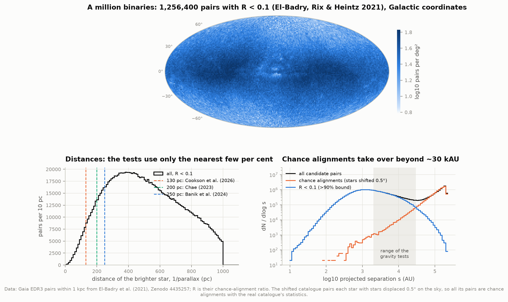
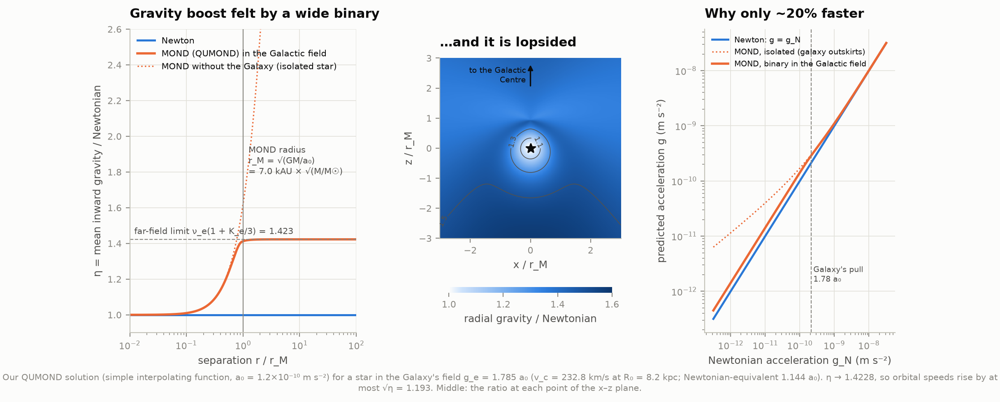
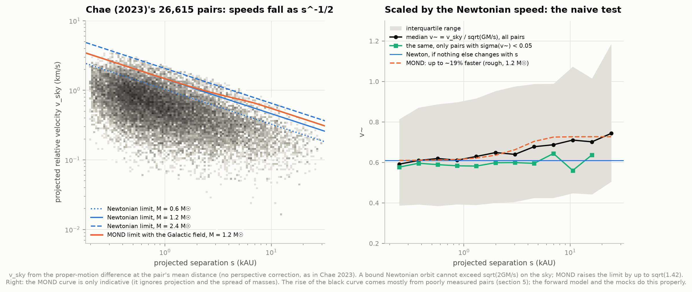
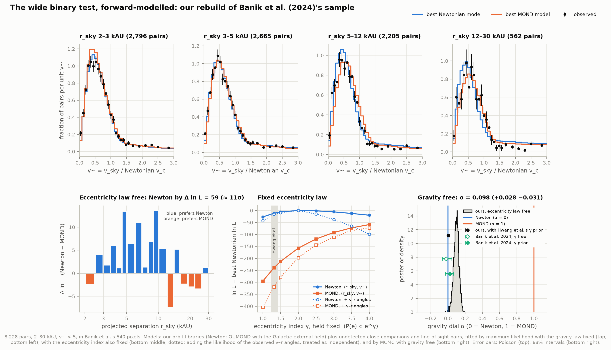
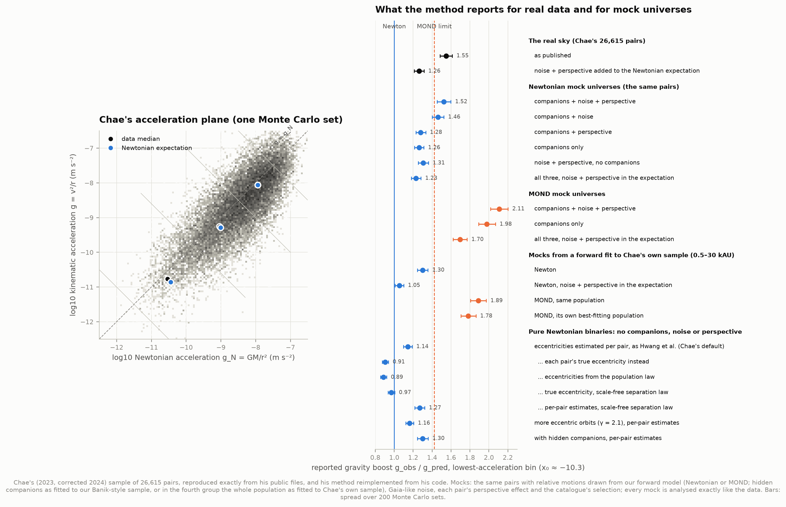
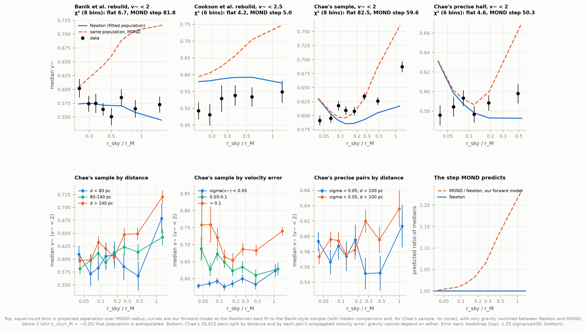
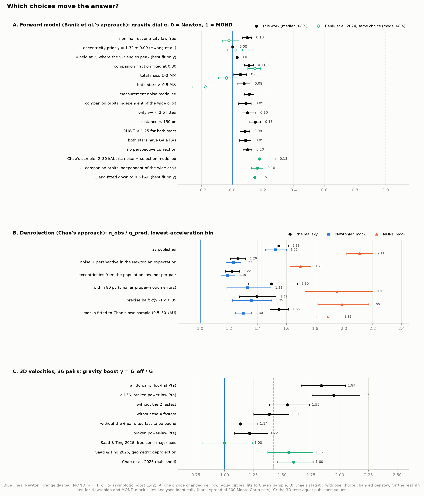
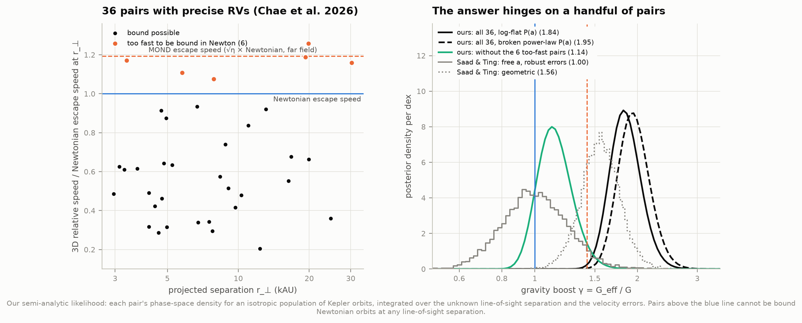

# M3 — Wide binaries: a test of gravity at low acceleration

**Two Sun-like stars 10,000 AU apart tug on each other with only ~10⁻¹⁰ m/s², the acceleration at which
galaxy rotation curves start to need dark matter. MOND, the best-known alternative, says gravity itself
strengthens there, so the widest pairs should orbit ~20% faster than Newton allows. Gaia has catalogued over
a million wide binaries, and published analyses disagree about what they show. Can we see why?**

Mostly, yes. **Both published results reproduce, and they disagree mainly because of the methods, not the
data.** Chae's statistic has no fixed Newtonian zero point, while the forward model, which fits the hidden
companions, excludes MOND in every sample we tried, Chae's included. We rebuilt the samples of the main
papers from public data, reimplemented both families of analysis, and ran each method on mock skies where
we know the answer. This reproduces a live debate; it is not a verdict on it.

- **Both results reproduce.** Chae's (2023) deprojection method, reimplemented from his code and run on his
  exact 26,615 pairs, reports a gravity boost **g_obs/g_pred = 1.55 ± 0.06** at the lowest accelerations
  (his corrected value is 1.49 ± 0.07). Banik et al.'s (2024) forward model, rebuilt from scratch and run on
  our 8,228-pair rebuild of their sample, gives a gravity dial **α = 0.003 (+0.014 −0.012)** (0 = Newton,
  1 = MOND) with the eccentricities tied to Hwang et al.'s measurement, where they found 0.024
  (+0.042 −0.054); Newton then beats MOND by 19σ, as in their headline result (but see the fourth point).
- **Chae's statistic reads 1.3–1.5 in a Newtonian universe.** We built mock skies from his own pairs in
  which every pair obeys Newton, with Gaia-like noise, perspective effects and hidden companions as fitted
  to real data. With the companions fitted to the Banik-style sample the statistic returns **1.52** (MOND:
  **2.11**); with everything fitted to Chae's own sample, **1.30** (MOND: **1.78–1.89**). The real sky gives
  1.55. Even ideal Newtonian binaries read 1.14: the per-pair eccentricities (estimated from the angle
  between each pair's separation and velocity) add a quarter on their own, partly offset by a Newtonian
  reference that assumes a scale-free population. So the statistic's Newtonian baseline is not 1, and the
  unseen companions move it by ~0.2: the sky sits on the first Newtonian mock but roughly midway between
  the Newtonian and MOND mocks of the second set. On its own, the statistic cannot decide.
- **Inside Chae's sample, the rise of ṽ with separation is a measurement effect.** The median ṽ of his
  sample rises 11% from tight to wide pairs, but within each class of velocity precision the rise
  vanishes (ratios 0.93–1.04). Poorly measured pairs have higher ṽ at every separation, and wide pairs are
  more often poorly measured.
- **The forward model's remaining freedom is the eccentricity law.** Left free, it prefers very eccentric
  orbits plus α ≈ 0.10 ± 0.03, a ~2% speed-up (on Chae's sample α = 0.16–0.18). MOND (α = 1) is excluded in
  all 15 fits (6–19σ). The pairs' own v–r angles, modelled with their companions, prefer γ ≈ 1.5–2. There
  the best-fitting α is 0.03 on the Banik-style sample, no significant gain over Newton, but 0.09–0.14 on
  Chae's sample (Δ ln P = 4–12 over Newton): a 2–3% speed-up we cannot pin on anything. Underestimated
  Gaia errors or companions our model misses could do it; it is far below MOND's 19%.
- **3D velocities (36 pairs with precise radial velocities) do not settle it yet.** Our likelihood gives
  γ = G_eff/G = 1.84 (+0.21 −0.18). Without the six pairs that are too fast to be bound in Newtonian gravity
  it gives 1.14 (+0.15 −0.12). Saad & Ting (2026) find 1.00 for all 36; no error-model choice we tried
  reproduces that.

An offline explorer (`figures/wide_binary_explorer.html`) lets you apply the cuts yourself.

| Check | This work | Published |
|---|---|---|
| El-Badry et al. (2021) candidates; with R < 0.1 | 1,817,594; 1,256,400 | 1,817,594; 1,256,400 (their Table 1) |
| Expected chance alignments, R < 0.1 / R < 0.01 | 4,614 / 873 | 4,600 / 870 |
| Pittordis & Sutherland (2023) search: parent stars, candidates, after vetoes, after Arenou cut | 2,102,656; 92,737; 81,876; 72,727 | 2,101,920; 92,677; 82,402; 73,159 |
| Banik et al. (2024) sample; with both RVs | 8,228; 5,248 | 8,611; 5,504 |
| Chae (2023) sample | 26,615 | 26,615 |
| Cookson et al. (2026) sample; best-fitting flat median ṽ | 1,220; 0.518 | 1,421; 0.489 |
| Gaia DR3 rows (parallax > 10/3 mas, G < 20) vs server counts | 8,857,051 = 8,857,051 | — |
| Galactic field g_e, its Newtonian equivalent g_Ne | 1.785 a₀, 1.144 a₀ | 1.785 a₀, 1.144 a₀ (Banik et al. 2024) |
| MOND's far-field boost η = ν_e(1 + K_e/3) | 1.4228 (numerical solution) | "just over 40%" (Banik et al.; analytic) |
| Hwang et al. (2022) eccentricities, our reimplementation | mode within 0.01 for 68% of pairs | their catalogue |
| Forward model, eccentricity law free: Newton over MOND; α; γ | Δ ln P = 59 (11σ); 0.098 (+0.028 −0.031); 2.9 ± 0.4 | 175 (19σ); −0.021 (+0.065 −0.045); 2.04 (+0.27 −0.19) |
| Forward model, eccentricity prior γ = 1.32 ± 0.09: Newton over MOND; α; γ | Δ ln P = 178 (19σ, prior included); 0.003 (+0.014 −0.012); 1.52 ± 0.08 | —; 0.024 (+0.042 −0.054); 1.47 (+0.08 −0.07) |
| Forward model, companion fraction fixed at 0.30: α | 0.109 (+0.028 −0.029) | 0.149 (+0.035 −0.048) |
| Chae's method, his sample, lowest bin; f_multi | 1.55 ± 0.06; 0.54 | 1.49 ± 0.07; 0.48 (Chae 2024a, corrected) |
| 3D test, 36 pairs, γ | 1.84 (+0.21 −0.18) (log-flat P(a)) | 1.60 (+0.17 −0.14) (Chae et al. 2026); 1.00 (+0.24 −0.19) (Saad & Ting 2026) |

---

## The physics in four steps

1. **Two stars on a Kepler orbit.** Their relative speed at separation *r* is set by the total mass *M*:
   v² = GM (2/r − 1/a). For a circular orbit v_c = √(GM/r): 0.42 km/s for two Suns 10,000 AU apart, about
   walking pace. Gaia sees only the *projected* separation on the sky, r_sky, and the *projected* relative
   velocity, v_sky (from the two stars' proper motions at their common distance), so the test works with

   > ṽ = v_sky / √(GM / r_sky)

   (Pittordis & Sutherland 2019). For a bound Newtonian orbit ṽ < √2 whatever the orientation and phase;
   typical values are 0.5–0.6. Newton has no preferred scale, so the *distribution* of ṽ would be the same
   for tight and wide pairs if the population looked the same at every scale. Slow changes with separation
   in the eccentricities, and in how common orbits of each size are, tilt it a little (section 5).
2. **MOND (Milgrom 1983)** changes gravity below a₀ ≈ 1.2 × 10⁻¹⁰ m/s²: far from a lone mass the pull falls
   as 1/r instead of 1/r², which makes flat rotation curves without dark matter (project D4 measured the
   transition scale as g† = 1.11 × 10⁻¹⁰ m/s²). It sets in beyond the **MOND radius**
   r_M = √(GM/a₀) = 7.0 kAU × √(M/M☉).
3. **But the Galaxy pulls too.** MOND is non-linear: a binary falling freely through the Milky Way's field,
   g_e = v_c²/R₀ = 1.785 a₀, feels that field in its *internal* dynamics (the "external field effect").
   Instead of growing without limit, the boost saturates: wide binaries should feel gravity 1.42× stronger
   than Newtonian and orbit √1.42 = 1.19× faster. This is a prediction without a free parameter, and dark
   matter cannot enter it, because a binary contains essentially none.
4. **The catch: impostors.** A third to a half of the stars in wide pairs may themselves have a close
   companion too faint or too near to resolve. A hidden companion adds mass the observer does not count
   (masses come from luminosity) and makes the visible star's light-centre wobble, adding velocity. Both
   inflate ṽ, as MOND would. So do measurement errors, chance alignments with unrelated stars, and sky
   geometry ("perspective": a pair receding from us seems to shrink on the sky). The whole debate is about
   how well these impostors are removed or modelled.

---

## The data

| Source | What | How |
|---|---|---|
| El-Badry, Rix & Heintz (2021) | 1,817,594 candidate pairs within 1 kpc from Gaia EDR3, with chance-alignment ratios R; a "shifted" catalogue of 517,993 pairs that can only be chance alignments | Zenodo 4435257 (1.42 + 0.35 GB), fetched as parallel byte ranges (one connection ran at 110 kB/s, six at 6 MB/s), MD5-checked |
| Hwang, Ting & Zakamska (2022) | per-pair eccentricity estimates from the v–r angle | their Google Drive file (218 MB), linked from their GitHub |
| Chae (2023, 2024a) | his 200 pc base sample (81,880 pairs with dust-corrected magnitudes, masses, Gaia DR3 RVs, Hwang eccentricities), pure-binary samples, mass–magnitude polynomials and code | Zenodo 8416435, 10062232, 10987140 |
| Gaia DR3 (ESA archive) | every source with parallax > 10/3 mas and G < 20: 8,857,051 rows in 63 sky patches, each checked against a server-side count; full rows for the 164,313 members of our own pairs | TAP, synchronous queries by source_id range |
| Chae et al. (2026), via Saad & Ting (2026) | 36 pairs with precise radial-velocity differences | github.com/seratsaad/wb3d-gamma |
| Schlegel, Finkbeiner & Davis (1998) | dust reddening maps | sfddata copy (2 × 67 MB) |
| Pecaut & Mamajek (2013), v2022.04.16 | main-sequence colours, magnitudes, masses | E. Mamajek's website |
| 17 papers | sample definitions, models, published numbers | arXiv LaTeX sources |

Total ~3.6 GB downloaded (2.1 GB of files, 1.5 GB of Gaia query results, plus 0.3 GB of paper sources).
`fetch_data.py` records each file's URL, date, size and SHA-256 in `data/provenance.json`; each Gaia
query's ADQL and service sit beside its result. The caches under `data/derived/` take another 8 GB, mostly
forward-model libraries of ~0.5 GB each; they can be deleted and are rebuilt on demand (2–5 min each).

---

## Results

### 1. A million binaries, rebuilt and checked



**El-Badry, Rix & Heintz's (2021) catalogue, recounted.** Every number in their Table 1 comes out
exactly: 1,817,594 candidate pairs, 1,256,400 with chance-alignment ratio R < 0.1, and the same split
into main-sequence and white-dwarf pairs. Summing R over the selected pairs predicts 4,614 chance
alignments among those with R < 0.1 and 873 among those with R < 0.01 (their 4,600 and 870). Their
"shifted" catalogue (every star paired with stars moved 0.5° away, so every pair is a chance alignment)
shows where contamination takes over: beyond ~30 kAU (right panel). The tests below stay inside 30 kAU.

**Three published samples, rebuilt from public data.**

| Sample | Published | Ours | How |
|---|---|---|---|
| Chae (2023), within 200 pc | 26,615 | **26,615** | from his public base file; two cuts appear only in his code (below) |
| Pittordis & Sutherland (2023) candidates (the parent of Banik et al.) | 92,677 → 82,402 → 73,159 | 92,737 → 81,876 → 72,727 | our own pair search in 8.86 M Gaia DR3 stars |
| Banik et al. (2024) | 8,611 (5,504 with both RVs) | 8,228 (5,248) | their published cuts on our search |
| Cookson et al. (2026), within 130 pc | 1,421 | 1,220 | their cuts; their colour–magnitude band and de-grouping are not fully specified |

Chae's 26,615 comes out exactly only with two cuts that are in his code (`velprofile_wb_v3.py`) but not
in the paper: pairs south of declination −28° are dropped at *every* distance whenever magnitudes are
dust-corrected (the Bayestar dust map's footprint), and a diagonal colour–magnitude line,
BP−RP > −1.222 + 0.313 M_G, removes stars below the main sequence. Banik et al.'s sample is "available on
request" only, so we rebuilt it: Pittordis & Sutherland's search (parallax > 10/3 mas, G < 17, |b| > 15°,
pairs within 50 kAU, distances within min(8 pc, 4σ), sky velocity difference < 3 km/s, no shared stars,
four cluster boxes, no faint comoving third star, Arenou et al.'s astrometric cut) and then Banik et al.'s
cuts (parallax > 4 mas, 2–30 kAU, ṽ < 5, total mass 0.464–4.31 M☉, SFD A_V < 0.5, no white dwarf,
`ipd_frac_multi_peak` ≤ 2, at least one Gaia RV, consistent RVs, and a Monte Carlo ṽ error below
0.1 max(1, ṽ/2)). The counts track theirs to 0.1–5% at every step. Running the same search against a
shifted copy of the sky predicts only **14 chance alignments** among our 8,228 pairs (0.17%), all beyond
15 kAU.

### 2. What MOND predicts for a binary in the Milky Way



We solved QUMOND for a star in the Galaxy's field ourselves (`qumond.py`). The extra "phantom" density
that MOND's modified Poisson equation adds around the star has a closed form; we expand it in Legendre
polynomials about the field direction and integrate it multipole by multipole (up to l = 192, converged to
10⁻⁴). The solution reproduces every known limit: the isolated star near the centre (ν(g_N)), the
analytic far field ν_e(1 + K_e sin²θ/2) of Banik & Zhao (2018), the angle-averaged boost
**η = ν_e(1 + K_e/3) = 1.4228** at large separations, and zero net phantom force on the star itself
(< 10⁻⁶ a₀). The boost is lopsided: 1.56× along the direction to the Galactic Centre, 1.35× across it.
Orbits were then integrated in this field (RK4, 20 revolutions, 9,900 orbits per gravity law) for nine
values of a gravity "dial" α from −0.5 to 1.5: the force is g_N + α (g_MOND − g_N), so α = 0 is Newton
and α = 1 is MOND. On the same orbits, Newtonian ṽ distributions match exact Kepler orbits (KS test
p = 0.48), and MOND raises the median ṽ of a 1.4 M☉ pair by 13% at 2–5 kAU and by 20–21% beyond 5 kAU.



Figure 3 is the naive version of the test, on Chae's sample. The median ṽ of all his pairs rises with
separation much as MOND predicts, but that of his precisely measured half stays flat; section 5 explains
why, and sections 3–4 do the test properly.

### 3. The test as Banik et al. did it: a forward model



Banik et al. predicted the whole distribution of (r_sky, ṽ), pixel by pixel, from a model of the
population, and fitted it. We rebuilt that model from scratch (`forward.py`): semi-major axes from a
broken power law, eccentricities P(e) ∝ e^γ (γ = 1 is the "thermal" distribution; larger γ means more
eccentric orbits), isotropic orientations, uniform orbital phase, total masses from the data. Every star
is, with probability f_CB, itself an unresolved pair (mass ratio ∝ q^0.4 plus 4% twins, separations
log-flat over 1.5 dex below k_CB times the wide orbit's size), and a fraction f_LOS of the pairs are
unrelated stars. One improvement: instead of treating a hidden companion's wobble as a constant velocity
(or as nothing below 3.2 AU, as they did), we fit a straight line to the light-centre's track over Gaia
DR3's 34-month baseline, as Gaia's own proper motions do.

**With the eccentricity law free, as in their nominal analysis,** the best Newtonian model beats the best
MOND model on our 8,228 pairs by **Δ ln P = 59 (≈ 11σ)**; ln P is the log-likelihood of the pixel counts,
as in Banik et al., and σ = √(2 Δ ln P). With the gravity dial free, MCMC gives
**α = 0.098 (+0.028 −0.031)**: MOND (α = 1) is excluded by ~30 standard deviations, but Newton (α = 0)
sits 3σ away too. Banik et al. found α = −0.021 (+0.065 −0.045) and Δ ln P = 175 (19σ) on their 8,611
pairs.

**The difference is the eccentricities.** Our fits want much more eccentric orbits than theirs: γ = 2.9 ± 0.4
with α free (theirs 2.04 +0.27 −0.19), and the best MOND fit runs to the edge of the allowed range,
γ = 4, while theirs stayed at 1.96 (their table 3). Very eccentric orbits spend most of their time
crawling near apocentre, which hides part of MOND's extra speed. Holding γ fixed shows how much rides on
it: Newton's advantage is Δ ln P = 268 at γ = 1, 228 at γ = 1.32, 158 at γ = 2 and 39 at γ = 4. Newton's own
best fit sits at γ ≈ 2.1, while MOND's keeps improving all the way to the edge. Hwang et al. (2022)
measured γ ≈ 1.3 for pairs of these separations, from the angle between each pair's separation and its
relative velocity (information the forward model does not use). With that measurement as a prior
(γ = 1.32 ± 0.09, one of Banik et al.'s variants) the two analyses agree:

| γ prior | Our α | Banik et al.'s α | Our Δ ln P (Newton − MOND) | Our γ |
|---|---|---|---|---|
| flat, 0–4 | 0.098 (+0.028 −0.031) | −0.021 (+0.065 −0.045) | 59 (11σ) | 2.9 ± 0.4 |
| 1.32 ± 0.09 | **0.003 (+0.014 −0.012)** | 0.024 (+0.042 −0.054) | **178 (19σ)**, including the prior | 1.52 ± 0.08 |

Our best-fitting population differs from theirs in the hidden companions (f_CB = 0.33 against their 0.63;
our companions' wobble is modelled differently, see above) and in the chance alignments (0.4% against
1.9%; our shifted-sky estimate is 0.2%). Modelling the measurement noise (α = 0.11), making the companions'
orbits independent of the wide orbit (0.09) or fixing f_CB = 0.3 (0.11; Banik et al. 0.15) barely moves α:
the eccentricity law is the choice that matters (section 6).

### 4. The test as Chae did it: deprojection



Chae (2023) took each pair's projected separation and velocity, drew a random orbital orientation and
phase, and an eccentricity from Hwang et al.'s estimate for that pair, and "deprojected" them to a 3D
separation r and speed v. The median offset of log(v²/r) from log(GM/r²), in bins of acceleration, is
compared with a Newtonian simulation of the same pairs. Hidden companions are added to a fraction
f_multi of the pairs, calibrated so that the highest-acceleration bin matches Newton.

**Reproduced.** Our reimplementation (from his published code) on his exact 26,615 pairs gives
**g_obs/g_pred = 1.55 ± 0.06** in the lowest-acceleration bin and 1.16 ± 0.03 in the middle one, with
f_multi = 0.54 (his corrected values: 1.49 ± 0.07, f_multi = 0.48; Chae 2024a, appendix). Our
reimplementation of Hwang et al.'s eccentricity estimates reproduces their catalogue (posterior mode
within 0.01 for 68% of pairs).

**But the method sees an anomaly in a Newtonian universe.** We built mock versions of Chae's sample.
Every pair keeps its separation, masses, distance, measurement errors and motion through the Galaxy, but
its relative motion comes from our forward model (the best Newtonian fit of section 3, or the same
population under MOND). It then gets Gaia-like noise, its perspective effect, Hwang-style eccentricity
estimates computed from its mock velocity, and the catalogue's selections (El-Badry et al.'s
proper-motion cut, the R < 0.01 filter). Analysed exactly like the data:

| Universe (Chae's 26,615 pairs) | g_obs/g_pred, lowest bin | f_multi |
|---|---|---|
| **The real sky** | **1.55 ± 0.06** | 0.54 |
| **Newton**: hidden companions + noise + perspective | **1.52 ± 0.07** | 0.41 |
| **MOND**: the same population | **2.11 ± 0.09** | 0.39 |
| Newton, companions only | 1.26 ± 0.05 | 0.34 |
| Newton, companions + noise | 1.46 ± 0.06 | 0.39 |
| Newton, companions + perspective | 1.28 ± 0.05 | 0.38 |
| Newton, noise + perspective, no companions | 1.31 ± 0.05 | 0.03 |
| Newton, binaries only: no companions, noise or perspective; eccentricities from Hwang et al.'s law | 1.14 ± 0.04 | 0.11 |
| the same with more eccentric orbits (γ = 2.1) | 1.16 ± 0.04 | 0.00 |
| the same with hidden companions | 1.30 ± 0.06 | 0.44 |

(± is the spread over Chae's Monte Carlo deprojections, his quoted error; each mock is one realization.)

Three things stand out. **The statistic's zero point is not 1:** binaries that obey Newton exactly, with no
companions, errors or perspective, and with eccentricities drawn from the very law the method assumes,
come out at 1.14. **Calibrating f_multi does not remove the companions:** they still add 0.10–0.16, because
our companion population is not the one the method assumes, and a companion's wobble matters more, relative
to the orbital speed, for slow wide pairs than for fast tight ones. **Measurement noise adds ~0.2:** the
Newtonian reference is noise-free while the data are not, and errors matter most for the slowest pairs.
Putting noise and perspective into the reference as well brings the real sky to 1.26 ± 0.05, the Newtonian
mock to 1.23 ± 0.05 and the MOND mock to 1.70 ± 0.07. Either way, the real sky sits on the Newtonian mock
and far below the MOND one. The same holds for subsets: within 80 pc the sky gives 1.50 ± 0.17 (Newtonian
mock 1.33 ± 0.15, MOND mock 1.95 ± 0.24), and for the precisely measured half 1.39 ± 0.13 (1.35 ± 0.14 and
1.99 ± 0.18).

**But the baseline depends on the hidden companions.** The mocks above take their companions from the
forward-model fit to the Banik-style sample: separations that scale with the wide orbit, 1–35 AU for a
10 kAU pair, whose wobble Gaia sees as a steady extra velocity. A second set of mocks takes everything from
the forward model fitted to Chae's own sample down to 0.5 kAU. There the companions are mostly 0.2–6 AU
from their star, and their wobble partly averages out over Gaia's 34 months. On those mocks the statistic
reads **1.30 ± 0.06** under Newton, **1.89 ± 0.08** under MOND with the same population and 1.78 ± 0.08
with MOND's own best-fitting one. With noise and perspective in the reference, the numbers are 1.05, 1.53
and 1.42, against 1.26 for the sky. So the Newtonian baseline moves by ~0.2 with companions that the
(r_sky, ṽ) data barely distinguish, nearly half the MOND signal. Against this second set the sky lies
roughly midway between Newton and MOND, and its median-ṽ profile too lies between the two mocks' at wide
separations. Chae's statistic cannot settle the question without knowing the companions. The forward
model, which fits them, does better on the same data (section 6): MOND is excluded at 6–8σ, though a
2–4% speed-up over the best Newtonian population remains.

**Why does pure Newton read 1.14?** We analysed the noise-free Newtonian mock three ways. With each pair's
true eccentricity (which only a mock knows) the method returns **0.91 ± 0.03**; with eccentricities drawn
from the population law, ignoring each pair's angle (Chae's "statistical" option), **0.89 ± 0.03**; with
each pair's eccentricity estimated from its own angle between separation and velocity, as Hwang et al. do
(Chae's default), **1.14 ± 0.04**. So the per-pair eccentricities alone add a quarter. The likely reason:
that angle depends on where the pair is in its orbit as much as on the orbit's shape, but the
deprojection uses the angle only to pick an eccentricity and then draws the orbital phase afresh. On
the real sky the same switch moves Chae's result from 1.55 to **1.22 ± 0.05**. Chae (2023) preferred the
per-pair estimates because statistical ones "would dilute any signature of gravity"; in the mock, they
create one.

The 0.91 for true eccentricities is a bias the other way. The Newtonian reference deprojects each observed
separation at a random orbital phase, which is right only for a scale-free population (dN/da ∝ 1/a). Real
wide binaries thin out beyond ~5 kAU, so at a given projected separation they are more often seen near
the far ends of smaller orbits, where they move slowly. In a mock with a scale-free population, the true
eccentricities give **0.97 ± 0.03** and the per-pair estimates **1.27 ± 0.05**: the two biases are separate,
and they partly cancel. Finally, the full Newtonian mock analysed with population eccentricities gives
1.19 ± 0.05, against 1.22 ± 0.05 for the real sky. **However Chae's statistic is computed, the real sky
matches the first set of Newtonian mocks.**

### 5. A model-light test: the median ṽ against separation



MOND predicts a step: pairs well beyond the MOND radius r_M should have a median ṽ about 20% higher than
pairs well inside it (bottom-right panel). Newton predicts no step, though not necessarily a flat line.
Eccentricities that grow with separation, and a separation distribution that steepens, tilt it down (our
pure-Newtonian mock of Chae's sample falls by 19% from 0.2 to 30 kAU); hidden companions and noise tilt it
up. Cookson et al. (2026) fit a flat line and MOND's step, each with a free normalization, to the binned
medians. The same test on our samples (top row; the step's shape is MOND over Newton in our forward model):

| Sample (ṽ cut) | Pairs | χ², flat (Newton) | χ², MOND's step | Bins |
|---|---|---|---|---|
| Our rebuild of Banik et al. (ṽ < 2) | 8,228 | 6.7 | 82 | 8 |
| Our rebuild of Cookson et al. (ṽ < 2.5) | 1,220 | 4.2 | 5.0 | 6 |
| Cookson et al. (2026), their sample (ṽ < 2.5) | 1,421 | 2.5 | 15.1 | 6 |
| Chae's sample, its precisely measured half, σ(ṽ) < 0.05 (ṽ < 2) | 14,611 | 4.6 | 50 | 6 |
| Chae's sample, all (ṽ < 2) | 26,615 | 83 | 60 | 8 |

Two of our samples clearly prefer the flat line. Our rebuild of Cookson et al.'s sample cannot tell the
two apart: its median ṽ creeps up from 0.49 to 0.55, between the two curves. Their own sample gave
Δχ² = 12.6 for Newton, and we cannot say which of the pairs that differ between the two samples make the
difference.

**Chae's full sample fits neither**: its median ṽ rises by 11% from tight to wide pairs, but not with
MOND's shape. That rise depends on how well the velocities are measured, which gravity cannot know
(bottom row):

| Chae's pairs (ṽ < 2) | Median ṽ, wide pairs (s ≳ 4 kAU) over tight ones (s ≲ 0.8 kAU) |
|---|---|
| all | 1.11 ± 0.02 |
| within 80 pc / 80–140 pc / beyond 140 pc | 1.10 ± 0.06 / 1.06 ± 0.02 / 1.14 ± 0.02 |
| velocity error σ(ṽ) < 0.05 / 0.05–0.1 / > 0.1 | 1.04 ± 0.03 / 0.93 ± 0.03 / 0.99 ± 0.04 |

Within each precision class the rise disappears. At every separation, poorly measured pairs have higher
ṽ than well-measured ones (bottom-middle panel), and wide pairs are more often poorly measured: their
velocities are smaller, so the same proper-motion error is a larger fraction of them. Mixing the classes
makes a rise. The distance split points the same way, more weakly (1.14 beyond 140 pc against 1.06 at
80–140 pc).

### 6. Which choices move the answer?



Each method has one choice that matters far more than all the others.

**The forward model: the eccentricity law.** One choice changed at a time (Banik-style sample unless noted;
our medians with 68% intervals, Banik et al.'s modes with 68% intervals from their table 4):

| Choice | Pairs | Our α | Banik et al.'s α |
|---|---|---|---|
| nominal: eccentricity law free | 8,228 | 0.10 ± 0.03 | −0.02 (+0.07 −0.05) |
| eccentricity prior γ = 1.32 ± 0.09 (Hwang et al.) | 8,228 | **0.003 ± 0.013** | 0.02 ± 0.05 |
| γ held at 2, where the v–r angles peak (best fit only) | 8,228 | 0.03 | — |
| companion fraction fixed at 0.30 | 8,228 | 0.11 ± 0.03 | 0.15 (+0.04 −0.05) |
| total mass 1–2 M☉ | 6,029 | 0.05 ± 0.04 | −0.04 (+0.08 −0.05) |
| both stars > 0.5 M☉ | 4,903 | 0.08 ± 0.04 | −0.18 (+0.06 −0.08) |
| measurement noise modelled | 8,228 | 0.11 ± 0.03 | — |
| companion orbits independent of the wide orbit | 8,228 | 0.09 (+0.03 −0.05) | — |
| only ṽ < 2.5 fitted | 8,228 | 0.10 (+0.05 −0.04) | — |
| distance < 150 pc | 3,186 | 0.15 ± 0.04 | — |
| RUWE < 1.25 for both stars | 6,332 | 0.08 ± 0.03 | — |
| both stars have Gaia RVs | 5,248 | 0.09 ± 0.04 | — |
| no perspective correction | 8,238 | 0.10 ± 0.03 | — |
| Chae's sample, 2–30 kAU, its noise and selection modelled | 7,647 | 0.18 (+0.10 −0.04) | — |
| … companion orbits independent of the wide orbit | 7,647 | 0.16 ± 0.04 | — |
| … and fitted down to 0.5 kAU (best fits only, capped optimiser) | 20,238 | 0.15 | — |

MOND (α = 1) is excluded in every row, by 6–19σ in likelihood. With the eccentricity law free, every row
prefers very eccentric orbits (γ = 2.3–3.4) and a small positive α; with the law pinned to Hwang et al.'s
measurement, α vanishes.

**So which eccentricity law is right?** The angle between each pair's separation and its velocity carries
the eccentricity information that the (r_sky, ṽ) fit ignores. Hwang et al.'s γ ≈ 1.3 came from that angle,
but without modelling hidden companions, which make the angles look more random; Banik et al. argued it
could therefore be an underestimate. We scored the observed angle distribution of the same 8,228 pairs
against each fixed-γ population of the forward model, with its companions and the data's velocity errors
(fig. 4, bottom middle). For Newtonian populations the angles prefer **γ ≈ 1.5–2**: relative to γ = 2,
Δ ln L = −4 at γ = 1.32, −32 at γ = 3 and −79 at γ = 4 (Monte Carlo noise ±1.6). That agrees with the
γ ≈ 2.1 the (r_sky, ṽ) fit prefers on its own under Newton. Adding the two likelihoods, Newton's best
(γ = 2) beats MOND's best (γ = 4) by Δ ln L = 73 (12σ). At γ = 2 the best-fitting gravity dial is
**α = 0.03**, which improves the fit over α = 0 by only Δ ln L ≈ 1 (at γ = 1.5 it is 0.00, at γ = 2.5
0.07). The small α of the free fit was the price of eccentricities that the angles strongly disfavour.
**Chae's sample keeps more of it:** with its noise and selection modelled (2–30 kAU), the best α is 0.09 at
γ = 1.5 and 0.14 at γ = 2, better than α = 0 at the same γ by Δ ln P = 4.2 and 12. We did not run the angle
test on his sample, whose larger errors would blur the angles.

**Chae's method: the per-pair eccentricities and the Newtonian reference.** Every choice we varied moves
the real sky's statistic and the Newtonian mock's together (panel B): as published 1.55 against 1.52;
noise and perspective in the reference 1.26 against 1.23; population eccentricities 1.22 against 1.19;
within 80 pc 1.50 against 1.33; the precise half 1.39 against 1.35. The MOND mock sits at 1.70–2.11 in the
four of these where we ran it. What does move the Newtonian mock is its companion population: mocks fitted
to Chae's own sample read 1.30 under Newton and 1.89 under MOND (last row), with the sky in between.

**The 3D test: which pairs are kept.** Dropping the six pairs that are too fast to be bound moves γ from
1.84 to 1.14; every error-model choice we tried moves it by less than 0.2 (panel C).

### 7. Three dimensions: 36 pairs with precise radial velocities



Chae et al. (2026) compiled 36 pairs (3–30 kAU, within 150 pc) with precise radial velocities for both
stars, often from different instruments and epochs; the quoted error of the velocity difference is
3–100 m/s (median 47 m/s). Then the third velocity component is known, and only the separation along the
line of sight is missing. We wrote a semi-analytic likelihood (`threed.py`): for an isotropic
population of Kepler orbits with a semi-major-axis law P(a) and Saad & Ting's eccentricity law, the
probability density of each pair's observed projected separation and 3D velocity, integrated over the
unknown line-of-sight separation and over the velocity and mass errors, with gravity scaled by
γ = G_eff/G (MOND's far-field value is η = 1.42). Injection tests on synthetic 36-pair samples recover
γ = 1.0 as 1.04 ± 0.08 and γ = 1.6 as 1.67 ± 0.13 (mean ± scatter of eight samples).

On the real pairs, **γ = 1.84 (+0.21 −0.18)** with a log-flat P(a), or 1.95 (+0.23 −0.19) with a broken
power law. That is closer to Chae et al.'s 1.60 (+0.17 −0.14) than to Saad & Ting's 1.00 (+0.24 −0.19).
**The answer is decided by six pairs** that move faster than the Newtonian escape speed at their projected
separation (left panel). No bound Newtonian orbit can produce them, whatever their line-of-sight
separation, so a Newtonian model has to treat them as something else (a hidden companion, an RV zero-point
error, a recently perturbed pair). Dropping the fastest pairs moves γ from 1.84 to 1.55 (two dropped),
1.39 (four) and **1.14 (+0.15 −0.12)** (all six). Changing the error model barely matters: a free systemic
velocity for each pair gives 1.89–1.91, ignoring perspective 1.98, Student-t RV errors with extra
proper-motion jitter 1.80, Saad & Ting's whole error model (free systemic velocities, Student-t RVs and
jitter together) 1.76, dropping the v–r
angle information 1.95, and an explicit outlier population (uniform in velocity up to 3 km/s) 1.95, with no
pair assigned to it.

Saad & Ting's own "geometric deprojection" variant gives 1.56, close to ours. Their baseline (1.00) differs
from that variant only in how the orbit's size is parameterised: each pair's semi-major axis is a free
parameter with a population prior. In a population likelihood like ours that choice should not matter if
the priors are the same, and with their broken power-law prior we get 1.95, so the source of the
difference is still open. With 36 pairs, the 3D test is only as good as the treatment of its few fastest
pairs. Repeated spectra matter here: Pasquini et al. (2026) found 12 of 26 wide pairs observed several
times with ESPRESSO to be RV-variable, i.e. to hide close companions. Saglia et al. (2025) found HARPS 3D
velocities of 32 wide pairs broadly Newtonian.

### 8. The explorer

`figures/wide_binary_explorer.html` (offline; open in any browser) lets you pick a sample (our rebuilds of
Chae's, Banik et al.'s and Cookson et al.'s), tighten its distance, precision, RUWE and ṽ cuts, and watch
the median ṽ against separation, the ṽ distributions of tight and wide pairs, and their ratio respond,
against the Newtonian and MOND expectations.

---

## Caveats

- **This reproduces a live debate; it is not a verdict.** Our forward model and our mock universes are
  models too. The mock tests show that Chae's statistic is far from neutral, and that its value for the
  real sky is what our Newtonian population produces. They cannot prove that our population is the right
  one: its companions were fitted at 2–30 kAU on the Banik-style sample and are extrapolated below 2 kAU,
  where Chae's method calibrates. With a population fitted to Chae's own sample down to 0.5 kAU the
  Newtonian mock reads 1.30 instead of 1.52, so the statistic's Newtonian baseline is uncertain by ~0.2.
  That fit is a capped maximum-likelihood fit without MCMC (its likelihood is ten times slower).
- **Our forward-model α is small but not zero** while the eccentricity law is free (0.10 ± 0.03 on the
  Banik-style sample, 0.16–0.18 on Chae's). That is a speed-up of ~2–4% for the widest pairs, not MOND's 19%.
  On the Banik-style sample it comes with very eccentric orbits (γ ≈ 3) that the pairs' own v–r angles
  disfavour, and it goes away when γ is held where the angles prefer. On Chae's sample 0.09–0.14 remains at
  those γ (section 6). Effects we did not model could produce it: Gaia errors larger than quoted, companions
  whose frequency or separation changes with the wide orbit, pairs perturbed near the Galactic tidal limit,
  and residual selection effects.
- **The v–r angle check is approximate.** It scores the binned |cos ψ| of the same pairs in three separation
  ranges, conditional on r_sky and ṽ < 2, for the best (r_sky, ṽ) fit at each fixed γ, and adds that to the
  (r_sky, ṽ) likelihood as if the two were independent, which they are not exactly. Its Monte Carlo noise
  is ±1.6 in ln L.
- **Our gravity dial differs from Banik et al.'s.** Both are 0 for Newton and 1 for MOND, but ours
  interpolates the force and theirs the predicted distributions. Near α = 0 both scale with the asymptotic
  speed-up (≈ 0.21 α for ours, 0.19 α for theirs).
- **Rebuilt samples are not the published ones.** Ours match the counts to 0.1–5% (exactly for Chae), but
  not pair by pair. Banik et al.'s and Cookson et al.'s lists are not public, and some of their steps (the
  colour–magnitude band, Cookson et al.'s de-grouping of crowded systems) are not fully specified. On our
  rebuild of Cookson et al.'s sample, their median-ṽ test does not separate Newton from MOND (section 5),
  unlike on theirs.
- **The MOND tested is QUMOND with the simple interpolating function and a₀ = 1.2 × 10⁻¹⁰ m/s²**, as in
  Banik et al. The Galactic field is the circular-speed value 1.785 a₀; Gaia's measured acceleration of the
  Solar System, 1.93 ± 0.13 a₀ (Gaia Collaboration, Klioner et al. 2021), would strengthen the field and
  weaken the boost slightly. AQUAL gives
  nearly the same boost (Banik et al. 2024, their fig. 6).
- **The binary is a test particle orbiting the total mass** (Banik & Zhao 2018's approximation), and orbits
  are followed for 20 revolutions in a fixed Galactic-field direction.
- **Masses come from luminosities** through one main-sequence relation (Banik et al.'s cubic with their
  FLAME correction, or Chae's polynomial for his sample). The test divides out the Newtonian prediction, so
  a mass bias that does not depend on separation cancels.
- **The 3D test rests on 36 pairs**, compiled from many spectrographs, and on six of them in particular.
  Those six are faster than Newtonian escape at their projected separation, which a hidden companion, an RV
  zero-point offset between instruments or a perturbed orbit could also cause. We could not find the source
  of the difference from Saad & Ting's 1.00. Their whole error model inside our likelihood gives 1.76, and
  their own two variants (1.00 and 1.56) differ in how the semi-major axis is parameterised, which in a
  population likelihood like ours should not matter if the priors are the same.

## How to reproduce

```bash
cd 53-wide-binaries
../.venv/bin/python run.py            # fetch, analyse, draw: ~8-10 h on a busy 16-core machine the first time
../.venv/bin/python run.py --quick    # skip the eleven forward-model variants
../.venv/bin/python figures.py        # redraw the figures from cached results (minutes)
../.venv/bin/python interactive.py    # rebuild the explorer
../.venv/bin/python -m pytest test_physics.py -q
```

Every step caches its output under `data/derived/` (results as JSON in `data/derived/results/`, a summary
in `data/results.json`), so a second run takes minutes. The code needs numpy, scipy, astropy, numba, emcee
and matplotlib (all in the shared venv); the SFD dust maps are read straight from their FITS files. Seeds
are fixed, so reruns give the same numbers. The MCMC chains (32 walkers, 1,500–2,500 steps) are 20–40
autocorrelation times long: enough for medians and 68% intervals, though shorter than emcee's
50-autocorrelation-time rule of thumb.

## Files

| File | What it does |
|---|---|
| `config.py` | paths, constants, the random seed, Zenodo file list and checksums |
| `fetch_data.py` | downloads (parallel byte ranges, MD5 checks, provenance with SHA-256) |
| `gaia_tap.py`, `gaia_queries.py`, `verify_gaia_counts.py` | Gaia DR3 queries by source_id range, cached, checked against server-side counts |
| `elbadry.py` | slim copies of El-Badry et al.'s catalogue and its shifted twin; their Table 1 counts |
| `pairs.py` | Pittordis & Sutherland's (2023) pair search, on the real and on a shifted sky |
| `samples.py` | the published samples rebuilt: Chae (2023), Banik et al. (2024), Cookson et al. (2026) |
| `masses.py` | mass–luminosity relations (Banik et al.'s cubic + FLAME correction, Chae's polynomials, Pecaut & Mamajek) |
| `kinematics.py` | sky velocities with perspective removed, ṽ, Monte Carlo ṽ errors from the full covariance |
| `qumond.py` | QUMOND for a star in the Galactic field: phantom density, multipole solution, η |
| `orbits.py` | orbit libraries for nine force laws between Newton and MOND (numba RK4) |
| `forward.py`, `fit.py` | the forward model of (r_sky, ṽ) with hidden companions and chance alignments; maximum likelihood and MCMC |
| `chae.py` | Chae's deprojection method, reimplemented from his code |
| `hwang.py` | Hwang et al.'s eccentricity estimates from the v–r angle, reimplemented |
| `injection.py` | mock skies of Chae's sample (Newton or MOND, companions, noise, perspective, selection) |
| `threed.py` | the 3D likelihood for the 36 pairs, its variants and injection tests |
| `analysis.py` | every analysis, each cached as JSON |
| `figures.py`, `plotstyle.py` | the eight figures |
| `interactive.py` | the offline explorer |
| `run.py` | runs everything |
| `test_physics.py` | checks: Galactic field, QUMOND limits, Kepler orbits, mass inverse, perspective, deprojection prior |

## References

- Arenou, F., Luri, X., Babusiaux, C., et al. 2018, A&A 616, A17 — Gaia DR2 catalogue validation (the astrometric cut)
- Banik, I. & Zhao, H. 2018, MNRAS 480, 2660 — Testing gravity with wide binary stars like α Centauri
- Banik, I., Pittordis, C., Sutherland, W., et al. 2024, MNRAS 527, 4573 — Strong constraints on the gravitational law from Gaia DR3 wide binaries
- Chae, K.-H. 2023, ApJ 952, 128 — Breakdown of the Newton–Einstein standard gravity at low acceleration in internal dynamics of wide binary stars
- Chae, K.-H. 2024a, ApJ 960, 114 — Robust evidence for the breakdown of standard gravity at low acceleration from statistically pure binaries free of hidden companions
- Chae, K.-H., Lee, B.-C., Hernandez, X., et al. 2026, arXiv:2601.21728 — the 36 wide binaries with precise radial velocities
- Cookson, S. A., Banik, I., El-Badry, K., et al. 2026, MNRAS 547 — A quality framework for testing gravity with wide binaries: no evidence for MOND (arXiv:2602.24035)
- El-Badry, K., Rix, H.-W. & Heintz, T. M. 2021, MNRAS 506, 2269 — A million binaries from Gaia eDR3
- Gaia Collaboration, Klioner, S. A., et al. 2021, A&A 649, A9 — the acceleration of the Solar System from Gaia EDR3
- Gaia Collaboration, Vallenari, A., et al. 2023, A&A 674, A1 — Gaia Data Release 3
- Hwang, H.-C., Ting, Y.-S. & Zakamska, N. L. 2022, MNRAS 512, 3383 — The eccentricity distribution of wide binaries and their individual measurements
- Milgrom, M. 1983, ApJ 270, 365; Milgrom, M. 2010, MNRAS 403, 886 (QUMOND)
- Pasquini, L., Saglia, R., Patat, F., et al. 2026, A&A 707 — Wide binaries without viable bound Newtonian orbits (arXiv:2602.04661)
- Pecaut, M. J. & Mamajek, E. E. 2013, ApJS 208, 9
- Pittordis, C. & Sutherland, W. 2019, MNRAS 488, 4740; 2023, OJAp 6, 4
- Saad, S. M. & Ting, Y.-S. 2026, arXiv:2603.11015 — No gravitational anomaly in wide binaries from forward modeling of 3D orbits
- Saglia, R., Pasquini, L., Patat, F., et al. 2025, A&A 699, A151 — Testing gravity with wide binaries: 3D velocities from Gaia and HARPS
- Schlegel, D. J., Finkbeiner, D. P. & Davis, M. 1998, ApJ 500, 525

Further reading (read for this project, not used directly): Chae (2025, arXiv:2508.11996); Chae & Yoon
(2026, arXiv:2607.14450); Yoon, Tian & Chae (2025, arXiv:2507.13177) on perspective effects; Makarov
(2025, arXiv:2512.25002); Pittordis, Sutherland & Shepherd (2025, arXiv:2504.07569); Saad & Ting (2025,
arXiv:2512.19652).

Data credits: Gaia (ESA, processed by DPAC); El-Badry et al., Hwang et al., Chae, Chae et al. and Saad &
Ting for their public catalogues, samples and code.
