# M5 — Stars that touch, trade mass and merge

**Close binary stars can swell until they touch, share one envelope, and spiral into a single star. Can we find
contact binaries by the hundred thousand, follow a merger that was watched as it happened, and learn from a merger
prediction that failed?**

Yes, and the failure turned out to be the most instructive part. This project rebuilds five stories from public data:

* **The shape of a contact binary.** Each star in a binary has a teardrop-shaped zone, its Roche lobe, inside which
  its own gravity wins. Stars that overfill both lobes share one peanut-shaped envelope and vary in brightness all the
  time, because we see the peanut side-on, then end-on. Our own ray tracer turns that geometry into a light curve.
* **Contact binaries by the hundred thousand.** 369,578 of them in the Zwicky Transient Facility (ZTF), 642,329
  contact-like candidates in Gaia DR3: their periods stop abruptly near 0.227 days, and their periods tell their
  luminosities well enough to measure distances across the Galaxy.
* **A merger that did not happen.** KIC 9832227 was predicted (Molnar et al. 2017) to merge in 2022.2 ± 0.7 and flare
  up as a naked-eye "red nova". We measured its eclipse times ourselves from 1999 to 2025 and found exactly how one
  number, an eclipse time from 1999 read with the wrong half-day convention, manufactured the prediction.
* **A merger that did.** V1309 Scorpii was a contact binary watched by OGLE for six years before it erupted in 2008. From
  the published photometry its orbit shrank by 1.2%, and its light curve changed shape as the stars merged.
* **A white dwarf feeding on a giant.** T Coronae Borealis, which erupted as a nova in 1866 and 1946, has been expected
  to erupt again since 2023. In 950,000 AAVSO observations up to the evening of 2026 October 9, it has not.

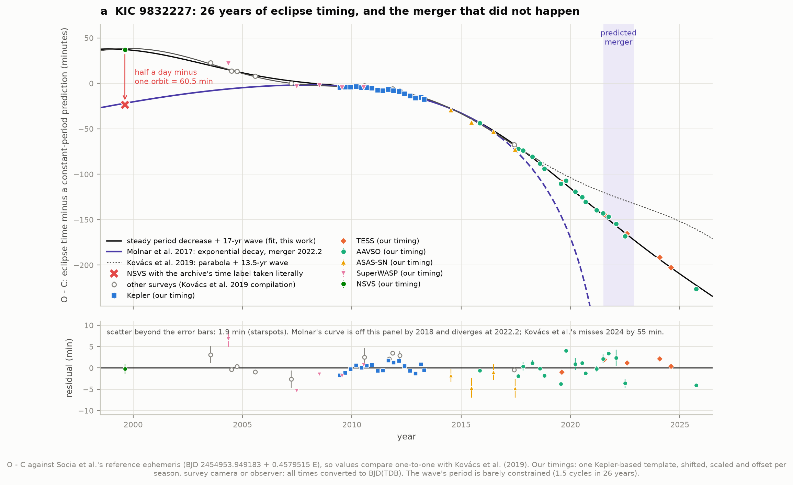

**KIC 9832227 over 26 years.** Each point says how early (down) or late (up) the eclipses came compared with a
constant period. The purple curve is the published merger prediction: it runs through the 1999 point read with the
wrong time convention (red X) and plunges towards a merger in 2022. The real 1999 point (green) sits an hour higher,
and the eclipses since 2017 (TESS, AAVSO) follow a gentle curve: the period shrinks slowly and steadily, by about a
second in fourteen years. The star is still there.

## What we found, in short

- **Our Roche model works.** Lobe volumes match Eggleton's (1983) formula to 0.8%; a ray-traced limb-darkened sphere
  matches the analytic flux to 0.03%; and with Molnar et al.'s published parameters for KIC 9832227 (mass ratio 0.228,
  inclination 53.2°, fill-out 0.43) the model's amplitude is **0.194 mag against Kepler's measured 0.195 mag**.
- **The period edge.** ZTF's contact binaries pile up towards short periods and then stop: the edge (midpoint of a
  fitted step) is at **0.2272 days (5.45 hours)**, the same within 1% in every slice of apparent magnitude from 12.5
  to 20.5 (so it is not a survey limit), and at 0.2247 d in Gaia's own contact-like candidates. Rucinski (2007) put it at
  0.215–0.22 d from ASAS. Only 1% of the systems lie below 0.225 d, and the 367 below 0.21 d with Gaia parallaxes
  (parallax/error > 5) are **red dwarf pairs** (median M_G = 8.2, against 5.5 for periods of 0.25–0.30 d).
- **A volume-limited view.** Within 1 kpc the distribution peaks at **0.28 days**, right next to the edge (Rucinski:
  0.27 d); the magnitude-limited sample peaks at 0.34 d because bright, long-period systems are seen from farther away.
- **Gaia agrees but cannot look below 0.2 d.** 74% of ZTF's contact binaries are in Gaia DR3's eclipsing-binary table,
  and 98.4% of those have the same period within 1%. Gaia's period search stopped at 0.2 days exactly.
- **Period–luminosity relation.** Chen et al.'s (2018) W1 relation is reproduced exactly from their own table
  (M_W1 = −5.830 log P − 0.050). The same stars with **Gaia DR3 parallaxes** give **M_W1 = −6.13 ± 0.17 log P −
  0.19 ± 0.07**, and the scatter drops from 0.163 to 0.139 mag: one contact binary gives its distance to **6.4%**.
  Calibrated on those 153 bright stars, the relation predicts the parallaxes of **41,386 independent ZTF contact
  binaries** to a mean ratio of **1.0003 ± 0.0001**.
- **Survey selection shows up in the slope.** Fitted directly in ZTF, the slope depends on distance (−3.7 within 500 pc,
  where ZTF saturates on bright long-period stars; −6.2 to −6.0 at 0.5–1.2 kpc; flatter beyond, where only bright stars
  keep good parallaxes). A distance indicator must be calibrated on a sample whose selection does not cut through it.
- **261,725 contact binaries placed in the Galaxy** with an extinction-free Wesenheit relation, median distance 3.1 kpc,
  90% within 6.4 kpc, checked against 48,023 Gaia parallaxes (median ratio 0.977, scatter 11%).
- **KIC 9832227: the mistake reproduced from raw data.** The 1999 survey (NSVS) times are labelled "JD − 2400000" in
  their archive but hold MJD = JD − 2400000.5; Molnar et al. used the Kepler catalogue's convention "MJD = JD − 2400000.0".
  Taking the label literally moves our NSVS eclipse time by **60.55 minutes** (half a day minus one 0.458-day orbit:
  60.55 min expected). With that point, an exponential "merger" law fitted to the data Molnar et al. had gives
  **t0 = 2021.3 (+0.9/−0.7)** and fits to 0.8 min; Molnar et al. found 2022.2 ± 0.7. With the correct time the law needs
  3.5 min of extra scatter at best and no longer gives a merger date at all, while a smoothly changing period fits to 0.8
  min. Socia et al. (2018) found the error; our NSVS time agrees with theirs (+36.9 ± 1.3 min vs their +42).
- **And after the prediction.** 49 timings of our own (NSVS, SuperWASP, Kepler, ASAS-SN, AAVSO, TESS) span 1999.6–2025.7
  and agree with Kovács et al.'s (2019) compilation to 1.98 min rms. The period is **0.45793680 d in 2025 against
  0.45794891 d in 2011: 1.05 seconds shorter**. A steady decrease (Ṗ = −2.0 × 10⁻⁹) plus a 17-year, 13-minute wave
  (perhaps an unseen third star, perhaps magnetic cycles) fits 26 years to 1.9 minutes. Even the cautious 2019 model of
  Kovács et al. misses the 2024 TESS timing by 55 minutes: O − C extrapolations are fragile however they are done.
- **V1309 Sco: a merger watched.** From the 1,344 pre-discovery OGLE points, our 17 periods match Tylenda et al.'s
  (2011) to a median of 0.13 seconds. The orbit shrank by **1.23%** between 2002 and 2007; fitting Tylenda's law
  P = P0 exp(c/(t − t0)) to our periods gives **t0 = 2010.19 ± 0.59** (theirs: 2010.10), and to our eclipse timings
  2010.50 ± 0.25. The brightening began on **2008.22 (late March 2008)**, about two years before t0, as Tylenda et al.
  said. The light curve changed: the two-eclipses-per-orbit signal fell from 0.12 to 0.03 mag while a one-hump signal
  grew to 0.18 mag, as gas leaving the system began to shroud it.
- **T CrB: still waiting.** 884,443 AAVSO observations in the bands we use, 1866 to 2026 October 9 19:40 UT. The 1946 eruption fell
  2 and 3 magnitudes in **3.3 and 5.0 days** (Schaefer 2023: 3.0 and 5.0) and had a second, fainter brightening at day
  159 (day 148 in 1866). AAVSO's record before 1946 is almost entirely one observer, Leslie Peltier, who saw the
  pre-eruption fading in 1945. Today B = 11.7, near its quiescent level, after the 2015–2023 high state, the 2023–24
  fading and the 2024–25 recovery. The red giant's tidal distortion shows as a 0.37-mag double wave every 227.6 days,
  and the minimum when its inner face is in view is 0.07 mag shallower: the white dwarf and disc heat that face.
  Recurrence statistics alone (Pei et al. 2026) give 17% for the rest of 2026 and 60% within twelve months.
- **False alarms are part of the data.** In the past year at least five visual reports put T CrB at magnitude 4.1–4.8,
  each contradicted the same night by other observers near 10; four more (all 4.9, one observer) arrived on October 9.
  And one validated 1946 estimate (5.1 mag, four days before the eruption began) is almost certainly misdated.

---

## Build your own contact binary

Open **[`figures/contact_binary_explorer.html`](figures/contact_binary_explorer.html)** (offline, no libraries). Drag
the mass ratio, fill-out and inclination: the binary is ray-traced from the Roche potential in your browser (a
JavaScript port of `roche.py`) and its light curve is computed from the images. Lay the model over KIC 9832227's Kepler
light curve or V1309 Sco's progenitor in 2002, 2004, 2006 and 2007, and watch where a spotless model can and cannot
follow a real star. Presets: KIC 9832227 (Molnar et al. 2017), V1309 Sco in 2002 (Zhu et al. 2016's q = 0.094 and
f = 0.90, our inclination 69° matched to the amplitude), equal twins, an extreme mass ratio.

---

## 1. Roche lobes: how close can two stars get?

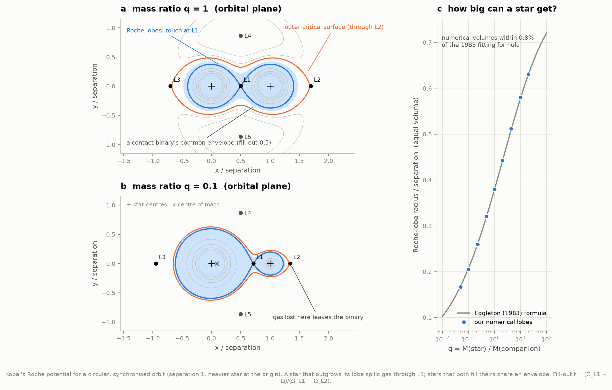

In the frame that rotates with the orbit, gas feels the gravity of both stars plus a centrifugal push. Surfaces of
equal effective potential (Kopal's Ω) are the shapes a star in equilibrium can take. Close to each star they are
spheres; farther out they stretch towards the companion until, at the **inner Lagrange point L1**, the two lobes touch.
A star that outgrows its lobe pours gas through L1 onto its companion (that is how the *Algol paradox* happens: the
less massive star in Algol is the more evolved one, because it has given most of its mass away). If both stars fill
their lobes they share an envelope between the inner critical surface and the outer one through **L2**; beyond that,
gas leaves the binary altogether. The **fill-out factor** f places a contact binary's surface between the two: 0 just
touching, 1 at the brink of losing gas through L2.

For equal masses (a) L1 sits midway and L2 and L3 lie 0.698 separations beyond each star; for q = 0.1 (b) the smaller star
has a lobe only a third the size of its companion's. Our numerical lobe volumes (c) match Eggleton's (1983) fitting
formula to within 0.8% everywhere, its stated accuracy being 1%.

## 2. Why contact binaries never stop varying

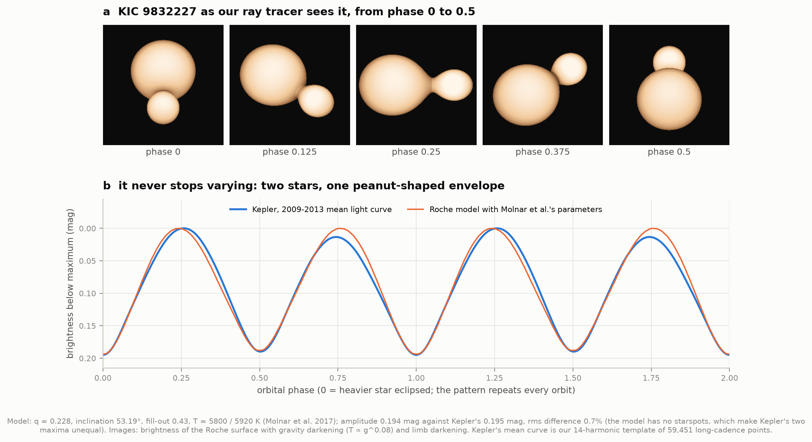

`roche.py` ray-traces the stars' common surface. Each pixel's ray is marched from the observer until it enters the
envelope; there the surface normal and the local gravity follow from the potential's gradient. Temperature follows
gravity (T ∝ g^0.08, the law Lucy 1967 derived for convective envelopes: the narrow neck has low gravity and is
darker), and intensity follows Planck's law with limb darkening. Summing each image gives the light curve.

Viewed at KIC 9832227's inclination of 53°, the peanut is brightest side-on (phases 0.25 and 0.75) and faintest when
one star is in front of the other. With Molnar et al.'s parameters the model reproduces the amplitude of Kepler's mean
light curve (0.194 vs 0.195 mag) and the depth difference of the two minima; what it cannot do is the 0.013-mag
difference between the two maxima, an O'Connell effect from starspots that our spotless model does not include. A
sphere test (`test_physics.py`) checks the integration against the analytic flux of a limb-darkened star to 0.03%.

## 3. Contact binaries by the hundred thousand: the 0.22-day edge

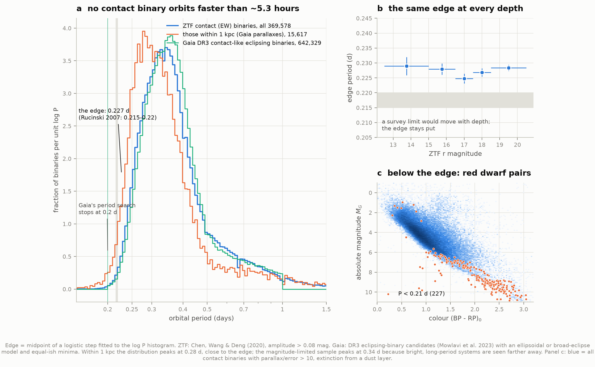

The ZTF catalogue of periodic variables (Chen, Wang & Deng 2020) classifies **369,707 EW-type (W Ursae Majoris)
binaries** among 781,602 variables; 369,578 have amplitudes above 0.08 mag (their selection). Their periods pile up
towards short values and stop. A logistic step fitted to the histogram puts the **edge at 0.2272 days** (width 0.025 in
log P), and it does not move with apparent magnitude (b: 0.2248–0.2289 d from r = 12.5 to 20.5). A survey limit would
move with depth; a property of the stars does not. Only 0.1% of the binaries have P < 0.199 d.

Why there is an edge is still debated. Rucinski (1992) tried to explain it as the point where the stars become fully
convective; Stępień (2006) argued that the shortest-period systems are those whose magnetic braking is too slow to
have shrunk them within the age of the Galaxy. What we can say is what lies below it (c): the 367 sub-edge systems with
parallaxes better than 20% are faint and red, M_G = 8.2 and (BP − RP)₀ = 1.96 at the median, red-dwarf pairs on
the extension of the contact-binary sequence; 6.5% are luminous and blue, probably δ Scuti stars or blends misclassified as binaries.

Gaia DR3's eclipsing-binary candidates (Mowlavi et al. 2023), from a completely different instrument and pipeline,
show the same edge in their contact-like subset (0.2247 d). They cannot test what lies below: **Gaia's period search
stopped at 0.2 days** (the shortest period in its table is 0.2000028 d). 273,355 ZTF contact binaries have a Gaia EB
entry, and their periods agree for 98.4%.

The two samples also show how much selection shapes a distribution: within 1 kpc (orange, volume-limited) the peak is
at 0.28 d, against 0.34 d for the whole magnitude-limited sample, because a longer-period contact binary is more
luminous and is seen out to a larger volume.

## 4. The period tells the luminosity

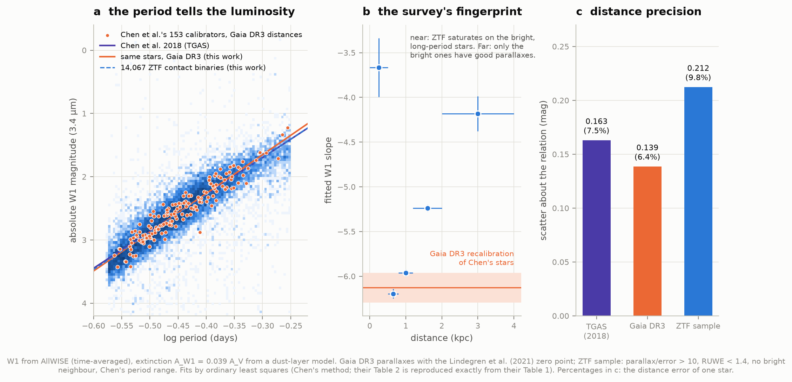

Kepler's third law fixes a contact binary's separation from its period and mass; the stars fill that space, so their
size, temperature and hence luminosity are tied to the period. Chen et al. (2018) calibrated the relation in 12 bands
on 183 nearby W UMa stars with Tycho–Gaia (TGAS) parallaxes. Their Table 2 is reproduced exactly from their Table 1 by
ordinary least squares (W1, the WISE 3.4-µm band: −5.830 log P − 0.050, scatter 0.171 mag; V, G and W1 at maximum
likewise; their G-band mean relation comes out 0.1 steeper, −8.69 vs −8.58).

We then gave the same stars **Gaia DR3 parallaxes** (with the Lindegren et al. 2021 zero point): 30 times more precise
than TGAS (median distance-modulus error 0.006 mag against 0.168). For the 153 with well-behaved astrometry
(RUWE < 1.4) the relation becomes **M_W1 = (−6.13 ± 0.17) log P − (0.19 ± 0.07)**, the slope 0.3 steeper (1.2σ), and
the scatter falls from 0.163 to **0.139 mag**: a single contact binary gives its distance to 6.4%.

In ZTF itself, 14,067 contact binaries with parallaxes better than 10% give −5.88 log P − 0.06 with 0.21 mag scatter,
but here the survey's selection leaves fingerprints (b): within 500 pc ZTF saturates on the bright, long-period
systems and the fitted slope flattens to −3.7; beyond 1.2 kpc only the brighter stars have good parallaxes and the slope
flattens again. Between 0.5 and 1.2 kpc it is −6.0 to −6.2, consistent with the DR3 recalibration of Chen's bright
stars, which is free of this effect. The scatter (c) is our measure of distance precision.

## 5. A distance indicator, tested and used

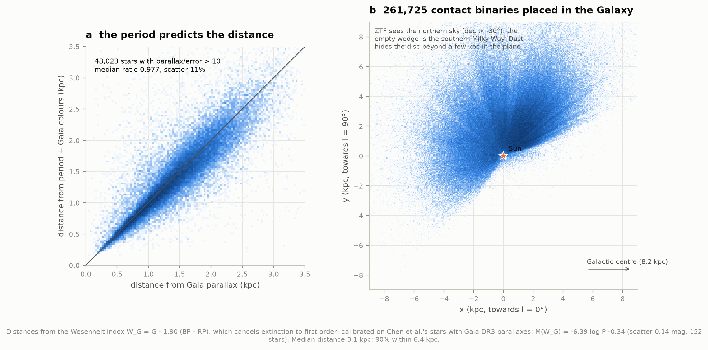

Calibrated on Chen's 153 stars, the W1 relation predicts the parallaxes of **41,386 ZTF contact binaries** that played
no part in the calibration: the error-weighted mean of measured over predicted parallax is **1.0003 ± 0.0001**. (The
comparison is made in parallax space, which avoids the Lutz–Kelker bias of comparing magnitudes; the cut at
parallax/error > 5 and ZTF's magnitude limits can still bias it at the per-cent level, more than the formal error.)

For a map we switched to the Wesenheit index W_G = G − 1.90 (BP − RP), which cancels interstellar extinction to first
order and needs only Gaia photometry, calibrated the same way (M(W_G) = −6.39 log P − 0.34, scatter 0.14 mag). Against
48,023 parallaxes better than 10% the distances agree to a median ratio of 0.977 with 11% scatter (a; larger than the
calibration scatter because the survey sample includes blends and misclassifications). Applied to every ZTF contact
binary with Gaia colours, it places **261,725** of them in the Galaxy (b), median distance 3.1 kpc, 90% within 6.4 kpc,
most beyond the reach of good parallaxes. The empty wedge is the southern sky ZTF cannot see; dust hides the far disc.

## 6. KIC 9832227: the merger that did not happen

KIC 9832227 is a contact binary in the Kepler field with a 0.458-day orbit. In 2017 Molnar et al. reported that its
period was shrinking ever faster, following the same exponential law Tylenda et al. had fitted to V1309 Sco before its
merger, and predicted a merger and a naked-eye red nova in **2022.2 ± 0.7**. In 2018 Socia et al. traced the
acceleration to one eclipse time from the Northern Sky Variability Survey (NSVS, 1999), off by half a day plus a
miscounted orbit. We redid both sides of the argument from the original photometry.

**Our timings** (figure 6, top of this page). One template, the 14-harmonic mean light curve from 59,451 Kepler points,
is shifted, scaled and offset to fit each season, camera or observer of:

| data | years | timings | notes |
|---|---|---|---|
| NSVS (VizieR II/287) | 1999.3–2000.2 | 1 | two survey IDs, unfiltered; frame times are MJD |
| SuperWASP DR1 + VeSPA | 2004–2010 | 5 | per-camera offsets; 2009–10 only in VeSPA |
| Kepler long cadence | 2009.4–2013.3 | 17 | 90-day segments |
| ASAS-SN (V) | 2014–2018 | 4 | yearly |
| AAVSO observers | 2015.9–2025.7 | 17 | 58 observer-band systems, each with its own zero point |
| TESS (SPOC 2-min, QLP) | 2019.6–2024.6 | 5 | sector pairs |

All times are converted to BJD(TDB) (HJD and JD from UTC; TDB−UTC is ~65 s, a minute that matters here). Where both
exist, our values agree with Kovács et al.'s (2019) compilation to 1.98 min rms (median offset −0.85 min, from the
template choice). Epochs we have no photometry for (Vulcan 2003, HAT 2004–2012, ASAS 2007, WISE 2010, MLO 2017) come from
their table. Two pitfalls had to be handled: the light curve is so close to a pure second harmonic that a flipped
template shifted by a quarter cycle fits almost as well (we require positive scales), and the two minima differ by only
2% in depth, so with spots a fit can lock onto the other one; each TESS and AAVSO season is therefore searched around
the timing predicted by the earlier ones (an even-harmonic template, insensitive to which minimum is which, gives the
same TESS times within 0.1 min).

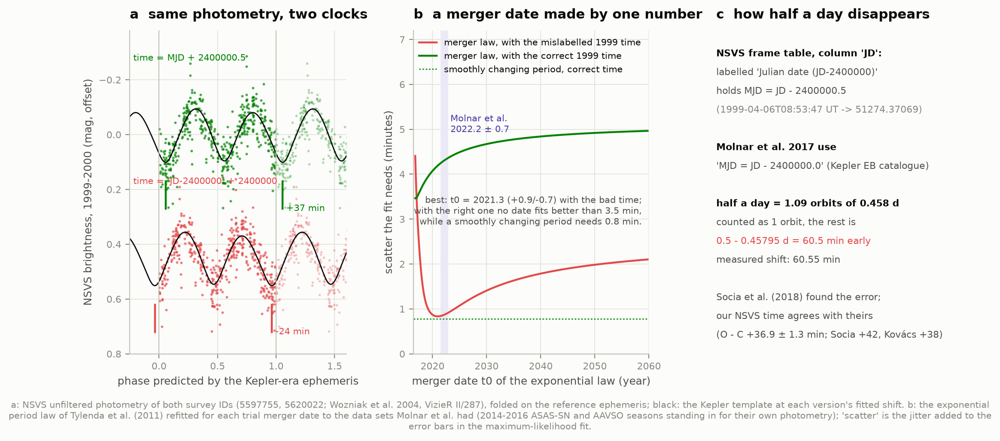

**The mistake.** VizieR's NSVS frame table labels its time column "Julian date (JD−2400000)", but the values are MJD
(JD − 2400000.5): frame 80850, taken at 1999-04-06T08:53:47 UT, is listed as 51274.37069. Molnar et al. state that
they use the Kepler Eclipsing Binary Catalogue's convention MJD ≡ JD − 2400000.0. Either way, a time read half a day
early is 1.09 orbits early; counted as one orbit, the remainder makes the eclipse look 0.5 − 0.45795 d = 60.55 min
early. Our NSVS eclipse time moves by exactly that (60.55 min) between the two readings (a), and the misread point lands
where Molnar et al.'s plot has it.

**The consequence (b).** We refitted the exponential law P(t) = P0 exp(τ/(t − t0)) to the data sets Molnar et al. had
(NSVS, ASAS, WASP 2007–08, Kepler, and ASAS-SN/AAVSO seasons of 2014–16 standing in for their own photometry),
scanning the merger date t0. With the misread 1999 time the law fits beautifully, needing only 0.84 min of extra scatter,
and puts the merger at **2021.3 (+0.9/−0.7)**, with P0 = 0.4579610 d and τ = 0.099 d (Molnar et al.: 0.4579615 d,
0.114 d, 2022.2 ± 0.7). With the correct time no merger date fits better than 3.5 min, and a period that simply changes
smoothly fits to 0.78 min. The prediction was a property of one number.

**What the period actually did.** Over 26 years the timings follow a steady decrease, Ṗ = −2.0 × 10⁻⁹ (the period
loses about 0.06 s per year), plus a 17-year, 13-minute wave, with 1.9 min of scatter that starspots easily account
for. The wave's period is barely constrained (1.5 cycles); if it were light-travel time across an orbit around a third
star, the binary would move 1.6 AU and the mass function would be 0.014 M☉: a red dwarf of at least ~0.4 M☉, about
8.6 AU from the pair, just inside the 11–678 AU range where Salinas & Howell's (2023) speckle images found no
companion. The 2019 polynomial-plus-sinusoid model of Kovács et al. (13.5-yr wave) under-predicts the period's decline since then: by 2024.6 it is 55 minutes off. Period derivatives of
contact binaries wander; extrapolating them, whether to a merger or to a gentle future, is fragile.

## 7. V1309 Sco: a merger watched

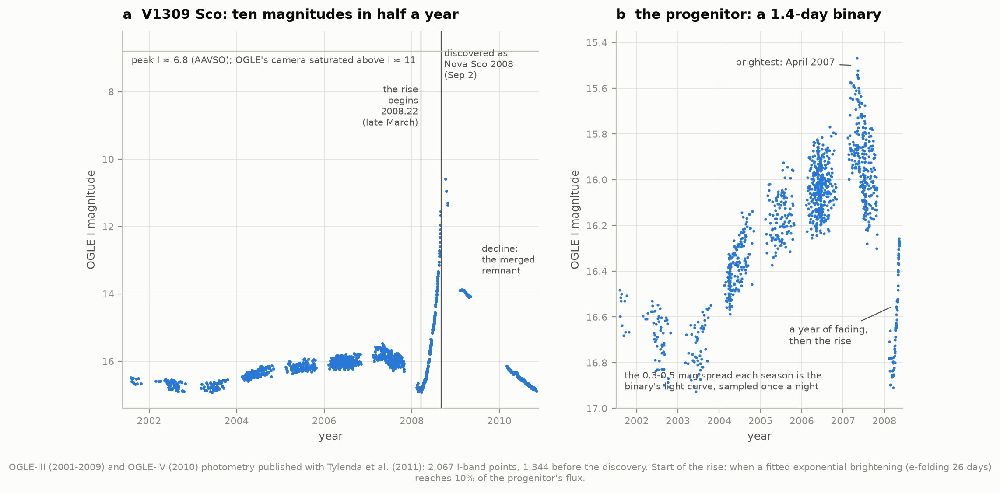

OGLE observed V1309 Sco about 1,340 times between 2001 and its discovery as "Nova Scorpii 2008" on September 2, and the
photometry was published with Tylenda et al.'s (2011) analysis (the atlas spec assumed it was not public; it is, at
`astrouw.edu.pl/ogle/ogle3/V1309_SCO/`). The progenitor brightened slowly for five years, peaked in April 2007, faded
for a year and then, from **2008.22 (late March)**, brightened exponentially with an e-folding time of 26 days, by ten
magnitudes in half a year (figure 8). The 0.3–0.5-mag spread within each season is the binary itself, sampled once a night.

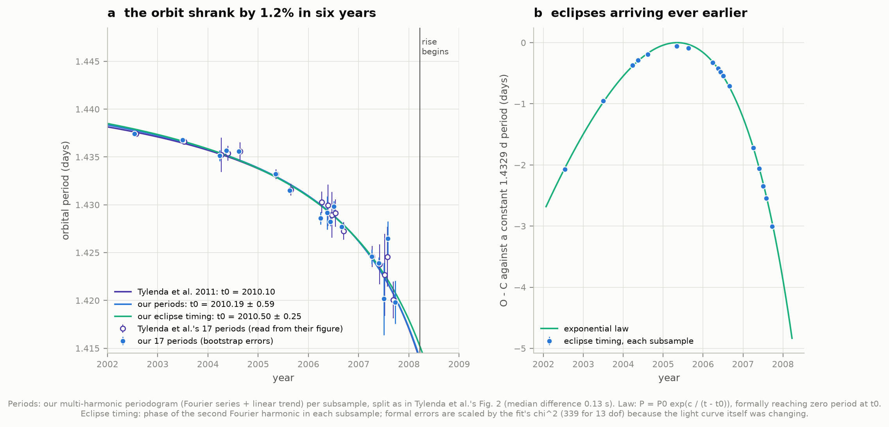

**The period (a).** We split each season into ~50-point subsamples as Tylenda et al. did (17 in all) and searched each
with a multi-harmonic periodogram (a four-term Fourier series plus a linear trend, fitted by least squares at each trial
frequency; the relative of the analysis-of-variance method they used), with bootstrap uncertainties. Our periods match
theirs, which we read from the vector graphics of their Figure 2, to a median of 0.13 s. The orbit shortened from
1.4374 d in 2002 to 1.4198 d in late 2007, **by 1.23%** (Tylenda: 1.2%). Fitting their law gives P0 = 1.4462 ± 0.0017 d,
c = 16.2 ± 4.2 d and **t0 = 2010.19 ± 0.59** (theirs: 1.4456, 15.29, 2010.10).

**Eclipse timing (b).** The phase of the second Fourier harmonic, which follows the eclipses and ignores the changing
heights of the maxima, gives an independent timing in each subsample; relative to a constant period the eclipses drift
by days. Fitted to these phases, the law's t0 is **2010.50 ± 0.25** (errors scaled up because the light curve itself
changed). Either way, the formal "zero period" date lies about two years after the merger actually began: an
exponential period law tells the order of the time left, not the date.

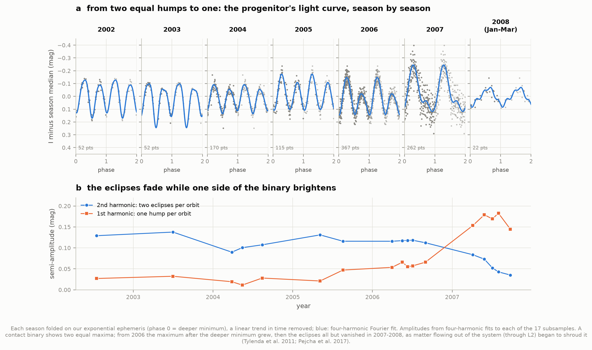

**The light curve changed (a, b).** In 2002–2005 the curve had two nearly equal maxima, as a contact binary should. From
2006 the maximum after the deeper minimum grew; in 2007 the second-harmonic (two eclipses per orbit) amplitude fell
from 0.12 to 0.035 mag while the first harmonic (one hump per orbit) rose to 0.18 mag. Tylenda et al. read this as the
companion orbiting faster than the primary's envelope rotated, Pejcha et al. (2017) as gas spiralling out through L2
and veiling the binary. By early 2008 the binary's signal had nearly vanished.

## 8. T CrB: a nova on the doorstep

T Coronae Borealis is a white dwarf in a 227.6-day orbit with a red giant that fills its Roche lobe. Gas from the giant
piles up on the white dwarf until its base ignites in a thermonuclear runaway, a nova, as in 1866 and 1946. After a
high state like the one that preceded 1946, an eruption has been expected since 2023.

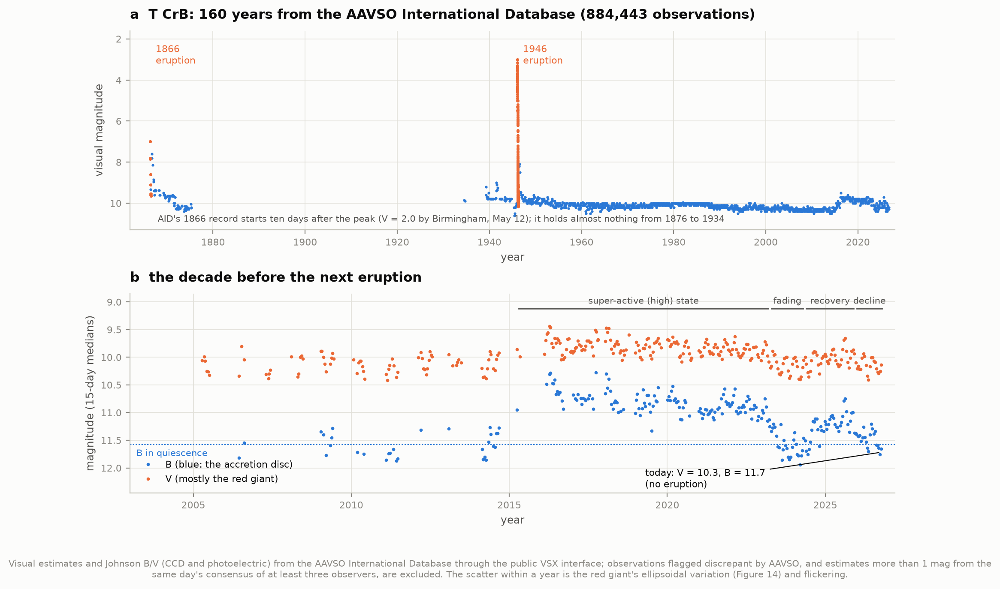

Everything here comes from the AAVSO International Database, through the public VSX interface (the atlas spec assumed
an account was needed; it is not, for reading): 950,487 observations from 1866 to 2026 October 9, of which 884,443 are
in the eight bands we use and not flagged discrepant by AAVSO. In every analysis, estimates more than 1 mag from the
same day's consensus of at least three observers (each observer counted once) are also rejected: 2.3% of visual
estimates, including the four reports of magnitude 4.9 on October 9. The rule follows a real eruption: only 3 of the
121 visual estimates in the three weeks around the 1946 peak were rejected.

The last decade (b): B, dominated by the accretion disc, brightened by 0.76 mag in the 2015–2023 high state, faded in
2023–24 below its quiescent level (11.93 against 11.58), recovered in 2024–25 and has declined again in 2026. The last
30 days: **V = 10.29, B = 11.72. No eruption.**

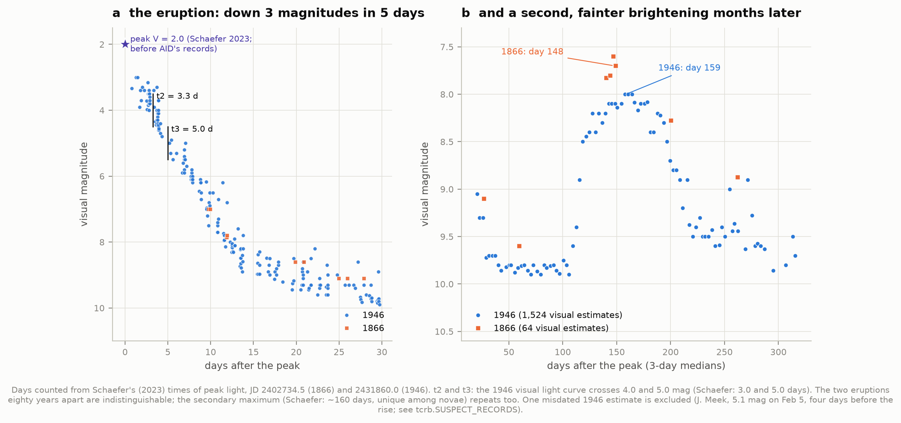

**The eruptions (figure 12).** AID's 1866 record starts ten days after the peak (Birmingham's V = 2.0 on May 12 is
not in it), so the rise is not ours to measure. The 1946 light curve fell 2 and 3 magnitudes from Schaefer's peak of
V = 2.0 in **3.3 and 5.0 days** (Schaefer 2023: 3.0 and 5.0): T CrB is one of the fastest novae known. Both eruptions
were followed, after ~80 quiet days, by a second, fainter brightening peaking at day 159 (1946) and day 148 (1866),
a feature no other nova shows. One validated 1946 estimate (J. Meek, 5.1 mag on JD 2431856.0, four days before an
eruption that rose within hours of Peltier's 9.9 on February 2) matches the brightness ten days later and is excluded
as a likely date-entry error (`tcrb.SUSPECT_RECORDS`).

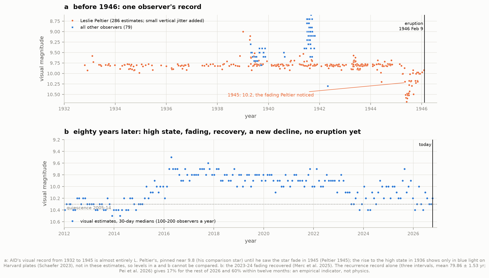

**The decade before (figure 13).** AID's visual record from 1932 to 1945 is almost entirely **Leslie Peltier's**, pinned
near 9.8 until 1945, when he saw the star fade to 10.2–10.6 and announced that an eruption was imminent (Peltier
1945). Schaefer (2023) excluded these estimates from his compilation for that reason: 180 of Peltier's 249 magnitudes
from 1933–1946 are exactly 9.8, and his comparison sequence differs from modern V by up to 1.7 mag. The 1936 rise to
the high state appears only in blue light on Harvard plates (Schaefer 2023), not in these estimates, so the levels of the two panels cannot be compared. Merc et al. (2025) showed that the 2023–24 fading is not
the 1945 dip. On the recurrence record alone (three effective intervals of 81.44, 78.39 and 79.75 years; mean 79.86 ±
1.53, Pei et al. 2026, whose 30.2% and 56.9% we reproduce for their date) the chance is **17% for the rest of 2026 and
60% within twelve months**: an empirical indicator, not physics.

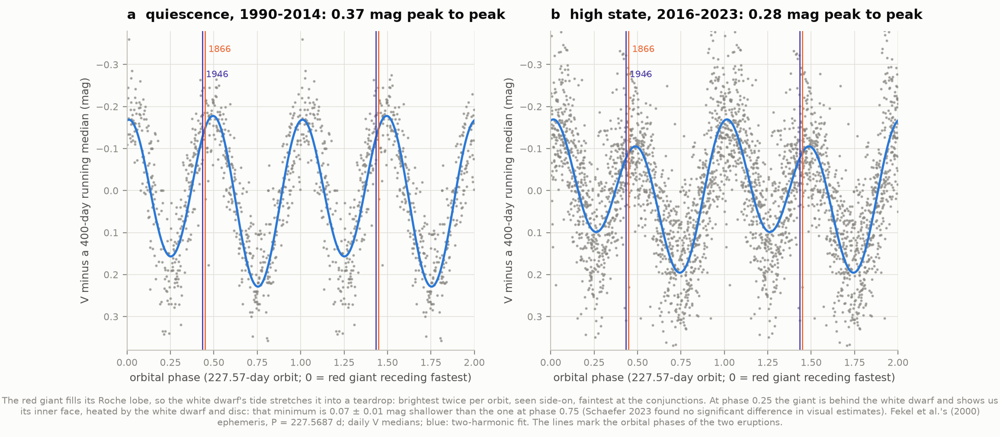

**The red giant's shape (figure 14).** With the slow changes removed, the V light curve folds on Fekel et al.'s (2000)
227.57-day spectroscopic period into a double wave, **0.37 mag peak to peak** in quiescence (1990–2014) and 0.28 mag in
the high state, when the disc's extra light dilutes it: the giant, stretched into a teardrop by the white dwarf's tide,
is brightest side-on (phases 0 and 0.5) and faintest at the conjunctions. The two minima differ: at phase 0.25 the giant
is behind the white dwarf and shows us its inner face, and that minimum is **0.072 ± 0.009 mag shallower** than the
one at phase 0.75 (0.098 ± 0.008 in the high state; bootstrap errors over days, optimistic because flickering is
correlated). That is the signature of the inner face being heated by the white dwarf and disc; Schaefer (2023) found no
significant difference in visual estimates. Both eruptions happened near phase 0.44; Pei et al. (2026a) found no
significant phase locking.

## 9. Predicting stellar catastrophes: the record so far

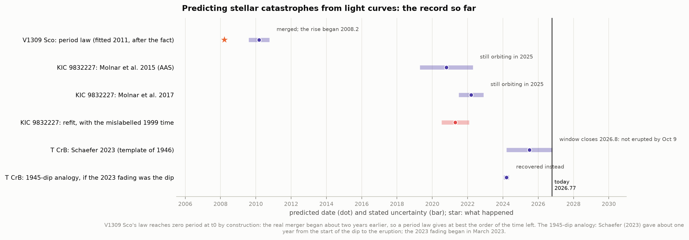

| prediction | for | outcome |
|---|---|---|
| V1309 Sco period law (fitted after the fact) | t0 = 2010.2 ± 0.6 | merged; the eruption began 2008.2 |
| KIC 9832227, Molnar et al. 2015 | 2020.8 ± 1.5 | still orbiting in 2025 |
| KIC 9832227, Molnar et al. 2017 | 2022.2 ± 0.7 | still orbiting in 2025 |
| KIC 9832227, our refit with the misread 1999 time | 2021.3 (+0.9/−0.7) | the misreading reproduces the prediction |
| T CrB, Schaefer 2023 (1946 template) | 2025.5 ± 1.3 | window closes 2026.8: no eruption by October 9 |
| T CrB, one year after the start of a 1945-like dip (Schaefer's rule applied to March 2023) | ~2024.2 | the fading recovered |

## Data and provenance

| source | what | access |
|---|---|---|
| OGLE-III/IV (Tylenda et al. 2011) | V1309 Sco I and V, 2001–2010 | `astrouw.edu.pl/ogle/ogle3/V1309_SCO/`, plain files |
| Kepler (MAST) | KIC 9832227 long cadence Q0–Q17 | `archive.stsci.edu/missions/kepler/lightcurves/` |
| TESS (MAST) | SPOC 2-min (S14, 15, 40, 41, 54, 55), QLP (S74, 75, 81, 82) | via `lightkurve` search, MAST download API |
| NSVS (Woźniak et al. 2004) | 1999–2000 photometry, IDs 5597755, 5620022 | VizieR II/287 field files, streamed until the ID passes |
| SuperWASP (Butters et al. 2010; VeSPA, McMaster et al. 2021) | 2004–2010 | NASA Exoplanet Archive DR1 FITS; superwasp.org VeSPA FITS |
| ASAS-SN Variable Stars Database (Jayasinghe et al.) | 2014–2018 V | `asas-sn.osu.edu/variables/<id>.json` |
| AAVSO International Database (Kafka 2021) | T CrB (950,487 obs.), KIC 9832227 (25,307) | VSX API `view=api.object&data=...`, no login |
| ZTF periodic variables (Chen, Wang & Deng 2020) | 781,602 variables | VizieR J/ApJS/249/18, 24 RA slices |
| Chen et al. 2018 | 183 W UMa calibrators, 55,603 candidates | VizieR J/ApJ/859/140 |
| Gaia DR3 (Gaia Collaboration 2023) | astrometry/photometry of 452,374 matches; 1,771,176 EB candidates P ≤ 2 d | CDS xMatch (I/355/gaiadr3); VizieR I/358/veb |
| AllWISE (Cutri et al. 2013) | W1, W2 for 135,305 binaries with parallax/error > 5 | CDS xMatch (II/328) |
| arXiv sources | Tylenda+11, Molnar+17, Socia+18, Kovács+19, Chen+18, Chen+20, Rucinski 07, Schaefer 23, Merc+25, Pei+26 (×2) | `arxiv.org/e-print/` |

All of it is fetched by `fetch_data.py` (0.75 GB, 327 files) and listed with size, SHA-256 and date in
`data/manifest.json`. Literature numbers used for comparison are in `literature.py`, each with its source; the
timing tables of Socia et al. and Kovács et al. and Tylenda et al.'s period measurements are parsed from the arXiv
sources, not typed in.

## How to run

```bash
cd astrophysics/54-contact-binaries
../.venv/bin/python run.py              # fetch what is missing, analyse, draw, print the summary
../.venv/bin/python run.py --no-fetch   # cached data only (works offline)
../.venv/bin/python run.py --figures-only
../.venv/bin/python test_physics.py     # 14 checks of the physics and the methods
```

The first run takes 1–2 hours, mostly the CDS cross-match of 420,000 ZTF binaries with Gaia (10,000 per request, ~80 s
each) and the AAVSO API (the server's 30-s limit forces windows of a week or two in 2024–26). From the cache, the
analysis and figures take about 12 minutes on a busy machine (8 CPU-minutes, 4.6 GB of memory at peak; the V1309
Sco bootstrap is the slowest part). A rebuild from the raw downloads alone, with the network switched off
(`unshare -rn`), reproduced every number in `data/results.json` exactly. Code: `roche.py` (potential,
lobes, ray tracer), `timing.py` (time systems, templates, phase fits), `kic9832227.py`, `v1309sco.py`, `census.py`,
`plrelation.py`, `tcrb.py`, `catalogs.py`, `analysis.py` (every number), `figures.py`, `explorer.py`.

## Caveats and deviations from the atlas spec

- **Data the spec assumed unavailable are public:** V1309 Sco's OGLE photometry (above), and AAVSO data without an
  account. Both were used.
- **KIC 9832227 beyond Kepler:** the spec asked for Kepler's O − C; we added NSVS, SuperWASP, ASAS-SN, AAVSO and TESS
  so the 1999 error and the post-2017 behaviour could be measured, not quoted.
- **Gaia via CDS:** the ESA archive was congested (a 1,000-row upload join took over two minutes), so Gaia DR3 came
  through CDS xMatch and VizieR (I/355, I/358). Gaia's EB table has no periods below 0.2 d.
- **ZTF's EW class includes semi-detached systems** (Chen et al. did not separate them; their Δmin column could) and
  some ellipsoidal variables; the period edge and the PL relations are robust to this, the sub-edge counts less so.
- **Extinction:** W1 needs little (A_W1 = 0.039 A_V); we used a dust-layer model as Chen et al. did, and the
  Wesenheit index for Gaia bands. The raw G-band relation in ZTF (0.55 mag scatter) is dominated by extinction errors.
- **The Roche model** has no spots, no reflection effect and blackbody intensities; it is a geometric light-curve model
  good to ~1%, not a replacement for PHOEBE or Wilson–Devinney.
- **T CrB's visual estimates** are on observers' own comparison-star scales; levels from different eras are not
  directly comparable (Schaefer 2023 re-calibrated them; we do not). The pre-1946 record is essentially one observer.
- **KIC 9832227's 17-year wave** spans 1.5 cycles; we do not claim a third star.
- **Download:** 0.75 GB (spec: 0.1–0.5 GB), plus 0.4 GB of derived caches.

## References

Bellm et al. 2019, PASP 131, 018002 (ZTF) · Borucki et al. 2010, Science 327, 977 (Kepler) · Butters et al. 2010, A&A
520, L10 · Chen, Deng, de Grijs et al. 2018, ApJ 859, 140 · Chen, Wang & Deng 2020, ApJS 249,
18 · Cutri et al. 2013, AllWISE Explanatory Supplement · Eggleton 1983, ApJ 268, 368 · Fekel et al. 2000, AJ 119, 1375 · Gaia Collaboration, Vallenari et al. 2023, A&A
674, A1 · Jayasinghe et al. 2018, MNRAS 477, 3145 (ASAS-SN variables) · Kafka 2021, AAVSO International Database ·
Kopal 1959, *Close Binary Systems* · Kovács, Hartman & Bakos 2019, A&A 631, A126 · Lindegren et al. 2021, A&A
649, A4 · Lucy 1967, ZAp 65, 89 · McMaster et al. 2021, RNAAS 5, 228 (VeSPA) · Merc et al. 2025, MNRAS 541, L14 · Molnar et al.
2017, ApJ 840, 1 · Mowlavi et al. 2023, A&A 674, A16 · Pei et al. 2026, arXiv:2607.15245 and arXiv:2605.20991 · Pejcha,
Metzger, Tyles & Tomida 2017, ApJ 850, 59 · Peltier 1945, Harvard Announcement Card 709 · Rucinski 1992, AJ 103, 960 ·
Ricker et al. 2015, JATIS 1, 014003 (TESS) · Rucinski 2007, MNRAS 382, 393 · Salinas & Howell 2023, RNAAS 7, 75 · Schaefer 2023, MNRAS 524, 3146 · Socia et al.
2018, ApJL 864, L32 · Stępień 2006, AcA 56, 199 · Tylenda et al. 2011, A&A 528, A114 · Udalski 2003, AcA 53, 291
(OGLE-III) · Udalski, Szymański & Szymański 2015, AcA 65, 1 (OGLE-IV) · Woźniak et al. 2004, AJ 127, 2436
· Zhu et al. 2016, RAA 16, 68.

*Everything in this folder was produced by AI (Claude) at the direction of a hobbyist; see the note at the top of the
repository's README.*
