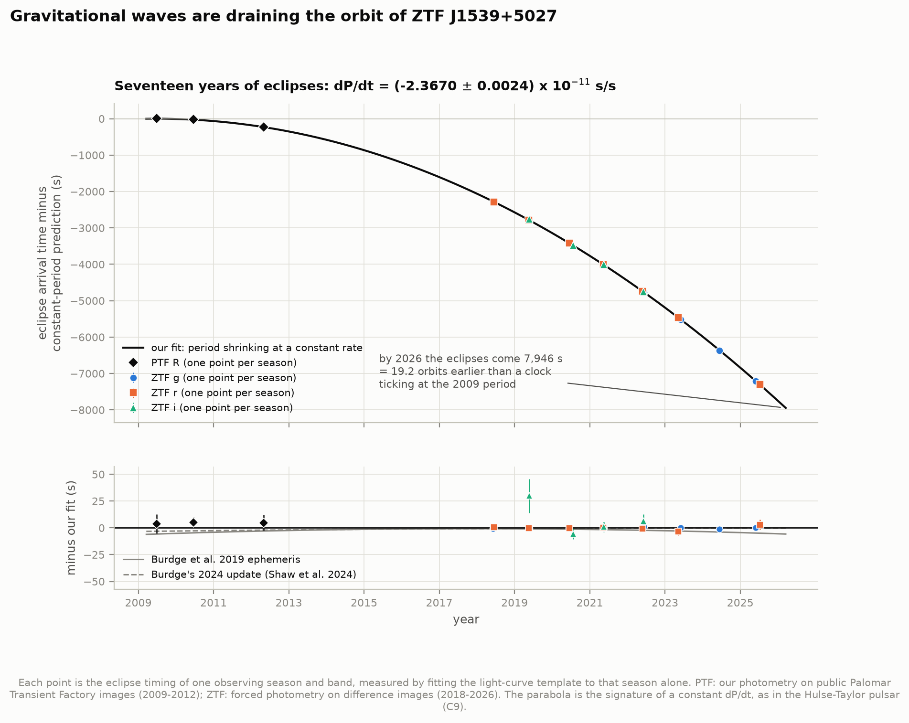
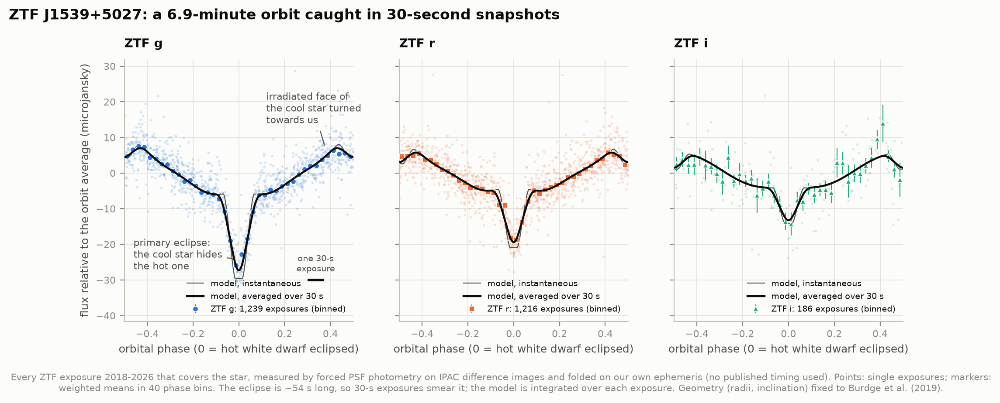
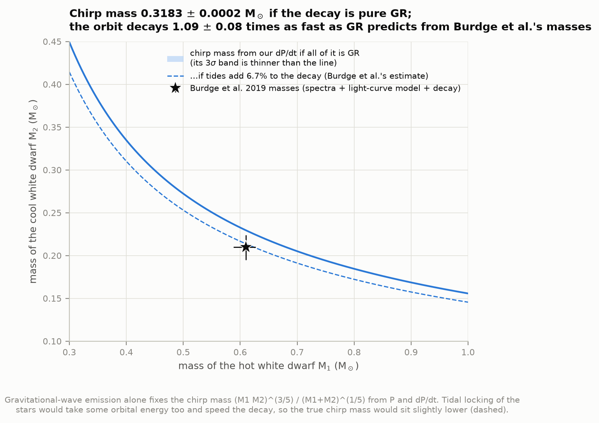
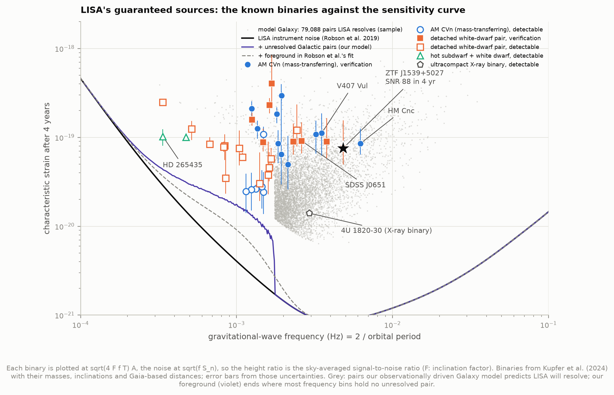
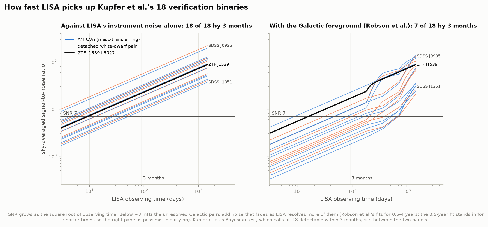
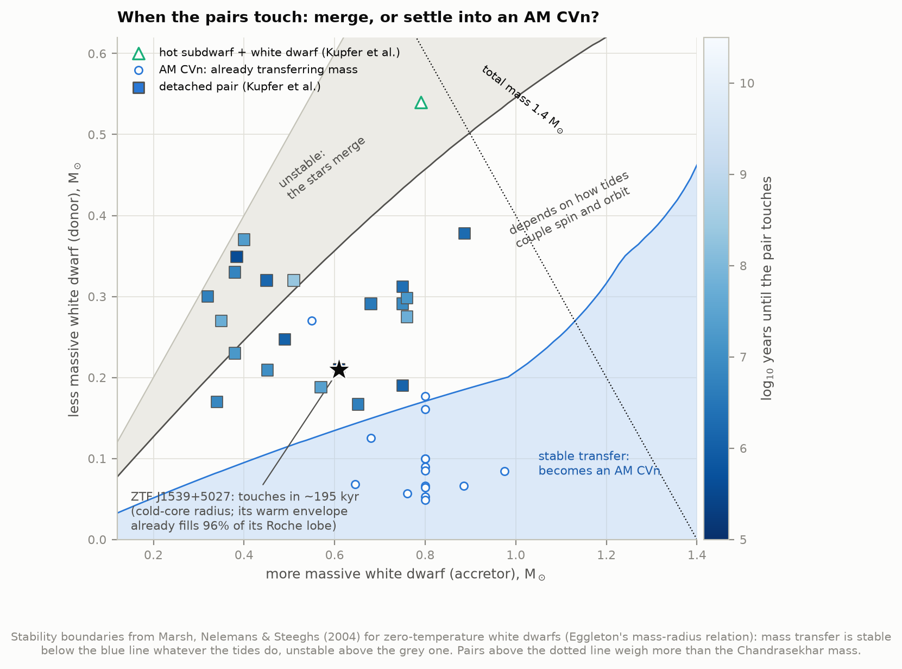
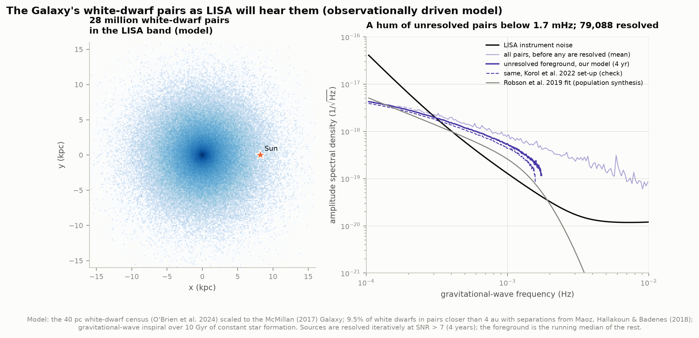

# M6 — White dwarf pairs: LISA's guaranteed sources

**ZTF J1539+5027 is a pair of white dwarfs that orbit each other every 6.91 minutes and eclipse on
every orbit. Gravitational waves are draining their orbital energy, so the eclipses come earlier each
year. Can we measure that from public survey data, and predict what LISA, the space-based
gravitational-wave observatory, will hear from such pairs?**

Yes, and to a precision we did not expect from 30-second survey snapshots of a 20th-magnitude star.
From forced photometry of **2,641 ZTF exposures (2018-2026)**, with no published timing as input, the
period is found from scratch, the orbit is followed season by season, and the eclipses arrive earlier
and earlier exactly as a steadily shrinking period requires. ZTF alone gives

> **dP/dt = (−2.3687 ± 0.0048) × 10⁻¹¹ s/s**

and adding **121 Palomar Transient Factory images from 2009-2012**, a decade before ZTF, stretches the
baseline to 17 years: **dP/dt = (−2.3670 ± 0.0024) × 10⁻¹¹ s/s**. Burdge et al. (2019, Nature) found
−2.373 ± 0.005 from archival PTF data and high-speed cameras on the Palomar 5-m and Kitt Peak 2.1-m
telescopes; Burdge's 2024 update of the ephemeris, which adds the 10.4-m Gran Telescopio Canarias
(published in Shaw et al. 2024), gives −2.36812 ± 0.00044. We agree with both, at 1.1σ and
0.4σ. Our eclipse times land within 0.4-0.8 s of theirs, and our period at their epochs agrees to
1-2 microseconds.

The orbit shrinks by **94 metres a year** and the period by **747 microseconds a year**. The pair
radiates about **21 solar luminosities in gravitational waves**, seventeen times more power than the
hot white dwarf's light. If all of the decay is gravitational radiation, it weighs the system's chirp
mass at **0.3183 ± 0.0002 M☉**. Burdge et al.'s component masses predict a decay **1.09 ± 0.08 times
slower** than observed: tides that keep the stars spinning with the orbit should take ~7% extra
(their estimate), which fits.

For LISA, we compute the gravitational-wave signal of all 40 binaries that Kupfer et al. (2024) expect
LISA to detect. Against LISA's instrument noise alone, **all 18 of their "verification binaries" reach a
signal-to-noise ratio of 7 within three months**, and so do three more. The Galactic foreground, the
hum of millions of unresolved white-dwarf pairs, is what decides it in practice: with Robson et al.'s
early-mission estimate of it, only 7 do. ZTF J1539+5027 is among the loudest: SNR ~90-100 after four
years.

An **observationally driven model of the Galaxy** (the 40 pc white-dwarf census, the McMillan Galaxy,
and Maoz et al.'s statistics of white-dwarf pairs) puts **28 million** pairs in LISA's band. LISA should
pick out **~79,000** individually; the rest blur into a foreground that drowns LISA's instrument noise
below ~1.7 mHz.



Interactive: [`figures/lisa_explorer.html`](figures/lisa_explorer.html) (LISA's sensitivity with every
known binary, for 3 months to 4 years of observing; offline, one file).
Animation (a labelled visualisation): [`figures/j1539_orbit.mp4`](figures/j1539_orbit.mp4), the two
white dwarfs to scale with the light curve and the gravitational wave.

---

## Results

### 1. A 6.9-minute orbit, caught in 30-second snapshots

ZTF J1539+5027 (Gaia G = 20.4) sits at ZTF's detection limit, and in eclipse it all but disappears, so
we measured its flux in **every** exposure that covers it, detected or not: forced PSF photometry on
IPAC's difference images (method below). Of 2,931 exposures, 149 have no difference image that
the archive would deliver and 2 lack a PSF; 2,641 of the remaining 2,780 pass the quality cuts (1,239 g,
1,216 r, 186 i).

**Finding the period.** A Lomb-Scargle periodogram of the 2018 data alone (the high-cadence survey in
which Burdge et al. found the binary; 678 exposures) has one dominant peak at **P = 414.792 s =
6.91 min** (false-alarm probability 10⁻¹⁴⁷); the next-highest peak is its 1-day alias (figure 2).

**The light curve** (figure 1). Folded on our ephemeris, all three bands show the deep primary eclipse
(the larger, cool white dwarf hides the hot one), the brightening as the cool star turns its heated face
towards us, and the shallow secondary eclipse in front of that face. The eclipse lasts ~54 s, so a 30-s
exposure averages over half of it; the model is integrated over every exposure. The depth of the total
eclipse is the hot star's own flux: **g = 20.44** (Burdge et al.: 20.38 ± 0.05, from a different method),
with g−r = −0.38 as expected for a ~49,000 K white dwarf.



**Watching the period shrink.** A constant period fitted to each observing season on its own already
shows the decay (figure 2, right):

| Season | 2018 | 2019 | 2020 | 2021 | 2022 | 2023 | 2024 | 2025 |
|---|---|---|---|---|---|---|---|---|
| P (s) − 414.79 | +1.64 ms | +0.79 | +0.43 | −0.62 | −1.17 | −1.75 | −2.95 | −3.32 |
| ± (ms) | 0.18 | 0.17 | 0.17 | 0.13 | 0.27 | 0.47 | 0.26 | 0.29 |

A straight line through these gives dP/dt = −2.29 × 10⁻¹¹ s/s. The phase-coherent fit to all exposures
(the period, its derivative and a phase, with the light-curve shape and a flux offset per season and
band solved at each step) pins the period ~100 times more precisely:

| | This work: ZTF 2018-2026 | This work: + PTF 2009-2012 | Burdge et al. 2019 | Shaw et al. 2024 (Burdge's update) |
|---|---|---|---|---|
| dP/dt (10⁻¹¹ s/s) | **−2.3687 ± 0.0048** | **−2.3670 ± 0.0024** | −2.373 ± 0.005 | −2.36812 ± 0.00044 |
| P at 2021 Oct 9 (s) | 414.789 099 1 ± 0.000 001 8 | 414.789 099 1 ± 0.000 001 8 | | |
| P at 2018 Jul 2, Burdge's T₀ (s) | | 414.791 541 7 ± 0.000 002 4 | 414.791 540 4 ± 0.000 002 9 | |
| P at 2021 May 10, Shaw's T₀ (s) | | 414.789 421 3 ± 0.000 001 6 | | 414.789 422 3 ± 0.000 000 1 |
| our eclipse time minus theirs | | | **+0.82 ± 0.34 s** | **+0.39 ± 0.29 s** |
| data | 30-s exposures, 1.2 m | 60-s exposures, 1.2 m | PTF + 3-s CHIMERA (5 m) + KPED | + HiPERCAM (10.4 m), 6 years |

(Our eclipse time near T_ref: BJD_TDB 2459500.000 474 ± 0.31 s.) The two published ephemerides agree
with each other to 0.1 s; ours puts the eclipses 0.4-0.8 s later than both (1.3σ and 2.3σ). That
could be a small offset in the absolute zero point of ZTF's time stamps or in our template; it does not
affect dP/dt, which only uses timing *differences*.

**Robustness.** dP/dt from subsets and variants of the ZTF fit (10⁻¹¹ s/s):

| Variant | dP/dt | Exposures |
|---|---|---|
| all bands (baseline) | −2.3687 ± 0.0048 | 2,641 |
| g only | −2.3687 ± 0.0056 | 1,239 |
| r only | −2.3719 ± 0.0109 | 1,216 |
| only exposures with no IPAC quality flag set | −2.3687 ± 0.0048 | 2,510 |
| without 2018 (the discovery season) | −2.3687 ± 0.0074 | 1,941 |
| light curve allowed to be asymmetric (sine terms) | −2.3687 ± 0.0048 | 2,641 |

No exposure was rejected as an outlier in the final fits; the per-band error scale factors are 1.01-1.13
(the noise model was close to right). `test_physics.py` also hides a known dP/dt in simulated data on
the real exposure times and errors and recovers it without bias.

### 2. Seventeen years of decay

PTF's public archive holds 124 R-band images of the field from 2009, 2010 and 2012 (60-s exposures; the
2016 iPTF data Burdge et al. used are not public). Measured on the science images and fitted with the ZTF
r-band light curve (figure 10), each PTF season lands exactly where the ZTF-only ephemeris, run back a
decade, says it should:

| PTF season | images | eclipse phase − ZTF-only prediction | prediction's own uncertainty |
|---|---|---|---|
| 2009 | 30 | −0.016 ± 0.020 orbits (−6.6 s) | 0.019 orbits |
| 2010 | 48 | −0.018 ± 0.012 orbits | 0.016 |
| 2012 | 43 | −0.016 ± 0.022 orbits | 0.011 |

So there is no ambiguity in counting orbits across the six-year gap: being off by one orbit would need
dP/dt to differ by 0.23-0.39 × 10⁻¹¹, 50-80 times ZTF's own error (figure 4). Measured against a clock
that kept the 2009 period, the eclipses of 2026 arrive **7,946 s (19.2 orbits) early** (figure 3).

**Is dP/dt itself changing?** General relativity predicts that it grows as the stars approach, with a
"braking index" f f̈ / ḟ² = 11/3. Adding a cubic term to the joint fit gives f̈ = (1.1 ± 1.3) × 10⁻¹²
d⁻³, consistent with zero and with GR's 1.9 × 10⁻¹⁴ d⁻³, which is 70 times below our precision. Burdge
et al. pointed out that measuring f̈ would separate the tidal and gravitational-wave parts of the decay;
that needs decades more of high-speed timing, not survey data.

### 3. What the decay weighs

If gravitational radiation alone shrinks the orbit, P and dP/dt fix the chirp mass
M_c = (M₁M₂)^3/5 / (M₁+M₂)^1/5:

| | |
|---|---|
| chirp mass from our dP/dt, pure GR | **0.3183 ± 0.0002 M☉** |
| ... if tides add 6.7% to the decay (Burdge et al.'s estimate) | 0.3061 M☉ |
| from Burdge et al.'s masses (0.610 + 0.210 M☉) | 0.303 ± 0.012 M☉ |
| dP/dt predicted by GR from those masses | (−2.18 ± 0.15) × 10⁻¹¹ s/s |
| **observed / predicted** | **1.09 ± 0.08** (tides predict 1.067) |

The masses come from Burdge et al.'s combination of spectroscopy, light-curve modelling and the decay
itself, so this is a consistency check, not an independent test: gravitational waves plus tidal locking
account for the decay within the 7% uncertainty of the masses (figure 5). Apparent period changes from
the star's motion are negligible: the Shklovskii term (proper motion 3.7 mas/yr from Gaia DR3) adds
3 × 10⁻¹⁷ s/s, and Burdge et al. put the Galactic-acceleration term at ~1 × 10⁻¹⁷; each is about a
millionth of the measured value.



### 4. What LISA will hear

A binary radiates gravitational waves at twice its orbital frequency: ZTF J1539+5027 at **4.82 mHz**,
near LISA's best sensitivity, with a strain amplitude of ~1.0 × 10⁻²² at Earth. Using the quadrupole
formula with the masses, inclinations and Gaia-based distances of Kupfer et al. (2024) and the LISA
sensitivity of Robson, Cornish & Liu (2019), averaged over sky position:

| | SNR > 7 within 3 months | SNR > 7 within 4 years |
|---|---|---|
| instrument noise only (upper bound) | **21**: all 18 of Kupfer et al.'s verification binaries + ZTF J0127, SDSS J2322, TIC 378898110 | 37 of 40 |
| with the Galactic foreground (Robson et al.'s fits) | 7 | 26 of 40 |
| Kupfer et al. 2024 (full Bayesian analysis) | 18 "verification binaries" | 40 "detectable" |

Below ~3 mHz the foreground of unresolved Galactic pairs, not the instrument, sets the noise, and how
much of it remains after 3 months is the uncertain part: Robson et al. fit it for 6 months and longer,
and their 6-month foreground at 1.5-2.5 mHz is high. Kupfer et al.'s classification sits between our
two bounds. The three binaries that stay below SNR 7 even without the foreground (SDSS J0106, CD−30°11223,
HD 265435) are at the lowest frequencies, 0.3-0.85 mHz.



For ZTF J1539+5027, the four-year SNR is **88** with Kupfer et al.'s inputs (Gaia-prior distance 2.47 kpc,
Burdge et al.'s masses, inclination 84°), **95** with our chirp mass and **100** at Burdge et al.'s
spectroscopic distance (2.34 kpc). Burdge et al. quoted 143 ± 14 with the full detector response: a
binary at ecliptic latitude +66°, seen almost edge-on, does better than the sky average. With the
inputs of Kupfer et al. (2018), our amplitudes match their table to 0.3% (AM CVn 28.29 vs 28.3 × 10⁻²³;
only HP Lib, whose masses are given as ranges, differs by 10%). Our sky-averaged SNRs differ from their
full simulations by factors of 0.65-1.7, lower above 3 mHz and higher near 2 mHz: a frequency pattern
that points to different noise and foreground models, not different signals. Figure 7 shows how the
SNR grows with observing time.



### 5. Where the pairs are heading

Gravitational waves keep shrinking each detached pair until the lighter white dwarf (the larger one)
fills its Roche lobe. What follows depends on the mass ratio (Marsh, Nelemans & Steeghs 2004; figure 8):

- **ZTF J1539+5027** touches first: in ~195,000 years at a period of 3.3 minutes if its secondary were a
  cold, degenerate white dwarf. Its warm envelope already fills 96% of its Roche lobe, so mass transfer
  from the envelope could start within ~30,000 years; Burdge et al. give ~130,000 years to reach 5 minutes,
  where the core starts to respond. With q = 0.34 it sits in the zone where the outcome depends on how
  tides couple the accretor's spin to the orbit: an AM CVn system, or a merger.
- **7 of the 21 detached pairs** have mass ratios above the instability line and will **merge** (ZTF
  J2243, ZTF J0538, ZTF J2029, ZTF J0722, J1526−2711, SDSS J1235, SDSS J1337), into one more massive
  white dwarf or a helium-rich giant (R CrB) star. None of them is massive enough for a Type Ia supernova.
- **The other 14** fall in the tidal zone; **none** is stable whatever the tides do.
- Times to contact range from 0.2 Myr (ZTF J1539) to 215 Myr (SDSS J1337).
- The two hot-subdwarf binaries must first finish burning helium. **HD 265435** totals 1.64 M☉, above
  the Chandrasekhar mass: Pelisoli et al. (2021) proposed it as a Type Ia supernova progenitor, and we
  also find contact in ~70 Myr. The survivors of such explosions are L5's hypervelocity white dwarfs.
- The 16 AM CVn binaries in the list already passed this point: their mass transfer was stable.



### 6. The Galaxy's hum

Kupfer et al.'s 40 binaries are the loud, nearby, mostly northern tip of a population that LISA will
see across the whole Galaxy. Following Korol et al. (2022), we built it from observations, not
binary-evolution simulations (figure 9):

| Step | Value | Source |
|---|---|---|
| white dwarfs within 40 pc | 1,078, or **4.02 ± 0.12 × 10⁻³ pc⁻³** | O'Brien et al. 2024 (spectroscopically confirmed) |
| white dwarfs in the Galaxy | 3.7 × 10⁹ | scaled by stellar mass, McMillan 2017 model |
| in pairs closer than 4 au | 9.5%: 3.5 × 10⁸ pairs | Maoz, Hallakoun & Badenes 2018 |
| with f_GW > 0.1 mHz (orbits < 5.6 h) | 7.9%: **28 million** | separations a^−1.3 at birth, GW inspiral, 10 Gyr |
| resolved by LISA (SNR > 7, 4 years) | **~79,000** | iterative subtraction; 123,000 against instrument noise alone |
| foreground above instrument noise | below **1.7 mHz** | |
| merger rate per white dwarf | 8.4 × 10⁻¹² yr⁻¹ (pairs merging within 10 Myr) | Maoz et al.: (9.7 ± 1.1) × 10⁻¹² |

**Checks.** In Korol et al.'s own set-up (one disc normalised to the 20 pc density, the SDSS mass
function) our code gives 2.69 × 10⁹ white dwarfs (theirs 2.7 × 10⁹) and 65,000 resolved pairs (theirs
~60,000), but 19.5 million pairs in the band against their 26 ± 6 million. Their analytic integral of
the separation distribution, which we checked, gives our number; we could not find the source of their
1.35× higher in-band fraction. In power, our foreground is 1.4 times Robson et al.'s population-synthesis
fit at 0.2 mHz, 4 times at 1 mHz and 8 times at 1.5 mHz (3.4 in Korol et al.'s set-up), and then ends
more abruptly. Korol et al. found the same shape and traced it to the heavier pairs (larger chirp
masses) of the observationally driven population.

**What it means.** LISA will measure ZTF J1539+5027 and its siblings within weeks, but the white-dwarf
foreground will be the dominant "noise" between 0.1 and ~2 mHz, and the tens of thousands of resolved
pairs will map the Galaxy's binaries out to the far side of the bulge, where telescopes cannot see.



---

## How it works

**1. Photometry that keeps the faint phases.** ZTF's public light curves list a star only when the
pipeline detects it in an exposure; for a star at the detection limit that keeps the bright phases
and drops the faint ones (IRSA's light-curve service also returned errors in October 2026). Instead,
`fetch_data.py` downloads, for each of the 2,931 exposures covering the star, a 61×61-pixel cutout of
IPAC's *difference image* (the exposure minus a deep reference image of the field, PSF-matched) and
that difference image's PSF. `ztf_phot.py` fits the PSF at the star's Gaia position in every exposure,
detected or not (forced photometry, as IPAC's own service does), calibrates the flux with each
exposure's zero point, and takes the error from the pixel noise, scaled up by the extra scatter of the
same estimator at ~24 empty places in each cutout (correlated noise from resampling). Three
subtraction failures (fluxes −2,800 to −6,700 µJy for a 25 µJy star) are cut.

**2. Clocks good to a fraction of a second.** The mid-point of the shutter-open interval (FITS keywords
`SHUTOPEN`/`SHUTCLSD`, UTC) is converted to Barycentric Dynamical Time at the Solar System barycentre
(BJD_TDB) with astropy, for the star's direction and Palomar's position. Two header traps: `OBSJD` is
~0.7 s *before* the shutter opens, and the header "HJD" equals `OBSJD`: it is not heliocentric.

**3. A light-curve model averaged over each exposure.** Per band, the flux is a constant per season
(difference fluxes are relative to an unknown reference flux), plus cosine harmonics of the orbital
phase (the cool star's irradiated face and tidal distortion, symmetric about conjunction), minus the
two eclipses. The eclipse shapes come from the geometry Burdge et al. measured with high-speed
photometry (R₁/a = 0.139, R₂/a = 0.280, i = 84.15°, limb darkening 0.15 on the hot star): survey data
cannot measure these, but can use them. Every term is averaged over the exposure (30 s = 7% of an
orbit) with 15-point Gauss-Legendre quadrature.

**4. The ephemeris.** The phase grows as φ(t) = φ₀ + f₀(t − T_ref) + ½f₁(t − T_ref)², so the orbital
frequency rises linearly (f₁ = −Ṗ/P²). For each trial (φ₀, f₀, f₁) every linear coefficient (offsets,
harmonics, eclipse depths) is solved exactly by weighted least squares, and the three nonlinear
parameters are optimised (variable projection) in units of their typical uncertainties. Outliers
beyond 5σ would be clipped (there were none); each band's errors are rescaled to a reduced χ² of 1;
the covariance comes from a central-difference Jacobian at the solution. Phase zero is the deeper
eclipse: with free eclipse depths a fit can lock on half an orbit away, the shallow-eclipse term
absorbing the deep eclipse, so the code checks for this and corrects it (it happened in development).

**5. Nothing borrowed from the answer.** The period comes from the 2018 periodogram, the starting dP/dt
from the season-by-season periods, then the phase-coherent fit. Burdge et al.'s and Shaw et al.'s
ephemerides enter only in the comparison.

**6. PTF, a decade earlier.** No public PTF difference images exist, so `ptf_phot.py` does aperture
photometry on 8′ cutouts of the science images (radius 0.8 × FWHM, which maximises a faint star's
signal-to-noise), with a local sky annulus, and calibrates every image on 12-14 isolated, non-variable
Gaia stars measured the same way, so seeing and aperture losses cancel. Errors are scaled by how much
faint constant stars scatter (×1.09). In the joint fit, PTF's light curve has the ZTF r-band shape
averaged over 60 s, with a free amplitude and offset per season. PTF headers store the observatory
longitude as +116.86 (west-positive): we use our own Palomar coordinates.

**7. LISA.** `gw.py` implements the quadrupole formulae and Robson et al.'s analytic sensitivity, with
their foreground fits for 0.5-4 years (interpolated in log T between them). A monochromatic binary's
SNR averaged over sky and polarisation is ρ² = 4T𝒜²[((1 + cos²i)/2)² + cos²i]/S_n(f), which averaged
over inclination gives Robson et al.'s (16/5)T𝒜²/S_n, with 𝒜 = 2(G M_c)^5/3 (πf)^2/3 / (c⁴d) as in
Kupfer et al. It reproduces Robson et al.'s worked example (SDSS J0651: SNR 140). `kupfer.py` reads
Kupfer et al.'s Tables 1-2 from the paper's LaTeX source, keeping each value's kind (measured, assumed,
range, lower limit). A Monte Carlo over those uncertainties gives each SNR's range. Unknown inclinations
are averaged over.

**8. Fates.** `fates.py` takes each detached pair to contact (Eggleton's zero-temperature mass-radius
relation and Roche-lobe fit) and classifies the mass transfer with Marsh et al.'s criteria; the
boundaries reproduce their figure 1.

**9. The Galaxy.** `population.py`: white dwarfs from the 40 pc census, spread over the McMillan (2017)
Galaxy (thin and thick discs, bulge) in proportion to stellar mass; 9.5% in pairs closer than 4 au with
the present-day separation distribution of Maoz et al. (2012, 2018) for α = −1.3 and 10 Gyr of constant
star formation; the heavier star's mass drawn from the 40 pc sample, its partner's uniform from 0.15 M☉
to that (Korol et al.'s prescription). Every pair above 0.1 mHz gets a distance and orientation. Sources
with 4-year SNR > 7 against instrument + foreground are "resolved" and removed, the foreground is
re-estimated as the running median of the rest's power spectrum (as LISA pipelines do: a median is not
inflated by the few bright, isolated sources that share a wide frequency bin), and the loop repeats until
nothing changes.

## Checks against published numbers

| Quantity | This work | Published |
|---|---|---|
| period (2018 epoch) | 414.791 541 7 ± 0.000 002 4 s | 414.791 540 4 ± 0.000 002 9 (Burdge et al. 2019) |
| dP/dt | (−2.3670 ± 0.0024) × 10⁻¹¹ | −2.373 ± 0.005 (Burdge 2019); −2.36812 ± 0.00044 (Shaw et al. 2024) |
| dP/dt from PTF/iPTF alone | (PTF used jointly) | −2.378 ± 0.049 (Burdge 2019, 4 epochs) |
| mid-eclipse time | +0.82 ± 0.34 s; +0.39 ± 0.29 s | Burdge 2019 T₀; Shaw 2024 T₀ (±0.10 s, ±0.02 s) |
| hot white dwarf alone, g | 20.44 | 20.38 ± 0.05 (Burdge 2019) |
| decay vs GR from the masses | 1.09 ± 0.08 | 1.067 expected with tides (Burdge 2019) |
| verification binaries | 18 of 18 by 3 months (instrument noise) / 7 (with foreground) | 18 (Kupfer et al. 2024) |
| LISA SNR of ZTF J1539, 4 yr | 88-100 (sky-averaged) | 143 ± 14 (Burdge 2019, full response) |
| GW amplitudes 𝒜 | 28.29, 6.38, 16.19, 10.69 × 10⁻²³ | 28.3, 6.4, 16.2, 10.7 (Kupfer et al. 2018: AM CVn, HM Cnc, J0651, ES Cet) |
| SNR of SDSS J0651 (Robson et al.'s example) | 139.8 | 140 |
| stability boundaries | M₂ = 0.207 / 0.545 at M₁ = 1.0 | Marsh et al. 2004 fig. 1 (~0.2 / ~0.53) |
| time to reach P = 5 min | 130,700 yr | ~130,000 yr (Burdge 2019) |
| white dwarfs in the disc (Korol set-up) | 2.69 × 10⁹ | 2.7 × 10⁹ (Korol et al. 2022) |
| pairs in band (Korol set-up) | 19.5 million | 26 ± 6 million (Korol 2022): unexplained 1.35× |
| resolved pairs (Korol set-up) | 65,000 | ~60,000 (Korol 2022) |
| WD merger rate | 8.4 × 10⁻¹² yr⁻¹ per WD | (9.7 ± 1.1) × 10⁻¹² (Maoz et al. 2018) |

## Caveats and what this does not do

- **Absolute timing.** Our eclipse times sit 0.4-0.8 s after the high-speed ephemerides (1.3σ, 2.3σ).
  dP/dt is untouched, but if you use our T₀, treat it as uncertain by ~0.5 s.
- **The light-curve model is phenomenological.** The eclipse geometry is fixed to Burdge et al.'s, the
  rest is a cosine series. Allowing asymmetric terms changes nothing, but the ZTF data cannot test the
  irradiation physics.
- **5% of the ZTF exposures (149) have no difference image in IRSA's archive**, mostly from 2023; they are
  skipped, not replaced by science-image photometry.
- **LISA SNRs are sky-averaged.** The real response depends on each binary's position relative to LISA's
  antenna pattern over the year, shifting individual values by tens of per cent. The 3-month foreground is
  Robson et al.'s 6-month fit, which is pessimistic. Kupfer et al.'s distances for faint stars (ZTF J1539
  among them) are dominated by their Galactic prior. HM Cnc's distance is unknown (we take 7.5 ± 2.5 kpc).
- **Fates use zero-temperature radii.** Warm, low-mass white dwarfs are larger, so they touch earlier
  (ZTF J1539's secondary is 1.6 times its zero-temperature size) and at longer periods. The classification
  ignores helium-shell detonations, which can make a merger of a CO and a He white dwarf explode (the D⁶
  route behind L5's survivors).
- **The population model is simple and observationally anchored.** Its uncertainties are dominated by the
  pair fraction (±21%) and the mass distribution of companions, which the radial-velocity surveys cannot
  pin down; the 40 pc census itself is 4% short (O'Brien et al. count 1,124 possible white dwarfs
  including those Gaia missed). Results scale linearly with the white-dwarf density and pair fraction.
- **B10 (white dwarfs) is not built yet**: the spec said to scale from its white-dwarf density, so we
  took the 40 pc census directly.

## Figures

| File | What it shows |
|---|---|
| `01_light_curve` | ZTF g, r, i folded on our ephemeris, binned, with the exposure-averaged model |
| `02_period_search` | 2018 periodogram; the period measured in each season |
| `03_orbital_decay` | **the O−C diagram**: 17 years of eclipses against a constant-period clock, with residuals and the published ephemerides |
| `04_uniqueness` | χ² against trial dP/dt; PTF eclipses against the ZTF-only prediction |
| `05_chirp_mass` | the chirp mass from dP/dt in the plane of the two masses |
| `06_lisa_sensitivity` | LISA's sensitivity with Kupfer et al.'s binaries and our model Galaxy's resolvable pairs |
| `07_snr_growth` | signal-to-noise against observing time for the 18 verification binaries, with and without the foreground |
| `08_fates` | mass-transfer stability zones with every known pair and its time to contact |
| `09_galactic_foreground` | the model Galaxy's pairs and their foreground |
| `10_ptf_seasons` | the PTF light curves of 2009, 2010 and 2012 |
| `lisa_explorer.html` | interactive version of figure 6, with observing time and a table view |
| `j1539_orbit.mp4` | animation: the binary to scale, its light curve and its gravitational wave (a visualisation of the fitted model) |

## Running it

```bash
python fetch_data.py          # ~0.3 GB, ~6,000 small files; resumable (see below)
python fetch_data.py --only ztf --patient --workers 16   # finish the slow ZTF files
python run.py --photometry    # photometry, every fit, results.json, all figures (6-12 min; ~35 on a busy machine)
python run.py --figures-only  # redraw from the cache (the movie is made once; --animation remakes it)
python test_physics.py        # unit checks and the injection test
```

IRSA serves most ZTF cutouts in 2-5 s, but about 18% of exposures are staged from slow storage and
take 3-20 minutes each (cutout and PSF alike). The first pass sets them aside; `--patient` fetches
them with long timeouts. Everything after the download runs offline.

## Data and credits

- **ZTF** (Bellm et al. 2019; Masci et al. 2019): difference images and PSFs from the NASA/IPAC Infrared
  Science Archive (IRSA), DOI 10.26131/IRSA539. Based on observations obtained with the Samuel Oschin
  48-inch Telescope at Palomar Observatory as part of the Zwicky Transient Facility project.
- **PTF** (Law et al. 2009): Level 1 images from IRSA, DOI 10.26131/IRSA155.
- **Gaia DR3** (Gaia Collaboration 2023) via VizieR (I/355): the star's position and the PTF comparison
  stars.
- **O'Brien et al. 2024**, MNRAS 527, 8687: the 40 pc white-dwarf sample (VizieR J/MNRAS/527/8687).
- **Burdge et al. 2019**, Nature 571, 528; **Shaw et al. 2024**, AJ (arXiv:2411.02238): ZTF J1539+5027's
  system parameters and ephemerides (comparison and the fixed eclipse geometry).
- **Kupfer et al. 2024**, ApJ 963, 100 (arXiv:2302.12719): the LISA binaries; **Kupfer et al. 2018**,
  MNRAS 480, 302: amplitude and SNR checks.
- **Robson, Cornish & Liu 2019**, CQG 36, 105011: LISA sensitivity curves.
- **Maoz, Hallakoun & Badenes 2018**, MNRAS 476, 2584; **Maoz, Badenes & Bickerton 2012**: white-dwarf
  pair statistics; **Korol et al. 2022**, MNRAS 511, 5936: the observationally driven population recipe.
- **McMillan 2017**, MNRAS 465, 76: the Galaxy model (parameters as in galpy's `McMillan17`).
- **Marsh, Nelemans & Steeghs 2004**, MNRAS 350, 113: mass-transfer stability; Eggleton's mass-radius
  relation via Verbunt & Rappaport 1988.

Builds on: **C1** (the chirp mass of GW150914: 32 M☉ swept in a fifth of a second; here 0.32 M☉ drifting
for 17 years), **A1** (folding light curves), **L5** (the survivors of white-dwarf explosions), and the
spirit of **C9** (the Hulse-Taylor O−C parabola, not yet built).
