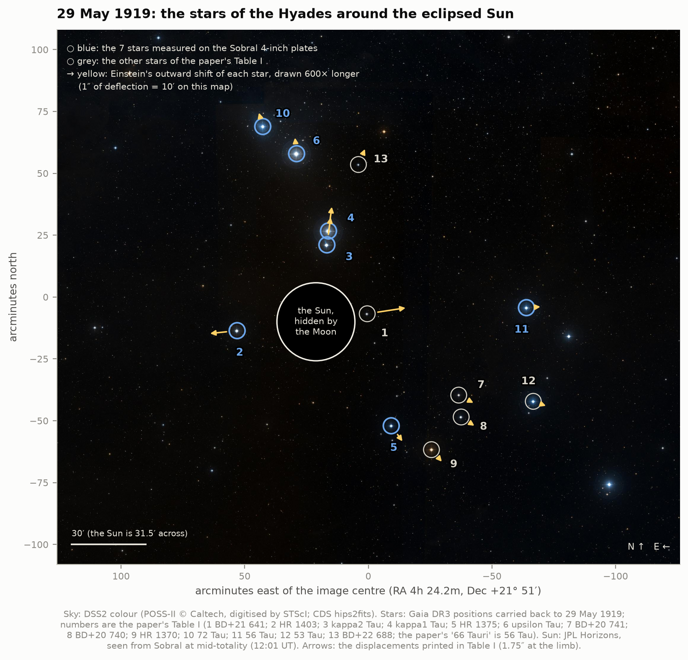
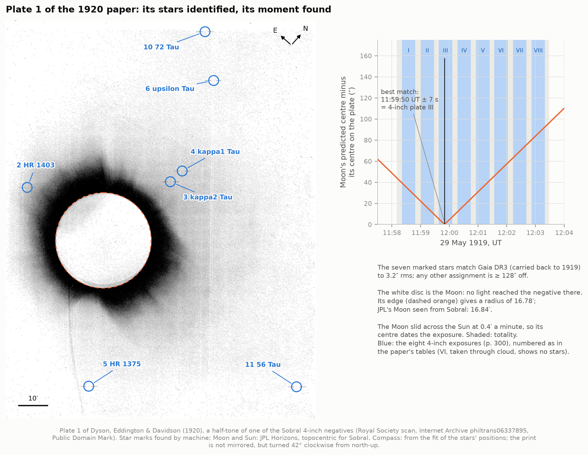
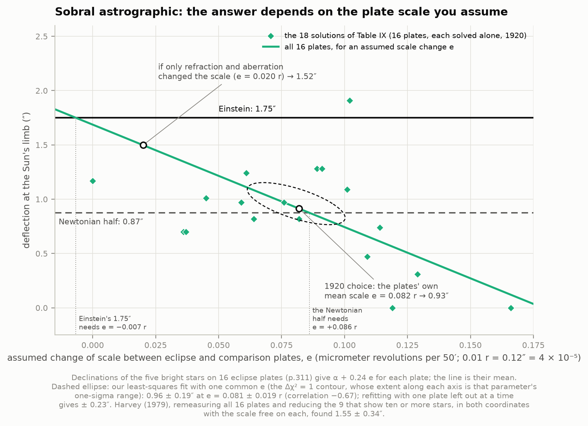
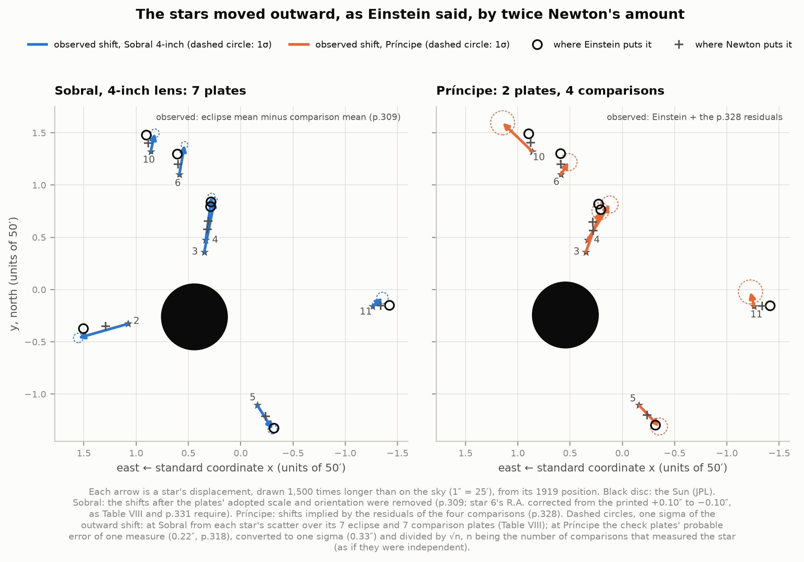
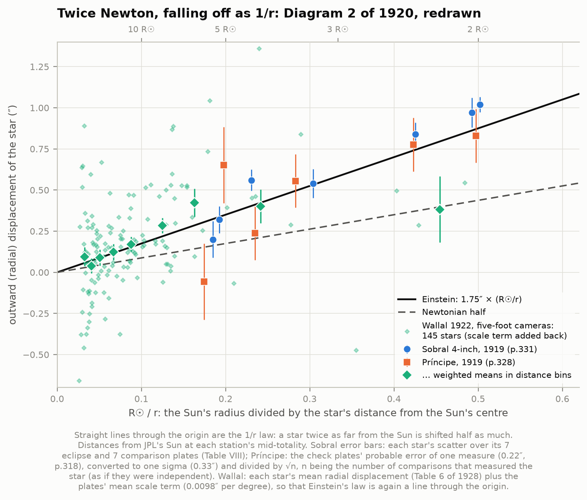
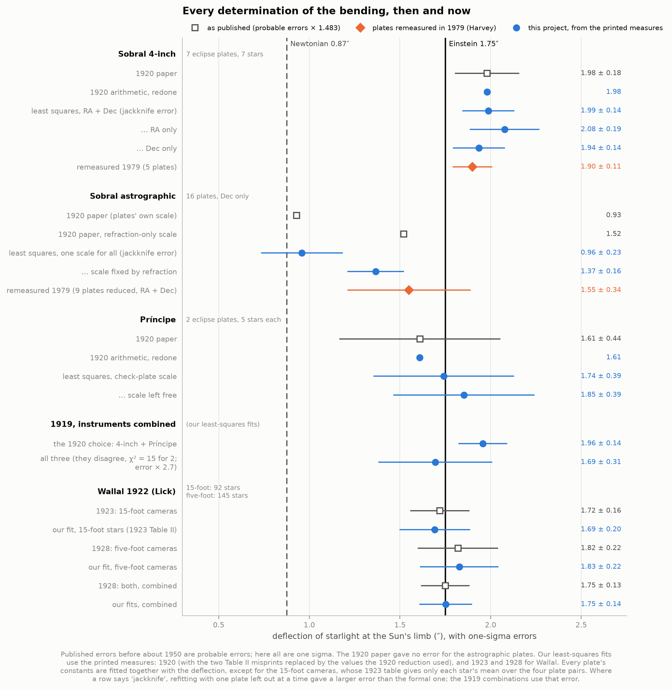
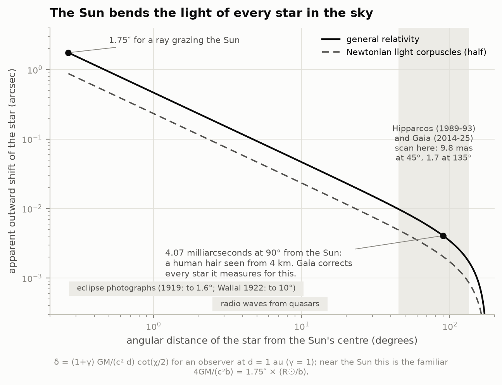
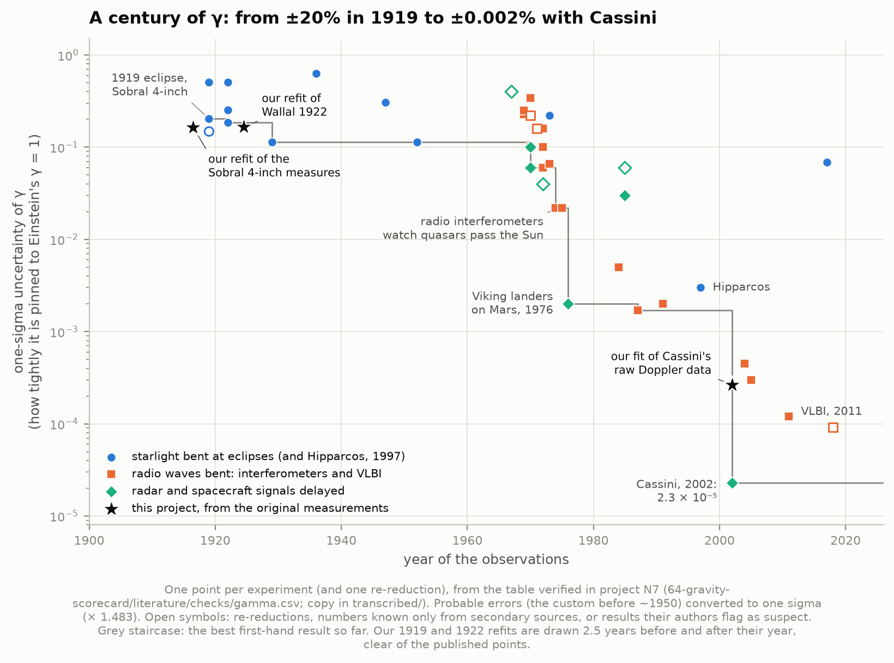
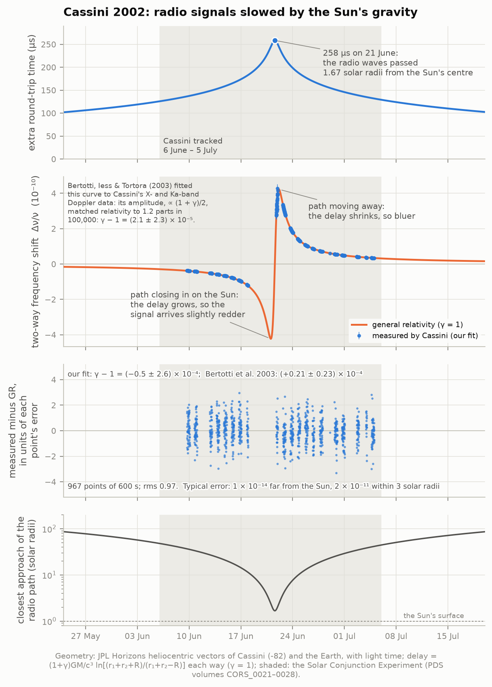

# N2 — Bending starlight: from the 1919 eclipse to Cassini

**On 29 May 1919 two British expeditions photographed the stars around the eclipsed Sun and found
them pushed outward by about the 1.75″ Einstein had predicted, twice the Newtonian value. The result
made Einstein famous overnight, and it has been argued over ever since. Can we redo the measurement
from the expeditions' own published star positions, then follow light bending and its partner, the
Shapiro delay, to today's precision?**

Yes. We transcribed every table of the 1920 report and of the Lick Observatory's 1923 and 1928
bulletins on the 1922 eclipse from the scanned pages: about 13,500 numbers. Each table was read
twice, independently, and checked against the papers' own arithmetic. We redid the 1920 reduction
and got the published numbers back exactly. Then we refitted all of it with modern least squares.

- **Sobral, 4-inch lens (7 plates, 7 stars):** **1.99 ± 0.14″** at the Sun's limb (one sigma; the
  report gave 1.98″ ± 0.12″ *probable error*, i.e. ± 0.18″ at one sigma). Einstein's 1.75″ is
  1.6σ away; Newton's 0.87″ is 7.7σ away.
- **Príncipe (2 plates, 5 stars each):** **1.74 ± 0.39″** (the report: 1.61″ ± 0.30″ probable error).
- **The two together, the choice the report made: 1.96 ± 0.14″.**
- **The Sobral astrographic plates**, the ones the report set aside, give **0.96 ± 0.23″** with
  the scale the plates themselves imply, or 1.37″ if only refraction changed their scale. They
  disagree with the 4-inch plates at **3.8σ**, which is the 1920 argument in one number: one of the
  two instruments has a large systematic error. The report blamed the astrographic's
  Sun-warped mirror; the 1979 remeasurement of those plates (1.55 ± 0.34″) sided with the 4-inch.

Along the way the transcription turned up things the papers do not say:
- two misprinted numbers in the report's main table of measures, proved by its own downstream
  arithmetic;
- a sign misprint, the wrong longitude for Sobral, and a dozen arithmetic slips (none of which
  changes a conclusion);
- **which negative the report's famous photograph is**: the Moon's position on Plate 1, compared
  with JPL's ephemeris, dates the middle of the exposure to 11:59:50 UT ± 7 s, which is the 4-inch
  plate III.

**Wallal 1922.** We also refitted the Lick Observatory's Australian eclipse, from the per-star tables
of the 1923 and 1928 bulletins. The five-foot cameras (145 stars) give **1.83 ± 0.22″**, the 15-foot
cameras (92 stars) 1.69 ± 0.20″, and together **1.75 ± 0.14″**: Campbell & Trumpler's 1.75″ ± 0.09″
(probable error), to the digit.

**Cassini 2002.** We also measured γ from Cassini's raw tracking data in NASA's archive. In June 2002
the radio link to the spacecraft passed 1.7 solar radii from the Sun's centre. The Shapiro delay
shifted the link's frequency by up to 4 parts in 10¹⁰, and the X- and Ka-band links, combined to
cancel the solar corona, measured that shift to 1–1.5 parts in 10¹⁴ every ten minutes far from the
Sun (within 5 solar radii, where it is largest, only to 10⁻¹²–10⁻¹¹). We get
**γ − 1 = (−0.5 ± 2.6) × 10⁻⁴**, general relativity to ± 0.03%. That is about ten times less
precise than the published (2.1 ± 2.3) × 10⁻⁵ (Bertotti, Iess & Tortora 2003). Part of the gap is
the third radio link they used to remove the corona exactly, which the archive's tracking files
lack. Most of it is our own analysis: JPL's fit of the same kind of two-link, closed-loop data
reached ± 5.2 × 10⁻⁵ (Anderson, Lau & Giampieri 2004), and our error budget adds the scatter
between passes, twelve alternative analysis choices and the choice of starting trajectory to a
formal ± 0.9 × 10⁻⁴.

There is also an interactive page, [`figures/plate_lab.html`](figures/plate_lab.html), where you can
redo the reductions yourself: choose plates, stars, coordinates and the plate scale, and watch the
deflection change. Its fits match the Python code (checked in headless Chromium by
`tools/check_explorer.js`). It is also published as a private artifact,
https://claude.ai/artifact/FksLym6sN7y5LupavdQDTi, from `data/derived/plate_lab_artifact.html`
(rewritten by `explorer.py`; republish to that URL).

---

## Results

### 1. The star field of 1919, checked against today's sky

**The stars.** Table I of the report lists 13 stars around the Sun in "standard co-ordinates" (units
of 50′). We identified all 13 in Gaia DR3, carried their positions back to 29 May 1919 (proper
motion, parallax, radial velocity) and to the mean equator and equinox of 1919.4, and fitted a
tangent point, rotation and scale. Gaia reproduces Table I to **1.7″ rms** per coordinate (at most
2.8″). Rounding to the printed 0.001 unit (3″) accounts for only 0.9″ of that (and never more than
1.5″, which 10 of the 26 coordinates exceed), so the 1919 star places themselves were good to about
1.5″. The scale is 0.999998 ± 0.000146 and the rotation 0.016 ± 0.008°. Two names needed care:
- the report's star 11, "66 Tauri", is in fact **56 Tau** (66 Tau is 12° away);
- star 9, "Piazzi IV 53", is the K giant **HR 1370** (HD 27639 A).

Six of the 13 (stars 1, 2, 3, 4, 6, 8) belong to the Hyades cluster: parallaxes of 20–23 mas and
the cluster's common motion. The other seven are background stars.

**The predictions.** Table I also prints the displacement each star should show at each station for
1.75″ at the limb. We recomputed them with the exact formula, δ = (1 + γ) GM/(c² d) cot(χ/2), and the
Sun's position seen from each station at mid-totality (JPL Horizons). They agree to **0.06″ at
Sobral and 0.02″ at Príncipe**. The Sun's centre implied by the printed vectors (leaving out the one
value at each station that does not fit their 1/r pattern) is 18″ and 24″ from JPL's. (The worst
printed prediction, star 13's x at Sobral, is off by 0.06″. Star 13 is not on the 4-inch plates, and
the astrographic plates that show it were measured only in declination (p.310), so the misprint
entered no reduction.)

**The Moon, the Sun and the clocks.** JPL's Moon and Sun seen from each station give totality at:

| | Sobral | Príncipe |
|---|---|---|
| JPL Horizons (ours) | 11:58:10 – 12:03:28 UT | 14:13:08 – 14:18:17 UT |
| the 1920 report | second contact assumed 11:58:18 (contact times were not observed; no duration is given) | computed 14:13:05 – 14:18:07 |

The 1919 times are astronomical G.M.T., counted from noon ("May 28, 23h 58m 18s"). All the
exposures listed for Sobral fall inside JPL's totality. They do so only at the station's real
longitude, about 2h 41m W. The report prints 2h 47m 25s, a misprint: at that longitude totality would
have ended at 12:00:21, before half the plates were exposed.

### 2. Plate 1: the most famous photograph of the eclipse, identified and dated

The report's only photograph, Plate 1, is a half-tone of "one of the negatives taken with the
4-inch lens at Sobral". It marks seven stars with pairs of short dashes. The Royal Society's scan on
the Internet Archive (Public Domain Mark) is sharp enough to measure.

- **The stars.** A thin-line filter finds all seven dash pairs, and the star sits between each pair.
  An affine map from the seven 4-inch stars' Gaia positions in 1919 fits them to **1.06 px
  (3.2″) rms**, for exactly one of the 5,040 possible assignments; the next best is 128″ off. The
  print is not mirrored, but it is turned: north points to the upper right, about 42° clockwise
  from the top of the page, and east to the upper left (seven stars "could be photographed by
  turning the plate through 45 degrees", p.298).
- **The Moon.** The white disc on the negative is the Moon (no light reached the plate there). A
  circle fitted to its edge at 360 points gives a radius of **16.78′**; JPL's Moon seen from Sobral
  had a radius of 16.84′. The 0.4% (3.9″) shortfall is about what the Moon's own motion produces:
  it moved 12.4″ against the stars during the 28-s exposure, and only the overlap of its discs at
  the start and the end stayed unexposed, whose edge lies on average 12.4″/π = 3.9″ inside the
  Moon's. Light of the bright inner corona spreading into the edge may add to it; the two are not
  separated here.
- **The moment.** During totality the Moon slid across the Sun by 0.4′ a minute, so its offset from
  the stars dates the exposure. JPL's predicted Moon passes within 0.06 px of the measured centre at
  **11:59:50 UT ± 7 s**.
- **The plate.** The report lists the eight 4-inch exposures of 28 s each (pp.299–300). The
  unexposed disc is centred on the Moon's mid-exposure position, so the date marks the middle of the
  exposure. The middle of exposure 3, plate III (11:59:38 – 12:00:06), is 0.3σ from it; the middles
  of plates II and IV are 4.9σ and 5.6σ away. With the clock moved to JPL's second contact (8 s
  earlier) the answer is the same (III 0.8σ; II 6.0σ, IV 4.5σ). **Plate 1 is the 4-inch plate
  III.** We found no statement of this in the report or in the re-analyses we read.

### 3. The Sobral 4-inch plates: the 1920 reduction redone, then refitted

**What was measured.** Seven eclipse plates (I–VIII; VI was clouded) and seven comparison plates
taken at Sobral in July were each measured against one "scale plate". For every star the report's
Table II gives the measured differences Dx, Dy (micrometer revolutions of 6.25″). For each plate, the
report solved

    Dx = a x + b y + c + α Ex,        Dy = d x + e y + f + α Ey

by least squares (Tables III–VI). (a, b, c, d, e, f) are the plate's shift, scale and orientation
relative to the scale plate; α is the deflection at 50′ from the Sun, multiplying a 1/r pattern
(Ex, Ey). The deflection is the mean α of the eclipse plates minus that of the comparison plates.

**Replication.** From Table II we rebuild all 364 printed numbers of the normal equations and
their solutions. Two numbers in Table II are not the ones the reduction used:
- plate I, star 2: printed Dx = −0.789; the reduction used **−0.798**;
- plate 14₂a, star 2: printed −0.396; the reduction used **−0.346**.

Each is proved twice over: all 13 printed numbers of that plate's normal equations follow from the
second value to 0.001, and so does the star's residual in Table VIII. Most likely both are typesetting
slips in Table II. With the values the reduction used, our arithmetic gives **α = 0.105 r from RA,
0.098 r from Dec, 0.100 r combined: 1.980″ at the limb**, the report's 1.98″. Every plate's α
matches its printed value to 0.0035 r. The remaining small differences are documented slips in the
1920 arithmetic (four sums off by 0.003–0.009, one sign, one back-substitution). With Table II as
printed the result would have been 2.01″.

**Our refit.** One least-squares fit over all 14 plates at once:
- each plate's six constants;
- the scale plate's own error at each star, which is common to every plate measured against it;
- one deflection;
- a noise level for each coordinate and plate kind, estimated from the residuals.

| | deflection at the limb (″) |
|---|---|
| RA and Dec together | **1.99 ± 0.11** (formal); ± 0.14 from a jackknife over plates (or stars) |
| RA only | 2.08 ± 0.19 |
| Dec only | 1.94 ± 0.14 |
| Table II as printed | 2.03 ± 0.11 |
| leaving out any one plate or star | 1.87 – 2.05 |
| the report (1920) | 1.98 ± 0.12 probable error (RA 2.06, Dec 1.94) |
| Russell (1920), least squares with linear distortion | 2.00 |
| Gilmore & Tausch-Pebody (2022), least squares | 1.99 |
| Harvey (1979), 5 eclipse + 5 comparison plates remeasured | 1.90 ± 0.11 (standard error) |

The noise per measured coordinate is 0.11–0.14″, consistent with the scatter of Table VIII. With the
jackknife error, the deflection comes out 1.6σ above Einstein's value, and 7.7σ from Newton's half.

### 4. The astrographic plates: the answer depends on the scale you assume

The Sobral astrographic telescope took 19 plates, 16 of them usable, with 6–12 stars measured on
each. The report printed only each plate's own solution (Table IX) and the declination measures of
the five bright stars on every plate (p.311). The images were blurred. The report blamed the
coelostat mirror, distorted by the Sun's heat, and found that the plates' scale differed from the
comparison plates' far more than refraction and aberration could explain.

That scale difference is the whole story. The five bright stars lie mostly north of the Sun, so a
change of scale in declination mimics much of a deflection (in our joint fit the two are correlated
at −0.67):

- with **the plates' own mean scale** (e = 0.082 r), the report got **0.93″**;
- with **only refraction and aberration** changing the scale (e = 0.020 r), it got **1.52″**;
- in the same arithmetic, Einstein's 1.75″ needs essentially **no** scale change (e = −0.007 r),
  and the Newtonian 0.87″ needs e = +0.086 r, almost exactly the plates' own mean. Our least
  squares (below), which fits each plate's zero point and x term from the same five stars, puts
  these at −0.038 r and +0.093 r (as the interactive page shows); with no scale change it gives
  1.50″.

We replicate p.311–312 to the precision the report rounded to (0.91″ and 1.50″ from unrounded
values; three per-plate slips in the 1920 arithmetic are documented). Our joint least squares over
the 16 plates gives **0.96 ± 0.19″** with one scale fitted for all plates (e = 0.081 ± 0.019 r;
refitting with one plate left out at a time gives ± 0.23″, the error we adopt), **0.96 ± 0.20″**
with a scale per plate, and **1.37 ± 0.16″** with the scale fixed at the refraction value. Gilmore &
Tausch-Pebody (2022) get 0.95″ from the same five stars.

Harvey (1979) remeasured all 16 eclipse plates with a modern machine, and reduced the 9 that show
the ten most often imaged stars, in both coordinates and with the scale free on every plate. He
found **1.55 ± 0.34″**: consistent with 1.75″, 2σ from the half value. The five stars do separate a
uniform change of scale from the deflection (0.96 ± 0.19″ with the scale fitted, ± 0.14–0.16″ with
it fixed). What one coordinate cannot show is whether the warped mirror changed the scale uniformly
at all; Harvey's measures in both coordinates, with six constants free on every plate, test that
better, and his result is 1.4σ from ours. The full astrographic measures were never published, so
Harvey's remeasurement cannot be redone from the report.

### 5. Príncipe: the 1920 reduction redone, and one unexplained step

Eddington and Cottingham at Príncipe got two usable plates through cloud, X and W, with five stars
each. They were measured against Oxford plates of the same field taken in January (G1, H1 for X;
D1, I2 for W): both comparisons of X at Príncipe a few days after the eclipse, W at Cambridge on
22–23 August (p.321). The scale was fixed from check plates of a field near Arcturus taken at both
places. The x measures gave the plate's orientation, and the y measures the deflection κ (in units
of 0.003″; κ = 184 is Einstein's).

**Replication.** We reproduce the chain exactly:
- the deflection steps from the printed numbers give κ corrections of +20.2, −32.4, −21.7 and −8.7
  (printed +20, −33, −21, −9);
- that is 1.94″, 1.44″, 1.54″ and 1.67″ at the limb; their mean is 1.65″;
- after the report's −0.04″ correction for an approximation in the orientation step, **1.61″**.

The plate coordinates are exactly 10 × Table I's coordinates + 14 (reseau intervals of 5 mm).

**One step does not reproduce.** The report says the orientations were "determined by least
squares" from the x measures. A least-squares fit of the printed x measures gives orientations
2.6, 4.3, 2.3 and 1.2 units larger than the printed +163, +10, +91 and −30. That raises the four
results to 2.06″, 1.64″, 1.59″ and 1.69″, a mean of 1.74″. The transcription agent's independent
reading found the same thing. A guess: the orientations were carried over from the provisional
reduction that the report mentions.

**Our refit.** We fit each comparison's x and y measures together:
- the unknowns are two zero points, the orientation and the deflection, with the exact GR pattern
  of the five stars;
- the noise level per coordinate is pooled over the four comparisons (0.44″ in x, 0.29″ in y);
- each plate's two comparisons are averaged (they share the eclipse plate's measuring errors);
- the check-plate scale error is added (the report: ± 0.14″ probable error at the limb).

| | deflection at the limb (″) |
|---|---|
| our fit, check-plate scale | **1.74 ± 0.39** (plate X 1.83, plate W 1.65) |
| the same with the 1920 displacement pattern | 1.76 ± 0.39 |
| scale left free (6 unknowns from 10 measures per comparison: scale corrections in x and in y added) | 1.85 ± 0.39 |
| the report (1920) | 1.61 ± 0.30 probable error (0.44 at one sigma) |
| Gilmore & Tausch-Pebody (2022) | 1.61 |

### 6. The stars moved, and fell off as 1/r

Each arrow is a star's measured shift, drawn 1,500 times longer than on the sky; the open black
circles mark where Einstein puts it, the crosses where Newton does, and the dashed circles are
one-sigma errors. At Sobral the shifts are the mean of the seven eclipse plates minus the mean of
the seven comparison plates (the report's p.309, with one sign misprint corrected: star 6's RA is
printed +0.10″ but every other table needs −0.10″). At Príncipe they are Einstein's displacement
plus the residuals of the four comparisons (p.328).

The report's Diagram 2 plotted each star's outward shift against the reciprocal of its distance from
the Sun, where the 1/r law is a straight line through the origin. Redrawn with both 1919 stations
and the 145 stars of the 1922 Wallal eclipse (with the Wallal plates' scale term added back, so that
Einstein's law is again a line through the origin), the points follow Einstein's line from 2 to 30
solar radii. The one exception is Wallal's innermost distance bin, four stars at 2.2 solar radii:
it sits on the Newtonian line, 2.1σ below Einstein's.

### 7. Every determination, then and now

**Combining the instruments.** Our fits combined, with honest errors (for the 4-inch and the
astrographic, the larger of the formal error and a jackknife over plates):

| combination | deflection at the limb (″) | agreement |
|---|---|---|
| **the 1920 choice: 4-inch + Príncipe** | **1.96 ± 0.14** | χ² = 0.35 for 1 dof: 0.6σ apart |
| all three instruments | 1.69 ± 0.12 → ± 0.31 after scaling | χ² = 14.7 for 2 dof: they disagree |
| the two Sobral instruments | 1.69 ± 0.12 → ± 0.47 after scaling | χ² = 14.7 for 1 dof: 3.8σ apart |
| Gilmore & Tausch-Pebody (2022), 4-inch + Príncipe | 1.93 ± 0.17 | |

**What the 1920 decision was.** The report said "the greatest weight must be attached" to the
4-inch plates: their images were better and their scale larger, their RA and Dec results agreed,
and their residuals were consistent (p.330). The astrographic plates' result was "discordant by an
amount much beyond the limits of its accidental error", and "not much weight" was attached to it.
Earman & Glymour (1980) accused the authors of discarding inconvenient data. The numbers here show
what the data say.

- **The two Sobral instruments cannot both be right.** If the astrographic plates are kept with the
  error their own scatter implies, the combination's χ² of 15 says something is wrong with one of
  them.
- **The evidence points to the astrographic.** Its blurred images, its scale far beyond what the
  atmosphere could do, and the sensitivity of its result to that scale all point there. Harvey's
  remeasurement in 1979, with both coordinates, more stars and a free scale, moved its result from
  0.93″ to 1.55 ± 0.34″, into agreement with the 4-inch.
- **With the astrographic set aside, both instruments agree:** 1.96 ± 0.14″, 8σ from the
  Newtonian value.

Every re-analysis of the 4-inch measures we found lands between 1.9″ and 2.1″ (Russell 1920, Danjon
1932, Mikhailov 1959, Harvey's remeasurement 1979, Gilmore & Tausch-Pebody 2022), except that
Freundlich, von Klüber & von Brunn (1931) argued for between 2.0″ and 2.2″, citing Hopmann's (1923)
2.16″ from a fit with a free scale. Our refits, including those that leave out one plate or star,
span 1.87–2.08″.

### 8. Wallal 1922: the Lick Observatory's answer

On 21 September 1922 a Lick Observatory party under W. W. Campbell photographed the eclipse from
Wallal, on the coast of Western Australia, with two instruments.
- **Two 15-foot cameras:** 92 stars on four plate pairs.
- **A pair of five-foot cameras:** a wider field, 145 stars on six plate pairs.

The comparison plates were taken at night in Tahiti in May 1922, four months before the eclipse.
The displacements are *relative*: each plate's scale was fixed so that the reference stars far from
the Sun (beyond 5° for the five-foot cameras, 2° for the 15-foot ones) average to zero. So each
plate pair is solved for the deflection β and a small residual scale term α together:

    D_r = β R☉/r − α r            (R☉ = 0.2661°; r in degrees)

**Replication.** From the 1928 bulletin's Table 6 (the radial displacement and weight of every star
on every plate pair) we get back its Table 9:

| plate pair | β ours | β 1928 | weight ours / 1928 |
|---|---|---|---|
| M15–M7 | 2.39 | 2.38 | 0.84 / 0.85 |
| M16–M11 | 1.62 | 1.66 | 0.96 / 0.96 |
| M17–M9 | 1.34 | 1.36 | 0.82 / 0.83 |
| N18–N11 | 2.07 | 2.00 | 0.72 / 0.73 |
| N19–N13 | 2.57 | 2.54 | 0.89 / 0.89 |
| N20–N9 | 1.00 | 1.01 | 0.87 / 0.88 |
| **weighted mean** | **1.83 ± 0.15** (p.e.) | **1.82 ± 0.15** (p.e.) | α = 0.0098″/° (0.010) |

The β differences, up to 0.07″ (N18–N11) and 0.04″ (M16–M11), are more than ten times what
Table 6's rounding to 0.01″ can produce (0.003–0.006″ rms for each pair), and we could not trace
them. The weights and scale terms reproduce, each difference is far inside its pair's probable
error (± 0.34–0.39″), and the weighted mean agrees to 0.01″.

**Our fits.**
- **Five-foot cameras:** fitting all six pairs together (one β, each pair its own α; weight 1 = a
  probable error of 0.33″, as the authors adopted) gives **1.83 ± 0.22″** (one sigma), with χ²/dof
  = 0.82: the adopted unit weight was slightly conservative. That is 4.4σ from the Newtonian 0.87″.
- **The 1/r law:** letting the power of 1/r float gives n = 0.58 ± 0.24, 1.7σ from Einstein's 1.
  The relative displacements and the scale term leave the shape of the law weakly constrained; β
  and n are correlated at 0.96.
- **15-foot cameras:** the 1923 bulletin's Table II gives each star's mean radial displacement over
  the four plate pairs. The same fit gives **1.69 ± 0.20″**, against the 1923 result of 1.72″ ±
  0.11″ (probable error), which came from solving each plate pair separately. With the radial
  displacements corrected by the check-star curves, we get 2.07″; the 1923 paper got 2.05″ this
  way and called it an extrapolation.
- **Both instruments combined: 1.75 ± 0.14″**, as in 1928: 1.75″ ± 0.09″ probable error, "which
  agrees exactly with Einstein's prediction" (p.160).

### 9. The Sun bends the light of every star in the sky

The 1/r law near the Sun is the small-angle limit of δ = (1 + γ) GM/(c² d) cot(χ/2), where χ is a
star's angular distance from the Sun and d the observer's distance from it. Far from the Sun the
deflection is small, and it vanishes only exactly opposite the Sun:
- **4.07 mas at 90°**, a human hair seen from 4 km;
- **9.8 mas at 45° and 1.7 mas at 135°**, the range of angles at which Hipparcos and Gaia scan the
  sky.

Gaia corrects every position it measures for this, with γ in its model (Klioner 2003). Radio
astronomers measure the same bending on quasars that pass near the Sun each year; geodetic VLBI
measures it on thousands of radio sources all over the sky.

### 10. A century of γ

Every experiment measures (1 + γ)/2, where γ is the PPN parameter for how much space curvature a
unit of mass produces (general relativity: γ = 1). The 40 results here (39 independent experiments,
plus Harvey's 1979 re-reduction of the Sobral plates, drawn open) come from the
table that project N7 checked against the primary papers (copied into `transcribed/` with
`gamma_history_notes.md`; probable errors converted to one sigma).

- **Optical eclipses** reached ± 0.11 in γ by 1929 and ± 0.07 in 2017; most, 1919's included, are
  ± 0.2–0.6.
- **Radio interferometers** watching quasars pass the Sun reached ± 0.02 by 1975, and geodetic
  **VLBI** ± 1.2 × 10⁻⁴ by 2011.
- **Timing radar and spacecraft signals** (the Shapiro delay) reached ± 0.002 with the Viking
  landers on Mars (1976).
- **Cassini** reached ± 2.3 × 10⁻⁵ (2002).

That is four orders of magnitude in a century. Our own refits of the original 1919 and 1922
measures (black stars, drawn 2.5 years before and after their year so as not to hide the published
points) sit among the published points. Our fit of Cassini's raw Doppler data (± 2.6 × 10⁻⁴) is as
good as the VLBI results of 2004–2005 (geodetic VLBI, ± 4.5 × 10⁻⁴; VLBA phase referencing of
3C 279, ± 3 × 10⁻⁴) and about ten times short of the published Cassini result (§11).

### 11. Cassini 2002: the delay you cannot see, measured as a frequency

**What was measured.** In June 2002 Cassini was on its way to Saturn, 7.4 au from the Sun and 8.4 au
from the Earth, and passed behind the Sun as seen from the Earth. On 21 June the radio path came
within 1.7 solar radii of the Sun's centre. The Shapiro delay, the extra time the signal spends in
the Sun's curved space-time, rose to 258 µs for the round trip (top panel). The experiment did not
time that delay. It measured the delay's *rate of change*, as a frequency:
- as the path closes in on the Sun, each wave crest is delayed a little more than the one before,
  so the received frequency drops;
- after conjunction the delay shrinks and the frequency rises (second panel).

The shift peaks at 4 parts in 10¹⁰. The two-way link, controlled by hydrogen masers at Goldstone,
measured it to 1–1.5 parts in 10¹⁴ per ten minutes far from the Sun, and to 10⁻¹²–10⁻¹¹ within 5
solar radii, where the corona's noise dominates.

**The data.** NASA's Planetary Data System keeps the experiment's closed-loop tracking files
(volumes CORS_0021–0028; 1.3 GB as downloaded here). They hold 2.3 million one-second two-way
Doppler points from six Deep Space Network antennas. One antenna, DSS 25 at Goldstone, worked in
both X band (7.2 GHz up, 8.4 GHz down) and Ka band (34 GHz up, 32 GHz down) on 23 of the 29 days.
Its Ka-band transmitter failed on 18–20 June, the last days before conjunction, when the signal was
growing towards its largest; the published analyses lack those days too.

**The model.** For every one-second point we compute the frequency the station should have
received, with the Shapiro delay switched on and off. The model includes:
- the station's position, solid-Earth tides included, in the Solar System's barycentric frame;
- the up and down light times, with the Sun's Shapiro delay to second post-Newtonian order;
- the troposphere, from Goldstone's water-vapour radiometers, and the Earth's ionosphere, from GPS;
- Cassini's trajectory as JPL's navigation team reconstructed it (archived as a SPICE kernel),
  plus a nine-parameter correction fitted here: position and velocity on 21.5 June, and a constant
  acceleration.

On a quiet day far from the Sun the Ka-band residuals scatter by 1 × 10⁻¹³ per minute.

**The corona.** The Sun's plasma also shifts the frequency, in proportion to 1/f² on each leg, and
near the Sun it swamps the Shapiro signal. X band carries 18 times as much of it as Ka band. The
combination 1.0576 × (Ka/Ka) − 0.0576 × (X/X) cancels it whenever the up and down legs see the same
plasma. That holds for the slowly changing corona, which is the part that could mimic the signal.
Without the combination the fit is badly biased, because the corona's phase advance grows as the
path nears the Sun, opposite to the delay:
- X/X alone gives γ − 1 = −0.04;
- Ka/Ka alone gives −2 × 10⁻³.

**The result.** We fit λ = (1 + γ)/2, the factor by which the measured shift differs from GR's, to
967 ten-minute points from 21 daily passes (9 June – 5 July, 1.8–42 solar radii):

> **γ − 1 = (−0.5 ± 1.7 stat ± 1.3 syst) × 10⁻⁴**, or **(−0.5 ± 2.6) × 10⁻⁴** with the
> trajectory term

The three error terms:
- **statistical:** the largest of three estimates: the formal error, a jackknife over passes and
  a bootstrap over passes;
- **systematic:** the spread of twelve alternative analysis choices (bin length, noise model,
  trajectory correction, troposphere calibration, elevation and impact-parameter cuts, a fitted
  coronal template);
- **trajectory:** half the change when the fit starts from JPL Horizons' trajectory instead of the
  navigation team's.

GR is 0.2σ away. The Shapiro signal itself is measured to 0.01%. The third panel shows every point's
deviation from GR in units of its own error (rms 0.97).

| analysis | data | γ − 1 (one sigma) |
|---|---|---|
| Bertotti, Iess & Tortora 2003 | open-loop receivers; X/X, X/Ka and Ka/Ka links (exact plasma cancellation); 1,094 points of 300 s in 18 passes | (2.1 ± 2.3) × 10⁻⁵ |
| Anderson, Lau & Giampieri 2004 (JPL navigation) | closed-loop Doppler, the kind the archive holds; the same two-link combination (1.0575901, −0.0575901); 1,575 points of 300 s in 17 passes | (−1.3 ± 5.2) × 10⁻⁵ |
| this project | closed-loop Doppler from the archive; the two-link combination; 967 points of 600 s in 21 passes | (−0.5 ± 2.6) × 10⁻⁴ |

**Why ours is less precise:**
- **Most of the gap is our own analysis.** JPL navigation's fit of the same kind of closed-loop,
  two-link data reached ± 5.2 × 10⁻⁵ (table above), only 2.3 times Bertotti et al.'s error, so the
  missing third link (next item) can explain at most a factor 2.3 of our factor 11. Our formal
  error, ± 0.9 × 10⁻⁴, is already 1.7 times JPL's, and the bootstrap over passes, the twelve
  alternative analyses and the trajectory term raise it to ± 2.6 × 10⁻⁴ (of the total variance, 12%
  is the formal error, 29% the bootstrap's excess over it, 24% the alternatives and 35% the
  trajectory). With independent errors weighted pass by pass, as JPL's were, our formal error would
  be ± 0.6 × 10⁻⁴, but the scatter between passes (a jackknife) then says ± 1.4 × 10⁻⁴.
- **The third link is missing.** The archive's closed-loop files have no X-up/Ka-down link. That
  link exists only in open-loop receiver recordings (~120 MB per pass), which we did not process.
  With only two links the plasma does not cancel exactly, and near the Sun the combination
  inherits the X/X data's excess noise. Three passes at 7–15 solar radii (16, 23 and 25 June) carry
  about 70% of our information, and they are 1.3–5 times noisier than our passes far from the Sun;
  with the third link, Bertotti et al.'s data were about as quiet there as anywhere (their
  Supplementary Fig. S1). Neither analysis gets much from closer in: 21 and 22 June carry 1% of our
  information, and Bertotti et al. used no pass on 21 June and only a handful of points on 22 June.
- **Excess noise far from the Sun.** Six of the 16 passes beyond 12 solar radii carry 1–3 × 10⁻¹⁴
  of extra noise per ten-minute point, correlated from point to point. It likely comes from errors
  of the troposphere calibration, and from ocean-tide loading and sub-daily Earth rotation, which we
  do not model. The day-to-day part is smaller: beyond 6 solar radii the daily mean residuals
  scatter by 0.5 × 10⁻¹⁴. Both published analyses fitted the data with JPL's Orbit Determination
  Program (Bertotti, Ashby & Iess 2008; Anderson et al. 2004), "the most complete and sophisticated
  model available for fitting DSN data" in the words of an earlier, since-withdrawn preprint by
  Anderson et al. (gr-qc/0308010).

**What went wrong on the way.** An earlier version of the model gave λ = 0.953 ± 0.007, a 5% deficit.
Fixing it took eight corrections, among them:
- **Plasma calibration** was missing. X/X data alone still give λ − 1 = −2% with every other fix in.
- **Horizons' epochs were rounded** to 0.86 ms, which put 3 × 10⁻¹⁰ wiggles into the Doppler.
- **The Shapiro delay was computed about the barycentre** rather than the Sun, 1.17 solar radii
  away.
- **Solid-Earth tides were missing.** They move λ by 3.4 × 10⁻⁴.
- **The least-squares solver** inverted a normal matrix whose columns span 20 orders of magnitude.

Each fix is documented in [`cassini_notes.md`](cassini_notes.md), with the pass list, the noise
model and every variant fit.

**A puzzle in the 2003 paper.** Fig. 2 of Bertotti et al. 2003 draws the two-way signal peaking at
about ± 6 × 10⁻¹⁰, 1.4 times the standard formula (± 4.23 × 10⁻¹⁰ along JPL's geometry). Cassini's
measured points here follow the standard formula, to 10⁻⁴. Two factor-of-2 slips in that paper's
equations were later acknowledged by its authors, but neither explains 1.4, and we could not find
out what does.

---

## How it works

| File | Role |
|---|---|
| `config.py` | paths, sources, constants, the Table I stars' Gaia IDs, the adopted solar radius |
| `fetch_data.py` | downloads (page scans, ADS scans, Gaia, JPL Horizons, a sky image, Cassini ODFs) with a manifest |
| `transcribed/` | every table transcribed from the 1920, 1923, 1928 and 1979 papers, with notes on each check and misprint (committed) |
| `stars.py` | Table I against Gaia; the Sun's position; GR's displacement of each star |
| `plate1.py` | Plate 1: dash detection, identification, the Moon's disc, dating the exposure |
| `eclipse1919.py` | the Sobral 4-inch and astrographic reductions, replicated and refitted |
| `principe.py` | the Príncipe reductions, replicated and refitted |
| `wallal.py` | the 1922 Wallal radial displacements refitted |
| `refraction.py` | differential refraction and aberration across a plate (ERFA) |
| `history.py` | a century of γ: conversions to one sigma, the precision ladder |
| `shapiro.py` | the Shapiro delay to Cassini in 2002, from JPL's geometry |
| `cassini_odf.py`, `cassini_tdf.py`, `cassini_spk.py` | readers for Cassini's tracking files (ODF, TDF) and the navigation trajectory (SPICE transfer format) |
| `cassini_media.py` | troposphere (water-vapour radiometers, Niell mapping) and ionosphere calibrations |
| `cassini_doppler.py` | the Doppler model, residuals and inventory; `run_cassini()` rebuilds the Cassini analysis |
| `cassini_plasma.py`, `cassini_gamma.py` | the plasma-free link combination; the γ fit, its errors and variants |
| `analysis.py` | every result, into `data/results.json` |
| `figures.py` | the figures (PNG + SVG) |
| `explorer.py`, `explorer_template.html` | the interactive page (`tools/check_explorer.js` checks it against Python in a headless browser) |
| `cassini_notes.md` | the Cassini analysis in detail: data inventory, model, checks, bugs, variants |
| `test_physics.py` | the self-checks |
| `run.py` | everything, in order |

**Transcription.** Every table transcribed from the 1920, 1923, 1928 and 1979 papers was read by
one agent from enlarged crops of the full-resolution scans, then read again blind by a second agent,
and the two readings were compared cell by cell (`gamma_history.csv`, `literature_reanalyses.csv`
and `literature_notes.md` are literature compilations checked against the papers, not double-read
from scans):

| tables | cells compared | disagreements |
|---|---|---|
| 1920, Sobral 4-inch: Tables I–VI | 787 | 0 |
| 1920, Sobral 4-inch: Tables VII–VIII, pp.307–309, p.331, exposures | 580 | 0 |
| 1920, Sobral astrographic; Harvey 1979 | 517 (252 printed numbers) | 1 (the wording of a note) |
| 1920, Príncipe: Tables XI–XIII, the plate reductions, p.328 | 1,101 printed numbers | 0 |
| 1923 and 1928 Lick bulletins (Wallal) | 12,517 (10,843 printed numbers) | 0 |

In the Wallal tables, the second reader saw 50 cells of the first reading before finishing. Those
cells were read again from the scans, and the arithmetic confirms all of them except 7 group
distances in Table 8.

Each table was also checked against the paper's own arithmetic (sums, normal equations, means,
residuals, weighted means); the scripts are in [`transcribed/checks/`](transcribed/checks/).
Printed values are kept exactly as printed, misprints included. The analysis code applies the
corrections it needs, and the notes files give the evidence for each.

## Checks against published numbers

| quantity | ours | published |
|---|---|---|
| Sobral 4-inch, the 1920 arithmetic | 1.980″ (RA 2.07, Dec 1.93) | 1.98″ (RA 2.06, Dec 1.94); Dyson et al. 1920 |
| Sobral 4-inch, least squares | 1.99 ± 0.14″ | 2.00 (Russell 1920); 1.99 (Gilmore & Tausch-Pebody 2022) |
| Sobral astrographic, plates' scale / refraction scale | 0.91 / 1.50″ (0.93 / 1.52 from rounded α) | 0.93 / 1.52″ |
| Sobral astrographic, least squares, five stars | 0.96 ± 0.19″ (± 0.23″ jackknife) | 0.95 (Gilmore & Tausch-Pebody 2022) |
| Príncipe, the 1920 arithmetic | 1.61″ (four comparisons 1.94, 1.44, 1.54, 1.67) | 1.61″ (1.94, 1.44, 1.55, 1.67) |
| Table I predictions vs exact GR | 0.06″ max | — |
| Sobral second contact | 11:58:10 UT (JPL) | 11:58:18 assumed |
| Príncipe second and third contact | 14:13:08 and 14:18:17 UT (JPL) | 14:13:05 and 14:18:07 computed |
| Plate 1's Moon radius | 16.78′ (fitted to the plate) | 16.84′ (JPL) |
| Wallal five-foot cameras, Table 9 from Table 6 | 1.83″ ± 0.15″ p.e.; α = 0.0098″/° | 1.82″ ± 0.15″; α = 0.010 (Campbell & Trumpler 1928) |
| Wallal 15-foot cameras | 1.69 ± 0.20″ (uncorrected), 2.07″ (check-star corrected) | 1.72″ ± 0.11″ p.e.; 2.05″ (Campbell & Trumpler 1923) |
| Wallal, both instruments | 1.75 ± 0.14″ | 1.75″ ± 0.09″ p.e. (= ± 0.13″) |
| Cassini: closest approach of the radio path | 1.67 R☉ on 21 June (JPL geometry) | 1.6 R☉ (Ashby & Bertotti 2010) |
| Cassini: two-way Shapiro delay at closest approach | 258.4 µs (exact formula, with light time; 258.6 µs with Earth and Cassini at the same instant) | ≈ 260 µs (the approximate formula, Will 2015 eq. 4) |
| Cassini: plasma-free combination | 1.0576 Ka/Ka − 0.0576 X/X | 1.0575901, −0.0575901 (Anderson et al. 2004) |
| Cassini: noise far from the Sun | 1.4 × 10⁻¹⁴ per 600 s (Allan deviation beyond 20 R☉; ≈ 1.1 × 10⁻¹⁴ at 1000 s) | 0.7 × 10⁻¹⁴ at 1000 s (Bertotti et al. 2008) |
| Cassini: γ − 1 | (−0.5 ± 2.6) × 10⁻⁴ | (2.1 ± 2.3) × 10⁻⁵ (Bertotti et al. 2003); (−1.3 ± 5.2) × 10⁻⁵ (Anderson et al. 2004) |

## Caveats

- **The 4-inch result rests on the report's measures as printed.** We cannot remeasure the plates.
  Harvey did, in 1979, and got 1.90 ± 0.11″.
- **Errors.**
  - The jackknife errors are larger than the formal ones, by 26% for the 4-inch (± 0.14″) and 17%
    for the astrographic (± 0.23″): there is some structure the plate models do not capture. We
    use the larger error for both.
  - Príncipe's error is dominated by its two plates and the check-plate scale.
  - The astrographic's real uncertainty is set by the scale question, not by its statistical
    ± 0.23″.
- **Two Príncipe steps are not reproduced:** the orientations, and the −0.04″ correction (the report
  says 0.092″ for plate X where its own numbers give 0.049″). Both are inside the report's probable
  error (± 0.25″ from the measures, ± 0.30″ with the scale) but systematic: the orientations alone
  would move the mean of the four by +0.10″.
- **Plate 1's identification** assumes the report's exposure times are right to within about 15 s
  (the middles of neighbouring exposures are 38–39 s apart); they were kept by a metronome counted
  from an assumed second contact, which JPL puts 8 s earlier.
- **Cassini's trajectory.** The fit starts from the trajectory that JPL's navigation team fitted to
  these same data, assuming γ = 1. Our nine-parameter correction spans its smooth forces, but
  starting from Horizons' trajectory instead still moves γ by 3.1 × 10⁻⁴ (from −0.5 to
  −3.7 × 10⁻⁴); half of that, ± 1.6 × 10⁻⁴, is in the error budget.
- **Cassini's error budget is not complete:**
  - near the Sun the closed-loop X/X data do not behave as pure 1/f² plasma, and the noise model
    down-weights them rather than modelling them;
  - ocean-tide loading, sub-daily Earth orientation and antenna thermal deformation (each about
    10⁻¹⁴, mostly diurnal) are not modelled.

## Figures

| # | file | shows |
|---|---|---|
| 1 | `01_field_1919` | the 13 stars of Table I on a real image of the sky, the eclipsed Sun, Einstein's shifts |
| 2 | `02_plate1` | Plate 1 identified, its Moon fitted, its exposure dated |
| 3 | `03_star_shifts` | observed shifts against Einstein and Newton, Sobral and Príncipe |
| 4 | `04_radial_law` | radial shift against 1/r, both expeditions (Diagram 2 of 1920, redrawn) |
| 5 | `05_every_determination` | every determination, published and ours |
| 6 | `06_astrographic_scale` | the astrographic deflection against the assumed scale |
| 7 | `07_deflection_vs_elongation` | GR's deflection across the whole sky |
| 8 | `08_century_of_gamma` | the precision of γ, 1919–2018 |
| 9 | `09_shapiro_cassini` | the Shapiro delay to Cassini, the frequency shift it caused, Cassini's measurements |

## Running it

    cd astrophysics/56-light-bending
    python run.py              # fetch what is missing, every analysis step, every figure,
                               # the interactive page, a summary (~20 s once data/ is filled)
    python run.py --check      # also the self-checks
    node tools/check_explorer.js   # the interactive page against Python, in a headless browser (Playwright)
    python run.py --cassini    # also fetch Cassini's raw 2002 Doppler data (~1.3 GB) and refit it:
                               # ~4 min once the one-second Doppler model is cached, much longer the first time

## Data and credits

- **Dyson, F. W., Eddington, A. S. & Davidson, C. 1920**, Phil. Trans. R. Soc. A 220, 291–333.
  Scan by the Royal Society on the Internet Archive (`philtrans06337895`, Public Domain Mark).
- **Campbell, W. W. & Trumpler, R. 1923**, Lick Obs. Bull. 11, 41.
- **Campbell, W. W. & Trumpler, R. 1928**, Lick Obs. Bull. 13, 130 (the Wallal eclipse).
- **Harvey, G. M. 1979**, The Observatory 99, 195. The 1923, 1928 and 1979 papers are NASA ADS scans.
- **Gaia DR3** (ESA/Gaia/DPAC) via VizieR.
- **JPL Horizons** (the Sun, the Moon, the Earth and Cassini).
- **DSS2** colour via CDS hips2fits (POSS-II plates © California Institute of Technology). The
  Digitized Sky Surveys were produced at the Space Telescope Science Institute under U.S. Government
  grant NAG W-2166. The images of these surveys are based on photographic data obtained using the
  Oschin Schmidt Telescope on Palomar Mountain and the UK Schmidt Telescope. The plates were
  processed into the present compressed digital form with the permission of these institutions.
  The Second Palomar Observatory Sky Survey (POSS-II) was made by the California Institute of
  Technology with funds from the National Science Foundation, the National Geographic Society, the
  Sloan Foundation, the Samuel Oschin Foundation, and the Eastman Kodak Corporation. The Oschin
  Schmidt Telescope is operated by the California Institute of Technology and Palomar Observatory.
- **Cassini radio science data**: PDS Atmospheres Node, volumes CORS_0021–0028 (tracking files,
  media calibrations, the navigation team's SCE1 trajectory).
- **Bertotti, B., Iess, L. & Tortora, P. 2003**, Nature 425, 374; **Anderson, J. D., Lau, E. L. &
  Giampieri, G. 2004**, Proc. 22nd Texas Symposium (eConf C041213, 0305; their 2003 preprint,
  gr-qc/0308010, was withdrawn); **Bertotti, Ashby & Iess 2008**, CQG 25, 045013; **Ashby &
  Bertotti 2010**, CQG 27, 145013.
- **Re-analyses read for comparison:** Russell 1920 (MNRAS 81, 154); Freundlich, von Klüber & von
  Brunn 1931 (Z. Astrophys. 3, 171); Danjon 1932 (J. Phys. Radium 3, 281); Mikhailov 1959; Earman &
  Glymour 1980; Kennefick 2009; Gilmore & Tausch-Pebody 2022 (Notes Rec. R. Soc. 76, 155).
- **The γ history** is project N7's verified table (`64-gravity-scorecard`).

Everything in this folder was produced by AI (Anthropic's Claude) at the direction of a hobbyist;
results are compared with published values throughout but have not been reviewed by a professional
astronomer.
