# N1 — Precessing orbits: from Mercury to S2

**Mercury's orbit is not a fixed ellipse: its perihelion, the point closest to the Sun, creeps
forward by about 575 arcseconds per century. Newton's gravity, through the tugs of the other
planets, accounts for all but 43″ of it, and in 1915 Einstein's general relativity (GR) explained
those 43″. Can we reproduce that budget with our own N-body integration from JPL's ephemeris, and
then follow the same effect up a ladder of ever stronger gravity: binary stars, binary pulsars,
and the star S2 orbiting the Milky Way's central black hole?**

Yes. Starting from JPL's DE440 ephemeris at J2000 and switching forces on one at a time in our
own REBOUND/REBOUNDx integrations, Mercury's perihelion turns, in arcseconds per Julian century
(″/cy):

| Force | Our N-body | Check |
|---|---:|---|
| the planets (Newton) | **532.289** | Park et al. 2017: 532.3035 (with asteroids, their fit) |
| general relativity | **42.9807** | formula 6πGM/(c²a(1−e²)): 42.9807 |
| the Sun's oblateness (J2) | +0.0278 | formula: +0.0278 |
| the Sun's spin (Lense–Thirring) | −0.0020 | formula: −0.0020 |
| **total** | **575.2956** | **JPL DE440, measured the same way: 575.2969** |

The last 0.0013″/cy is the asteroid belt, which DE440 contains and our runs do not: summing
DE440's 343 asteroid masses gives +0.0015″/cy. Fitted the way Park et al. (2017) fitted
MESSENGER's ephemeris (AD 1000–3000, quadratic plus 14 periodic terms), our model gives
**575.3094″/cy**, against their **575.3100 ± 0.0015″/cy**.

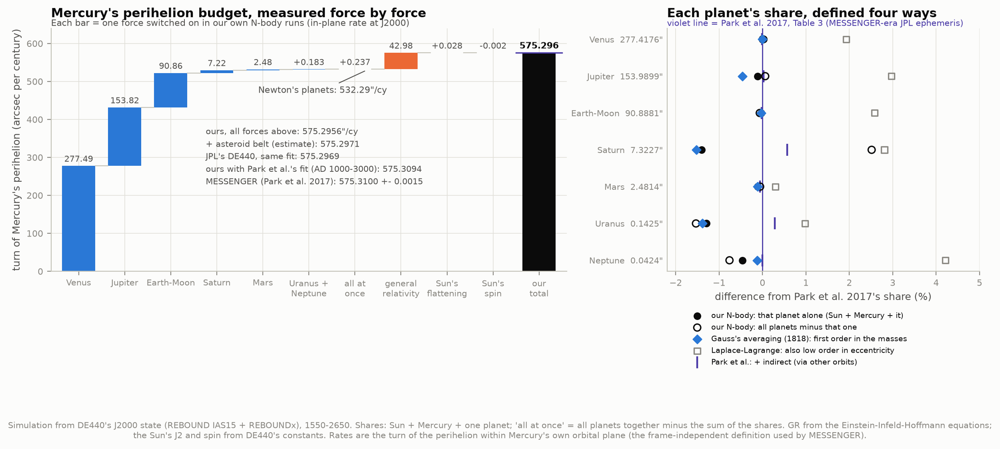

Without GR our Mercury falls behind JPL's by **43.01″ per century**: 279″ and 77,000 km by 2650,
21.5′ and 520,000 km by AD 5000. With GR (plus the Sun's shape and spin) it stays within 0.07″ of
JPL's DE441 over six millennia.

Three findings that the textbook story leaves out:

* **"575″ per century" depends on how you measure.** The famous numbers are the turn of the
  perihelion *within Mercury's own orbital plane*. The longitude of perihelion in the fixed
  ecliptic of J2000 (the frame the atlas spec suggested) advances 571.93″/cy, and on the ICRF
  equator 560.93″/cy: the orbit plane slides along the reference plane, and the "dogleg" angle
  Ω + ω picks that up. And the rate itself changes: it was 578.0″/cy around 850 BC and will be
  572.7″/cy around AD 4550.
* **Each planet's share depends on its definition.** Venus 277.4, Jupiter 153.8–154.1, Earth–Moon
  90.83–90.89: whether a planet acts alone, is removed from the full system, or is split into
  direct and indirect effects (Park et al.) moves its share by up to 0.3″/cy. The total does not
  depend on it.
* **Gauss had it in 1818.** His method of averaging one orbit over another, exact to first
  order in the planetary masses, gives each planet's share to 0.003–0.35% of our full N-body
  value; the classical low-eccentricity (Laplace–Lagrange) expansion is 2–5% high at Mercury's
  e = 0.206.

Up the ladder, from an Earth satellite to the Galactic Centre, every measured orbit precesses as
GR predicts. The most precise rungs are the double pulsar (measured/predicted
**1.000005 ± 0.000025**, its masses taken from two *other* relativistic effects) and Mercury
(**1.00002 ± 0.00002**, MESSENGER).

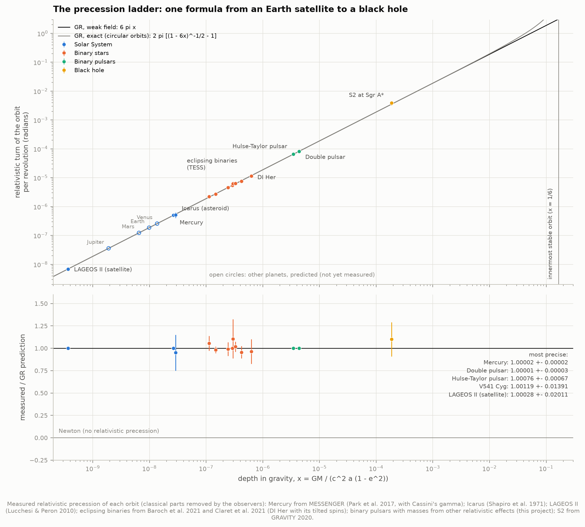

---

## Results

### 1. Mercury's budget, force by force

**What precesses.** A planet alone around a point-mass Sun traces a closed ellipse forever. Any
extra force turns the ellipse slowly in its plane, and the perihelion moves. Here the extra forces
are the other planets (Newtonian tugs), the Sun's equatorial bulge (its quadrupole moment J2), the
Sun's spin (which drags space around with it: the Lense–Thirring effect), and general relativity
itself, which makes gravity slightly stronger close to the Sun than the inverse-square law allows.

**The simulations.** Every run starts from Mercury's, the Sun's and the planets' positions and
velocities in DE440 at J2000.0 (2000 January 1, 12:00 TDB), with DE440's masses, and is integrated
backwards to 1550 and forwards to 2650 with REBOUND's IAS15 integrator (adaptive, 15th order, error
at the level of floating-point round-off). Mercury's state is recorded every 2 days. Earth and Moon
travel as one body at their barycentre; seen from Mercury, the pair's quadrupole is two parts in
10⁷ of its pull. GR comes from REBOUNDx: the Einstein–Infeld–Hoffmann (EIH) equations for every
pair of bodies (`gr_full`), cross-checked with the single-Sun first-post-Newtonian force (`gr`) and
the Nobili–Roxburgh effective potential (`gr_potential`). The Sun's J2 (2.196 × 10⁻⁷), radius,
spin axis (IAU pole: RA 286.13°, Dec 63.87°) and angular momentum (1.90 × 10⁴¹ kg m² s⁻¹, from
DE440's moment-of-inertia factor and rotation rate) are DE440's own constants.

**Measuring a rate.** The perihelion direction wobbles by up to ±20″ with periods from 44 days to
12 years as the planets pass by. We fit the slowly turning angle with a quadratic in time over the
whole 1,100 years. The linear coefficient is the rate at J2000, and the quadratic lets the rate
itself drift (by −0.092″/cy per century). Each force's share is measured on the *difference*
between two runs (with and without that force), in which the planets' wobbles cancel almost
exactly.

| Contribution (″/cy, in-plane, J2000) | Our N-body | Formula / reference |
|---|---:|---:|
| Venus (alone with Sun + Mercury) | 277.487 | |
| Jupiter | 153.820 | |
| Earth–Moon | 90.863 | |
| Saturn | 7.220 | |
| Mars | 2.479 | |
| Uranus + Neptune (+ Pluto: 0.000) | 0.183 | |
| all planets at once, minus the sum above | +0.237 | |
| **planets, Newton** | **532.289** | Park et al. 2017: 532.3035 incl. asteroids |
| GR, EIH, all planets present | 42.980672 | 6πGM/(c²a(1−e²)): 42.980676 |
| GR, Sun + Mercury: `gr` / `gr_full` / `gr_potential` | 42.980675 / 42.980670 / 42.980678 | |
| Sun's J2 (Mercury 3.38° from the solar equator) | +0.027771 | (3/4) n J2 (R/p)² (3cos²i − 1): +0.027771 |
| Sun's spin (Lense–Thirring) | −0.002015 | −4GS cos i / (c²a³(1−e²)^{3/2}): −0.002015 |
| **total** | **575.2956** | DE440: 575.2969 |
| + asteroid belt (343 DE440 masses, ring estimate) | +0.0015 | → 575.2971 |

DE440's own rate is measured from its Mercury exactly as from our runs: same span, same fit.
Park et al.'s MESSENGER-era JPL solution differs from DE440 (their J2 is 2.25 × 10⁻⁷,
their β − 1 = −2.7 × 10⁻⁵), but those differences add only ~0.001″/cy. The remaining 0.013″/cy
between DE440's 575.2969 and their 575.3100 is the fitting window: see §2.

### 2. "The" precession rate: which frame, which fit?

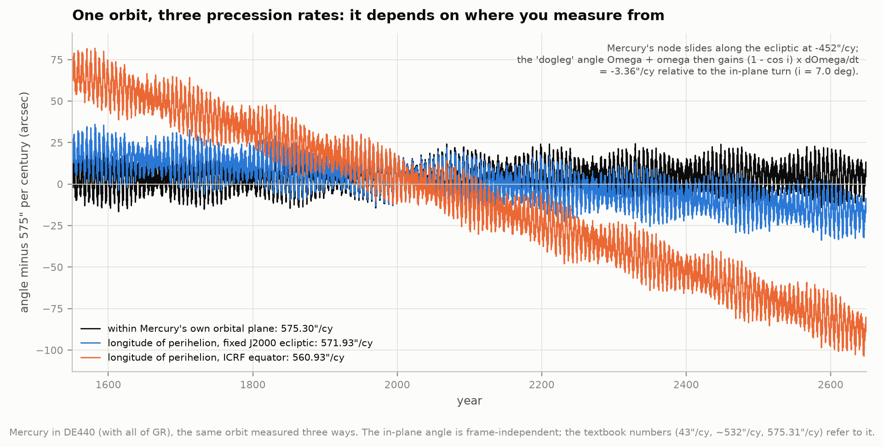

A perihelion's position can be written as the longitude of perihelion ϖ = Ω + ω: the angle along
a reference plane from a fixed direction to the orbit's ascending node (Ω), then along the orbit
to the perihelion (ω). It is a "dogleg" angle, and while Mercury's node slides along the J2000
ecliptic at −451.5″/cy (the planets also tilt Mercury's orbit), the dogleg changes by
(1 − cos i) dΩ/dt = −3.36″/cy. Measured on the ICRF equator, where Mercury's orbit is tilted
28.6°, the difference grows to −14.4″/cy. The frame-independent quantity is the turn of the
eccentricity vector (the arrow to the perihelion) about the orbit's own axis. We compute it from
consecutive samples as the angle (ê₁ × ê₂)·ĥ, the same quantity as dω + cos i dΩ.

| Mercury in DE440 (″/cy at J2000) | |
|---|---:|
| in Mercury's own plane | **575.297** |
| longitude of perihelion, fixed J2000 ecliptic | 571.927 |
| longitude of perihelion, ICRF equator | 560.933 |

The textbook 43″ and 532″ and MESSENGER's 575.31″ are in-plane rates: Park et al. measure the
perihelion in Mercury's mean orbital plane (their Sect. 4), where the dogleg vanishes.

**The fitting window matters at 0.01″/cy.** The rate at J2000 from symmetric windows of ±100 to
±450 years spans 575.268–575.302″/cy. Park et al. fitted AD 1000–3000 with a quadratic plus 14
periodic terms (their Table 2). Applying exactly that recipe to our six-millennium full-physics run
(§3) gives **575.3079″/cy**, plus 0.0015 for the asteroids **= 575.3094**, against
**575.3100 ± 0.0015** (difference 0.4σ). Their fitted curvature, Q = −0.044781″/cy², we reproduce as
−0.044790. The individual periodic amplitudes do not match their Table 2. Sampling once per
orbit, at perihelion, makes terms that differ by a multiple of Mercury's mean motion nearly
indistinguishable. The rate does not depend on them: a quadratic alone gives 575.3084.

### 3. Against JPL: 1,100 and 6,000 years

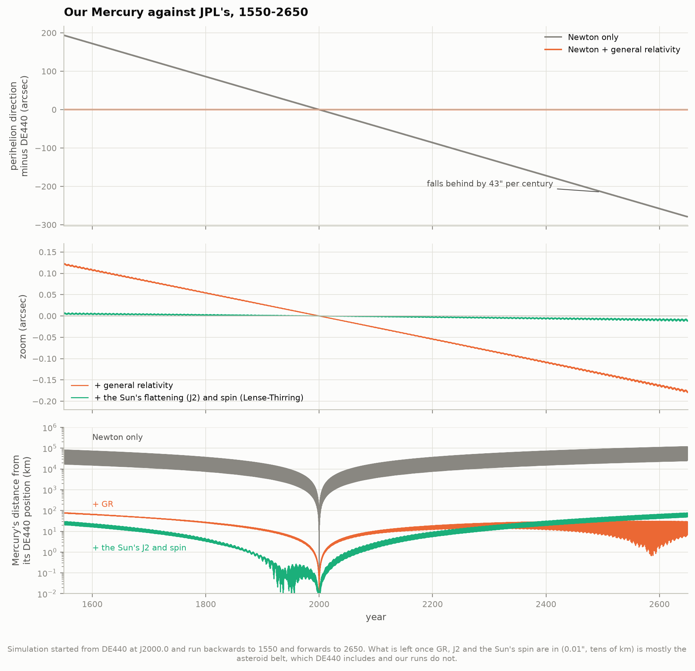

Our runs start from DE440's state at J2000, so any difference later is the physics we left out.
With Newton alone, Mercury's perihelion falls behind DE440's by 43.0″ per century: 193″ ahead in
1550 and 279″ behind in 2650, with Mercury itself up to 118,000 km out of place. Adding GR brings
the perihelion within 0.18″ and Mercury within 78 km; adding the Sun's J2 and spin, within
0.013″. That last drift (−0.0013″/cy) is the asteroid belt.

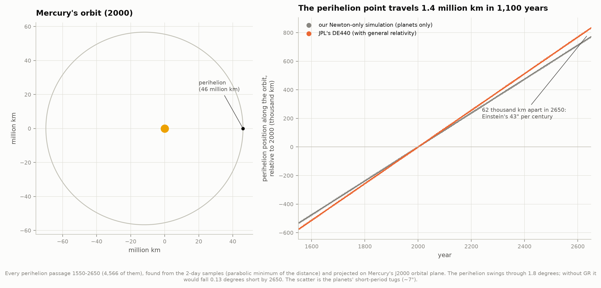

Every one of Mercury's 4,566 perihelion passages between 1550 and 2650 in DE440 marches 1.4
million km along the orbit (1.8°); in our Newton-only run the perihelion falls 62,000 km short by
2650.

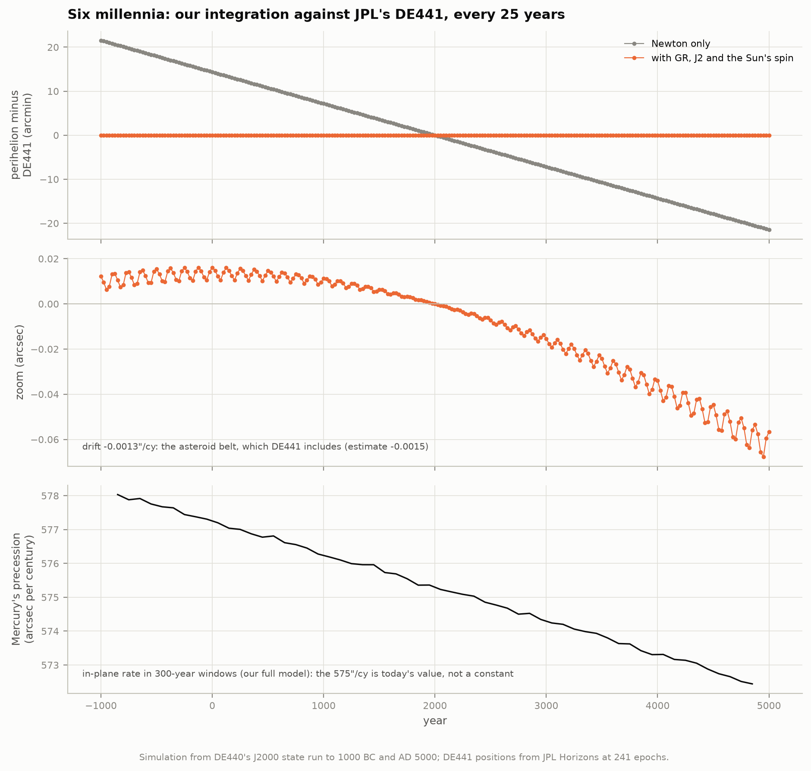

Over six millennia, against DE441 (JPL's long-span ephemeris, served by Horizons) every 25 years
from 1000 BC to AD 5000: Newton-only drifts by −43.010″/cy (21.5′ at the ends, 520,000 km);
the full model by −0.00125″/cy, the asteroid belt again (estimate −0.0015), staying within 0.07″
and 1,500 km. The precession rate itself falls from 578.0″/cy around 850 BC to 572.7″/cy around
AD 4550, as the planets' orbits slowly change: 575.3″ is today's value, not a constant.

**Horizons cross-checks.** Our osculating elements computed from DE440 state vectors (with
GM = GM☉ + GM_Mercury and the IAU 1976 obliquity, 84381.448″, as Horizons' headers state) match
Horizons' printed elements at 109 epochs from 1560 to 2640 to 5 × 10⁻¹⁵ in e and 6 × 10⁻⁹″ in
the angles. Horizons labels its source DE441, but its Mercury positions equal DE440's to
3 × 10⁻⁸ km over that span.

### 4. Each planet's share, four ways

Asking "how much does Venus contribute?" has more than one honest answer, because the planets also
pull on each other:

| ″/cy | Venus | Jupiter | Earth–Moon | Saturn | Mars | Uranus | Neptune |
|---|---:|---:|---:|---:|---:|---:|---:|
| our N-body: Sun + Mercury + that planet | 277.487 | 153.820 | 90.863 | 7.220 | 2.479 | 0.141 | 0.042 |
| our N-body: all planets minus that one | 277.440 | 154.086 | 90.830 | 7.507 | 2.480 | 0.140 | 0.042 |
| Park et al. 2017, direct effect | 277.418 | 153.990 | 90.888 | 7.323 | 2.481 | 0.143 | 0.042 |
| Park et al. 2017, + interaction rows | 277.390 | 154.030 | 90.866 | 7.364 | 2.480 | 0.143 | 0.042 |
| Gauss's averaging (first order, exact in e, i) | 277.419 | 153.277 | 90.860 | 7.211 | 2.479 | 0.141 | 0.042 |
| Laplace–Lagrange (low order in e) | 282.76 | 158.56 | 93.24 | 7.53 | 2.489 | 0.144 | 0.044 |

**Why they differ.** In a pair run Jupiter follows its J2000 osculating orbit without Saturn,
which is not Jupiter's real average orbit (Saturn's "great inequality" perturbs it). Removing
Saturn from the full system changes Jupiter's average orbit too, and that change is booked to
Saturn (+0.18″ relative to Park et al.'s direct value). The pair shares sum to 532.05 and the
all-but-one shares to 532.53, while all planets together give 532.29: the planets' pulls are
0.04% non-additive.

**Gauss and Laplace–Lagrange.** Gauss (1818) spread each planet along its orbit as a ring,
weighted by the time it spends there, and averaged the ring's pull over Mercury's orbit. Our
implementation of that, first order in the masses but exact in eccentricity and inclination,
matches the pair runs to 0.003% (Earth) to 0.35% (Jupiter). We traced Jupiter's 0.54″/cy to
second order in its mass: the pair run with Jupiter 10× and 100× lighter, scaled back up, gives
153.330 and 153.281″/cy, converging on Gauss's 153.277 (`10_numerics.png`). The classical
Laplace–Lagrange theory expands to second order in eccentricities and comes out 2–5% high at
Mercury's e = 0.206. Le Verrier and Newcomb carried such expansions to higher order by hand.

### 5. The anomaly through history

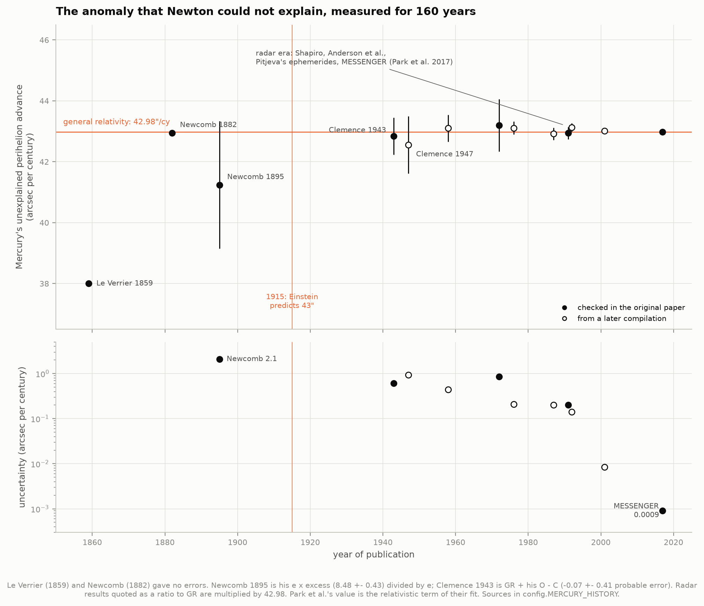

| Year | Who | Anomalous advance (″/cy) | Source |
|---|---|---:|---|
| 1859 | Le Verrier | 38 | primary: Comptes rendus 49, 380 ("38 secondes") |
| 1882 | Newcomb (transits 1677–1881) | 42.95 | primary |
| 1895 | Newcomb (all observations) | 41.24 ± 2.09 | primary: e × excess = 8.48 ± 0.43, ÷ e |
| 1943 | Clemence (meridian + transits 1765–1940) | 42.84 ± 0.61 | primary O − C = −0.07 ± 0.41 (p.e.) relative to GR |
| 1947 | Clemence | 42.56 ± 0.94 | via Pireaux & Rozelot 2003 |
| 1958 | Duncombe | 43.10 ± 0.44 | via Pireaux & Rozelot 2003 |
| 1972 | Shapiro et al. (radar) | 1.005 ± 0.02 × GR | primary (±0.007 statistical) |
| 1976 | Shapiro et al. | 43.11 ± 0.21 | via Anderson et al. 1991 and Pireaux & Rozelot |
| 1987 | Anderson et al. (radar + Mariner 10) | 42.92 ± 0.20 | via Anderson et al. 1991 |
| 1991 | Anderson et al. (radar 1966–88) | 42.94 (± 0.20) | primary |
| 1992 | Anderson et al. | 43.13 ± 0.14 | via Pireaux & Rozelot 2003 |
| 2001 | Pitjeva (EPM2000) | 43.0115 ± 0.0085 | via Pireaux & Rozelot 2003 |
| 2017 | Park et al. (MESSENGER) | 42.9799 ± 0.0009 | primary, Table 3 |

Le Verrier's 38″ (with planetary masses of his day; he suspected an unseen planet or ring, "Vulcan")
grew to 43″ with Newcomb's better masses. Newcomb's own 1895 value, 41.24 ± 2.09″/cy, is often
misquoted as 43″. Many of these values were checked against the original papers by the N7 project
(`64-gravity-scorecard/literature/checks/`); this project read Clemence 1943 and Anderson et al.
1991 in their ADS page scans. Values known only from later compilations are drawn as open
circles. The uncertainty fell 2,000-fold, from Newcomb's ±2.1″/cy to MESSENGER's ±0.0009″/cy.

### 6. General relativity on every planet

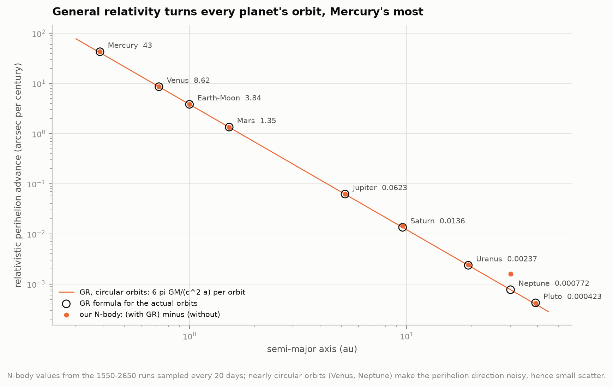

The same runs give GR's share for every planet, as (all planets + GR) minus (all planets): Mercury
42.981, Venus 8.633, Earth–Moon 3.839, Mars 1.351, Jupiter 0.063, Saturn 0.014″/cy, against the
formula's 42.981, 8.625, 3.839, 1.351, 0.062, 0.0136. GR falls off as a^(−5/2)/(1 − e²).
The outer planets' nearly circular orbits make their perihelia noisy (Neptune's e = 0.009).

### 7. Numerical honesty

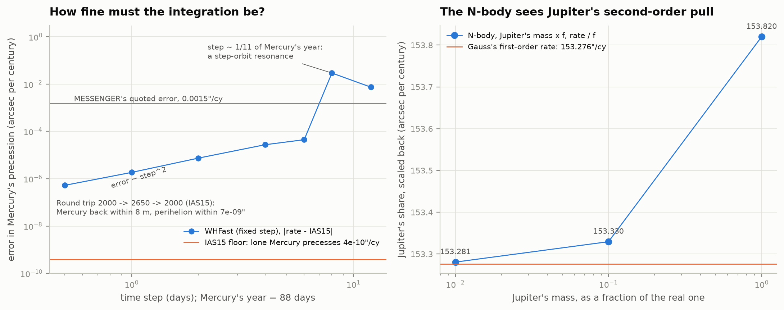

* **Floor.** Sun + Mercury alone, Newtonian, must not precess. It precesses at 4 × 10⁻¹⁰″/cy.
* **Round trip.** Integrating forward 650 years and back brings Mercury home within 8 m, its
  perihelion direction within 7 × 10⁻⁹″.
* **Fixed steps.** The symplectic WHFast integrator, compared with IAS15 at identical sample times,
  errs by 5 × 10⁻⁷″/cy at a 0.5-day step, growing as step² to 4.5 × 10⁻⁵″/cy at 6 days. At
  8 days, close to 1/11 of Mercury's 88-day year, a step–orbit resonance spikes the error to
  0.03″/cy (12 days: 0.007).
* **Physics.** Three different REBOUNDx GR implementations agree to 8 × 10⁻⁶″/cy.

### 8. The precession ladder

The figure at the top places every measured relativistic precession on one axis: how deep in
gravity the orbit is, x = GM/(c²a(1 − e²)) (M the total mass of the pair). To first
post-Newtonian order, GR predicts a turn of 6πx radians per orbit for any pair, whatever the mass
ratio. The weak-field line continues into the exact Schwarzschild curve for circular orbits,
2π[(1 − 6x)^(−1/2) − 1], which diverges at the innermost stable orbit (x = 1/6).

| Rung | x | Measured / GR | How |
|---|---:|---:|---|
| LAGEOS II perigee (Earth's field) | 3.6 × 10⁻¹⁰ | 1.0003 ± 0.021 | Lucchesi & Peron 2010 (±0.0021 statistical, ~2% systematic) |
| Mercury | 2.7 × 10⁻⁸ | 1.000023 ± 0.000020 | (2 + 2γ − β)/3 from Park et al. 2017's β and Cassini's γ |
| (1566) Icarus | 2.9 × 10⁻⁸ | 0.95 ± 0.2 | Shapiro et al. 1971 (realistic error) |
| 6 TESS eclipsing binaries | 1.1–4.2 × 10⁻⁷ | 0.96–1.11 each; A = 1.000 ± 0.012 | §9 |
| EW Ori | 2.4 × 10⁻⁷ | 0.99 ± 0.08 | Claret et al. 2021, Appendix A |
| DI Herculis | 6.3 × 10⁻⁷ | 0.96 ± 0.14 | §9 |
| Hulse–Taylor pulsar | 3.5 × 10⁻⁶ | 1.0008 ± 0.0007 | §10 |
| double pulsar | 4.4 × 10⁻⁶ | 1.000005 ± 0.000025 | §10 |
| S2 at Sgr A* | 1.9 × 10⁻⁴ | 1.10 ± 0.19 | GRAVITY Collaboration 2020; §11 |

For the stars the classical part of the precession (tides, stellar spins) has been subtracted with
the observers' stellar models; for the pulsars and S2 the observers fitted GR's term directly. The
other planets are drawn as predictions only: their relativistic precession is folded into modern
ephemeris fits, not measured on its own.

### 9. Eclipsing binaries and DI Herculis

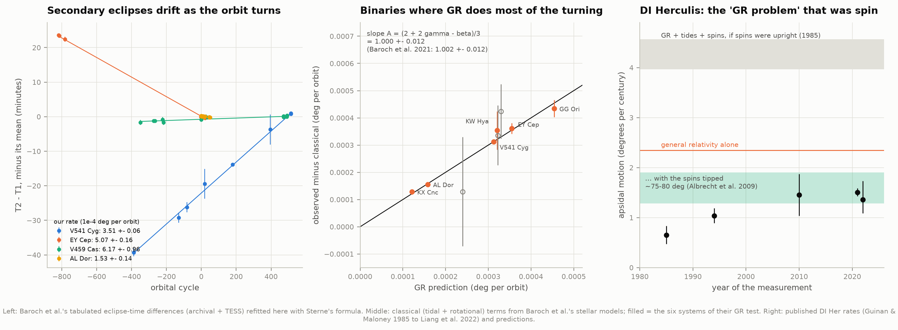

In an eccentric eclipsing binary the secondary eclipse is not halfway between primaries. The time
from primary to secondary eclipse, T₂ − T₁, depends on e cos ω, so it drifts as the orbit turns
(Sterne's formula). Baroch et al. (2021) picked binaries of small Sun-like stars in wide orbits,
where GR does 60–99% of the turning. From their LaTeX source we re-derive the rates from their
tabulated timings:

| System | Our rate (10⁻⁴ °/orbit) | Baroch et al. |
|---|---:|---:|
| V541 Cyg (archival + TESS, 901 orbits) | 3.506 ± 0.063 | 3.52 ± 0.04 |
| EY Cep | 5.074 ± 0.157 | 5.07 ± 0.16 |
| V459 Cas | 6.17 ± 0.96 | 6.5 ± 1.0 |
| AL Dor (TESS alone) | 1.53 ± 0.14 | 1.63 ± 0.06 |
| KX Cnc (from their quoted ΔT) | 1.313 ± 0.057 | 1.31 ± 0.10 |

Subtracting their classical (tidal + rotational) terms, the six systems of their GR test give
(2 + 2γ − β)/3 = **1.000 ± 0.012** (theirs: 1.002 ± 0.012). Our GR rates reproduce their
Table 9 to every digit except KW Hya, where the printed value is 0.3% off its own inputs.

**DI Herculis** was the "GR problem" of eclipsing binaries: from 1985 on, its observed apsidal
motion (0.65 to 1.75° per century, depending on the analysis; 1.51 ± 0.08 from TESS) sat far below
the 4.27° per century expected from GR (2.34) plus tides and rotation with upright spins. Read
naively, that is (observed − classical)/GR = −0.18: GR would be failing. Albrecht et al. (2009)
found both stars' spin axes steeply tilted (sky-projected 72° and −84°; 3D obliquities ~75° and
80°, Liang et al. 2022). A star spinning sideways bulges in a direction that pushes the periastron
backwards. With that, the measured GR part is 0.96 ± 0.14 of GR's prediction (Claret et al.
2021's rate and theory).

### 10. Binary pulsars: periastron advance as a test

A pulsar in a binary is a clock on an orbit, and timing it yields several relativistic effects,
each fixed in GR by the two masses. The published masses use the periastron advance itself, so
here we weigh each system with two *other* effects and then predict its advance:

| System | Masses from | m_p, m_c (M☉) | ω̇ predicted (°/yr) | measured | ratio |
|---|---|---|---:|---:|---:|
| PSR B1913+16 | time dilation γ + orbital decay | 1.4355 ± 0.0024, 1.3897 ± 0.0012 | 4.2234 ± 0.0028 | 4.226585 | 1.0008 ± 0.0007 |
| PSR J0737−3039 | mass ratio R + γ | 1.3382, 1.2490 | 16.900 ± 0.013 | 16.899323 | 0.99996 ± 0.00075 |
| PSR J0737−3039 | Shapiro shape s + orbital decay | 1.338181, 1.248842 | 16.89923 ± 0.00043 | 16.899323 | **1.000005 ± 0.000025** |

The last route is Kramer et al.'s (2021) own test (their ratio: 1.000015 ± 0.000026), with the same
masses they quote. Weisberg & Huang (2016) print γ = "0.004307 ms"; their own parameter file
shows it is 4.307 ms.

### 11. S2 at the Galactic Centre

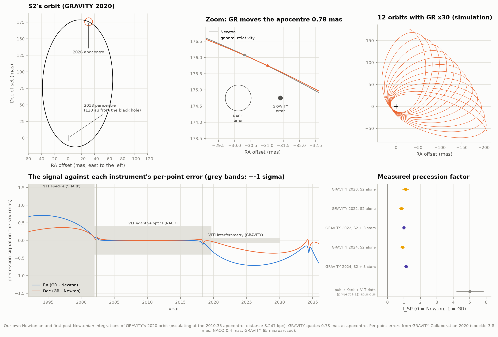

S2 swings to within 120 au of Sagittarius A* every 16 years at 2.6% of the speed of light, and GR
turns its orbit by 12.2′ per revolution. Integrating GRAVITY's 2020 orbit (osculating at the
2010.35 apocentre) once with Newton and once with first-post-Newtonian gravity, GR moves S2's
**2026 apocentre by 0.782 mas** (0.71 mas in RA). GRAVITY quotes 0.78 mas, mostly in RA. The
orbit model reproduces 127 NACO positions (2002–2016) to 0.6/0.5 mas rms, against their
0.4 mas errors.

That shift is twice the per-point error of the VLT's adaptive optics (NACO, 0.4 mas) and twelve
times that of VLTI/GRAVITY (65 µas). It also needs the AO frame tied to the black hole to
~0.1 mas, the limiting systematic in GRAVITY's analysis. GRAVITY measured f_SP = 1.10 ± 0.19
(2020, S2 alone); later 0.85 ± 0.16 (2022, S2) and 1.135 ± 0.110 (2024, with three more stars).
Project H1 fitted the public Keck and NTT/VLT positions and got f_SP ≈ 5.0 ± 0.8, a spurious
value driven by 1990s speckle data.

### 12. The rosette

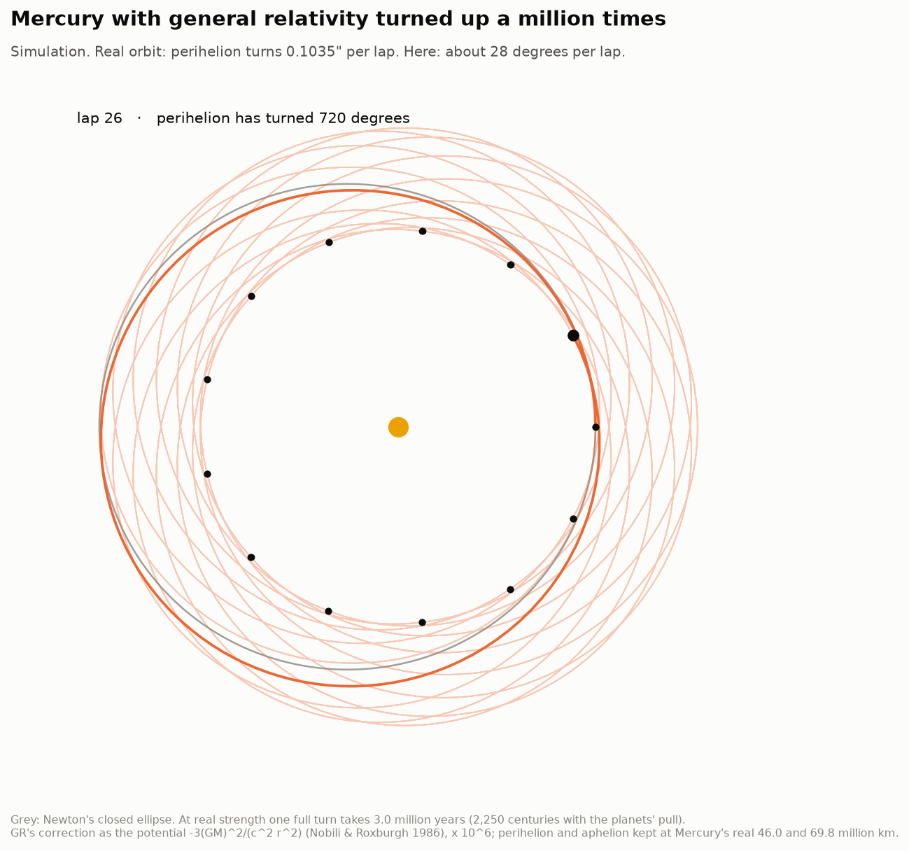

`figures/mercury_rosette.mp4` (and a lighter `.gif`) is a **simulation**: Mercury with GR's extra
pull multiplied by 10⁶ (light slowed to 300 km/s). At real strength the perihelion turns 0.1035″
per orbit, and one full turn takes 3.0 million years (225,000 years with the planets' share).
×10⁶, it turns about 28° per orbit. At that strength GR's first-post-Newtonian force is no longer
a small correction, and REBOUNDx's iterative 1PN force stops converging. So the animation uses
the effective potential −3(GM)²/(c²r²) (Nobili & Roxburgh 1986), which gives exactly GR's
precession at real strength (42.98068″/cy in our runs) and keeps the orbit an exact turning
ellipse: Newton's "revolving orbits" (Principia, Book I, Prop. 44). The rosette keeps Mercury's
real perihelion and aphelion distances (46.0 and 69.8 million km). It then turns 27.690° per
lap, as the exact solution for that potential predicts, 2π(√(1 + 6GM/c²p) − 1) = 27.690°
(scaling 0.1035″ up linearly would give 28.75°).

---

## Data and provenance

| Data | Source | Size |
|---|---|---:|
| DE440 ephemeris (1550–2650) and its 645 constants | JPL SSD, `ssd.jpl.nasa.gov/ftp/eph/planets/` (Park et al. 2021, AJ 161, 105) | 120 MB |
| Mercury from DE441 at 350 epochs (vectors, elements) | JPL Horizons API | 150 kB |
| Baroch et al. 2021 LaTeX source (tables of rates and timings) | arXiv:2103.03140v2 | 5 MB |
| Baroch et al. 2021 TESS eclipse times | VizieR J/A+A/649/A64 | 13 kB |
| Orbits of asteroids 1–1467 (for DE440's 343 asteroid masses) | JPL SBDB query API | 64 kB |
| S2 positions (orbit check only) | H1's cache of Gillessen et al. 2017 (VizieR J/ApJ/837/30) | — |

Published numbers (Park et al. 2017's Table 3, GRAVITY, pulsar timing, DI Her, LAGEOS, Icarus, the
history table) are in `config.py`, each with its source and table or page. They were read from the
papers themselves, not from search summaries; two journal references were corrected via Crossref.

## How to run

```bash
cd astrophysics/57-orbital-precession
../.venv/bin/python run.py              # fetch, simulate, analyse, draw, animate
../.venv/bin/python run.py --no-movie   # skip the 3-minute animation
../.venv/bin/python test_physics.py     # 12 checks of formulas, conventions and runs
```

The first run downloads ~125 MB and integrates 37 N-body runs (~25 minutes on 4 cores, mostly the
six-millennium full-physics run; the cache in `data/derived/runs/` is ~0.5 GB). Afterwards
everything rebuilds from the cache in about a minute plus the animation, offline.

Code: `ephemeris.py` (DE440), `orbit_physics.py` (elements, rates, Gauss and Laplace–Lagrange),
`nbody.py` (REBOUND runs), `budget.py` (the budget), `park_check.py` (Park et al.'s recipe),
`horizons_check.py`, `binaries.py`, `pulsars.py`, `s2.py`, `ladder.py`, `analysis.py`,
`figures.py`, `animate.py`.

## Caveats

* Our model leaves out the asteroids (estimated, +0.0015″/cy), the Moon as a separate body
  (negligible here), solar mass loss and tides. "Measured" for Mercury means measured on DE440, an
  ephemeris fitted to real observations, and on Park et al.'s MESSENGER-era fit. We do not fit
  radar or spacecraft ranging ourselves.
* Rates at J2000 depend on the fitting window at the ±0.02″/cy level; quote the window with the
  number.
* For binary stars the classical apsidal motion comes from the observers' stellar-structure
  models; we do not recompute it. For S2 we cannot refit GRAVITY's data (not public); we compute
  the expected signal.
* History values marked "via" are second-hand. Clemence 1943's anomaly uses Newcomb's empirical
  term of 43.37″ from a secondary source to convert his O − C.

## Changes from the atlas spec

* The spec's "work in the fixed ecliptic J2000 frame" does not give the famous numbers: in that
  frame ϖ advances 571.9″/cy (planets 528.9″/cy). The 575″, 532″ and 43″ are rates within
  Mercury's orbital plane (MESSENGER's definition); the README explains the dogleg.
* Download ~125 MB (DE440 is 120 MB), not <10 MB.
* Added: per-planet comparison with Park et al. 2017's Table 3, Gauss's and Laplace–Lagrange's
  secular theory, a six-millennium check against DE441, the WHFast step test, the asteroid
  closure, LAGEOS II, Icarus and EW Ori on the ladder, independent pulsar mass routes, and S2's
  on-sky signal.
* C9 (binary pulsars) is not built yet; pulsar parameters come straight from Weisberg & Huang 2016
  and Kramer et al. 2021.

## References

Albrecht et al. 2009, Nature 461, 373 · Anderson et al. 1991, Proc. ASA 9, 324 · Baroch et al. 2021,
A&A 649, A64 · Bertotti, Iess & Tortora 2003, Nature 425, 374 · Claret, Torres & Wolf 2010, A&A 515,
A4 · Claret et al. 2021, A&A 654, A17 · Clemence 1943, AJ 50, 126 · GRAVITY Collaboration 2020,
A&A 636, L5; 2022, A&A 657, L12; 2024, A&A 692, A242 · Guinan & Maloney 1985, AJ 90, 1519 ·
Kramer et al. 2021, PRX 11, 041050 · Le Verrier 1859, Comptes rendus 49, 379 · Liang, Winn &
Albrecht 2022, ApJ 927, 114 · Lucchesi & Peron 2010, PRL 105, 231103 · Newcomb 1882, Astron. Papers
1, 363; 1895, The Elements of the Four Inner Planets · Nobili & Roxburgh 1986, IAU Symp. 114, 105 ·
Nobili & Will 1986, Nature 320, 39 · Park et al. 2017, AJ 153, 121 · Park et al. 2021, AJ 161, 105
(DE440/DE441) · Pireaux & Rozelot 2003, Ap&SS 284, 1159 · Rein & Spiegel 2015, MNRAS 446, 1424
(IAS15) · Shapiro et al. 1971, AJ 76, 588; 1972, PRL 28, 1594 · Sterne 1939, MNRAS 99, 451 ·
Tamayo et al. 2020, MNRAS 491, 2885 (REBOUNDx) · Weisberg & Huang 2016, ApJ 829, 55.
