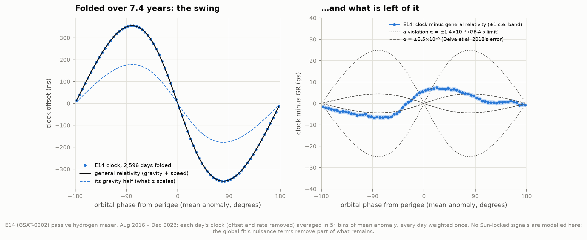
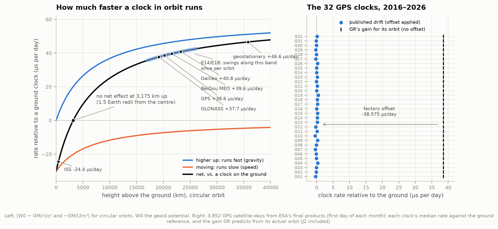
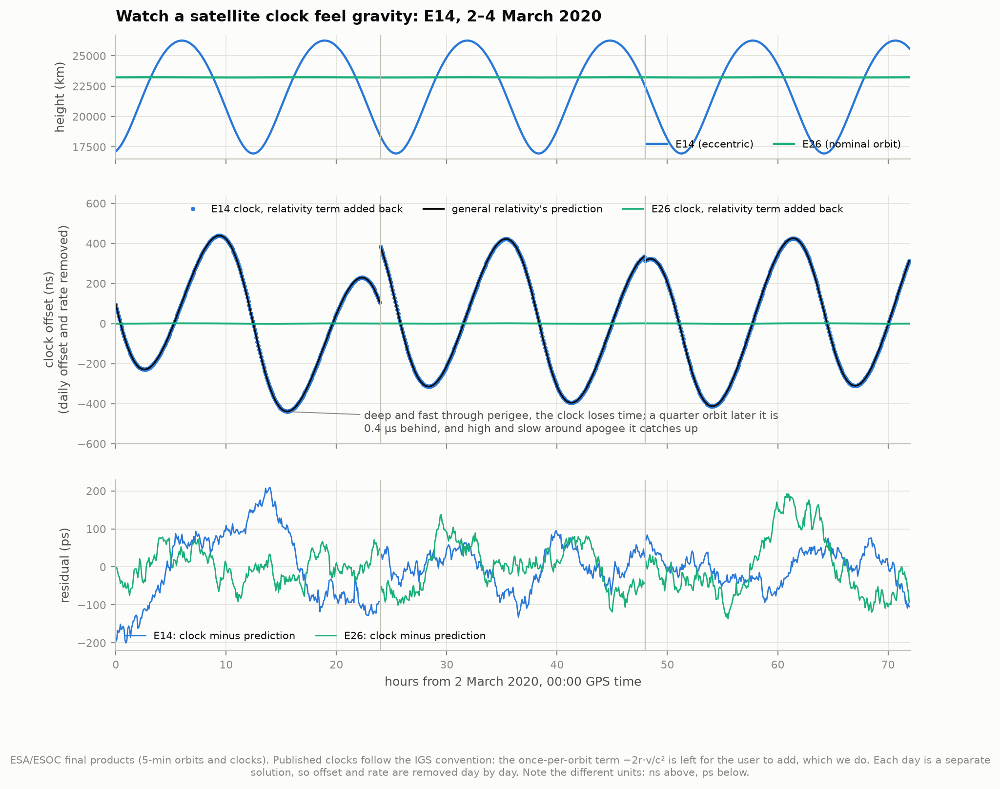
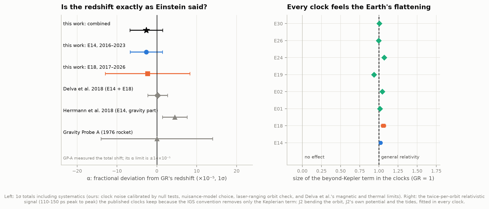
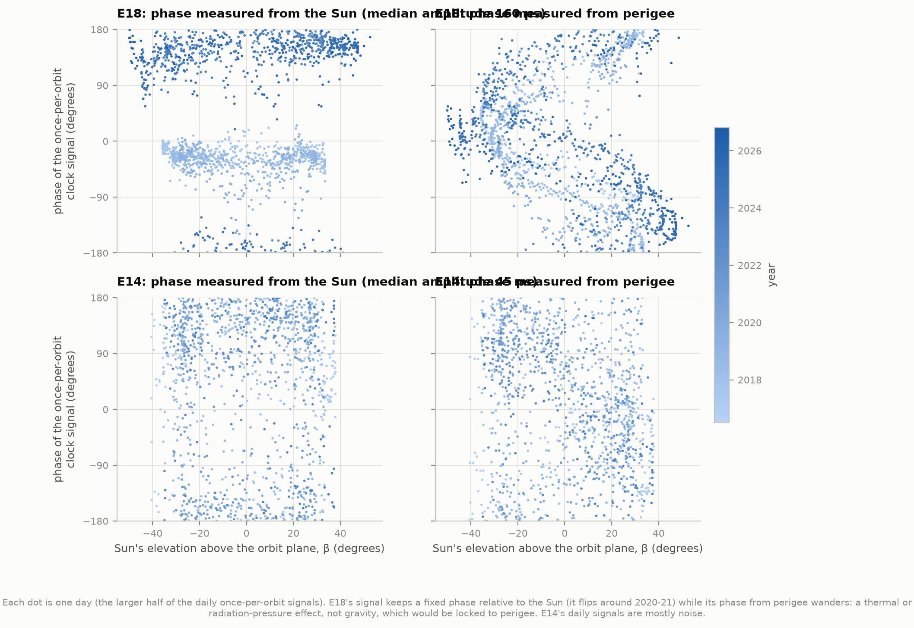
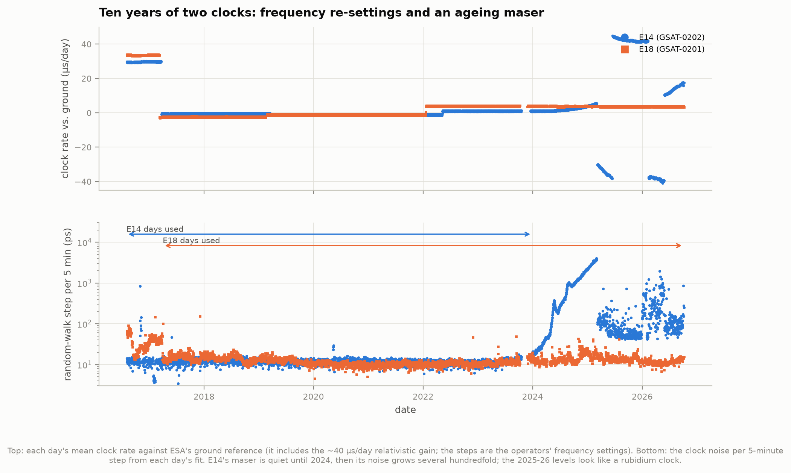
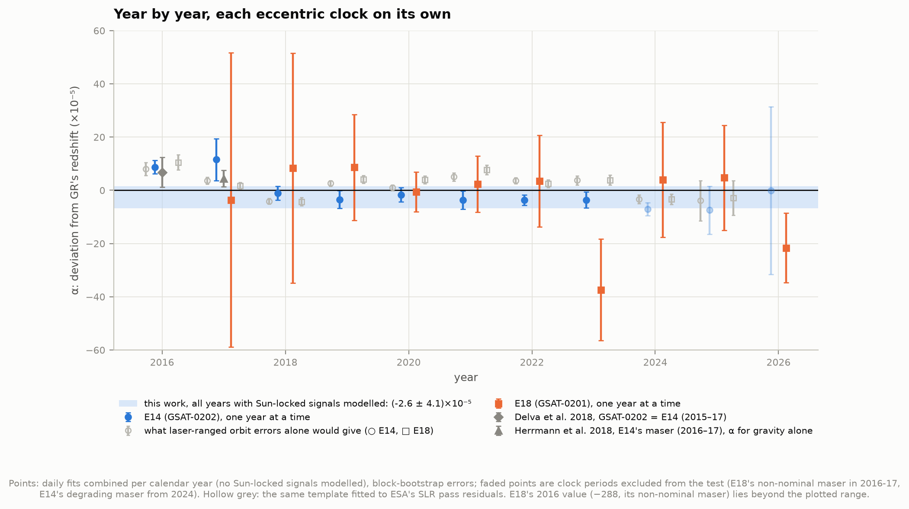
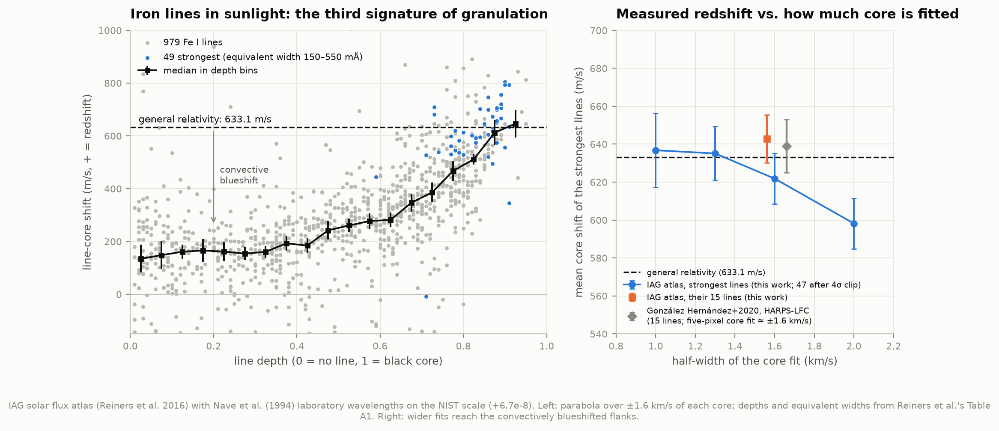
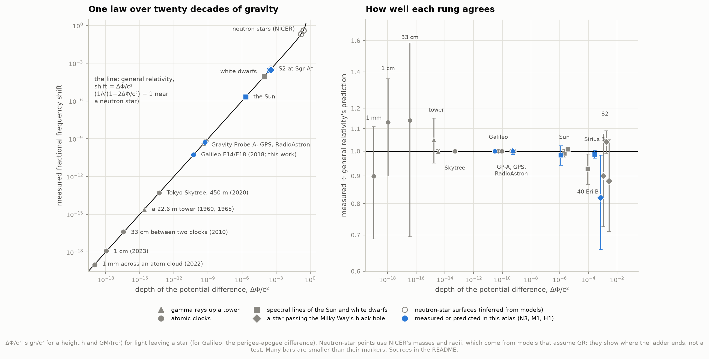

# N3 — Clocks run slower downhill: gravitational redshift from GPS to white dwarfs

**General relativity says a clock deeper in gravity ticks slower, and a moving clock ticks slower
too. Can we see this in public navigation data: GPS clocks that would gain 38 microseconds a day, and
two Galileo satellites stranded in eccentric orbits whose clocks speed up and slow down on every
orbit? And can we measure the same effect in the light of the Sun and of a white dwarf?**

Yes, on all counts, and with ten years of data rather than the three the published tests used.

**GPS.** For every GPS satellite in ESA's products (3,852 satellite-days, 2016-2026), general
relativity predicts that its clock gains **38.57 µs a day** on clocks on the ground (+45.7 for being
20,200 km up, −7.2 for moving at 3.9 km/s). The clocks are built to tick slow by exactly
4.4647 × 10⁻¹⁰ (−38.575 µs/day) before launch, and in orbit they keep time with the ground: their
published drifts have a median of **−0.02 µs/day**. The once-per-orbit wobble that receivers still
have to add is up to **60 ns (18 m)** on the most eccentric GPS satellite.

**The eccentric Galileo clocks.** E14 (GSAT-0202) and E18 (GSAT-0201) climb and fall 9,000 km twice a
day. Adding back the term the published clocks leave out, we watch each hydrogen maser fall
**0.38 µs behind** after its deep, fast perigee pass and catch up near apogee, every 12.9 hours,
exactly as GR predicts. We fit how strongly the clock responds to gravity:
the parameter α of Delva et al. (2018), zero if Einstein is right. Over 2,605 days of E14's maser
(2016-2023) and 3,382 days of E18's (2017-2026), with signals that follow the Sun rather than the
perigee modelled out:

> **α = (−2.6 ± 4.1) × 10⁻⁵**: the gravitational redshift confirmed to 4 parts in 100,000

That is **3.4 times tighter than Gravity Probe A's 1976 rocket** (±14 × 10⁻⁵) and in line with the two
published Galileo tests (Delva et al. 2018: 0.19 ± 2.48; Herrmann et al. 2018: 4.5 ± 3.1). It is
not tighter than theirs. More data beat the clock noise down to ±1.2 × 10⁻⁵, but the test is limited by
what cannot be measured from the ground: errors in the satellites' orbits, which leak into the clocks
(±3.2, checked against laser ranging), the masers' sensitivity to Earth's magnetic field (±1.9,
adopted from Delva et al.), and the choice of how to model a large clock signal locked to the Sun
(±1.3), which we discovered in E18.

Along the way the clocks show a smaller relativistic effect that the published products leave in: the
**Earth's flattening (J2)**, which bends the orbits and adds its own potential, makes every clock run
fast and slow twice per orbit by 110-150 ps. We detect it in **all eight** satellites we looked at, at
1.02 ± 0.04 of GR's size.

**The Sun.** In the IAG solar atlas, the cores of the 47 strongest iron lines are shifted by
**622 ± 26 m/s**; general relativity predicts **633.1 m/s** as seen from Earth. Weak lines show only
~150 m/s: convection blueshifts them by ~480 m/s. On the 15 lines González Hernández et al. (2020)
used, the IAG spectrum gives **643 ± 13 m/s** to their 639 ± 14.

**Sirius B.** M1's mass (1.015 M☉, from the orbit) and radius (0.0079 R☉) predict
**81.8 ± 1.0 km/s**; Joyce et al. (2018) measured **80.65 ± 0.77 km/s** in its Hα line (ratio
0.986 ± 0.016).

**The ladder.** Put beside a century of published tests, from a millimetre inside a cloud of atoms
(1.1 × 10⁻¹⁹) to light leaving Sirius B (2.7 × 10⁻⁴) and S2 passing the Milky Way's black hole, every
measured shift equals ΔΦ/c² within its errors: one law over twenty decades of gravity.



Animation: [`figures/galileo_clock.mp4`](figures/galileo_clock.mp4), one day of E14 to scale with its
real clock.

---

## Results

### 1. The GPS clock budget



A clock at distance r from the Earth's centre, moving at speed v, ticks at a rate
`1 − [U(r) + v²/2]/c²` of coordinate time, where U = GM/r (plus the Earth's flattening) is the
gravitational potential. A clock on the ground ticks at `1 − W₀/c²`, with W₀ = 62,636,856 m²/s² the
potential of the geoid (Earth's gravity plus its rotation). So a satellite clock gains

    (W₀ − GM/r)/c²     because it is higher up,       and loses
    GM/(2rc²)          because it moves (v² = GM/r on a circular orbit).

| Orbit | height | gravity | speed | net, µs per day |
|---|---|---|---|---|
| ISS | 420 km | +3.8 | −28.2 | **−24.4** |
| no net effect | 3,175 km (r = 1.50 Earth radii) | | | 0 |
| GLONASS | 19,100 km | | | +37.7 |
| GPS | 20,200 km | +45.7 | −7.2 | **+38.6** |
| BeiDou MEO | 21,500 km | | | +39.6 |
| Galileo | 23,200 km | | | +40.8 |
| geostationary | 35,800 km | | | +46.6 |

**Real GPS clocks.** From ESA's full product files on the first day of each month (32 satellites,
3,852 satellite-days), we compute each satellite's predicted gain from its actual orbit (with J2):
median **38.574 µs/day**, ranging 38.548-38.624 between orbits. The published clocks, measured against
ESA's ground reference, drift by a median **−0.019 µs/day** (robust scatter ±0.53, 95% within
±1.2 µs/day): the factory offset of −38.575 µs/day takes the gain away. Drift minus offset gives an
implied gain of **38.556 µs/day**, 0.05% from GR's. This is a consistency check rather than a clean
test: the operators also adjust satellite clocks, so the drifts are not untouched by design.

**"11 km a day".** 38.6 µs times the speed of light is 11.6 km of range, the figure usually quoted
for the error if relativity were ignored. In practice the ground segment estimates every satellite
clock and broadcasts corrections, so a steady drift would be absorbed, until the broadcast offset
(a 22-bit field spanning ±0.98 ms) overflowed after ~25 days. A drift shared by all satellites would
also be absorbed into each receiver's own clock solution. What a receiver cannot avoid is the
once-per-orbit term that differs between satellites: for GPS orbits it reaches 18 ns on a typical
satellite (median) and **60 ns** (18 m) on the most eccentric; every receiver adds it back.

### 2. Watching a satellite clock feel gravity



On 22 August 2014, a Soyuz upper-stage fault left Galileo satellites 5 and 6 in elongated orbits. After
orbit raising they swing between **17,200 and 26,200 km** above the ground every 12.94 hours
(a = 27,978 km, e = 0.162, inclination 50°). Each carries passive hydrogen masers, clocks stable to
~10⁻¹⁴ over an orbit.

For a Keplerian orbit, the integral of the clock's rate has a periodic part
`Δτ = −(2/c²)·√(GMa)·e·sin E = −2 r·v/c²` (E: eccentric anomaly): **±381 ns** for these orbits,
**762 ns peak to peak**. Half of it is gravity (the clock runs slow deep in the potential near
perigee) and half is speed (it is also fastest there). The International GNSS Service convention
publishes satellite clocks with this term **removed**, for users to add back. We verified that on
the data: E18's published clock is flat to 0.18 ns rms after a straight line is removed; adding
−2r·v/c² produces the 859 ns swing; subtracting our full GR model makes it flat again (0.18 ns).

Our GR model integrates `[U + v²/2]/c²` numerically along the actual orbit every 5 minutes: the
Earth's monopole and flattening (J2) in the terrestrial frame, the tidal potentials of the Moon and
the Sun, and the speed in the geocentric inertial frame (IAU 2006/2000A rotation with IERS Earth
orientation). Tested on synthetic orbits, it reproduces an ODE-integrated proper time to better than
0.05 ps.

### 3. The test: does the clock follow Einstein exactly?

A violation of the redshift is written, after Delva et al. (2018), as
`dτ/dt = 1 − (1 + α)·U/c² − v²/(2c²)`: α scales only the gravitational part, whose once-per-orbit
swing is ±190 ns. If α = 10⁻⁵, the clock would be off by 1.9 ps at the peaks. Herrmann et al. (2018)
also scaled the speed term; their parameter is close to α/2.

**The data.** ESA/ESOC's final multi-GNSS products: orbits and satellite clocks every 5 minutes (the
clocks in the SP3 files equal the 30-s clock files at those epochs), 2016-08-01 to 2026-10-06
(3,616 days of the 2023 reprocessing and its operational continuation, then 103 days of ESA's IGS
operational series). E14 and E18 appear on 3,600 days each with complete orbits.

**Day by day.** Each daily file is an independent solution, so every day gets its own clock offset and
rate (Delva et al.'s "daily linear fit"; a day splits into arcs if the clock jumps), outliers beyond
6× the robust scatter are dropped, and α is fitted with the noise model measured that day: a random
walk (white frequency noise, ~12 ps per 5-minute step for the maser periods) plus white phase noise.
The fit is generalised least squares, done exactly and quickly on first differences.

**One fit for all days.** E18's clock turned out to carry a once-per-orbit signal of ~160 ps whose
phase is fixed relative to the **Sun**, not the perigee (section 4). A redshift violation must be
locked to the perigee; radiation-pressure errors in the orbit and thermal effects on the clock are
locked to the Sun. The two can be told apart because the Sun's direction moves around the orbit once a
year while the perigee drifts only 12° a year. The global fit adds Sun-locked terms (once and twice
per orbit in the angle from the Sun, each allowed to vary with the Sun's elevation β as a quadratic
and to change from year to year) and solves for α with all days' clock offsets and rates profiled
out. Errors come from a block bootstrap (30-day blocks).

| E14, 2,605 days (2016-08 to 2023-12) | α (×10⁻⁵) |
|---|---|
| no Sun-locked terms | −0.03 ± 1.84 |
| once per orbit, per year | −0.46 ± 1.20 |
| once per orbit × β², per year | −2.41 ± 1.08 |
| **once and twice per orbit × β², per year (adopted)** | **−2.65 ± 0.98** |
| the same per half-year | −2.66 ± 2.31 |
| adopted model, no eclipse days / \|β\| > 15° | −2.22 ± 1.79 / −2.05 ± 1.74 |
| adopted model, first / second half of the days | −2.19 ± 1.58 / −2.60 ± 1.52 |

**Null tests.** We repeated the fit with 16 fake templates: the same shape and size, but tied to a
perigee that drifts 25-90° a year faster or slower than the real one. They feel the same Sun-locked
systematics and carry no gravity. Their α values scatter around zero by **1.21 × 10⁻⁵** (rms) for E14
(bootstrap error 0.98) and **6.9 × 10⁻⁵** for E18 (bootstrap 4.2). We take the null scatter as each
satellite's statistical error. The simpler once-per-orbit model fails this test (rms 1.64 against a
bootstrap of 1.20: Sun-locked signals leak into the template), which is why it is not the one adopted.

**Error budget** (×10⁻⁵, 1σ):

| | E14 | E18 | combined |
|---|---|---|---|
| α | −2.65 | −2.33 | **−2.64** |
| clock noise, null-test calibrated | 1.21 | 6.88 | 1.20 |
| choice of Sun-locked model (half the spread) | 1.10 | 6.12 | 1.25 |
| orbit errors (laser ranging, section 4) | 3.15 | 4.85 | 3.20 |
| magnetic field (Delva et al. 2018, adopted) | 1.92 | 1.93 | 1.92 |
| temperature (Delva et al. 2018, adopted) | 0.13 | 0.59 | 0.14 |
| **total** | **4.04** | **10.6** | **4.12** |

E14 carries 97% of the weight. In Herrmann et al.'s convention (gravity and speed scaled together),
E14 gives −1.33 ± 0.49 (clock noise only).

**The published span.** In the 476 days of E14's maser that overlap the published analyses
(2016-08 to 2017-12-16), our raw value is **+11.1 ± 6.1**, in line with their raw values (Delva et al.
+6.75 ± 1.41 statistical for GSAT-0202 in 2015-17; Herrmann et al.'s clock 5, +3.7 ± 0.4 in their
convention, ≈ +7.4 in ours). With the Sun-locked terms modelled the same days give **−0.7 ± 4.1**: the
positive raw value is mostly the Sun-locked signal.



### 4. Systematics: a clock that follows the Sun, and orbits checked by laser



**E18's Sun-locked signal.** Fitting each day's leftover once-per-orbit wave and measuring its phase
two ways shows what it is. Measured from the Sun's direction, E18's phase sits at about −30° from 2016
to 2019 and +160° from 2022 on (it flipped in 2020-21, when its amplitude passed through zero);
measured from perigee, it wanders. Its median amplitude is **160 ps**, as large as a redshift violation
of α ≈ 8 × 10⁻⁴. Something on board responds to the Sun's illumination, most likely the maser's
temperature or the satellite's radiation-pressure model. E14 shows **45 ps**, mostly noise. Herrmann
et al. saw "rather pronounced slow variations of the bias" in both satellites' PHM-B masers
(2015-16, before our data) and took their final result from E14's PHM-A (2016-17), the maser that is
also the cleanest here.

**Laser ranging.** Galileo satellites carry retroreflectors, and stations of the International Laser
Ranging Service time laser echoes from them: a range measurement that needs no satellite clock. ESA
publishes weekly per-pass mean residuals of its orbits (443 weeks, Aug 2016 - Jan 2025; 5,677 usable
passes of E14, 4,243 of E18). An orbit too high by δr puts δr/c into the estimated clock, so
−residual/c is what the orbit errors alone would do to the clock. Fitting our template to that, with
the same Sun-locked terms and a range offset per station:

- E14: **α_orbit = +2.5 ± 1.4** (×10⁻⁵, bootstrap); E18: **+4.3 ± 1.3**. Without Sun-locked terms,
  +2.0 and +1.8. Herrmann et al. found the same for E14's maser: an orbit-induced bias of +1.5 in
  their convention (≈ +3 in ours), which they subtracted.
- **But the 12 stations disagree** with each other far beyond their errors (χ²/dof = 18 and 15): for
  E14 the two lasers at Wettzell give −7.4 and +12.2. A perigee-locked signal of α = 2.5 × 10⁻⁵ is a
  radial orbit error of only 1.4 mm, at the level of SLR's own range-dependent biases.
- Within a day, clock residuals barely correlate with the laser residuals (r = 0.06 for E14, 0.01 for
  E18, 0.05-0.17 for nominal satellites): the true orbit errors (millimetres) are buried under ~16 mm
  of SLR scatter.

So the laser check bounds the orbit error rather than measuring it. Like Delva et al., we add it to
the uncertainty (√(α_orbit² + station scatter²) = 3.2) instead of correcting for it. Correcting would
move E14 to −5.2 ± 2.9 (1.8σ from GR) if laser residuals could be trusted at the millimetre level;
the station disagreement says they cannot.

### 5. Ten years of two clocks



The clocks' daily rates and noise tell their operational history, which no public notice records.
Both clocks ran ~30 µs/day fast until March 2017 (Delva et al. explain their ~34 µs/day drift as the
~40 µs/day relativistic gain less an intentional −6 µs/day offset of the masers), then were re-set to
within a few µs/day of the ground, and re-set again in 2022.
E18's maser (PHM-A, the clock ESA called non-nominal and both published teams excluded for 2016-17) is
**five to ten times noisier** in its first months here and close to nominal after its frequency re-set
in March 2017; we use E18 from April 2017, which keeps nine months of that clock (E18 carries only 3% of
the combined weight). **E14's maser is excellent until the end of 2023, then its noise per 5-minute
step grows several hundredfold through 2024-25** while its frequency runs away; from 2025 the
operators re-tuned it repeatedly (rates of −38 to +44 µs/day), and its noise looks like a rubidium
clock.
Neither satellite is used for navigation (NAGU 2021008 declared both not usable); the clock
periods used for the test are E14 2016-08 to 2023-12 and E18 2017-04 to 2026-10.



### 6. The clocks feel the Earth's flattening

The IGS convention removes only the Keplerian term −2r·v/c². The rest of general relativity's
prediction stays in the published clocks: the Earth's equatorial bulge (J2) bends the orbit, which
changes r and v away from Keplerian (~100 ps), J2's own potential adds ~35 ps (Delva et al.: 40 ps),
and the Moon and Sun ~5 ps. Together they make the clock run fast and slow **twice per orbit by
110-150 ps** (peak to peak). Fitting that whole beyond-Kepler term in each published clock (GR = 1):

| satellite | E14 | E18 | E01 | E02 | E19 | E24 | E26 | E30 |
|---|---|---|---|---|---|---|---|---|
| beyond-Kepler term | 1.021 ± 0.016 | 1.057 ± 0.031 | 1.013 ± 0.015 | 1.044 ± 0.012 | 0.935 ± 0.017 | 1.069 ± 0.014 | 0.996 ± 0.015 | 1.004 ± 0.017 |
| J2 potential alone | 1.14 ± 0.06 | 1.24 ± 0.13 | 1.14 ± 0.06 | 1.20 ± 0.05 | 0.91 ± 0.09 | 1.36 ± 0.06 | 1.04 ± 0.07 | 1.09 ± 0.06 |

Every clock shows it, at 30-90σ: on average **1.02, with 4% scatter between satellites**, larger
than the errors allow, so a few ps of twice-per-orbit systematics remain (radiation-pressure orbit
errors have twice-per-orbit parts too). Fitted on its own, the J2 potential term is detected at
9-25σ (the orbit-bending part is then removed with the model); the three pieces cannot be fitted
separately, because within a day they all look like twice-per-orbit waves. The lunisolar tidal
term alone (~5 ps) is below the systematic floor (fitted coefficients from −0.2 to +4). E11 is left
out: its clock was noisy on all but 42 days.

### 7. The Sun's redshift in its own iron lines



Light leaving the Sun climbs out of its potential and arrives redshifted by GM/(R☉c) = **636.3 m/s**,
or **633.1 m/s** after the small fall into the potential at 1 AU and the Earth's own (González Hernández
et al. 2020). Convection gets in the way: hot gas rises in bright granules, so lines are blueshifted
by hundreds of m/s, least for the cores of the strongest lines, which form high in the atmosphere
where convection has died away.

We measured the core of every line on Reiners et al.'s list of 1,251 clean Fe I lines in the IAG solar
flux atlas (a Fourier-transform spectrum of the Sun as a star with an absolute wavelength scale good
to ±10 m/s), against laboratory wavelengths of Nave et al. (1994) put on the NIST scale
(+6.7 × 10⁻⁸, i.e. +20 m/s; Kramida et al. 2019). 1,028 lines match an unblended laboratory line and
give a clean core.

- **The third signature of granulation.** Core shifts rise from ~150 m/s for weak lines to ~640 m/s
  for the deepest (binned medians, left panel).
- **The strongest lines** (equivalent width 150-550 mÅ, the cut González Hernández et al. used; 47
  after a 4σ clip), parabola over the central ±1.6 km/s: **621.8 ± 13.4 m/s**. Fitting less or more of
  the core moves this between 637 (±1.0 km/s) and 598 m/s (±2.0 km/s): the flanks of even the
  strongest lines are blueshifted. With that spread (±19), the atlas scale (±10) and the laboratory
  scale (±2.4): **622 ± 26 m/s = 0.98 ± 0.04 of GR**.
- **Replication.** Reiners et al.'s own blueshifts are reproduced with their recipe to +9 m/s (median;
  ±20 m/s per line). On the 186 Fe I lines of González Hernández et al.'s table, our cores agree with
  their HARPS-LFC Moon spectra to −8 ± 3 m/s; their 15 strong lines give 643 ± 13 m/s in the IAG atlas
  and 640 ± 14 in theirs. Blurring the IAG atlas to HARPS resolution and imitating their five-pixel
  fit reads 34 ± 2 m/s lower, a reminder that "the line core" is defined only to tens of m/s.

### 8. Sirius B

A white dwarf packs a Sun's mass into an Earth-sized sphere, so its surface potential is ~400 times
deeper than the Sun's. M1 (`50-binary-orbits/`) weighed Sirius B from its orbit (1.015 ± 0.011 M☉) and
sized it from its brightness and temperature (0.00789 R☉, HST/STIS V band). Its predicted redshift:

> GM/(Rc) = **81.8 ± 1.0 km/s** (the mass and radius share the parallax, so their errors partly cancel)

Joyce et al. (2018) measured **80.65 ± 0.77 km/s** from Sirius B's Hα line with HST/STIS, after
removing its orbital velocity: **0.986 ± 0.016 of the prediction** (0.9σ). With M1's Gaia-band radius
the prediction is 81.2 km/s; with Bond et al.'s mass and radius, 80.0. The exact Schwarzschild
formula adds only 0.03 km/s.

### 9. The redshift ladder



The same law, from a millimetre inside a cloud of atoms to light leaving a white dwarf: the fractional
frequency shift equals the potential difference ΔΦ/c² (gh/c² for a height h; GM/(rc²) for light
leaving a star), over twenty decades. Values checked against the primary papers (October 2026):

| Rung | ΔΦ/c² | measured ÷ GR | Source |
|---|---|---|---|
| 1 mm across a strontium atom cloud | 1.1 × 10⁻¹⁹ | 0.90 ± 0.21 | Bothwell et al. 2022, Nature 602, 420 |
| 1 cm, miniature clock network | 1.1 × 10⁻¹⁸ | 1.13 ± 0.23 (α = 0.13 ± 0.23) | Zheng et al. 2023, Nat. Commun. 14, 4886 |
| 33 cm between two Al⁺ clocks | 3.6 × 10⁻¹⁷ | 1.14 ± 0.44 ((4.1 ± 1.6) × 10⁻¹⁷) | Chou et al. 2010, Science 329, 1630 |
| Harvard tower, 74 ft (22.6 m), γ rays | 2.5 × 10⁻¹⁵ | 1.05 ± 0.10; 0.9990 ± 0.0076 | Pound & Rebka 1960, PRL 4, 337; Pound & Snider 1965, Phys. Rev. 140, B788 |
| Tokyo Skytree, 450 m, optical clocks | 4.9 × 10⁻¹⁴ | 1 + (1.4 ± 9.1) × 10⁻⁵ | Takamoto et al. 2020, Nat. Photon. 14, 411 |
| **Galileo E14/E18** | 5.3 × 10⁻¹¹ (perigee to apogee) | **1 + (−2.6 ± 4.1) × 10⁻⁵** (this work); 1 + (0.19 ± 2.48) × 10⁻⁵; 1 + (4.5 ± 3.1) × 10⁻⁵ | section 3; Delva et al. 2018; Herrmann et al. 2018 |
| Gravity Probe A rocket, 10,000 km | 4.3 × 10⁻¹⁰ | 1 + (5 ± 140) × 10⁻⁶ | Vessot et al. 1980, PRL 45, 2081 (final report: Vessot & Levine 1979) |
| **GPS clocks** | 5.3 × 10⁻¹⁰ | **0.9995 ± 0.014** (this work; operators adjust the clocks, so not a clean test) | section 1 |
| RadioAstron, to 353,000 km | up to 6.8 × 10⁻¹⁰ | 1 + (2.1 ± 3.3) × 10⁻⁴ | Nunes et al. 2023, CQG 40, 175005 |
| **the Sun** | 2.1 × 10⁻⁶ | **0.98 ± 0.04** (this work); 0.99 ± 0.02; 1.008 ± 0.009 | section 7; LoPresto et al. 1991, ApJ 376, 757; González Hernández et al. 2020 |
| 40 Eridani B | 9.3 × 10⁻⁵ | 0.93 ± 0.06 (25.8 ± 1.4 vs 27.82 ± 0.97 km/s) | Reid 1996, AJ 111, 2000; prediction Bond et al. 2017, ApJ 848, 16 |
| **Sirius B** | 2.7 × 10⁻⁴ | **0.986 ± 0.016** (Joyce et al.'s measurement, M1's prediction) | section 8 |
| **S2 at pericentre** (redshift + time dilation) | 3.5 × 10⁻⁴ | **0.82 ± 0.16** (H1); 0.90 ± 0.17; 1.04 ± 0.05; 0.88 ± 0.17 | 17-galactic-centre; GRAVITY 2018 (A&A 615, L15), 2019 (A&A 625, L10); Do et al. 2019 (Science 365, 664) |
| neutron-star surfaces | 0.16, 0.25 | inferred: z = 0.21, 0.41 | NICER: Riley et al. 2019 (ApJL 887, L21), 2021 (ApJL 918, L27) |

Notes on the ladder:

- **Gravity Probe A** quoted agreement "at the 70 × 10⁻⁶ level" for the total shift (gravity and
  speed); the redshift part alone is ε = (5 ± 140) × 10⁻⁶ in the project's final report, the
  |α| < 1.4 × 10⁻⁴ that Delva and Herrmann et al. cite. Pound and Snider's 1964 letter gave 0.9970;
  0.9990 ± 0.0076 is their 1965 paper (systematic limit 0.010).
- **Neutron stars are not a test.** No spectral line from a neutron-star surface stands today: the
  z = 0.35 lines of EXO 0748−676 (Cottam et al. 2002) did not reappear in later observations (Cottam
  et al. 2008). NICER's masses and radii come from modelling X-ray pulses with GR's light bending, so
  the redshifts plotted (1/√(1 − 2GM/Rc²) − 1) assume what would be tested.
- **ACES**, the clock ensemble launched to the International Space Station in April 2025, aims at
  2-3 × 10⁻⁶; no redshift result had been published by October 2026.
- **Galaxy clusters** also show it: galaxies in clusters are redshifted by −7.7 ± 3.0 km/s relative to
  the central galaxy (Wojtak et al. 2011, Nature 477, 567; −11.4 ± 3.3 km/s in Rosselli et al. 2023), but
  the prediction needs a model of each cluster's mass and of kinematic terms, so they are left off the
  figure.
- The S2 numbers scale gravity and speed together (f = 1 in GR); GRAVITY's 2020 joint fit with the
  precession gives f = 0.965 ± 0.042.

---

## How it works

1. **`fetch_data.py`** streams ESA's daily SP3 files (orbits + clocks, ~0.6-1 MB each), keeps the
   header, epochs and nine Galileo satellites (~75 KB/day) and the full file once a month; downloads
   ESA's weekly SLR summaries, IERS Earth orientation (finals2000A), the IAG solar atlas and line
   lists from the CDS, and the papers we check against. 3.4 GB streamed, 0.44 GB kept.
2. **`gnss.py`**: SP3 reader; terrestrial-to-celestial rotation with erfa's IAU 2006/2000A
   (`c2t06a`) and IERS polar motion and UT1 (UT1−TAI is interpolated, so leap seconds need no
   bookkeeping); velocities from 11-point Lagrange stencils; proper time from the degree-9 Lagrange
   integral of `(U + v²/2)/c²` (monopole, J2, Moon and Sun tides, speed), plus the IGS term −2r·v/c².
3. **`prepare.py`**: per satellite, one array file of all days (1.5 min for ten years with 4 workers).
4. **`clockfit.py`**: the daily fits, the noise model (random walk + white phase noise from first
   differences, robustly), exact O(n) OLS variances and differenced GLS.
5. **`globalfit.py`**: the all-days fit with Sun-locked nuisance terms (reduced normal equations per
   day, summed per 30-day block for the bootstrap), and the fake-perigee null templates.
6. **`slr.py`**: SLR pass residuals averaged over each pass's geometry, the orbit-bias regression and
   the station-by-station check.
7. **`redshift_test.py`**: the whole test, cached (15 min the first time on a busy machine).
8. **`gps_budget.py`**, **`solar.py`**, **`sirius.py`**, **`ladder.py`**: the other rungs.
9. **`figures.py`**, **`animation.py`**, **`run.py`**; **`test_physics.py`**: Kepler and J2 orbits,
   the GPS budget, the rotation.

## Checks against published numbers

| Quantity | This work | Published |
|---|---|---|
| GPS clock gain (circular orbit) | 38.57 µs/day (+45.7, −7.2) | 38 µs/day (Ashby 2003) |
| GPS factory offset vs. GR gain | implied 38.556 vs. predicted 38.574 µs/day | −4.4647 × 10⁻¹⁰ (IS-GPS-200) |
| E14/E18 periodic term | ±381 ns (gravity half ±190 ns, ~400 ns p-p) | ~370 ns peak (Herrmann); 400 ns p-p gravity (Delva) |
| J2 effect | potential ~35 ps p-p; with orbit bending and tides 110-150 ps, found at 1.02 ± 0.04 in 8 clocks | 40 ps p-p potential term (Delva et al. 2018); Herrmann et al.'s twice-per-orbit FFT peak |
| α, E14 2016-17, raw | +11.1 ± 6.1 | +6.75 ± 1.41 stat (Delva, GSAT-0202); ≈ +7.4 ± 0.8 (Herrmann clock 5) |
| orbit (SLR) bias on α, E14 | +2.0 to +2.5 | ≈ +3 (Herrmann, converted) |
| α, final | (−2.6 ± 4.1) × 10⁻⁵ | (0.19 ± 2.48) × 10⁻⁵ (Delva); (4.5 ± 3.1) × 10⁻⁵ (Herrmann, gravity part) |
| solar redshift, strong lines | 622 ± 26 m/s; 643 ± 13 on their lines | 639 ± 14 (González Hernández et al. 2020); theory 633.1 |
| solar line shifts vs. Reiners et al. | +9 m/s median (±20 per line) | Reiners et al. 2016 Table A1 |
| Sirius B | predicted 81.8 ± 1.0 km/s | measured 80.65 ± 0.77 (Joyce et al. 2018) |

## Caveats and what this does not do

- **The result is systematics-limited, and two of its systematics are borrowed.** We have no onboard
  telemetry: the magnetic-field and temperature terms are Delva et al.'s, computed for their 2015-17
  data from ground tests of the masers. The magnetic term is locked to perigee (the field falls as
  1/r³), so it cannot be modelled out.
- **The Sun-locked model is a choice.** Five reasonable choices give α between −0.03 and −2.66; the
  ones that pass the null test cluster at −2.4 to −2.7. We quote half the spread of the four nuisance
  models as an error.
- **Laser ranging is used through ESA's weekly pass means**, not the individual normal points; the
  passes are averaged over their duration (median 10-13 min). The station disagreement means the SLR
  check is an upper-limit-style bound.
- **One processing chain.** All clocks and orbits come from ESA/ESOC (NAPEOS). Another analysis
  centre's orbits (e.g. CODE) would test the orbit term independently; not done.
- **Clock identities are inferred.** No public record says which of the four onboard clocks was
  active when; the periods used are chosen from the data's own noise and rate history.
- **The Sun's value depends on how much of the core is fitted** (598-637 m/s for half-windows of
  1.0-2.0 km/s); no 3D convection model is used, unlike González Hernández et al.'s 638 ± 6 m/s.
- **Sirius B is not re-measured.** The redshift is Joyce et al.'s; only the prediction is ours (M1).
- **The GPS check is not a clean test**, because the operators steer the clocks.

## Figures

| File | What it shows |
|---|---|
| `gps_clock_budget` | gravity and speed against height; the 32 GPS clocks with and without the factory offset |
| `galileo_clocks` | **three days of E14**: height, the clock swinging ±0.4 µs on GR's curve, and the ps-level residuals, beside a nominal Galileo clock |
| `galileo_fold` | 2,596 days of E14 folded on the orbit: the swing, and what is left of it against violations of GP-A's and Delva's size |
| `galileo_alpha_by_year` | α year by year for both clocks, with the SLR orbit term and the published values |
| `galileo_sun_vs_perigee` | the once-per-orbit signal's phase from the Sun and from perigee: E18's thermal/radiation-pressure signature |
| `galileo_clock_history` | daily clock rates and noise, 2016-2026 |
| `galileo_result` | α with full errors beside GP-A, Delva and Herrmann; the beyond-Kepler (J2) term in eight clocks |
| `solar_redshift` | core shifts of 1,028 Fe I lines against depth; the strongest lines against fit width |
| `redshift_ladder` | twenty decades of redshift tests on one curve, and how well each agrees |
| `galileo_clock.mp4` | animation: one day of E14 to scale, its clock rate split into gravity and speed, and its clock (real data) |

## Running it

```bash
python fetch_data.py      # ~3.4 GB streamed (ESA SP3: ~12 min at 5 MB/s), ~0.45 GB kept
python run.py             # everything; ~20 min the first time (null tests), ~2 min from cache
python run.py --force     # recompute the cached fits
python test_physics.py    # the physics checks
```

Everything after the download runs offline.

## Data and credits

- **ESA/ESOC Navigation Support Office**, GNSS final products (ESA0MGNFIN, ESA0OPSFIN) and weekly SLR
  residual summaries, `navigation-office.esa.int`; the reprocessing uses NAPEOS 4.8 (Springer, ESOC).
- **ILRS** stations, whose laser ranges underlie ESA's SLR summaries (Pearlman et al. 2019).
- **IERS** Rapid Service/Prediction Center, finals2000A Earth orientation parameters.
- **IAG solar flux atlas**: Reiners et al. 2016, A&A 587, A65 (VizieR J/A+A/587/A65).
- **Nave et al. 1994**, ApJS 94, 221 (VizieR J/ApJS/94/221): Fe I laboratory wavelengths; NIST scale
  correction after Kramida et al. 2019 as applied by González Hernández et al. 2020.
- **González Hernández et al. 2020**, A&A 643, A146 (VizieR J/A+A/643/A146): HARPS-LFC solar line shifts.
- **Delva et al. 2018**, PRL 121, 231101; **Herrmann et al. 2018**, PRL 121, 231102: the Galileo tests.
- **Joyce et al. 2018**, MNRAS 481, 2361: Sirius B's gravitational redshift.
- The ladder's published rungs are listed with their references in section 9.
- **IERS Conventions 2010** (Petit & Luzum): constants; **erfa/SOFA** for Earth rotation.

Builds on: **M1** (Sirius B's mass and radius) and **H1** (S2's redshift factor). **F4** (the solar
spectrum poster), **B10** (white dwarfs) and **C8** (neutron stars) are not built yet, so the solar atlas
and line lists are fetched here and the neutron-star rung uses published values.
