# H4 — Feel the Galaxy's pull: the Sun's acceleration from quasars

**The Sun circles the Milky Way at about 230 km/s, so it is always falling towards the Galactic
Centre. The pull is tiny, a few ten-billionths of a metre per second per second, but it bends
our path, and that changes how starlight reaches us. Can we feel it in the light of 1.2 million
quasars?**

Yes. Gaia's 1,215,942 best-measured quasars all creep across the sky towards the Galactic Centre
at **5.05 ± 0.36 microarcseconds per year**. That is an acceleration of
**(2.32 ± 0.16) × 10⁻¹⁰ m/s²**, pointing to within **3.4°** of Sgr A*, the black hole at the
centre. Put another way, the Sun's velocity changes by **7.3 mm/s every year**. We repeated the
published Gaia measurement (Klioner et al. 2021) number for number. Every component, error and
correlation of their result table agrees to within 0.02σ.

The Galaxy's rotation predicts 4.5–4.9 µas/yr: H1's distance to the centre and Sgr A*'s proper
motion give 4.64 ± 0.09. Read the other way, the drift gives the Sun's **circular speed:
238 ± 8 km/s**, a **Galactic year of 205 ± 7 million years**, and
**(1.05 ± 0.08) × 10¹¹ M☉** inside the Sun's orbit. The last matches project H2's
1.06 × 10¹¹ from 21-cm hydrogen.

Two findings go beyond the published analysis.

- **Gaia's own errors are as big as the signal.** Large-scale patterns in its quasar proper
  motions (a spin of the reference frame, swirls and flows on 20–90° scales) have an rms of
  6.0 µas/yr, more than the acceleration's 4.4. The fit separates them only because
  their shapes differ. A fit with the acceleration alone is pulled 12° away from the centre;
  so, apparently, was one published dipole-only measurement.
- **The drift depends on the quasars' redshift, which a real acceleration cannot do.** Quasars
  nearer than z = 1.25 drift at 3.50 ± 0.51 µas/yr, those beyond at 6.27 ± 0.47. That is a 4σ
  split, 4.3× the spread we get after shuffling redshifts within the same patches of sky. It
  confirms, more strongly, a 2–3σ claim by Tsigkas Kouvelis et al. (2026). It is not caused by
  host galaxies, brightness or sky coverage. Its cause is unknown; Gaia DR4 (due December 2026)
  should settle it.

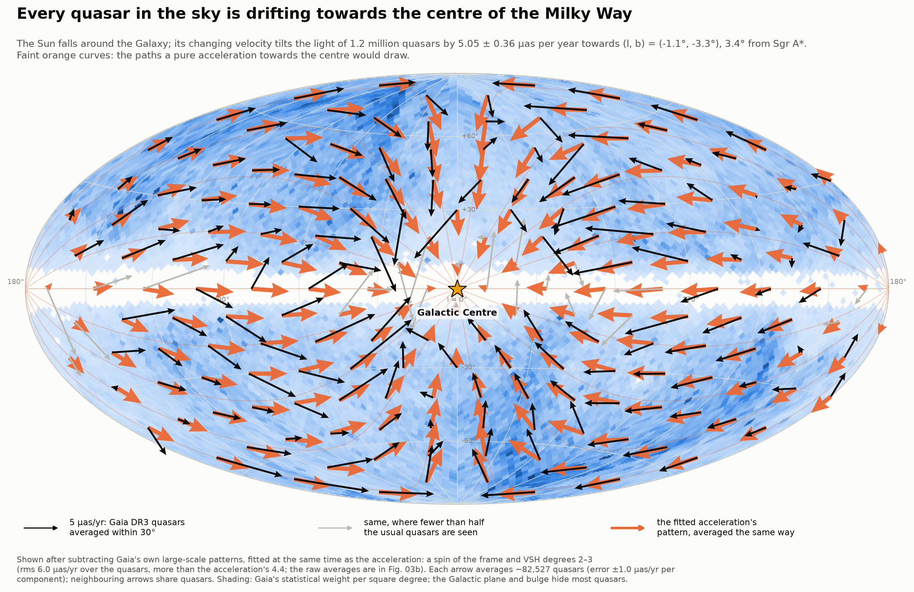

---

## The idea

Run through vertical rain and the drops seem to come at you slanted. Light does the same: an
observer moving at speed v sees every source shifted towards the direction of motion by an angle
of about v/c. James Bradley discovered this **aberration of light** in 1728, from the Earth's
30 km/s around the Sun (a 20″ wobble every year).

The whole Solar System also moves, at about 248 km/s around the Galaxy. That shifts every star
by nearly 3 arcminutes, but while the velocity stays the same the shift never changes, and
nobody can tell where the stars "really" are. John Pond saw in 1833 that a *changing* velocity
would give itself away: the shift would change too, and every distant source would appear to
creep across the sky.

The Sun's velocity does change, because the Galaxy bends its path into an orbit. The
acceleration a points towards the Galactic Centre, so every quasar should drift **towards the
Galactic Centre** at the angular rate

    g = a / c

The drift is largest for quasars 90° from the centre, zero for those in line with it, and always
along the great circle through the centre. Mathematicians call such a pattern a **glide**. For
a = 2.3 × 10⁻¹⁰ m/s² it amounts to **5 microarcseconds per year**: the width of a hair seen
from 4,000 km, or the Moon's diameter in 370 million years.

Why quasars? They are billions of light-years away. Even at 1,000 km/s of their own they would
move by less than 0.2 µas/yr, in random directions, so on average they stand still. Stars in our
Galaxy move by thousands of times more than the signal.

What makes it hard: Gaia measured each quasar's proper motion to about ±450 µas/yr. The signal
is ~90 times smaller than one quasar's error bar, so only an average over a million quasars can
reveal it. Gaia's own small systematic errors also make large-scale patterns, and the fit has to
tell those apart from the glide by their shapes.

## Data

| What | Where | Size |
|---|---|---|
| The **Gaia-CRF3**: 1,614,173 compact extragalactic sources in Gaia DR3 (`gaiadr3.agn_cross_id`), their astrometry from `gaia_source`, and Gaia's own quasar classification (`qso_candidates`) | ESA Gaia archive, 228 synchronous queries by sky pixel, 19 Oct 2026. Server counts match the published ones exactly: 1,614,173 in all, 1,215,942 with five-parameter and 398,231 with six-parameter solutions | 397 MB |
| The **frame rotator's sources**: the 428,034 quasars Gaia used to stop its reference frame spinning (`gaiadr3.frame_rotator_source`) | ESA Gaia archive | 5 MB |
| **Quasar look-alikes**: the first 0.5% (by `random_index`) of all Gaia DR3 sources with five-parameter solutions, G > 16 and parallax and proper motion within 5σ of zero that are not in the Gaia-CRF3: 147,449 sources, mostly stars | ESA Gaia archive, 10 asynchronous queries | 14 MB |
| **Quaia** (Storey-Fisher et al. 2024): 1,295,502 quasars with redshifts from Gaia's spectra and unWISE colours (980,890 of our five-parameter quasars) | Zenodo record 10403370, MD5 checked | 171 MB |
| **SDSS DR16Q** spectroscopic redshifts (Lyke et al. 2020), matched within 1″ to 397,800 of our sources | re-used from project I3's cache (VizieR VII/289) | 21 MB |
| R₀ = 7.93 ± 0.05 kpc from project **H1**; the Sun's angular speed from Sgr A*'s proper motion (Reid & Brunthaler 2020; project H2 used Reid et al. 2019's 30.32 km/s/kpc) | sibling projects | — |
| Klioner et al. 2021, the Gaia EDR3 acceleration paper | arXiv:2012.02036 | 2 MB |

Gaia DR3's astrometry is identical to EDR3's: 34 months of observations, July 2014 to May 2017.
The published EDR3 analysis can therefore be redone exactly.

---

## Results

### 1. A million quasars that should not move

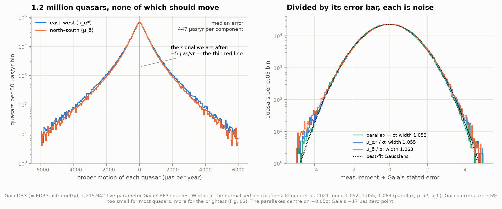

Left: the measured proper motions of the 1,215,942 quasars with Gaia's best (five-parameter)
solutions. They scatter by about ±450 µas/yr around zero, with a long tail of poorly measured
faint ones. The signal is the thin red line at ±5 µas/yr.

Right: each proper motion divided by Gaia's stated error. If the errors were exactly right these
would be Gaussians of width 1. They are Gaussians of width **1.052 (parallax), 1.055 (east–west)
and 1.063 (north–south)**, the values Klioner et al. found (1.052, 1.055, 1.063). Gaia's error
bars are about 5% too small, and there is almost no excess tail: beyond 4σ we count 0.03–0.04% of
the quasars against 0.02% expected. The parallaxes centre on −0.05σ, which is Gaia's known −17
µas parallax zero point.

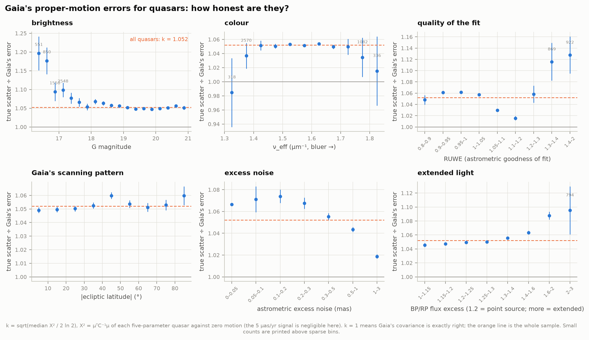

How the error underestimate k depends on the quasars. It is a flat **1.05 for G ≥ 18** (98% of
the quasars), whatever their colour or position relative to Gaia's scanning pattern. It rises to
**1.10 at G = 17 and 1.20 at G = 16.3**: bright quasars have relatively larger unmodelled
errors, as Gaia's bright stars do. It also grows with the BP/RP flux excess, a sign of extended
light (1.046 → 1.095). Sources with large excess noise already carry inflated errors (k → 1.02).
Re-weighting the fit with this magnitude-and-colour model (k = 1.048–1.179) moves the glide by
0.02–0.03 µas/yr: the weights barely matter.

### 2. The fit, and Klioner et al. (2021) reproduced

The proper-motion field of the quasars is fitted with **vector spherical harmonics** (VSH),
Fourier series for arrows on a sphere (Mignard & Klioner 2012). There are two families.
*Toroidal* patterns swirl around points; their lowest member (l = 1) is a rigid rotation of
the whole sky. *Spheroidal* patterns flow from one point to another; their lowest member is the
glide. Higher degrees l describe smaller patterns, ~180°/l across. Following Klioner et al., we
fit all terms up to l = 3 (30 numbers) at once. Each quasar is weighted by its full error
covariance. Quasars are clipped iteratively when their weighted residual exceeds 3 times the
median. Errors come from 400 bootstrap resamplings with the clipping redone each time.

| | this project | Klioner et al. 2021, Table 2 |
|---|---|---|
| glide, equatorial (g_x, g_y, g_z), µas/yr | −0.069 ± 0.415, −4.299 ± 0.370, −2.642 ± 0.352 | −0.07 ± 0.41, −4.30 ± 0.35, −2.64 ± 0.36 |
| correlations ρ_xy, ρ_xz, ρ_yz (fit covariance) | +0.001, −0.094, −0.025 | +0.001, −0.094, −0.025 |
| direction (α, δ) | 269.08° ± 5.54°, −31.57° ± 4.14° | 269.1° ± 5.4°, −31.6° ± 4.1° |
| glide, galactic (g_X, g_Y, g_Z), µas/yr | +5.037 ± 0.357, −0.095 ± 0.380, −0.293 ± 0.401 | +5.04 ± 0.35, −0.10 ± 0.36, −0.29 ± 0.41 |
| correlations ρ_XY, ρ_XZ, ρ_YZ | +0.036, −0.014, −0.079 | +0.036, −0.014, −0.079 |
| direction (l, b) | 358.92° ± 4.33°, −3.33° ± 4.55° | 358.9° ± 4.1°, −3.3° ± 4.6° |
| amplitude \|g\| | 5.046 ± 0.357 µas/yr (bias-corrected 5.016) | 5.05 ± 0.35 (bias +0.024) |
| acceleration | (2.324 ± 0.164) × 10⁻¹⁰ m/s², 7.33 ± 0.52 km/s/Myr | (2.32 ± 0.16) × 10⁻¹⁰, 7.33 ± 0.51 |
| unit weight error, outliers | 1.0482, 3,783 (3 iterations) | 1.048, ~3,800 |
| bootstrap / fit errors | 1.05–1.10 | 1.05–1.08 |
| quasars per magnitude bin (G ≤ 18, 18–19, 19–20, > 20) | 29,200, 146,614, 490,161, 549,966 | 29,200, 146,614, 490,161, 549,967 |

Every number agrees within 0.02σ. The published correlations are matched exactly by the fit's
covariance, not by the bootstrap's, which shows which one their table used. The single missing
quasar in the faintest bin is a source without a G magnitude. The "sandwich" error, built from
the residuals' actual scatter, lies between the fit's and the bootstrap's (0.34 vs 0.33 and 0.36
µas/yr in g_X).

### 3. The picture: quasars drift towards the Galactic Centre

The keeper at the top of this page. Each black arrow is the weighted average of ~82,500
quasars within 30° of its point; each orange arrow is the fitted acceleration pattern, averaged
the same way. The faint orange curves are the paths a pure acceleration towards the centre draws.
The arrows are shown after subtracting the other terms of the same fit: the frame's spin and the
degree-2 and -3 patterns. That subtraction matters.

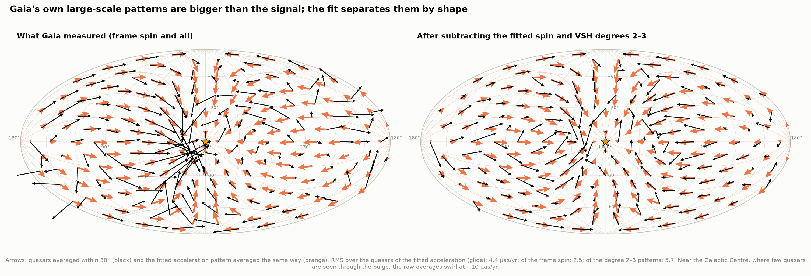

**Gaia's own large-scale patterns are bigger than the signal.** Over the quasars, the fitted
glide has an rms of 4.4 µas/yr; the frame's spin 2.5; the degree-2 and -3 patterns 5.7.
On the left, without subtraction, the averages near the Galactic Centre swirl at ~10 µas/yr. Few
quasars are seen there through the bulge, so those averages also lean on quasars 20–30° away.
The fit can still separate the acceleration from the patterns, because a glide has a different
shape from every other term. The Gaia-CRF3 paper quotes ~12 µas/yr of systematics on scales
above 15°.

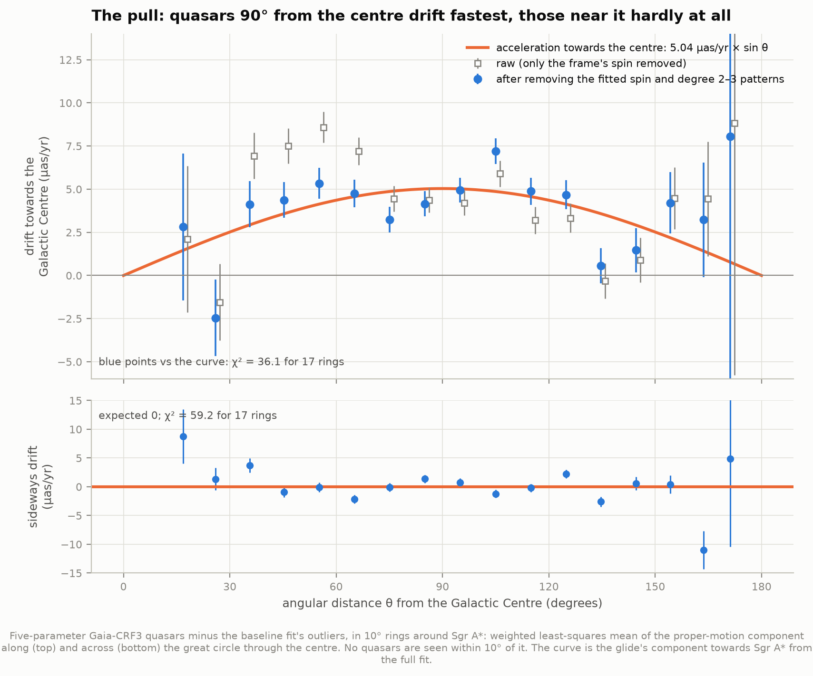

The same idea, without any map. In rings around Sgr A* we average the proper-motion component
along the great circle through the centre. A glide predicts g × sin θ: nothing at the centre or
the anticentre, the full 5 µas/yr at 90°. With Gaia's fitted patterns removed (blue), the rings
follow the curve, but not perfectly: χ² = 36 for 17 rings, and the sideways component, which
should vanish, has χ² = 59. Smaller patterns that the l ≤ 3 fit does not remove still put
1–3 µas/yr into some rings. The raw rings (grey) sit 2–4 µas/yr high at 30–70°: Gaia's larger
patterns again.

### 4. Where the pull points

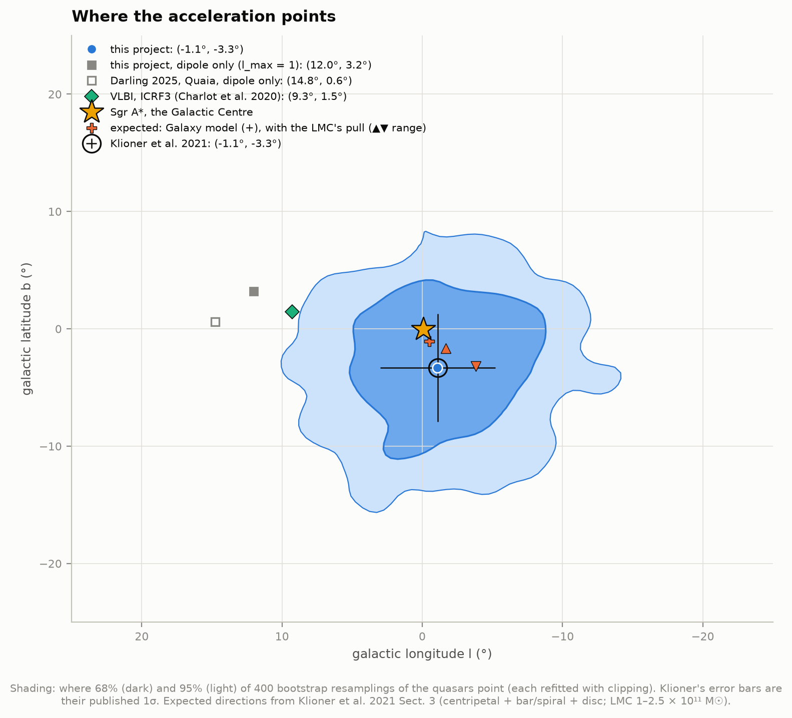

Our direction, (l, b) = (−1.1°, −3.3°) ± 4.4°, is Klioner et al.'s, 3.4° from Sgr A*. The Galaxy
model predicts (−0.5°, −1.1°): the centripetal pull, a 0.04–0.1 km/s/Myr sideways tug from the
bar and spiral arms, and a 0.15 km/s/Myr pull down towards the disc (McMillan 2017, recomputed
here with galpy). The Large Magellanic Cloud's direct pull, 0.18–0.45 km/s/Myr towards
(l, b) = (280°, −33°), would move the prediction by 1–4°. All of this lies well inside our
uncertainty.

The grey squares are fits of **the dipole alone** (l_max = 1). They point 12–15° east of the
centre, and our own dipole-only fit has g_Y = 1.1 ± 0.3 µas/yr, 4σ from zero. Gaia's degree-2
pattern leaks into a dipole-only fit on a sky with the Galactic plane missing. Darling's (2025)
dipole-only measurement with the Quaia quasars lands on the same spot, 14.8° east, which
suggests the same bias. The VLBI direction (Charlot et al. 2020, ICRF3), 9° east, comes from a
different technique with its own systematics.

### 5. How hard the Galaxy pulls

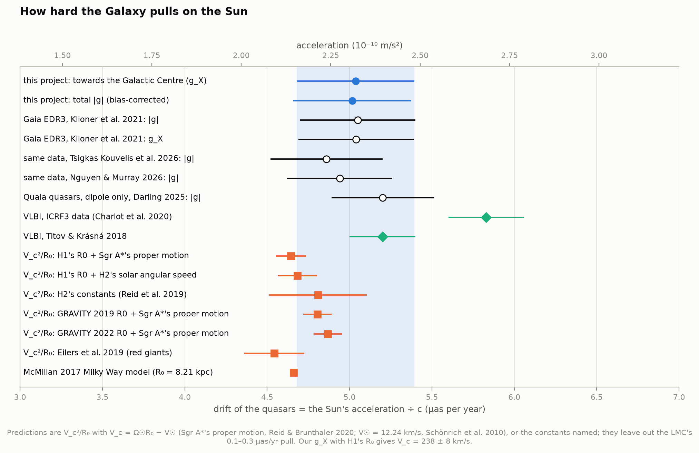

For a nearly circular orbit, the pull is a = V_c²/R₀, where V_c is the speed of a circular orbit
at the Sun's distance. Careful: V_c is not the Sun's own speed. The Sun moves 12 km/s faster than
a circular orbit, but gravity depends only on where the Sun is, not how fast it goes (Klioner
et al. 2021, Sect. 3.1). Predictions:

| Galactic constants | V_c (km/s) | predicted drift (µas/yr) | ours − predicted |
|---|---|---|---|
| H1's R₀ = 7.93 kpc + Sgr A*'s proper motion (V_c = Ω☉R₀ − V☉) | 228.8 ± 2.6 | 4.64 ± 0.09 | +1.1σ |
| H1's R₀ + H2's solar angular speed (30.32 km/s/kpc, Reid et al. 2019) | 229.8 ± 3.2 | 4.68 ± 0.12 | +0.9σ |
| H2's adopted constants (R₀ = 8.15 kpc, Θ₀ = 236 km/s) | 236 ± 7 | 4.81 ± 0.30 | +0.5σ |
| GRAVITY 2019 R₀ = 8.178 kpc + Sgr A* (as Klioner et al.) | 236.3 ± 2.2 | 4.80 ± 0.09 | +0.6σ |
| GRAVITY 2022 R₀ = 8.277 kpc + Sgr A* | 239.3 ± 2.3 | 4.87 ± 0.09 | +0.5σ |
| Eilers et al. 2019 (red giants) | 229 ± 5 | 4.54 ± 0.18 | +1.2σ |
| McMillan 2017 model (R₀ = 8.21 kpc) | 233.1 | 4.66 | — |

Every prediction agrees with our g_X = 5.04 ± 0.36 within 1.2σ. The 2025–26 re-analyses of the
same Gaia data range from 4.86 to 5.20 µas/yr (Tsigkas Kouvelis et al. 2026; Nguyen & Murray
2026; Darling 2025). VLBI's 5.83 ± 0.23 (Charlot et al. 2020) is 1.8σ above ours. All the
predictions leave out the LMC, which adds 0.1–0.3 µas/yr, mostly sideways.

**Run backwards, the drift is a speedometer and a clock.**

| from our g_X = 5.04 ± 0.36 µas/yr | |
|---|---|
| the Sun's velocity changes each year by | 7.32 ± 0.52 mm/s |
| circular speed at the Sun, √(a R₀) with H1's R₀ | **238 ± 8 km/s** (Sgr A*'s motion says 229 ± 3) |
| one Galactic year, 2π √(R₀/a) | **205 ± 7 million years** |
| mass inside the Sun's orbit, V_c² R₀ / G (as if spherical) | **(1.05 ± 0.08) × 10¹¹ M☉** (H2: 1.06 × 10¹¹) |
| R₀ from the drift and Sgr A*'s proper motion alone, solving (Ω☉R₀ − V☉)²/R₀ = a | 8.5 ± 0.6 kpc (H1: 7.93 ± 0.05) |

The last line needs no distance ladder and no stellar orbits, but it is 12 times less precise
than H1's S2 orbit. With Gaia DR5's expected 0.05 µas/yr it would reach ~0.15 kpc, limited
then by the Sun's own peculiar motion (V☉ = 12.24 ± 2 km/s).

### 6. Is it the Galaxy, or is it Gaia?

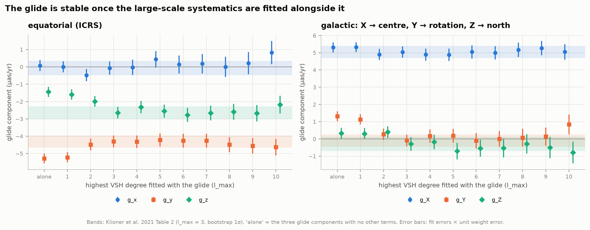

**More terms.** Fitting the glide alone, or with only the rotation (l_max = 1), gives 5.45 ± 0.29
µas/yr pointing 12° east of the centre: the degree-2 pattern leaks in. From l_max = 2 to 10 the
glide stays between 4.90 and 5.29 µas/yr, within its errors, which grow from 0.33 to 0.46 as
more patterns compete for the same data. Klioner et al. chose l_max = 3 for the same reason.

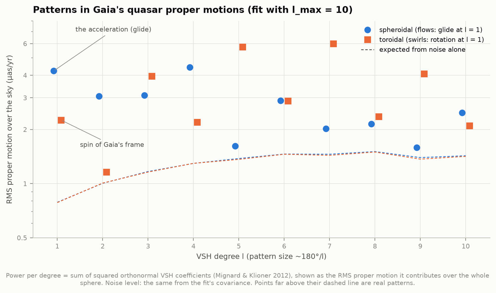

**What else is in the data.** Fitted to l_max = 10, the field's power in each degree, as the rms
proper motion it puts on the sky. Noise alone would give the dashed lines (0.8–1.5 µas/yr).
Besides the glide (4.2 over the whole sphere), Gaia's systematics put 3–4.4 µas/yr into the
spheroidal degrees 2–4 and 4–6 µas/yr into the *odd* toroidal degrees 3, 5, 7 and 9. These
swirling patterns are as big as the signal. The frame's l = 1 spin is the subject of section 8.

**Other analysis choices** (each a separate fit; errors ~0.33–0.36 unless noted):

| variant | \|g\| (µas/yr) | g_X | note |
|---|---|---|---|
| baseline (κ = 3) | 5.05 | 5.04 | 3,783 outliers |
| clip at κ = 2.5 / 4 / none | 5.17 / 5.01 / 4.99 | 5.15 / 4.99 / 4.96 | 18,532 / 41 / 0 outliers |
| no correlation ρ in the weights | 4.97 | 4.97 | Klioner et al.: ~0.1σ effect |
| errors × magnitude-colour model | 5.08 | 5.06 | Fig. 02 |
| without Gaia's "star"-classified 12% | 4.82 | 4.81 | DSC P(star) > 0.5 |
| proper motions conditioned on zero parallax, Lindegren+21 zero point | 4.94 | 4.90 | errors shrink by 1.8% |
| same, constant −17 µas zero point | 5.51 | 5.49 | |
| same, naive zero point 0 | **8.16** | 7.47 | a trap: see below |
| five- plus six-parameter quasars (1.6 million) | 5.28 | 5.27 | |
| six-parameter only (398,231) | 8.07 ± 1.1 | 7.82 ± 1.1 | worse astrometry, frame spins 15 µas/yr |

A quasar's true parallax is zero. Its parallax and proper-motion errors are correlated, so the
measured parallax can "predict" part of the proper-motion error and remove it. But Gaia's
parallaxes have a zero point of about −17 µas. Ignore it, and the correction itself becomes a
systematic error with a sky pattern from Gaia's scanning law: the glide jumps to 8.2 µas/yr,
pointing 20° off the plane. With Lindegren et al.'s (2021) zero point, the conditioned result is
4.94, consistent with the baseline, and the errors shrink by only 1.8%. Makarov (2026) found the
same sensitivity for quasars at 1 < z < 1.5: 3.35 ± 0.72 µas/yr raw, 5.59 after conditioning,
4.91 once the zero point was corrected, and traced it to the sky pattern of the
parallax–proper-motion correlations. Selecting quasars by
their measured parallax does the same thing on a larger scale. Quasars with parallax > +2σ glide
at 109 µas/yr, those below −2σ at 84 µas/yr in the opposite direction. Neither group is made of
stars; their proper-motion errors are correlated with their parallax errors.

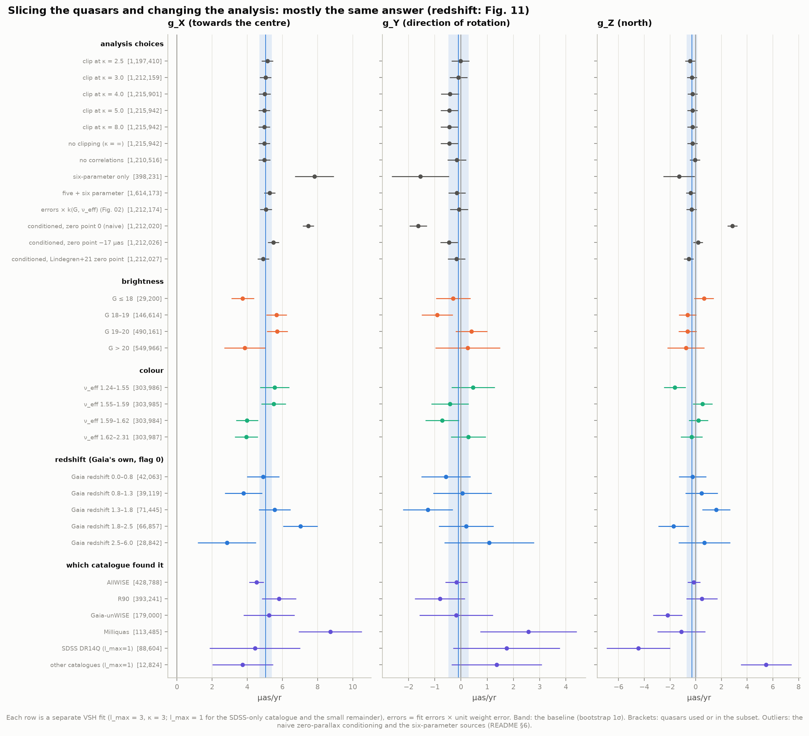

**Different quasars.** Each subset is fitted on its own. Quasars brighter than G = 18 give a
lower drift (3.74 ± 0.65), and so do the bluer half (3.94–3.98 ± 0.65 against 5.50–5.56 for the
redder half). These are 1.5–2σ effects, of the size Klioner et al. called "mild". The quasars
selected from different external catalogues agree within 2σ (AllWISE 4.53 ± 0.42, R90 5.80 ±
0.97, Gaia-unWISE 5.24 ± 1.45, Milliquas 8.72 ± 1.80).

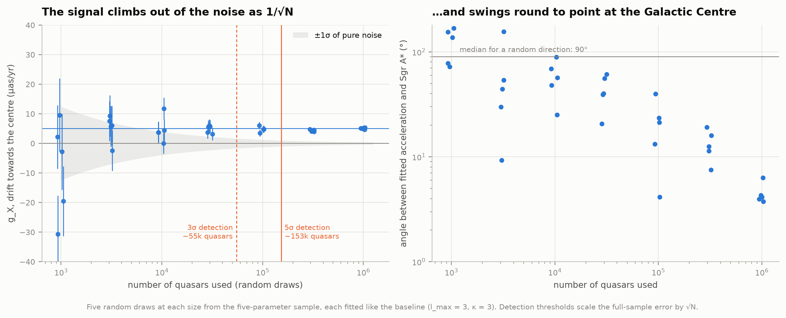

**How the signal emerges.** Random draws of N quasars, each fitted like the baseline. With 1,000
the error is ±12 µas/yr and the fitted direction points anywhere. The error shrinks as 1/√N; a
3σ detection needs ~55,000 quasars and 5σ ~153,000. With all 1.2 million the direction settles
within a few degrees of the centre.

### 7. Near or far? The drift should not care — but it does

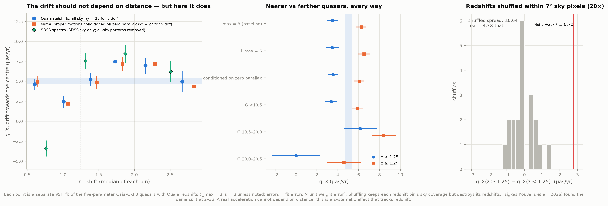

Aberration depends only on our own motion, so quasars at every distance must drift alike. Two
2025–26 papers reported otherwise. Tsigkas Kouvelis et al. (2026) found the drift of quasars at
z < 1.25 about half that of more distant ones (2–3σ). Makarov, Heinesen & Schücker (2026) saw "a
hint at redshift dependence" below z = 1, with 3.6 ± 0.7 and 2.0 ± 0.8 µas/yr in their first two
redshift batches. We split our quasars by Quaia's redshifts (980,890 of them) and fitted each
group like the baseline.

- **Six redshift bins:** 4.63 ± 0.73 (median z 0.62), 2.45 ± 0.73 (1.04), 5.28 ± 0.81 (1.43),
  7.49 ± 0.86 (1.78), 6.97 ± 1.00 (2.22), 4.97 ± 1.33 (2.75) µas/yr. A constant drift fits
  them with χ² = 24.9 for 5 degrees of freedom, p = 0.00015.
- **Split at z = 1.25:** 3.50 ± 0.51 below, 6.27 ± 0.47 above, a difference of 2.77 ± 0.69
  (4.0σ). Gaia's own (QSOC) redshifts show the same shape at lower significance (3.8 ± 1.1 at
  z ≈ 1.05 against 7.0 ± 1.0 at z ≈ 2.1). With SDSS spectroscopic redshifts, on the third of
  the sky SDSS covers and after removing the all-sky fit's patterns, the split is even sharper:
  −3.4 ± 1.0 at z < 1 against 6–8 µas/yr beyond.
- **It is not where the quasars are.** Shuffling the redshifts 20 times among quasars in the
  same ~7° patch of sky keeps each bin's sky coverage but destroys its redshifts. The shuffled
  splits scatter by ±0.64 µas/yr around −0.08, as the formal error (±0.72) predicts. None comes
  near the real 2.77, which is 4.3 times their spread.
- **It is not brightness.** At G < 19.5 alone: 3.37 ± 0.56 against 5.89 ± 0.55.
- **It is not host galaxies.** Nearby quasars are more often partly resolved: 98% of those at
  z < 0.5 show astrometric excess noise or extra BP/RP flux, against 52–61% beyond z = 1. But
  compact and extended quasars drift alike overall (4.93 ± 0.50 vs 5.09 ± 0.45), and the split
  appears in both: compact 3.03 ± 0.84 vs 6.06 ± 0.65, extended 3.76 ± 0.65 vs 6.43 ± 0.70.
- **It is not the fit.** With l_max = 6: 3.48 ± 0.59 against 6.51 ± 0.57 µas/yr (3.7σ). With
  proper motions conditioned on zero parallax: 3.55 ± 0.50 against 6.05 ± 0.46 (3.7σ).

So Gaia's proper motions of quasars carry a systematic error that depends on redshift at a fixed
brightness and extendedness. It looks like a glide of ±1.4 µas/yr towards the Galactic Centre,
of opposite sign in the two halves, and averages out in the full sample. Nothing physical
predicts this. The secular parallax from our 370 km/s motion relative to the cosmic microwave
background is a 1/distance effect of about 0.04 µas/yr at z = 0.5, less beyond, and it points
elsewhere. One
candidate is chromatic: quasars' strong emission lines move through Gaia's G band with redshift,
so two quasars of the same average colour (ν_eff, which Gaia's astrometry corrects for) can have
different spectra. If the colour calibration drifted during the mission, that would turn into
proper-motion errors that depend on redshift. We have not tested this. The baseline uses all
redshifts together, as Klioner et al. did. Its agreement with the Galaxy's prediction holds
either way, but an extra ±1 µas/yr systematic of this kind is not in the quoted error.

### 8. A check on Gaia's reference frame: the spin

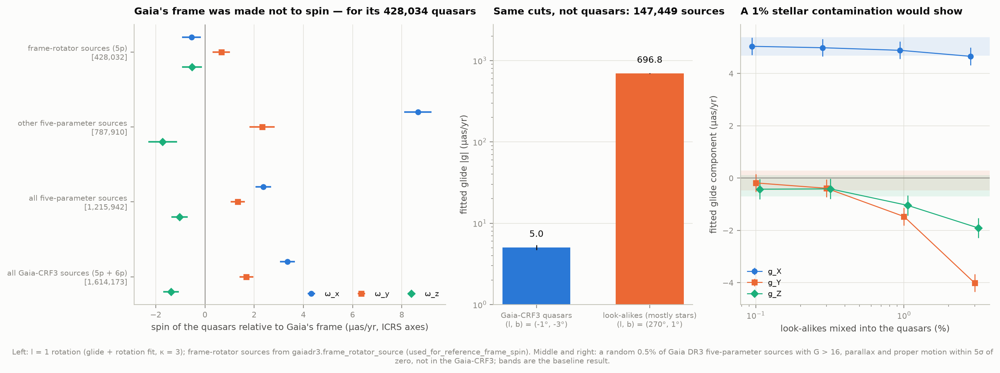

The l = 1 *rotation* of the same fit measures whether Gaia's reference frame spins relative to
the quasars. Gaia removed the spin during its solution, using 428,034 quasar-like sources (the
`frame_rotator_source` table). Fitted on exactly those, our rotation is (−0.55 ± 0.38,
+0.67 ± 0.35, −0.53 ± 0.41) µas/yr: zero, as it should be. That confirms our conventions and
weights match Gaia's. The other 787,910 five-parameter quasars spin at (8.7, 2.3, −1.7) ± 0.5
µas/yr, which is why all 1.2 million together show 3 µas/yr. The spin depends on brightness in
both groups. Among the frame rotator's own quasars, ω_x runs from −5.1 ± 0.7 µas/yr at G < 18
to +9.9 ± 1.4 at G = 19.5–20, and cancels only for that particular mix of magnitudes. Among
the others it reaches +29 ± 3 beyond G = 20.5. Gaia's frame is non-rotating "at a level of a
few µas/yr", as the Gaia-CRF3 paper puts it, and differently so for bright and faint quasars.

The Gaia-CRF3 paper (Klioner et al. 2022) ran the same check on all its sources with a spin-only
fit. We reproduce it: **1,607,289 sources accepted, ω = (+3.44, +1.57, −1.24) µas/yr**. The
paper prints exactly these numbers, except for **−3.44** in the first component. (Its errors,
0.30, 0.28 and 0.32, are ours times the fit's unit weight error.) The conventions agree: the
paper's own observation equations (its Appendix A) match ours for ω_x. And values for the frame
rotator's own sources, left commented out in the paper's arXiv source, have the same signs as
ours: (−0.53, +0.55, −0.39) against our (−0.55, +0.57, −0.41). So the printed minus sign looks
like a slip. The same appendix matrix has a sign inconsistency in another element, so we flag
this rather than claim it.

### 9. Why the sample must be pure: stars that pass the same cuts

The middle panel of figure 12 shows 147,449 Gaia sources that pass the same "doesn't move"
cuts as quasars but are not in the Gaia-CRF3: mostly faint, distant stars. Their glide is
697 µas/yr towards (l, b) = (270.3°, 1.5°), ~140 times the quasars'. It points away from the
direction of the Sun's motion around the Galaxy: the reflex of our orbit, seen against stars
that lag behind it. Klioner et al. found ~360 µas/yr towards (270°, 0°) for their 23.6 million
such sources. Our glide-plus-rotation fit (l_max = 1) gives 359 µas/yr, pointing 13° further
round. These stars' motions have far more structure than a glide, so the number depends on the
fit. Mixing a known fraction of them into the quasars (right panel) shows how fragile the
measurement is. 0.1% of them changes nothing visible. 1% shifts g_Y by −1.4 µas/yr, a 4σ
effect, and 3% by −3.9, even though the clipping catches a third of them. Our measured
g_Y = −0.10 ± 0.38 therefore limits this kind of contamination to about 0.5%.

The real sample is clean by three tests:

- **Parallaxes**: as many quasars have parallaxes above +2σ as below −2σ (34,587 vs 34,604), so
  no measurable population of nearby stars hides among them.
- **The clipped outliers**: the 3,783 sources the fit throws out glide at 52 ± 11 µas/yr towards
  (l, b) = (265°, 0°), the stellar direction. The clipping removes exactly the contaminants it
  should.
- **Gaia's own classifier**: it calls 148,710 (12%) of these "quasars" stars. They glide
  differently in Y (−5.7 ± 1.5 µas/yr). Removing them moves the result from 5.05 to 4.82 ± 0.36,
  within its error.

### 10. Explore it yourself

[`figures/quasar_drift_explorer.html`](figures/quasar_drift_explorer.html) (3.7 MB, works
offline) redoes the fit in your browser. Choose quasars by brightness or colour; use 1%, 10% or
100% of them; fit with l_max = 1, 2 or 3; change the averaging radius; show the arrows raw or
with Gaia's patterns removed. With 1% of the quasars (12,000) the acceleration disappears into
the noise (2.3 ± 3.4 µas/yr, pointing 45° off). With all of them, the page reproduces the exact
fit to 0.016 µas/yr. Hovering an arrow shows its numbers.

---

## How it works

**1. Download** (`fetch_data.py`, `gaia_archive.py`). The 1.6 million Gaia-CRF3 rows come from
ESA's archive as one synchronous query per HEALPix sky pixel (a `source_id` range). In October
2026 an anonymous query is cut off after ~15 s (synchronous) or 60 s (asynchronous), so a pixel
that times out is split into its four children. Every count is checked against server-side
`COUNT(*)` queries split the same way. The asynchronous queue silently returns at most 50,000 rows
unless told otherwise: the first look-alike download came back with exactly 50,000 rows and was
discarded. Each file's size, SHA-256 and row count is in `data/manifest.json`.

**2. The basis** (`vsh.py`). Vector spherical harmonics in Mignard & Klioner's (2012)
conventions, built from SciPy's spherical Legendre functions. Each coefficient maps one-to-one
onto theirs. `test_physics.py` checks the basis is orthonormal over the sphere and that the
l = 1 terms are exactly a rotation and a glide with Klioner et al.'s Eq. 6 coefficients.

**3. The fit** (`fit.py`). Weighted least squares with each quasar's full 2 × 2 covariance
(both errors and their correlation ρ). Outliers are clipped iteratively: a quasar whose weighted
residual X exceeds κ = 3 times the median X of *all* quasars is dropped, and the iteration
stops the first time a set of outliers repeats. Errors are given four ways: formal, scaled by the
unit weight error, a "sandwich" estimate from the scatter of the residuals, and a bootstrap of
400 resamplings with the clipping redone each time.

**4. Pictures** (`analysis.cap_averages`, `skymap.py`). Each arrow is a weighted least-squares
mean of all quasars within 30° (or 45°): every quasar's proper motion and covariance are moved to
the arrow's position through 3D. The same averaging is applied to the fitted acceleration
pattern, so model and data are compared like for like. The Hammer projection draws each arrow by
stepping along the great circle it points to, so directions stay true near the map's edges.

**5. The Galaxy** (`galaxy.py`). Predictions V_c²/R₀ by Monte Carlo over the inputs; McMillan's
(2017) Milky Way model through galpy for the pull towards the disc; the LMC as a point mass.

**6. The explorer** (`interactive.py`). Gaia's quasars summed into 3,072 sky pixels for every
magnitude bin, colour bin and random tranche, and the VSH basis at each pixel centre. The page
redoes the fit in JavaScript. With every quasar it reproduces the exact fit to within
0.016 µas/yr.

## Reproduce

```bash
cd astrophysics/59-quasar-acceleration
../.venv/bin/python fetch_data.py     # ~0.6 GB, ~45 minutes (ESA's archive is the bottleneck)
../.venv/bin/python run.py            # every fit, number, figure and the explorer
../.venv/bin/python test_physics.py   # 10 self-checks
```

The first `run.py` takes about an hour on four cores (load-dependent), mostly the bootstrap, the
l_max = 4–10 fits and the redshift shuffles. Every step is cached in `data/cache/`, so a rerun
redraws the figures in about 2.5 minutes and needs no network. `run.py --force` recomputes
everything; `run.py --only subsets,maps` recomputes just those steps. Needs numpy, scipy,
pandas, astropy, healpy, matplotlib, galpy (for McMillan 2017) and gaiadr3_zeropoint (for the
parallax zero point).

| File | What it does |
|---|---|
| `fetch_data.py`, `gaia_archive.py` | downloads with server-count checks; a careful synchronous/asynchronous TAP client |
| `config.py` | paths, units, fit settings, Galactic constants from H1/H2, published values we grade against |
| `prepare.py` | one analysis table, with DR16Q redshifts matched by position |
| `vsh.py` | vector spherical harmonics, rotation and glide fields |
| `fit.py` | weighted least squares with clipping, sandwich and bootstrap errors |
| `analysis.py` | every fit and test → `data/cache/*.json` |
| `galaxy.py` | what the acceleration should be; what ours implies |
| `skymap.py`, `figures.py`, `plotstyle.py` | the projection and the 13 figures |
| `interactive.py` | the offline explorer page |
| `run.py` | runs it all, writes `data/results.json` |

## Checks against published numbers

| quantity | ours | published |
|---|---|---|
| Gaia-CRF3 sources: all / five-parameter / six-parameter | 1,614,173 / 1,215,942 / 398,231 (server counts and download) | same (Klioner et al. 2021, Sect. 4.1) |
| glide, galactic (g_X, g_Y, g_Z) | (5.037, −0.095, −0.293) ± (0.357, 0.380, 0.401) | (5.04, −0.10, −0.29) ± (0.35, 0.36, 0.41) |
| \|g\|, direction (l, b) | 5.046 ± 0.357 µas/yr, (358.92°, −3.33°) | 5.05 ± 0.35, (358.9°, −3.3°) |
| unit weight error; outliers at κ = 3 | 1.0482; 3,783 | 1.048; ~3,800 |
| normalised widths: parallax, µ_α*, µ_δ | 1.0519, 1.0551, 1.0634 | 1.052, 1.055, 1.063 |
| amplitude bias (Appendix A) | +0.030 µas/yr | +0.024 |
| frame-rotator sources used for the spin | 428,034 (428,032 among the Gaia-CRF3) | 428,034 |
| Gaia-CRF3 spin-only check: accepted sources, ω | 1,607,289; (+3.44, 1.57, −1.24) µas/yr | 1,607,289; (−3.44, 1.57, −1.24); sign of ω_x see §8 |
| centripetal prediction, GRAVITY 2019 R₀ + Sgr A* | 4.804 ± 0.086 µas/yr | 4.80 ± 0.08 |
| LMC pull, 10¹¹ M☉ at 49.6 kpc (a_X, a_Y, a_Z) | (+0.027, −0.148, −0.097) km/s/Myr | (+0.025, −0.148, −0.098) |
| McMillan 2017 pull towards the disc (z☉ = 25 pc) | 0.154 km/s/Myr | 0.15 ± 0.03 |
| redshift split at z = 1.25 (Tsigkas Kouvelis et al. 2026) | 3.50 ± 0.51 vs 6.27 ± 0.47 (4.0σ) | a factor ~2, 2–3σ |

## Caveats and what this does not do

- **Systematics dominate the error budget, and they are not all in the quoted error.** The
  ±0.36 µas/yr is statistical (bootstrap). The choice of l_max moves the result by up to ±0.2,
  the clip limit by ±0.1, and the redshift-dependent effect of §7 is ±1.4 µas/yr in each half of
  the sample. A more honest total uncertainty is probably 0.4–0.5 µas/yr. That still makes the
  detection better than 10σ.
- **The frame's spin is not physics.** We fit it as a nuisance term. Its value depends on which
  quasars are used, at the level of several µas/yr (§8).
- **Correlations between quasars are ignored**, as in the published analysis. Gaia's errors are
  correlated on large angular scales (the patterns of §6). The VSH terms absorb the largest ones;
  the bootstrap, which resamples quasars independently, cannot see the rest.
- **The redshift dependence is unexplained.** Our tests rule out sky coverage, brightness and
  host galaxies, but not a chromatic calibration effect. With Quaia's photometric redshifts about
  15% of quasars sit in the wrong bin (Quaia vs SDSS spectra: |Δz|/(1+z) > 0.1 for 15%), which
  dilutes rather than creates a trend.
- **The direction is good to ~4°, the predictions differ by ~1°.** The bar, spiral arms, disc
  and LMC are beyond reach. Gaia DR4 (66 months, expected December 2026) should cut the random
  error to ~0.12 µas/yr (it scales as T^−3/2) and test the LMC's pull directly.
- **Pictures are not measurements.** The sky maps average quasars within 30°, so neighbouring
  arrows share quasars, and they are drawn after subtracting the fitted spin and degree-2/3
  patterns (Fig. 03b shows the raw version). Every number comes from the fits.
- **Spec deviations.** H2 did not measure the circular speed at the Sun: it adopted Reid et al.
  2019. We therefore combine H1's R₀ with Sgr A*'s proper motion, and also show H2's constants.
  The download is ~0.6 GB (spec: 0.1–0.3 GB), mostly because we fetch 44 columns per quasar and
  the Quaia catalogue.

## Data and credits

- **Gaia**: Gaia Collaboration, Vallenari et al. 2023, A&A 674, A1 (DR3); Lindegren et al.
  2021, A&A 649, A2 (the EDR3 astrometric solution); Gaia
  Collaboration, Klioner et al. 2022, A&A 667, A148 (Gaia-CRF3). This work has made use of data
  from the European Space Agency mission Gaia, processed by the Gaia Data Processing and Analysis
  Consortium (DPAC). Retrieved from the ESA Gaia archive on 19 October 2026.
- **The measurement we repeat**: Gaia Collaboration, Klioner et al. 2021, A&A 649, A9, "Gaia
  Early Data Release 3: Acceleration of the solar system from Gaia astrometry".
- **Quaia**: Storey-Fisher et al. 2024, ApJ 964, 69; Zenodo record 10403370.
- **SDSS DR16Q**: Lyke et al. 2020, ApJS 250, 8, via VizieR VII/289 (project I3's copy).
- **Methods**: Mignard & Klioner 2012, A&A 547, A59 (vector spherical harmonics); Lindegren et
  al. 2021, A&A 649, A4 (parallax zero point; the `gaiadr3_zeropoint` package); McMillan 2017,
  MNRAS 465, 76, via galpy (Bovy 2015).
- **Galactic constants**: Reid & Brunthaler 2020, ApJ 892, 39; Schönrich, Binney & Dehnen 2010,
  MNRAS 403, 1829; GRAVITY Collaboration 2019 (A&A 625, L10) and 2022 (A&A 657, L12); Eilers et
  al. 2019, ApJ 871, 120; Reid et al. 2019, ApJ 885, 131; Pietrzyński et al. 2019, Nature 567,
  200 (LMC distance); Erkal et al. 2019, MNRAS 487, 2685 (LMC mass).
- **Comparison measurements**: Charlot et al. 2020, A&A 644, A159; Titov & Krásná 2018, A&A
  610, A36; MacMillan et al. 2019, A&A 630, A93; Darling 2025, ApJL 982, L46; Tsigkas Kouvelis
  et al. 2026, JCAP 06, 034; Nguyen & Murray 2026, A&A (arXiv:2605.30367); Makarov 2025, Nat.
  Astron. 9, 1396; Makarov, Heinesen & Schücker 2026, CQG 43, 125012; Makarov 2026
  (arXiv:2608.16767).
