# H6 — Fly through the dust around the Sun: the Local Bubble and the Radcliffe Wave in 3D

**Gaia measured the distances and the dimming of 54 million stars near the Sun, enough to map the dust
between them in three dimensions. Can we fly through the clouds around us, see the Local Bubble we
live in, and trace the Radcliffe Wave, a 2.7-kpc ripple of star-forming clouds?**

Yes. The keeper is an interactive 3D viewer and a 100-second movie flown through the 3D dust map of
Edenhofer et al. (2024): out of the Sun's dust-free bubble, past Taurus, Perseus and Orion, up over
the bubble's wall, out to the Radcliffe Wave and round to its side, where its clouds rise and fall.
Everything shown is the posterior mean of their map; the only things we add are the overlays (young
star clusters, the bubble's wall, a fitted model of the wave) and a choice of how dust turns into
light, which the viewer states on screen.

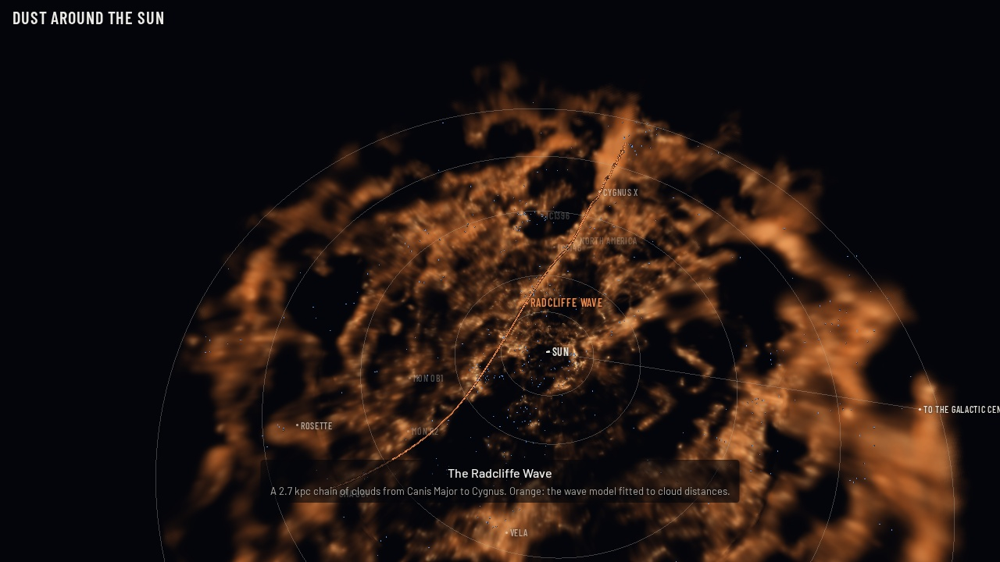

**Viewer:** [`figures/dust_flythrough.html`](figures/dust_flythrough.html) (one self-contained file,
36 MB; open it in a browser, drag to turn, scroll to move, or press *Play tour*). Online (private
until shared): https://claude.ai/artifact/RrgMMnU8f2x56nHqJBs738
**Movie:** [`figures/dust_flythrough.mp4`](figures/dust_flythrough.mp4).

What came out of checking it all against the papers:

* **The map reproduces the paper's own figure, and we found why our numbers are 4-8% higher.** Read
  back pixel by pixel through its own colour bar, the published face-on view (their Fig. 4) matches
  ours with r = 0.995 over 2.8 million pixels, but ours is 4.4% higher near the Sun and 7.7% higher at
  1.1 kpc. Twelve posterior samples, fetched as 96 small byte ranges out of a 19.5 GB file, show why:
  the authors' figure averages the samples after interpolating each one in log space, whereas the
  released mean map (and every tool built on it, theirs included) interpolates the logarithm of the
  mean. By Hölder's inequality the second is always larger. The samples predict the gap to within
  0.003 at every distance.
* **The Local Bubble.** Re-running O'Neill et al. (2024)'s recipe on all 786,432 sightlines puts the
  bubble's wall within 1 pc of their released model on 97.5% of them: median distance **169 pc**
  (theirs 170), thickness **35 pc** (35), dust-traced mass **6.0 × 10⁵ M☉** (6.0), interior equal to
  a **166-pc sphere** (165). The wall is far from round: 70 pc toward some directions, beyond 600 pc
  in the open "chimney" toward the north Galactic pole.
* **The bubble's history.** From Zucker et al. (2022)'s own cluster tracebacks we refit their
  expanding-shell model: first supernova **14.5 ± 0.8 Myr ago**, radius today **166 ± 6 pc**,
  expansion **6.7 (+0.5 −0.4) km/s**, all as published. The real wall, measured from the same centre,
  lies anywhere between 112 and 251 pc (16th-84th percentiles): the sphere is a sketch.
* **Young stars on the wall.** Within 250 pc, half of the 41 young (< 20 Myr) Gaia clusters of Hunt
  & Reffert (2023) sit within 30 pc of the wall along their sightline, against 35 ± 8% expected by
  chance and 29% of clusters aged 60-300 Myr. A third are inside the bubble: mostly Sco-Cen's
  subgroups, the bubble's own parents.
* **The Radcliffe Wave.** Unrolling the map along the wave shows it in the dust itself, with no fit
  involved: clouds and young clusters dip to z ≈ −200 pc at Orion and rise above the plane beyond
  Cepheus. Fitting Konietzka et al. (2024)'s model to the same 326 cloud sightlines Alves et al. used,
  but with distances measured in the map, gives a wave **2.95 kpc** long that swings up to
  **203 (+11 −14) pc** from its baseline, with a mean wavelength of **2.16 kpc** (shrinking from
  4.6 kpc at Canis Major to ~0.3 kpc at Cygnus X) and a radius of 49 pc. Alves et al. found 2.7 kpc and
  ~160 pc; Konietzka et al. an amplitude parameter of 220 pc, a ~2 kpc mean wavelength and a 47-pc
  radius. With the published cloud distances our fit gives 2.73 kpc and 169 pc. Let the shape
  parameters roam, though, and the data prefer other curves through the clouds: the smooth 2-kpc wave
  is partly what the published priors encode.
* **Alves et al. (2020)'s printed model does not reproduce their own wave.** With their Extended
  Data Table 2 values, their equation (1) never rises more than 61 pc above its baseline, not the
  160 pc they quote. Refitting their printed form to the same clouds with their own priors recovers
  the rest of their table (amplitude 172 pc, period 3.6 kpc, length 2.84 kpc), but the damping comes
  out δ = 0.30 ± 0.06, where their prior expected it, instead of 6.68.
* **Cloud distances.** For the 263 Zucker et al. (2020) sightlines where both pick the same cloud,
  the map puts it **2-4% farther** within 700 pc (their stated systematic is ~5%) and 7-13% farther
  beyond, where the coarser 2 kpc map takes over.
* **A second map.** Against Vergely, Lallement & Cox (2022), integrated extinction agrees to a median
  ratio of **0.998** over 3,072 directions. But their clouds are stretched **2.2-3.0 times** along the
  line of sight ("fingers of god" pointing at the Sun), Edenhofer's only **0.84-1.27 times**.
* **A dereddening tool** (`deredden.py`) for the HR-diagram projects. Against 1,312 Gaia clusters with
  photometric extinctions it agrees to **1.4%** with a scatter of 0.15 mag, once the two extinction
  laws are put on the same footing (the map's curve is closest to R_V = 2.76, the clusters' assume
  3.1, an 11% difference). At high Galactic latitude it matches SFD (1998) dust emission with slope
  1.045 and a floor of +0.008 mag in E(B−V).

---

## The fly-through

The viewer ray-marches the dust through three nested volumes (all of it from Edenhofer et al.):

| volume | map | cells | box |
|---|---|---|---|
| inner | main map | 2.5 pc | \|x\|, \|y\| < 400 pc, \|z\| < 250 pc |
| middle | main map | 5 pc | \|x\|, \|y\| < 1250 pc, \|z\| < 400 pc, within 1240 pc of the Sun |
| outer | 2 kpc "validation" map | 10 pc | \|x\|, \|y\| < 2000 pc, \|z\| < 500 pc |

The densities are stored as 8-bit codes on a log scale (0.016 dex steps from 2 × 10⁻⁵ to 0.2 ZGR23
mag/pc, i.e. hydrogen densities of 0.03 to 330 cm⁻³; thinner dust is left empty). The graphics card's
trilinear filtering of log values is a geometric interpolation, the map's own convention.

What brightness means is a choice, so the viewer offers three and says which is on:

* **Glow**: brightness grows with the dust column along each line of sight (a log stretch), the way a
  far-infrared camera sees cold dust. Physically literal, but from inside the disk every direction
  along the plane is bright.
* **Starlight**: a white background dimmed by the dust, 10^(−0.4 A) separately for red, green and blue
  using the extinction curve behind the map (A at 650, 550, 450 nm = 2.16, 2.68, 3.55 × the map's
  unit). This is what starlight passing through the clouds would look like, reddening included.
* **Solid** (the movie): dust also absorbs what lies behind it, so near clouds hide far ones and the
  3D shape reads. Its opacity scale (4 per ZGR23 mag) and a fade that hides dust thinner than
  n_H ≈ 0.1-0.8 cm⁻³ are display choices.

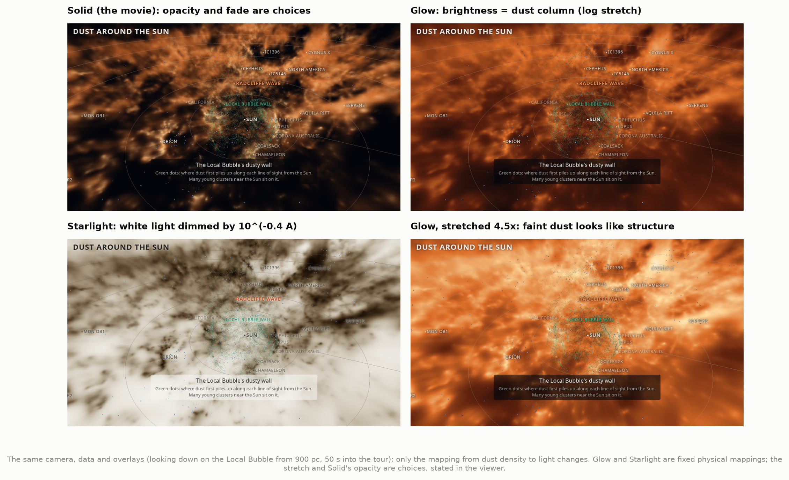

The tour is scripted (100 s): from the Sun past Taurus (140 pc) and Perseus (290 pc) to Orion
(400 pc), up over the bubble's wall with the young clusters on it, out above the Radcliffe Wave, and
round to its side, where a labelled cutaway shows only the dust within 350 pc of the wave's axis.
The readout gives the camera's distance and direction from the Sun and the **A_V between the camera
and the Sun**, integrated through the same voxels the view shows.

---

## Results

### 1. The map, and reproducing the paper's own figure

Edenhofer et al. (2024) reconstructed the dust density on 516 spheres of HEALPix pixels (Nside 256,
14′ pixels), logarithmically spaced from 69 to 1,250 pc (0.4 pc apart near the Sun, 7 pc at the
edge), from the distances and extinctions that Zhang, Green & Rix (2023, "ZGR23") derived from Gaia
BP/RP spectra. The map's unit is ZGR23's extinction per parsec; × 2.8 gives A_V (at 540 nm), × 1653
gives hydrogen nuclei per cm³.

Our sampler interpolates the logarithm of the density bilinearly on the sphere and linearly in
distance, exactly as the authors' `interp2box.py` and the `dustmaps` package do. Against both it
agrees to float32 rounding (identical on a test box; ≤ 6 × 10⁻⁸ at 200,000 random points).

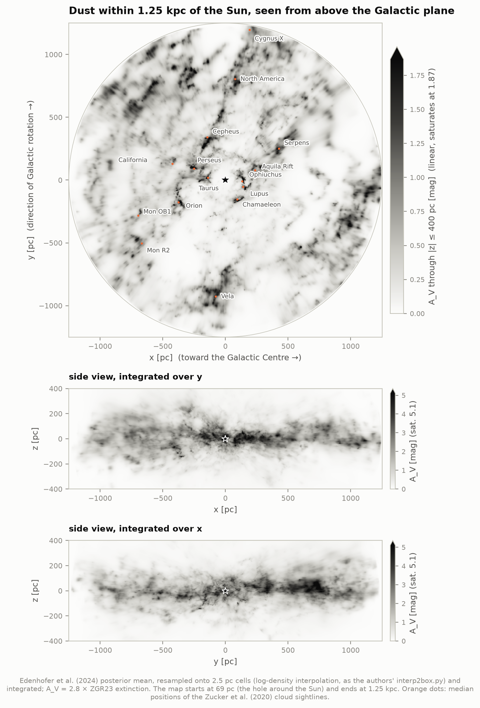

The published face-on view (their Fig. 4) can be read back into numbers: its colour bar is linear
from 0 to **1.698 mag** (fit to the eight tick marks, rms 0.3 mmag). Pixel by pixel our projection
agrees with it (**r = 0.995**, 2.8 million pixels), but runs higher, and more so with distance.

### 2. Why our numbers are 4-8% higher: the mean map vs the posterior samples

The map between voxel centres is defined by interpolating ln(density). That operation does not
commute with averaging: the geometric interpolation of the posterior *mean* is always at least the
mean of the geometric interpolations of the *samples* (Hölder's inequality), and the gap grows with
the scatter between samples. The samples file is 19.5 GB, but each sample's sphere is one contiguous
3.1 MB block, so we fetched 12 samples × 4 pairs of neighbouring spheres by HTTP byte range:

| distance | ours ÷ published Fig. 4 | interpolated mean ÷ mean of interpolated samples | voxel scatter |
|---|---|---|---|
| 150 pc | 1.044 | 1.042 | 45% |
| 400 pc | 1.055-1.061 | 1.057 | 49% |
| 800 pc | 1.068-1.073 | 1.073 | 52% |
| 1,160 pc | 1.077 | 1.080 | 55% |

So their figure was made from the samples, and anything built on the released mean map and its
recommended interpolation (including their own Cartesian product) reads **4-8% high** in projected
or interpolated density. At voxel centres the released mean equals the average of the samples to
3 × 10⁻⁷, and integrated extinction from voxel sums is linear in the voxels, so our extinction tool
and the bubble's mass are unaffected; our face-on figures and the viewer carry the 4-8%.

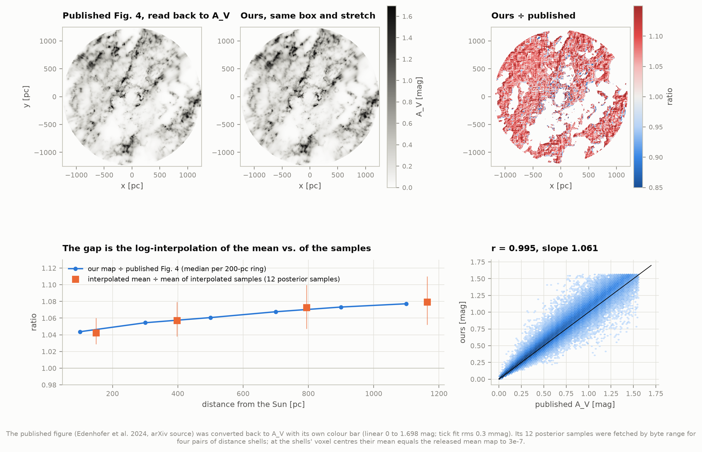

The samples also tell how uncertain single voxels are: the posterior standard deviation is a median
**54%** of the mean in the mid-plane, and neighbouring voxels are *positively* correlated (+0.29 to
+0.48 between adjacent spheres, +0.38 to +0.48 between adjacent pixels). Sums over many voxels are much
better determined (the paper quotes ~10% for its projections).

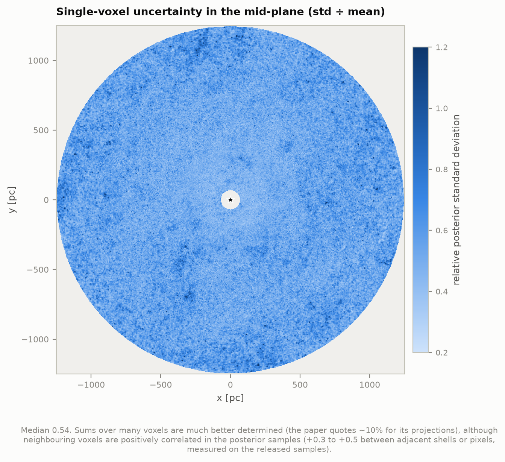

All-sky views of the extinction from the Sun out to 250, 500, 750 and 1,250 pc reproduce the
paper's Fig. 2: the Aquila Rift and Ophiuchus dominate nearby, the Galactic plane fills in with
distance.

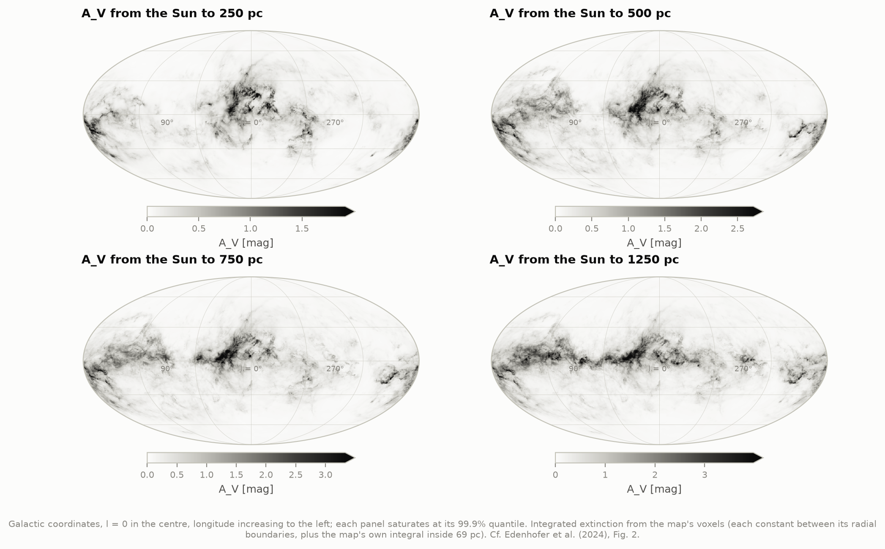

### 3. The Local Bubble's wall

The Sun sits in a cavity ~300 pc across, blown by supernovae: the **Local Bubble**. Its dusty wall is
where the dust density first rises along each line of sight. O'Neill et al. (2024) defined it on this
very map: sample each of the 786,432 sightlines every parsec from 69 to 650 pc, smooth with a 7-pc
Gaussian, and take the first peak with a prominence above 2.04 × 10⁻⁶ ZGR23/pc; its edges are where
the profile falls by half the prominence. We re-ran that recipe and compared sightline by sightline
with the model they released:

| | ours | O'Neill et al. 2024 |
|---|---|---|
| sightlines within 1 pc / 5 pc | 97.5% / 99.1% | |
| wall distance: min, 2.3%, median, 97.7%, max | 72, 92, **169**, 361, 616 pc | 71, 91, 170, 362, 616 |
| thickness: median (2.3-97.7%) | **35 pc** (13-123) | 35 (13-123) |
| peak density n_H: median (2.3-97.7%) | 0.63 cm⁻³ (0.036-21) | 0.61 (0.04-21) |
| dust-traced mass of the wall | **6.01 × 10⁵ M☉** | (6.0 ± 0.7) × 10⁵ |
| mass with the generous 0.9-prominence edges | 8.1 × 10⁵ M☉ | 8.0 × 10⁵ |
| interior volume (to the 0.9 edge) | 1.91 × 10⁷ pc³ = a **166-pc sphere** | 1.9 × 10⁷ = 165 pc |
| extent in x, y, z | −294…332, −355…445, −301…603 pc | −300…330, −355…445, −300…600 |
| geometric centre | (−9.8, 1.9, 0.1) pc | (−9.8, 1.9, 0.2) |

83% of the wall distances are identical and 15% differ by one parsec, equally often either way. Their
edges are whole parsecs where ours are interpolated (half a parsec farther on average), which does not
change thicknesses or masses. Only 29 sightlines find no wall within 650 pc; the far-flung ones toward
the north Galactic pole are what O'Neill et al. call the **Local Chimney**.

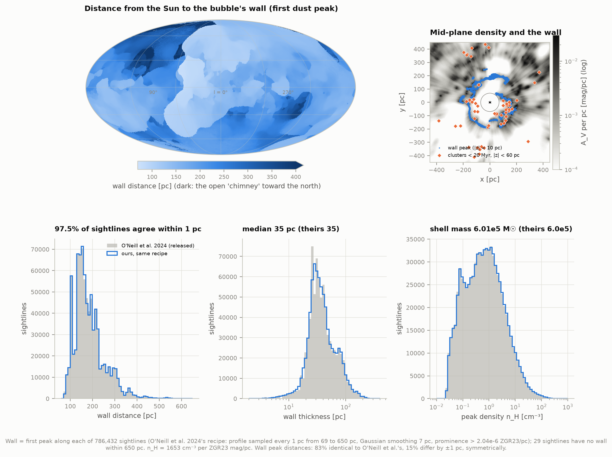

### 4. The bubble's history

Zucker et al. (2022) traced 34 young clusters back in time with their Gaia motions and found that the
nearby ones were born on the surface of an expanding shell centred where the Upper Centaurus-Lupus and
Lower Centaurus-Crux clusters were ~14 Myr ago: the bubble's supernovae. Their shell model (from
simulations of clustered supernovae, El-Badry et al. 2019) grows as R ∝ (Δt_SNe n₀)^(−1/5) t^(3/5).
With their released tracebacks, birth positions and priors we refit it (22 clusters):

| | ours | Zucker et al. 2022 |
|---|---|---|
| time of the first supernova | **−14.5** (+0.9 −0.8) Myr | −14.4 (+0.8 −0.7) |
| ambient density n₀ | 2.70 (+1.66 −1.02) cm⁻³ | 2.71 (+1.57 −1.02) |
| time between supernovae | 1.05 (+0.65 −0.40) Myr | 1.06 (+0.63 −0.39) |
| shell thickness | 23.4 (+2.6 −2.4) pc | 23.3 (+2.5 −2.3) |
| radius today | **166 ± 6 pc** | 165 ± 6 |
| expansion speed today | **6.7** (+0.5 −0.4) km/s | 6.7 (+0.5 −0.4) |
| explosion centre (heliocentric today) | (39, 7, −19) pc | (39, 7, −18) |

The model sphere's radius matches the wall's interior volume (a 166-pc sphere, above). But measured
from that centre, the actual wall lies at 180 pc in the median and anywhere from 112 to 251 pc
(16th-84th percentiles); only 38% of sightlines put it within ±30 pc of the sphere.

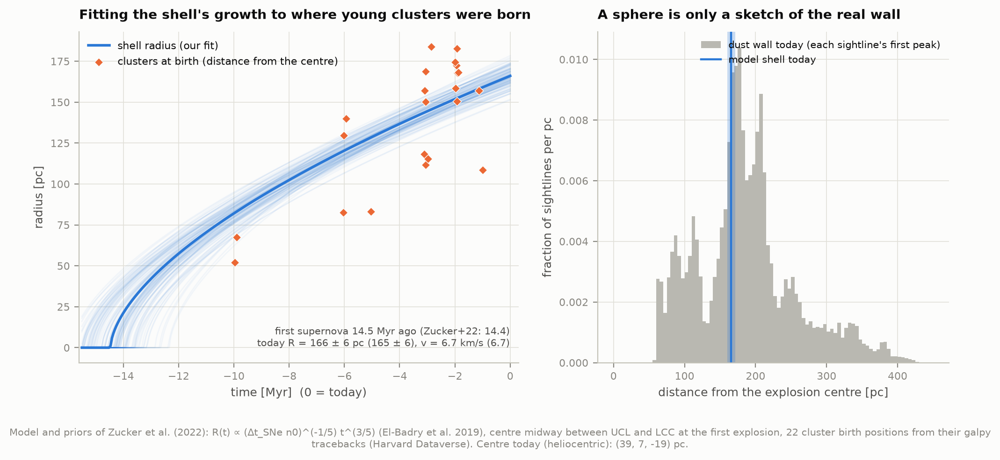

### 5. Are young stars born on the wall?

For each reliable Hunt & Reffert (2023) cluster within 250 pc we measured how far it sits from the
wall along its own line of sight:

| clusters within 250 pc | n | within 30 pc of the wall | inside the bubble (> 30 pc short) |
|---|---|---|---|
| younger than 20 Myr | 41 | **51%** | 34% |
| 20-60 Myr | 34 | 47% | 35% |
| 60-300 Myr | 51 | 29% | 29% |
| random sightlines, same distances (young sample) | | 35 ± 8% | |

Chamaeleon I lies 0.3 pc from the wall; the Taurus groups 3-25 pc; Corona Australis 6 pc. The young
clusters inside the bubble are mostly Sco-Cen's subgroups (10-20 Myr) and the ε Chamaeleontis group,
born near the bubble's centre. Further out (250-400 pc) most young clusters belong to Orion and
Perseus, on the Radcliffe Wave rather than on this wall.

### 6. The Radcliffe Wave

Alves et al. (2020) noticed that the molecular clouds from Canis Major through Orion, Cepheus and the
North America Nebula to Cygnus X line up in one narrow chain 2.7 kpc long that rises and falls about
the Galactic plane like a damped wave, ~160 pc high. Konietzka et al. (2024) showed, from the motions
of young clusters born in it, that it also travels like a wave.

**The wave in the dust, before any fitting.** Take the vertical surface that follows the wave's
baseline across the Galactic plane, add up the dust within 150 pc on either side, and unroll it. At
true aspect ratio, the dust, the cloud sightlines and the young star clusters all dip to z ≈ −200 pc
around Orion and Mon R2 (s ≈ 500-1,000 pc along the wave), climb through a looping structure, stand
above the plane beyond Cepheus (s ≈ 1,500 pc) and settle near it toward Cygnus X.

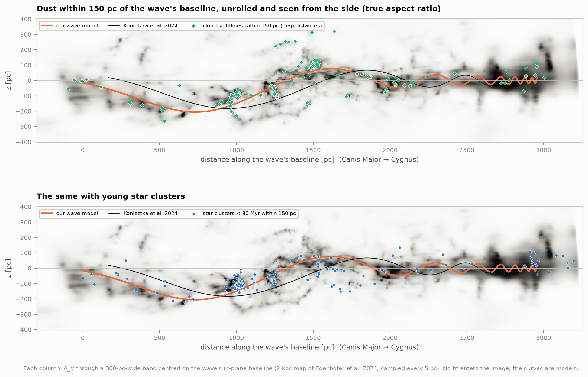

**Two published models.** Both describe a curved baseline across the plane with a damped sine wave
in height along it. Konietzka et al.'s is fully specified: evaluated at their published parameters it
gives their own numbers (wavelength 4.8 kpc at CMa OB1, 402 pc at Cygnus X, mean 2.2 kpc; deepest
trough at Orion, 182 pc below the plane), which confirms our reading of it. Alves et al.'s printed
equation (1), Δz = A exp[−δ (d/kpc)²] sin[(2πd/P)(1 + (d/d_max)/γ) + φ], with their Extended Data
Table 2 (δ = 6.68), damps the wave away within 1 kpc and never rises more than **61 pc**, not the
160 pc they quote; their own prior on ln δ was N(−0.5, 0.5), which makes 6.68 a 4.8σ outlier of it.

**Fitting the clouds.** As Alves et al. did, we fit all 326 Zucker et al. (2020) cloud sightlines,
letting each cloud be either on the wave (Gaussian scatter across the curve) or in a uniform
background, and sample with dynesty using the published priors. Only each cloud's offset from the
curve is modelled, not where along it the cloud sits: the catalogue samples the wave unevenly (24
sightlines in Orion, 4 in CMa OB1), and a model that spreads the wave's clouds evenly along its length
rewards short curves through crowded regions (our first attempt did exactly that). Then we refit with
cloud distances measured in the Edenhofer map (section 7).

| model and priors | cloud distances | largest height off the baseline | length | mean wavelength | wave radius | clouds on the wave |
|---|---|---|---|---|---|---|
| Konietzka form, their priors | Zucker et al. 2020 | 169 (+21 −28) pc | 2.73 kpc (in the plane) | 2.04 kpc | 46 pc | 138 of 326 |
| Konietzka form, their priors | **Edenhofer map** | **203 (+11 −14) pc** | **2.95 kpc** | **2.16 kpc** | 49 pc | 139 of 308 |
| Alves form, their priors | Zucker et al. 2020 | 175 ± 11 pc (A = 172) | 2.84 kpc (along the curve) | | 48 pc | 138 of 326 |
| Alves form, their priors | Edenhofer map | 198 ± 12 pc (A = 182) | 3.05 kpc | | 50 pc | 139 of 308 |
| Konietzka et al. 2024 (published) | | 182 pc (A = 220) | 2.5 kpc (model to Cygnus X) | ~2 kpc | 47 pc | |
| Alves et al. 2020 (published) | | A = 160 ± 30 pc | 2.7 ± 0.2 kpc | ~2 kpc | 62 pc | 43% |

* With the published distances our fits land close to the published waves (Konietzka's amplitude
  parameter 183 vs 220 pc, 1.5σ; Alves's period, amplitude and length within their errors, our wave
  radius 48 vs 62 pc); with the map's distances the wave comes out ~8% longer and ~20% taller,
  because the map places the distant clouds (CMa OB1, Cygnus X) 7-13% farther away (section 7).
* Alves et al.'s form, refit with their priors, recovers their table except the damping:
  **δ = 0.30 ± 0.06** (0.28 with map distances), where their prior expected it, not 6.68.
* **The priors matter.** With flat priors on amplitude, wavelength and damping, Konietzka et al.'s
  form prefers a narrow 290-pc bump near Cepheus (mean wavelength 0.95 kpc; evidence higher by
  Δ ln Z = 9.5) and Alves et al.'s a curve wiggling every few hundred parsecs to visit more clouds
  (Δ ln Z = 65). There is more than one way to string these clouds together; the smooth wave with a
  ~2 kpc wavelength is the reading the published priors encode, and the unrolled dust above (which no
  fit enters) supports its big trough and crest, not its finer shape.
* Near Cygnus X the model's wavelength shrinks toward zero (at s = p/γ ≈ 3.2 kpc), producing ripples
  that Konietzka et al. also noted and could not test; we do not interpret them.
* We did not fit the young clusters alone: within 2 kpc most belong to other groups (Sco-Cen, the rest
  of the Local Arm) and a trial fit wandered onto a curve through the solar neighbourhood. Konietzka et
  al. first selected the clusters near the dust wave and used their 3D velocities, which we did not
  model; on the unrolled dust the young clusters follow the same trough and crest.

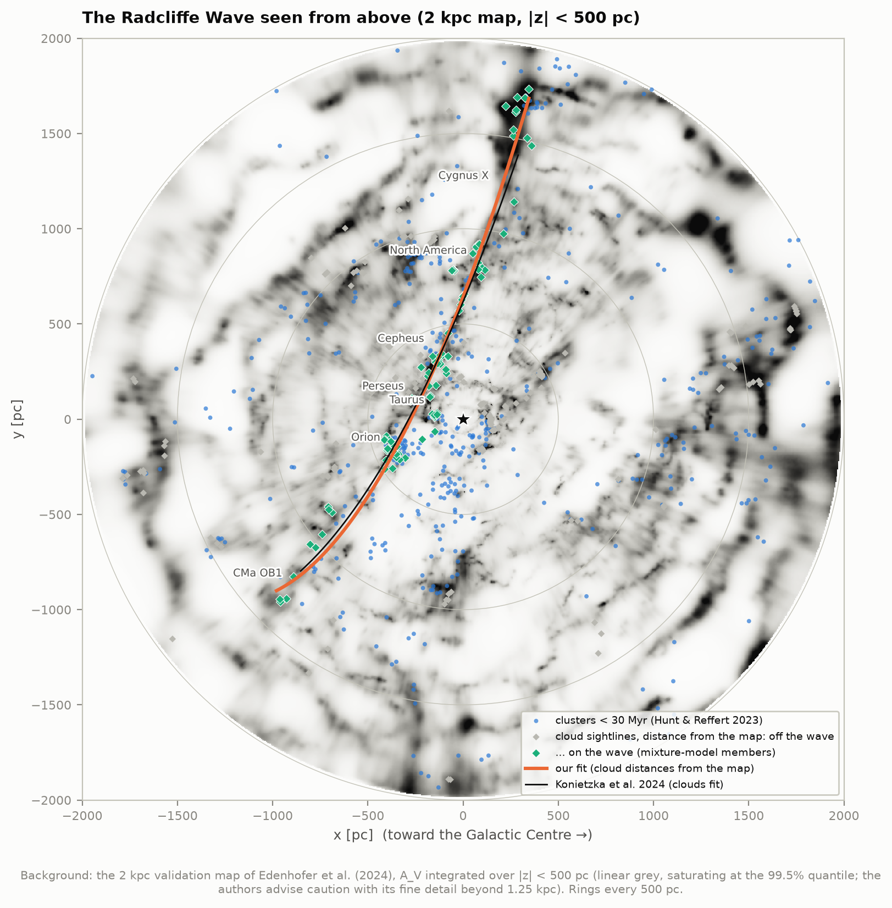

### 7. Cloud distances: the map vs Zucker et al. (2020)

Zucker et al. measured the distance to 326 sightlines through local molecular clouds by fitting a
single dust screen to the stars along each. In the map, the equivalent is the cloud holding the most
extinction along the same sightline (pixels within 15′), at the distance where half of its extinction
has built up. For 263 of the 308 sightlines within 1.95 kpc the two methods pick the same cloud
(within 30%); for the rest the map's dominant cloud is another one along the same sightline (the
Coalsack's sightlines, at 190 pc in Zucker et al., cross more dust at 1.3 kpc).

| Zucker distance | n | map ÷ Zucker (median) |
|---|---|---|
| < 200 pc | 40 | 1.035 |
| 200-400 pc | 69 | 1.036 |
| 400-700 pc | 47 | 1.020 |
| 700-1,100 pc | 59 | 1.067 |
| > 1,100 pc | 48 | 1.126 |

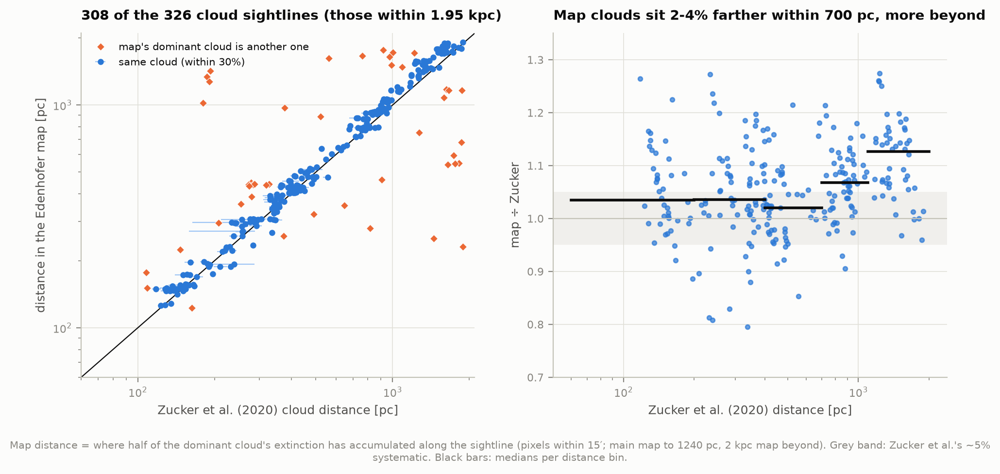

The map puts clouds **2-4% farther** than Zucker et al. within 700 pc, inside their quoted ~5%
systematic and in line with Edenhofer et al.'s remark that some structures sit "at slightly larger
distances in our map" than in Leike et al. (2020)'s. Beyond 700 pc the offset grows, and beyond
1,240 pc it comes from the less detailed 2 kpc map.

A worked example of why this matters for single stars: toward the Orion Nebula Cluster (l = 209.0°,
b = −19.4°) the map gives A_V = 0.12 mag at 400 pc but 2.3 mag at 430 pc and 3.5 at 450 pc. The
cluster itself (~390-400 pc) sits on the near side of Orion A, and its ~1 mag foreground "veil" is
far smaller than the map's resolution. Near a cloud, a few percent of distance can swing the answer by
magnitudes.

### 8. A second map, and fingers of god

Vergely, Lallement & Cox (2022) built their map from 35 million stars (Gaia EDR3 + 2MASS, calibrated
on spectroscopic extinctions) on a Cartesian grid with a 10-pc correlation length. Their cube has no
coordinate keywords; we read its "Sun position" header as the centre of pixel (300, 300, 80), and a
cross-correlation of the two maps' mid-planes confirms it (best shift 1.4 pc, a third of a cell).

* **Integrated extinction** from the Sun to 100-1,200 pc along 3,072 directions: median ratio
  **0.998** (16th-84th percentiles 0.80-1.24); 0.95-1.00 for A_V above 0.1 mag, 1.12 below.
* **Fingers of god.** Uncertain stellar distances smear dust along lines of sight. We measured how far
  the small-scale density stays correlated along vs across the line of sight (both maps on 5 pc
  cells, trends on scales above 30 pc removed):

| distance | Edenhofer: along ÷ across | Vergely: along ÷ across |
|---|---|---|
| 100-200 pc | **0.84** (16 / 19 pc) | 2.22 (38 / 17 pc) |
| 200-350 pc | 1.05 | 2.35 |
| 350-500 pc | 1.20 | 2.44 |
| 500-700 pc | 1.24 | 2.33 |
| 700-900 pc | 1.27 | 2.46 |
| 900-1,100 pc | 1.26 (32 / 26 pc) | **3.00** (60 / 20 pc) |

Edenhofer et al. wrote that their "dust clouds are compact and only weakly elongated radially"; this
is that statement in numbers. In Vergely et al.'s face-on view the streaks pointing at the Sun are
plain to see.

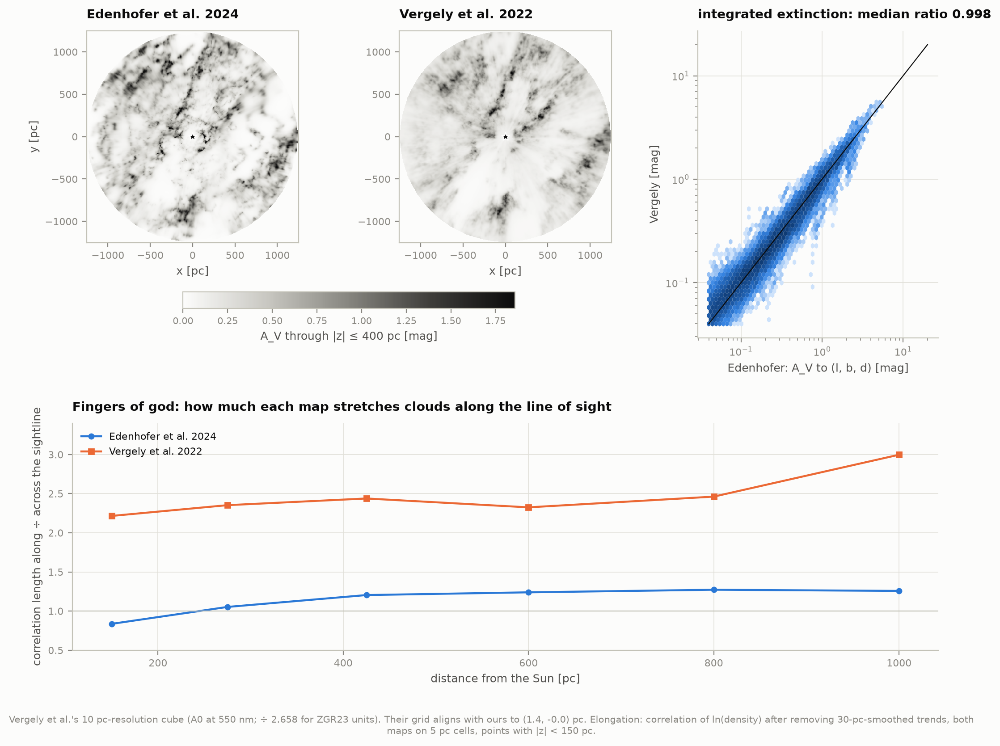

### 9. A dereddening tool for B1 and B8

```
python deredden.py 184.6 -5.8 140                 # l, b (deg), distance (pc)
python deredden.py --radec 83.82 -5.39 400        # RA, Dec (deg), distance
python deredden.py --parallax 56.67 24.12 7.35    # RA, Dec, parallax (mas)
```
or `from deredden import Extinction; Extinction().bands(l, b, d)`. It sums the map's voxels from the
Sun to the star (each constant between its radial edges, plus the map's own integral inside 69 pc),
combines the four nearest sightlines, and converts with the ZGR23 extinction curve: A_V (540 nm),
A_G (672 nm), E(B−V) ≈ 0.97, E(BP−RP) ≈ 1.36 and 2MASS J, H, Ks. The error is quoted as a range,
from independent voxels (a lower bound) to fully correlated voxels (an upper bound), since the
samples show neighbouring voxels correlated by +0.3 to +0.5.

Checks:

* **1,312 open clusters** (Hunt & Reffert 2023, 100-1,200 pc) with extinctions from their own
  isochrone fits: Spearman 0.90, median difference −0.04 mag, robust scatter 0.15 mag. Their A_V
  assumes the Cardelli et al. (1989) law with R_V = 3.1; the ZGR23 curve behind the map is closest to
  R_V = 2.76 and assigns **0.900 times** the A_V to the same reddening. On the same footing the median
  ratio is **0.986**.
* **SFD (1998) at |b| > 30°**, where the whole dust column lies within the map: E(B−V) from the map vs
  0.86 × SFD (Schlafly & Finkbeiner 2011 recalibration), r = 0.95, slope **1.045**, offset
  **+0.008 mag**, the floor that ZGR23's strictly positive extinctions leave where there is almost
  no dust.
* **The `dustmaps` package**: its integrated mode agrees with ours *evaluated half a voxel farther
  out* (99th-percentile ratio 1.000002, against 1.024 at the same distance): it places the cumulative
  sum to each voxel's outer edge at the voxel's centre. The offset is 0.2-3.5 pc.

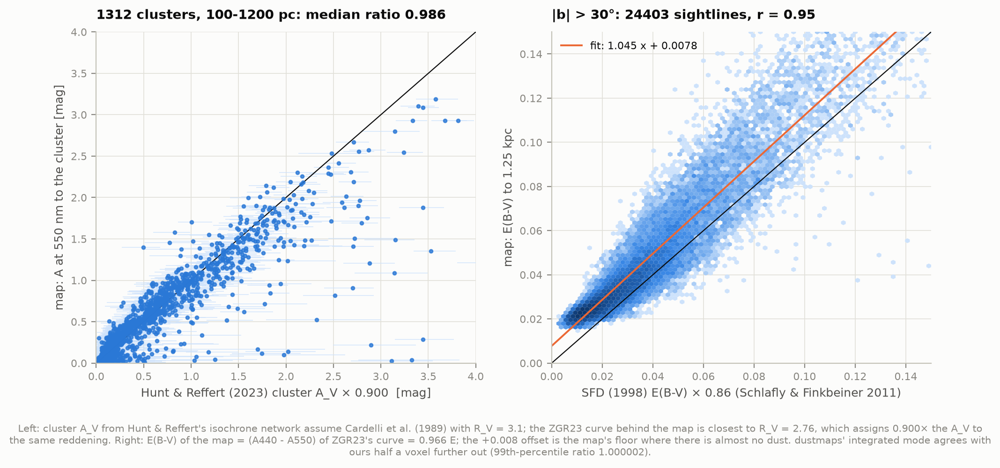

---

## How it works

| step | module |
|---|---|
| download (resumable parallel byte ranges, MD5 against Zenodo) | `fetch_data.py` |
| read, sample, integrate the HEALPix map | `dustmap.py` |
| Cartesian grids: projections, mid-plane, viewer volumes | `grids.py` |
| the published figure, the samples test, extinction checks | `validation.py` |
| Local Bubble wall (O'Neill recipe) and young clusters | `bubble.py` |
| the bubble's expansion (Zucker et al. 2022 refit) | `history.py` |
| Radcliffe Wave models, cloud distances, nested-sampling fits, the curtain | `wave.py` |
| Vergely et al. comparison and fingers of god | `compare.py` |
| dereddening tool | `deredden.py` |
| figures; viewer (WebGL 2, no libraries); movie | `figures.py`, `viewer.py` + `viewer_template.html`, `movie.py` + `tools/render_frames.js` |
| published numbers we compare with | `literature.py` |
| unit tests on synthetic inputs | `test_physics.py` |

## Checks against published numbers

| quantity | ours | published |
|---|---|---|
| Fig. 4 face-on view (Edenhofer et al. 2024) | r = 0.995; 4-8% higher, explained | |
| local Bubble wall, median distance / thickness / mass (O'Neill et al. 2024) | 169 pc / 35 pc / 6.0 × 10⁵ M☉ | 170 / 35 / 6.0 × 10⁵ |
| Bubble age / radius / expansion (Zucker et al. 2022) | 14.5 Myr / 166 pc / 6.7 km/s | 14.4 / 165 / 6.7 |
| Radcliffe Wave (Alves et al. 2020; Konietzka et al. 2024) | 2.95 kpc long, up to 203 pc high, mean wavelength 2.16 kpc (map distances); 2.73 kpc, 169 pc (Zucker distances) | 2.7 kpc long; amplitude ~160 pc (Alves), A = 220 pc, mean wavelength ~2 kpc (Konietzka) |
| cloud distances (Zucker et al. 2020) | 2-4% farther within 700 pc | ±5% systematic |
| second map (Vergely et al. 2022), integrated extinction | median ratio 0.998 | "good agreement" (Edenhofer et al.) |
| cluster extinctions (Hunt & Reffert 2023) | median ratio 0.986 (same extinction law) | |
| SFD at high latitude | slope 1.045, +0.008 mag | |

## Caveats and what this does not do

* **The map's resolution is the limit.** Near the Sun voxels are 0.4 pc deep and 14′ wide, but the
  map is "parsec-scale" only where stars constrain it; flying close to a cloud shows soft shapes, not
  filaments. Single voxels are uncertain by ~50%.
* **Mean map vs samples**: our Cartesian products (figures, viewer) inherit the 4-8% upward bias of
  interpolating the mean in log space; for quantitative work use the samples, as the authors advise.
* **The map starts at 69 pc.** Inside, the file gives only the total extinction per direction, so the
  bubble's nearest walls and the "Local Fluff" clouds around the Sun are invisible. The tool scales
  the inner integral linearly.
* **Beyond 1.25 kpc** everything comes from the 2 kpc validation map, built from fewer stars, which
  the authors flag as less reliable in detail; the bright rim at 1.5-2 kpc in the viewer is partly its
  edge.
* **The Radcliffe Wave fits** depend on which clouds are "on" the wave; the mixture model decides,
  and so did Alves et al.'s, but with a background density we chose (a 2 kpc × 0.7 kpc cross-section); with broad priors the preferred shape changes).
* **Young clusters and the wall** are compared along each cluster's sightline only, with Hunt &
  Reffert's distances (a few percent) and ages (factor ~1.5 for the youngest) taken as given.
* **The dereddening tool** returns monochromatic extinctions; broad-band values depend on the star's
  spectrum by up to ~10%, and near a cloud the answer depends steeply on the star's exact distance.
* **Rendering**: Solid's opacity and fade are display choices; Glow and Starlight are physical but
  their stretch is not. The face-on figures use the paper's linear, 99.9%-quantile stretch.

## Figures

| file | what |
|---|---|
| `dust_flythrough.html`, `dust_viewer/` | the interactive viewer (offline file; online version with separate data files) |
| `dust_flythrough.mp4`, `dust_flythrough_poster.png` | the tour as a movie, and one frame of it |
| `map_projections(_labelled).png` | face-on and side views, the paper's Fig. 4 layout |
| `check_published_fig4.png` | the published figure read back, and the samples test |
| `sky_extinction.png` | all-sky extinction to 250-1,250 pc |
| `uncertainty_midplane.png` | single-voxel uncertainty |
| `bubble_wall.png`, `bubble_history.png` | the Local Bubble |
| `wave_faceon.png`, `wave_curtain.png` | the Radcliffe Wave |
| `cloud_distances.png` | map vs Zucker et al. (2020) |
| `second_map.png` | Vergely et al. (2022) and fingers of god |
| `extinction_checks.png` | the dereddening tool against clusters and SFD |
| `render_modes.png` | the same view in each render mode |

## Running it

```
python fetch_data.py      # ~8.1 GB: the two maps (7.4 GB), samples' byte ranges, catalogues, papers
python run.py             # everything: ~1 h the first time on a busy machine (mostly the wave fits), ~1 min after
python run.py --no-movie  # skip the movie (it needs a browser that can use the GPU)
python test_physics.py
```
Python 3.14 venv with numpy, scipy, astropy, healpy, dynesty, numba, matplotlib, pandas, requests and
`dustmaps` (for cross-checks and SFD). The movie needs Node with Playwright's Chromium (rendering on
the GPU through ANGLE + Vulkan: ~0.1 s a frame instead of ~25 s on the software renderer) and ffmpeg.
Map grids are cached in `data/cache/`; after one run everything works offline.

## Data and credits

* Edenhofer, G., Zucker, C., Frank, P., et al. 2024, A&A 685, A82: the 3D dust map (Zenodo,
  doi:10.5281/zenodo.8187942; we use record 10658339, v1.0.2). Built on Zhang, Green & Rix 2023
  (MNRAS 524, 1855), whose extinction curve (Zenodo 7811871) converts its units.
* O'Neill, T. J., Zucker, C., Goodman, A. A., & Edenhofer, G. 2024, ApJ 973, 136: the Local Bubble
  model (Harvard Dataverse doi:10.7910/DVN/INB1RB).
* Zucker, C., Goodman, A. A., Alves, J., et al. 2022, Nature 601, 334: cluster tracebacks and tables
  (doi:10.7910/DVN/E8PQOD, ZU97QD, 1VT8BC).
* Zucker, C., Speagle, J. S., Schlafly, E. F., et al. 2020, A&A 633, A51 (doi:10.7910/DVN/07L7YZ) and
  Alves, J., Zucker, C., Goodman, A. A., et al. 2020, Nature 578, 237 (bridging sightlines,
  doi:10.7910/DVN/K16GQX).
* Konietzka, R., Goodman, A. A., Zucker, C., et al. 2024, Nature 628, 62.
* Vergely, J.-L., Lallement, R., & Cox, N. L. J. 2022, A&A 664, A174 (CDS J/A+A/664/A174).
* Hunt, E. L., & Reffert, S. 2023, A&A 673, A114 (CDS J/A+A/673/A114).
* Schlegel, Finkbeiner & Davis 1998, ApJ 500, 525; Schlafly & Finkbeiner 2011, ApJ 737, 103 (SFD maps
  via the `dustmaps` package's data on Harvard Dataverse, doi:10.7910/DVN/EWCNL5).
* Software: healpy, astropy, dynesty (Speagle 2020), dustmaps (Green 2018), numba, matplotlib, scipy.

This work used data from the European Space Agency mission Gaia, processed by the Gaia Data
Processing and Analysis Consortium (DPAC).
