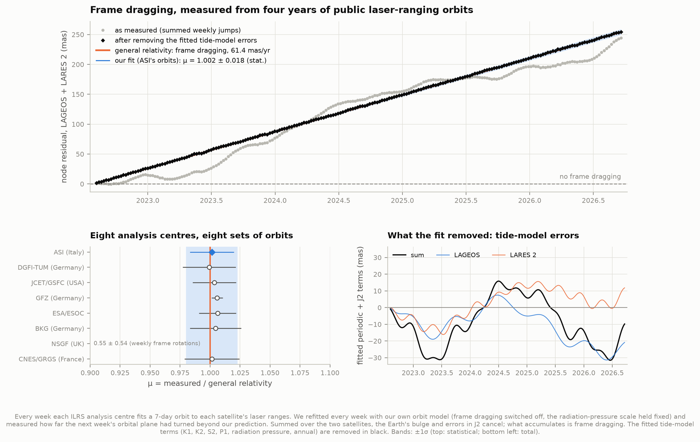
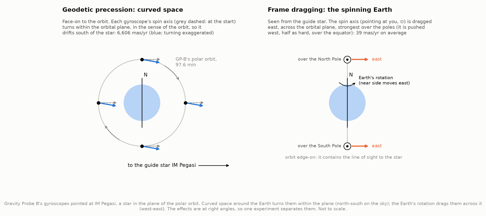
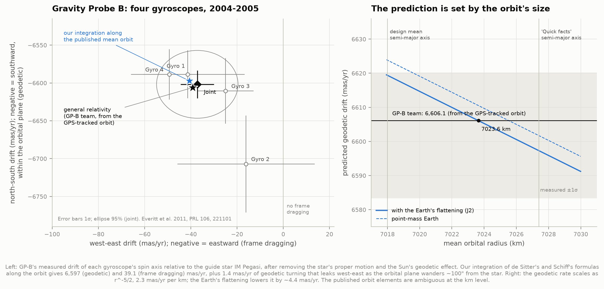
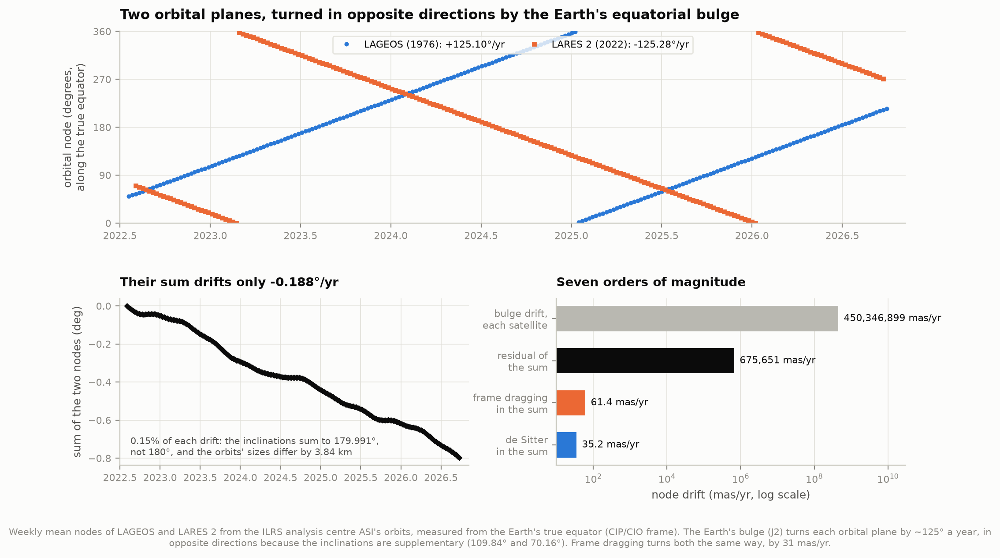
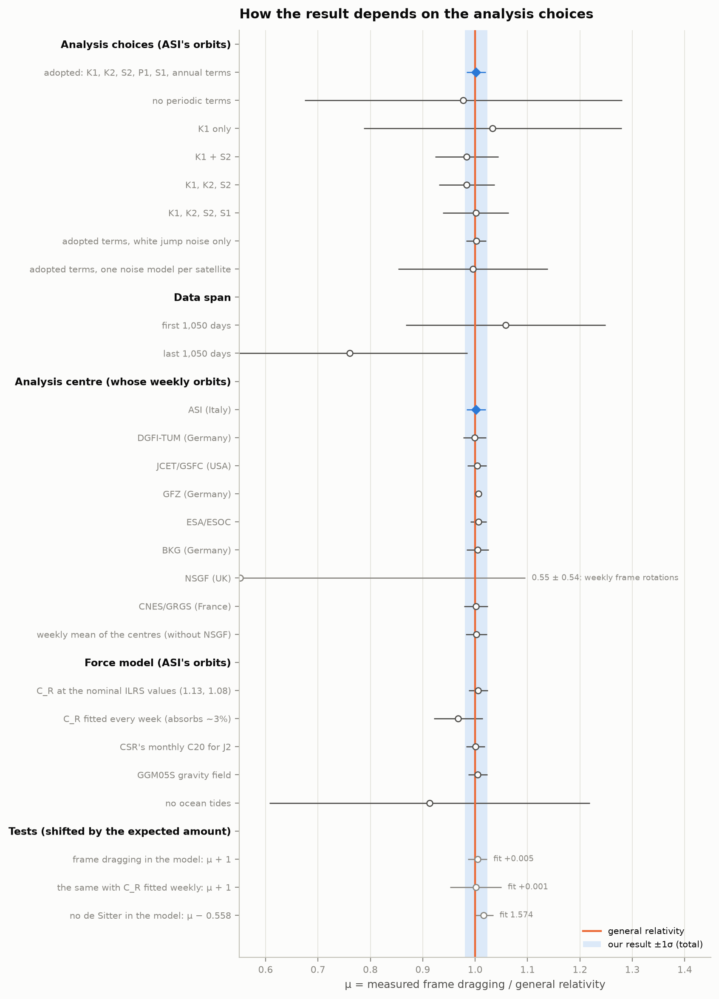
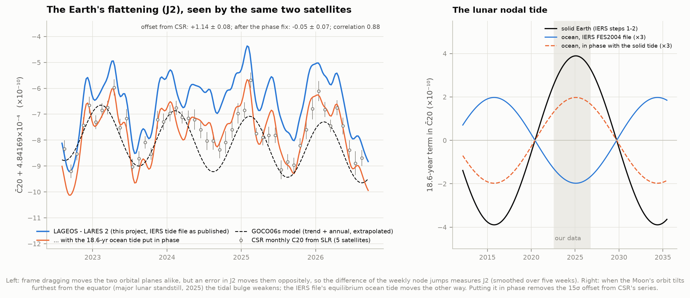
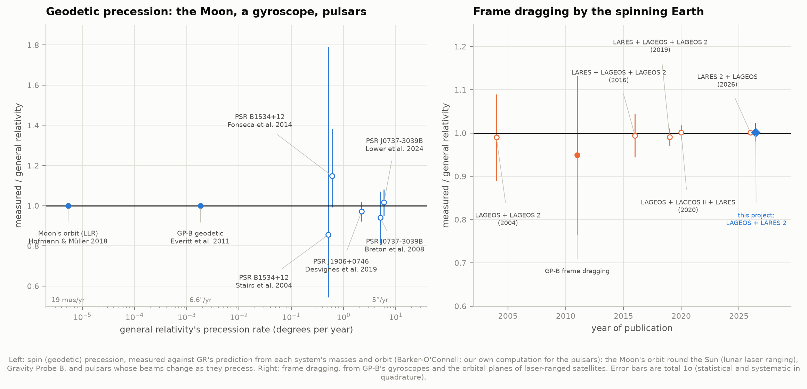

# N4 — Gyroscopes in curved space: geodetic precession and frame dragging

**A perfect gyroscope orbiting the Earth slowly turns for two reasons: space around the Earth is
curved (geodetic precession, 6.6″ a year in Gravity Probe B's orbit), and the spinning Earth drags
spacetime round with it (frame dragging, 0.039″ a year). Can we compute these effects ourselves,
compare them with every measurement, and find the same physics in the orbits of laser-ranged
satellites and in binary pulsars whose spin axes wobble?**

Yes, and we went a step further than the plan: **we measured frame dragging ourselves**, from four
years of public laser-ranging orbits of the satellites LAGEOS and LARES 2.

**Frame dragging, measured.** Every week, the analysis centres of the International Laser Ranging
Service (ILRS) fit 7-day orbits to the laser echoes of LAGEOS (launched 1976) and LARES 2 (2022) and
publish them, accurate to about a centimetre. We refitted all of them, Aug 2022 – Oct 2026, with our
own orbit model in which frame dragging is switched off, and measured how far each satellite's orbital
plane had turned beyond our model from one week to the next. The Earth's equatorial bulge turns the two
planes by 125° a year in **opposite** directions (the satellites fly mirror-image orbits); frame
dragging turns both the same way, by 31 mas a year. Summed over the pair, the bulge cancels and frame
dragging adds up:

> **μ = 1.002 ± 0.018 (statistical) ± 0.011 (systematic)** of general relativity's Lense–Thirring
> prediction (61.35 mas/yr for the pair), from 216 weeks of the ASI analysis centre's orbits: frame
> dragging detected at 47σ. Seven of the eight analysis centres' orbits give 0.999–1.006 (the eighth,
> NSGF's, rotated from week to week, gives 0.55 ± 0.54).

That agrees with general relativity, and with the result Ciufolini et al. published in *Nature* in July
2026 from the same two satellites, μ = 1.001 ± 0.001 ± 0.002. Theirs is about ten times more precise:
they fit the raw laser ranges with NASA's GEODYN software, a 60×60 gravity field with GRACE's monthly
variations, and a full error budget; we fit the public weekly orbit products with a hobby orbit model.
Either way, seeing the effect means modelling a 450-million-mas-a-year drift to one part in ten million.

**One trap on the way.** Our first result was μ = 0.96, and both satellites' inclinations, which frame
dragging leaves alone, drifted by −21 mas/yr. The cause was our own fitting choice: we let the
radiation-pressure scale C_R float every week, as analysis centres do. On synthetic orbits, that
absorbed 0–19% of frame dragging depending on the season (in eclipse seasons the Earth's shadow lets
sunlight push the orbital plane round). Holding C_R at one value per satellite recovers 99.7–99.9% of a
synthetic signal, removes the inclination drift, and gives the result above.

**Gravity Probe B.** Integrating de Sitter's and Schiff's formulas along GP-B's real orbit (with the
Earth's flattening, the Sun and the Moon) reproduces the experiment's predictions: frame dragging
**−39.1** mas/yr (GP-B team −39.2), the Sun's own geodetic effect **+7.4 / −16.4** (GP-B: +7.3 / −16.2),
and a geodetic drift of **−6,597 to −6,620** mas/yr depending on the orbit's exact size (GP-B: −6,606.1
from its GPS-tracked orbit; the published orbit numbers disagree by 9 km, and the prediction moves by
2.3 mas/yr per km). GP-B measured −6,601.8 ± 18.3 and −37.2 ± 7.2 (Everitt et al. 2011). The integration
also shows why its orbit was tilted 0.007° from polar: the Sun and Moon alone would have turned the
orbital plane about 0.33° away from the guide star during the mission, and the tilt lets the Earth's
bulge turn it back by 0.30°, leaving −0.025°.

**A by-product: the Earth's flattening, and a sign in the IERS Conventions.** A J2 error moves the two
satellites' planes in opposite directions, so the *difference* of their weekly jumps weighs the Earth's
flattening every week. It tracks the University of Texas's monthly laser-ranging series (correlation
0.88), with a 14σ offset of 1.14 ± 0.08 × 10⁻¹⁰ in C̄₂₀ that we traced to the 18.6-year ocean tide in the IERS
Conventions' FES2004 file: it moves in anti-phase with the solid-Earth tide raised by the same
potential. Put in phase, the offset becomes −0.05 ± 0.07 × 10⁻¹⁰.

**Pulsars and the Moon.** The geodetic precession that turned GP-B's gyroscopes by 6.6″ a year turns
pulsars' spin axes by degrees a year. From published masses we compute 5.074°/yr for pulsar B of the
double pulsar (measured 5.16 ± 0.33, Lower et al. 2024), 2.234°/yr for PSR J1906+0746 (2.17 ± 0.11) and
0.514°/yr for PSR B1534+12 (0.59 +0.12/−0.08). Lunar laser ranging sees the Moon's whole orbit precess
at 19.2 mas/yr round the Sun, confirmed to 0.09%. Every measurement agrees with GR.

Animation: [`figures/orbital_planes.mp4`](figures/orbital_planes.mp4), the two orbital planes week by
week, to scale, with frame dragging building up beside them.

---

## Results

### 1. What general relativity does to a gyroscope

A gyroscope's spin axis, free of torques, keeps its direction in a freely falling frame. In curved
spacetime that frame turns relative to the distant stars, at a rate (weak fields, PPN γ = 1)

    Ω = (3/2) (v × a_N) / c²   +   (G / c² r³) [3 (J·r̂) r̂ − J]
        geodetic (de Sitter 1916)    frame dragging (Lense & Thirring 1918; Schiff 1960)

where v is the gyroscope's velocity, a_N the Newtonian gravitational acceleration it feels (including
the Earth's flattening) and J the Earth's spin angular momentum (J/M = 9.81 × 10⁸ m²/s, from J2 and the
dynamical ellipticity). For GP-B's 642 km polar orbit the first term is 6.6″ a year, turning the spin
axis within the orbital plane; the second, averaged over the orbit, is 0.039″ a year at right angles
to it. Frame dragging pushes the axis east over the poles and west, half as hard, over the equator.
The **same two effects act on whole orbits**: geodetic (de Sitter) precession turns the orbit of the
Earth–Moon system round the Sun at 19.2 mas/yr (and every satellite orbit with it), and frame dragging
turns a satellite's orbital plane (its node) at `2GJ / (c² a³ (1 − e²)^{3/2})`: **30.7 mas/yr** for
LAGEOS and LARES 2, whatever their inclination.

### 2. Gravity Probe B, recomputed

We integrate GP-B's orbit through its science phase (28 Aug 2004 – 14 Aug 2005) from Stanford's
published elements (a = 7,027.4 km, e = 0.0014, i = 90.007°, node 163.26°, the orbital plane set to
contain the guide star IM Pegasi), with the zonal field J2–J6 of GOCO06s and the Sun and Moon from
DE440, and accumulate the drift of a gyroscope pointing at IM Peg (VLBI position, Bartel et al. 2015)
in the north-south (NS) and west-east (WE) directions the experiment used (`gpb.py`):

| mas/yr | NS (geodetic) | WE (frame dragging) | GP-B team (Everitt et al. 2011) |
|---|---|---|---|
| geodetic, point-mass Earth | −6,601.8 (by coincidence the measured value) | | |
| geodetic, with J2 and the real orbit | **−6,597.4** | −1.4 (leak) | −6,606.1 |
| frame dragging | 0.0 | **−39.1** | −39.2 |
| the Sun's geodetic effect | +7.40 | −16.41 | +7.3 ± 0.3 / −16.2 ± 0.6 |
| **measured** (joint, four gyroscopes) | | | **−6,601.8 ± 18.3 / −37.2 ± 7.2** |

- **The Earth's flattening** lowers the geodetic rate by 4.4 mas/yr at a fixed mean radius: averaged
  over a polar orbit, J2 adds an outward pull of ¾J2(R/r)² of the main one, slowing the orbit.
  Breakwell (1988) quotes "−7 mas/yr" for a polar orbit relative to his mean elements.
- **The orbit's size matters more**: the rate scales as r^−5/2, 2.35 mas/yr per km. Stanford's "quick
  facts" give a = 7,027.4 km, its orbit-design section a mean semi-major axis of 7,018.0 km, the papers
  "642 km". GP-B's −6,606.1 corresponds to a mean radius of 7,023.6 km in our model, between them. The
  0.1% this leaves open in our prediction is far below the measurement's 0.28%.
- **The guide star stayed in the plane by design**: with the Earth's bulge alone, the node of a 90.007°
  orbit drifts 0.30° during the mission (1,048″ off the star by the end); with the Sun and Moon the
  drift is −0.025°, and IM Peg stays within ~100″ of the plane. That leaks −1.4 mas/yr of geodetic
  turning into the WE axis, the "about 1 mas/yr from orbit imperfection" the GP-B team mention.
- **The Sun's geodetic effect** (19.2 mas/yr about the ecliptic pole) is the same physics as the
  Moon's orbit precession below; projected at IM Peg it gives +7.4 NS and −16.4 WE, which GP-B removed
  before quoting its results.

GP-B's own data (about 1 TB of telemetry, at NASA's NSSDCA by request only) are not reasonably usable,
and its final analysis needed five years to model unexpected classical torques from electrostatic
patches on the gyroscopes, which is why the four gyroscopes scatter (gyroscope 2 at −6,707 ± 64). Here
we compare predictions with the published per-gyroscope results.

### 3. Two orbital planes swung in opposite directions

LAGEOS (60 cm, 407 kg, 426 retroreflectors, 1976) and LARES 2 (42 cm, 295 kg, 303 retroreflectors,
launched 13 July 2022 on the first Vega C) fly 5,900 km up in nearly the same orbit, tilted the two
opposite ways: from the ILRS orbits, inclinations 109.836° and 70.155° to the true equator (sum
179.991°), semi-major axes 12,270.01 and 12,266.17 km. The Earth's equatorial bulge makes every orbital
plane precess round the Earth's axis at a rate proportional to cos i, so the two planes swing round in
opposite directions:

| node drift, 4.1 years of weekly orbits | LAGEOS | LARES 2 | sum |
|---|---|---|---|
| measured | **+125.096°/yr** | **−125.284°/yr** | −0.188°/yr |
| first-order J2 formula, measured elements | +125.061 | −125.248 | −0.187 |

The sum is 0.15% of either drift: the inclinations are 0.009° short of supplementary and the orbits
3.8 km apart. Frame dragging (61.4 mas/yr in the sum) is a ten-thousandth of that residual and
1.4 × 10⁻⁷ of one satellite's drift, which is why it takes the full force model below.

**Two-line elements cannot do it.** CelesTrak's current element sets, propagated with SGP4 to the latest
precise orbits (15–21 days back), are off by 1.3–1.9 km along the orbit and **265–340 m across it**
(`tle_check.py`). Frame dragging moves each orbital plane by 1.8 m a year at the satellites.

### 4. Measuring frame dragging

**The data.** The ILRS analysis centres (ASI in Italy; BKG, DGFI-TUM and GFZ in Germany; CNES/GRGS in
France; ESA/ESOC; JCET/GSFC in the USA; NSGF in the UK) each fit a 7-day orbit to both satellites' laser
ranges every week, estimating once-per-revolution cross-track accelerations and the Earth's rotation
as they go, and publish the orbits at the EUROLAS Data Center (EDC): positions and velocities every
2 minutes in the Earth-fixed frame. We use every week from August 2022 to October 2026: 217 weeks for
LARES 2 and 220 for LAGEOS from ASI (the ILRS primary combination centre), 3,435 files from all eight.

**Our orbit model** (`forcemodel.py`, compiled with numba; a 7-day orbit takes ~1 s) follows the IERS
Conventions (2010): the GOCO06s gravity field to degree 30 with its trend and annual terms; solid-Earth
tides (IERS steps 1–3, including the frequency-dependent K1 Love number), FES2004 ocean tides to degree
20 with 81 admittance waves, solid and ocean pole tides; the Sun, Moon, Venus, Mars, Jupiter and Saturn
(DE440); solar radiation pressure on a sphere with a conical Earth shadow; and the relativistic terms
of IERS eq. 10.12: Schwarzschild, de Sitter (scale μ_dS = 1) and Lense–Thirring (scale μ_LT). Each
weekly orbit is rotated from the Earth-fixed frame into the GCRS (IAU 2006/2000A, IERS EOP 20 C04) and
fitted by least squares: initial state, along-track accelerations (constant + once per revolution) and
a radial constant. Deliberately **no cross-track** empirical acceleration: it would turn the orbital
plane and absorb the very effect we measure. With frame dragging off (μ_LT = 0) the fits leave ~0.2 cm
radial, ~1.8 cm along-track and ~4 cm cross-track rms. Nine checks against textbook rates are in
`test_physics.py` (the Lense–Thirring, de Sitter and J2 node rates, GP-B's circular-orbit formulas,
the frames, the pulsar formula, the tides, and the method's gain).

**The node jumps.** Each fitted week is propagated half a day past its end; the next week's fit is
propagated half a day back. Over that shared day both describe the same satellite, and the difference
of their nodes is the **jump**: how far the real plane turned in a week beyond our model. Each fit
settles on the true node at the middle of its week, so a jump equals (true rate − model rate) × 7 days,
whatever the evaluation time. The two propagations agree to 0.01–0.02 mas over the day. Summed, the
jumps give the node residual.

**The radiation-pressure trap.** Our first runs let C_R float every week, as the analysis centres do.
On synthetic orbits generated with frame dragging and fitted without it (`test_physics.test_jump_gain`),
the jumps then recovered only 81–100% of the true signal, depending on the season; with C_R held fixed,
99.7–99.9% at all four seasons tried. In eclipse seasons the shadow switches the sunlight's push on and
off around the orbit, so radiation pressure can turn the orbital plane, and a free weekly C_R mimics
part of the drift. On the real orbits the free-C_R fits gave μ = 0.957 ± 0.054 and spurious inclination
drifts of −21 mas/yr in both satellites (the same in three centres' orbits); with C_R held at the median
of the free fits (1.099 for LAGEOS, 1.091 for LARES 2) the inclination drifts vanish (+0.3 ± 1.1 and
−0.5 ± 1.3 mas/yr) and μ rises to the adopted value. Running the whole chain once more with frame
dragging switched *on* in our model (μ_LT = 1) leaves μ = 0.005 ± 0.018: on the real orbits the measured
value falls by 0.997, so the method passes frame dragging at full strength (with a weekly C_R it fell by
0.967).

**The Earth's J2.** A first pass with GOCO06s as published (extrapolated from its 2010 epoch) gives jumps
of −117 mas/yr (LAGEOS) and +175 mas/yr (LARES 2) with C_R fitted weekly (−120 and +180 with it held
fixed): our model's J2 is 3.2 × 10⁻⁷ too large, and wobbles
with the seasons. Because that error moves the two nodes oppositely while frame dragging moves them
alike, the difference of the jumps measures it week by week (section 5). We feed that J2 back, smoothed
over five weeks, and refit everything; the fitted residual J2 offset is then (−1.1 ± 1.4) × 10⁻⁸.

**The fit** (`framedrag.py`). Frame dragging is a common trend, μ × 30.7 mas/yr in each satellite. The
two satellites' jumps are fitted together, rotated into their sum and difference, with μ, a residual J2
offset (opposite in the two satellites), and periodic terms at every argument where errors of the tide
and radiation-pressure models must appear: the satellite's node angle (K1, period ~1,050 days for both),
twice it (K2), twice its angle from the Sun (S2: 280 days for LAGEOS, 135 for LARES 2), its angle from
twice the Sun's (P1: 221 and 156 days), its angle from the Sun (radiation pressure: 560 and 271 days)
and the year. A periodogram of the summed residual shows its strongest peaks near 1,030 and 136 days.
The noise model has white node errors, white model errors and slowly varying (AR(1)) errors, fitted by
restricted maximum likelihood in the sum and difference separately. With all these terms the summed
residuals are white: 0.25 mas per week of node error and 0.2 mas of model error.

| ASI's orbits, 216 weeks | μ |
|---|---|
| raw sum of jumps, no fit at all | 0.963 (59.1 of 61.35 mas/yr) |
| no periodic terms | 0.977 ± 0.303 |
| K1 only | 1.033 ± 0.246 |
| K1 + S2 | 0.984 ± 0.061 |
| K1, K2, S2 | 0.984 ± 0.053 |
| K1, K2, S2 + radiation pressure | 1.001 ± 0.063 |
| **all expected terms (adopted)** | **1.002 ± 0.018** |
| adopted terms, white jump noise | 1.002 ± 0.019 |
| first 1,050 days (one K1 period) | 1.06 ± 0.19 |
| last 1,050 days | 0.76 ± 0.23 |
| C_R fitted every week (the trap) | 0.968 ± 0.047 (0.957 ± 0.054 with K1, K2, S2) |

Without the P1 and radiation-pressure terms those signals (significant at 6σ and 3σ) end up in the
slowly varying noise, and the error grows threefold; the central values stay within 0.02. The fitted
K1 residuals are 11.3 (LAGEOS) and 8.7 (LARES 2) mas: Ciufolini et al. fit a K1 residual of −13.5 mas.

**Systematics.** Every analysis centre fits the same laser ranges with its own software, models and
station coordinates, so the same analysis on each centre's orbits tests everything downstream of the
data:

| centre | ASI | DGFI-TUM | JCET/GSFC | GFZ | ESA/ESOC | BKG | CNES/GRGS | NSGF |
|---|---|---|---|---|---|---|---|---|
| weeks | 216 | 209 | 214 | 213 | 215 | 212 | 216 | 180 |
| μ | 1.002 ± 0.018 | 0.999 ± 0.022 | 1.004 ± 0.018 | 1.006 ± 0.005 | 1.006 ± 0.015 | 1.005 ± 0.021 | 1.002 ± 0.023 | 0.55 ± 0.54 |

Seven centres agree to ±0.003. NSGF's weekly orbits are rotated about the Earth's axis by up to 15 mas
from one week to the next (both satellites jump together), ten times the others; the noise model
notices, and its result is consistent but uninformative. GFZ's small error reflects noise that is
almost purely independent week-to-week node offsets, which cancel in the sum. The weekly mean of the
seven gives 1.002 ± 0.020 (215 weeks). Changing the force model on ASI's orbits: C_R at the nominal ILRS
values (1.13,
1.08) 1.006 ± 0.018; CSR's monthly C20 instead of our own J2, 1.001 ± 0.018; the GGM05S gravity field
instead of GOCO06s, 1.005 ± 0.018. **Without ocean tides** the summed drift falls to 35.8 mas/yr and the
fitted K1 terms grow to 184 mas in each satellite: the ocean's K1 tide alone shakes each node by three
years' worth of frame dragging, and μ = 0.91 ± 0.31. The systematic error adds in quadrature the spread
between the seven centres (0.003), between the well-determined sets of periodic terms (0.010) and the
largest force-model change (0.004): **±0.011**. Not included: forces we do not model at all, the
Earth's reflected and emitted radiation and the satellites' thermal thrust; Ciufolini et al. estimate
each at 0.1% after modelling them, and unmodelled they could be several times that.

### 5. The Earth's flattening, and the 18.6-year tide

The difference of the two satellites' jumps measures our model's J2 error week by week
(`framedrag.j2_from_difference`); added to GOCO06s it gives the Earth's C̄₂₀ (= −J2/√5) from LAGEOS and
LARES 2 alone. Against the University of Texas Center for Space Research's monthly series (Cheng & Ries,
RL06, from laser ranging to five satellites, atmosphere and ocean mass included), month by month:

| | offset (pair − CSR, ×10⁻¹⁰) | month-to-month scatter | correlation |
|---|---|---|---|
| with the IERS tide file as published | **+1.14 ± 0.08** | 0.53 | 0.88 |
| with the 18.6-year ocean tide in phase with the solid tide (full re-run) | **−0.05 ± 0.07** | 0.47 | 0.90 |

(Both from first-pass fits with C_R held fixed; with C_R fitted weekly the offset is +1.10 ± 0.07.)
GOCO06s, extrapolated from its 2010 epoch, sits 0.48 × 10⁻¹⁰ below CSR over the same months.

**What happened.** The Moon's orbit is tilted 5° to the ecliptic, so its tilt to the equator swings
between 18.3° and 28.6° every 18.6 years; it was largest at the major lunar standstill of 2024–25. The
Moon then reaches high declinations, the tidal bulge is less concentrated at the equator, and C̄₂₀ rises:
our solid-tide model (IERS steps 1 and 2) gives **+3.9 × 10⁻¹⁰ cos N′**, N′ being the argument of the lunar
node. An equilibrium ocean tide must respond to the same potential in the same sense. The IERS
Conventions' FES2004 coefficient file gives the 18.6-year ocean term as **−6.6 × 10⁻¹¹ cos N′**: the
opposite sense. The IERS text itself notes "an ongoing discussion on whether the phase change to π/2
… introduced in the update dated 2011/09/23, is justified" for exactly this term. Flipping it moves our
model's C̄₂₀ by 1.32 × 10⁻¹⁰ cos N′; over 2022–26 (cos N′ = 0.68–1.0) that predicts an offset of
1.19 × 10⁻¹⁰. Re-running the whole first pass with the 18.6-year ocean term in phase brings the pair's
C̄₂₀ to −0.05 ± 0.07 × 10⁻¹⁰ from CSR's series (a shift of 1.19 × 10⁻¹⁰, as predicted): the two
satellites and CSR's independent five-satellite solution agree once the tide is in phase. This error
cancels in the frame-dragging sum (the two nodes respond oppositely).

### 6. Gyroscopes everywhere

| system | GR rate | measured | measured / GR | reference |
|---|---|---|---|---|
| the Moon's orbit round the Sun | 19.2 mas/yr | — | 1 ± 0.0009 | Hofmann & Müller 2018 |
| GP-B, geodetic | 6,606 mas/yr | 6,601.8 ± 18.3 | 0.999 ± 0.003 | Everitt et al. 2011 |
| PSR B1534+12 | 0.514 °/yr (ours) | 0.59 +0.12/−0.08 | 1.15 +0.23/−0.16 | Fonseca et al. 2014 |
| PSR J1906+0746 | 2.234 °/yr (ours) | 2.17 ± 0.11 | 0.97 ± 0.05 | Desvignes et al. 2019 |
| PSR J0737−3039B | 5.074 °/yr (ours) | 5.16 +0.32/−0.34 | 1.02 ± 0.07 | Lower et al. 2024 |
| GP-B, frame dragging | 39.2 mas/yr | 37.2 ± 7.2 | 0.95 ± 0.18 | Everitt et al. 2011 |
| LARES 2 + LAGEOS, frame dragging | 61.4 mas/yr | | 1.001 ± 0.002 | Ciufolini et al. 2026 |
| **LARES 2 + LAGEOS, this project** | 61.4 mas/yr | 61.4 ± 1.3 mas/yr | **1.002 ± 0.021** | |

The pulsar rates are our own, from the Barker–O'Connell formula with the current timing masses (Kramer
et al. 2021; van Leeuwen et al. 2015; Fonseca et al. 2014); they reproduce the published predictions
(5.0734, 2.234, 0.51). Two pulsars the plan named have **no measured rate**: PSR B1913+16's changing
profile (Kramer 1998; Weisberg & Taylor 2002) and PSR J1141−6545's (Hotan et al. 2005; Manchester et al.
2010) are modelled assuming GR's rate (1.215 and 1.401 °/yr from our formula). PSR J1141−6545's famous
2020 result (Venkatraman Krishnan et al.) is a different effect: its orbit is tilted by the spin of its
fast-rotating white dwarf (frame dragging plus the white dwarf's spin-induced quadrupole), measured as
ẋ = (1.7 ± 0.3) × 10⁻¹³.

---

## Data

| source | what | size |
|---|---|---|
| EDC (DGFI-TUM), `ftp://edc.dgfi.tum.de/pub/slr/products/orbits/TRF/` | the ILRS analysis centres' weekly orbits of LAGEOS and LARES 2, Aug 2022 – Oct 2026, 8 centres | 801 MB (3,435 files; 103 MB for ASI alone) |
| Paris Observatory / IERS | EOP 20 C04 (to 2026-09-19) + IERS rapid service (finals2000A) | 9 MB |
| ICGEM (GFZ) | GOCO06s, GGM05S, EIGEN-6S4 (v2) gravity fields | 46 MB |
| IERS Conventions | FES2004 ocean-tide coefficients; chapters 5–7 | 5 MB |
| UT/CSR | monthly C20 from SLR (RL06) | 0.03 MB |
| JPL | DE440 (hard link to N1's copy) | 120 MB |
| CelesTrak | current two-line elements | <0.01 MB |
| published papers | GP-B, LARES/LAGEOS, pulsars, lunar laser ranging (values in `literature.py`, each checked against the paper; text extracts in `data/literature/extracted/`) | 5 MB |

About 0.9 GB downloaded (0.16 GB for one analysis centre); the fitted-arc cache is ~1.3 GB.

## Caveats

- **This analysis uses the public orbit products, not the laser ranges.** The orbits are data-driven:
  each centre estimates once-per-revolution cross-track accelerations and the Earth's rotation every
  week, so the orbital plane follows the ranges, and frame dragging is in the orbits whether or not a
  centre's model contains it (they all do, per the IERS Conventions). But every orbit inherits its
  centre's station coordinates, ranging corrections and models. Eight centres with different software
  agree, which is the main check.
- **De Sitter is assumed, not measured.** The Sun's geodetic precession turns both orbital planes the
  same way (17.2 and 17.0 mas/yr over our data), exactly like frame dragging; in this geometry the two
  cannot be separated. We hold it at GR's value (lunar laser ranging confirms it to 0.09%). Switching de
  Sitter off in our model raises μ to 1.574 ± 0.018 (expected 1.002 + 0.558 = 1.560): the pair's planes
  then turn at 96.6 ± 1.1 mas/yr against GR's 95.6 for frame dragging and de Sitter together. Read the
  other way, with frame dragging held at GR's value, the same orbits measure the de Sitter precession at
  1.03 ± 0.03 of GR.
- **The periodic terms are fitted, not predicted.** They absorb residual tide- and radiation-pressure-
  model errors of up to ~11 mas; over 4.1 years (1.4 K1 periods) the K1 term is partly degenerate
  with a trend, which is why shorter spans are much less precise.
- **The radiation-pressure scale is one number per satellite**, the median of the weekly free fits. At
  the nominal ILRS values (1.13 and 1.08) μ = 1.006 ± 0.018.
- **Our J2 comes from the same data** (the difference channel), smoothed over five weeks. It cannot
  bias μ: a J2 error moves the nodes oppositely and enters the sum only through the 0.15% mismatch of
  the two drift rates. With CSR's independent C20 instead, μ = 1.001 ± 0.018.
- **GP-B**: the prediction uses published mean orbit elements that are ambiguous at the 9 km level
  (0.1% in the geodetic rate); the GP-B team used the GPS-tracked orbit.

## Reproducing

    python fetch_data.py      # ~0.9 GB (all eight analysis centres) + small files
    python campaign.py        # ~8,700 weekly orbit fits, ~3-4 h on 8 cores, cached and resumable
    python run.py             # the frame-dragging fits, GP-B, pulsars, figures (minutes)
    python animation.py       # figures/orbital_planes.mp4
    python test_physics.py    # nine checks of the model against textbook rates (~10 min)
    python tle_check.py       # two-line elements against the precise orbits

| file | what |
|---|---|
| `config.py`, `literature.py` | every assumed constant and every published value, with sources |
| `fetch_data.py` | downloads, with a manifest (URL, size, SHA-256, date) |
| `frames.py` | time scales, IERS EOP, ITRS ↔ GCRS, SP3 reader, orbital elements |
| `gravity.py`, `tides.py` | gravity field (ICGEM), solid/ocean/pole tides (IERS 2010 ch. 6) |
| `forcemodel.py`, `arcmodel.py` | the compiled force model and integrator; per-arc tables |
| `odfit.py`, `nodes.py`, `campaign.py` | weekly orbit fits, node jumps, all fitting runs |
| `framedrag.py` | the frame-dragging fit, J2 from the pair, spans, inclinations |
| `gpb.py`, `pulsars.py` | GP-B's prediction; pulsar spin precession and the ladder |
| `figures.py`, `animation.py`, `plotstyle.py` | figures and the animation |

## References

- Everitt, C. W. F. et al. 2011, PRL 106, 221101 (GP-B final results); Everitt et al. 2015, CQG 32, 224001
- Silbergleit, A. et al. 2015, CQG 32, 224018; Conklin, J. W. et al. 2015, CQG 32, 224020 (GP-B data analysis)
- Bartel, N. et al. 2015, CQG 32, 224021; Ratner, M. I. et al. 2012, ApJS 201, 5 (IM Pegasi)
- Breakwell, J. V. 1988, in *Near Zero*, 685 (the J2 correction)
- Ciufolini, I. et al. 2026, Nature 655, 332 (LARES 2 + LAGEOS); Ciufolini & Pavlis 2004, Nature 431, 958;
  Ciufolini et al. 2016, EPJC 76, 120; 2019, EPJC 79, 872; 2023, EPJ Plus 138, 1054; Lucchesi et al. 2020, Universe 6, 139
- Petit, G. & Luzum, B. (eds.) 2010, IERS Conventions (2010), IERS TN 36
- Kvas, A. et al. 2019, GOCO06s (GFZ Data Services); Lyard, F. et al. 2006 (FES2004)
- Cheng, M. & Ries, J. C., UT/CSR monthly C20 RL06 series
- Barker, B. M. & O'Connell, R. F. 1975, PRD 12, 329
- Breton, R. P. et al. 2008, Science 321, 104; Lower, M. E. et al. 2024, A&A 682, A26; Kramer, M. et al.
  2021, PRX 11, 041050
- Desvignes, G. et al. 2019, Science 365, 1013; van Leeuwen, J. et al. 2015, ApJ 798, 118
- Stairs, I. H. et al. 2004, PRL 93, 141101; Fonseca, E. et al. 2014, ApJ 787, 82
- Kramer, M. 1998, ApJ 509, 856; Weisberg, J. M. & Taylor, J. H. 2002, ApJ 576, 942
- Venkatraman Krishnan, V. et al. 2020, Science 367, 577
- Williams, J. G., Turyshev, S. G. & Boggs, D. H. 2004, PRL 93, 261101; Hofmann, F. & Müller, J. 2018,
  CQG 35, 035015
