# N5 — Falling into a black hole (labelled simulation)

**What would you see, and feel, falling into a black hole? Would you be stretched into spaghetti before
reaching the horizon, or cross it without noticing? How long would the trip take by your own watch, and
how would it look to a friend watching from far away?**

> **This is a simulation** (ground rule 1). Nothing here was observed falling in. Every input is
> measured: the black holes' masses come from this atlas (Sgr A* from S2's orbit in **H1**, M87* from its
> EHT ring in **I5**, Cygnus X-1 from its orbit in **I4**) and from published papers (GW250114's
> remnant, Gaia BH1). The sky behind the black hole is real: **1.8 billion Gaia DR3 stars** plus
> Hipparcos. The fall itself is computed from general relativity.

Falling straight into **Sgr A\***, the black hole at the centre of the Milky Way (3.96 million Suns),
from rest far away:

* **By your own watch**, the last 10 Schwarzschild radii (117 million km) take **13 min 16 s**, and the
  trip from the horizon to the centre takes **26.0 s** more. Nobody can last longer than **61 s** inside,
  however they enter.
* **You feel nothing special at the horizon.** The tide stretching you from head to foot is
  **1.3 × 10⁻⁴ g** there. It reaches a lethal 10 g only **0.095 s before the end**, and that last tenth
  of a second turns out to be the same for every black hole. Fall into Cygnus X-1 instead and you are torn
  apart **4,860 km out, 78 times its horizon radius**.
* **What you see** is in the movie below: the Milky Way bent into Einstein rings around a black disc,
  which grows to an angular radius of **42.1°** as you cross the horizon (not the whole sky, as is often
  said: that is what someone *hovering* there would see). The sky crowds into a bright ring ahead,
  blueshifted by up to ×3.9, and dims and reddens behind (×½ straight back). Inside, the outside
  universe stays visible, until in the last fraction of a second it is squeezed into a thin blue band
  around your waist.
* **A friend far away** sees you redden by a factor *e* every **78 s** and fade by *e* every **19.5 s**.
  Your watch, seen through their telescope, freezes at the moment you crossed: they never see you go in.

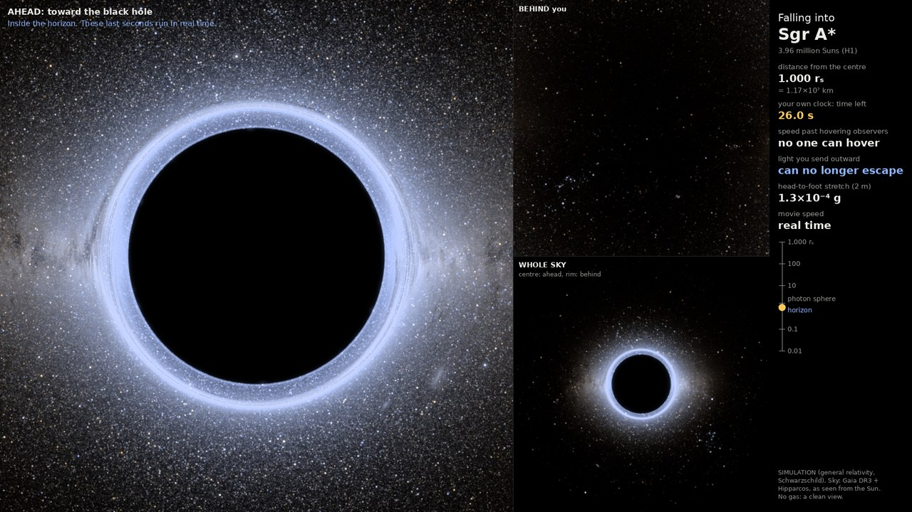

**The movie:** [`figures/falling_into_sgr_a.mp4`](figures/falling_into_sgr_a.mp4) (76 s, 1920 × 1080, 16 MB).
Left, the view ahead; right, the view behind and the whole sky at once, with your clock, distance,
speed and tidal stretch. The approach from 1,000 Schwarzschild radii is sped up; the last 26 seconds,
inside the horizon, run in **real time**.

---

## Results

### 1. What you would see

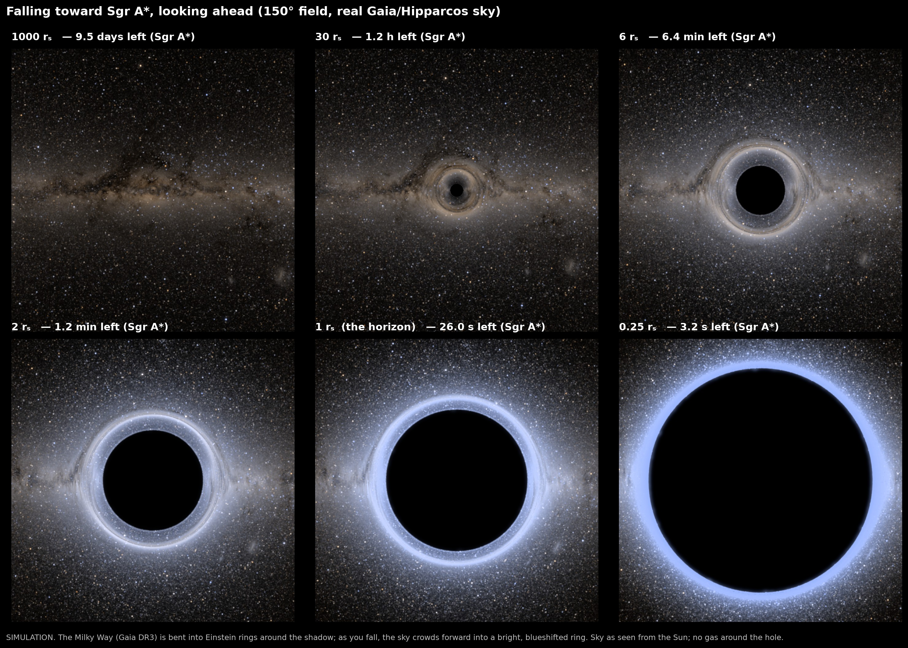

Looking ahead while falling toward Sgr A\*, with a 150° field of view. Distances are in
**Schwarzschild radii** (r<sub>s</sub> = 2GM/c², 11.7 million km for Sgr A\*; the horizon is at 1 r<sub>s</sub>).

* **1,000 r<sub>s</sub>, 9.5 days left.** The black hole is a dot 0.3° across in front of the Milky Way's
  centre. We placed it in front of the real Sgr A\*, so the background is the real sky toward
  Sagittarius as seen from Earth, with the Magellanic Clouds at lower right.
* **30 r<sub>s</sub>, 1.2 hours left.** Gravity bends the light of the stars behind the hole into an
  **Einstein ring**, and the Milky Way's band wraps around it. Inside that ring the whole sky appears
  again, squeezed and mirrored: light that went round the far side of the hole. Its innermost part
  shows the stars behind you.
* **6 r<sub>s</sub> and 2 r<sub>s</sub>.** The dark disc (the "shadow") grows, and more images of the whole sky pile
  up at its edge. A ray just outside the edge has circled the hole once, twice, many times, at the
  **photon sphere** (1.5 r<sub>s</sub>), where light can orbit.
* **1 r<sub>s</sub>: crossing the horizon, 26.0 s left.** The dark disc has an angular radius of **42.1°**.
  Light from the edge of the sky ahead is blueshifted **×3.875**, turning white stars blue. Nothing
  marks the horizon itself.
* **0.25 r<sub>s</sub>, 3.2 s left.** The sky has become a brilliant blue ring around a black disc that fills most
  of the view ahead.

Every image is computed by tracing light rays backward from the faller's eye through curved spacetime
to the real sky (section "How it works"). The view depends only on the distance in units of
r<sub>s</sub>. The same pictures hold for M87\* or Cygnus X-1; only the clock differs.

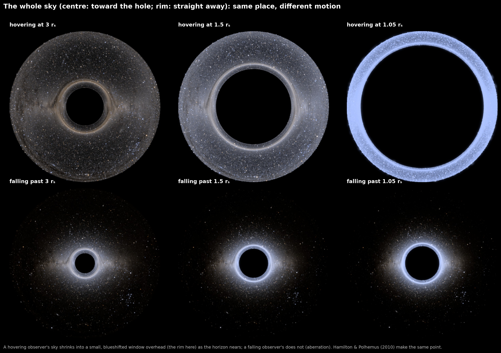

**Hovering versus falling.** The whole sky in one disc: the centre is toward the hole, the rim straight
away from it. Top: an observer hovering on rockets. As they get closer, the dark region swallows the sky,
leaving a small, intensely blueshifted window overhead (the rim at 1.05 r<sub>s</sub>). Bottom: at the same
places, a falling observer sees a much smaller hole, because they are moving toward the light coming up
from below. Aberration bunches that light forward, just as rain seems to come from ahead when you run.
Hamilton & Polhemus (2010) make the same point: the "tiny blueshifted patch" view is that of a hovering
observer, not of anyone who actually falls in.

| Distance (r<sub>s</sub>) | Hovering: angular radius of the dark region | Falling from far away |
|---|---|---|
| 50 | 2.9° | 2.6° |
| 10 | 14.3° | 10.3° |
| 3 | **45.0°** | 24.2° |
| 1.5 (photon sphere) | **90.0°** (half the sky) | 35.3° |
| 1 (horizon) | 180° (impossible to hover) | **42.1°** |
| 0.5 | (inside) | 53.3° |
| 0.05 | (inside) | 77.3° |

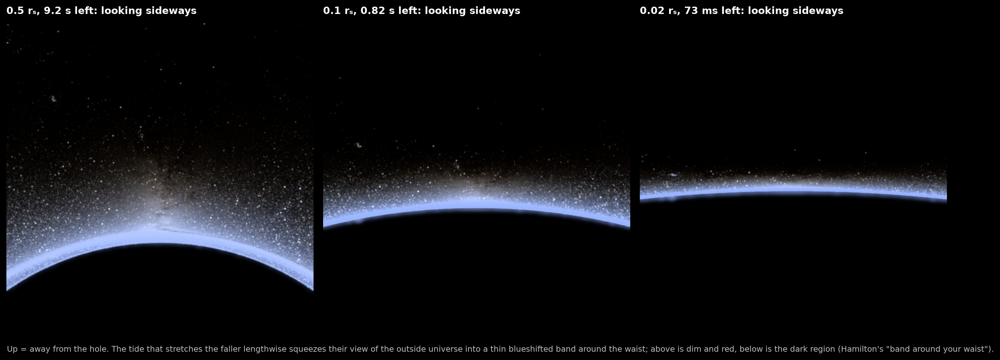

**The last second.** Looking sideways near the centre. The tide that stretches the faller lengthwise also
squeezes their view: the whole outside universe ends up in a thin blueshifted band just below the
horizontal. Above, the sky is dim and red; below is the black region. This matches Andrew Hamilton's
description of his Black Hole Flight Simulator ("a thin band around your waist … the view around your
waist is brightened and blueshifted"). The singularity itself is never seen: no light comes out of it.

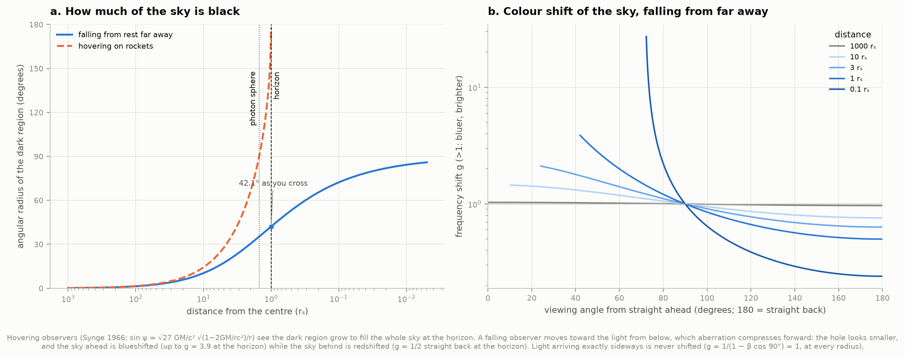

The colours follow from two shifts: gravity blueshifts light falling in, and the faller's motion
blueshifts what is ahead and redshifts what is behind. For a body falling from rest far away the
combined factor is exactly g = 1/(1 − β cos χ), where β = √(2GM/rc²) is its speed relative to hovering
observers and χ the angle from straight ahead. So light arriving exactly sideways is never shifted,
at any radius, and light from straight behind arrives at half its frequency at the horizon.

### 2. Two clocks

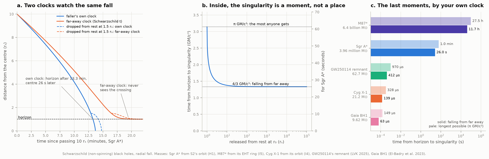

**(a)** The same fall timed by the faller's own watch (blue) and by a far-away clock (orange,
Schwarzschild's time t). By their own watch the faller passes the horizon after 13.3 min (from
10 r<sub>s</sub>) and hits the centre 26 s later. By the far-away clock, they never arrive. Dashed: a body
dropped from rest at 1.5 r<sub>s</sub>, released as the first one passes.

**(b)** Inside the horizon, r stops being a place and becomes a time. The singularity r = 0 is not at the
centre of anything: it lies in the future of everyone inside, as unavoidable as tomorrow. The most time
anyone gets between horizon and singularity is **π GM/c³**, for a body released from rest just above the
horizon. Fallers from far away get **4/3 GM/c³**. A curious fact checked here: by the faller's own
clock, the fall from rest at r₀ to r = 0 takes exactly Newton's free-fall time, π√(r₀³/8GM).

**(c)** The last moments for each black hole:

| | M87\* | Sgr A\* | GW250114 remnant | Cyg X-1 | Gaia BH1 |
|---|---|---|---|---|---|
| Mass (Suns) | 6.4 billion (I5) | 3.96 million (H1) | 62.7 (LVK 2025) | 21.2 (I4) | 9.62 |
| Horizon radius r<sub>s</sub> | 1.89 × 10¹⁰ km (127 AU) | 11.7 million km | 185 km | 62.6 km | 28.4 km |
| 10 r<sub>s</sub> → horizon (own clock) | 14.9 days | 13.3 min | 12.6 ms | 4.3 ms | 1.9 ms |
| horizon → singularity, falling from far | **11.7 h** | **26.0 s** | 0.41 ms | 0.14 ms | 63 µs |
| longest possible inside, π GM/c³ | 27.6 h | 61 s | 0.97 ms | 0.33 ms | 149 µs |
| stretch head to foot at the horizon | 5 × 10⁻¹¹ g | 1.3 × 10⁻⁴ g | 5.4 × 10⁵ g | 4.7 × 10⁶ g | 2.3 × 10⁷ g |
| torn apart (10 g) at | 0.00017 r<sub>s</sub> | 0.024 r<sub>s</sub> | 38 r<sub>s</sub> (6,980 km) | 78 r<sub>s</sub> (4,860 km) | 131 r<sub>s</sub> (3,730 km) |
| rocket thrust to hover at 1.5 r<sub>s</sub> | 186 g | 300,000 g | 2 × 10¹⁰ g | 6 × 10¹⁰ g | 10¹¹ g |
| far-away friend: redshift ×e every | 35 h | 78 s | 1.2 ms | 0.42 ms | 0.19 ms |

The hovering row makes a point people rarely expect: near a black hole, **falling is gentle and hovering
kills you**. Staying put at the photon sphere of Sgr A\* takes rockets pushing at 300,000 g, while a
body falling past the same point feels a ten-thousandth of g.

### 3. Tides: spaghetti or not?

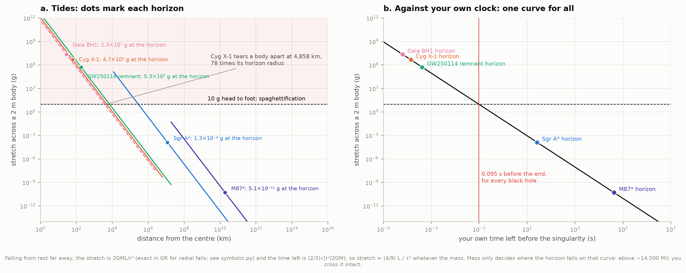

A falling body is stretched along the fall and squeezed sideways, because its feet are pulled harder than
its head. For a radial fall the stretch across a body of length L is exactly 2GML/r³ in general relativity,
as in Newton (derived symbolically here: the tidal tensor is diag(−2GM/r³, GM/r³, GM/r³) for any radial
faller).

**(a)** Against distance. The dots mark each horizon. The stellar black holes tear a person apart thousands
of kilometres out, long before the horizon. The giants let them cross with nothing felt.

**(b)** Against the faller's own time left, all five curves collapse onto **one**, stretch = (4/9) L/τ²,
because the free-fall time is (2/3)√(r³/2GM) and the mass cancels. **Whatever the black hole, the stretch
passes 10 g 0.095 s before the end.** The mass only decides whether that last tenth of a second comes
before or after the horizon. The dividing line is about **14,500 solar masses**: above it you cross the
horizon intact.

The same physics decides whether a black hole can shred a star (I10, tidal disruption events): a Sun-like
star is swallowed whole by black holes above about **1.1 × 10⁸ solar masses**, where its tidal disruption
radius falls inside the horizon.

### 4. What a far-away friend sees

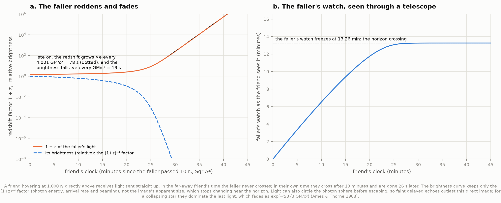

A friend hovering 1,000 r<sub>s</sub> above, on the same line, receives the faller's light. **(a)** The
light reddens slowly at first, then exponentially: ×e every **4 GM/c³** (fitted: 4.001; 78 s for Sgr A\*).
The brightness falls ×e every GM/c³ (19.5 s) from the (1+z)⁻⁴ factor alone. **(b)** The faller's watch,
seen through the friend's telescope, slows and freezes at the horizon-crossing reading. In the friend's
time the crossing never happens. In the faller's, it is over in 13 minutes plus 26 seconds. Both are
correct: they are different clocks describing the same events.

### 5. Maps of the trip: the Penrose diagram and the river

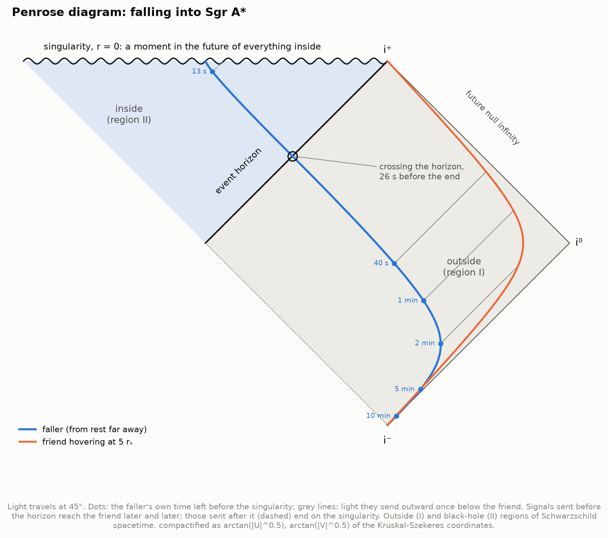

A **Penrose diagram** squeezes all of space and time into a finite picture while keeping light rays at
45°, so you can read off who can send signals to whom. The faller (blue) crosses the event horizon (the
45° line) at the circled point and reaches the singularity (the jagged horizontal line at the top) 26 s
later. Signals they send outward (grey) reach the hovering friend (orange) later and later. Those sent
after the crossing (dashed) run into the singularity. The horizon is not a wall: it is the boundary of
the region from which no signal can ever get out.

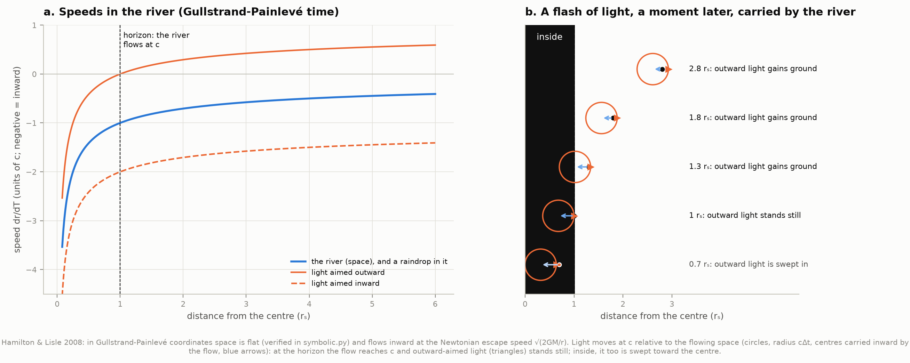

**The river model** (Hamilton & Lisle 2008). In Gullstrand–Painlevé coordinates, the faller's own clock
becomes the time coordinate and space, at each moment, is perfectly flat. We verified this symbolically.
Space flows inward like a river at the Newtonian escape speed √(2GM/r). Light swims through it at c. Outside
the horizon, light aimed outward makes headway. At the horizon the river flows at exactly c and that light
stands still. Inside, it flows faster than light and everything is swept inward. The faller drifts with
the river and feels no current: falling freely is weightless.

### 6. Spinning black holes: frame dragging

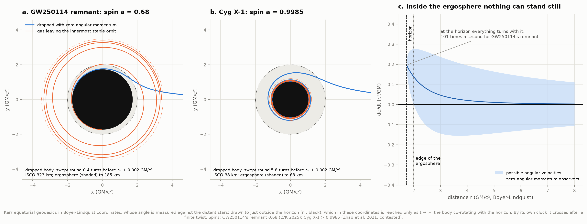

Real black holes spin. The merged remnant of **GW250114**, the loudest black-hole merger yet recorded,
has a = 0.68, measured to ±0.01 (LVK 2025; I7 will measure it from the ringdown). Continuum fitting gives
Cygnus X-1 a near-maximal a > 0.9985 (Zhao et al. 2021), though other methods dispute it.

* **(a, b)** A body dropped with zero angular momentum is nonetheless dragged round by the spin:
  **0.4 turns** around GW250114's remnant and **5.8 turns** around Cyg X-1 before it reaches the horizon
  (until 0.002 GM/c² outside it), seen against the distant stars. Its angular velocity tends to that of
  the horizon itself, which turns **101 times a second** for GW250114's remnant and **722** for Cyg X-1.
  Gas that slips inside the innermost stable circular orbit (ISCO; 323 km and 38 km) plunges in **1.4**
  and **2.2 turns** from 90% of that radius (5.9 ms and 0.11 ms of its own time). Up to the ISCO it has
  radiated **10.1%** and **32.9%** of its rest mass, against 5.7% for a non-spinning hole.
* **(c)** Inside the **ergosphere** (out to 185 km and 63 km at the equator) the slowest possible
  angular velocity is positive: nothing, not even light, can stay still against the distant stars.

---

## How it works

**One number per ray.** Spherical symmetry makes the light-bending problem one-dimensional. A ray
arriving at angle χ from the direction of the hole lies in a plane through the hole, and where it came
from on the sky is fixed by one number: the angle φ it swept round the hole on its way. For a ray with
impact parameter b, φ is the orbit integral ∫ du / √(1/b² − u² + 2GMu³/c²) (u = 1/r), an incomplete
elliptic integral. We evaluate it **exactly with Carlson's R<sub>F</sub>** (DLMF 19.29.4), both when
the cubic has three real roots (rays that come in, turn at a closest approach and go out) and when it
has one (rays that came out from deeper down). So every frame needs only a 4,000-point table of
φ(χ). Near the shadow's edge φ diverges logarithmically as rays wind round the photon sphere, so the
table is uniform in ln(χ − χ<sub>edge</sub>).

**Which rays are black.** Following a ray backward in time, it either reaches the sky or ends on the
horizon. In a real black hole that means on the dimmed surface of the star that collapsed long ago (the
"illusory horizon" of Hamilton & Polhemus). The boundary is the critical impact parameter b = √27 GM/c²,
and which side is dark depends on whether the observer is inside or outside the photon sphere and on
the ray's direction. raymap.py works through every case, including inside the horizon, where some
directions see photons of negative Killing energy that can never come from the sky.

**The faller's own frame.** All of this is done in the frame of a "raindrop" falling from rest at
infinity, in Gullstrand–Painlevé coordinates, which stay regular at and inside the horizon. A photon seen
at angle χ has conserved energy E = 1 − β cos χ, angular momentum L = r sin χ and frequency shift g = 1/E.
Hovering or dropped observers are a Lorentz boost along the radius away. The spec's warning holds: the
aberration has to be applied in the observer's local frame, which is what makes the hovering and falling
views so different.

**The sky.** Two layers, so that no star is counted twice:

* **Point stars:** the 1,247,240 Gaia DR3 stars brighter than G = 11. For the 1,606 naked-eye stars
  brighter than V = 5, Hipparcos replaces Gaia's saturated photometry (1,116 Gaia counterparts were
  dropped through Gaia's official cross-match). Each star is lensed individually: its primary image, its
  secondary image on the opposite side, and a faint third one. Each image is magnified by the ratio of
  solid angles, sin χ / |sin φ · dφ/dχ|, capped at 1,000.
* **The glow:** every fainter Gaia star, **1,805,007,192** of them, summed on the archive's server into
  12.6 million HEALPix pixels of 3.4′ (G, BP and RP fluxes). That becomes a mipmapped sky texture, so
  that a screen pixel seeing a large patch of sky (near the shadow's edge) averages that patch rather than
  sampling one point.

**Colours.** Every source is treated as a blackbody whose temperature comes from its colour (Mamajek's
dwarf sequence; BP−RP for Gaia, B−V for Hipparcos) and whose brightness is its V magnitude. The reason
is physics: I<sub>ν</sub>/ν³ is the same for every observer along a ray, so a blackbody at T shifted by g is
exactly a blackbody at gT. Colours on screen come from the CIE 1931 colour-matching functions. A strongly
blueshifted star tends to the colour of an infinitely hot body, a pale blue (148, 177, 255). Its visible
brightness then grows only ∝ g, since most of the energy (∝ g⁴) moves into the ultraviolet and X-rays.

**Display.** A falling observer's sky spans about six decades of brightness. A fixed, logarithmic-like
tone curve (asinh, as in Lupton et al. 2004) keeps the faint Milky Way and the blazing ring both
visible, with each pixel's colour preserved. The exposure is fixed for the whole movie, so brightening
and dimming are real.

**Clocks and maps** (infall.py): closed forms for the raindrop (τ = (√2/3) r^{3/2}) and the cycloid of a
body dropped from rest, Schwarzschild's t (MTW eq. 31.10, checked by quadrature), Eddington–Finkelstein
and Kruskal–Szekeres coordinates. **Kerr** (kerr.py): equatorial geodesics with conserved E and L, in
Boyer–Lindquist coordinates (angles against the distant stars) and in horizon-penetrating Kerr
coordinates. **SymPy** (symbolic.py) derives the metric facts listed below rather than quoting them.

---

## Checks against analytic and published results

All run by `python test_physics.py` (17 tests) unless noted.

| Check | Expected | Ours |
|---|---|---|
| Orbit integral (Carlson) against 40-digit quadrature, 12 radii × 5 angles | — | agree to ≤ 10⁻⁸ rad (≤ 10⁻⁷ within 10⁻⁷ rad of the edge; exactly on the photon sphere that close to the edge, double-precision round-off makes the problem ill-conditioned and those 2 points are skipped) |
| Against brute-force geodesics (SymPy Christoffel symbols, DOP853, started from the observer's frame) | — | agree to ≤ 10⁻⁸ rad, from 500 to 0.25 r<sub>s</sub> |
| Weak-field bending (N2's 1.75″ for the Sun) | 4M/b + (15π/4)M²/b² + (128/3)M³/b³ | matches to O(b⁻⁴) |
| Strong-deflection limit (Bozza 2002) | −ln(b/b_c − 1) − 0.4002 | matches |
| Shadow for a hovering observer (Synge 1966) | sin ψ = √27 GM/c² √(1 − 2GM/rc²)/r | to 10⁻⁹ at 6 radii; 45° at 3 r<sub>s</sub>, 90° at 1.5 r<sub>s</sub> |
| Shadow at the horizon, falling from far away | 2 arctan(2/√27) = 42.10° | 42.10° |
| Frequency shift at the horizon | ½ straight back; 1/(1 − cos 42.1°) at the edge | 0.500; 3.875 |
| Hovering observers see every direction shifted by | 1/√(1 − 2GM/rc²) | to 10⁻¹² |
| Proper time horizon → singularity | ≤ π GM/c³; 4/3 for a faller from far away | π to 10⁻³ (released 10⁻⁹ GM/c² above the horizon); 4/3 exactly |
| Fall from rest at r₀ | Newton's π√(r₀³/8GM) | to 10⁻⁸ |
| Far-away time of a dropped body | MTW eq. 31.10 | to 10⁻⁶ |
| Redshift seen by a far-away friend | ×e every 4 GM/c³ | 4.001 |
| GP metric = Schwarzschild; flat slices; raindrop is a geodesic (SymPy) | identities | exact |
| Curvature (Kretschmann scalar) | 48 G²M²/c⁴r⁶: finite at the horizon | exact |
| Tidal tensor, falling from far away and dropped from rest | diag(−2, 1, 1) GM/r³ | exact |
| Kerr ISCO and efficiency (Bardeen, Press & Teukolsky 1972; Thorne 1974) | 6 GM/c², 5.72% (a = 0); 32.1% (a = 0.998); 42.3% (a → 1); retrograde 9 GM/c² | all reproduced |
| Frame dragging | a dropped body ends up turning with the horizon, Ω<sub>H</sub> = a/(r₊² + a²) | 0.194 vs 0.196 at 0.002 GM/c² outside |
| Hamilton's flight-simulator descriptions | outside sky stays visible after crossing; "thin band around your waist", blueshifted, with dim red above and below | both seen (figures 7, 9) |
| Sky orientation (checked once by eye, not in the test file) | named stars placed from astropy coordinates | land on the rendered stars; Orion and the Pleiades not mirrored |
| Gaia downloads | archive counts | 1,247,240 stars = server count; summed-flux counts equal server counts in 3 test patches |
| Naked-eye sky | ~9,000 stars to V = 6.5 | 9,144 |

---

## Caveats and what this does not do

* **The sky is the one we see from the Sun, not from Sgr A\*.** We place the black hole in front of the
  real Galactic Centre so that the view ahead is the real sky toward Sagittarius. But the stars are all
  where they appear from here. From Sgr A\* itself the sky would be dominated by a cluster of millions of
  stars within a few light-years, some of which (like S2) pass within a few light-days of the hole, and
  the nearby stars of our sky would bunch up in one direction 26,000 light-years away. No catalogue gives
  that view in 3D, so we use the real sky we have, and say so.
* **No gas.** Sgr A\* and M87\* are wrapped in hot, glowing accretion flows (I5 imaged them). Near the
  shadow that light would outshine the background sky. Our view is deliberately clean.
* **Non-spinning views.** The rendered views use the Schwarzschild metric. A spinning hole would make the
  shadow slightly lopsided and drag the view round. Sgr A\*'s spin is unknown anyway. The spin results
  (section 6) are orbits, not rendered views.
* **Colours are blackbody approximations.** Real stars have absorption lines and far less ultraviolet than
  a blackbody, so strongly blueshifted colours (which show the source's infrared) and redshifted ones
  (its ultraviolet) are approximate.
* **The glow is resolved starlight only:** Gaia stars to G ≈ 21, with no nebulae, no unresolved starlight
  and no zodiacal light. Our Milky Way is somewhat fainter than in photographs.
* **Screen brightness is compressed** by the asinh tone curve, a display choice stated on every image.
  Point images are capped at ×1,000 magnification (a star exactly behind the hole would become a ring of
  formally infinite brightness), and wave optics is ignored.
* **The 10 g line and the 2 m body are rough human numbers.** The 0.095 s result holds for any body
  falling from rest far away: (2/3)√(L/a) for length L and lethal stretch a.
* **The friend's brightness** keeps only the (1+z)⁻⁴ factor, not the image's size. Light that circles
  the photon sphere first arrives later as faint echoes, which are not computed here. For a collapsing star
  that delayed light dominates the late glow, which fades as exp(−t/3√3 GM/c³) (Ames & Thorne 1968).
* **The Penrose diagram** uses arctan(|U|<sup>½</sup>), a legitimate compactification chosen so the friend
  is visible. The textbook arctan(U) crowds anyone beyond a few r<sub>s</sub> into the corners.
* **Inputs we did not measure:** GW250114's remnant (I7 is not built yet; LVK's values) and Cyg X-1's spin
  (contested). H1 measured Sgr A\* at **3.96 ± 0.04** million Suns at its own fitted distance (7.93 kpc).
  At GRAVITY's distance (8.28 kpc) its fit gives 4.29 million, which would lengthen all of Sgr A\*'s
  times by 8.4% (horizon to singularity: 28.2 s instead of 26.0 s).

---

## Figures

| File | What it shows |
|---|---|
| `falling_into_sgr_a.mp4`, `movie_poster.jpg` | the movie (76 s) and a still from the horizon crossing |
| `01_clocks` | own clock vs far-away clock; time inside vs release height; the last moments for each black hole |
| `02_tides` | stretch against distance and against time left (one universal curve) |
| `03_friend_view` | redshift and fading seen from far away; the faller's frozen watch |
| `04_penrose` | Penrose diagram with world lines and light signals |
| `05_river` | the river model: speeds, and flashes of light carried by flowing space |
| `06_shadow_size_and_shift` | size of the dark region (hovering vs falling) and the colour shift of the sky |
| `07_views_ahead` | the real sky ahead at six distances |
| `08_hovering_vs_falling` | the whole sky for hovering and falling observers at the same places |
| `09_near_the_singularity` | the band around the waist |
| `10_spinning_black_holes` | frame dragging, ISCO plunges, the ergosphere (GW250114's remnant, Cyg X-1) |

Static figures are PNG + SVG; the sky renders are JPEG (quality 90).

## Running it

```bash
python fetch_data.py     # once: ~0.36 GB downloaded in ~10 min (0.22 GB kept)
python run.py            # sky texture + every figure + data/results.json (1-6 min)
python movie.py          # 2,280 frames (resumable), then H.264: 79 min on 6 cores at load ~50
python test_physics.py   # 17 checks, ~3 min
```

Python 3.14 with numpy, scipy (≥ 1.8 for Carlson's integrals), astropy, healpy, sympy, matplotlib and
Pillow; ffmpeg for the movie. Once the data are cached, everything runs offline (checked by running
`run.py` with the network cut off). The movie's frames (5.3 GB of PNGs in `data/cache/frames`, gitignored)
are only needed to re-encode it: delete them freely, and `python movie.py` renders them again.

## Data and credits

* **Gaia DR3**: Gaia Collaboration, Vallenari et al. 2023, A&A 674, A1; ESA Gaia archive
  (`gaiadr3.gaia_source`, `gaiadr3.hipparcos2_best_neighbour`). Photometric zero points and G − V
  relation: Riello et al. 2021, A&A 649, A3, and the Gaia DR3 documentation. This work has made use of
  data from the European Space Agency (ESA) mission Gaia, processed by the Gaia Data Processing and
  Analysis Consortium (DPAC).
* **Hipparcos**: ESA 1997, The Hipparcos and Tycho Catalogues, ESA SP-1200 (via the Gaia archive).
* **Colour–temperature sequence**: Pecaut & Mamajek 2013, ApJS 208, 9 (E. Mamajek's online table).
  **CIE 1931 colour-matching functions**: Colour & Vision Research Laboratory (CVRL), UCL.
* **Masses**: H1 (Sgr A\*, from Do et al. 2019 and Gillessen et al. 2017 data), I5 (M87\*, EHT data), I4
  (Cyg X-1, Miller-Jones et al. 2021, Science 371, 1046), GW250114: LVK Collaboration 2025, PRL 135,
  111403 ("The remnant black hole has a mass of M<sub>f</sub> = 62.7 (+1.0 −1.1) M☉ and a spin of
  χ<sub>f</sub> = 0.68 (±0.01)", 90% intervals), Gaia BH1: El-Badry et al. 2023, MNRAS 518, 1057.
  Cyg X-1's spin: Zhao et al. 2021, ApJ 908, 117.
* **Theory**: Hamilton & Lisle 2008, Am. J. Phys. 76, 519 (the river model); Hamilton & Polhemus 2010,
  New J. Phys. 12, 123027, and A. Hamilton's "Inside black holes" pages (jila.colorado.edu/~ajsh/insidebh);
  Synge 1966, MNRAS 131, 463; Bardeen, Press & Teukolsky 1972, ApJ 178, 347; Thorne 1974, ApJ 191, 507;
  Bozza 2002, PRD 66, 103001; Ames & Thorne 1968, ApJ 151, 659; Misner, Thorne & Wheeler 1973,
  *Gravitation*; Carlson's elliptic integrals: NIST DLMF §19.29; Lupton et al. 2004, PASP 116, 133 (asinh
  display).

Builds on: **H1** (Sgr A\*'s mass), **I5** (M87\*), **I4** (Cyg X-1). **I6** (ray tracing), **I7**
(GW250114), **H5** (the all-sky map) and **N6** (Killing vectors) are not built yet, so the ray tracer,
the sky map and the conserved quantities are built here: I6 and N6 can reuse raymap.py and symbolic.py.
