# N6 — Killing vectors: the symmetries that make orbits solvable

**Why can S2's orbit, a black hole's shadow and the innermost stable orbit be worked out with
pencil and paper, when Einstein's equations are so hard? Because those spacetimes have
symmetries, and every symmetry hands an orbiting body a conserved quantity.**

A **Killing vector** is a direction in which you can slide all of spacetime without changing its
geometry: a symmetry. Along every free-fall path (geodesic) it gives a conserved quantity. Time
translation gives energy *E*, rotation gives angular momentum *L* (Noether's theorem in
geometric form). In this project we count the symmetries of a dozen spacetimes with an exact
computer-algebra method, and find them explicitly for five. We then find Kerr's
**hidden** symmetry, the Killing *tensor* behind Carter's constant, without being told it exists.
Finally we use the conserved quantities to reproduce the textbook results and test them on real
data from earlier projects: S2 around Sgr A* (H1), the EHT rings (I5), the black holes the atlas
has weighed (I4, I1, I3, C1, GW250114), and the cooling of the cosmic microwave background (D7).

The headline results:

- **Symmetry counts, proved exactly.** Flat spacetime 10, Schwarzschild 4, Kerr 2, an expanding
  universe 6 (none of them a time translation), de Sitter 10, Gödel's universe 5, the Einstein
  static universe 7, a plane gravitational wave 5. Each is an exact upper bound from Taylor
  expansion, matched (where we constructed them) by explicit solutions checked by substitution.
- **Kerr's hidden symmetry, found by counting.** Kerr has **5** independent Killing tensors that
  respect its symmetries. Four are built from the metric and its two Killing vectors; the fifth is
  new. We verify that it is the Killing tensor of Carter (1968) and Penrose & Floyd (1973). A
  static vacuum spacetime with the same two symmetries but a different shape (Zipoy–Voorhees) has
  only 4.
- **The textbook numbers, derived from the conserved quantities.** ISCO at 6.000000 GM/c²,
  photon sphere 3.000000, shadow impact parameter √27 = 5.196152, accretion efficiency 5.719% to
  42.265%. All agree with Bardeen, Press & Teukolsky (1972) to 10⁻¹³.
- **S2 conserves its angular momentum and energy within the errors.** Thirteen observing seasons
  measured independently give the same areal velocity (χ² = 10.7 for 13). That is Kepler's
  second law, 26,000 light-years away, while S2's speed changes 13-fold. Twelve seasons give the
  same orbital energy (χ² = 9.9 for 12). The pericentre shift computed from S2's E and L,
  11.70′ ± 0.07′ per orbit, agrees with all three GRAVITY measurements.
- **Shadows.** The conserved quantities of light give a shadow 9.66–10.39 GM/c² across for any
  spin and viewing angle (the EHT quotes 9.6–10.4). For Sgr A* that is 51.2 ± 0.3 µas from H1's
  mass; I5 measured a 53.9 ± 1.3 µas ring.
- **Thermodynamics of every black hole in the atlas.** Every one is far colder than the microwave
  background, from 7 × 10⁻⁹ K (GX 339-4) down to 3 × 10⁻¹⁸ K (NGC 4889). GW250114's horizon area
  grew from 236,500 to 374,200 km², an entropy increase of 1.3 × 10⁸⁰ k_B.

---

## Results

### 1. How many symmetries does a spacetime have?

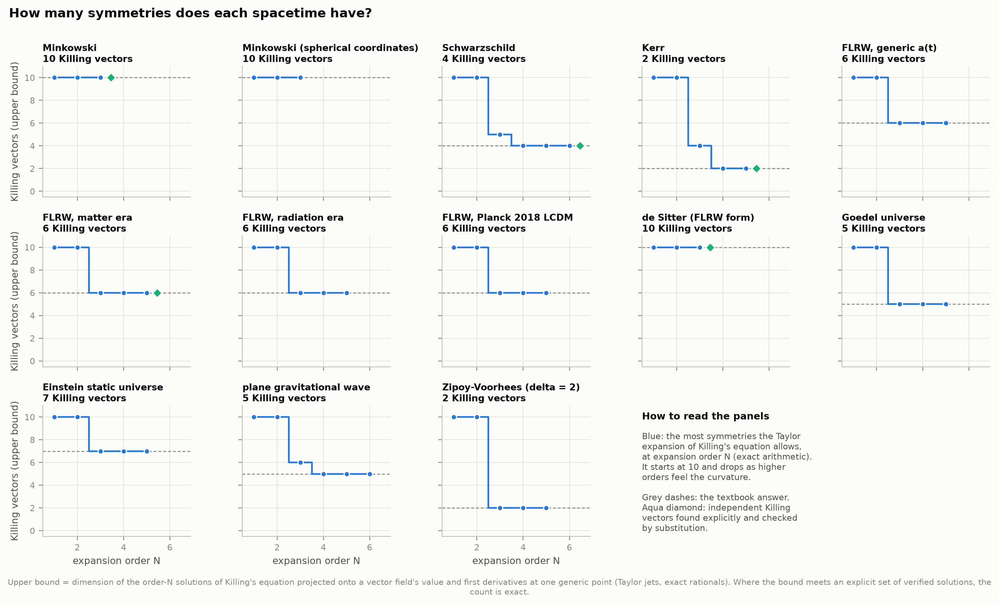

Killing's equation, ∇_a ξ_b + ∇_b ξ_a = 0, is ten coupled partial differential equations for four
unknown functions. Solving it in general is hard. **Counting** its solutions exactly turns out to
be easy, thanks to two facts:

1. **A Killing vector is fixed by what it does at a single point:** its value there (4 numbers)
   and its first derivatives (16 numbers). Killing's equation forces every higher derivative to
   follow. Ten combinations are already ruled out at the point itself (the symmetric part of the
   derivative must vanish), so no four-dimensional spacetime has more than 10 symmetries.
2. **Taylor expansion turns the equation into linear algebra.** Expand the metric and an unknown
   vector field in a power series about a point and insert both into Killing's equation. Each
   order of the expansion gives linear equations for the series coefficients. Every true Killing
   vector satisfies them, so the number of independent "first-order data" these equations still
   allow is an **upper bound** on the number of Killing vectors, at every expansion order N.

With a rational point and rational parameters (we write spherical metrics in terms of
x = cos θ, so that sin²θ = 1 − x² keeps every component a ratio of polynomials), all coefficients
are exact fractions. The ranks are computed exactly, so each bound is a theorem, not a
floating-point estimate. As N grows, the equations feel the curvature (order 3), then how the
curvature changes (order 4), and the bound drops:

| Spacetime | Bound at N = 1, 2, 3, 4, 5, 6 | Explicit solutions found | Textbook |
|---|---|---|---|
| Minkowski (flat) | 10, 10, 10 | 10 | 10 |
| Minkowski in spherical coordinates | 10, 10, 10 | (same spacetime) | 10 |
| Schwarzschild | 10, 10, 5, 4, 4, 4 | 4 | 4 |
| Kerr (a = 0.6 M) | 10, 10, 4, 2, 2 | 2 | 2 |
| FLRW, generic a(t) / matter / radiation / Planck 2018 ΛCDM | 10, 10, 6, 6, 6 | 6 for any a(t) | 6 |
| de Sitter (FLRW with a = e^{Ht}) | 10, 10, 10 | 10 | 10 |
| Gödel's rotating universe | 10, 10, 5, 5, 5 | — | 5 |
| Einstein static universe | 10, 10, 7, 7, 7 | — | 7 |
| Plane gravitational wave (generic profile) | 10, 10, 6, 5, 5, 5 | — | 5 |
| Zipoy–Voorhees (δ = 2) | 10, 10, 2, 2, 2 | 2 (d/dt, d/dφ) | 2 |

Where the bound meets an explicit, verified set of solutions, the count is **exact**: there can be
no more and we have them all. The rows marked "—" stop at the bound, which reaches the known
answer and stays there (Gödel 1949; Bondi, Pirani & Robinson 1959). The count is also independent
of coordinates: flat spacetime in spherical coordinates still gives 10.

### 2. Finding them, and what they look like

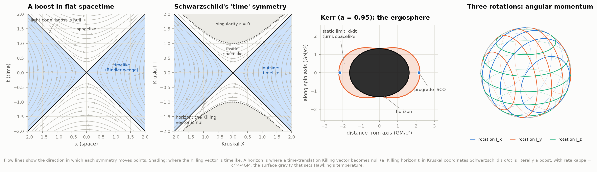

To find the symmetries in closed form, `killing.py` searches all vector fields whose components
are polynomials of degree ≤ 2 in Cartesian-like coordinates: 4 × 15 = 60 unknown coefficients.
Killing's equation, evaluated exactly at 30–36 points with rational coordinates (for Schwarzschild,
points where r = √(x² + y² + z²) is rational; for Kerr, its Kerr–Schild form, where the radius is
defined implicitly), becomes 300–360 linear equations, solved exactly. The solver finds:

- **flat spacetime**: 10, which are exactly 4 translations, 3 rotations and 3 boosts. Their
  commutators reproduce the Poincaré algebra, including [K_x, K_y] = J_z: two boosts compose into
  a rotation (the Thomas–Wigner rotation);
- **Schwarzschild**: 4, which are time translation plus the 3 rotations, with algebra so(3) ⊕ ℝ;
- **Kerr**: 2, which are time translation and rotation about the spin axis. They commute;
- **an expanding universe** (matter era): 6, the translations and rotations of space, forming the
  Euclidean group;
- **de Sitter** (in conformal coordinates): 10. Six are the spatial ones above, plus a dilatation
  (cosmic-time translation combined with a stretch of space) and three "special" ones. Together
  they form de Sitter's 10-dimensional algebra so(4,1).

Each was checked by substitution in the usual coordinates (spherical, Boyer–Lindquist), where
L_ξ g simplifies to zero. Some candidates fail, as they should. r∂_r is not a symmetry of
Schwarzschild. In Kerr the rotations about the x- and y-axes leave nonzero terms that all vanish
when a = 0; for example the t–θ component is −2Mar cos φ/Σ. Spin is what breaks the spherical
symmetry.

The figure shows four symmetries:

- **A boost of flat spacetime.** It is timelike only in the "Rindler wedges".
- **Schwarzschild's time translation in Kruskal coordinates.** It is literally a boost: timelike
  outside, null on the horizon, spacelike inside. A horizon is a **Killing horizon**, where a
  time-translation Killing vector becomes null, and the boost rate there is the surface gravity
  κ = c⁴/4GM that sets Hawking's temperature (section 7).
- **Kerr's ergosphere.** There d/dt itself turns spacelike: nothing can stand still, and a body's
  Killing energy can be negative (the Penrose process).
- **The three rotations,** whose conserved quantities are the three components of angular momentum.

**Why an expanding universe has no conserved energy.** With an arbitrary a(t), Killing's
equation gives d_t ξ^t = 0 (tt component) and ∂_i ξ^j + ∂_j ξ^i = −2(ȧ/a) ξ^t δ_ij. Combining
these with the ti components shows that a nonzero ξ^t requires a²·d(ȧ/a)/dt to be constant.
SymPy finds that combination to be −2/(3t^{2/3}) in the matter era and −1/(2t) in the radiation
era, neither constant, but exactly 0 for de Sitter. Only an exponentially expanding universe has
a time symmetry. What FLRW does have is a **conformal** Killing vector, a(t)∂_t, with
L g = 2ȧ g: a symmetry up to a rescaling, which conserves a·E for light only (section 8).

### 3. Kerr's hidden symmetry

Kerr has only two Killing vectors, yet every geodesic has a third constant of motion. Carter found
it in 1968 by separating the Hamilton–Jacobi equation; Walker & Penrose (1970) showed that it
comes from a **Killing tensor**, a symmetric K_ab with ∇_(a K_bc) = 0, which conserves the
quadratic quantity K_ab u^a u^b.

**Found by counting.** `jets.py` applies the same Taylor-series method to Killing's tensor
equation. It counts the Killing tensors unchanged by time translation and rotation about the
axis, projecting onto 2-jets, since a Killing 2-tensor is fixed by its derivatives up to second
order at a point:

| Spacetime | Killing tensors (N = 3, 4, 5) | Built from g and the Killing vectors | New |
|---|---|---|---|
| Schwarzschild | 5, 5, 5 | g, T·T, T·Φ, Φ·Φ, J_x² + J_y² + J_z² (= L²) | 0 |
| **Kerr (a = 0.6)** | **5, 5, 5** | g, T·T, T·Φ, Φ·Φ | **1** |
| Zipoy–Voorhees (δ = 2) | 4, 4, 4 | g, T·T, T·Φ, Φ·Φ | 0 |

In Schwarzschild the fifth is the total angular momentum squared, which is built from the three
rotations. Kerr has only two Killing vectors, which make just 3 products plus the metric. The
count says there is a fifth: **the hidden symmetry, found without being told it exists.**

**Verified exactly.** The Penrose–Floyd tensor is

Y = a cos θ dr ∧ (dt − a sin²θ dφ) + r sin θ dθ ∧ ((r² + a²) dφ − a dt).

We checked symbolically that it satisfies the Killing–Yano equation ∇_(a Y_b)c = 0, and that
K = Y·Y is a Killing tensor of the full Kerr metric (arbitrary M and a). K is linearly independent
of g, T·T, T·Φ and Φ·Φ (rank 4 → 5), so it is irreducible. At a = 0 it reduces exactly to
J_x² + J_y² + J_z². Carter's constant is Q = K_ab u^a u^b − (L − aE)².

**What it buys.** Figure 9 (right) integrates a tilted Kerr orbit from the geodesic equation
alone. Carter's K stays fixed to 7 × 10⁻¹¹, as do E and L_z, while Schwarzschild's L², no longer
a symmetry, wobbles by 0.5%. With three constants the motion is **integrable**: in "Mino time"
the radial and up-down oscillations decouple, every orbit winds regularly around a torus, and its
Poincaré section is a smooth curve (figure 8, left).

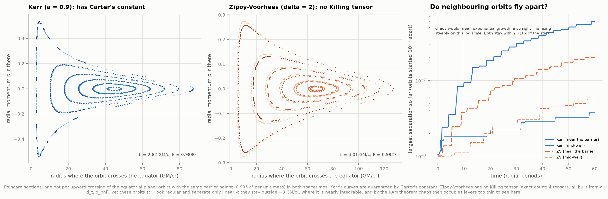

**A negative result worth knowing.** The Zipoy–Voorhees spacetime is an exact vacuum solution
with the same two Killing vectors but no Killing tensor, so it is expected to be non-integrable
(Lukes-Gerakopoulos 2012 reports chaotic orbits). We compared the two with matched orbits, giving
both the same barrier height of 0.995 c² per unit mass, and found no visible chaos. The ZV
sections look as regular as Kerr's, and two orbits started 10⁻⁸ apart separate only about 10-fold
in 60 radial periods, in both spacetimes. Stronger deformations (δ = 3, 4) and energies right up
to the barrier top gave the same result. The reason is that in ZV every bound orbit stays outside
its centrifugal barrier, beyond about 3 GM/c², where the spacetime is nearly integrable. By the
KAM theorem, chaos then lives in layers too thin for these runs to resolve. **Losing the hidden
symmetry does not make chaos appear everywhere at once.** The proof that the symmetry is missing
is the exact Killing-tensor count, not the pictures.

### 4. Orbits from conserved quantities

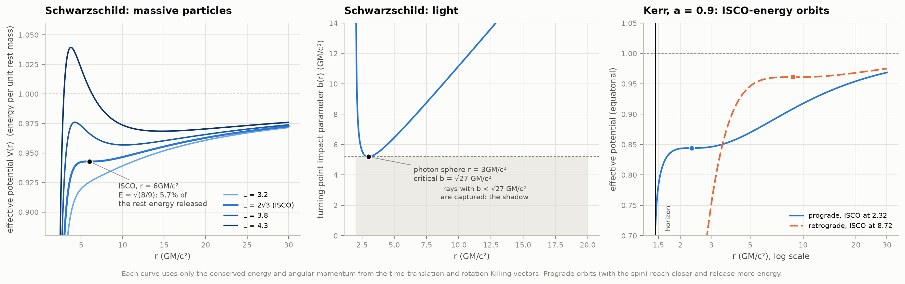

Put E and L into the normalisation g(u, u) = −1, and the four geodesic equations collapse into
one, (dr/dτ)² = E² − V(r)², motion in a one-dimensional potential. From the potential alone:

| | Ours | Textbook |
|---|---|---|
| Schwarzschild ISCO (V's minimum and maximum merge) | 6.000000 GM/c² | 6 |
| photon sphere / critical impact parameter | 3.000000 / 5.196152 GM/c² | 3 / √27 |
| marginally bound orbit (E = 1) | 4.000000 GM/c² | 4 |
| efficiency at the ISCO, 1 − E | 5.719% | 1 − √(8/9) |
| Kerr a = 0.998: ISCO, efficiency | 1.237 GM/c², 32.10% | 32.1% (Thorne's limit) |
| Kerr a = 1: prograde / retrograde efficiency | 42.265% / 3.775% | 1 − 1/√3 / 1 − √(25/27) |

For Kerr, `orbits.py` solves R = R′ = R″ = 0 of the radial function
R(r) = [E(r² + a²) − aL]² − Δ[r² + (L − aE)²] numerically for (r, E, L). It finds the photon
orbit and marginally bound orbit the same way, never using the closed formulas. Over 29 spins the
results agree with Bardeen, Press & Teukolsky (1972) to 2 × 10⁻¹⁴. Matching coefficients of the
ISCO's triple root also gives E² = 1 − 2/(3r_ISCO) and (L − aE)² = r_ISCO²/3, which the tests
check.

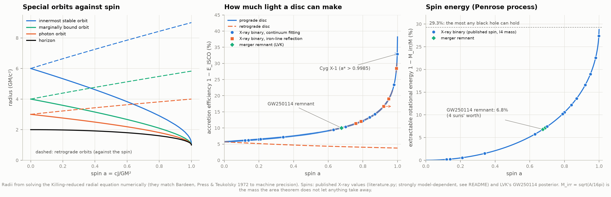

The middle panel places published X-ray-binary spins (19 systems; `literature.py`, each value
checked against the paper's text or, for a few, its abstract) and GW250114's remnant (χ = 0.676) on the efficiency curve. Cyg X-1's
a* > 0.9985 (Zhao et al. 2021) would mean a disc turning at least 32.9% of the infalling rest mass
into light. **These spins are strongly model-dependent:** with a warm Comptonising layer the same
Cyg X-1 data allow spins from 0.82 down to below 0.1 (Zdziarski et al. 2024). The right panel is
the rotational energy a hole stores, M − M_irr: 6.8% of the GW250114 remnant (4 solar masses), up
to 29.3% for a = 1.

**Precession from E and L.** The exact Schwarzschild pericentre shift per orbit, an elliptic
integral, equals our direct quadrature of dφ/dr between the turning points to 10⁻¹⁵, and tends
to 6πGM/(c²p) for wide orbits.

### 5. S2: conserved, within the errors

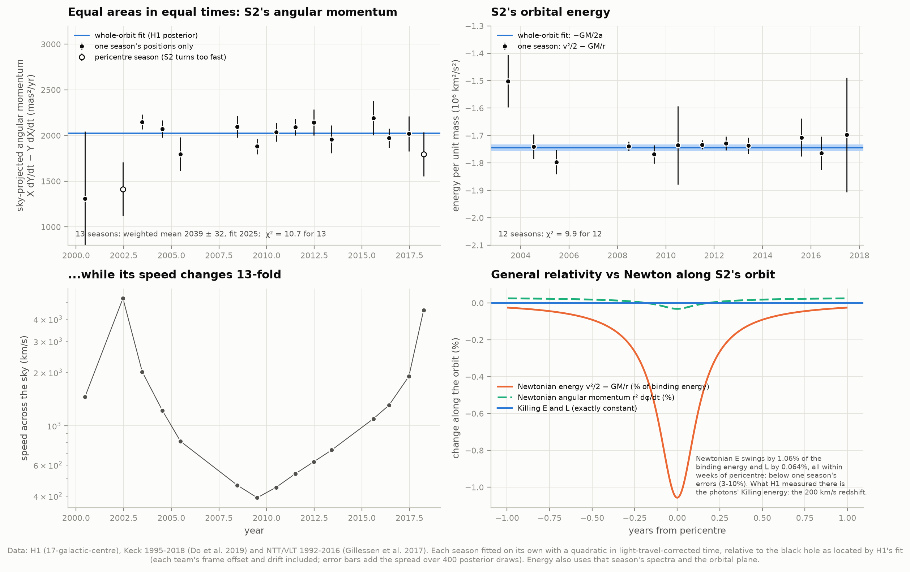

H1 fitted S2's orbit to both teams' measurements: 45 Keck positions (1995–2018), 145 NTT/VLT
positions (1992–2016) and 116 velocities. A fitted orbit conserves E and L by construction, so
computing them along it would test nothing. Instead we test conservation **season by season**,
using only that season's measurements:

- **Kepler's second law (angular momentum about our line of sight).** We fit each season's
  positions alone with a quadratic in light-travel-corrected time, relative to the black hole as
  located by H1. Each team has its own frame offset and drift, as H1 found it must, and our error
  bars include the spread over 400 posterior draws. That gives S2's position and velocity on the
  sky, and so h = X dY/dt − Y dX/dt, twice the areal velocity. Thirteen seasons give a weighted
  mean of 2,039 ± 32 mas²/yr, against 2,025 ± 4 from H1's whole-orbit fit, with **χ² = 10.7 for
  13**. Meanwhile the sky speed ranges from 392 km/s (2009) to 5,250 km/s (2002). The two
  pericentre seasons (2002, 2018) are shown but not used: S2 turns by up to 180° in a few months,
  which a one-season quadratic cannot follow.
- **Energy.** E = v²/2 − GM/r needs the full speed and distance. We take the sky velocity from
  the same fits and the line-of-sight velocity from that season's spectra (minus H1's zero point,
  instrument offset and the relativistic redshift). The line-of-sight position comes from the
  orbital plane, which is itself fixed because the direction of L is conserved. Twelve seasons:
  **χ² = 9.9 for 12**, with errors of 1–12% per season.

**General relativity versus Newton (bottom right).** Integrated as an exact Schwarzschild
geodesic, S2's Killing energy and angular momentum stay constant to 10⁻¹⁶. The Newtonian
expressions v²/2 − GM/r and r²dφ/dt do not: they dip by 1.06% of the binding energy and 0.064%
near pericentre, and only for a few weeks. That is far below a season's precision. Near
pericentre, what the data do measure is the **photons'** Killing energy: the ~200 km/s
gravitational redshift plus time dilation that H1 detected at 5σ.

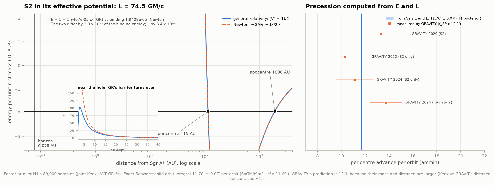

**S2's constants (H1's 80,000 posterior samples).** In GR form, E = 1 − 1.9407 × 10⁻⁵ c² and
L = 74.49 ± 0.22 GM/c. The GR and Newtonian binding energies differ by only 2.9 × 10⁻⁵ of
themselves, and L by 3.4 × 10⁻⁴, both far below the posterior widths (0.7% and 0.3%). S2 bounces
between 115 and 1,898 AU in its effective potential. The inset shows the barrier near the hole,
which is where GR and Newton really part: GR's turns over at about 3 GM/c², while Newton's rises
for ever. S2's L of 74 GM/c makes that barrier's top about 14 times S2's total energy (rest energy
included), so S2 could never plunge.

**The pericentre shift** computed from E and L by the exact orbit integral is **11.70′ ± 0.07′
per orbit** (6πGM/c²a(1−e²) gives 11.69′). GRAVITY's measurements are f_SP × 12.10′, because their
mass and distance are larger (the Keck–GRAVITY distance tension discussed in H1):

| GRAVITY | f_SP | Measured shift (arcmin) |
|---|---|---|
| 2020, S2 | 1.10 ± 0.19 | 13.3 ± 2.3 |
| 2022, S2 only | 0.85 ± 0.16 | 10.3 ± 1.9 |
| 2024, S2 only | 0.918 ± 0.128 | 11.1 ± 1.5 |
| 2024, four stars | 1.135 ± 0.110 | 13.7 ± 1.3 |

All four agree with 11.70′, three within 1σ (the four-star value is 1.5σ above). The public
Keck and VLT data cannot measure the shift themselves: H1 found a spurious 5× Einstein from the
1990s speckle positions.

### 6. Shadows from the conserved quantities of light

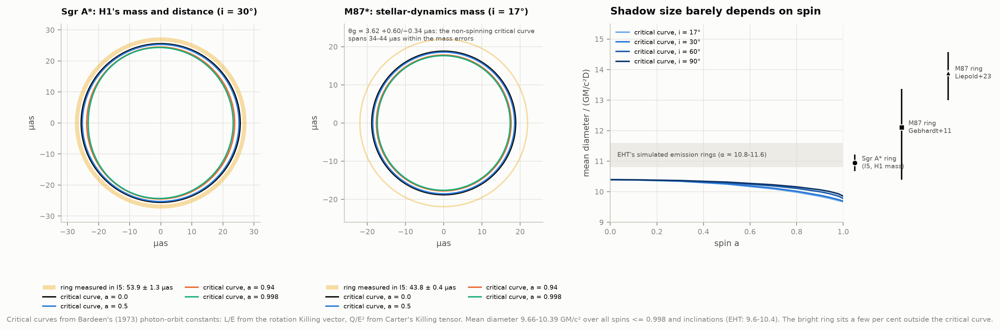

For light only the ratios of the conserved quantities matter. The impact parameter b = L/E comes
from the rotation Killing vector, and η = Q/E² from Carter's Killing tensor. Rays tuned to an
unstable spherical photon orbit draw the shadow's edge, the critical curve (Bardeen 1973). Over
spins up to 0.998 and every viewing angle, its mean diameter is **9.66–10.39 GM/c²**. The EHT
quotes 9.6–10.4. The smallest value is for a near-maximal spinner seen face-on (9.66); edge-on
gives 9.86.

- **Sgr A\*.** H1's mass and distance give θ_g = GM/(c²D) = 4.924 ± 0.027 µas. The non-spinning
  shadow is then **51.17 ± 0.28 µas**, and 47.6–51.2 µas for spins up to 0.998 at the EHT's
  favoured inclinations (i ≤ 30°). I5 measured a **53.9 ± 1.3 µas** ring: 10.95 ± 0.27 θ_g, or
  1.054 ± 0.026 times the non-spinning shadow. That matches the EHT's simulation-calibrated
  ring-to-mass factor of about 10.8: the bright ring is emission from gas just outside the
  critical curve.
- **M87\*.** With the stellar-dynamics mass I5 sided with (Gebhardt et al. 2011,
  θ_g = 3.62 +0.60/−0.34 µas), the critical curve is 37.6 µas (34–44 within the mass errors).
  I5's ring is 43.8 ± 0.4 µas, or ring/θ_g = 12.1 (+1.3/−1.7), consistent with the EHT's α ≈ 11.6.
  Liepold et al.'s (2023) lower stellar mass gives 13.9 (+0.7/−0.9), and the gas-dynamics mass
  gives 21.

The shadow measures M/D almost regardless of spin, which is why it weighs black holes and cannot
measure their spin.

### 7. Black-hole thermodynamics

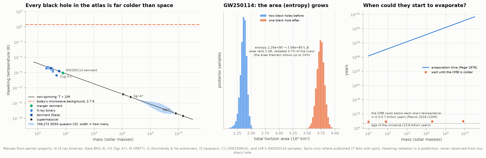

The surface gravity κ of a Killing horizon sets Hawking's temperature, T = ħκ/(2πck_B), and the
horizon area sets Bekenstein's entropy, S = k_B Ac³/(4Għ). For one solar mass, not spinning:
**T = 6.1703 × 10⁻⁸ K**, **S = 1.0489 × 10⁷⁷ k_B**, and a lifetime of **2.16 × 10⁶⁶ years**
(Page 1976, with massless neutrinos), or 1.16 × 10⁶⁷ years with photons and gravitons only. These
are textbook values, all reproduced. Spin cools a hole: κ falls to zero at
a = 1.

| Black hole (source project) | Mass (M☉) | Spin | T_H (K) | S (k_B) | Lifetime (yr) |
|---|---|---|---|---|---|
| GX 339-4 (I4 mass, reflection spin) | 4.1 | 0.95 | 7.1 × 10⁻⁹ | 1.2 × 10⁷⁸ | 8 × 10⁶⁸ |
| Cyg X-1 (I4) | 21.2 | > 0.9985 | 3.0 × 10⁻¹⁰ | 2.5 × 10⁷⁹ | 1 × 10⁷¹ |
| Gaia BH3 (I4) | 32.7 | — | 1.9 × 10⁻⁹ | 1.1 × 10⁸⁰ | 4 × 10⁷¹ |
| GW250114 remnant (LVK samples) | 62.7 | 0.676 | 8.4 × 10⁻¹⁰ | 3.6 × 10⁸⁰ | 3 × 10⁷² |
| Sgr A* (H1) | 3.96 × 10⁶ | — | 1.6 × 10⁻¹⁴ | 1.6 × 10⁹⁰ | 7 × 10⁸⁶ |
| M87* (I5) | 6.4 × 10⁹ | — | 9.6 × 10⁻¹⁸ | 4.3 × 10⁹⁶ | 3 × 10⁹⁶ |
| NGC 4889 (I1, heaviest in Kormendy & Ho) | 2.1 × 10¹⁰ | — | 3.0 × 10⁻¹⁸ | 4.5 × 10⁹⁷ | 1 × 10⁹⁸ |

The census has 32 named black holes plus I3's 746,272 SDSS quasars (median 4.7 × 10⁸ M☉). Every
one is colder than today's 2.7 K microwave background, so each **absorbs** more than it emits. A
hole would have to weigh less than 4.5 × 10²² kg, about two-thirds of the Moon's mass, to be
warmer. In Planck 2018 ΛCDM the background cools below a solar-mass hole's temperature in about
310 billion years, Sgr A*'s in 570 billion and M87*'s in 700 billion; evaporation can only start
then. De Sitter space's own horizon temperature, 2.2 × 10⁻³⁰ K, is the floor, and every real
black hole is warmer than that, so all of them eventually evaporate. (The table's lifetimes use
Page's photon-and-graviton rate: at least two of the three neutrino types are far too heavy to be
emitted by holes this cold, though the lightest might not be. With all neutrinos massless, as Page
assumed, each lifetime is 5.4 times shorter.)

**GW250114: the area theorem read as the second law.** From LVK's 19,990 posterior samples
(NRSur7dq4, the discovery paper's preferred analysis), the two horizons' total area was
**236,500 (+8,100/−10,800) km²** before the merger and **374,200 (±11,000) km²** after, 1.58
times larger. The entropy rose from 2.26 × 10⁸⁰ to 3.58 × 10⁸⁰ k_B. The merger radiated 4.7% of
the mass (3.1 M☉), while the area theorem would allow up to 24%. The remnant's horizon spins
100 times a second. These samples come from GR waveforms, so the increase is built in; the actual
test (inspiral and ringdown measured separately, 4.4σ in the paper) is project I7's.

### 8. The expanding universe: why light redshifts

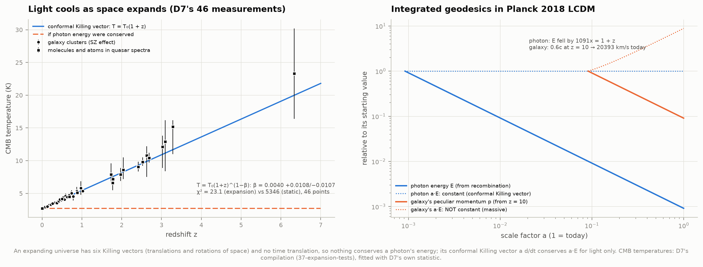

With no time-translation symmetry, nothing conserves a photon's energy. The conformal Killing
vector a(t)∂_t instead conserves **a·E** for light, so wavelengths stretch with space,
1 + z = a_now/a_then. A thermal spectrum therefore stays thermal with **T = T₀(1 + z)**. Refitting
D7's 46 published CMB temperatures (galaxy clusters to z = 1.0, quasar absorbers to z = 6.3) with
D7's own statistic reproduces D7 exactly: T = T₀(1 + z)^{1−β} with **β = 0.0040 +0.0108/−0.0107**.
That gives χ² = 23.1 for expansion and 5,346 for a static universe.

Geodesics integrated numerically through Planck 2018 ΛCDM confirm both conservation laws. A
photon from recombination keeps a·E constant to 6 × 10⁻⁸ and loses energy by exactly 1,091 = 1 + z.
For a galaxy given 0.6c of peculiar velocity at z = 10, the spatial Killing vector conserves
a²dx/dτ (to 10⁻¹²). Its peculiar momentum therefore falls as 1/a, leaving 20,390 km/s today, the
Killing prediction to 10⁻¹². Its a·E is *not* conserved (×8.8): the conformal symmetry helps only
light.

### 9. Noether's theorem, numerically

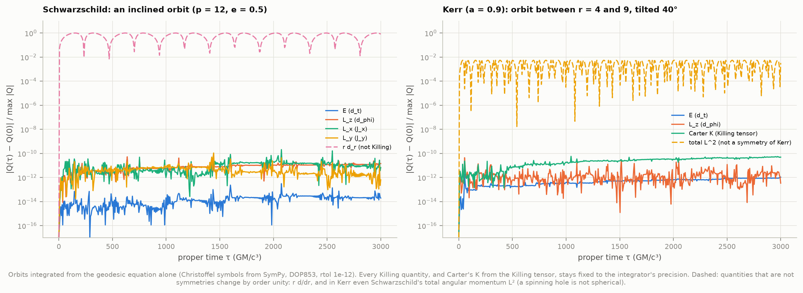

Orbits integrated from the geodesic equation alone, using Christoffel symbols from SymPy,
conserve every Killing quantity to the integrator's precision. Along an inclined Schwarzschild
orbit, E, L_x, L_y and L_z hold to 10⁻¹⁰–10⁻¹³; along a tilted Kerr orbit, E, L_z and Carter's K
hold to 10⁻¹¹. Quantities that are not symmetries change at order unity: r∂_r in Schwarzschild,
and Schwarzschild's total L² in Kerr.

### The Kerr orbit explorer

[`figures/kerr_orbit_explorer.html`](figures/kerr_orbit_explorer.html) is a self-contained page
(22 kB, works offline, light or dark). Choose a spin and an orbit's closest and farthest distances
and tilt; the page solves for E, L and Q and integrates the decoupled Mino-time equations. It
shows the orbit in a 3D view you can turn by dragging, the radial and up-down "potentials" R(r)
and Z(z), and the constants. Its presets show a tilted orbit, a zoom-whirl, a polar orbit, a
retrograde orbit, the no-spin case (one fixed plane) and an orbit hugging a 0.99 spinner's
horizon. Sliders that ask for an orbit that cannot exist are refused, with the reason. The solver
is the same algorithm as `orbits.kerr_constants`; both give identical constants for every preset.

---

## How it works

**1. The geometry (`geometry.py`).** A `Metric` holds coordinates and components, and computes
the inverse metric, Christoffel symbols, Riemann, Ricci and Kretschmann tensors. It writes
Killing's equation two ways, as a Lie derivative (L_ξ g)_ab and as ∇_a ξ_b + ∇_b ξ_a, and the
tests check that they agree. The catalogue: Minkowski (two charts), Schwarzschild (three), Kerr
(Boyer–Lindquist with x = cos θ, and a plotting version; Kerr–Schild lives in `killing.py`), flat
FLRW with any a(t), Gödel, the Einstein static universe, an exact plane wave, and Zipoy–Voorhees.
Checks: Schwarzschild, Kerr and ZV are Ricci-flat; Schwarzschild's Kretschmann scalar is
48M²/r⁶.

**2. Counting (`jets.py`).** Truncated multivariate power series with Python `Fraction`s; exact
ranks with SymPy's `DomainMatrix` over ℚ. The upper bound at order N is
dim(solutions projected onto the 1-jet) = 20 − (rank A − rank A_high), where A_high drops the
first-order columns. For Killing tensors the projection is onto the 2-jet, over tensors that
depend only on the coordinates the metric depends on. Functions such as a(t), e^x (Gödel) and the
wave profiles A(u), B(u) enter through their exact Taylor coefficients. Planck 2018 ΛCDM's a(t)
comes from repeated differentiation of the Friedmann equation, rounded to 18 digits; the count is
the generic one.

**3. Explicit solutions and checks (`killing.py`).** The polynomial search, verification by
substitution, commutator tables, the FLRW analysis, and Kerr's Killing–Yano and Carter tensors
with the reducibility test.

**4. Orbits (`orbits.py`).** Effective potentials; the special radii by root-finding on R(r); the
exact Schwarzschild orbits (Cutler, Kennefick & Poisson 1994) and pericentre shift; Kerr orbits
from their turning points; a general geodesic integrator (DOP853, rtol 10⁻¹²); and a Hamiltonian
integrator for Poincaré sections, with p_t = −E and p_φ = L fixed by the two Killing vectors.

**5. S2 (`s2.py`, `h1link.py`).** H1's own modules supply the data loaders, frames, orbit model
and likelihood, loaded under their own names without clashing with ours. Our reconstruction gives
H1's best-fit χ² exactly. The S2 module computes the posterior of E, L and the precession, the
seasonal tests, and the GR-versus-Newton geodesic. Sign convention: in H1's (East, North, away)
frame the sky areal velocity is −|L| cos i (1 + k)/R₀², checked against H1's orbit code.

**6. Shadows, thermodynamics, cosmology, chaos** (`shadows.py`, `thermo.py`, `cosmology.py`,
`chaos.py`). Bardeen's critical curves, closed exactly where β = 0. Kerr horizon quantities in SI
units, the atlas census and the far-future background temperature. D7's statistic recoded, and
FLRW geodesics with the scale factor integrated jointly, so that a and ȧ stay consistent. Matched
Poincaré sections and divergence tests for Kerr and ZV.

**7. Literature (`literature.py`).** X-ray-binary spins (19 systems, method and confidence level,
each with a code saying whether it was read in the full text or only the abstract; notes record
where later analyses disagree). Page's evaporation
coefficients, the GW250114 paper's numbers, GRAVITY's f_SP values, and shadow facts. A subagent
verified each against the primary papers on 2026-10-19.

**8. Tests (`test_physics.py`, 34 checks, about 1 minute).** Lie derivative equals the covariant
form; the exact Taylor series against SymPy's; jet bounds for flat and Schwarzschild; the
polynomial solver against the Poincaré generators; Schwarzschild's Killing vectors by
substitution; FLRW's conformal factor; the special radii against BPT; precession two ways; Noether
along a geodesic; shadow diameters; Hawking temperature, entropy and Page's lifetime; D7's β
exactly; FLRW conservation; H1's χ²; the S2 sign convention; GW250114's medians against the
paper; Kerr's Killing–Yano and Killing tensors; Kerr Ricci-flat.

---

## What this cannot tell you

- **Whether S2 follows a geodesic to better than a few per cent.** One season's data constrain the
  areal velocity to 4–10% and the energy to 1–12%. GR and Newton differ by far less (1% of the
  binding energy, for weeks around pericentre). The seasonal tests check conservation, not
  relativity; the relativistic signal in S2's data is the redshift H1 measured.
- **S2's frames.** Every seasonal value depends on where H1's fit puts the black hole in each
  team's frame. The 400 posterior draws carry that uncertainty, but a systematic frame error that
  H1's model cannot absorb would shift all seasons together.
- **Black-hole spins.** The X-ray spins are published values, model-dependent at the level of
  tens of per cent (sometimes 0.9 versus 0.1 for the same system); I4 measured masses, not spins.
  The EHT ring does not measure spin at all (section 6).
- **Hawking radiation.** Every number in section 7 is a prediction. No black hole's radiation has
  been observed, and all real ones are colder than the background. The lifetimes assume empty
  space and ignore the background's warmth until it cools.
- **The area theorem.** The GW250114 numbers come from waveform models that assume GR, so the
  increase is a consequence of the fit, not an independent test. That test needs I7.
- **Chaos in non-Kerr spacetimes.** We showed that Zipoy–Voorhees lacks Carter's tensor but could
  not show its chaos (section 3). A finer analysis (rotation-number plateaus, orbits closer to the
  singular rod) would be needed. Lukes-Gerakopoulos (2012) reports it.
- **Killing tensors beyond the invariant ones.** The tensor count covers tensors unchanged by
  time translation and axial rotation, which includes every quadratic constant of motion built
  from Killing vectors and Carter's. We did not count non-invariant ones, nor higher-rank tensors.
- **The polynomial search.** It found closed forms of degree ≤ 2 in Cartesian-like coordinates.
  Completeness comes from the jet bound, not from the search. For Gödel, the Einstein static
  universe and plane waves we report the bound only.

---

## Reproduce

```bash
cd astrophysics/63-killing-vectors
../.venv/bin/python fetch_data.py     # 27 MB (GW250114 samples) + fingerprints of earlier projects' files
../.venv/bin/python run.py            # every number, figure and the explorer
../.venv/bin/python test_physics.py   # 34 self-checks
```

The first `run.py` takes 15–25 minutes on a busy machine. The exact algebra dominates (8 minutes,
3 of them Kerr's Killing tensors), then the Poincaré sections (3 minutes) and the geodesic
integrations. Everything is cached in `data/cache/`, so afterwards a run takes one to two minutes
(mostly drawing figures) and needs no network (checked in a network-less namespace). `run.py --force` recomputes everything. `run.py` warns
if an earlier project's input files have changed since `fetch_data.py` fingerprinted them. Needs
SymPy (1.14), NumPy, SciPy, matplotlib, pandas, pyarrow and h5py, plus projects H1 and
I1–I5, C1 and D7 in their sibling folders (published fallback values are used if some are
missing).

| File | What it does |
|---|---|
| `fetch_data.py` | downloads the GW250114 samples; fingerprints the inputs from earlier projects |
| `config.py` | paths, constants, inputs, fallbacks, textbook results to reproduce |
| `geometry.py` | metrics, curvature, Killing's equation, the catalogue of spacetimes |
| `jets.py` | exact Taylor-series upper bounds for Killing vectors and Killing tensors |
| `killing.py` | explicit Killing vectors, verification, algebras, Kerr's hidden symmetry |
| `orbits.py` | effective potentials, special radii, precession, geodesic and Hamiltonian integrators |
| `s2.py`, `h1link.py` | S2's conserved quantities and seasonal tests, using H1's code and chains |
| `shadows.py` | critical curves against I5's rings |
| `thermo.py` | horizon thermodynamics, the atlas census, GW250114, the far future |
| `cosmology.py` | D7's T(z) refit, FLRW geodesics |
| `chaos.py` | Poincaré sections and divergence tests, Kerr against Zipoy–Voorhees |
| `literature.py` | published values with references and verification codes |
| `analysis.py`, `run.py` | runs and caches everything, prints the headline numbers |
| `figures.py`, `plotstyle.py`, `viewer.py` | the 11 figures and the orbit explorer |
| `test_physics.py` | self-checks |

---

## Data and credits

- **New download:** LIGO Scientific, Virgo and KAGRA Collaborations (Abac, A. G. et al.) 2025,
  *Phys. Rev. Lett.* 135, 111403, "GW250114: Testing Hawking's Area Law and the Kerr Nature of
  Black Holes" (arXiv:2509.08054). Posterior samples `posterior_samples_NRSur7dq4.h5` from Zenodo
  record 10.5281/zenodo.16877102, and GWOSC's parameter table. URL, retrieval time and SHA-256 are
  in `data/manifest.json`.
- **From earlier projects** (read in place; their SHA-256 fingerprints are in the manifest):
  - H1 (17-galactic-centre): Do et al. 2019 and Gillessen et al. 2017 data, joint GR chain.
  - I5 (36-m87-shadow): EHT ring diameters and M87 mass discussion.
  - I4 (35-x-ray-binaries): BlackCAT masses, Cyg X-1, Gaia BH1–3.
  - I1 (32-m-sigma-relation): Kormendy & Ho 2013.
  - I3 (34-quasars): Wu & Shen 2022 masses.
  - C1 (02-gravitational-waves): GWTC values for GW150914.
  - D7 (37-expansion-tests): CMB temperature compilation.
- **Literature compared with:**
  - Carter 1968 (*Phys. Rev.* 174, 1559); Walker & Penrose 1970 (*Commun. Math. Phys.* 18, 265);
    Penrose & Floyd 1973 (*Nature Phys. Sci.* 229, 177).
  - Bardeen, Press & Teukolsky 1972 (*ApJ* 178, 347); Bardeen 1973 (*Black Holes*, Les Houches).
  - Cutler, Kennefick & Poisson 1994 (*Phys. Rev. D* 50, 3816); Mino 2003 (*Phys. Rev. D* 67,
    084027).
  - Hawking 1971 (*PRL* 26, 1344) and 1975 (*Commun. Math. Phys.* 43, 199); Bekenstein 1973
    (*Phys. Rev. D* 7, 2333); Page 1976 (*Phys. Rev. D* 13, 198) and 2005 (*New J. Phys.* 7, 203);
    Christodoulou 1970 (*PRL* 25, 1596).
  - Gödel 1949 (*Rev. Mod. Phys.* 21, 447); Bondi, Pirani & Robinson 1959 (*Proc. R. Soc. A* 251,
    519); Zipoy 1966 (*J. Math. Phys.* 7, 1137); Voorhees 1970 (*Phys. Rev. D* 2, 2119);
    Lukes-Gerakopoulos 2012 (*Phys. Rev. D* 86, 044013).
  - GRAVITY Collaboration 2020, 2022, 2024 (*A&A* 636, L5; 657, L12; 692, A242).
  - Event Horizon Telescope Collaboration 2019, 2022 (*ApJL* 875, L6; 930, L12, L16, L17);
    Johannsen & Psaltis 2010 (*ApJ* 718, 446).
  - X-ray-binary spin papers as listed in `literature.py`.
  - Carroll 2004 (*Spacetime and Geometry*) and Wald 1984 (*General Relativity*) for the
    textbook counts.
- Computed 19 October 2026 with SymPy 1.14.0 on Python 3.14.
