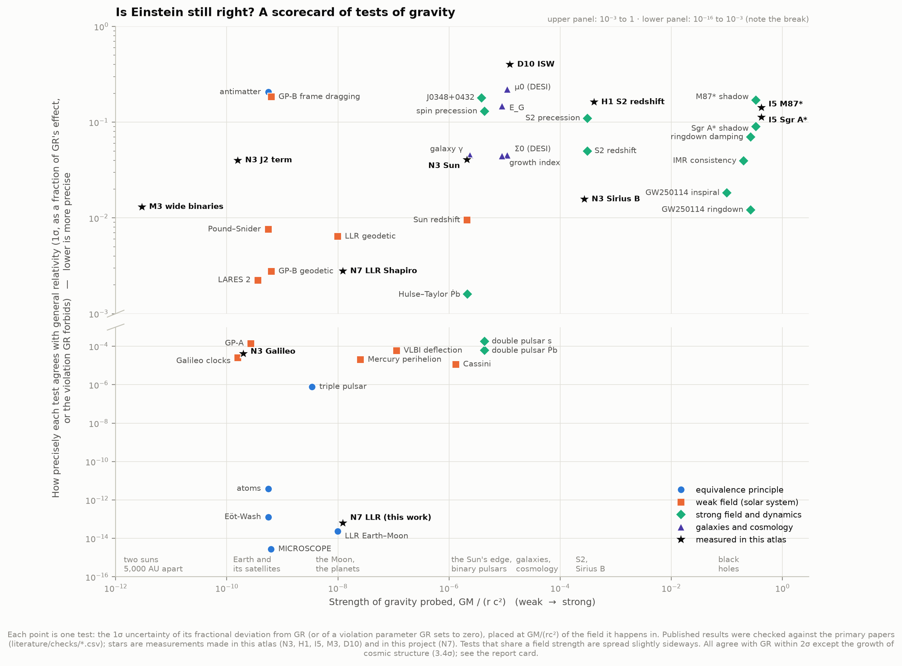
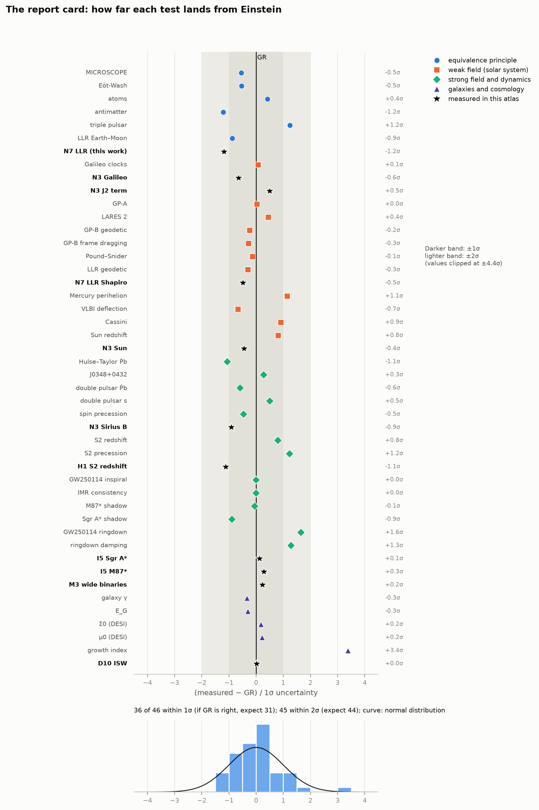
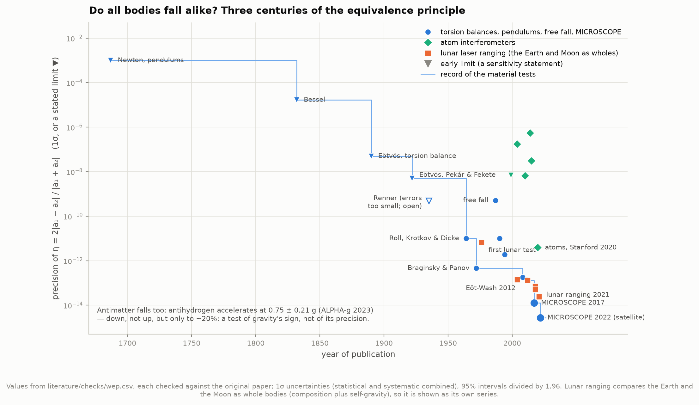
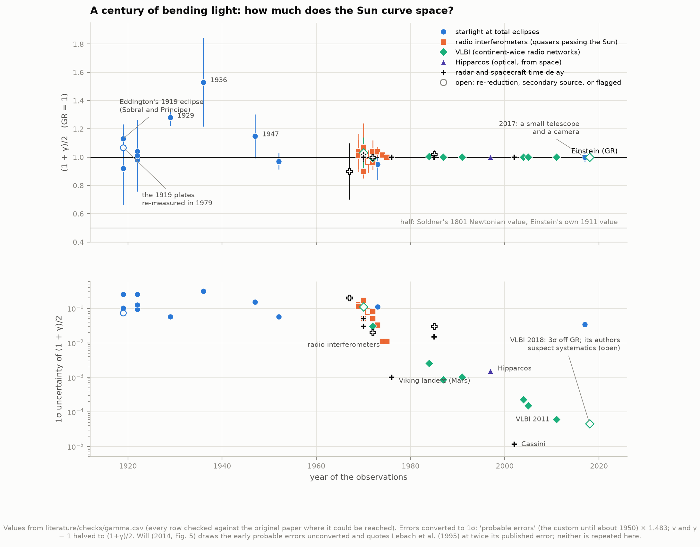
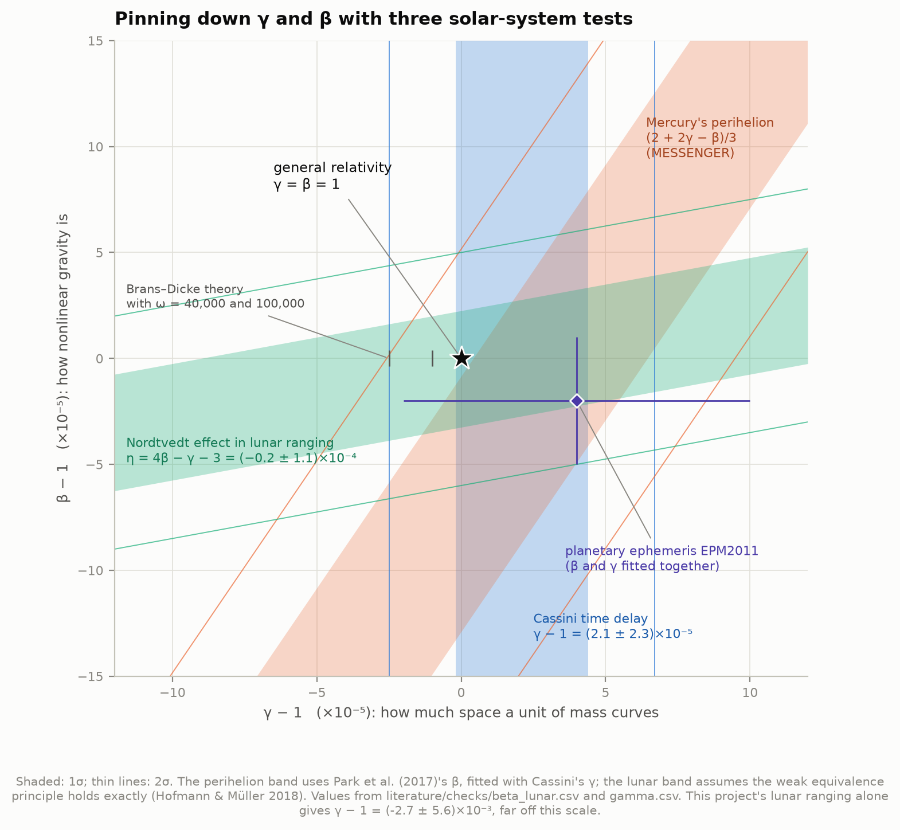
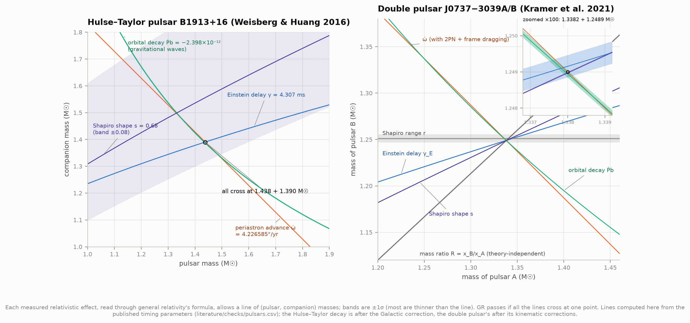
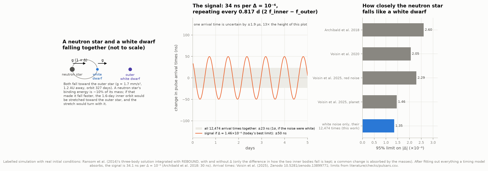
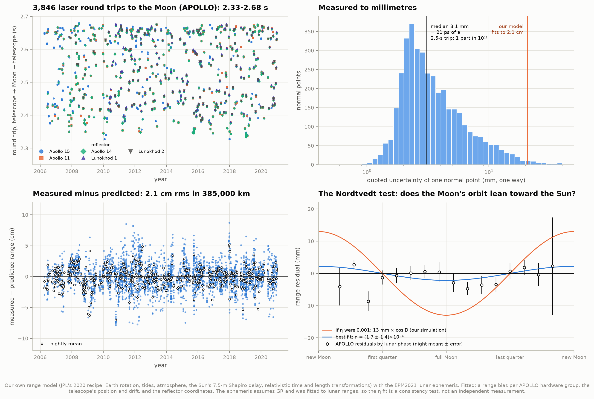
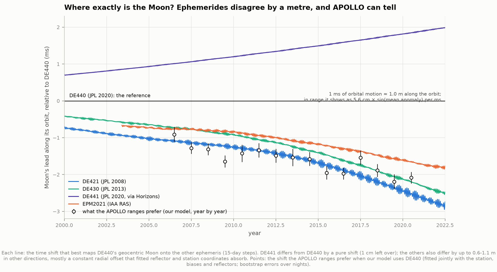
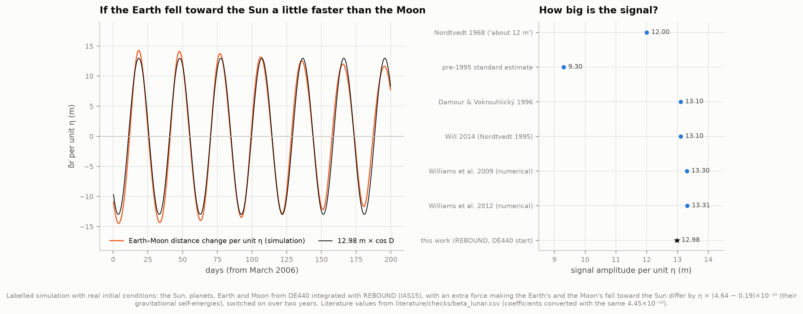

# N7 — Is Einstein still right? A scorecard of gravity tests

**General relativity (GR) has been tested for over a century, from the laboratory to the whole universe.
How precisely, and where could it still fail? We compute GR's prediction for every classic test, plot each
measurement against it, and test it ourselves on the one data set in the spec: 3,846 laser round trips to the Moon.**

Yes, it is still right: on every test we could find, to the precision each one reaches.

**The scorecard.** We collected 46 tests. 35 are published landmarks, from MICROSCOPE's
satellite to black-hole shadows, merging black holes and the growth of cosmic structure. 11 were measured in
this atlas: four in N3, two in I5, one each in H1, M3 and D10, and two in this project.
For each we put the measured deviation from GR, with a 1σ error, on one footing. **36 of 46 land within
1σ of Einstein and 45 within 2σ**; if GR is right and the errors are honest, 31 and 44 are expected. The one
outlier is the growth rate of cosmic structure, 3.4σ (Nguyen et al. 2023). It relies on Planck's older lensing
data, and similar tensions have faded with newer data. The tests span 14 decades in precision
(MICROSCOPE: 2.7 × 10⁻¹⁵) and 11 decades in the strength of the gravity they probe (GM/rc² from 3 × 10⁻¹² to 1/3).



**Interactive version:** [`figures/scorecard_explorer.html`](figures/scorecard_explorer.html) is a single file that works offline. Hover over or tap any
test to see its paper, value and source. You can also filter by family, switch to the report card, or sort the full table.

**Every number was checked against the original paper.** Five subagents transcribed **625 published
values** into `literature/checks/`. They recorded each paper's exact sentence and its confidence convention
(1σ, 90%, 95%, "probable error"). 182 values confirmed our first draft, 19 corrected it, 388 were added and 36
could only be found in secondary sources. Along the way they found errors in the standard review: Will (2014)
quotes Lebach et al. (1995) at twice its published error. It also turns PSR J1738+0333's 95% interval for the
PPN parameter α₁ into a limit of 7 × 10⁻⁵, which is the interval's full width, not a bound on |α₁|. And it plots
the early eclipses with probable errors, not 1σ.

**Lunar laser ranging, done ourselves.** Following JPL's own published recipe (Williams & Boggs 2020), we
built a model of the range from Apache Point Observatory to five reflectors on the Moon. It includes the Earth's rotation and tides,
the atmosphere, the Sun's 7.5-m Shapiro delay, and the relativistic transformations of time and length.
It predicts all 3,846 APOLLO round trips (2006–2020; 2.3–2.7 s, each measured to **3.1 mm**) to
**2.1 cm rms** in 385,000 km. In the residuals:

> - the Sun's Shapiro delay is there at full strength: **γ − 1 = (−2.7 ± 5.6) × 10⁻³**;
> - no Nordtvedt effect: the Earth and Moon fall toward the Sun alike, **η = (1.7 ± 1.4) × 10⁻⁴**. A violation would
>   stretch the Moon's orbit toward the Sun by **12.98 m × η**, which our own N-body simulation reproduces (literature: 12.9–13.3 m);
> - the telescope drifts with North America at **13.3 ± 0.4 mm/yr west and 4.7 ± 0.8 mm/yr south**, the same as the
>   GPS station 2.8 km away (12.9 ± 0.2 and 5.6 ± 0.1).

The ephemeris assumes GR and was itself fitted to lunar ranges, so these are consistency tests: the ranges
agree with a GR model at the centimetre level. Real tests refit the whole ephemeris with the parameter free.

**A surprise: where exactly is the Moon?** With JPL's flagship ephemeris DE440 our model leaves a 7-cm signal
at the Moon's anomalistic month. It is the signature of the Moon being **1 to 2 m ahead along its orbit**
(1.3 ms of orbital motion in 2013, growing). The independent Russian ephemeris EPM2021 and JPL's own older
DE421 and DE430 all place the Moon 0.7–2.2 ms *behind* DE440, matching what the APOLLO ranges prefer year by
year. JPL's DE441 runs 1–1.7 ms *ahead*. JPL fits DE440 to these same data at ~1 cm in its own software,
so either its range model contains a convention ours (built from its memo) lacks, or DE440's along-track
solution differs in a way that model absorbs. We document it rather than resolve it.

**Two simulations, labelled as such.** *(a)* The Nordtvedt effect: the Sun, planets, Earth and Moon from
DE440, integrated with REBOUND, give 12.98 m × η cos D. *(b)* The triple pulsar PSR J0337+1715: a neutron
star and a white dwarf fall together toward a second white dwarf. If the neutron star fell faster by
Δ, the arrival times would carry a **34 ns** signal per Δ = 10⁻⁶ (Archibald et al. 2018: 30 ns). With the
12,474 public arrival times of Voisin et al. (2025), white noise alone would limit |Δ| to 1.35 × 10⁻⁶ (95%);
they publish 1.46–2.29 × 10⁻⁶, depending on whether the leftover signal is red noise or a planet.

---

## Results

### 1. The scorecard and the report card



**What each point means.** Every test is turned into one number: the fractional deviation of the measured
effect from GR's prediction, or a violation parameter that GR sets to zero, with a symmetric 1σ error. The
x-axis of figure 1 is the strength of the gravity involved, GM/(rc²), the dimensionless Newtonian potential in
the field where the test happens (Baker, Psaltis & Skordis 2015 use the same axis):

| family | tests | where the gravity comes from |
|---|---|---|
| equivalence principle | MICROSCOPE, Eöt-Wash, atoms, antimatter, lunar ranging, triple pulsar | the Earth, the Sun, the outer white dwarf |
| weak field | Cassini, VLBI, Mercury, clocks, Gravity Probe A and B, LAGEOS/LARES 2, the Sun's redshift | the Earth or the Sun |
| strong field | binary pulsars, S2, black-hole shadows, gravitational waves, Sirius B | an orbit near a neutron star or black hole |
| galaxies, cosmology | lensing vs dynamics, Σ0, μ0, growth index, wide binaries, ISW | a galaxy, the large-scale structure |

Four literature points (Galileo clocks, Gravity Probe A, Pound & Snider, the Sun's redshift) come from N3's redshift
ladder, whose values were checked against the primary papers there. The x-axis is a convention, not a unique definition. For the triple pulsar, what makes the neutron star a strong-field
*body* is its own compactness (~0.1–0.2); the axis shows the external field it falls in (3 × 10⁻⁹).

**The report card** (figure 2) shows each deviation in units of its own error. If GR is right and every
error is honest, about 68% should land within ±1σ; we find 36 of 46 (78%), with 45 within 2σ. Slightly too
many tests sit close to GR, as is common for compilations, where errors are often conservative.
The points worth a second look:

| test | deviation | remark |
|---|---|---|
| growth index of structure (Nguyen et al. 2023) | **+3.4σ** | slower growth than GR; relies on Planck PR3 lensing, and DESI's similar Σ0 tension disappears with Planck PR4 |
| GW250114 ringdown frequency | +1.6σ | one event; the catalogue average (GWTC-5) is consistent |
| ringdown damping time, GWTC-5 catalogue | +1.3σ | the multiplied posterior puts GR just outside 90%; the LVK suspect noise or waveform systematics |
| triple pulsar Δ (red-noise model) | +1.2σ | 0.5σ with the planet model |
| N7's Nordtvedt test | −1.2σ | this project, below |

Not on the chart, because they are not fractional precisions: the graviton mass (m_g ≤ 1.92 × 10⁻²³ eV/c²,
90%, GWTC-4.0), the speed of gravity (GW170817: −3 × 10⁻¹⁵ ≤ Δv/c ≤ +7 × 10⁻¹⁶), and Ġ/G
((−5.0 ± 9.6) × 10⁻¹⁵ per year, lunar ranging, Biskupek et al. 2021).

### 2. GR's predictions, computed here

`gr_predictions.py` computes each classic prediction from first principles with IAU/IERS constants and
DE440 masses. The experiments use the published predictions where their geometry is more detailed than ours.

| test | GR's prediction (this work) | published GR value | measured |
|---|---|---|---|
| Mercury's perihelion advance | **42.98″ per century** | 42.98″ (Nobili & Will 1986) | GR term 42.9799 ± 0.0009″ (MESSENGER, Park et al. 2017) |
| starlight bent at the Sun's edge | **1.7512″** (Newtonian half: 0.8756″) | 1.75″ | 1.98 ± 0.18″ (Sobral 1919) … γ to 2.3 × 10⁻⁵ (Cassini) |
| radar echo delay, Mars behind the Sun | **247 µs** round trip | ~250 µs | Viking 1976: γ = 1.000 ± 0.002 |
| redshift up a 22.6-m tower | **2.46 × 10⁻¹⁵** | 2.46 × 10⁻¹⁵ | 0.9990 ± 0.0076 of it (Pound & Snider 1965) |
| the Sun's redshift, seen from Earth | **633.4 m/s** | 633.1 m/s | 638 ± 6 m/s (González Hernández et al. 2020); N3: 622 ± 26 |
| Gravity Probe B, geodetic (ideal 642-km orbit) | **6,621 mas/yr** | 6,606.1 (real orbit) | 6,601.8 ± 18.3 |
| Gravity Probe B, frame dragging (ideal) | **40.9 mas/yr** | 39.2 (real orbit, guide star) | 37.2 ± 7.2 |
| LAGEOS's node, frame dragging | **30.7 mas/yr** | ≈ 30.7 | μ = 1.001 ± 0.002 (LARES 2, disputed) |
| the Moon's orbit, geodetic precession | **19.19 mas/yr** | 19.2 | K_gp = −0.0019 ± 0.0064 |
| Nordtvedt signal per unit η | **12.98 m × cos D** (our N-body simulation) | 13.1 m (Nordtvedt 1995), 13.3 (JPL numerical) | η = (−0.2 ± 1.1) × 10⁻⁴ |
| triple-pulsar signal per Δ = 10⁻⁶ | **34 ns** (our simulation) | 30 ns (Archibald et al. 2018) | \|Δ\| < 1.5–2.3 × 10⁻⁶ |
| S2's precession per orbit | **12.2′** | 12′ | f_SP = 1.135 ± 0.110 (GRAVITY 2024) |
| M87* shadow (6.5 × 10⁹ M☉, 16.8 Mpc) | **39.7 µas** | (ring ~10% larger) | ring 42 ± 3 µas; I5: 43.8 |
| Sgr A* shadow (4.0 × 10⁶ M☉, 8.0 kpc) | **51.3 µas** | | ring 51.8 ± 2.3; I5: 53.9 ± 1.3 |
| Hulse–Taylor decay (masses 1.438 + 1.390) | **−2.4021 × 10⁻¹²** | −2.40263 × 10⁻¹² | (0.9983 ± 0.0016) × GR |

### 3. Do all bodies fall alike? The equivalence principle, 1687–2022



From Newton's pendulums (a difference of "less than the thousandth part") to MICROSCOPE's titanium and platinum
masses in orbit (η = [−1.5 ± 2.3 (stat) ± 1.5 (syst)] × 10⁻¹⁵), the precision with which different materials
fall alike improved by **12 orders of magnitude**. Records: Eötvös 1890 (5 × 10⁻⁸; the 1922 paper with Pekár and
Fekete states 5 × 10⁻⁹, not the 3 × 10⁻⁹ in reviews), Roll, Krotkov & Dicke 1964, Braginsky & Panov 1972 (the
record for about three decades), the Eöt-Wash group (1.3 × 10⁻¹³) and MICROSCOPE. Renner's 1935 claim was 5 × 10⁻¹⁰, not
the "~2 × 10⁻⁹" in reviews, which is Roll et al.'s estimate after finding his errors about 3× too small; it is drawn
open. Atom interferometers reached 3.8 × 10⁻¹² (Stanford 2020). Lunar ranging tests the Earth and Moon as whole
bodies, composition plus self-gravity, at 2.4 × 10⁻¹⁴ (Biskupek et al. 2021). Antimatter falls down:
antihydrogen accelerates at 0.75 ± 0.21 g (ALPHA-g 2023), a test of gravity's sign, not yet of its precision.

### 4. A century of bending light



Light passing the Sun is bent by (1 + γ)/2 × 1.7512″, and its radio echoes are delayed by the same factor.
γ measures how much space a unit of mass curves; GR has γ = 1, and Newton's corpuscles would give the "half"
value. Errors are converted to 1σ: before ~1950, astronomers quoted *probable errors* (0.6745σ). With
that, Eddington's 1919 Sobral telescope gives (1+γ)/2 = 1.13 ± 0.10 and Principe 0.92 ± 0.25. The 1979 re-reduction of
the Sobral plates (Harvey) gives 1.07 ± 0.07. Optical eclipses never beat ±6%. Radio interferometers reached
1% by 1975, the Viking landers on Mars 0.1%, VLBI 0.006% (Lambert & Le Poncin-Lafitte 2011), and Cassini's radio
link 0.001%: γ − 1 = (2.1 ± 2.3) × 10⁻⁵. Titov et al. (2018)'s global VLBI solution sits 3σ off GR, which its
authors attribute to systematics (drawn open). No γ has yet been published from Gaia or BepiColombo.

### 5. γ and β: three solar-system tests together



The parametrized post-Newtonian (PPN) framework summarises how metric theories of gravity differ from GR in the
solar system. γ is the space curvature per unit mass and β the nonlinearity of gravity; GR has γ = β = 1.
Three measurements cross at GR:
- Cassini's time delay fixes γ.
- Mercury's perihelion measures (2 + 2γ − β)/3: β − 1 = (−2.7 ± 3.9) × 10⁻⁵ with MESSENGER (Park et al. 2017).
- Lunar ranging's Nordtvedt effect measures η = 4β − γ − 3 = (−0.2 ± 1.1) × 10⁻⁴ (Hofmann & Müller 2018),
  assuming the weak equivalence principle holds exactly; with the laboratory test subtracted, the error grows to ±3.4 × 10⁻⁴.

Brans–Dicke theory is pushed to ω > 40,000. Will (2014)'s Table 4 has two inconsistencies:
- Its two β rows are not like-for-like: the perihelion row is an error bar, the Nordtvedt row is value plus error.
- Its α₁ limit from PSR J1738+0333 (7 × 10⁻⁵) is the full width of a 95% interval, [−3.5, +3.3] × 10⁻⁵, not a bound on |α₁|.

### 6. Binary pulsars: each effect is a line of possible masses



A binary pulsar's timing measures several relativistic effects: the periastron advance ω̇, the Einstein
delay γ, the orbital decay Ṗb from gravitational waves, and the Shapiro delay's range r and shape s. Through
GR's formulae, each measured effect allows a line of possible (pulsar, companion) masses. We computed the
lines from the published parameters. Two effects fix the masses; every further line that passes through the same
point is a test.
- **Hulse–Taylor** (Weisberg & Huang 2016): the orbital decay is 0.9983 ± 0.0016 of GR's. The test is limited by
  the Galactic correction to Ṗb, that is, by the pulsar's distance: with a VLBI parallax it becomes
  1.005 (+0.001/−0.003), 1.6σ (Deller et al. 2018).
- **Double pulsar** (Kramer et al. 2021): six lines cross at 1.3382 + 1.2489 M☉. The orbital decay agrees to
  0.999963 ± 0.000063 (1.3 × 10⁻⁴ at 95%). At the ×100 zoom, the periastron advance needs its second-order (2PN) term and
  the pulsar's own frame dragging, both included.

### 7. The triple pulsar: does a neutron star fall like a white dwarf?



In PSR J0337+1715 a millisecond pulsar and a white dwarf orbit each other every 1.63 days, and that pair orbits
a second white dwarf every 327 days. The strong equivalence principle says the neutron star, whose gravitational
binding energy is ~10% of its mass, must fall toward the outer star exactly like the white dwarf. We integrated
Ransom et al. (2014)'s three-body solution with REBOUND, with and without a violation Δ. Only the *difference*
in how the inner pair falls is observable; a common change is absorbed by the masses (and would otherwise drift
the orbital phases by milliseconds). We fitted out everything a timing model absorbs. What remains is a
sinusoid at 2f_inner − f_outer (every 0.817 d) with **34.1 ns per Δ = 10⁻⁶**; Archibald et al. (2018)
quote 30 ns, and a forced-eccentricity estimate gives 34 ns. A single arrival time is uncertain by ±1.9 µs, but
Voisin et al. (2025)'s 12,474 public times average down to ±23 ns, so white noise alone would allow
|Δ| < 1.35 × 10⁻⁶ (95%). Their published limits are 1.46 × 10⁻⁶ (if the leftover slow signal is a lunar-mass
planet) and 2.29 × 10⁻⁶ (if it is red noise). Archibald et al. 2018: 2.6 × 10⁻⁶; Voisin et al. 2020: 2.05 × 10⁻⁶.

### 8. Lunar laser ranging with APOLLO



**The data.** APOLLO's telescope at Apache Point (New Mexico, 2,788 m) fired green laser pulses at five
reflector arrays left by Apollo 11, 14 and 15 and the Soviet Lunokhod rovers. A few photons per pulse came back.
Its 3,846 normal points (2006-04-07 to 2020-12-27, all six releases) each give a round trip of 2.33–2.68 s. Each is
quoted to a median of **21 ps, i.e. 3.1 mm one way: one part in 10¹¹**.

**Our model** follows JPL's lunar laser range model memo (Williams & Boggs 2020) step by step:
- UTC → TAI → TT → TDB at the station, with its own relativistic clock term.
- The station: ITRF coordinates plus plate motion, solid tides of degrees 2 and 3 with the K1 correction, and the
  pole tide.
- Earth orientation: IAU 2006/2000A precession-nutation, the IERS EOP 20 C04 series, and the sub-daily ocean-tide
  terms (ORTHO_EOP, ported and checked against its test case).
- The station is Lorentz-contracted and rescaled to barycentric coordinates.
- The Moon: the ephemeris position, rotated by its integrated librations, with the DE440 reflector coordinates.
  It is displaced by the Earth's and Sun's tides on the Moon, then Lorentz-contracted and rescaled.
- The light time is iterated up and down to 0.1 ps.
- On each leg: the atmosphere (Mendes–Pavlis zenith delay with each normal point's pressure, temperature and
  humidity, FCULa mapping), the Shapiro delay of the Sun (7.5 m) and the Earth (4 cm), and the corner-cube delay.

Per hardware group we fit a range bias, plus the telescope's position and drift and the reflector coordinates.
Ocean and atmospheric loading, geocentre motion, reflector thermal expansion and lunar tidal dissipation are
each below 1 cm at Apache Point and are not modelled.

**Result.** The model fits to 2.07 cm rms with EPM2021 as the lunar ephemeris (1.7–2.6 cm per hardware group;
1.5 cm in nightly means). With DE440 it fits to 3.40 cm, which needs a fitted along-track correction (section 9);
without it, 3.72 cm. JPL reaches ~1.3 cm over all stations, and INPOP17a 1.15 cm on APOLLO's best group, so
our model is within a factor 1.5–2 of the state of the art.

**Relativity in the ranges** (EPM2021 fit; bootstrap errors over 553 nights):

| what | fitted | GR | with DE440 instead |
|---|---|---|---|
| strength of the Sun's (and Earth's) Shapiro delay, γ − 1 | **(−2.7 ± 5.6) × 10⁻³** | 0 | (−10.8 ± 6.9) × 10⁻³ |
| strength of the TDB − TT change during the 2.5-s trip (up to ±18 cm), k − 1 | **(−0.9 ± 1.0) × 10⁻²** | 0 | (−0.1 ± 1.2) × 10⁻² |
| Nordtvedt parameter η (12.98 m × η × cos D) | **(1.7 ± 1.4) × 10⁻⁴** | 0 | (0.04 ± 1.6) × 10⁻⁴ |

A Nordtvedt effect of η = 10⁻³ would be a 13-mm cosine at the synodic month, which the binned residuals
(figure 8, bottom right) rule out. Our η corresponds to Δ(m_G/m_I) = (−0.75 ± 0.64) × 10⁻¹³ between Earth and
Moon. That is 2–3 times weaker than Ke et al. (2026)'s residual-based test with EPM21 and all stations since
1970, (0.9 ± 3.2) × 10⁻¹⁴, and than the ephemeris refits, (−2.1 ± 2.4) × 10⁻¹⁴ (Biskupek et al. 2021).

**The telescope's own motion** is a check that the model is right. With EPM2021 the fit gives
−13.3 ± 0.4 mm/yr east, −4.7 ± 0.8 north and +0.3 ± 1.1 up. The EarthScope GPS station P027, 2.8 km away, moved
−12.93 ± 0.16, −5.60 ± 0.13 and +0.10 ± 0.47 mm/yr over 2007–2024 (Nevada Geodetic Laboratory, IGS14). All
three components agree within 1.2σ, so the Moon measures North America's drift. The fitted position is
14 cm west, 56 cm north and 9 cm up of the approximate coordinates on APOLLO's page.

### 9. Where exactly is the Moon?



With DE440, the residuals first showed a −7.4 cm × sin(mean anomaly) term. It is common to all five reflectors
and to every hardware group, so it is not a tide or libration error. It is exactly what a Moon displaced *along* its orbit
produces: 1 ms of orbital motion is 1 m along the track, and in range it appears as the radial velocity × 1 ms
= 5.6 cm × sin(anomaly). We chased it:
- The time tags really are fire times in UTC: the ILRS archive copy of the same normal points says so in its headers, and its values match APOLLO's files.
- NAIF's DE440 file equals JPL's original ASCII DE440 to 0.1 mm, librations included.
- **DE421** (JPL 2008), used in the same model on 2006–2010, leaves no such term (2.9 cm rms against DE440's 5.2 cm).
- The independent **EPM2021** (IAA RAS, fitted with entirely different software) fits all 14 years at 2.07 cm.
  Its fitted along-track correction is zero within errors (+0.11 ± 0.15 ms).

Mapping each ephemeris onto DE440 as a time shift, DE421, DE430 and EPM2021 put the Moon 0.7–2.2 ms behind DE440,
growing with time, and DE441 puts it 1.0–1.7 ms ahead. The APOLLO ranges, year by year, sit with DE421, DE430
and EPM2021 at −0.9 (2006) to −2.2 ms (2019).

We do not know why. JPL fits DE440 to these data at ~1 cm in its own software. So either the JPL model contains
something that our implementation of its published memo lacks, which acts like a ~1-ms lunar time offset, or
DE440's along-track solution differs and JPL's fitted parameters absorb it. Fitted reflector coordinates
can absorb much of such a shift: in a DE440 fit without the along-track term, all five reflectors moved together by
0.7 m along the orbit direction and the sin(anomaly) term vanished, but the fit stayed worse (3.8 cm) because the
shift's signature at other lunar frequencies remained. Either way it matters for anyone combining DE440 with an independent range model. In our
DE440 analysis it is fitted out as a smooth (quadratic) time offset and does not affect the relativity tests, which
live at other frequencies.

### 10. The Nordtvedt effect, simulated



If gravitational binding energy fell differently from other energy (η ≠ 0), the Earth would fall toward the Sun
at a different rate from the Moon. The Earth's binding energy is 4.64 × 10⁻¹⁰ of its mass, the Moon's 0.19 × 10⁻¹⁰.
The Moon's orbit would then be polarised toward the Sun. We integrated the Sun, the planets, the Earth and the Moon
from DE440 with REBOUND (IAS15), with an extra force for η = ±1 switched on over two years, and fitted the change
in the Earth–Moon distance: **12.98 m × η × cos D**, where D is the Moon's elongation from the Sun.
For comparison:
- Nordtvedt's 1968 estimate was "about 12 m", and the pre-1995 standard estimate 9.3 m.
- Nordtvedt (1995) and Damour & Vokrouhlický (1996) found that the solar tide amplifies the signal, to 13.1 m.
- JPL's numerical checks give 13.3 m.

The +η and −η runs mirror each other to 1.3 mm, so the response is linear.

### 11. This atlas's own measurements on the scorecard

| project | test | result |
|---|---|---|
| [N3](../58-gravitational-redshift/) | Galileo clocks' redshift | α = (−2.6 ± 4.1) × 10⁻⁵ |
| N3 | the Sun's redshift (iron lines) | 0.982 ± 0.040 of GR |
| N3 | Sirius B's redshift (M1's mass) | 0.986 ± 0.016 of GR |
| N3 | the J2 relativistic clock term | 1.02 ± 0.04 of GR |
| [H1](../17-galactic-centre/) | S2's redshift, Keck positions | f = 0.82 ± 0.16 (0.70 ± 0.15 adding VLT positions) |
| [I5](../36-m87-shadow/) | Sgr A*'s ring vs the size predicted from S2's mass | +1.4% ± 2.5% ± 11% (EHT calibration) |
| I5 | M87*'s ring vs the stellar-dynamics mass | +4% ± 14% |
| [M3](../53-wide-binaries/) | wide binaries, Newton (0) vs MOND (1) | α = 0.003 (+0.014/−0.012), Hwang's eccentricities |
| [D10](../40-isw-effect/) | ISW effect, GR + ΛCDM amplitude | A = 1.01 ± 0.40 |
| N7 | Nordtvedt test in the APOLLO ranges | η = (1.7 ± 1.4) × 10⁻⁴ |
| N7 | the Sun's Shapiro delay in the APOLLO ranges | γ − 1 = (−2.7 ± 5.6) × 10⁻³ |

When N1 (orbital precession), N2 (light bending) and N4 (gyroscopes) are finished, they belong on this list;
`scorecard.atlas_rows` reads each project's `data/results.json`.

---

## How it works

1. `fetch_data.py` downloads everything, recording a SHA-256 manifest:
   - APOLLO's normal points;
   - JPL DE440 and its lunar orientation from NAIF;
   - IERS Earth orientation;
   - the JPL and IERS model documents;
   - for the cross-checks: DE421, DE430 and DE440 in JPL's own format, EPM2021 (a 6.5-MB byte range of IAA RAS's file), DE441 lunar vectors from Horizons, GPS velocities and one ILRS CRD file.
2. Lunar ranging:
   - `apollo.py` reads the normal points.
   - `earth.py` handles Earth orientation, the station and its tides.
   - `ephem.py` evaluates the ephemerides with exact (day, second) time arithmetic. A single Julian-date double resolves only ~40 µs, about 1 cm of lunar motion.
   - `llr_model.py` computes the round trips; `llr_fit.py` fits the residuals, bootstraps over nights and runs the GPS check.
   - `moon_compare.py` maps the five ephemerides onto each other.
3. Simulations: `nordtvedt.py` and `triple_pulsar.py`, both REBOUND/IAS15.
4. Literature and scorecard:
   - `literature.py` reads the checked tables and converts every convention to 1σ: 90% ÷ 1.645, 95% ÷ 1.96, probable error × 1.4826, statistical and systematic errors in quadrature.
   - `gr_predictions.py` computes GR's predictions.
   - `scorecard.py` builds the 46-test table, reading the atlas projects' results files (a project that has not been run is left out).
5. `figures.py` draws everything, `explorer.py` writes the interactive page, and `run.py` runs it all and writes `data/results.json`.
6. `test_physics.py` has 18 checks against known answers, including:
   - APOLLO's documented example line;
   - the IERS ORTHO_EOP test case;
   - NAIF's DE440 file against JPL's original to 0.1 mm;
   - the 2.4-m zenith delay of one atmosphere;
   - the Sun's 7.5-m Shapiro delay;
   - the 0.4-m static lunar tide at Apollo 15 (JPL: 383 mm);
   - the classic predictions;
   - the Hulse–Taylor and double-pulsar post-Keplerian parameters;
   - the probable-error conversion;
   - both simulations' amplitudes.

## Checks against published numbers

| quantity | this work | published |
|---|---|---|
| Nordtvedt range signal per unit η | 12.98 m | 13.1 m (Nordtvedt 1995; Damour & Vokrouhlický 1996), 13.3 m (Williams et al. 2009, 2012) |
| triple-pulsar signal per Δ = 10⁻⁶ | 34.1 ns | 30 ns (Archibald et al. 2018) |
| white-noise 95% limit on \|Δ\| from Voisin et al.'s TOAs | 1.35 × 10⁻⁶ | 1.46 (planet) – 2.29 (red noise) × 10⁻⁶ (Voisin et al. 2025) |
| lunar-range fit | 2.07 cm rms (EPM2021) | ~1.3 cm (DE440, all stations); 1.15 cm (INPOP17a, APOLLO group D) |
| APOLLO telescope drift (east, north) | −13.3 ± 0.4, −4.7 ± 0.8 mm/yr | −12.93 ± 0.16, −5.60 ± 0.13 (GPS P027) |
| static lunar tide at Apollo 15 (up) | 0.38 m | 383 mm (Williams & Boggs 2020, Table A.2) |
| Mercury, light bending, geodetic, LAGEOS | 42.98″/cy, 1.7512″, 19.19 mas/yr, 30.7 mas/yr | 42.98, 1.75, 19.2, ≈30.7 |
| double pulsar: masses from k and s reproduce γ_E, Ṗb^GW, s | within their 1σ | Kramer et al. 2021 |

## Corrections to the literature found along the way

The checked tables record the details (`literature/checks/*_notes.md`). The notable ones:
- **Will (2014), the standard review**:
  - It quotes Lebach et al. (1995) as γ − 1 = (−8 ± 34) × 10⁻⁴, twice the published (−4 ± 17) × 10⁻⁴.
  - Its α₁ limit from PSR J1738+0333 is the full width of a 95% interval, not a bound on |α₁|.
  - Its two β rows are not like-for-like.
  - Its Figure 5 plots pre-1950 probable errors as if they were 1σ, Robertson & Carter (1984) at 1.000 (the paper
    says 1.004) and Shapiro et al. (1971) at 1.00 (1.02).
  - Three double-pulsar entries in its Table 7 match neither Lyne et al. (2004) nor Kramer et al. (2006).
- **Commonly repeated numbers that are not what the papers say**:
  - Eötvös, Pekár & Fekete give 5 × 10⁻⁹, not 3 × 10⁻⁹.
  - Renner claimed 5 × 10⁻¹⁰, not 2 × 10⁻⁹.
  - Newcomb (1895) found 41.2 ± 2.1″/cy for Mercury, not 43″.
  - The LAGEOS 2004 result is 0.99 ± 0.05; ±0.10 was the authors' extra allowance for unknown errors.
  - The "Shapiro et al. 1976 radar β" is a lunar-ranging result.
  - K_gp = −0.0019 ± 0.0064 is Williams et al. 2004, not 1996.
  - The Fienga et al. (2015) paper and the 2024 Living Review list INPOP10a's β − 1 as its γ − 1.
- **Values superseded in later versions**:
  - The GWTC-3 graviton-mass bound became 2.42 × 10⁻²³ eV in the published version (1.27 × 10⁻²³ in arXiv v1).
  - Kramer et al. (2021)'s double-pulsar Pb and e differ from the 2006 values still quoted.
  - Weisberg & Huang (2016)'s Galactic correction is −0.025 × 10⁻¹², not 2005's −0.0128 × 10⁻¹².
- **Slips inside papers**:
  - Voisin et al. (2020) write "~0.1 s" for a 0.1-µs signal.
  - Weisberg & Huang label γ in "ms" for a value in seconds.
  - Biskupek et al. (2021) cite MICROSCOPE's Pt–Pt control result as its Ti–Pt test.
  - Pitjeva & Pitjev (2013) call the same error 3σ in one section and σ in another.

## Caveats: what this does not show

- **Passing is not proof.**
  - The PPN framework covers only a class of theories.
  - Strong-field tests usually check consistency with GR templates, not a parametrised alternative.
  - GR remains incompatible with quantum mechanics.
  - Dark matter and dark energy mean either unseen ingredients or different gravity at large scales (sections D, K of the atlas).
- **The lunar-ranging tests are consistency tests.** The ephemerides (DE440, EPM2021) assume GR and were fitted to lunar ranges,
  including most of these APOLLO data, so they may already absorb part of any violation. A proper test refits the
  ephemeris with η, γ or β free; our η is 2–3 times weaker than tests using all stations since 1970.
- **Model dependence.**
  - EHT shadow tests rest on a simulation-based ring-to-shadow calibration (±11%).
  - Binary-pulsar decay tests rest on the Galaxy's acceleration and the pulsar's distance.
  - The cosmological tests assume ΛCDM.
  - The LARES 2 error budget is disputed (Iorio 2025; a Nature referee).
  - The growth-index tension depends on which Planck release is used.
- **The scorecard is a compilation.**
  - One "best" result is shown per test type, and choices had to be made.
  - Equivalent ways of quoting a result, η or Δ(m_G/m_I), were converted with stated self-energies.
  - 36 of the 625 rows rest on secondary sources only (marked in the CSVs), and none of them is a scorecard point.
- **The x-axis is a convention** (section 1). It locates tests, but it is not a unique measure of "how relativistic" each one is.
- **The along-track puzzle (section 9) is unresolved.** We report what the data and five ephemerides show, not a verdict on DE440.

## Figures

| file | shows |
|---|---|
| `01_scorecard` | every test: precision vs strength of gravity |
| `02_report_card` | every test: deviation from GR in units of its error |
| `03_equivalence_principle` | η from Newton to MICROSCOPE |
| `04_gamma_history` | (1+γ)/2 from 1919 to Cassini |
| `05_gamma_beta` | Cassini, Mercury and the Nordtvedt effect in the γ–β plane |
| `06_binary_pulsars` | mass–mass diagrams of the Hulse–Taylor and double pulsars |
| `07_triple_pulsar` | the strong-equivalence-principle signal and limits |
| `08_lunar_ranging` | APOLLO's round trips, precision, residuals and the Nordtvedt test |
| `09_moon_along_track` | four ephemerides vs DE440, and what APOLLO prefers |
| `10_nordtvedt_signal` | the simulated Nordtvedt effect and its amplitude |
| `scorecard_explorer.html` | figures 1 and 2 to explore: details for every test, family filters, a sortable table, light and dark themes |

Each figure is saved as PNG and SVG. The explorer is one self-contained HTML file (`explorer.py`), and
`data/derived/scorecard_table.csv` is the scorecard's table.

## Running it

```bash
cd astrophysics/64-gravity-scorecard
../.venv/bin/python fetch_data.py          # ~180 MB: core inputs ~65 MB, cross-checks ~115 MB
../.venv/bin/python run.py                 # from cache: ~1 min; with --force: ~7 min
../.venv/bin/python test_physics.py        # 18 checks
```

Needs numpy, scipy, pandas, matplotlib, jplephem, pyerfa and rebound, all in the shared `.venv`. Once
fetched, everything runs offline. The papers the verification agents downloaded (`data/literature/papers/`,
~575 MB) are kept for provenance and are not needed to run anything.

## Data and credits

- **APOLLO** lunar laser ranging normal points: T. W. Murphy and the APOLLO collaboration, UC San Diego
  (`tmurphy.physics.ucsd.edu/apollo/norm_pts.html`). APOLLO asks to be invited to co-author derivative science
  papers; this hobby analysis is not one.
- **JPL**:
  - DE440/DE441: Park et al. 2021, AJ 161, 105.
  - The lunar laser range model: Williams & Boggs 2020, JPL IOM 335N-20-01.
  - DE421, DE430: Folkner et al.
  - SPICE kernels from NAIF; DE441 vectors from Horizons.
- **EPM2021**: Institute of Applied Astronomy, Russian Academy of Sciences (`ftp.iaaras.ru/pub/epm/EPM2021`).
- **IERS**: EOP 20 C04 series; IERS Conventions 2010 (Petit & Luzum), chapters 7–9 and their reference software.
- **GPS velocities**: Nevada Geodetic Laboratory MIDAS (Blewitt et al. 2016, 2018), station P027 (EarthScope).
- **ILRS**: CRD normal points from the EDC (DGFI-TUM) archive.
- **Triple-pulsar arrival times**: Voisin et al. 2025, A&A, Zenodo 10.5281/zenodo.13899771.
- **Literature**: the primary papers listed in `literature/checks/*.csv` (reference, DOI and arXiv ID on every row);
  C. M. Will, *Living Rev. Relativ.* 17, 4 (2014).
- **Software**: REBOUND (Rein & Liu 2012; Rein & Spiegel 2015), jplephem (B. Rhodes), ERFA/pyerfa, NumPy, SciPy,
  pandas, Matplotlib.

Everything in this project, the code, the analysis and this text, was produced by AI (Claude) at the direction of a
hobbyist; numbers were checked against the original papers, but nothing here has been reviewed by a professional.
