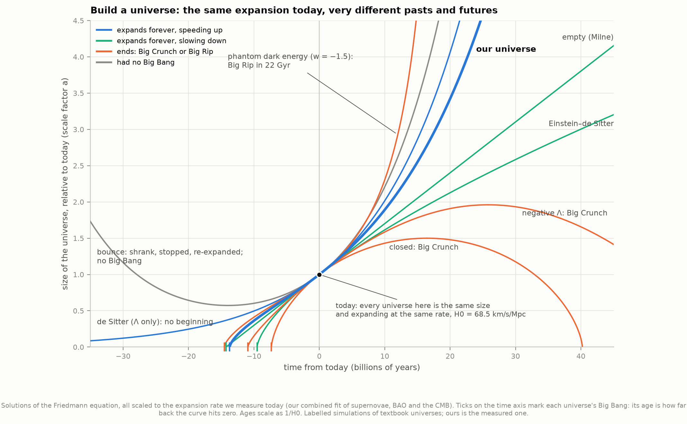
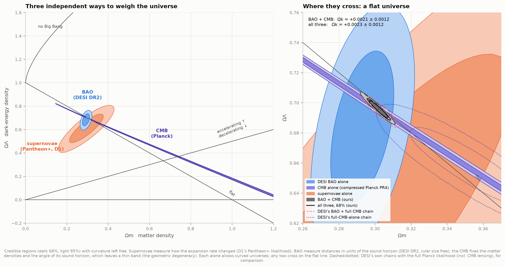
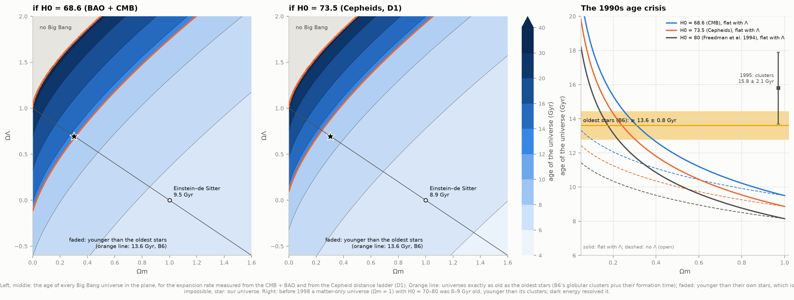
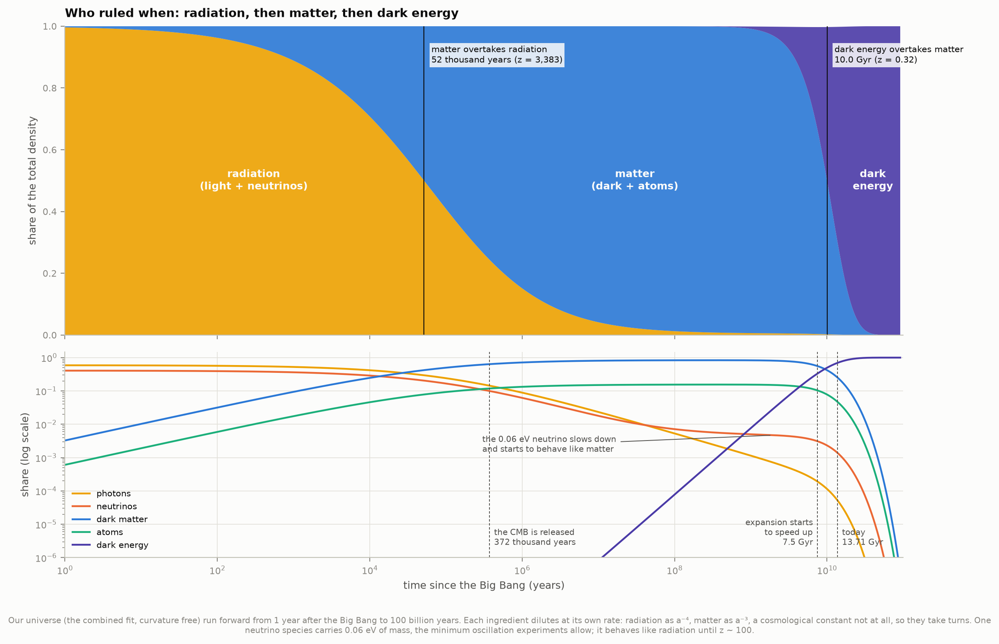
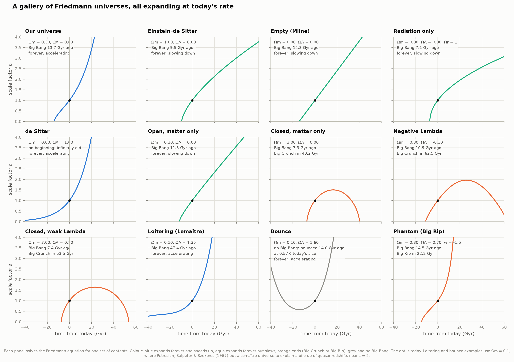
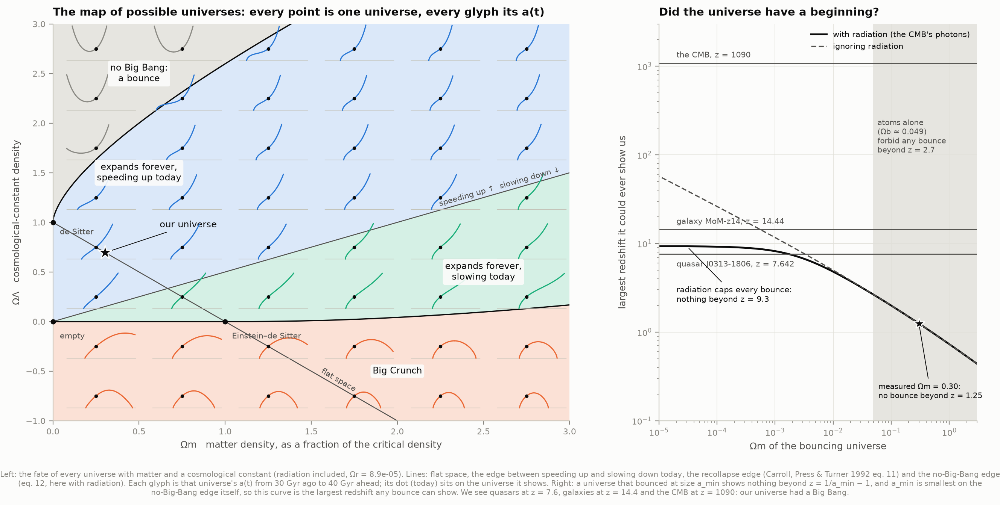
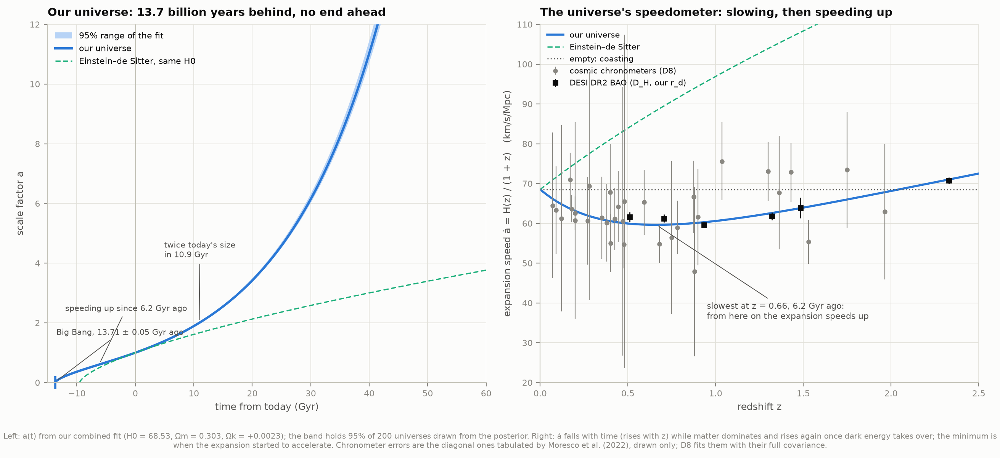
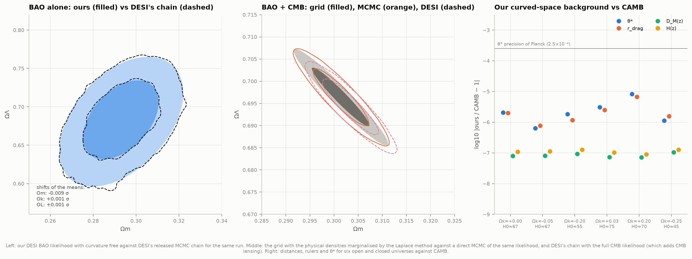

# O1 — Build a universe: solving the Friedmann equations

**Give a universe some matter, radiation, curvature and dark energy: how does it live and die?**

The Friedmann equation answers that for any recipe. This project solves it exactly for every
kind of universe: ones that end in a Big Crunch, ones that expand forever, ones that loiter
for tens of billions of years, ones that never had a Big Bang, and ones torn apart in a Big Rip.
Then it asks which of them is ours. Three independent measurements answer, each with
curvature left completely free:

- the brightness of 1,590 supernovae (project D1's data),
- the sound-wave ruler in DESI's 2025 galaxy maps (D5's data),
- the Planck cosmic microwave background (D3 and D5).

Each one alone allows strongly curved universes. Any two of them cross on the flat line.

**The answer:** space is flat to within a quarter of a percent (Ω_k = +0.0023 ± 0.0012).
The universe began in a Big Bang 13.71 ± 0.05 billion years ago, or 13.787 ± 0.016 if
space is assumed exactly flat (Planck 2018 + BAO: 13.787 ± 0.020). It switched from slowing
down to speeding up 6.2 billion years ago, and it will expand forever. A bouncing universe
with no Big Bang is ruled out by a simple argument. The universe contains radiation (the
CMB's photons), so no bounce could ever show us anything beyond redshift 9.3, and we see
galaxies at z = 14.4 and the CMB at z = 1090.

There is also an **interactive page**, [`figures/build_a_universe.html`](figures/build_a_universe.html):
drag a universe around the map, and its history, fate, age and expansion speed update live,
with the real measurements drawn on the map. It works offline.

---

## Results

### How flat is space? What does the universe contain?

All fits leave curvature free. The parameters are the matter density Ω_m, the dark-energy
density Ω_Λ (a cosmological constant) and Ω_k = 1 − Ω_m − Ω_Λ − Ω_r, as fractions of the
critical density. Errors are 68% (1σ).

| Data | Ω_m | Ω_Λ | Ω_k | H₀ (km/s/Mpc) | Check against |
|---|---|---|---|---|---|
| Supernovae alone (Pantheon+) | 0.294 ± 0.054 | 0.609 ± 0.081 | +0.096 ± 0.130 | — | D1: 0.295 ± 0.054, 0.609 ± 0.081 |
| DESI DR2 BAO alone | 0.2929 ± 0.0116 | 0.6822 ± 0.0339 | +0.025 ± 0.040 | — | DESI's chain: 0.2930 ± 0.0118, 0.6821 ± 0.0341, +0.025 ± 0.041 |
| CMB alone (compressed Planck PR4) | a thin band, see below | | | | |
| Supernovae + BAO | 0.293 ± 0.012 | 0.657 ± 0.029 | +0.050 ± 0.037 | — | DESI's best fit: Ω_k = +0.049 |
| Supernovae + CMB | 0.334 ± 0.020 | 0.671 ± 0.016 | −0.005 ± 0.005 | 65.3 ± 2.0 | |
| **BAO + CMB** | **0.3014 ± 0.0039** | **0.6964 ± 0.0043** | **+0.0021 ± 0.0012** | **68.61 ± 0.33** | DESI DR2 (full CMB): 0.3034 ± 0.0037, Ω_k = +0.0023 ± 0.0011, H₀ = 68.50 ± 0.33 |
| **All three** | **0.3028 ± 0.0038** | **0.6949 ± 0.0043** | **+0.0023 ± 0.0012** | **68.53 ± 0.32** | Planck 2018 + lensing + BAO: Ω_k = +0.0007 ± 0.0019 |
| BAO + D3's own CMB fit | 0.3042 ± 0.0048 | 0.6925 ± 0.0059 | +0.0033 ± 0.0017 | 68.65 ± 0.34 | |

- **Our BAO likelihood reproduces DESI's own MCMC chain for the same run** to 0.01σ in every
  parameter (widths within 2%). At DESI's best-fit point our χ² is 9.959343 against
  DESI's 9.9593429. Our supernova χ² at DESI's BAO + Pantheon+ best fit is 1403.7024
  against DESI's 1403.7024.
- **BAO + CMB with a compressed CMB prior gives what DESI got with the full Planck
  likelihood:** Ω_k within 0.2σ, Ω_m within 0.55σ, H₀ within 0.35σ. An independent
  MCMC of our likelihood (no approximations) gives Ω_k = +0.0021 ± 0.0012,
  H₀ = 68.61 ± 0.33, age 13.708 ± 0.045 Gyr, identical to the grid method.
- **95% range for all three: −0.0002 < Ω_k < +0.0047.** If space is curved, its radius of
  curvature exceeds c/(H₀√|Ω_k|) ≈ 209 billion light-years, 4.5 times the radius of the
  observable universe. The small positive value (1.9σ) matches DESI's own +0.0023 ± 0.0011
  with the full CMB. At under 2σ, it is not a detection.
- **The CMB alone allows a whole family of universes.** It measures the physical densities of
  matter and the angle of its sound waves, but not H₀. So for every Ω_m there is a curved
  universe, with its own H₀, that puts the last-scattering surface at the right distance.
  This is the "geometric degeneracy". Our band runs from (Ω_m = 0.145, Ω_k = +0.033, H₀ = 99)
  through flat at Ω_m = 0.3125, H₀ = 67.4 (Planck's flat fit: 0.3153, 67.36) to
  (1.2, −0.23, 34). The full Planck likelihood also uses CMB lensing, which our compressed prior
  leaves out. DESI's full-CMB-alone chain gives Ω_k = −0.0107 ± 0.0060, Planck's mild
  preference for a closed universe. Adding BAO pulls it back to flat either way.
- D3's own fit of the Planck temperature spectrum, used as the CMB, gives the same picture,
  with 40% larger errors (Ω_k = +0.0033 ± 0.0017).

### How old is the universe?

| | Age (Gyr) |
|---|---|
| All three, curvature free | **13.706 ± 0.046** |
| BAO + CMB, curvature free | 13.708 ± 0.046 (DESI's full-CMB chain: 13.704 ± 0.044) |
| All three, space assumed flat | **13.787 ± 0.016** |
| BAO + CMB, flat | 13.783 ± 0.016 |
| BAO + D3's CMB, flat | 13.774 ± 0.022 |
| Planck 2018, TT,TE,EE+lowE+lensing | 13.797 ± 0.023 |
| Planck 2018 + BAO | 13.787 ± 0.020 |
| Oldest stars, B6 (globular clusters + formation time) | ≥ 13.6 ± 0.8 |

Freeing curvature lowers the age by 0.08 Gyr and triples its error. The small positive Ω_k
means a slightly faster past expansion. With Planck's own best-fit parameters our code gives
13.797 Gyr, Planck's value.

**Ages scale as 1/H₀, so the Hubble tension moves them by a billion years.** The same
universe (Ω_m = 0.303, Ω_Λ = 0.695) is 13.71 Gyr old if H₀ = 68.5 (CMB + BAO) and 12.77 Gyr
old if H₀ = 73.5 (Cepheids, D1). That is 1.0σ younger than B6's oldest stars.

**The 1990s age crisis.** A flat universe of matter only (Einstein–de Sitter, the favourite
before 1998) is 2/(3H₀) old. That is 9.50 Gyr with H₀ = 68.6, 4.9σ younger than its own oldest
stars, and 8.87 Gyr with D1's model-independent H₀ = 73.5, 5.7σ younger. In the mid-1990s
Freedman et al. (1994) measured H₀ = 80 ± 17 (8.1 Gyr for Einstein–de Sitter), while globular
clusters came out at 15.8 ± 2.1 Gyr (Bolte & Hogan 1995; Chaboyer et al. 1996: median 14.6,
95% lower bound 12.1). A universe younger than its stars is impossible; dark energy resolved it.

### Who ruled when: the equality epochs

For our universe (the all-three fit, curvature free):

| Moment | Redshift | Time after the Big Bang |
|---|---|---|
| Matter overtakes radiation | z = 3383 | 51,600 years |
| Atoms form; the CMB is released | z = 1090.0 | 372,000 years |
| The sound waves stall (the BAO ruler, r_d = 147.45 Mpc) | z = 1059.5 | |
| The expansion stops slowing and starts speeding up | z = 0.661 | 7.50 Gyr (6.20 Gyr ago) |
| Dark energy overtakes matter | z = 0.319 | 10.04 Gyr (3.66 Gyr ago) |
| Today | 0 | 13.71 Gyr |

Planck 2018 (+BAO): z_eq = 3387 ± 21, z* = 1089.9. Today the universe is 69.5% dark energy,
25.4% dark matter, 4.73% atoms, 0.14% neutrinos and 0.005% light. In 10.9 billion years it
will be twice today's size, and eventually it grows by a factor e every 17.1 billion years.

### A gallery of universes

All are scaled to today's expansion rate (H₀ = 68.5 km/s/Mpc), so every one is the same size and
growing at the same rate today; only their contents differ.

| Universe | Ω_m | Ω_Λ | Past | Future |
|---|---|---|---|---|
| Ours (the fit) | 0.303 | 0.695 | Big Bang 13.7 Gyr ago | forever, accelerating |
| Einstein–de Sitter | 1 | 0 | Big Bang 9.51 Gyr ago, exactly 2/(3H₀) | forever, slowing |
| Empty (Milne) | 0 | 0 | 14.27 Gyr ago, exactly 1/H₀ | forever, coasting |
| Radiation only (Ω_r = 1) | 0 | 0 | 7.13 Gyr ago, exactly 1/(2H₀) | forever, slowing |
| de Sitter | 0 | 1 | no beginning | exponential forever |
| Open, matter only | 0.3 | 0 | 11.5 Gyr ago | forever, slowing |
| Closed, matter only (Friedmann 1922) | 3 | 0 | 7.3 Gyr ago | stops at 1.50× today's size in 16.4 Gyr; Big Crunch in 40.2 Gyr |
| Negative Λ | 0.3 | −0.3 | 10.9 Gyr ago | Big Crunch in 62.5 Gyr |
| Closed, weak Λ | 3 | 0.1 | 7.4 Gyr ago | Big Crunch in 53.5 Gyr |
| Loitering (Lemaître) | 0.1 | 1.346 | 47.4 Gyr ago, then lingered near z ≈ 2 | forever, accelerating |
| Bounce | 0.1 | 1.6 | no Big Bang: stopped shrinking 14.0 Gyr ago at 0.57× today's size | forever, accelerating |
| Phantom energy (w = −1.5) | 0.303 | 0.697 | 14.5 Gyr ago | Big Rip in 22.2 Gyr |

The loitering example is the kind of universe Petrosian, Salpeter & Szekeres (1967) proposed
to explain why quasar redshifts seemed to pile up near z ≈ 1.95. It hovers close to Einstein's
static size for billions of years, so many objects would sit at almost the same redshift.

### Did the universe have a beginning?

With enough vacuum energy, a universe never had a Big Bang. Run backwards, it stops shrinking
at some smallest size a_min and re-expands. Such a universe can never show us anything more
redshifted than z = 1/a_min − 1. On the map's no-Big-Bang edge a_min is as small as it gets,
so the edge sets the largest redshift any bounce could reach.

- **Radiation alone forbids every bounce beyond z = 9.34.** Without radiation the edge
  reaches Ω_m → 0 and allows any redshift. But the universe contains the CMB's photons
  (Ω_r = 8.9 × 10⁻⁵ for H₀ = 68.5). With them the edge meets Ω_m = 0 at
  Ω_Λ = (1 + √Ω_r)² = 1.019 and a smallest possible size a* = (1 + Ω_r^−½)^−½ = 0.097.
- To show us the z = 7.64 quasar J0313−1806 (from I3's catalogues), a bouncing universe would
  need Ω_m < 0.0017 with radiation, or < 0.0032 without. Atoms alone give Ω_m ≥ 0.049, which
  caps any bounce at z = 2.67; the measured Ω_m = 0.30 caps it at z = 1.25.
- The most distant galaxy (MoM-z14, z = 14.44) and the CMB (z = 1090) cannot be seen in *any*
  bouncing universe that contains radiation. Our universe had a Big Bang.

### Past and future

The right panel shows the expansion *speed* ȧ = H(z)/(1+z), which is what a "speedometer" of the
universe reads. While matter dominates, the expansion slows, so ȧ was higher in the past (it
rises toward higher z). Once dark energy takes over, it speeds up again. The minimum, at
z = 0.66, is where the switch happened. DESI's line-of-sight BAO points, converted with our
r_d, trace it closely; the cosmic chronometers (D8's data) scatter around it.

---

## Background, in brief

**The scale factor.** In a universe that is the same everywhere, distances between galaxies all
grow by the same factor a(t): a = 1 today, a = 1/2 when everything was twice as close. Light
emitted then arrives stretched by 1/a = 1 + z, where z is the redshift. The growth rate
H = ȧ/a is the Hubble parameter, H₀ today.

**The Friedmann equation** (Friedmann 1922, 1924; Lemaître 1927) follows from Einstein's
equations for such a universe:

    H(a)² = H₀² [ Ω_r a⁻⁴ + Ω_m a⁻³ + Ω_k a⁻² + Ω_Λ a^(−3(1+w)) ]

Each ingredient dilutes in its own way as space grows. Radiation thins as a⁻⁴: the photons
spread out and each is stretched. Matter thins as a⁻³: the same atoms in more volume. The
curvature term goes as a⁻². Dark energy with equation of state w (pressure / density c²) goes
as a^(−3(1+w)), and a cosmological constant (w = −1) not at all. The Ω's are today's densities
as fractions of the critical density 3H₀²/(8πG), the density that makes space flat. They
add up to one, so Ω_k = 1 − Ω_r − Ω_m − Ω_Λ. A positive Ω_k means open (saddle-shaped) space,
a negative one closed (sphere-like) space.

**How fates are decided.** Multiply by a⁴: P(a) = Ω_r + Ω_m a + Ω_k a² + Ω_Λ a^(1−3w) must stay
positive wherever the universe exists, since (da/dt)² = H₀² P(a)/a². Today P(1) = 1. Where P has
a root, the expansion stops. A root below a = 1 is a bounce (no Big Bang); a root above 1 is a
turnaround into a Big Crunch. A double root, where P and its slope both vanish, is Einstein's
1917 static universe. Eddington (1930) showed it is unstable: a universe on that edge drifts
away from it forever, and one just beside it *loiters*. Those double-root conditions are linear
in (Ω_m, Ω_Λ), so the edges of the map are exact curves: the classic formulas of Carroll, Press
& Turner (1992, eqs. 11–12), here generalised to include radiation and any w. Phantom energy
(w < −1) grows as space expands and reaches infinite density in finite time, the Big Rip
(Caldwell, Kamionkowski & Weinberg 2003).

**Time** follows from dt = a da/(H₀√P(a)). The age is the integral from a = 0 to 1; the time
to a Big Crunch runs up to the turnaround and back down again.

**The three measurements.**

- **Supernovae** give *relative* distances. They measure how the expansion rate changed, but
  not its absolute value.
- **BAO** measure distances in units of the sound horizon r_d, about 147 Mpc. That is how far
  sound travelled in the hot plasma before atoms formed, and it left a preferred spacing
  between galaxies.
- **The CMB** measures the physical densities of matter and of atoms. It also measures the
  angle θ* = r*/D_M(z*) that the sound horizon spans on the sky, which is precise to 0.03%.

Curvature bends light rays: in closed space a ruler at a given distance looks bigger than in
flat space, and in open space smaller. That is how the CMB and BAO measure Ω_k.

---

## Method

1. **Toy universes** (`friedmann.py`). For given (Ω_m, Ω_Λ, Ω_r, w):
   - The turning points are the roots of P(a): polynomial roots for Λ, a bracketing scan for
     other w.
   - Times come from adaptive quadrature. The substitutions a = u² (at the Big Bang) and
     a = r ± s² (at a turning point r) remove the square-root singularities, so the integrands
     are smooth; near a root P(a)/(a − r) is evaluated by a Taylor series to avoid round-off.
   - Histories a(t) are assembled branch by branch, with the contracting phase of a bounce and
     the collapse after a turnaround as time-mirror images.
   - As an independent check, the acceleration equation ä = (aP′ − 2P)/(2a³) is integrated
     directly (DOP853). It passes through turning points with no special treatment and agrees
     to 10⁻¹⁰.
2. **The real universe** (`background.py`) is described by physical densities: ω_b, ω_c, h,
   Ω_k, the CMB photons at 2.7255 K, N_eff = 3.044, and one neutrino of 0.06 eV with its exact
   Fermi–Dirac density. This matches DESI's and Planck's conventions. Distances use
   Gauss–Legendre quadrature in u = √a with sin/sinh curvature transforms, the sound horizon
   is integrated directly, and z* and z_d come from CAMB's recombination code tabulated over
   (ω_b, ω_c). Checked against CAMB for six open and closed universes:
   - θ* and r_d agree to ≤ 1 × 10⁻⁵;
   - D_M and H(z) agree to 10⁻⁷;
   - the age agrees with a tight integral of CAMB's own H(z) to 2 kyr.
3. **Likelihoods** (`likelihoods.py`):
   - **Supernovae:** Pantheon+ (z > 0.01, the STAT+SYS covariance, the offset profiled exactly,
     as in D1).
   - **BAO alone:** DESI DR2 with the ruler h·r_d marginalised analytically under DESI's flat
     prior.
   - **CMB:** the compressed Planck PR4 prior on (θ*, ω_b, ω_b + ω_c), rebuilt from the
     Lemos & Lewis (2023) chains with the self-consistent mean that D5 identified. Those
     chains marginalise CMB lensing and the late-time ISW effect, so the prior holds for
     curved universes, whose only effect is to change the distance to last scattering.
   - **BAO + CMB:** the CMB calibrates the ruler r_d.
   - With the CMB involved, the nuisance densities x = (ω_b, ω_b + ω_c) are marginalised at
     every point of the plane by Gauss–Newton iterations plus the analytic Gaussian volume
     (Laplace). θ* pins one combination of x far more tightly than its prior does, so a grid
     over x would fail. This agrees with brute-force 2D integration to < 0.005 in −2 ln L,
     and with a direct MCMC to < 0.02σ.
4. **Grids.**
   - The supernovae use D1's (Ω_m, Ω_Λ) grid.
   - BAO uses a fine (Ω_m, Ω_k) grid.
   - The CMB band uses a grid sheared along its own ridge, because the band is too thin for a
     rectangular grid.
   - Each combination uses a grid of ±6σ in (Ω_m, Ω_k). That is a shear of (Ω_m, Ω_Λ) with
     unit Jacobian, so posteriors carry over unchanged.
   - Flat priors throughout (DESI's: −0.3 < Ω_k < 0.3, H₀ between 20 and 100).
5. **Derived quantities.** H₀ and ages carry both the spread across the plane and the conditional
   spread of the nuisance densities at each point.

## Validation

`python test_physics.py` runs 64 checks, all passing:

- every closed-form age and lifetime;
- the plane's edges against Carroll, Press & Turner's formulas (to 10⁻⁹);
- double roots;
- the radiation edge formulas;
- 400 random universes classified two ways;
- the ODE against the quadrature for five universes, including a bounce, a crunch and a Big Rip;
- the curved background against CAMB;
- DESI's best-fit χ²;
- the rebuilt CMB prior against D5's;
- the Laplace marginal against brute force.

`figures/09_validation.png` shows three of these comparisons.

---

## Data and credits

| Data | Source | Size |
|---|---|---|
| Pantheon+ supernovae (Scolnic et al. 2022; Brout et al. 2022) | github.com/PantheonPlusSH0ES/DataRelease, hard-linked from D1's cache | 34 MB (reused) |
| DESI DR2 BAO (DESI Collaboration 2025, PRD 112, 083515) | github.com/CobayaSampler/bao_data, from D5's cache | 3 kB (reused) |
| Planck PR4 early-universe chains (Lemos & Lewis 2023, arXiv:2302.12911) | github.com/cmbant/PlanckEarlyLCDM, from D5's cache | 28 MB (reused) |
| DESI's LCDM + Ω_k chains and best fits (answer key only) | data.desi.lbl.gov/public/papers/y3/bao-cosmo-params/, checksum-verified | 139 MB |
| Cosmic chronometers (Moresco et al. 2022, Living Rev. Rel. 25, 6, Table 1) | arXiv:2201.07241 source, from D8's cache | 0.5 MB (reused) |
| z > 6.3 quasars (Yang et al. 2021, ApJ 923, 262) | VizieR J/ApJ/923/262, from I3's cache | 12 kB (reused) |
| D3's Planck TT fit, B6's oldest-star age floor, D1's kinematic H₀ | the atlas's own results files | — |

Files already downloaded by earlier projects are hard-linked after a checksum check: no second
download and no extra disk. Every file's URL, size, SHA-256 and retrieval time is in
`data/manifest.json`. Published comparison values are from Planck 2018 VI (A&A 641, A6:
Tables 1–2, eqs. 46b, 47a–b), DESI DR2 Results II (Table V), Carroll, Press & Turner (1992,
ARA&A 30, 499), Caldwell, Kamionkowski & Weinberg (2003, PRL 91, 071301) and the historical papers
cited above. Each was checked against the paper itself. The distance records are MoM-z14 at
z = 14.44 (Naidu et al. 2025, OJAp 9) and J0313−1806 at z = 7.642 (Wang et al. 2021).

## Caveats and deviations from the plan

- **Download: ~0.14 GB, not "<5 MB".** Almost all of it is DESI's chains, used only as an answer
  key (`python fetch_data.py --no-chains` skips them). Another ~60 MB is reused from earlier
  projects.
- **Planck's age, label corrected.** The plan quoted "13.787 ± 0.020 Gyr" as Planck 2018. That
  value is Planck + BAO. Planck alone (TT,TE,EE+lowE+lensing) gives 13.797 ± 0.023, and our
  code gives 13.797 at Planck's parameters. Likewise z_eq: 3402 ± 26 alone, 3387 ± 21 with BAO.
- **No white dwarf ages.** The plan listed B10's white-dwarf ages as a second lower limit, but
  B10 has not been built yet. Only B6's globular clusters are used.
- **The quasar record moved in July 2026.** A Euclid quasar at z ≈ 7.77 (Yang, Hennawi et al.
  2026, A&A 711, A104) now beats J0313−1806, which we use because it is in I3's catalogues
  and has a precise [C II] redshift. The conclusion does not depend on which one is used.
- **The compressed CMB prior has no lensing information**, so the "CMB alone" band in the
  plane is the pure geometric degeneracy. With BAO the result matches DESI's full-CMB analysis
  anyway (above). The prior was derived from flat ΛCDM chains; it holds for curved universes
  as long as recombination physics is unchanged, which is the standard assumption.
- **The gallery, map and interactive page use "toy" universes**: four Ω's, with all neutrinos
  counted as radiation. The data fits use the full physical model. The two agree on our
  universe's age to 0.001 Gyr.
- **Chronometer errors are drawn but not fitted.** The 32 cosmic-chronometer points are shown
  with the diagonal errors tabulated by Moresco et al. D8 shows that a fit needs their full
  covariance.
- **Found along the way: CAMB's `physical_time()` is accurate only to ~2 × 10⁻⁵.** It returns
  ages 0.28 Myr shorter than a tight integral of CAMB's own H(z), the same in every universe
  tried. The CAMB checks here therefore use the tight integral. Harmless for every published
  age (±20 Myr), but it matters for code-to-code tests below 10⁻⁴.

## Running it

    python fetch_data.py      # ~0.14 GB once (DESI's chains); the rest is linked from D1/D5/D8/I3
    python run.py             # analysis (cached steps reused), 9 figures, the interactive page
    python run.py --force     # recompute everything: ~6-8 min
    python run.py --check     # also run the 64 self-checks

After the first fetch everything runs offline. This was verified inside a network namespace
with no connectivity: `run.py --check` completes in about 3 minutes from the caches (the
self-checks take most of it).

| File | Role |
|---|---|
| `config.py` | paths, data sources, conventions, published values |
| `fetch_data.py` | downloads / hard links, manifest, loaders |
| `friedmann.py` | the Friedmann solver: fates, ages, histories, the plane's edges |
| `background.py` | the physical model with curvature: distances, sound horizon, θ*, ages |
| `likelihoods.py` | supernovae, BAO, the CMB prior, the Laplace marginal |
| `analysis.py` | every result, cached step by step in `data/derived/` |
| `figures.py` | the nine figures (PNG + SVG) |
| `explorer.py`, `explorer_template.html` | the interactive page |
| `test_physics.py` | the self-checks |
