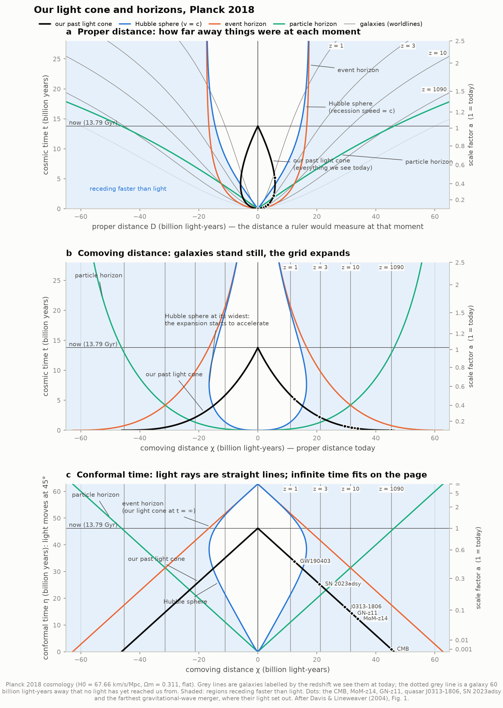
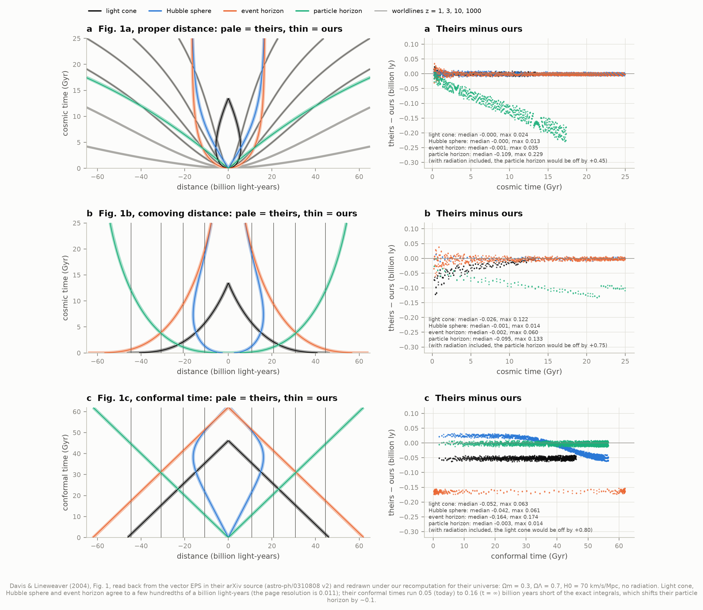
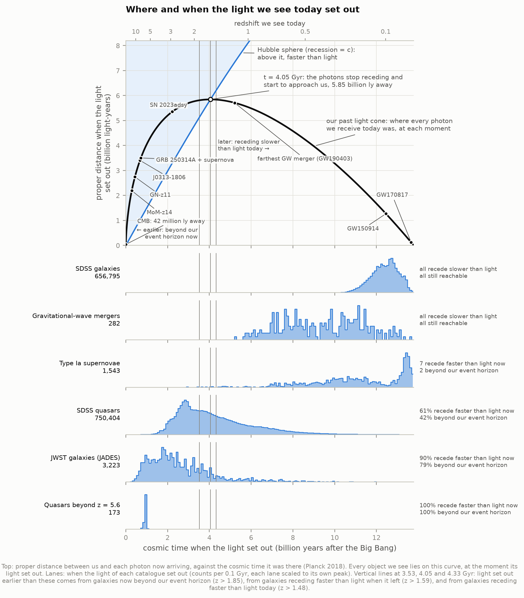
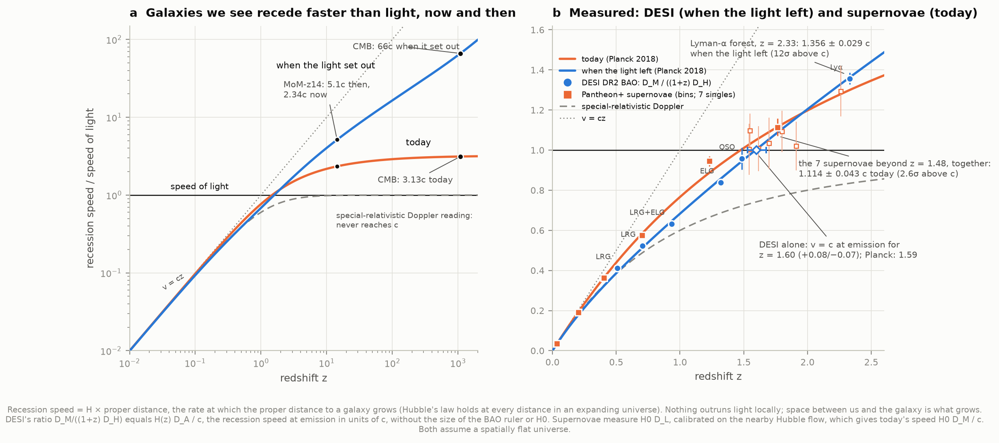
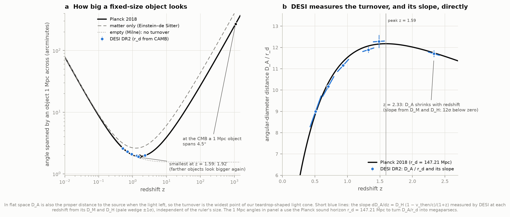
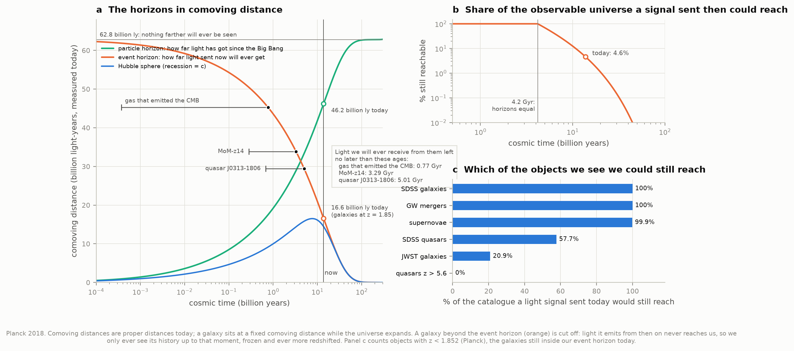
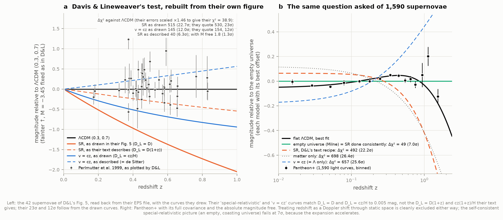
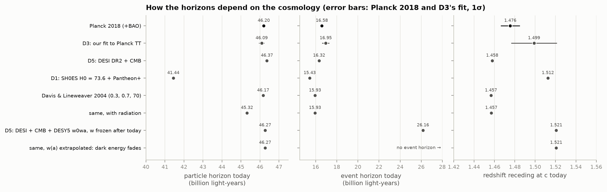

# O2 — The cosmic light cone: horizons and faster-than-light recession

**How can the observable universe be 46 billion light-years in radius if it is only 13.8 billion
years old? Why can we see galaxies that are receding faster than light? And which of the galaxies
we see could we never reach, even travelling at light speed?**

This project redraws Davis & Lineweaver's (2004) spacetime diagrams, the classic answer to these
questions, with today's cosmology (Planck 2018), using its own integration of the Friedmann
equation. It checks every curve against their own figure, read straight out of the PostScript in
their arXiv source. It then places **1.4 million real objects** on our past light cone: SDSS
galaxies and quasars, Pantheon+ supernovae, gravitational-wave mergers, JWST galaxies and the
record-holders out to MoM-z14 and the cosmic microwave background. Finally it **measures**
faster-than-light recession in data, rather than only computing it.

**The answers (Planck 2018):**

- **The observable universe is 46.20 ± 0.07 billion light-years in radius.** Light from its edge has
  travelled for 13.79 billion years. The gas that emitted the CMB was only **42 million light-years**
  away when that light set out, and expansion has since carried it **45.3 billion light-years** away.
- **97% of the observable universe is receding from us faster than light today**: everything beyond
  z = 1.476 (14.45 billion light-years away). We see it anyway. The CMB's gas recedes at **3.1c** now
  and receded at **66c** when it emitted the light we see.
- **We could still reach only 4.6% of it** (± 0.1%): the volume inside our event horizon, 16.58 billion
  light-years away (z < 1.852). Of the objects we see, that includes every SDSS galaxy and gravitational-wave
  merger, 58% of SDSS quasars, 21% of JWST's galaxies and none of the quasars beyond z = 5.6.
- **Measured, not just computed.** DESI's Lyman-α forest at z = 2.33 was receding at
  **1.356 ± 0.029c** when it sent its light, 12σ above light speed. That number comes from DESI's two
  distances alone, with no need for the size of the BAO ruler or for H0. Together, the 7 Pantheon+
  supernovae beyond z = 1.48 recede at **1.114 ± 0.043c today** (2.6σ above c; Planck predicts 1.115).
- **Farther objects look bigger beyond z ≈ 1.6, and DESI sees it.** At z = 2.33 DESI's angular-diameter
  distance is *falling* with redshift at 12σ. DESI's data alone put the turnover at z = 1.60
  (+0.08/−0.07); Planck predicts 1.592. In a flat universe the turnover and superluminal emission are the
  same thing: light that left a source receding faster than light first moved *away* from us.
- **Davis & Lineweaver checked, with two findings.** Their Figure 1 is reproduced curve by curve: their
  galaxy worldlines to 0.001 billion light-years, the light cone, Hubble sphere and event horizon to
  ≤ 0.04. It was drawn **without radiation**, and their conformal times run 0.05–0.16 billion years
  short. Their famous **23σ** rejection of the special-relativistic reading of redshift comes from curves
  drawn with D_L = D, not the D_L = D(1+z) their text describes. Done as described, their 42 supernovae
  give 6σ, or 1.3σ once the supernova brightness is left free. Pantheon+ settles it: **22σ** for the
  recipe as described, and **7.0σ** for the self-consistent special-relativistic universe (empty, coasting
  space), which fails because the expansion accelerates.



An **interactive explorer** ([figures/light_cone_explorer.html](figures/light_cone_explorer.html),
94 kB, self-contained, works offline) lets you pick an object and **follow its photon** to us. The
photon first moves away if it started beyond the Hubble sphere. You can slide the moment of
observation into the future and watch distant galaxies freeze at the edge of our event horizon. It
switches between proper, comoving and conformal coordinates, reports the recession speed of space at
any point you hover over, and has a light and a dark theme. It is also published as a private
artifact, https://claude.ai/artifact/Go5yAUm29yHCAuptwtxWPm, from
`data/derived/light_cone_explorer_artifact.html` (same page, theme left to the viewer); others can
open it only once it is shared from that page.

---

## Results

### 1. The horizons today

All from our own integration of the Friedmann equation for Planck 2018 (TT,TE,EE+lowE+lensing+BAO,
as astropy's `Planck18` holds it: H0 = 67.66 km/s/Mpc, Ωm = 0.3111 including a 0.06 eV neutrino,
flat, with photons and neutrinos). The uncertainties propagate Planck's published errors (H0 ± 0.42,
Ωm ± 0.0056, Ωm h³ ± 0.3%; the strong H0–Ωm anticorrelation, ρ = −0.986, is rebuilt from those three and
reproduces σ(H0) = 0.420).

| | This project | Spec / published |
|---|---|---|
| Age of the universe | **13.787 ± 0.020 Gyr** | Planck: 13.787 ± 0.020 |
| Particle horizon (radius of the observable universe) | **46.20 ± 0.07 billion ly** | spec 46.2 |
| Event horizon (farthest a signal sent today can get) | **16.58 ± 0.15 billion ly** | spec 16.6 |
| Hubble sphere (recession = c), c/H0 | **14.45 ± 0.09 billion ly** | 14.5 |
| Redshift receding at exactly c today | **z = 1.476 ± 0.010** | spec 1.48 |
| Redshift where a fixed-size object looks smallest | **z = 1.592 ± 0.006** | spec 1.59 |
| Redshift crossing our event horizon today | **z = 1.852 ± 0.024** | spec 1.85 |
| Share of the observable universe still reachable | **4.62 ± 0.14%** | spec "about 5%" |
| Share receding slower than light (inside the Hubble sphere) | **3.06%** | |
| Farthest anything will *ever* be seen (conformal time at t = ∞) | **62.78 billion ly** | |
| CMB last scattering, from CAMB | z* = **1089.79** | Planck: 1089.80 ± 0.21 |
| Matter–radiation equality | z = **3,388** | Planck: 3,387 ± 21 |

Our expansion history matches astropy's `Planck18` to 2 × 10⁻⁶ in distance out to the CMB, and
matches CAMB 2.0.4 to 7.5 × 10⁻⁶ (distances) and 1.5 × 10⁻⁵ (ages; CAMB's conformal time today
46.2010 vs our 46.2007 billion years). The remaining difference is a convention: CAMB scales the
massive neutrino's density with (N_eff/3)^¾, astropy and we with N_eff/3, which differ by 0.4% in
Ω_ν h².

A few moments in the history of our light cone:

- **t = 4.05 Gyr (z = 1.592)**: our past light cone is widest, **5.85 billion light-years**. Every photon
  now arriving was moving *away* from us until this moment, when the growing Hubble sphere overtook it.
- **t = 7.64 Gyr (z = 0.642)**: the expansion starts to accelerate. The comoving Hubble radius peaks at the
  same moment, at 16.51 billion light-years, and has been shrinking ever since.
- **t = 4.19 Gyr**: the particle and event horizons were equal (31.4 billion light-years comoving).
  Before then we could reach everything we could see. The share has fallen to 4.6% today and falls to
  1% at 20.5 Gyr and 0.1% at 32 Gyr.
- We currently see **39.9%** of the volume we will ever see; the rest is between 46.2 and 62.8 billion
  light-years, and its light has not arrived yet.

### 2. Davis & Lineweaver's Figure 1, recomputed and checked

Davis & Lineweaver's paper (PASA 21, 97; arXiv astro-ph/0310808 v2) ships its figures as vector
PostScript written by Grace. Every curve is a list of vertices with four decimals and every axis tick is
a labelled segment, so `dl2004.py` reads the curves back exactly (page precision 0.011 billion
light-years), calibrates each axis on its labelled ticks (rms residual < 3 × 10⁻⁵ page units) and
identifies each curve by its line style. We then redraw them under our own calculation for their
universe, (Ωm, ΩΛ) = (0.3, 0.7) with H0 = 70.



| Check | Result |
|---|---|
| Their worldlines for z = 1, 3, 10, 1000 (fitted comoving distance) | 10.775, 20.730, 30.790, 44.554 billion ly; ours 10.776, 20.729, 30.790, 44.555 |
| Light cone, Hubble sphere, event horizon in proper distance (Fig. 1a) | median residual 0.000, max 0.013–0.035 billion ly |
| The same with radiation included | particle horizon off by +0.45 (1a) and +0.75 (1b): **they drew a radiation-free universe** |
| Their scale-factor axis (where a = 0.2 … 2.0 sit in time) | within 0.007 Gyr of ours |
| Their conformal time today / at t = ∞ (read off Fig. 1c's 45° lines) | 46.115 / 61.937 vs exact 46.167 / 62.100: **0.05 and 0.16 short** |

The conformal-time shortfall (0.1–0.3%, a quarter of a millimetre on the printed page) makes their
particle horizon drift about 0.1 billion light-years low; everything else agrees to the width of their
lines. Their text checks out too, for their model:

| Davis & Lineweaver say | We get |
|---|---|
| objects beyond z ~ 1.46 recede faster than light | 1.457 |
| galaxies at z ~ 1.8 are crossing our event horizon | 1.805 |
| particle horizon "about 46 Glyr", age "13.5 Gyr" | 46.17, 13.467 |
| CMB (z ~ 1100) recedes at 3.2c now, 58.1c at emission | 3.195c, 58.07c |
| photons emitted in "the first ~five billion years" were emitted superluminally | 3.96 Gyr (the light cone's widest point; "~5" is generous) |
| particle and event horizons mirror each other about the z = 10 worldline | z = 10.38 |

For Planck 2018 the light cone is a little wider and the horizons a little farther. The particle
horizon is 46.20 instead of 46.17, but with radiation included the same universe would give 45.32: in
2004 the missing radiation and the then-higher H0 roughly cancelled.

### 3. Real objects on our past light cone

Every object we see lies on our past light cone, and its redshift says where: light seen at redshift z
set out when the universe was 1/(1+z) of its present size. That fixes when the light left, how far away
the source was then and is now, and how fast it was receding then and now.



| Catalogue | Objects | Light set out | Receding faster than light today | Beyond our event horizon |
|---|---|---|---|---|
| SDSS Main Galaxy Sample (D2) | 656,795 | 10.3–13.8 Gyr | none | none |
| Gravitational-wave mergers (GWOSC) | 282 | 5.2–13.7 Gyr | none | none |
| Type Ia supernovae (Pantheon+) | 1,543 | 2.9–13.8 Gyr | 7 | 2 |
| SDSS DR16Q quasars (I3) | 750,404 | 0.76–13.8 Gyr | 456,111 (61%) | 317,355 (42%) |
| JWST galaxies, JADES DR4 | 3,223 | 0.29–13.4 Gyr | 2,889 (90%) | 2,549 (79%) |
| Quasars beyond z = 5.6 (Bañados et al. 2016) | 173 | 0.75–1.0 Gyr | all | all |

| Object | z | Light set out (after the Big Bang) | Distance then | Distance now | Receding then / now | We will see it only up to age |
|---|---|---|---|---|---|---|
| CMB (gas at last scattering) | 1089.8 | 372,000 yr | 42 million ly | 45.3 billion ly | 66c / 3.13c | 0.77 Gyr |
| MoM-z14 | 14.44 | 283 Myr | 2.19 billion ly | 33.9 billion ly | 5.1c / 2.34c | 3.29 Gyr |
| JADES-GS-z14-0 | 14.18 | 290 Myr | 2.22 | 33.7 | 5.1c / 2.34c | 3.33 Gyr |
| GN-z11 | 10.60 | 435 Myr | 2.74 | 31.8 | 4.2c / 2.20c | 4.01 Gyr |
| GRB 090423 | 8.23 | 614 Myr | 3.25 | 30.0 | 3.5c / 2.08c | 4.76 Gyr |
| Quasar J0313−1806 | 7.64 | 677 Myr | 3.41 | 29.4 | 3.3c / 2.04c | 5.01 Gyr |
| GRB 250314A and its supernova | 7.3 | 720 Myr | 3.50 | 29.1 | 3.2c / 2.01c | 5.17 Gyr |
| SN 2023adsy (farthest Type Ia) | 2.903 | 2.22 Gyr | 5.35 | 20.9 | 1.6c / 1.45c | 10.0 Gyr |
| SN Colfax (farthest in Pantheon+) | 2.261 | 2.90 Gyr | 5.67 | 18.5 | 1.3c / 1.28c | 12.0 Gyr |
| GW190403 (farthest GW merger) | 1.17 | 5.21 Gyr | 5.71 | 12.4 | 0.78c / 0.86c | reachable |
| GW150914 (the first merger seen) | 0.099 | 12.46 Gyr | 1.27 | 1.40 | 0.09c / 0.10c | reachable |

The most distant galaxies were never far away *when their light left*: MoM-z14 was 2.2 billion
light-years from us, and nothing we see was ever more than 5.85 billion light-years away when its light
set out (the light cone's widest point). "We will see it only up to age" is the moment each object's
worldline crosses our event horizon. Light it emits after that never reaches us; as time goes on we
watch it ever more redshifted, frozen at that age. The gravitational-wave redshifts are recomputed from
the measured luminosity distances in our cosmology; they agree with GWOSC's to 0.011.

### 4. Faster than light, measured

The recession speed of a galaxy is v = H × D, the rate at which its proper distance grows. Hubble's law
holds exactly at all distances in an expanding universe (tested to 10⁻⁶ at 30 billion light-years).
Two surveys measure it directly:

- **DESI measures the speed when the light left.** DESI's BAO gives D_M/r_d (transverse comoving
  distance) and D_H/r_d = c/(H r_d) at the same redshift. Their ratio, divided by (1+z), is H(z) D_A / c,
  which is exactly the recession speed at emission in units of c, because D_A is the proper distance when
  the light left. The ruler's size r_d cancels, and so does H0. (This is the Alcock–Paczyński ratio
  F_AP = D_M/D_H, divided by 1+z.)
- **Supernovae measure the speed today.** They give H0·D_L up to one offset, which we calibrate on the
  277 SH0ES Hubble-flow supernovae (0.023 < z < 0.15, standard third-order expansion). Today's speed is
  H0·D_M / c = H0·D_L / ((1+z)c). Bins are generalised least-squares means with the full Pantheon+
  covariance.



| DESI tracer | z | Speed when the light left (our ratio) | Planck 2018 |
|---|---|---|---|
| LRG | 0.510 | 0.412 ± 0.011 c | 0.393 |
| LRG | 0.706 | 0.523 ± 0.012 c | 0.514 |
| LRG + ELG | 0.934 | 0.632 ± 0.010 c | 0.646 |
| ELG | 1.321 | 0.839 ± 0.019 c | 0.858 |
| QSO | 1.484 | 0.958 ± 0.055 c | 0.944 |
| **Lyman-α forest** | **2.33** | **1.356 ± 0.029 c (12.2σ above c)** | **1.362** |

Interpolating DESI's points alone puts v = c at emission at **z = 1.60 (+0.08/−0.07)**. Applied to
Planck's curve, the same linear interpolation is off by only +0.005. A flat ΛCDM fit to the six ratios
alone gives Ωm = 0.299 (0.282–0.316; DESI's full BAO fit: 0.2975 ± 0.0086) and z = 1.607 (1.587–1.628).

The supernovae beyond z = 1.476 together recede at **1.114 ± 0.043c today** (z_eff = 1.76; Planck
1.115). Individually they span 1.00–1.29 ± 0.08–0.13, from "Carter" at z = 1.54 to "Colfax" at z = 2.26.
The bin just inside (z = 1.0–1.48, 18 supernovae) comes out at 0.945 ± 0.025c against Planck's 0.887,
2.3σ high.

### 5. Objects that look bigger the farther they are

An object of fixed size subtends the angle size / D_A, and D_A peaks at z = 1.59: beyond that, more
distant objects look larger. In a flat universe this is the same statement as section 4. The slope
is dD_A/dz = D_H (1 − v_then/c)/(1+z), so D_A falls with redshift exactly where the source was receding
faster than light when it emitted. DESI therefore measures not only D_A at each redshift but also its
**slope**, from D_M and D_H, independently of the ruler.



- With Planck's sound horizon (r_d = 147.21 Mpc), a 1 Mpc object looks smallest at z = 1.59, spanning
  **1.92′**. At the CMB it spans **4.5°**. An empty universe has no turnover at all.
- DESI's D_A/r_d values rise from 9.00 (z = 0.51) to 12.28 (z = 1.48) and fall to 11.71 at z = 2.33.
  From the values alone the fall is only 1.7σ. The measured slope at z = 2.33 is negative at **12σ**.

### 6. What we can still reach



The event horizon shrinks in comoving terms. A signal sent at 1 Gyr could have reached 43.6 billion
light-years (today's distances); one sent today reaches 16.6; one sent at 50 Gyr will reach only 2.0
billion light-years, and one sent at 100 Gyr 115 million, about twice the distance of the Virgo cluster.
Of the galaxies we can see today, only those below z = 1.852 can still be reached.

### 7. Is redshift a Doppler shift? Davis & Lineweaver's supernova test

If galaxies simply flew apart through static space, their redshifts would be special-relativistic
Doppler shifts and every speed would stay below c. Davis & Lineweaver (Sec. 4.2) tested this against
Perlmutter et al.'s (1999) supernovae and quoted a 23σ rejection. We rebuilt the test from their own
Figure 5: the 42 supernovae with their error bars and the five curves, read from the EPS file.



**Finding.** Their three Friedmann curves match ours with their M = −3.45 to 0.002–0.006 mag. Their
special-relativistic curve matches **D_L = D** to 0.005 mag, and their v = cz curve **D_L = cz/H** to
0.006 mag. Their text says D_L = D(1+z) and D_L = cz(1+z)/H, which lie 0.9–1.5 mag away. The
published Δχ² values follow the drawn curves. The plotted error bars give χ² = 83 for their ΛCDM rather
than their 38.9, so their errors must have been about 1.46× larger. (A commented-out file name in
their LaTeX, "Goldhaber-ERRORx1.4", shows they scaled error bars by 1.4 for their Fig. 4.) With that
scaling we get:

| Model (42 supernovae, M = −3.45 fixed as in D&L) | Δχ² vs ΛCDM | D&L quote |
|---|---|---|
| SR, as drawn (D_L = D) | 515 (22.7σ) | 530 (23σ) |
| v = cz, as drawn (D_L = cz/H) | 145 (12.0σ) | 154 (12σ) |
| SR, as their text describes (D_L = D(1+z)) | 40 (6.3σ); 1.8 (1.3σ) with M free | — |

The remaining 3–6% difference from their numbers is within what their exact error model could
account for, which we cannot recover from the figure. Pantheon+ (1,590 light curves, full
covariance, offset free) answers the question decisively:

| Universe | Δχ² vs best flat ΛCDM (Ωm = 0.332) |
|---|---|
| Planck 2018 ΛCDM | 1.3 |
| Empty, coasting (Milne) = special relativity done consistently | **48.5 (7.0σ)**, identical to D1's 48.52 |
| SR, D&L's text recipe | 492 (22.2σ) |
| v = cz, D&L's text recipe (identical to a Λ-only universe) | 657 (25.6σ) |
| matter only (Einstein–de Sitter) | 698 (26.4σ) |
| SR and v = cz as drawn in D&L's Fig. 5 | 7966 and 1760 |

Galaxies moving through a static, empty space form, in consistent special relativity, the **Milne
universe**: the empty Friedmann model, which is flat spacetime in expanding coordinates. Its
luminosity distance is (c/H0) z(1 + z/2). Supernovae reject it at 7σ, not because special relativity
fails, but because the expansion accelerates (D1 found the same 7σ as evidence for dark energy). D&L's
recipe of a Doppler velocity in Hubble's law with H fixed and D_L = D(1+z) is cruder and is excluded at
22σ.

### 8. How much depends on the cosmology



| Universe | Age (Gyr) | Particle horizon | Event horizon | z at v = c today | z event horizon | Reachable |
|---|---|---|---|---|---|---|
| Planck 2018 | 13.787 | 46.20 ± 0.07 | 16.58 ± 0.15 | 1.476 | 1.852 | 4.6% |
| D3: our CAMB fit to Planck TT | 13.83 ± 0.03 | 46.09 ± 0.15 | 16.95 ± 0.35 | 1.499 | 1.913 | 5.0% |
| D5: DESI DR2 + CMB, ΛCDM | 13.779 | 46.37 | 16.32 | 1.458 | 1.808 | 4.4% |
| D1: SH0ES H0 = 73.55, Pantheon+ Ωm | 12.445 | 41.44 | 15.43 | 1.512 | 1.949 | 5.2% |
| Davis & Lineweaver (0.3, 0.7, 70) | 13.467 | 46.17 | 15.93 | 1.457 | 1.805 | 4.1% |
| same with radiation | 13.462 | 45.32 | 15.93 | 1.457 | 1.806 | 4.3% |
| D5: DESI + CMB + DESY5 w0wa, w frozen at w0 after today | 13.759 | 46.27 | 26.16 | 1.521 | 5.13 | 18% |
| same, w(a) extrapolated (dark energy fades) | 13.759 | 46.27 | **none** | 1.521 | — | 100% eventually |

The particle horizon scales almost as 1/H0, so the Hubble tension moves it by 4.8 billion light-years.
The event horizon depends on something no data constrain: the *future* of dark energy. If DESI's evolving
dark energy is extrapolated with its w0–wa formula, dark energy fades away, the expansion stops
accelerating, and there is **no event horizon** at all: given enough time, a signal could reach
everything. If instead w simply stays at today's value, the event horizon is 26 billion light-years. The
"5% we can reach" is a statement about a cosmological constant.

---

## The figures worth looking at

| Figure | What it shows |
|---|---|
| [01_spacetime_diagrams.png](figures/01_spacetime_diagrams.png) | Davis & Lineweaver's three diagrams (proper distance, comoving distance, conformal time) for Planck 2018, with real objects where their light set out |
| [02_objects_on_the_light_cone.png](figures/02_objects_on_the_light_cone.png) | The teardrop: how far each photon was from us at each moment, the record-holders on it, and when the light of each catalogue set out |
| [03_recession_speeds.png](figures/03_recession_speeds.png) | Recession speed now and when the light left, with DESI's and Pantheon+'s measurements |
| [04_angular_size_turnover.png](figures/04_angular_size_turnover.png) | The angle of a 1 Mpc object against redshift; DESI's D_A and its measured slope |
| [05_horizons_and_reach.png](figures/05_horizons_and_reach.png) | The horizons in comoving distance over 300 billion years; the reachable share; the catalogues we could still reach |
| [06_doppler_or_expansion.png](figures/06_doppler_or_expansion.png) | D&L's special-relativity test, rebuilt from their figure, and asked again of Pantheon+ |
| [07_davis_lineweaver_check.png](figures/07_davis_lineweaver_check.png) | Their Figure 1, read from their EPS, under our recomputation, with residuals |
| [08_five_distances.png](figures/08_five_distances.png) | Comoving, luminosity, light-travel, emission (D_A) and naive distances, with DESI and Pantheon+ |
| [09_cosmology_dependence.png](figures/09_cosmology_dependence.png) | The horizons for eight universes, with Planck's and D3's error bars |
| [light_cone_explorer.html](figures/light_cone_explorer.html) | Interactive: follow a photon, change coordinates, observe from the future |

---

## Background, in brief

**Five distances.** In an expanding universe "how far away" has several answers
([08_five_distances.png](figures/08_five_distances.png)). The **comoving distance** is where the source
is now: the length a chain of rulers laid out today would measure. The **proper distance when the light
left** is where it was then (in a flat universe, the angular-diameter distance D_A). The **light-travel
distance** is c times the time the light was in flight. The **luminosity distance** sets how faint it
looks. For the CMB these are 45.3 billion light-years, 42 million light-years, 13.8 billion
light-years and 49,000 billion light-years.

**The Hubble sphere** is where the recession speed v = HD equals c, now 14.45 billion light-years away.
Beyond it, space recedes faster than light. Special relativity is not violated, because nothing
overtakes a light beam locally; the space between us and the galaxy is what grows.

**Why we can see superluminal galaxies.** A photon from beyond the Hubble sphere moves towards us at c
through space that is receding faster than c, so at first it gets *farther* away (its speed relative to
us is v_rec − c). But the Hubble sphere grows: it overtakes the photon, which then finds itself in
subluminally receding space and starts to approach. That is why our past light cone is a teardrop in
proper distance: the photons we receive now were all receding until 4.05 Gyr. In the explorer, press
"Follow its photon" for GN-z11 to watch it happen.

**The particle horizon** is how far light has got since the Big Bang. Expansion has carried the sources
of the oldest light much farther than 13.8 billion light-years, to 46.2. **The event horizon** is how far
light sent *now* will ever get, 16.6 billion light-years. It exists because the expansion accelerates
forever in ΛCDM. Events beyond it will never be seen, although we still see those galaxies by their old
light.

**Conformal time** η = ∫ c dt/a is the comoving distance light covers. On a diagram of comoving distance
against conformal time, light moves at 45° and an infinite future fits into the finite height
η_∞ = 62.8 billion years, so both horizons are straight lines.

## How it works

- `cosmology.py`: our own Friedmann integrator. H(a) includes photons, massless neutrinos, one 0.06 eV
  neutrino (exact Fermi–Dirac density), matter, curvature and w0–wa dark energy, with a "frozen" future
  option. t(a) and η(a) are integrated once on an 8,000-cell grid in ln a (8-point Gauss–Legendre per
  cell, exact start values from the radiation+matter closed form at a = 10⁻¹⁰) and read through cubic
  Hermite splines that use the exact derivatives. Every horizon, distance and speed follows from t, η, a
  and H. The textbook cases are reproduced to 10⁻⁹: Einstein–de Sitter, Milne, de Sitter, and
  radiation-only.
- `dl2004.py`: a small Grace-EPS parser. It reads paths, line styles, text and circle symbols, calibrates
  axes on labelled ticks, and recovers D&L's Figure 1 curves and Figure 5 supernovae.
- `catalogs.py`: one loader per catalogue. JADES repeat observations are merged within 0.3″ (3,297 robust
  rows → 3,223 galaxies). GW redshifts come from the measured distances.
- `analysis.py`: everything in the tables above, written to `data/results.json`.
- `figures.py`, `explorer.py` (+ `explorer_template.html`): the figures and the explorer. The explorer
  carries the expansion history on a 1,500-point grid and computes every curve in the browser.
- `test_physics.py`: 38 checks (closed forms, identities, astropy, CAMB, the spec's and D&L's numbers,
  the EPS calibration).

## Honest notes

- **"Faster than light" depends on how you define distance at a given time.** The speeds here are rates
  of change of proper distance on surfaces of constant cosmic time, the natural choice in an expanding
  universe and the one D&L argue for. In the empty Milne universe, which *is* flat spacetime, the same
  galaxy at redshift z recedes at c·ln(1+z) in cosmic-time coordinates (faster than light beyond
  z = e − 1 = 1.72) but at c·tanh(ln(1+z)) = c((1+z)² − 1)/((1+z)² + 1) in the inertial frame. The latter is
  exactly the special-relativistic Doppler formula, always below c. Redshifts, light cones and horizons
  do not depend on this choice; speeds do. In a universe with matter there is no global inertial frame,
  and the cosmic-time speed is the only one defined everywhere.
- **The particle horizon assumes the hot Big Bang runs back to a = 0 with today's particle content.** The
  first 10⁻¹⁰ of the scale factor (the first second) adds under 10⁻⁶ billion light-years, so the change in
  particle species then does not matter. Inflation would make the formal particle horizon vastly larger.
  Light from before last scattering never reaches us, so the CMB at 45.3 billion light-years is the
  practical edge of what we see in light.
- **DESI's and the supernovae's speeds assume a spatially flat universe** (Ωk = 0.0007 ± 0.0019 from
  Planck + BAO). DESI's BAO distances also carry DESI's fiducial-cosmology compression, which DESI shows
  to be negligible. The supernova offset uses the standard cosmographic expansion (q0 = −0.55, j0 = 1)
  on the Hubble flow. The 1 Mpc angles in Figure 4a use Planck's r_d; the slope test does not.
- **The D&L reproduction uses their figure, not Perlmutter et al.'s table**: the 42 high-redshift
  supernovae as plotted (the 18 nearby Calán/Tololo supernovae are not in their Figure 5). The 1.46× error
  scaling is inferred from their χ², not stated in the paper. We examined the arXiv v2 source; the
  published PASA version may differ.
- **Catalogue choices.** JADES: flags A–C (robust), the 3,297 that JADES DR4 quotes; only the redshift
  table is fetched, by HTTP byte range (4.4 of 94 MB). GWOSC: events with a distance and p_astro ≥ 0.5 (or
  no p_astro, for the older catalogues). DR16Q: all 750,404 entries with z > 0, including its small
  share of non-quasars. Landmark redshifts come from the papers cited in `config.py`; JADES-GS-z14-0 uses
  JADES's 14.1796 (Carniani et al.'s ALMA [O III] value; Schouws et al. find 14.1793 ± 0.0007).
- **J8 (JWST first galaxies), C5 and I9 (gravitational-wave populations) are not built yet**, so this
  project reads JADES DR4 and the GWOSC list directly, rather than through those projects as the spec
  suggested.
- **The w0–wa futures are illustrations.** A fit to z < 2.3 says nothing about w at a > 1; we show two
  extrapolations only to make the point that the event horizon depends on the future.

## Running it

```bash
cd 66-cosmic-light-cone
../.venv/bin/python run.py             # fetch (if needed), analysis, figures, explorer: ~1 min
../.venv/bin/python run.py --figures-only
../.venv/bin/python test_physics.py    # 38 checks
```

`fetch_data.py` downloads about 5.5 MB when the sibling projects D1, D2, D5 and I3 have their caches.
It hard-links their identical files (DESI BAO, Pantheon+) and reads I3's DR16Q and D2's galaxy redshifts
in place. Without them it fetches everything itself, about 85 MB. The VizieR and SkyServer fallbacks were
tested on one sky strip each and match the siblings' data exactly. After that the project runs offline:
the full pipeline was run in a network namespace with no connectivity (`unshare -rn`), and all checks
pass. Requires numpy, scipy, matplotlib, astropy (+ camb and pyarrow, optional).

### Files

| File | Purpose |
|---|---|
| `config.py` | units (c = 1 billion light-years per billion years), the universes, data URLs, landmark redshifts with references, D&L's and the spec's numbers |
| `cosmology.py` | the Friedmann integrator: times, distances, horizons, speeds |
| `fetch_data.py` | downloads with a provenance manifest (`data/manifest.json`), sibling reuse, byte-range FITS |
| `catalogs.py` | catalogue loaders |
| `dl2004.py` | reads Davis & Lineweaver's Grace EPS figures |
| `analysis.py` | all numbers → `data/results.json`, `data/derived/cone_objects.npz` |
| `figures.py`, `plotstyle.py` | the nine figures |
| `explorer.py`, `explorer_template.html` | the interactive page |
| `test_physics.py` | checks |
| `run.py` | everything, in order |

## Data credits

- **Davis & Lineweaver 2004**, PASA 21, 97 (arXiv astro-ph/0310808): figures read from the arXiv source.
- **Planck Collaboration 2020**, A&A 641, A6 (Planck 2018 VI), Table 2; astropy's `Planck18`; **CAMB**
  (Lewis, Challinor & Lasenby 2000).
- **DESI DR2 BAO** (DESI Collaboration 2025), via CobayaSampler/bao_data.
- **Pantheon+** (Scolnic et al. 2022, ApJ 938, 113; Brout et al. 2022, ApJ 938, 110), PantheonPlusSH0ES/DataRelease.
- **GWOSC** cumulative event list GWTC-1 to GWTC-5.0 (LIGO Scientific, Virgo and KAGRA Collaborations).
- **JADES DR4** NIRSpec redshifts (Curtis-Lake et al. 2025; Scholtz, Carniani et al. 2025), jades.herts.ac.uk.
- **SDSS DR16Q** (Lyke et al. 2020, ApJS 250, 8) via VizieR VII/289; **SDSS DR17** Main Galaxy Sample
  (Strauss et al. 2002) via SkyServer; SDSS is funded by the Alfred P. Sloan Foundation and partners.
- **Bañados et al. 2016**, ApJS 227, 11 (VizieR J/ApJS/227/11).
- Landmarks: Naidu et al. 2026 (MoM-z14); Wang et al. 2021 (J0313−1806); Tanvir et al. 2009 and
  Salvaterra et al. 2009 (GRB 090423); Levan et al. 2025 and Cordier et al. 2025 (GRB 250314A); Pierel et
  al. 2024 (SN 2023adsy); Bunker et al. 2023 (GN-z11); Carniani et al. 2025 and Schouws et al. 2025
  (JADES-GS-z14-0).
- Perlmutter et al. 1999, ApJ 517, 565 (the supernovae of D&L's Fig. 5).

Data retrieved 19 October 2026. Everything in this folder was produced by AI (Claude); see the note at
the top of the atlas README.
