# P1 — Inflation on trial

**Why is the universe so flat and so uniform? Inflation says a brief burst of exponential expansion
stretched a tiny patch to cosmic size, and that its quantum jitters became the seeds of galaxies.
Different models of the field that drove it leave different fingerprints in the cosmic microwave
background (CMB). Which models survive Planck, BICEP/Keck, ACT and SPT, and which did the 2025 data
put under pressure?**

This project puts eight inflation models on trial with real data:

1. **The case for inflation.** On Planck's CMB sky, it measures how far light could have travelled
   before the CMB was released if there were no inflation. It also traces the flatness of space back
   to the Big Bang.
2. **The defendants.** It solves eight inflaton potentials exactly: the field rolling down its hill,
   plus the quantum fluctuations followed one by one through the horizon (the Mukhanov–Sasaki
   equation). No slow-roll formulas are used.
3. **The witnesses.**
   - It rebuilds the BICEP/Keck BK18 B-mode likelihood from the released data. Our version agrees with
     BICEP/Keck's own to the third decimal of χ².
   - It combines that likelihood with Planck 2018.
   - It reads the published MCMC chains of Planck, ACT DR6 and SPT-3G.
4. **The verdicts.** Each model is graded against each combination of data.

**The answer.** The simplest "chaotic" potentials are ruled out by the absence of primordial
gravitational waves:
- **m²φ², λφ⁴ and linear φ** are beyond 3.3σ in every data combination.
- **Natural inflation** is ruled out too: ≥ 3σ.
- **φ^(2/3)** is excluded by Planck 2018 + BK18 at 3.2σ.

The survivors are the plateau-shaped potentials: **Starobinsky's R² model (and Higgs inflation),
α-attractors and hilltop inflation**.

The 2025 data squeeze even those. ACT DR6 and SPT-3G combined with DESI moved n_s up, to
0.9741 ± 0.0033 and 0.9726 ± 0.0028, against Planck's 0.9649 ± 0.0042.
- Starobinsky with instant reheating lands at **2.3σ** from both.
- To sit at their central values it would need N* ≈ 71–75 e-folds, more than any reheating
  history provides. Even to come within 1σ it needs N* ≈ 64–67, which only an exotic "stiff" phase
  after inflation (equation of state w → 1) can provide; ordinary reheating cannot.

**Gravitational waves.** BK18 alone gives r < 0.0361 (95%; published 0.036), and with Planck
r < 0.0337. So inflation happened below 1.4 × 10¹⁶ GeV.

**The case for inflation, in numbers.** Without it, the CMB sky would be ~39,000 patches 1.16°
across that never exchanged light. The universe's flatness would have had to be tuned to 1 part in
10⁶² at the Planck temperature.

There is also an **interactive page**, [`figures/inflation_explorer.html`](figures/inflation_explorer.html).
Pick a model, slide N* and its parameter, and watch the exact prediction move among the real
contours, with a live verdict from each data set. Hovering anywhere grades that point too. It works
offline.

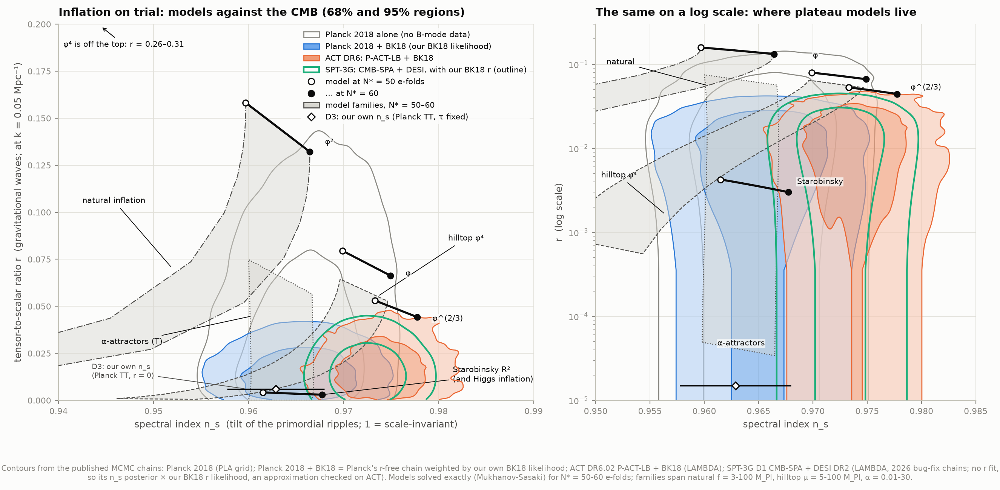

---

## Results

### 1. Why inflation: the horizon and flatness problems

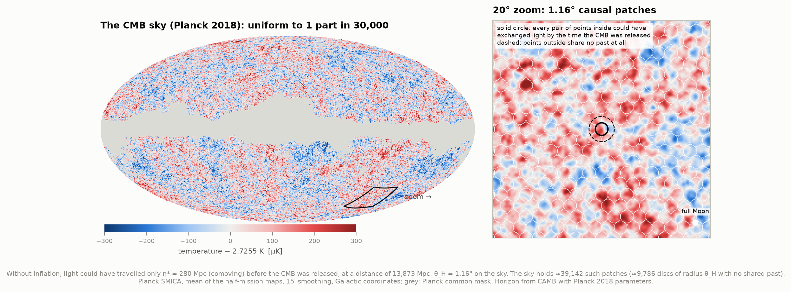

**The horizon problem, on the real sky.** Suppose the hot Big Bang ran all the way back to t = 0
with no inflation.
- Light emitted at the Big Bang could then travel only **η\* = 280 Mpc** (comoving) before the
  CMB was released at z = 1090.
- Seen from **13,873 Mpc** away, that is **θ_H = 1.16°**.
- So the sky splits into **≈39,000 patches** (discs 1.16° across) inside which points could have
  exchanged light. Using the looser test of "any shared past at all" (discs of radius θ_H) gives
  **≈9,800**.

Yet every patch has the same temperature, 2.7255 K, to within **90 µK rms**: 1 part in 30,000. The
zoom shows these patches drawn on a clean 20° field of Planck's SMICA map. The horizon distance is
computed with CAMB at Planck 2018's parameters.

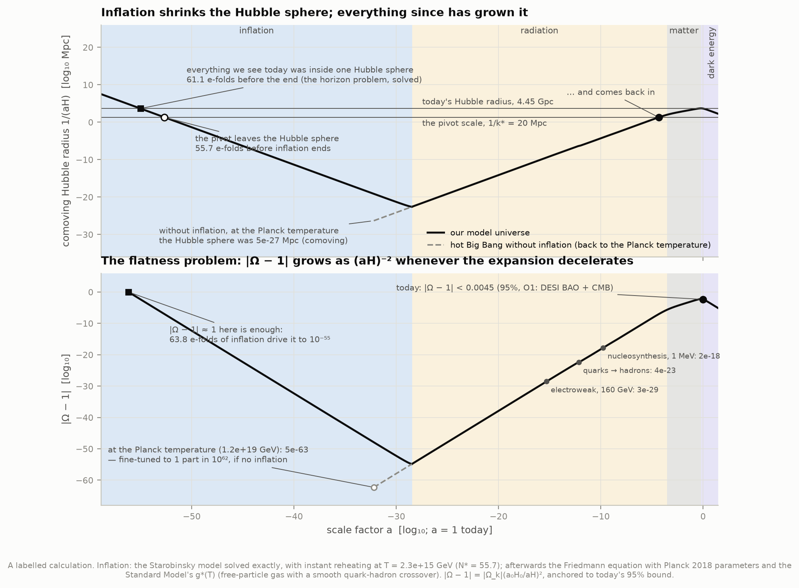

**The shrinking Hubble sphere.** The comoving Hubble radius 1/(aH) is the region that can talk to
itself in one expansion time. It grows in any decelerating universe. Inflation is the opposite: the
expansion accelerates, so 1/(aH) shrinks by e^N. The figure follows it from inside a real model to
today. The model is Starobinsky's, solved exactly and normalised to Planck's amplitude, with
instant reheating at T = 2.3 × 10¹⁵ GeV.
- Everything we see today was inside one Hubble sphere **61.1 e-folds** before inflation ended.
- The pivot scale (20 Mpc, where n_s and r are quoted) left 55.7 e-folds before the end, and came
  back in during the radiation era.

**The flatness problem.** |Ω − 1| = |Ω_k| (a₀H₀/aH)² grows whenever the expansion decelerates.
Start from today's bound, **|Ω_k| < 0.0045** (95%, project O1: DESI BAO + CMB), and run the hot Big
Bang backwards:

| Epoch | \|Ω − 1\| below |
|---|---|
| nucleosynthesis (1 MeV) | 2 × 10⁻¹⁸ |
| quark–hadron crossover | 4 × 10⁻²³ |
| electroweak scale | 3 × 10⁻²⁹ |
| the Planck temperature | **5 × 10⁻⁶³** |

Inflation makes this natural. Even if |Ω − 1| ≈ 1 when inflation began, **63.8 e-folds** shrink it
below 10⁻⁵⁵.

### 2. The models, solved exactly

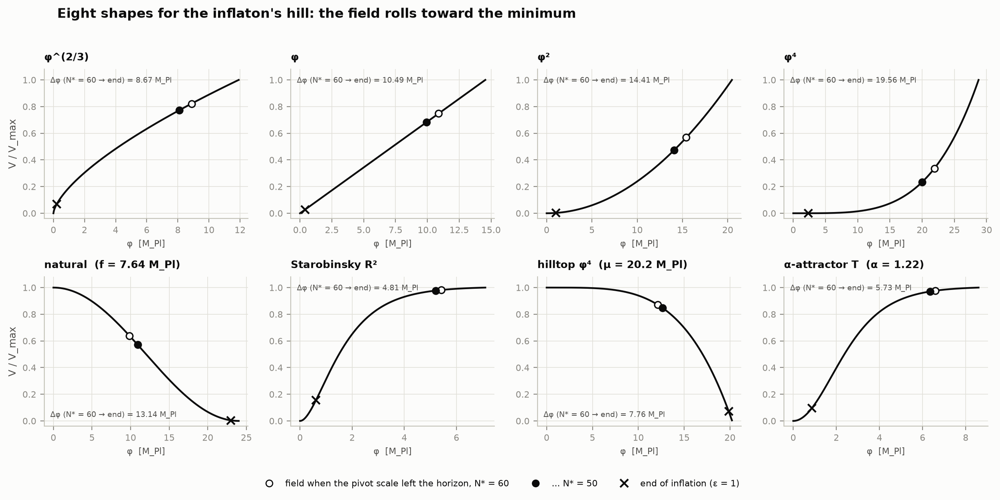

Each potential is integrated exactly: the inflaton's equation of motion together with the Friedmann
equation, from ~85 e-folds before the end until ε = 1. Then individual fluctuations are followed
with the **Mukhanov–Sasaki equation**:
- each starts as a quantum vacuum mode 300 times inside the horizon;
- the integration stops 10⁴ times outside it, long after the mode has frozen.

The frozen amplitudes give the scalar and tensor spectra. n_s, its running and r are their slopes
and ratio at k = 0.05 Mpc⁻¹.

| Model (N* = 50 → 60) | n_s | r | V\*^¼ [GeV] | Δφ [M_Pl] | N* if instant reheating |
|---|---|---|---|---|---|
| φ^(2/3) (axion monodromy) | 0.9733 → 0.9777 | 0.053 → 0.044 | 1.5 × 10¹⁶ | 7.9 → 8.7 | 56.5 |
| φ (linear monodromy) | 0.9699 → 0.9749 | 0.080 → 0.066 | 1.7 × 10¹⁶ | 9.5 → 10.5 | 56.8 |
| m²φ² | 0.9597 → 0.9664 | 0.158 → 0.132 | 2.0 × 10¹⁶ | 13.1 → 14.4 | 57.5 |
| λφ⁴ | 0.9393 → 0.9495 | 0.313 → 0.262 | 2.4 × 10¹⁶ | 17.7 → 19.6 | 58.6 |
| Starobinsky R² / Higgs | 0.9615 → 0.9677 | 0.0043 → 0.0030 | 8 × 10¹⁵ | 4.6 → 4.8 | 55.7 |

The family models span a range of predictions:
- natural inflation (f = 3–100 M_Pl): n_s 0.89–0.966;
- quartic hilltop (μ = 5–100 M_Pl): n_s 0.946–0.975, r 6 × 10⁻⁴–0.064;
- α-attractor T-model (α = 0.01–30): n_s 0.960–0.967 almost independently of α, r 3 × 10⁻⁵–0.075.

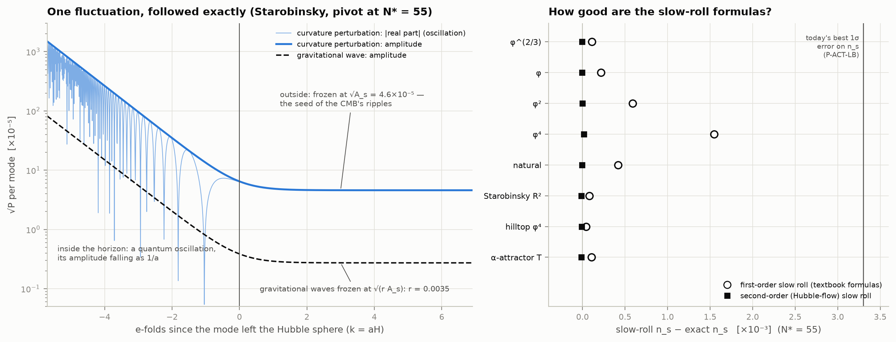

**One fluctuation, followed exactly.** Inside the horizon the mode oscillates, and its amplitude
falls as 1/a. Within about two e-folds of leaving the horizon it freezes at √A_s = 4.6 × 10⁻⁵, the
seed of the CMB's ripples. Its gravitational-wave partner freezes at √(r A_s).

**How good are the slow-roll formulas?**
- The textbook first-order formulas (n_s = 1 − 6ε + 2η, r = 16ε) overestimate n_s by up to
  **1.9 × 10⁻³** (λφ⁴) and **0.6 × 10⁻³** (φ²). That is up to half of today's best error bar, so
  exact solutions matter.
- Second-order (Hubble-flow) slow roll agrees with the exact solution to < 2 × 10⁻⁵.
- The spec's slow-roll numbers hold to their quoted precision: φ² at N = 60 gives 0.966/0.132
  (spec 0.967/0.13). λφ⁴ gives r = 0.262; the spec's "0.27" is 16/N, rounded.

### 3. Our own BICEP/Keck likelihood

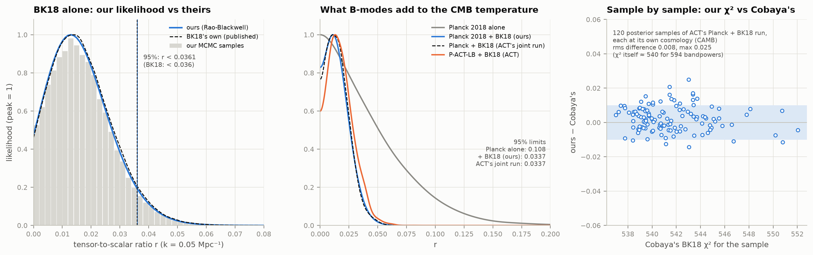

BK18 measured B-mode polarization in the same patch of sky with 11 maps, from WMAP's 23 GHz to
Planck's 353 GHz, through Keck and BICEP3 at 95, 150 and 220 GHz. That makes 66 auto- and
cross-spectra in 9 multipole bins, 594 numbers in all.
- Gravitational waves look the same in every map.
- Polarized dust brightens toward high frequencies, synchrotron toward low ones.
- So fitting all 594 numbers together separates them.

We rebuilt the likelihood from the release's CosmoMC files. It is the Hamimeche & Lewis
approximation, with each map's bandpass and the bandpower window functions, and seven foreground
parameters. We then sampled it with emcee: 48,000 samples, about 2,800 independent.

**Agreement with BICEP/Keck's own likelihood:**
- **Sample by sample.** ACT's DR6 chains record Cobaya's BK18 χ² for every sample. We took 120
  posterior samples of ACT's Planck + BK18 run, each at its own cosmology through CAMB. Our χ²
  agrees with theirs to **0.008 rms** (max 0.025) on χ² ≈ 540.
- **The r posterior.** Averaging p(r | foregrounds) over the samples (a Rao–Blackwell estimate, so no
  smoothing bias at r = 0) gives:

| | ours | BK-XIII |
|---|---|---|
| r_0.05, 95% upper limit | < 0.0361 ± 0.0001 | < 0.036 |
| peak and 68% interval | 0.013 (+0.010 / −0.010) | 0.014 (+0.010 / −0.011) |
| likelihood at r = 0 relative to the peak | 0.474 | 0.46 |
| dust amplitude A_d (353 GHz, ℓ = 80) | 4.48 (+0.80 / −0.71) µK² | 4.4 (+0.8 / −0.7) |
| dust spectral index β_d | 1.50 (+0.13 / −0.12) | 1.49 (+0.13 / −0.12) |
| best-fit dust slope α_d | −0.66 | −0.66 |
| synchrotron A_sync, 95% | < 1.41 µK² | < 1.4 |

The whole r curve lies within 0.03 of BK18's tabulated one.

**Combined with Planck.** We weighted Planck 2018's r-free chain by our BK18 likelihood:
- r < 0.108 (Planck alone) tightens to **r < 0.0337**, with **n_s = 0.9654 ± 0.0040**;
- ACT's full joint Planck + BK18 MCMC also gives r < 0.0337;
- at Planck's other pivot, r_0.002 < 0.0306.

### 4. The verdicts

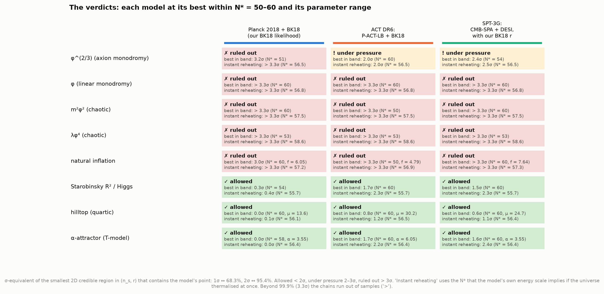

Each model is graded by the smallest 2D credible region of (n_s, r) that contains its prediction,
expressed as Gaussian σ: 1σ is the 68% region, 2σ the 95%. Each model is taken at its *best* point
for N* = 50–60 and across its parameter range. The figure also shows the verdict at the model's own
instant-reheating N*.

| Model | Planck 2018 + BK18 (ours) | ACT DR6: P-ACT-LB + BK18 | SPT-3G: CMB-SPA + DESI × BK18 |
|---|---|---|---|
| φ^(2/3) | ✗ 3.2σ | ! 2.0σ | ! 2.4σ |
| φ, φ², φ⁴ | ✗ > 3.3σ | ✗ > 3.3σ | ✗ > 3.3σ |
| natural inflation | ✗ 3.0σ | ✗ > 3.3σ | ✗ > 3.3σ |
| Starobinsky R² / Higgs | ✓ 0.3σ (instant reheating 0.4σ) | ✓ 1.7σ (instant 2.3σ) | ✓ 1.5σ (instant 2.3σ) |
| quartic hilltop | ✓ 0.0σ (μ ≈ 14) | ✓ 0.8σ (μ ≈ 30) | ✓ 0.6σ (μ ≈ 25) |
| α-attractor T-model | ✓ 0.0σ (α ≈ 3.5) | ✓ 1.7σ (instant 2.2σ) | ✓ 1.6σ (instant 2.4σ) |

These match the published statements:
- Planck 2018 X: φ^p with p > 1 and natural inflation "strongly disfavoured".
- BK18: φ^(2/3) and natural inflation outside the 95% region.
- ACT DR6 (Calabrese et al. 2025): R² "on the 2σ boundary of P-ACT-LB".

ACT's higher n_s does give φ^(2/3) some relief, from 3.2σ to 2.0σ.

### 5. n_s has moved by about 2σ

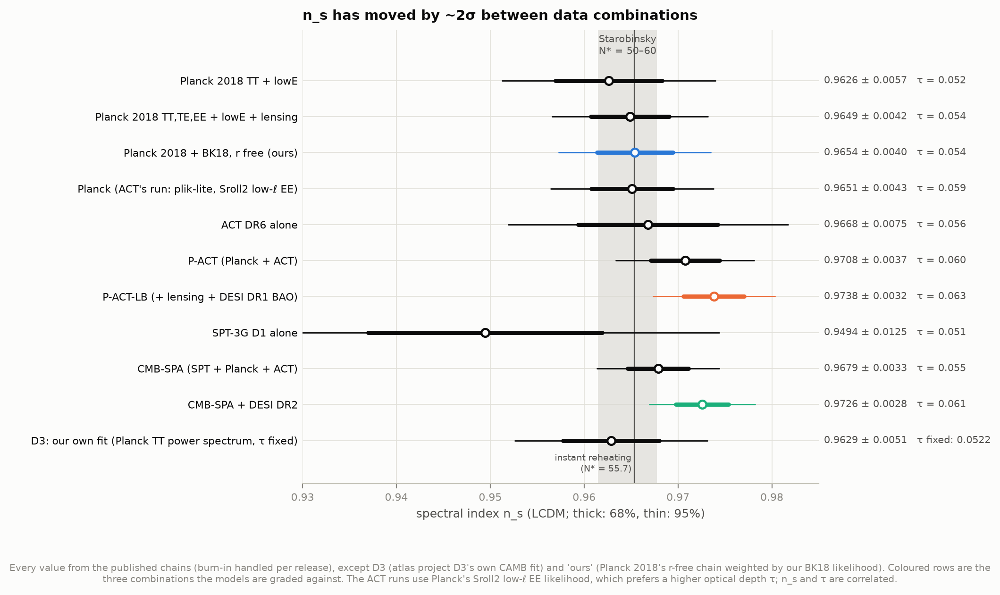

| Data | n_s (LCDM) | τ |
|---|---|---|
| Planck 2018 TT,TE,EE + lowE + lensing | 0.9649 ± 0.0042 | 0.054 |
| Planck 2018 + BK18, r free (ours) | 0.9654 ± 0.0040 | 0.054 |
| ACT DR6 alone | 0.9668 ± 0.0075 | 0.056 |
| P-ACT (Planck + ACT) | 0.9708 ± 0.0037 | 0.060 |
| P-ACT-LB (+ lensing + DESI DR1 BAO) | 0.9738 ± 0.0032 | 0.063 |
| SPT-3G D1 alone | 0.9494 ± 0.0125 | 0.051 |
| CMB-SPA (SPT + Planck + ACT) | 0.9679 ± 0.0033 | 0.055 |
| CMB-SPA + DESI DR2 | 0.9726 ± 0.0028 | 0.061 |
| D3, this atlas's own fit (Planck TT power spectrum, τ fixed) | 0.9629 ± 0.0051 | 0.052 |

Every value except ours and D3's comes from the published chains. Two things push n_s up:
- **High-ℓ polarization from ACT.**
- **BAO.** CMB-SPA → CMB-SPA + DESI moves n_s by +1.4σ of its own error.

The ACT runs also use Planck's Sroll2 low-ℓ EE likelihood, which prefers a higher optical depth τ.
n_s and τ are correlated. This is why the spec warned not to treat one combination as final.

### 6. Starobinsky against the 2025 data: what would reheating have to do?

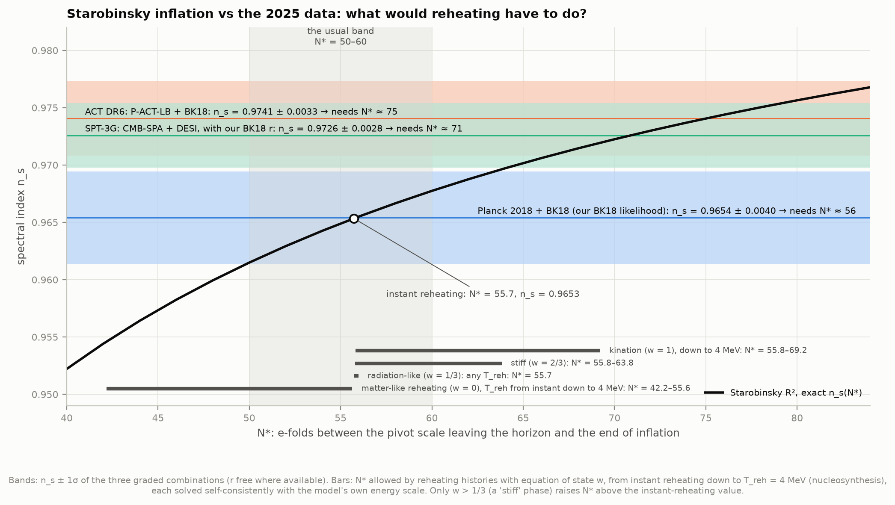

The convention "N* = 50–60" hides a calculation. N* follows from the model's own energy scale and
from how the universe reheated: its equation of state w and the temperature T_reh at which it
thermalised. We solve this self-consistently for each model (and check Starobinsky's
instant-reheating value against Planck 2018 X's eq. 47).

For Starobinsky:

| Reheating history | N* |
|---|---|
| instant | **55.7** |
| matter-like (w = 0), T_reh from instant down to 4 MeV (nucleosynthesis) | 42.2–55.6 |
| radiation-like (w = 1/3) | 55.7, whatever T_reh |
| stiff (w = 2/3) | up to 63.8 |
| kination (w = 1) | up to 69.2 |

- Reaching the P-ACT-LB + BK18 central value (n_s = 0.9741) needs **N* ≈ 75**.
- Reaching CMB-SPA + DESI's (0.9726) needs **N* ≈ 71**.
- Both are beyond even kination down to nucleosynthesis.

To come within 1σ of those values, Starobinsky needs N* ≈ 64–67 (and N* ≳ 59 for 2σ). Only the
stiffest histories (w → 1, reheating at low temperature) get there. Ordinary (w ≤ 1/3) reheating
leaves it at 2.3σ.

This agrees with the 2025 literature:
- Drees & Xu 2025 (PLB 867, 139612) find Starobinsky within 2σ of P-ACT-LB-BK18 only for
  N* ≈ 58–69, which needs w ≳ 0.46.
- Zharov, Sobol & Vilchinskii 2025 (PRD 112, 023544) reach a similar conclusion.

### 7. What r means: the energy and the distance the field rolled

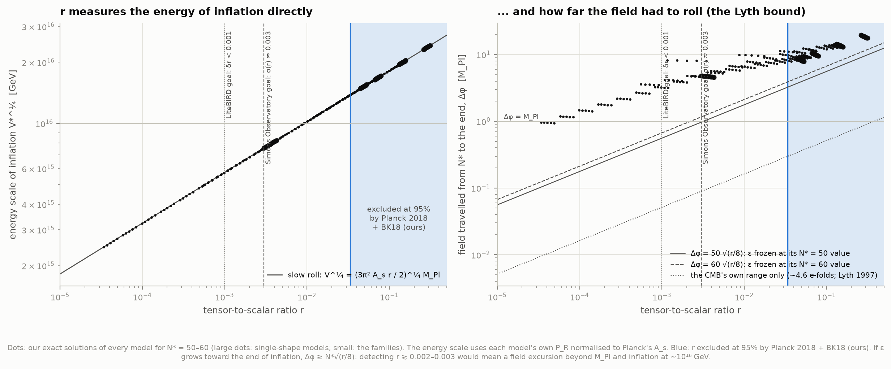

**r sets the energy of inflation directly:** V^¼ = (3π² A_s r / 2)^¼ M_Pl = **1.02 × 10¹⁶ GeV ×
(r/0.01)^¼**.
- Our r < 0.0337 means inflation happened below **1.39 × 10¹⁶ GeV**.
- Planck 2018 + BK15 gave below 1.6 × 10¹⁶.

**The field excursion.** While the field rolls, dφ/dN = √(r/8) M_Pl. If ε grows toward the end,
as in every model here, then Δφ ≥ N* √(r/8).
- Every model satisfies this.
- Detecting r ≳ 0.002–0.003 would therefore mean the field travelled more than the Planck mass
  (the Lyth bound).

**What comes next.**
- The Simons Observatory's 2019 goal was σ(r) ≈ 0.003; its 2026 forecast to 2035 is 0.0012.
- LiteBIRD aims for δr < 0.001.

Both would test Starobinsky's r ≈ 0.003–0.004.

### 8. B-modes: where the gravitational waves would hide

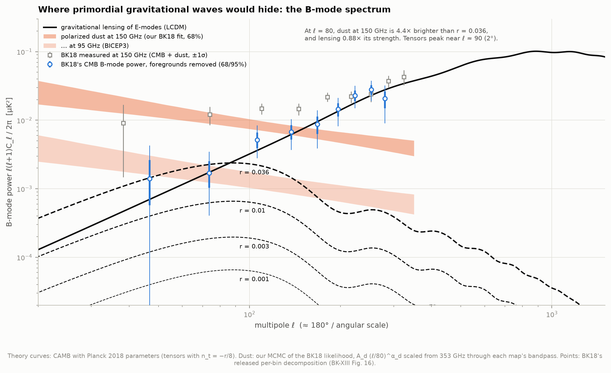

Primordial gravitational waves would twist the CMB's polarization into a "B-mode" pattern, peaking
at ℓ ≈ 90 (2°). It competes with two other sources:
- **Gravitational lensing**, which converts the much brighter E-modes into B-modes. At ℓ = 80 it is
  already 0.88× an r = 0.036 signal.
- **Polarized dust in our Galaxy.** In the BICEP field, our fit of the BK18 likelihood puts it at
  **4.4×** that signal at 150 GHz. At 95 GHz it is 0.66×.

BK18's released per-bin decomposition (their CMB component, with foregrounds removed) follows the
lensing curve: no sign of r.

### Interactive explorer

[`figures/inflation_explorer.html`](figures/inflation_explorer.html) (0.56 MB, no libraries, works
offline, light and dark):
- pick any of the eight models;
- slide N* from 40 to 80 and the family's parameter;
- switch r between linear and log;
- hover anywhere to see how each data set grades that point.

Ticks under the N* slider show the reheating histories for the current model. Buttons set N* to
them. A table view lists predictions and verdicts. It is also published as a private artifact,
https://claude.ai/artifact/TQe2Vg8pzWCKXYFx4beU2N, from `data/derived/inflation_explorer_artifact.html`
(`explorer.py` rewrites it; republish to the same link). Others can open it only once it is shared
from that page.

---

## Background, in brief

**The problems.** In a hot Big Bang without inflation, the comoving Hubble radius 1/(aH) only ever
grows. So scales we see today were always outside each other's horizon until recently. That is the
horizon problem: why do causally disconnected regions agree? And |Ω − 1| grows like (aH)⁻², so
today's flatness requires absurd fine-tuning early on: the flatness problem. A phase of accelerated
expansion (ä > 0) reverses both, if it lasts ≳ 60 e-folds.

**Slow roll.** A scalar field φ with potential V(φ) behaves like a ball rolling down a hill with
friction from the expansion. While its kinetic energy is small (ε = (M_Pl²/2)(V′/V)² ≪ 1), the
universe inflates. Quantum fluctuations of the field are stretched beyond the horizon and frozen. They
become curvature perturbations with amplitude P_R = H²/(8π² ε M_Pl²), slightly larger on large scales
(n_s < 1), and gravitational waves with P_t = 2H²/(π² M_Pl²), so r ≈ 16ε.

**The models.**
- **Monomials φ^p.** "Chaotic" inflation; p = 2/3 and 1 arise in axion monodromy from string theory.
- **Natural inflation.** An axion's cosine potential.
- **Starobinsky R².** A correction to Einstein gravity; Higgs inflation gives the same predictions.
- **α-attractors.** Plateaus that interpolate between Starobinsky (α = 1) and φ² (large α).
- **Hilltop.** The field rolls off a maximum.

---

## Method

**Background.** The equations are written in e-folds N = ln a, with M_Pl = 1:

    dφ/dN = π,  dπ/dN = −(3 − ε)(π + V′/V),  ε = π²/2,  H² = V/(3 − ε)

They are solved with SciPy's DOP853 (rtol 10⁻¹²) from ~85 slow-roll e-folds before the end until ε = 1.

**Perturbations.** Each mode k obeys

    R″ + (3 − ε + ε′/ε) R′ + (k/aH)² R = 0,   h″ + (3 − ε) h′ + (k/aH)² h = 0.

- It starts from the Bunch–Davies vacuum at k/aH = 300 and stops at k/aH = 10⁻⁴.
- Integration uses a numba Dormand–Prince 5(4) with the background carried along, at 12 ms per mode.
- n_s and the running come from a quadratic fit over ln k* ± 0.5. r is P_t/P_R at k*.

**Checks on the solver:**
- the exact power-law inflation solution (n_s and r to 10⁻⁸);
- convergence (300 vs 1000 times inside the horizon: |Δn_s| < 10⁻⁶);
- second-order slow roll (10⁻⁵).

**N\* from reheating.** N\* = −ln(k*/a₀H₀) + ln(H*/H₀) − ln(ρ_end/ρ_reh)/(3(1+w)) + ln(T₀/T_reh) +
⅓ ln(g_s0/g_reh). It is iterated with the model's own energy scale (V₀ = A_s/P̂_R). For Starobinsky
with instant reheating it agrees with Planck 2018 X eq. 47 to 0.1.

**BK18 likelihood.** We follow `BK18lf_dust.dataset`:
- 11 maps, 9 bins, ℓ = 2–600. The window weight beyond 600, 3 × 10⁻⁵, is dropped as CosmoMC does.
- Lensed-ΛCDM BB plus r × tensor BB from CAMB, at BK18's fixed Planck cosmology with n_t = 0.
- Dust: a modified blackbody, T_d = 19.6 K, β_d free (0.8–2.4), pivot 353 GHz, ℓ/80 power law with
  α_d ∈ [−1, 0].
- Synchrotron: a power law with a Gaussian prior on β_s of −3.1 ± 0.3, pivot 23 GHz.
- A dust–synchrotron correlation ε ∈ [−1, 1].
- Each scaling is integrated through every map's bandpass and converted to CMB temperature units.
- The Hamimeche–Lewis transform, with the noise added to model, data and fiducial, then χ² with the
  released 594 × 594 bandpower covariance.

**Combining.**
- **Planck + BK18:** Planck 2018's r-free chain (TT,TE,EE+lowE+lensing) is importance-weighted by our
  BK18 r likelihood. The effective sample size is 10,000 of 21,600. This assumes the lensing
  amplitude at BK18's fiducial cosmology, which ACT's joint run confirms: identical r < 0.0337.
- **ACT:** its DR6 chains already include BK18.
- **SPT-3G:** it never fitted r, so its ΛCDM n_s posterior is multiplied by our BK18 r likelihood,
  neglecting the small n_s–r correlation. We tested this on ACT, where both exist: n_s moves by
  0.0002 and r₉₅ by 6% (0.0358 vs 0.0380); the two densities overlap at 0.993 (Bhattacharyya).

**Contours and verdicts.**
- 2D densities are weighted histograms smoothed with a Gaussian kernel (Scott's rule per axis), with
  the samples mirrored at r = 0 so the kernel does not leak below the prior boundary.
- 68% and 95% regions are highest-density regions.
- A model's credibility is the posterior mass at higher density than at its point. It is quoted as
  σ-equivalent up to 99.9% (3.3σ). Beyond that the chains have too few samples, and we report
  "> 3.3σ".
- Self-checks: a 2D Gaussian's 1σ ellipse reads 68.3%; a half-Gaussian's 95% limit is 1.96σ.

**Horizons and flatness.**
- η\* and D_M(z\*) come from CAMB at Planck 2018's parameters.
- The hot-Big-Bang history uses a free-particle Standard Model g\*(T), with a smooth switch at the
  156.5 MeV quark–hadron crossover (HotQCD 2019) and instantaneous neutrino decoupling.
- Against project P2's interacting, lattice-based g\*(T), it is within 2–9% except just above the
  crossover, where free quarks and gluons overcount by up to 52% (as P2 itself found). The effect on
  the e-fold counts is ~0.002.

## Validation

`python test_physics.py` runs 14 checks in ~5 s, all passing:
- the power-law inflation exact solution;
- mode convergence;
- second-order slow roll;
- the spec's slow-roll numbers;
- Planck's eq. 47 for N*;
- g\*(T) staircase values;
- θ_H;
- BK18 χ² vs Cobaya;
- BK18's r limit and curve;
- the BK18 fiducial model's χ²;
- Planck's n_s from the chain against Planck's own GetDist output;
- the nested-zip reader;
- 2D credibility;
- the reflection boundary.

`analysis.py` also writes 28 comparisons with published numbers to `data/derived/checks.json`.

| Quantity | Ours | Published |
|---|---|---|
| Planck 2018 n_s (TT,TE,EE+lowE+lensing) | 0.9649 ± 0.0042 | 0.9649 ± 0.0042 (Planck VI eq. 19) |
| Planck 2018 TT+lowE n_s | 0.9626 ± 0.0057 | 0.9626 ± 0.0057 (Planck VI Table 2) |
| Planck 2018 r_0.002, 95% | < 0.1015 | < 0.10 (Planck X eq. 29) |
| Planck 2018 + BK15 r_0.002, 95% | < 0.0565 | < 0.056 (Planck X eq. 31) |
| BK18 r_0.05, 95% (our likelihood) | < 0.0361 | < 0.036 (BK-XIII) |
| Planck + BK18 + lensing + BAO, r 95% | < 0.0356 (ACT's chain) | < 0.035 (BK-XIII Fig. 5) |
| ACT DR6 / P-ACT / P-ACT-LB n_s | 0.9668 / 0.9708 / 0.9738 | 0.9666 / 0.9709 / 0.9743 (Louis et al. 2025) |
| P-ACT-LB + BK18 r, 95% | < 0.0383 | < 0.038 (Calabrese et al. 2025) |
| SPT-3G / + DESI n_s | 0.9494 / 0.9493 | 0.951 / 0.949 (Camphuis et al.) |
| CMB-SPA / + DESI n_s | 0.9679 / 0.9726 | 0.9679 / 0.9726 (Camphuis et al. v2) |
| V^¼ bound from r_0.002 < 0.056 | < 1.57 × 10¹⁶ GeV | < 1.6 × 10¹⁶ (Planck X eq. 32) |

ACT's chains on LAMBDA use the foreground-marginalised "ACT-lite" likelihood, so P-ACT-LB comes out
0.0005 (0.14σ) below the paper's full likelihood. SPT's released alone-chains are likewise the "lite"
version. Every published value was checked against the paper itself.

---

## Data and credits

| Data | Source | Size |
|---|---|---|
| BICEP/Keck BK18 release: bandpowers, r likelihood, component decomposition, CosmoMC likelihood data (Ade et al. 2021, PRL 127, 151301) | LAMBDA mirror of the October 2021 release (`lambda.gsfc.nasa.gov/data/suborbital/BICEPK_2021/`) | 12 MB |
| ACT DR6.02 MCMC chains: 4 tensor-mode runs (all with BK18), 4 ΛCDM runs (Louis et al. 2025; Calabrese et al. 2025) | LAMBDA (`lambda.gsfc.nasa.gov/data/act/chains/`) | 98 MB |
| SPT-3G D1 chains: SPT alone, SPT + DESI, CMB-SPA, CMB-SPA + DESI (Camphuis et al. 2025/2026) | LAMBDA: four folders read out of a 6.2 GB and an 0.8 GB zip by HTTP range requests (CMB-SPA from the 2026 bug-fix release) | 20 MB over the wire |
| Planck 2018 chains: ΛCDM and ΛCDM + r, with and without BK15 (Planck 2018 VI, X) | IRSA mirror of the Planck Legacy Archive: four runs read member by member out of the 11.8 GB grid zip | 102 MB over the wire, 327 MB unpacked |
| Planck SMICA CMB maps (half-mission) and common mask | IRSA; hard-linked from D3's cache | 1.4 GB (reused) |
| D3's Planck TT fit; O1's curvature; P2's g\*(T) | the atlas's own results files | — |

**Totals:** ~0.23 GB came over the wire and 0.51 GB is on disk. Downloaded 2026-10-19; each file's URL,
size, SHA-256 and retrieval time is in `data/manifest.json`. The comparison values come from Planck
2018 VI and X; BK-XIII; Louis et al. 2025 and Calabrese et al. 2025 (ACT DR6); Camphuis et al.
(SPT-3G D1, v2); Tristram et al. 2022; HotQCD 2019; the Simons Observatory 2019 and 2026 forecasts;
and LiteBIRD 2023. A subagent checked each against the source, and the corrections it found are
listed below.

## Caveats and deviations from the plan

- **BK-XX's component-separated maps are not public.** The spec asked for them "for a picture of
  where B-modes hide". The 2026 paper (ApJ 999, 89) releases only figures, and it quotes no r limit
  from real data. The B-mode figure uses BK18's released per-bin CMB/dust/synchrotron decomposition
  instead, plus our own dust fit.
- **"SPT-3G finds 0.9679 ± 0.0033 from the CMB alone" (spec).** That value is the CMB-SPA
  *combination* of SPT, Planck and ACT. SPT-3G alone gives 0.951 ± 0.011. The CMB-SPA values are the
  corrected ones from the 2026 bug-fix chains and paper v2 (v1: 0.9684 ± 0.0030 and 0.9728 ± 0.0027).
  The fix was posted on LAMBDA on 1 April 2026; the zip's own README says February.
- **The SPT plane is approximate** (see Method). ACT and Planck + BK18 are full joint fits.
- **ACT's "LB" uses DESI DR1 BAO.** Louis et al.'s v2 adds P-ACT-LB2 with DESI DR2,
  n_s = 0.9752 ± 0.0030, but that run's chains are not among the r chains on LAMBDA.
- **Verdicts depend on how they are framed.** We grade each model at its *best* N* in 50–60 and best
  parameter: generous to the model. The instant-reheating values are the stricter test. Beyond 3.3σ
  the chains run out of samples, so φ, φ², φ⁴ and natural inflation are just "> 3.3σ".
- **The hilltop potential is the truncated form** Λ⁴(1 − (φ/μ)⁴). Inflation ends at ε = 1 before
  φ = μ; the stabilising terms that would complete it are not modelled.
- **N\* scenarios assume** constant w during reheating and the Standard Model's 106.75 degrees of
  freedom at T_reh.
- **The energy-scale coefficient** is 1.02 × 10¹⁶ GeV at r = 0.01 with Planck 2018's A_s. The
  "1.04" sometimes quoted comes from Planck 2013's amplitude.
- **For anyone re-implementing BK18:** the bandpower window functions include the maps' filtering
  suppression (they sum to ~0.13–0.15 in bin 1). The likelihood's bandpowers are therefore ~7× below
  the released display bandpowers, which are suppression-corrected. ACT's and SPT's Cobaya chains
  include burn-in: we drop 30%. Planck's grid chains have it removed.
- **Download: ~0.23 GB**, within the spec's 0.1–1 GB; 1.4 GB more without D3's maps.
- **Found along the way: OpenBLAS thread contention.** On this shared machine at load ~27, numpy's
  default 16 BLAS threads made a single 594 × 594 inverse take 4.5 s instead of 0.05 s. The project
  pins BLAS to one thread (`config.py`) and parallelises with processes.

## Running it

    python fetch_data.py      # ~0.23 GB once (chains by byte range); the SMICA maps are linked from D3
    python run.py             # analysis (cached steps reused), 11 figures, the interactive page
    python run.py --force     # recompute everything: ~5 min (the BK18 MCMC and its validation dominate)
    python run.py --check     # also run the 14 self-checks

After the first fetch everything runs offline: `run.py --check` completes in about 20 s from the
caches (checked with the network switched off). `--force` took 5.3 min on an idle 16-core machine,
and about twice that on a heavily loaded one. Every step is seeded, so a forced rebuild reproduces
every cached number. The largest change seen was 2 × 10⁻⁷ relative, from CAMB's thread count.
`config.py` pins CAMB's OpenMP to one thread per process, because forking a worker pool after CAMB
had started its OpenMP thread team deadlocked the validation step.

| File | Role |
|---|---|
| `config.py` | paths, data sources, conventions, the models, published values |
| `fetch_data.py` | downloads, sibling hard links, HTTP range reads of remote zips, manifest |
| `inflation.py` | potentials, exact background, Mukhanov–Sasaki solver, slow roll, reheating |
| `bk18.py` | our BK18 likelihood, its MCMC and the Rao–Blackwell r posterior |
| `chains.py` | chain loaders (CosmoMC, Cobaya), statistics, 2D regions, credibility |
| `horizons.py` | the horizon and flatness problems, g\*(T), the CMB sky |
| `analysis.py` | every result, cached step by step in `data/derived/` |
| `figures.py` | the eleven figures (PNG + SVG) |
| `explorer.py`, `explorer_template.html` | the interactive page |
| `test_physics.py` | the self-checks |
