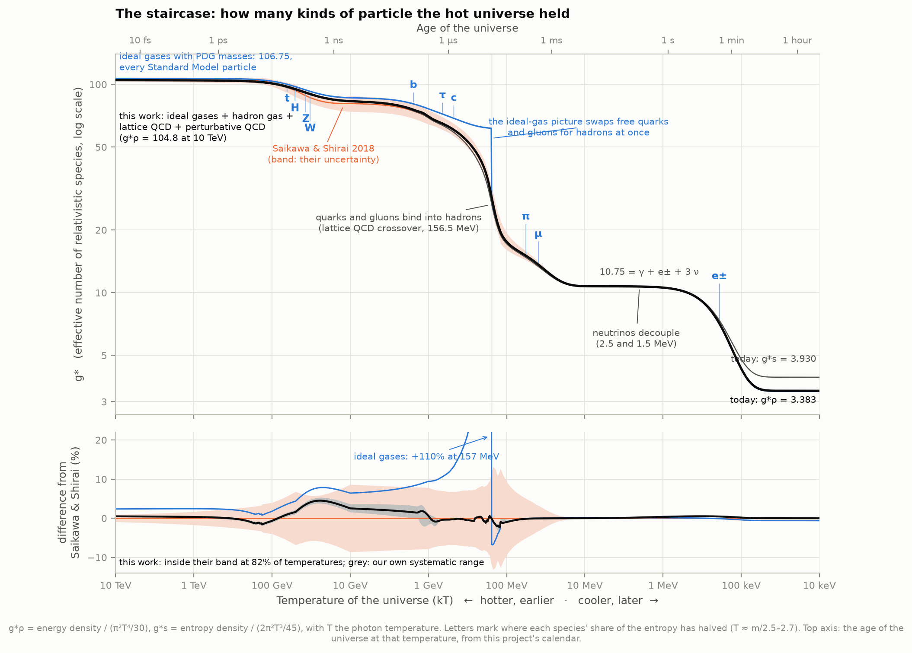
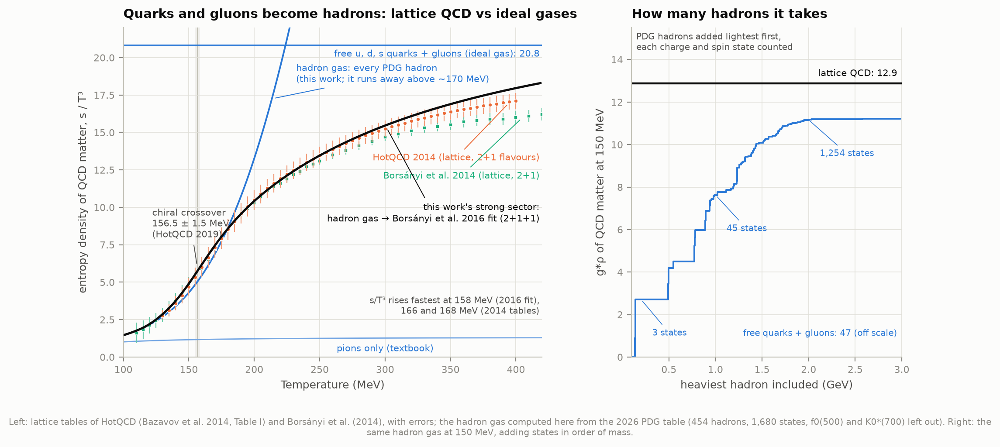
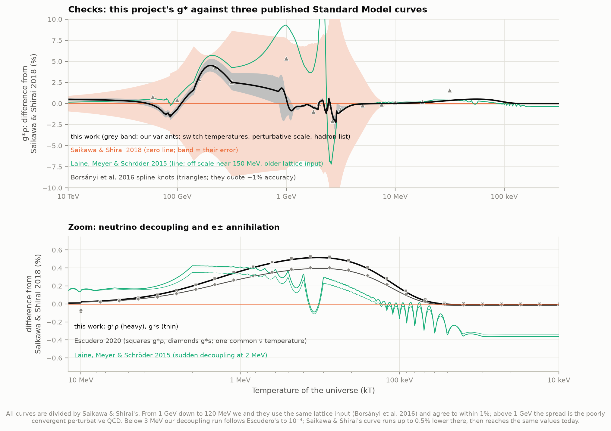
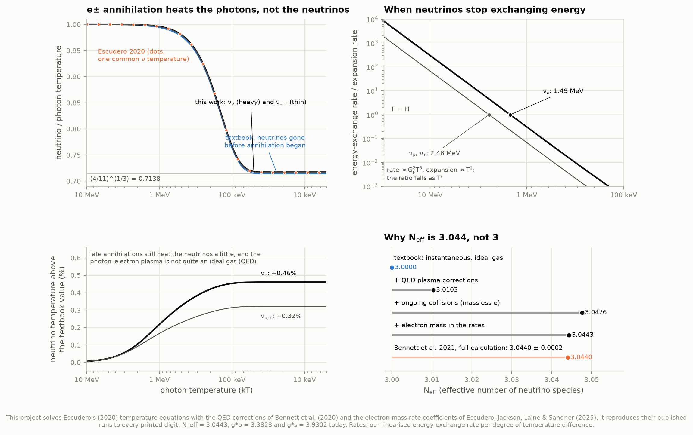
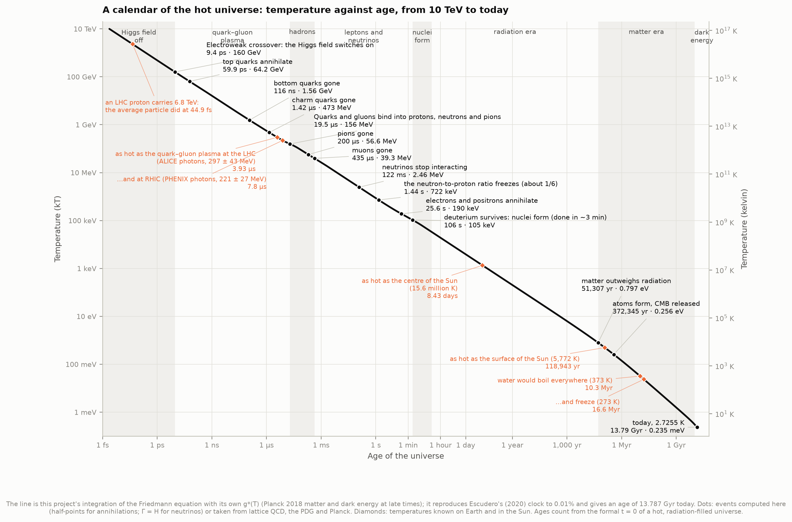
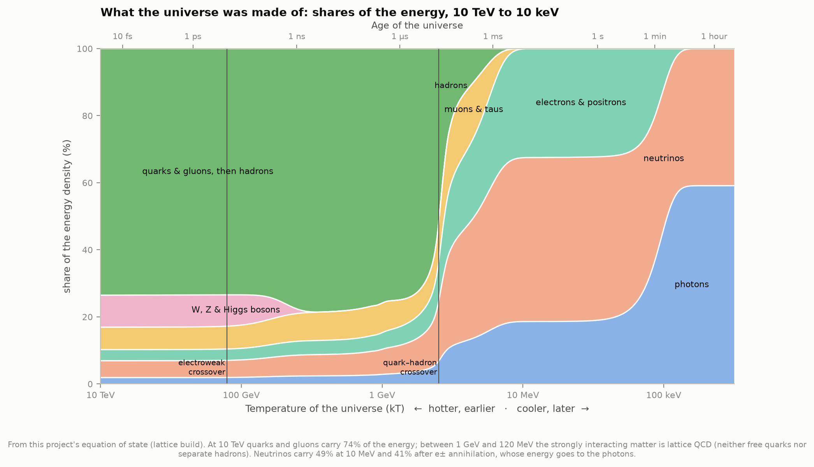
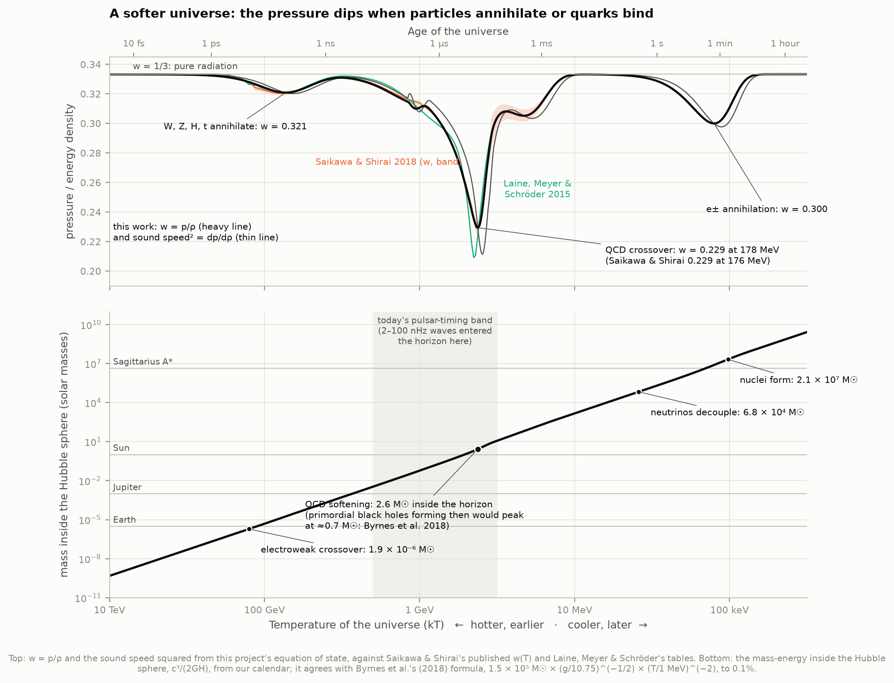

# P2 — From quarks to atoms: the thermal history of the universe

**What was the universe made of at each moment of its first minutes, and how fast was it cooling?
Can we count the Standard Model's particles species by species, add what lattice QCD says about the
quark–hadron transition, and turn the Friedmann equation into a calendar of the first second?**

This project counts every particle state the hot universe could hold, from the 2026 PDG tables, as
ideal Fermi and Bose gases with their real masses. It then rebuilds the strongly interacting part
from three ingredients: a gas of all 454 known hadrons, lattice QCD, and perturbative QCD. It solves
neutrino decoupling as a calculation, not a formula. Finally it integrates the Friedmann equation from
10 TeV (2 femtoseconds after the hot Big Bang) to today. Every step is checked against published work:
Saikawa & Shirai's (2018) Standard Model equation of state, Laine, Meyer & Schröder's (2015) tables,
Borsányi et al.'s (2016) lattice-based curve, Escudero's (2020, 2025) neutrino-decoupling runs, and
Planck.

**The answers:**

- **The staircase.** Counting particle states gives the famous numbers exactly: **106.75** with the
  whole Standard Model hot, **10.75** at a few MeV (photons, electrons and three neutrinos), and
  **3.363 / 3.909** today for the energy / entropy count if the neutrinos left before electrons and
  positrons annihilated. With interactions, our own build gives **104.8 at 10 TeV** (Saikawa & Shirai:
  104.3 ± 1.0). Today it gives **g\*ρ = 3.3828 and g\*s = 3.9302** (theirs: 3.3831 and 3.9309). It lies
  inside their error band at 82% of all temperatures and never more than 0.8σ away above 10 MeV.
- **The ideal gas fails at one place: the quark–hadron crossover.** Free quarks and gluons give
  g\* = 61.6 just above 156.5 MeV, **2.1 times** the true value. A free gas of every PDG hadron gives
  27.3 just below, close to lattice QCD's 29.2; the textbook "pions only" gives 16.9. At 150 MeV the
  pions carry only a quarter of the hadron gas, and states up to 2 GeV (1,254 of them) are needed to
  get within 14% of lattice QCD. The hadron gas follows HotQCD's lattice entropy within 1σ up to
  185 MeV, then runs away: the Hagedorn-like explosion of states.
- **A calendar.** Electroweak crossover at **9.4 picoseconds** (159.5 GeV). Quarks bind into protons
  and neutrons at **19.5 ± 0.6 microseconds** (156.5 MeV, 1.8 trillion K). Neutrinos stop exchanging
  energy at **0.12–0.34 s** (2.5 and 1.5 MeV). The neutron-to-proton ratio freezes at **1.4 s**. Half
  the electrons and positrons are gone at **26 s**, and deuterium survives from **106 s** (105 keV).
  Matter overtakes radiation at **51,300 years** (z = 3392; Planck: 3387 ± 21), and the CMB is
  released at **372,300 years**. Today is at **13.787 Gyr** (astropy's Planck 2018: 13.787). Below 1 MeV
  the clock matches Escudero's to 0.01%.
- **Why N_eff is 3.044, not 3.** Our decoupling run uses Escudero's equations, finite-temperature QED
  and the 2025 electron-mass rate coefficients. It gives **N_eff = 3.0443**, against the full
  momentum-dependent calculation's 3.0440 ± 0.0002 (Bennett et al. 2021). It reproduces Escudero's
  2020 runs and Escudero, Jackson, Laine & Sandner's 2025 runs to every printed digit. The textbook
  limit comes out exactly: T_ν/T_γ = (4/11)^(1/3), so **1.945 K and 336 neutrinos per cm³** today.
- **What the universe was made of.** At 10 TeV, quarks and gluons held 74% of the energy and the
  W, Z and Higgs bosons 9.5%. At 1 MeV it was 49% neutrinos, 32% electrons and positrons and 19%
  photons. After e± annihilation it is 59% photons and 41% neutrinos.
- **A softer universe.** When quarks bind, the pressure dips: w = p/ρ falls to **0.229 at 178 MeV**
  (Saikawa & Shirai: 0.229 at 176 MeV). At that moment the horizon held **2.6 solar masses**, the scale
  at which primordial black holes would form most easily (Byrnes et al. 2018 find a peak near
  0.7 M☉). Gravitational waves that entered the horizon then would today be at **3.4 nanohertz**, in
  the band of pulsar-timing arrays (2–100 nHz corresponds to horizon entry at 0.10–3.9 GeV).
- **Temperatures we know.** When the universe was 45 femtoseconds old, the average particle carried as
  much energy as an LHC proton (6.8 TeV). It was as hot as the quark–gluon plasma made at the LHC
  (297 MeV) at 3.9 µs, and as hot as the Sun's core (15.6 million K) at 8.4 days. It stayed hotter than
  the Sun's surface for 119,000 years. Between 10.3 and 16.6 million years the leftover radiation alone
  held everything between the boiling and freezing points of water (Loeb's 2014 "habitable epoch":
  10–17 million years).



An **interactive page**, [figures/cosmic_thermometer.html](figures/cosmic_thermometer.html) (128 kB,
self-contained, works offline), lets you drag through all 13.8 billion years. It reads out the age,
temperature, g\*, the colour the glow would have had, and what the energy was in. It also shows the
horizon's size and mass with everyday comparisons, and a clickable timeline of the events. It has
light and dark themes and works at phone width. It is also published as a private artifact,
https://claude.ai/artifact/U69aD1ajXzrQrtTGTs35Hg, from `data/derived/cosmic_thermometer_artifact.html`
(`explorer.py` rewrites it; republish to the same link). Others can open it only once it is shared
from that page.

---

## Results

### 1. The staircase: counting the Standard Model

Each particle species contributes to the energy density as an ideal Fermi or Bose gas,
ρ = g/(2π²) ∫ E² √(E² − m²) / (e^(E/T) ± 1) dE, and g\* is the total in units of one massless boson,
g\*ρ = ρ / (π²T⁴/30). A massless boson state counts 1 and a massless fermion state 7/8. The
Standard Model's 17 particles (PDG 2026 masses, via `particle` 1.0.1) add up as:

| Species | Mass (PDG) | States g | Counts as | Half gone at (T) |
|---|---|---|---|---|
| top quark | 172.6 GeV | 12 (3 colours × 2 spins × q, q̄) | 10.5 | 64.2 GeV |
| Higgs boson | 125.13 GeV | 1 | 1 | 50.8 GeV |
| Z boson | 91.188 GeV | 3 | 3 | 37.0 GeV |
| W⁺, W⁻ | 80.362 GeV | 6 | 6 | 32.6 GeV |
| bottom quark | 4.186 GeV | 12 | 10.5 | 1.56 GeV |
| tau lepton | 1.777 GeV | 4 | 3.5 | 0.66 GeV |
| charm quark | 1.273 GeV | 12 | 10.5 | 0.47 GeV |
| strange, down, up quarks | 93, 4.7, 2.2 MeV | 3 × 12 | 31.5 | bound into hadrons at 156.5 MeV |
| gluons | 0 | 16 (8 colours × 2) | 16 | bound into hadrons |
| muon | 105.7 MeV | 4 | 3.5 | 39.3 MeV |
| electron | 0.511 MeV | 4 | 3.5 | 190 keV |
| 3 neutrinos | ~0 | 3 × 2 | 5.25 | never (they decouple) |
| photon | 0 | 2 | 2 | never |
| **total** | | | **106.75** | |

"Half gone" is where a species' share of the entropy has fallen to half its massless value:
T = m/2.69 for fermions and m/2.46 for bosons. A particle disappears when the temperature falls
well below its mass, so it can no longer be made in collisions while it keeps annihilating.

Three plateaus check the count: 106.7500 at 1 PeV (all species massless), 10.742 at 5 MeV (10.75 in
the massless-electron limit), and 3.3626 / 3.9091 today with the textbook neutrinos. g\*ρ and g\*s
differ once species have different temperatures, as neutrinos and photons do after e± annihilation.
Energy-density formulas need g\*ρ; the expansion of comoving volumes (a³ ∝ 1/(g\*s T³)) needs g\*s.

### 2. The quark–hadron crossover: where the ideal gas fails



The textbook picture swaps free quarks and gluons for hadrons at once. At 156.5 MeV that drops g\*
from 61.6 to 27.3 (all hadrons) or 16.9 (pions only). Lattice QCD shows a smooth crossover spread
over ~120–300 MeV instead.

- **Our hadron gas.** We sum 454 PDG hadrons below 3 GeV: every charge state and antiparticle with
  its 2J+1 spin states, 1,680 states in all. We drop K_S and K_L, which duplicate K⁰ and anti-K⁰, and
  leave out f0(500) and K0\*(700), whose attraction is cancelled by repulsive channels (Broniowski
  et al. 2015). It matches HotQCD 2014's lattice pressure at 130 MeV (0.430 against 0.439 +0.065/−0.044),
  and its entropy within 1σ of HotQCD's up to 185 MeV. Borsányi et al. 2014 have smaller errors;
  against theirs it is within 1σ up to 150 MeV.
- **How many hadrons it takes.** At 150 MeV the strongly interacting matter has g\*ρ = 12.9 in
  lattice QCD. Pions alone give 2.7, hadrons below 1 GeV (45 states) 7.6, below 2 GeV (1,254 states)
  11.2, and free quarks and gluons 47. The exponentially growing number of resonances is what lets a
  hadron gas mimic the start of deconfinement.
- **Where the entropy rises fastest.** s/T³ rises fastest at 158 MeV in Borsányi et al.'s 2016 fit
  (as integrated here), and at 166 and 168 MeV in the HotQCD and Borsányi 2014 tables (5-MeV grids).
  Both are close to the chiral crossover temperature, 156.5 ± 1.5 MeV (HotQCD 2019; Borsányi et al.
  2020: 158.0 ± 0.6). The trace anomaly (ε − 3p)/T⁴ peaks later, at 190–201 MeV.
- **Joining lattice and perturbative QCD.** Above 1 GeV we use the QCD pressure to order g⁶ (Kajantie
  et al. 2003) with a four-loop running coupling (α_s(M_Z) = 0.1180; our α_s(m_τ) = 0.312, PDG 0.314)
  and Borsányi et al.'s charm/bottom/top thresholds. The one unknown constant, q_c, must be −3170 for
  the perturbative pressure to meet our lattice-plus-hadron-gas pressure at 1 GeV. Borsányi et al.
  fitted −3000 to their own lattice data: the same answer to 5%, about 1% in pressure.

### 3. How it compares



| Temperature range | This work vs Saikawa & Shirai (max) | Their own error (max) | Ideal gas vs them (max) | This work vs Laine, Meyer & Schröder |
|---|---|---|---|---|
| 10 TeV – 200 GeV | 0.75% (0.5σ) | 2.8% | 2.4% | 1.2% |
| 200 – 10 GeV | 4.5% (0.8σ) | 8.6% | 7.9% | 1.8% |
| 10 – 1 GeV | 2.5% (0.3σ) | 8.6% | 9.4% | 7.9% |
| 1 GeV – 200 MeV | 0.9% (0.1σ) | 8.3% | 51% | 12.5% |
| 200 – 120 MeV | 2.2% (0.2σ) | 13% | **110%** | 11.6% |
| 120 – 10 MeV | 1.2% (0.1σ) | 13% | 1.6% | 0.6% |
| 10 MeV – 10 keV | 0.5% | 0.1% | 0.6% | 0.6% |

- **Above 1 GeV** the differences are the perturbative-QCD region. Our own variants (switch
  temperatures, perturbative scale μ = πT…4πT with q_c refitted each time, pole instead of MS-bar
  quark masses, the hadron list) span ±1–1.5% between 1 and 10 GeV and ±0.2% at 10 TeV. Saikawa &
  Shirai's band is wider (±5–8%), and Laine, Meyer & Schröder sit up to 8% higher at 1–10 GeV.
- **Between 1 GeV and 120 MeV** we and Saikawa & Shirai use the same lattice input, and agree to 1–2%.
  Our hadron gas is ~1% below theirs at 100 MeV. Most of that gap is the f0(500) and K0\*(700),
  which they appear to keep: adding them closes 70% of it.
- **Below 10 MeV** our curve follows Escudero's decoupling run to 10⁻⁴. Saikawa & Shirai's published
  curve runs up to 0.5% lower between 3 MeV and 200 keV, more than their quoted 0.1%, but reaches the
  same values today (3.3831, 3.9309). Laine, Meyer & Schröder treat decoupling as sudden at 2 MeV and
  end at 3.371.
- Borsányi et al.'s 2016 spline knots, which they say are good to ~1%, agree with our curve to within
  1.2% at 15 of their 16 temperatures. The exception is 1 GeV, where their knot is 4.5% above ours
  (and 5% above Saikawa & Shirai's). Between 10 and 300 GeV Saikawa & Shirai sit 3–4.5% below both
  Borsányi et al. and us, inside their own band.

### 4. Neutrino decoupling and N_eff



Neutrinos exchange energy with electrons and positrons at a rate that falls as T⁵, while the
expansion slows only as T². The two cross where Γ = H: **2.46 MeV** for ν_μ and ν_τ (at 0.12 s) and
**1.49 MeV** for ν_e (0.34 s), using our linearised energy-exchange rate. Electrons and positrons
then annihilate and heat the photons, while the departed neutrinos are left colder. If the neutrinos
left completely before annihilation began, entropy conservation gives T_ν/T_γ = (4/11)^(1/3) = 0.7138.
That puts today's neutrinos at 1.9454 K and 112 per cm³ per flavour, **336 per cm³** in all (photons:
411 per cm³).

The real departure is gradual. We solve Escudero's (2020) temperature equations: photons + e± at one
temperature, each neutrino flavour at its own, joined by weak-interaction energy-transfer rates. We
add the finite-temperature QED pressure of the e±γ plasma at O(e²) and O(e³) (Bennett et al. 2020).
The run takes about a second.

| Treatment | T_γ/T_νe | T_γ/T_νμ,τ | N_eff | g\*ρ today | g\*s today | Published |
|---|---|---|---|---|---|---|
| Textbook: decoupled before annihilation | 1.40102 | 1.40102 | **3.0000** | 3.3626 | 3.9091 | (11/4)^(1/3) = 1.40102 |
| + QED corrections (still instantaneous) | 1.39981 | 1.39981 | 3.0103 | 3.3673 | 3.9140 | |
| Collisions, massless-electron rates, no QED | 1.39513 | 1.39731 | 3.0383 | 3.3801 | 3.9274 | |
| + QED O(e²) | 1.39396 | 1.39613 | 3.0486 | 3.3847 | 3.9322 | |
| + QED O(e³) | 1.39407 | 1.39624 | 3.0476 | 3.3843 | 3.9318 | Escudero 2020: 1.3941, 1.3962, 3.048 |
| same, one common ν temperature | 1.39540 | 1.39540 | 3.0486 | 3.3847 | 3.9322 | Escudero 2020: 1.3954, 3.049 |
| + electron mass in the rates (EJLS 2025) | **1.39460** | **1.39654** | **3.0443** | **3.3828** | **3.9302** | EJLS 2025: 3.0443, 3.3828, 3.9302 |
| same, one common ν temperature | 1.39578 | 1.39578 | 3.0453 | 3.3832 | 3.9307 | Escudero 2020: 1.39578, 3.045; EJLS 2025: 3.0453 |
| Full momentum-dependent calculation with oscillations | | | 3.0440 ± 0.0002 | | | Bennett et al. 2021 |

Every run with a published counterpart reproduces it to the last printed digit. Changing the weak
rates by ±10% moves N_eff by ∓0.0022. With the late heating, ν_e end 0.46% and ν_μ,τ 0.32% warmer
than the textbook value (1.954 and 1.952 K, in this thermal-spectrum approximation).

### 5. The calendar



We integrate the Friedmann equation, H² = 8πρ/(3M_Pl²), with ρ(T) from our own equation of state plus
Planck 2018's matter and dark energy. Entropy conservation then gives the age at every temperature:
dt = −(dT/T)(1 + ⅓ d ln g\*s/d ln T)/H. With constant g\* this reduces to the familiar
t = 2.42 s / √g\* × (1 MeV/T)². Above 10 TeV g\* is taken as constant, so the ages count from the
formal t = 0 of a hot, radiation-filled universe. Inflation and reheating, whatever they were, shift
these ages by less than the first femtosecond.

| Event | Temperature | Age | Hubble radius | Mass inside |
|---|---|---|---|---|
| Electroweak crossover (D'Onofrio & Rummukainen 2016) | 159.5 GeV (1.9 × 10¹⁵ K) | 9.40 ps | 5.6 mm | 1.9 × 10⁻⁶ M☉ (0.6 Earths) |
| Top quarks half gone | 64.2 GeV | 60 ps | 3.6 cm | 1.2 × 10⁻⁵ M☉ |
| Bottom quarks half gone | 1.56 GeV | 116 ns | 69 m | 0.023 M☉ |
| Charm quarks half gone (free-quark estimate) | 473 MeV | 1.42 µs | 830 m | 0.28 M☉ |
| **Quarks bind into hadrons** (HotQCD 2019) | **156.5 ± 1.5 MeV (1.8 × 10¹² K)** | **19.5 ± 0.6 µs** | **11 km** | **3.7 M☉** |
| Pions half gone | 56.6 MeV | 0.20 ms | 117 km | 39 M☉ |
| Muons half gone | 39.3 MeV | 0.44 ms | 255 km | 86 M☉ |
| ν_μ, ν_τ decouple (Γ = H) | 2.46 MeV | 0.122 s | 73,000 km | 2.5 × 10⁴ M☉ |
| ν_e decouple (Γ = H) | 1.49 MeV | 0.335 s | 201,000 km | 6.8 × 10⁴ M☉ |
| n/p freezes near 1/6 (T = Q/ln 6; PDG review) | 722 keV | 1.44 s | 863,000 km | 2.9 × 10⁵ M☉ |
| e± half gone | 190 keV | 25.6 s | 0.10 AU | 5.1 × 10⁶ M☉ |
| Deuterium survives (η⁻¹e^(−B_D/T) = 1, η = 6.14 × 10⁻¹⁰) | 105 keV | 106 s | 0.42 AU | 2.1 × 10⁷ M☉ |
| Matter outweighs radiation (z = 3392) | 0.80 eV (9,250 K) | 51,300 yr | 93,000 ly | 3.0 × 10¹⁷ M☉ |
| Atoms form; the CMB is released (Planck z\* = 1089.80) | 0.256 eV (2,973 K) | 372,300 yr | 627,000 ly | 2.0 × 10¹⁸ M☉ |
| The expansion starts to accelerate (z = 0.645) | | 7.62 Gyr | | |
| Dark energy outweighs matter (z = 0.305) | | 10.21 Gyr | | |
| Today | 2.7255 K | 13.787 Gyr | 14.45 Gly | 4.6 × 10²² M☉ |

The universe cools as T ∝ t^(−1/2) whenever g\* is constant (d ln T/d ln t = −0.495 at 1 MeV). It
cools more slowly while species annihilate, because annihilation feeds heat back to the bath: the
exponent is −0.35 just above the QCD crossover. The bare formula t = 2.42 s/√g\* (1 MeV/T)² is off
by 7% at T_pc because g\* changes so fast there (18.3 µs against our 19.5 µs).

**What the universe was made of** (figure 2): 74% quarks and gluons at 10 TeV, with W, Z and Higgs
bosons (9.5%), muons and taus (6.7%), neutrinos (5.0%), electrons (3.3%) and photons (1.9%). At
100 MeV the strongly interacting matter is down to 21%. At 1 MeV the universe is 49% neutrinos, 32%
electrons and positrons and 19% photons; after e± annihilation it is 59% photons and 41% neutrinos.



### 6. A softer universe, the horizon's mass and gravitational waves



Whenever particles annihilate or quarks bind, part of the energy goes into mass rather than pressure,
and w = p/ρ dips below the radiation value of 1/3:

| Dip | w (this work) | at | Saikawa & Shirai | Laine, Meyer & Schröder | sound speed² min |
|---|---|---|---|---|---|
| W, Z, H, t annihilate | 0.3208 | 54 GeV | 0.3204 at 63 GeV | 0.3209 at 58 GeV | 0.3202 |
| **Quarks bind into hadrons** | **0.2294** | **178 MeV** | **0.2289 at 176 MeV** | 0.209 at 200 MeV | 0.2115 (155 MeV) |
| e± annihilate | 0.300 | 158 keV | (not tabulated) | 0.300 at 160 keV | 0.298 |

A softer universe resists gravitational collapse less, so primordial black holes, if density
fluctuations were large enough to make any, would form most easily when the QCD dip crossed the
horizon. Then the horizon held **2.6 solar masses** (at 178 MeV, 13.5 µs). Our horizon mass,
c³/(2GH), agrees with Byrnes et al.'s (2018) 1.5 × 10⁵ M☉ (g/10.75)^(−1/2) (T/1 MeV)^(−2) to 0.1%;
they find the black-hole mass function peaking near 0.7 M☉ (a fraction of the horizon mass).

Every scale that entered the horizon carries a mark of g\* into today's primordial gravitational-wave
background (Saikawa & Shirai's motivation). A wave that entered at the QCD crossover now has a
frequency of 3.4 nHz, inside the pulsar-timing band. Horizon entry between 0.10 and 3.9 GeV maps
onto 2–100 nHz. The electroweak crossover maps to 4.2 µHz, and 10 TeV to 0.26 mHz, the bottom of
LISA's band.

---

## The figures worth looking at

1. [01_staircase.png](figures/01_staircase.png) — **the keeper**: g\*ρ and g\*s from 10 TeV to 10 keV, the ideal
   staircase with each species' step labelled, our interacting build and Saikawa & Shirai's band, with
   the age on the top axis and the difference panel showing that the ideal gas fails only at the QCD
   crossover.
2. [04_cosmic_calendar.png](figures/04_cosmic_calendar.png) — **the poster**: temperature against age from 2 fs to
   13.8 Gyr, every event with its time and temperature, and the temperatures we know (LHC, RHIC, the
   Sun, boiling water).
3. [02_composition.png](figures/02_composition.png) — what the energy was in, at every temperature.
4. [03_qcd_crossover.png](figures/03_qcd_crossover.png) — lattice QCD against the hadron gas and free quarks; how many
   hadrons the hadron gas needs.
5. [05_neutrino_decoupling.png](figures/05_neutrino_decoupling.png) — e± annihilation heating the photons, when
   neutrinos decouple, and the ladder from N_eff = 3 to 3.044.
6. [06_softening_and_horizon_mass.png](figures/06_softening_and_horizon_mass.png) — the dips in w, and the mass
   inside the horizon from 10⁻⁹ to 10¹⁰ solar masses.
7. [07_checks.png](figures/07_checks.png) — everything divided by Saikawa & Shirai's curve.
8. [cosmic_thermometer.html](figures/cosmic_thermometer.html) — the interactive page.

---

## Background, in brief

**Why count species?** In the radiation era the energy density is ρ = (π²/30) g\* T⁴, so the expansion
rate is H = 1.66 √g\* T²/M_Pl and the age is about 1/(2H). Every particle species light enough to be
made in thermal collisions adds to g\*, so the particle content of the universe sets its clock. A
heavier universe (larger g\*) expands faster at a given temperature.

**What happens when a species disappears?** As T falls below a particle's mass, pair creation stops
but annihilation goes on, and the particles' entropy passes to the remaining bath. That slows the
cooling briefly (the bath is reheated relative to a pure 1/a fall) and lowers g\*. Neutrinos are the
exception: they stop interacting at ~1–2 MeV, just before electrons and positrons annihilate, so they
miss most of the heat. That is why they are colder today (1.95 K against the photons' 2.73 K).

**Why is QCD hard?** Above ~200 MeV quarks and gluons are free-ish, but the strong coupling is large at
these energies and no simple calculation works between ~100 MeV and a few GeV. Lattice QCD computes
the pressure on a spacetime grid; the result is a smooth crossover rather than a sudden phase
transition, which matters for gravitational waves and primordial black holes (a first-order
transition would have left much stronger traces). Below ~150 MeV the strongly interacting matter
behaves like a gas of all hadrons and their resonances.

**N_eff** counts the neutrino-like radiation in units of one neutrino species at the textbook
temperature. It is 3 if neutrinos decoupled instantly before e± annihilation; the real value, 3.044, is
larger because the last annihilations still heated them a little, and because the e±γ plasma is not
quite an ideal gas. CMB measurements (Planck: 2.99 ± 0.17) test this; P3 picks it up.

---

## How it works

| File | What it does |
|---|---|
| `config.py` | Constants (CODATA 2022, PDG), today's temperature, Planck 2018's late universe, literature values |
| `fetch_data.py` | Downloads the published tables (~3.1 MB) with a manifest of SHA-256 hashes |
| `thermo.py` | Ideal Fermi/Bose gases: ρ, p, s, n tabulated once by adaptive quadrature (10⁻¹² accuracy), checked against the Bessel-function series |
| `particles.py` | The Standard Model species and the 454 hadrons from the PDG table in `particle` |
| `qcd.py` | Hadron gas, the three lattice equations of state (tables read from the papers' arXiv sources), perturbative QCD to g⁶ with four-loop α_s and quark thresholds, and the assembled strong sector |
| `neutrinos.py` | Finite-temperature QED, the weak energy-transfer rates (massless and electron-mass versions), the decoupling ODE |
| `eos.py` | The ideal and lattice builds of g\*ρ, g\*s, w and c_s², and the published curves on our grid |
| `cosmic_time.py` | The Friedmann integration (an exact-exponential quadrature, since 1/H spans 34 decades), horizons, horizon mass, gravitational-wave frequencies |
| `analysis.py` | Every number in `data/results.json`, the systematic variants, and the curves in `data/derived/curves.npz` |
| `figures.py`, `plotstyle.py` | The seven figures |
| `explorer.py`, `explorer_template.html` | The interactive page |
| `test_physics.py` | 31 self-tests (limits, published runs, the clock); `python test_physics.py` |
| `run.py` | Everything, end to end |

The strongly interacting part is built from its trace anomaly Δ = (ρ − 3p)/T⁴ = T d(p/T⁴)/dT:
hadron gas below 120 MeV, Borsányi et al.'s 2+1+1-flavour lattice fit (with charm) above, blended over
±10% in temperature, integrated upward for p/T⁴. That pressure is blended with the perturbative one
over 0.7–1.4 GeV, and Δ, ρ and s follow by differentiation, so s = dp/dT and ρ = Ts − p hold exactly.
Photons, leptons, W, Z and Higgs are ideal gases at T; neutrinos are ideal gases at their own
temperatures from the decoupling run.

---

## Honest notes

- **Electroweak interactions are not modelled.** W, Z, Higgs and top keep their zero-temperature masses
  through the electroweak crossover, and only QCD (and QED for e±) interactions are included.
  Saikawa & Shirai and Laine, Meyer & Schröder include the electroweak corrections. Between 10 and
  300 GeV we differ from Laine, Meyer & Schröder by at most 1.8% and from Saikawa & Shirai by up to
  4.5% (inside their ±5–9% band); Borsányi et al.'s knots side with us there.
- **Perturbative QCD converges poorly below ~10 GeV.** Our join at 1 GeV fixes the unknown g⁶
  constant against lattice QCD; varying the renormalisation scale (with that constant refitted) moves
  g\* by ±1–1.5% between 1 and 10 GeV. This is the least certain part of the curve, as it is in every
  published version.
- **The hadron list matters at the 1% level near T_pc.** Keeping f0(500) and K0\*(700) raises g\* by
  0.7% at 100 MeV and 0.4% at 150 MeV.
- **Neutrino spectra are kept thermal** (the momentum-averaged method). It reproduces the full
  momentum-dependent result to 3 × 10⁻⁴ in N_eff, but the "temperatures" of the heated neutrinos
  (1.954 K, 1.952 K) are effective values.
- **Saikawa & Shirai's published curve and ours differ by up to 0.5% between 3 MeV and 200 keV**, more
  than their quoted 0.1% error, while ours follows Escudero's run to 10⁻⁴. We have not found the
  reason; both end at the same values today.
- **Event times are conventions.** "Half gone" (T ≈ m/2.5–2.7) and "decoupled" (Γ = H with our
  linearised energy-exchange rate) are definitions; the literature quotes neutrino decoupling at
  anywhere from 1 to 3 MeV depending on the rate used. The n/p freeze-out and deuterium criteria are
  the simple ones from the PDG review (T ≈ Q/ln 6 for n/p = 1/6; η⁻¹e^(−B_D/T) = 1), not a nuclear
  network; K1 will do that properly.
- **The laboratory temperatures are "effective"** values from thermal photons, blue-shifted by the
  plasma's expansion (ALICE: 297 ± 12 ± 41 MeV; PHENIX: 221 ± 19 ± 19 MeV), not the plasma's initial
  temperature. The LHC comparison matches a proton's energy (6.8 TeV) to the mean particle energy
  (⟨E⟩ = 2.96 kT at that temperature).
- **The atlas spec said "<1 MB"**; the published tables and arXiv sources come to 3.1 MB.
- **The spec's "about a solar mass at the QCD epoch"** is the right order: the horizon held 3.7 M☉ at
  156.5 MeV and 2.6 M☉ at the softest point; the primordial-black-hole peak is lower (0.7 M☉).

---

## Running it

```bash
cd astrophysics/68-thermal-history
../.venv/bin/pip install particle        # the PDG tables (pure Python); everything else is in the shared venv
../.venv/bin/python run.py               # fetch (~3.1 MB), analysis, figures, page: ~3 min under load
../.venv/bin/python run.py --no-fetch    # from cache
../.venv/bin/python run.py --figures-only
../.venv/bin/python test_physics.py      # 31 self-tests
```

The analysis takes ~15–85 s depending on machine load (most of it the ten equation-of-state builds);
the figures take about a minute. Once `data/` is filled, everything runs offline.

### Files

- `data/raw/` — the downloaded tables (Saikawa & Shirai, Laine–Meyer–Schröder, Borsányi et al. 2014,
  Escudero 2020, the 2025 rate coefficients).
- `data/literature/` — the two TeX files we read tables from (HotQCD 2014 Table I; Borsányi et al.
  2016's supplement).
- `data/results.json` — every number quoted here.
- `data/derived/curves.npz` — our g\*ρ(T), g\*s(T), w(T), c_s²(T), the calendar t(T), horizon radius,
  horizon mass and gravitational-wave frequency, for other projects to use (P3, P4).
- `data/derived/cosmic_thermometer_artifact.html` — the page as a fragment for publishing.

---

## Data credits

- **Saikawa & Shirai (2018)**, JCAP 05, 035 (arXiv:1803.01038): tables of g\*ρ, g\*s and w,
  `member.ipmu.jp/satoshi.shirai/EOS2018`.
- **Laine, Meyer & Schröder (2015, updated 2019)**, JCAP 07, 035 (arXiv:1503.04935): Standard Model
  thermodynamics, `www.laine.itp.unibe.ch/eos15/`.
- **Borsányi et al. (2014)**, PLB 730, 99 (arXiv:1309.5258): 2+1-flavour lattice equation of state
  (ancillary file). **Borsányi et al. (2016)**, Nature 539, 69 (arXiv:1606.07494): 2+1+1-flavour
  trace-anomaly fit, q_c = −3000, and their g\*(T) spline table. **Borsányi et al. (2020)**, PRL 125,
  052001: T_c = 158.0 ± 0.6 MeV.
- **HotQCD: Bazavov et al. (2014)**, PRD 90, 094503 (arXiv:1407.6387), Table I; **(2019)**, PLB 795, 15:
  T_pc = 156.5 ± 1.5 MeV.
- **D'Onofrio & Rummukainen (2016)**, PRD 93, 025003: electroweak crossover at 159.5 ± 1.5 GeV.
- **Escudero (2020)**, JCAP 05, 048 (arXiv:2001.04466), with the SM_Thermo.dat ancillary table;
  **Escudero, Jackson, Laine & Sandner (2025)**, arXiv:2511.04747, rate coefficients from
  `github.com/MiguelEA/nudec_BSM` (v2, pinned commit 9f1824e); **Bennett et al. (2020)**, JCAP 03, 003
  (QED corrections) and **(2021)**, JCAP 04, 073 (N_eff = 3.0440 ± 0.0002).
- **Kajantie et al. (2003)**, PRD 67, 105008 (QCD pressure to g⁶ ln g), as written by Saikawa & Shirai;
  van Ritbergen, Vermaseren & Larin (1997), four-loop β function.
- **Particle Data Group** (2026 tables via scikit-hep `particle` 1.0.1); PDG review "Big-Bang
  Nucleosynthesis" (Fields, Molaro & Sarkar, 2024 edition).
- **Planck 2018 VI** (A&A 641, A6): late-universe parameters (TT,TE,EE+lowE+lensing+BAO), z\*, z_eq;
  **Fixsen (2009)**, ApJ 707, 916: T₀ = 2.72548 ± 0.00057 K.
- **Byrnes, Hindmarsh, Young & Hawkins (2018)**, JCAP 08, 041: horizon mass and the QCD-enhanced
  primordial-black-hole peak.
- **ALICE (2016)**, PLB 754, 235; **PHENIX (2010)**, PRL 104, 132301: direct-photon temperatures.
  **Vinyoles et al. (2017)**, ApJ 835, 202: B16-GS98 solar central temperature 15.6 MK (from the
  released model file). IAU 2015 Resolution B3: T_eff,☉ = 5,772 K. **Loeb (2014)**, IJA 13, 337:
  the habitable epoch. **Kim et al. (2002)**: the Planckian-locus fit used for the page's glow colour.
