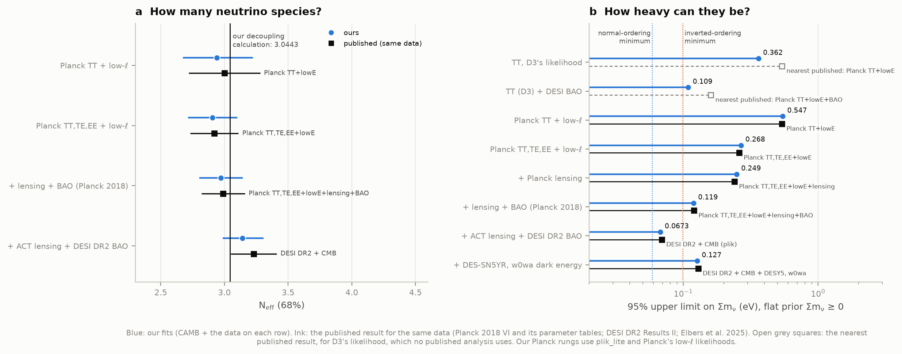
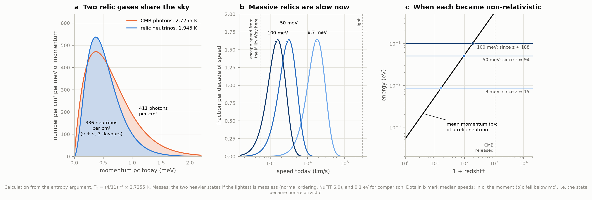
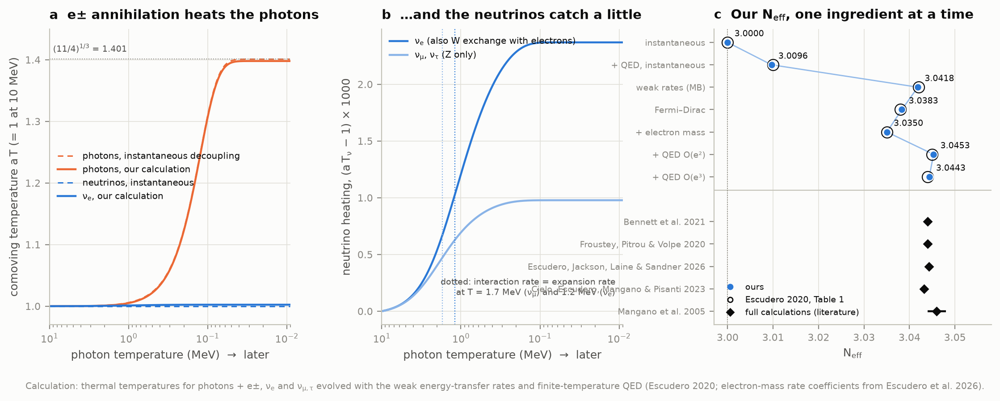
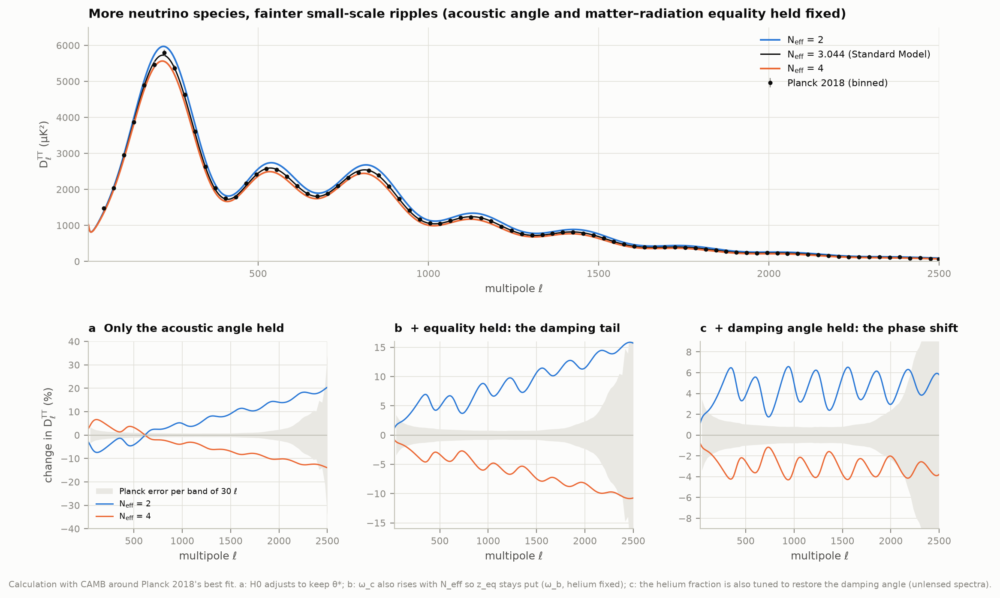
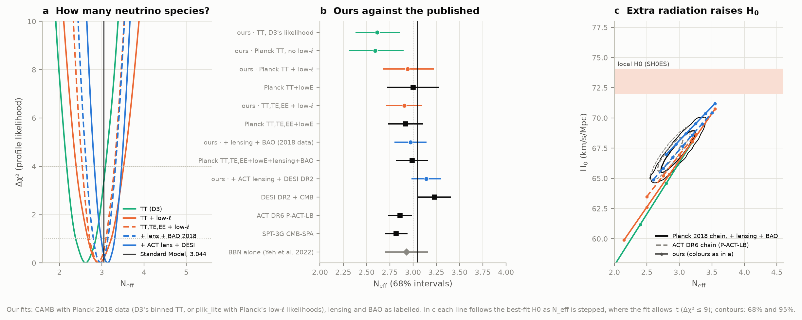
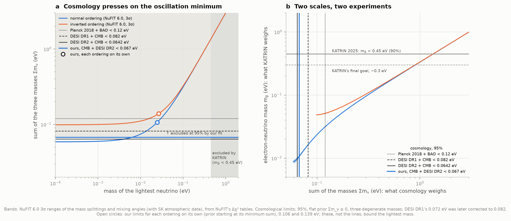
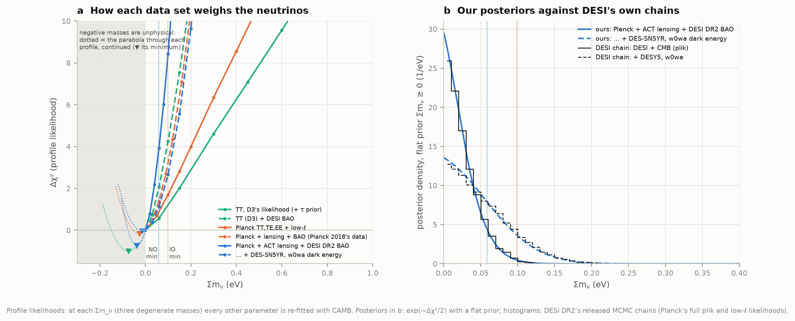
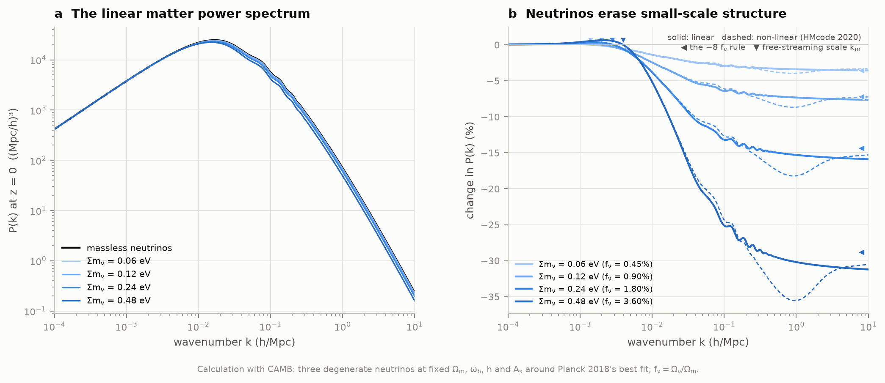

# P3 — The cosmic neutrino background

**One second after the Big Bang, neutrinos stopped interacting with everything else, and they have
streamed through the universe ever since. No one has detected these relic neutrinos directly, but
the cosmic microwave background (CMB) and the clustering of galaxies feel them. Can we see that,
count the neutrino species from the CMB, and understand why cosmology's upper limit on the
neutrino mass now presses against the minimum that oscillation experiments require?**

This project does four things with public data:

1. It **counts and characterises the relic neutrinos today** from the photons we can measure and
   the physics of their decoupling.
2. It **computes N_eff = 3.044 ourselves**: why there are "3.044" neutrino species and not 3.
3. It **fits the CMB and BAO data with CAMB**, letting the number of neutrino species and the
   neutrino mass float, on a ladder of data sets from project D3's temperature fit up to
   Planck + ACT lensing + DESI DR2. Every likelihood was first checked against the χ² the Planck,
   ACT and DESI teams published at their own best fits.
4. It **puts oscillations, KATRIN and cosmology on one plot** (NuFIT 6.0's tables), with our own
   limit on the sum of the masses.

**The answers:**

- **336 relic neutrinos per cm³ at 1.945 K**, against 411 CMB photons per cm³ at 2.7255 K. Counting
  the heat they caught while decoupling, **339.8 per cm³**. If the heaviest weighs 50 meV, it now
  drifts at a median **2,850 km/s**, too fast for the Milky Way (escape speed ~530 km/s) to hold.
- **Why "3.044" species, not 3: our own calculation gives N_eff = 3.0443**, reproducing every row of
  Escudero's (2020) table and agreeing with project P2's independent code to all five decimals. The
  full momentum-resolved calculation gives 3.0440 ± 0.0002 (Bennett et al. 2021).
- **Counting them in the CMB.** With Planck's 2018 data alone, our fits give
  **N_eff = 2.97 ± 0.17** (Planck's own analysis of the same data: 2.99 ± 0.17), and with ACT lensing
  and DESI DR2 BAO, **3.14 ± 0.16**: three neutrino species, with no room for a fourth (N_eff ≈ 4
  is excluded at more than 5σ). Extra radiation cannot fix the Hubble tension: reaching the local
  H₀ = 73 km/s/Mpc would need N_eff ≈ 3.9, disfavoured at 4.5σ.
- **Weighing them.** CMB + DESI DR2: **Σm_ν < 0.067 eV** (95%; DESI's own analysis with the same
  Planck likelihood: 0.069). That is just above the **0.059 eV** minimum that oscillations require for
  the normal ordering, and below the inverted ordering's **0.099 eV**; our fit disfavours the inverted
  ordering's minimum by Δχ² = 4.5 relative to the normal ordering's. Taking the normal ordering on
  its own (sums counted from its 0.059 eV minimum), the limit is 0.106 eV, so the lightest neutrino
  weighs **less than 25 meV** (Elbers et al. 2025: 23 meV).
- **The tension is real but modest.** The data prefer *less* clustering than any positive mass gives:
  a parabola through our profile, continued to negative masses, puts the best fit at
  **Σm_ν = −0.038 ± 0.045 eV** (Elbers et al. 2025: −0.036 ± 0.043), about 2σ from the normal
  ordering's minimum. Let dark energy evolve (w0wa, with DES-SN5YR) and the limit doubles to
  **0.127 eV** (DESI: 0.129) and the tension disappears.
- **What each data set adds.** D3's temperature fit alone allows Σm_ν < 0.36 eV; adding DESI DR2's
  distances tightens it 3.3-fold to 0.109 eV. Every rung of Planck's own data is reproduced:
  < 0.547, 0.268, 0.249, 0.119 eV against Planck's published 0.54, 0.26, 0.24, 0.12.
- **Laboratory scales.** KATRIN's m_β < 0.45 eV (2025) allows Σm_ν up to 1.35 eV, 20 times more than
  cosmology, but measures the mass directly, with no cosmological model in between.



An **interactive page**, [figures/neutrino_mass_explorer.html](figures/neutrino_mass_explorer.html)
(50 kB, works offline), lets you pick the ordering and the lightest mass and shows what oscillation
experiments, KATRIN, double-β decay and our CMB + DESI fit would each say, with today's speeds of
the three relic states and the dent their mass leaves in the matter power spectrum.

## Results

### 1. The relic neutrinos today

| | Value | How |
|---|---|---|
| CMB photons | **410.7 per cm³** at 2.7255 K | the measured CMB temperature (Fixsen 2009) |
| Relic neutrino temperature | **1.945 K** (1.676 × 10⁻⁴ eV) | (4/11)^{1/3} × 2.7255 K, the entropy argument |
| Relic neutrinos, each flavour (ν + ν̄) | **112.0 per cm³** | 3/11 of the photons |
| All three flavours | **336.0 per cm³**; **339.8** with the heat they caught at decoupling | our decoupling calculation (section 2) |
| Typical momentum today | 3.15 kT_ν = **0.53 meV** | Fermi–Dirac average |
| Mass → density | Ω_ν h² = Σm_ν / **94.06 eV** (instantaneous decoupling), / **93.03 eV** (ours) | Escudero 2020 gets 93.05 eV in the same approximation; with neutrino chemical potentials and spectral distortions the full calculations give 93.12–93.14 eV |
| Capture rate on 100 g of tritium (PTOLEMY's idea) | **4.06 per year** (Dirac) or **8.11** (Majorana) | σv = 3.834 × 10⁻⁴⁵ cm² c (Long, Lunardini & Sabancilar 2014: 4.06 and 8.12) |

How fast are they? It depends on the mass of each state, which oscillations only partly fix. If
the lightest neutrino is massless (normal ordering), the other two weigh 8.7 and 50.1 meV:

| State | Mass | Median speed today | Non-relativistic since |
|---|---|---|---|
| ν₁ | 0 | light speed | never |
| ν₂ | 8.7 meV | 16,500 km/s | z ≈ 15 |
| ν₃ | 50.1 meV | 2,850 km/s | z ≈ 94 |
| (comparison) | 100 meV | 1,430 km/s | z ≈ 188 |

Even the heavier states move faster than the Milky Way's escape speed (about 530 km/s at the Sun;
Deason et al. 2019), so our Galaxy barely gathers them: simulations put the local excess at about
3–12% for 50 meV and 14–50% for 100 meV (Zimmer et al. 2023; Mertsch et al. 2020). A detector would
need to see **4 captures a year in 100 g of tritium**, whose electrons emerge 2m_ν (about 0.1 eV)
above the end of tritium's ordinary β-decay spectrum, and resolve that gap. KATRIN, built to weigh neutrinos, limits the local relic density to
less than 10¹¹ times the mean (Aker et al. 2022).



### 2. Why N_eff = 3.044 and not 3

Project P2 computed the full thermal history of the first minutes, including neutrino decoupling.
We solved decoupling again in independent code, because two of this project's numbers depend on
it: how much warmer the neutrinos are than the textbook says, and the "N_eff = 3.044" that the
CMB fits below test. Both codes give **N_eff = 3.0443**. The full momentum-resolved calculations
give 3.0440 ± 0.0002 (Bennett et al. 2021).

| Ingredient added | Our N_eff | Escudero 2020, Table 1 |
|---|---|---|
| Instantaneous decoupling (the textbook) | 3.0000 | 3.000 |
| + QED plasma, O(e²) | 3.0106 | 3.011 |
| + QED plasma, O(e³) | 3.0097 | 3.010 |
| Weak rates, Maxwell–Boltzmann statistics | 3.0418 | 3.042 |
| Weak rates, Fermi–Dirac statistics | 3.0383 | 3.038 |
| + the electron's mass in the rates | 3.0350 | 3.035 |
| + QED O(e²) | 3.0453 | 3.045 |
| **+ QED O(e³): our answer** | **3.0443** | **3.044** |

Every row agrees with Escudero's table to its printed precision, and our final temperatures match
his appendix to five decimals (z_γ = 1.39790, z_νe = 1.00237, z_νμ = 1.00098). In words:

- **The neutrinos caught some of the heat.** Electron neutrinos ended up 0.46% warmer relative to
  the photons than (4/11)^{1/3}, and muon and tau neutrinos 0.32% warmer. The electron neutrinos
  gain more because they also interact with electrons through W exchange. That adds +0.04 to N_eff.
- **The plasma was not an ideal gas.** Thermal QED corrections reduce the pressure of the e±γ
  plasma. Less of the annihilation heat ends up in the photons, which raises N_eff by +0.01.
- **The electron's mass** weakens annihilation into neutrinos as the temperature falls towards
  m_e, removing 0.003.
- **When did they decouple?** The neutrinos' temperatures stop following the photons' when the
  energy exchange becomes slower than the expansion: at T ≈ 1.7 MeV for ν_μ and ν_τ and 1.2 MeV for
  ν_e, about 0.25 and 0.5 seconds after the Big Bang. (Rates defined other ways give 1.5–2.5 MeV;
  P2 quotes 0.12–0.34 s.)

A note on the last digit: in 2023 Cielo et al. found 3.043 by adding higher-order QED corrections
to the annihilation rate. Independent calculations since (Drewes et al. 2024; Jackson & Laine 2024)
find that effect about 30 times smaller, and the Particle Data Group keeps 3.044.



### 3. Counting neutrino species in the CMB

**What N_eff does to the CMB.** More radiation means a faster expansion before recombination. Most of
that is absorbed by other parameters: the acoustic angle is measured so precisely that the Hubble
constant adjusts to keep it, and the epoch of matter–radiation equality, read from the peak heights,
is restored by more dark matter. What remains is the damping tail. Photons diffuse a distance that
scales as H^{−1/2} while the sound horizon scales as H^{−1}, so a faster expansion makes the damping
scale larger relative to the acoustic scale (Hou et al. 2013). With θ* and z_eq held fixed,
N_eff = 2 raises the ℓ = 1500–2500 power by **13%** and N_eff = 4 lowers it by **9%**; Planck
measures each Δℓ = 30 band there to 1–6% (up to ℓ ≈ 2200). Holding the damping angle fixed too (by
adjusting the helium fraction) leaves what only free-streaming particles do: they pull the sound
waves along, which shifts the peaks slightly towards larger scales and lowers them (by another 3%
for N_eff = 4; Bashinsky & Seljak 2004). That **phase shift** is the signal Follin et al. (2015)
detected in Planck data.



**Our measurements**, from profile likelihoods (68% intervals):

| Data | Ours | Published, same data |
|---|---|---|
| TT, D3's likelihood (+ τ prior) | 2.62 −0.23/+0.24 | (no published equivalent) |
| TT (D3) + DESI DR2 BAO | 3.05 −0.19/+0.18 | — |
| Planck TT (plik_lite), τ prior, no low-ℓ data | 2.59 −0.28/+0.31 | — |
| **Planck TT + low-ℓ TT, EE** | **2.94 −0.27/+0.28** | **3.00 ± 0.28** (Planck TT+lowE) |
| **Planck TT,TE,EE + low-ℓ** | **2.91 ± 0.19** | **2.92 ± 0.19** |
| **+ Planck lensing + 2018 BAO** | **2.97 ± 0.17** | **2.99 ± 0.17** |
| Planck + ACT lensing + DESI DR2 BAO | 3.14 ± 0.16 | 3.23 ± 0.18 (DESI + CMB with CamSpec; Elbers et al. 2025) |

Published reference points: ACT DR6 P-ACT-LB 2.86 ± 0.13 (with DESI DR1); SPT-3G CMB-SPA
2.82 ± 0.12; big-bang nucleosynthesis alone 2.93 ± 0.23 (Yeh et al. 2022's N_ν = 2.889 ± 0.229,
converted with their N_eff = 1.0147 N_ν). Planck's own chains, read from its parameter grid, give
2.999 ± 0.280, 2.918 ± 0.187 and 2.985 ± 0.173 for the three bold rows; ACT's give 2.864 ± 0.127.

- **Planck's analysis is reproduced.** On the same data our N_eff agrees with Planck's to within
  0.2σ, with the same error bars. Our likelihood is not Planck's code: it uses Planck's compressed
  high-ℓ likelihood (plik_lite) and our own ports of the low-ℓ likelihoods.
- **D3's TT result is too precise and too low**, and the ladder separates the two. D3's fit treats
  the 83 band powers as independent, with no foreground or calibration uncertainty; Planck's own
  compressed likelihood of the same multipoles, with its full covariance, gives an error about 20%
  larger (0.29 against 0.24) and the same low value. That low value comes from the missing data
  below ℓ = 30: without them the fit trades N_eff against the spectral tilt n_s, and both slide down
  (N_eff 2.59, n_s 0.938). Planck's low-ℓ data pin n_s (0.958), and N_eff returns to 2.94.
- **DESI DR2 pulls N_eff up.** Replacing the 2018 BAO and Planck lensing by DESI DR2 and ACT lensing
  raises N_eff by 0.17. DESI's distances prefer a lower matter density and a higher H₀, and extra
  radiation is one way to raise H₀. The remaining 0.5σ gap to the published 3.23 is plausibly the
  CMB likelihood (we use Planck's 2018 plik_lite, DESI's headline uses the newer CamSpec).
- **Extra radiation raises H₀** by about 6 km/s/Mpc per extra species (panel c). To reach the local
  H₀ = 73.0 ± 1.0 km/s/Mpc (SH0ES), N_eff would have to be 3.9, which our CMB + DESI fit disfavours
  at 4.5σ.



### 4. Weighing neutrinos



**95% upper limits on Σm_ν** (three equal masses, flat prior Σm_ν ≥ 0), from our profile likelihoods:

| Data | Ours | Published, same data |
|---|---|---|
| TT, D3's likelihood (+ τ prior) | 0.362 eV | — |
| TT (D3) + DESI DR2 BAO | 0.109 eV | (Planck TT+lowE+BAO with the 2018 BAO: 0.16) |
| **Planck TT + low-ℓ** | **0.547 eV** | **0.54** (0.537 in Planck's tables) |
| **Planck TT,TE,EE + low-ℓ** | **0.268 eV** | **0.26** (0.257) |
| **+ Planck lensing** | **0.249 eV** | **0.24** (0.241) |
| **+ 2018 BAO** | **0.119 eV** | **0.12** (0.1205 from Planck's chain) |
| **Planck + ACT lensing + DESI DR2 BAO** | **0.067 eV** | **0.0691** (DESI DR2, same Planck likelihood; 0.0642 with CamSpec) |
| **… + DES-SN5YR, w0wa dark energy** | **0.127 eV** | **0.129** (DESI DR2) |

DESI's own released chains, read directly, give 0.0642, 0.0691 and 0.1291 eV, as printed in their
paper. Planck's chain gives 0.1205.

- **What BAO does.** The CMB alone measures the matter density only in combination with H₀; BAO
  breaks that degeneracy, so any extra matter in neutrinos shows up as a mismatch. On D3's
  temperature fit, DESI DR2 tightens the limit from 0.36 to 0.109 eV, a factor 3.3.
- **The ordering.** With CMB + DESI, the inverted ordering's minimum (Σm_ν = 0.099 eV) is disfavoured
  relative to the normal ordering's (0.059 eV) by Δχ² = 4.5. Taking each ordering on its own, with
  the prior starting at its minimum sum, the limits become < 0.106 eV (normal) and < 0.139 eV
  (inverted), so the lightest neutrino weighs less than 25 meV or 27 meV (the open circles in the
  figure). Elbers et al. publish 0.105 and 0.135 eV, and 23 and 24 meV, with CamSpec; DESI's chain
  with our Planck likelihood gives 0.109 eV for the normal ordering. Oscillation data themselves
  prefer the normal ordering by Δχ² = 6.1 with Super-Kamiokande's atmospheric data and slightly
  prefer the inverted ordering without them (NuFIT 6.0, from its tables).
- **"Negative" neutrino mass.** Our CMB + DESI profile rises from Σm_ν = 0 like the right half of a
  parabola centred at **−0.038 ± 0.045 eV** (Elbers et al.'s profile likelihood: −0.036 ± 0.043).
  This does not mean neutrinos have negative mass. It means the data prefer slightly *less*
  suppression of clustering (or more CMB lensing) than ΛCDM gives even with massless neutrinos. The
  normal ordering's minimum sits 2.1σ from that preferred value. Elbers et al., who continue the
  neutrinos' effect on the CMB and on distances consistently to negative masses instead of
  continuing a parabola, find a stronger preference: Σm_ν,eff = −0.101 +0.047/−0.056 eV.
- **Evolving dark energy loosens it.** With w0 and wa free (and DES-SN5YR supernovae), our fit
  finds w0 = −0.76 ± 0.06 and wa = −0.83 ± 0.23 at Σm_ν = 0.06 eV (DESI's chain, with the mass
  free: −0.758 ± 0.058 and −0.82 +0.26/−0.21), and the limit doubles to 0.127 eV. The parabola's
  centre moves to −0.015 eV, so the tension with the oscillation minimum disappears (1.1σ). Dark
  energy that changes with time can mimic part of what massive neutrinos do to distances, which is
  why "cosmology says Σm_ν < 0.07 eV" is a statement within ΛCDM.
- **KATRIN** measures the mass directly, with no cosmology assumed: m_β < 0.45 eV (90%, 2025). Read
  through the oscillation parameters, that allows Σm_ν < 1.35 eV, 20 times looser than cosmology.




### 5. Neutrinos and the cosmic web

Massive neutrinos are hot dark matter. Once non-relativistic they still move at thousands of km/s,
too fast to fall into small structures, so on scales smaller than their free-streaming length a
fraction f_ν = Ω_ν/Ω_m of the matter does not cluster, and the rest grows more slowly. Our CAMB
runs (three equal masses, at fixed Ω_m, ω_b, h and A_s):

| Σm_ν | f_ν | Linear P(k) at k = 1 h/Mpc | ÷ f_ν | Non-linear (HMcode 2020) | ÷ f_ν | σ₈ |
|---|---|---|---|---|---|---|
| 0.06 eV | 0.45% | −3.4% | −7.5 | −4.0% | −8.8 | 0.814 |
| 0.12 eV | 0.90% | −7.3% | −8.1 | −8.7% | −9.6 | 0.799 |
| 0.24 eV | 1.80% | −15.3% | −8.5 | −18.2% | −10.1 | 0.768 |
| 0.48 eV | 3.60% | −30.2% | −8.4 | −35.5% | −9.9 | 0.710 |

The textbook "−8 f_ν" (Hu, Eisenstein & Tegmark 1998; Lesgourgues & Pastor 2006) holds to about
10%, and non-linear growth deepens it to about −10 f_ν at k ≈ 1 h/Mpc, as N-body simulations find
(Brandbyge et al. 2008; Bird, Viel & Haehnelt 2012). At the smallest allowed mass, 0.06 eV, the
whole effect is a few percent. That is why the masses are weighed through the combination of
CMB lensing and BAO, and why the next decade's surveys aim at it directly.




---

## How it works

### The relic neutrinos (`relic.py`)

While the universe was hotter than about 1 MeV, neutrinos were kept in thermal equilibrium by the
weak interactions. When those froze out, each neutrino's momentum simply stretched with the
expansion, p ∝ 1/a. The population therefore kept its Fermi–Dirac *shape* forever, even after the
neutrinos became slow: the occupation number f(p) = 1/(e^{p/kT_ν} + 1) is frozen in momentum, and
only the meaning of a momentum changed (a speed v = pc²/E).

The photons cooled the same way except for one event. When the temperature fell below the
electron mass, electrons and positrons annihilated and handed their entropy to the photons, not to
the neutrinos, which had already decoupled. Entropy conservation (g_s = 2 + 7/8 × 4 = 11/2 before
annihilation, 2 after) makes the photons warmer by (11/4)^{1/3}. Hence T_ν = (4/11)^{1/3} T_γ, and
each flavour of neutrinos plus antineutrinos numbers 3/11 of the photons.

### Decoupling, done properly (`decoupling.py`)

The entropy argument assumes the neutrinos had fully decoupled before annihilation began. They had
not quite. We follow the method of Escudero (2019, 2020): photons with electrons and positrons,
electron neutrinos, and muon plus tau neutrinos are each a thermal gas with its own temperature.
Energy conservation and the weak interactions' energy-transfer rates evolve the three temperatures
from 10 MeV to 9 keV:

- **The rates.** δρ/δt ∝ G_F² [(g_L² + g_R²)(T_γ⁹ − T_ν⁹) and a scattering term], exact for
  Maxwell–Boltzmann statistics and massless electrons. Correction coefficients turn that into
  Fermi–Dirac statistics and add the electron mass as a function of m_e/T. We read those
  coefficients from the table published by Escudero, Jackson, Laine & Sandner (2026).
- **The QED plasma.** At these temperatures the electron–positron–photon plasma is not an ideal
  gas: thermal masses lower its pressure. We include the O(e²) and O(e³) corrections of Bennett et
  al. (2020). In the massless limit they reproduce the textbook −(5/288)e²T⁴ and
  e³T⁴/(36√3 π) to a few parts in 10⁶ (test_physics.py).
- **N_eff** is then the ratio of the neutrinos' radiation density to the photons', in units of one
  ideally decoupled species: N_eff = (8/7)(11/4)^{4/3} ρ_ν/ρ_γ.

This "momentum-averaged" approach treats each neutrino spectrum as thermal. The full calculations
follow every momentum separately, including the small spectral distortions and flavour
oscillations; for N_eff the two approaches agree to about 0.0003.

### The CMB and BAO fits (`cmb_model.py`, `likelihoods.py`, `fitting.py`, `cmb_fits.py`)

**The model.** CAMB 2.0.4 computes, for each trial universe, the lensed CMB spectra to ℓ = 3000,
the lensing potential, the BAO distances, distances for supernovae and derived numbers. Settings:
lensing accuracy 4, non-linear lensing (HMcode 2016), helium from BBN given ω_b and N_eff
(PArthENoPE), as in DESI's runs. With N_eff free we keep one 0.06 eV neutrino (Planck's
`base_nnu`). With Σm_ν free we use three equal masses (Planck's and DESI's `base_mnu`). Each CAMB
run takes ~10 s on one core and is cached on disk.

**The likelihoods**, each written as a vector of residuals whose squares sum to χ²:

| Likelihood | Data | Check against the published χ² |
|---|---|---|
| D3's TT | Planck's 83 binned TT band powers, ℓ = 30–2508, independent errors | binning reproduces Planck's binned best fit to 4 × 10⁻⁹ |
| plik_lite | Planck's foreground-marginalised TT, TE, EE (613 bins, full covariance, calibration) | identical to an independent implementation |
| low-ℓ TT | Planck's Commander likelihood, ℓ = 2–29 (Gaussianised Blackwell–Rao) | 23.2515 at Planck's best fit (Planck: 23.2515); 22.433 at DESI's (DESI: 22.432) |
| low-ℓ EE | Planck's SimAll table, ℓ = 2–29 (this is what measures τ) | 396.0499 at Planck's best fit (Planck: 396.0499); 395.87 at DESI's (DESI: 395.84) |
| Planck 2018 lensing | 9 band powers, L = 8–400, with the CMB-dependent correction | 8.954 and 9.005 at two Planck best fits (Planck: 8.966, 9.022) |
| ACT DR6 + Planck PR4 lensing | 19 band powers with ACT's normalisation and N1 corrections | 19.902 at DESI's best fit (DESI: 19.934; without the corrections it would be 21.27) |
| DESI DR2 BAO | 13 distance ratios with covariance | 11.1958 at DESI's best fit (DESI: 11.1964) |
| BAO 2018 | 6dFGS, SDSS MGS (tabulated χ²), BOSS DR12 | 0.003, 1.58, 3.698 (Planck: 0.003, 1.54, 3.710) |
| DES-SN5YR | 1,829 supernovae, offset profiled out (D5's implementation) | as in D5 |

The low-ℓ EE table is a step function in Planck's code; we interpolate through the middle of each
step so the fitter sees a smooth surface (χ² differs by 0.06 from the step function at Planck's best
fit, a near-constant offset).

ACT's lensing likelihood corrects the theory for how the lensing reconstruction depends on the CMB
spectra. Those corrections come as 2.9 GB of matrices inside a 361 MB archive. They are linear in
the theory spectra, so `fetch_data.reduce_act_lensing` streams the archive once and keeps only their
projections onto ACT's bins (2 MB).

**Fitting.** Gauss–Newton least squares: the Jacobian of the residuals by central differences, all
CAMB runs in parallel, a few iterations to converge. The covariance (JᵀJ)⁻¹ gives Gaussian error
bars. For N_eff and Σm_ν we also compute **profile likelihoods**: at each value on a grid, every
other parameter is re-fitted (starting from the full fit's linear prediction, with Broyden updates
of its Jacobian and a fresh Jacobian if a step fails). The full fit itself is always included as
the profile's lowest point. A Bayesian 95% upper limit then follows by integrating exp(−Δχ²/2)
with a flat prior Σm_ν ≥ 0, as the published limits use. Where the likelihood is Gaussian the
profile and the Bayesian marginal coincide.

**The optical depth.** D3 held τ fixed. Our D3 rungs give τ a Gaussian prior from Planck's low-ℓ
polarisation alone (0.0506 ± 0.0086). All other rungs use Planck's actual low-ℓ likelihoods.

### Masses (`masses.py`)

Oscillations measure Δm²₂₁ and |Δm²₃ℓ|, whose sign is unknown. Given the lightest mass, the three
masses, their sum, the β-decay mass m_β = (Σ|U_ei|² m_i²)^{1/2} and the double-β mass
m_ββ = |Σ U_ei² m_i| follow. We read NuFIT 6.0's one-dimensional Δχ² tables ourselves. The best
fits, from a parabola through the grid around each minimum, reproduce their Table 1. The 3σ
ranges set the bands.

---

## Honest notes

- **Our likelihoods are stand-ins, checked rather than assumed.** We use Planck's compressed
  high-ℓ likelihood (plik_lite) instead of the full plik code, and ports of Planck's low-ℓ codes.
  Each piece reproduces the χ² Planck, ACT or DESI recorded at their own best fits (table above),
  and the resulting limits match the published ones to within 1–4%. Planck's low-ℓ EE table is read
  with linear interpolation instead of Planck's step function, which shifts its χ² by 0.06.
- **Profile likelihoods, not MCMC.** For each value of N_eff or Σm_ν we re-fit every other parameter.
  Bayesian limits then come from integrating exp(−Δχ²/2) with a flat prior. This equals the
  marginal posterior when the likelihood is Gaussian in the other parameters, and DESI's chains
  confirm it here (figure 6b). Each profile has about ten points (steps of 0.02 eV for the
  tightest data, up to 0.3 eV for the loosest). Where a parabola fits the profile, a spline through
  the points and the fitted parabola give limits that agree to 1.5% or better.
- **Reading the lightest mass off figure 5.** The horizontal limit lines count Σm_ν from 0. In the
  normal ordering a sum below 0.059 eV is impossible, so reading the lightest mass off where our
  line crosses the band (6 meV) would overstate the bound. The 25 meV quoted above comes from the
  limit computed for each ordering on its own.
- **Three equal masses.** Like Planck and DESI, the mass fits use three degenerate neutrinos. The
  real masses are split, but for the sum at the precision of today's data the difference is
  negligible (Lesgourgues & Pastor 2006).
- **The "negative mass" numbers** are extrapolations of a parabola through the physical side of the
  profile. They show the direction and rough size of the preference, not a measurement.
- **The decoupling calculation** treats each neutrino spectrum as thermal. Full calculations that
  follow each momentum and include flavour oscillations give 3.0440 instead of 3.0443, and the
  neutrino number density 339.5 instead of our 339.8 per cm³.
- **The CMB "TT" rungs** are demonstrations of how the data constrain neutrinos, as the plan
  intended. Our D3-style N_eff (2.62 ± 0.24) is too low and too precise, as the rungs that add
  Planck's covariance and low-ℓ data show.
- **The relic-neutrino clustering and capture numbers** (section 1) are literature values or simple
  calculations, not simulations of our own.
- **CAMB 2.0.4** is newer than the versions Planck (2018) and DESI (1.5.4) used. At DESI's best fit,
  our H₀ derived from the same θ_MC agrees with DESI's to 1 × 10⁻⁵, r_d to 6 × 10⁻⁶ and σ₈ to
  3 × 10⁻⁴.

---

## Running it

```bash
cd ..                            # repository root
python3 -m venv .venv
source .venv/bin/activate
pip install numpy scipy pandas matplotlib camb threadpoolctl

cd 69-neutrino-background
python fetch_data.py             # ~0.95 GB (hard links where D3/D5 already have files)
python run.py                    # fits ~2-3 h the first time (6 CAMB workers); ~1 min afterwards
python test_physics.py           # 50 self-checks, under a minute
```

`python fetch_data.py --no-chains` skips the MCMC chains used only as answer keys (~0.3 GB), and
`--no-act-lensing` skips ACT's 361 MB archive (the rungs that use it are then not built).
`python tools/run_fits.py tt plik` runs only some rungs. Every CAMB run is cached under
`data/cache/theory/` (~160 kB each, ~2,000 runs, 0.32 GB), and every fit and profile under
`data/derived/fits/`, so an interrupted run resumes where it stopped and a rerun takes about a minute.
Once the cache is filled the project runs with no network at all.

### Files

| File | What it does |
|---|---|
| `config.py` | Paths, conventions, fit settings, and every published value we compare with, with its source |
| `fetch_data.py` | Downloads (with checksums), hard links to D3's and D5's copies, ranged reads from Planck's 11.8 GB grid archive, the streamed reduction of ACT's lensing matrices, and all loaders |
| `relic.py` | The relic neutrinos today: densities, temperatures, speeds, free streaming, tritium capture |
| `decoupling.py` | Neutrino decoupling and N_eff (Escudero's method): plasma thermodynamics, QED, weak rates |
| `masses.py` | Masses from oscillations, m_β, m_ββ, NuFIT bands |
| `cmb_model.py` | CAMB wrapper: one call → every prediction; disk cache; worker pool |
| `likelihoods.py` | D3's TT, plik_lite, low-ℓ TT and EE, Planck and ACT lensing, BAO (DESI DR2, 2018), supernovae |
| `fitting.py` | Gauss–Newton fits, profile likelihoods, limits |
| `cmb_fits.py` | The ladder of data combinations, the fits, and the answer keys from published chains |
| `illustrations.py` | CMB spectra at fixed acoustic scale; matter power spectra (labelled calculations) |
| `analysis.py` | Runs every step and writes `data/results.json` |
| `figures.py`, `plotstyle.py` | Every figure |
| `explorer.py`, `explorer_template.html` | The interactive page `figures/neutrino_mass_explorer.html` |
| `run.py` | One command for everything |
| `test_physics.py` | Self-checks: limits of every formula, Escudero's table, every likelihood against the published χ² |
| `tools/run_fits.py`, `tools/check_explorer.js` | Run selected rungs; drive the page in headless Chromium |


---

## Data credits

- **Planck** (ESA): 2018 power spectra and best-fit models, plik_lite, low-ℓ and lensing likelihoods
  (Planck Collaboration 2020, A&A 641, A5, A6, A8), via the Planck Legacy Archive and Cobaya's
  native-likelihood data (CobayaSampler/planck_native_data, planck_supp_data_and_covmats); parameter
  grid chains via NASA/IPAC IRSA.
- **ACT DR6** lensing likelihood (Madhavacheril et al. 2024, Qu et al. 2024; act_dr6_lenslike v1.2)
  and P-ACT-LB N_eff chains (Calabrese et al. 2025), via NASA LAMBDA.
- **DESI DR2** BAO (DESI Collaboration 2025) via CobayaSampler/bao_data; released cosmology chains
  and best fits from data.desi.lbl.gov.
- **BAO 2018**: 6dFGS (Beutler et al. 2011), SDSS DR7 MGS (Ross et al. 2015), BOSS DR12 (Alam et al.
  2017), via CobayaSampler/bao_data.
- **DES-SN5YR** (DES Collaboration 2024) via CobayaSampler/sn_data (D5's copy).
- **NuFIT 6.0** (Esteban et al. 2024, JHEP 12, 216), www.nu-fit.org.
- **Neutrino decoupling rate coefficients**: Escudero, Jackson, Laine & Sandner (2026,
  arXiv:2511.04747), from their public code (github.com/MiguelEA/nudec_BSM, GPL-3.0).
- Software: CAMB (Lewis, Challinor & Lasenby 2000), NumPy, SciPy, Matplotlib, pandas.

All data retrieved 2026-10-19/20.
