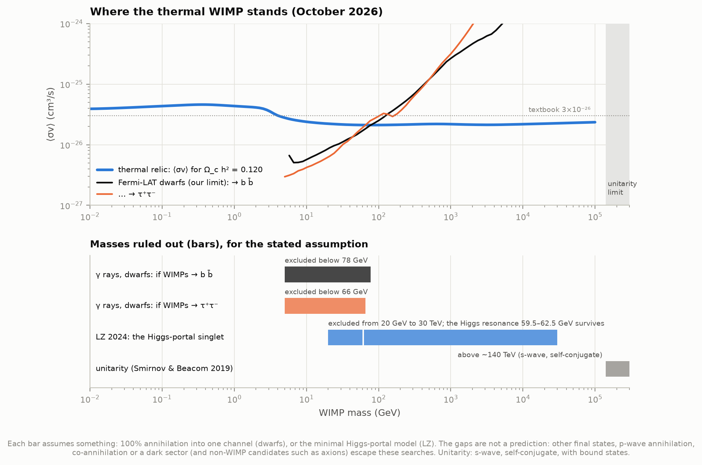
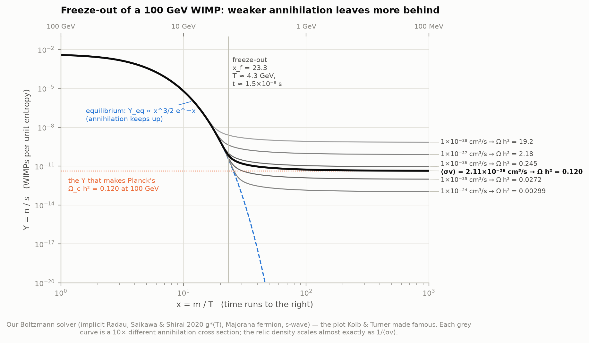
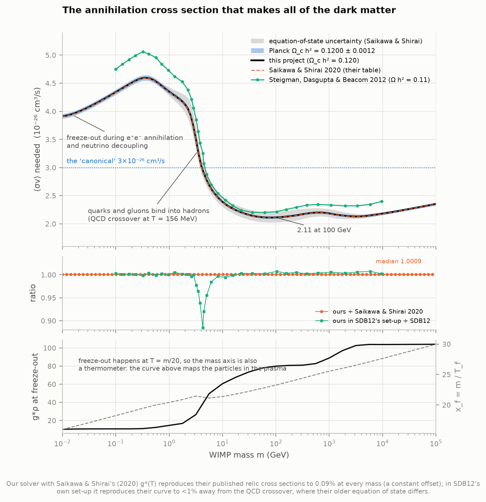
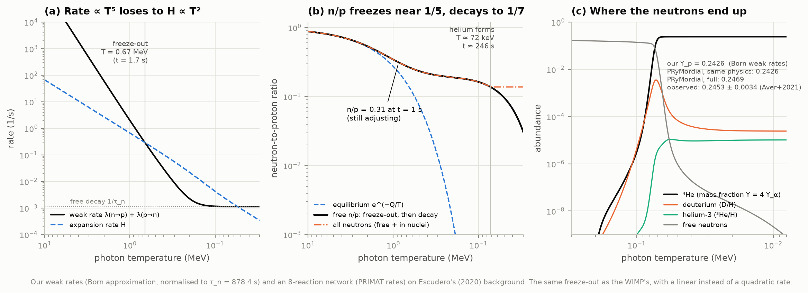
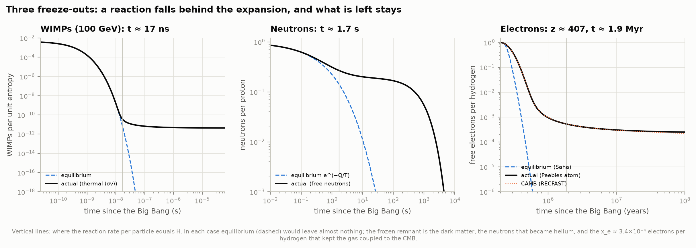
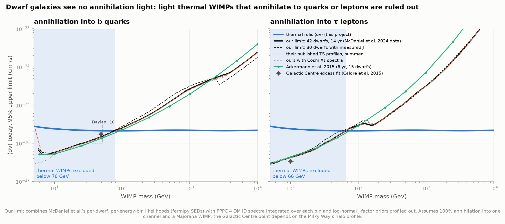
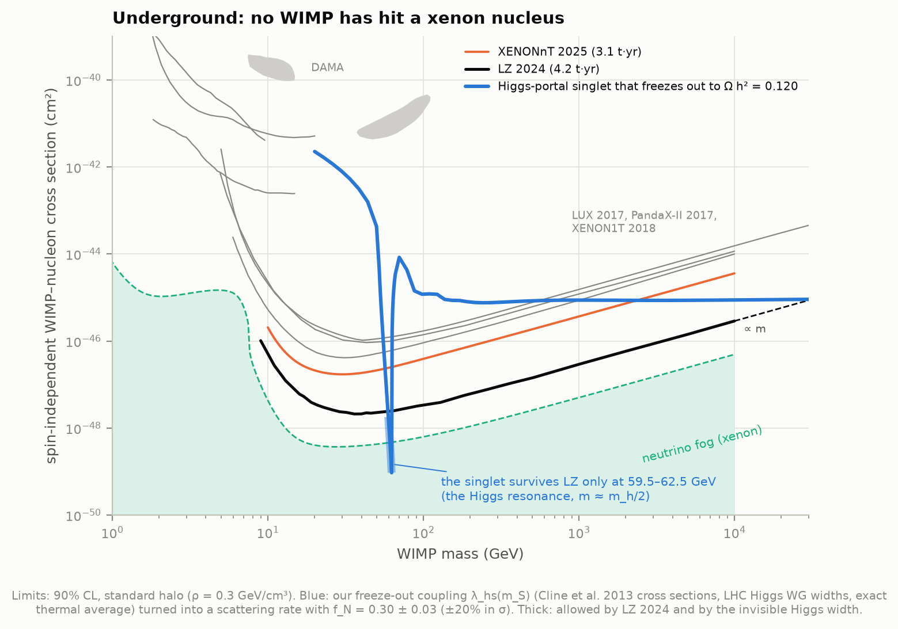
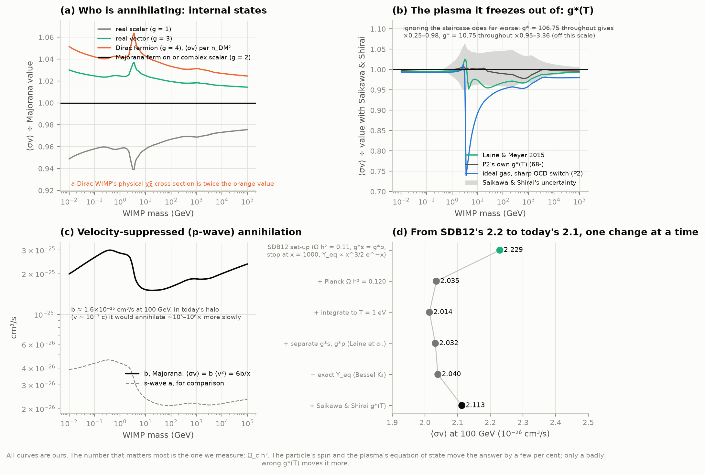

# P4 — Freeze-out: why there is dark matter (if it is a WIMP)

**If dark matter is a particle that once annihilated in pairs, how many would survive? The answer
depends mainly on how strongly they annihilate, and a cross section typical of the weak force gives
about the observed amount: the "WIMP miracle". Can we solve the equation that governs freeze-out,
find the cross section that makes Planck's dark matter density, and see where the searches stand?**

This project solves the Boltzmann equation for a relic's abundance with its own stiff solver and
the Standard Model's measured-and-computed equation of state (Saikawa & Shirai's g\*(T), lattice QCD
included). It finds the annihilation cross section that leaves exactly Planck's Ω_c h² = 0.120 at every
mass from 10 MeV to 100 TeV, and reproduces the published values. It then runs the same physics twice
more: the neutron-to-proton ratio one second after the Big Bang (on to helium, checked against the
BBN code PRyMordial), and the electrons left over after recombination (checked against CAMB). Finally
it asks where the searches stand. It combines 14 years of Fermi-LAT data on 42 dwarf galaxies into its
own gamma-ray limit, from the collaboration's released per-dwarf likelihoods. And it puts the simplest
complete thermal-relic model, a scalar coupled only to the Higgs, onto the LZ and XENONnT
direct-detection plots.

**The answers:**

- **The thermal cross section is ⟨σv⟩ = 2.11 × 10⁻²⁶ cm³/s** at 100 GeV, for a particle that is its
  own antiparticle and annihilates without velocity suppression. It is 2.11–2.39 × 10⁻²⁶ for every
  mass from 10 GeV to 10 TeV, and rises to 4.6 × 10⁻²⁶ near 0.35 GeV, where freeze-out happens in
  a plasma with far fewer particle species. Our solver reproduces Saikawa & Shirai's (2020) published
  values to **0.09–0.13% at every mass**, and to within 0.6% for all four particle types they list and
  for both s- and p-wave annihilation.
- **Why textbooks say 3 × 10⁻²⁶ and Steigman et al. (2012) said 2.2 × 10⁻²⁶.** The textbook number is a
  rounded order-of-magnitude estimate. Steigman, Dasgupta & Beacom's curve, which we reproduce to
  under 1% in their own set-up, was normalised to WMAP's Ω h² = 0.11. Moving to Planck's 0.120 accounts
  for most of the change (−8.7%); the modern equation of state adds +3.6%.
- **Freeze-out happens at x = m/T ≈ 23** for a 100 GeV particle: at T ≈ 4.3 GeV, 15 nanoseconds after
  the Big Bang. A cross section 10× weaker leaves 9× more behind. Kolb & Turner's textbook formula is
  good to a few per cent, except where g\* changes during freeze-out (the quark–hadron era): there it is
  18% too low.
- **The same race, one second in.** The weak reactions that swap neutrons and protons fall behind the
  expansion at **T = 0.67 MeV, 1.7 s** after the Big Bang. At 1 s the neutron-to-proton ratio is 0.31
  and still adjusting. It levels off near 1/5, then decays to **0.14** by the time deuterium survives
  (T = 72 keV, **246 s**). Our weak rates and 8-reaction network give helium **Y_p = 0.2426**,
  D/H = 2.43 × 10⁻⁵; PRyMordial with the same simplifications gives 0.2426 and 2.42 × 10⁻⁵. Its full
  calculation, with the radiative and finite-mass corrections to the weak rates we leave out, gives
  **0.2469**. Helium measured in metal-poor galaxies: 0.2453 ± 0.0034.
- **And after recombination.** Hydrogen forms around 380,000 years, but the recombination rate falls
  behind the expansion at z ≈ 407 (1.9 million years): 3.4 free electrons in 10,000 never find a proton
  (CAMB: 3.37), where equilibrium would have left 10⁻⁵³.
- **Gamma rays.** Our own combination of McDaniel et al.'s (2024) 14-year Fermi-LAT likelihoods for 42
  dwarf galaxies **rules out thermal WIMPs below 78 GeV if they annihilate to b quarks, below 66 GeV for
  τ leptons**. Summing the collaboration's own published profiles gives 81 and 66 GeV. Mild excesses
  in the 14-year data (the strongest, TS ≈ 9 near 12 GeV, is not significant once the many masses and
  dwarfs searched are counted) make these crossings lower than the 6-year result's (94 and 74 GeV
  against the same thermal line, read from Ackermann et al.'s figure).
- **Underground.** The minimal Higgs-portal scalar that freezes out to the right abundance would scatter
  on xenon at σ_SI ≈ 9 × 10⁻⁴⁶ cm² at high mass. **LZ 2024 excludes it at every mass from 20 GeV to
  30 TeV, except a window at 59.5–62.5 GeV** on the Higgs resonance, where annihilation is resonantly
  strong and the coupling tiny. By 30 TeV the coupling would have to be ≈ 9.5, beyond where
  perturbation theory can be trusted.



An **interactive page**, [figures/wimp_freeze_out_lab.html](figures/wimp_freeze_out_lab.html) (150 kB,
self-contained, works offline), runs the same implicit Boltzmann stepper in the browser. Pick a mass,
an annihilation strength, a particle type and s- or p-wave annihilation, and watch the abundance
freeze out. It reads out Ω h² against Planck's value, the freeze-out temperature and time, and whether
our Fermi-LAT limits allow it. Its numbers agree with the Python solver to 2 × 10⁻⁴ (checked in headless
Chromium by `tools/check_explorer.js`). It is also published as a private artifact,
https://claude.ai/artifact/8FS3ZmiDXfUnQ2y6jpn3Q6, from `data/derived/wimp_freeze_out_lab_artifact.html`
(rewritten by `explorer.py`; republish to that URL).

## Results

### 1. Freeze-out, solved

The Boltzmann equation is solved per unit entropy, Y = n/s, against x = m/T (Gondolo & Gelmini 1991),
with SciPy's implicit Radau method from x = 3 to x = 150. After that the equilibrium term is e⁻³⁰⁰ and
the remaining annihilation down to T = 1 eV is an exact integral. Below, a 100 GeV Majorana fermion
with six cross sections:

| ⟨σv⟩ (cm³/s) | 10⁻²⁸ | 10⁻²⁷ | 10⁻²⁶ | **2.11 × 10⁻²⁶** | 10⁻²⁵ | 10⁻²⁴ |
|---|---|---|---|---|---|---|
| Ω h² today | 19.2 | 2.18 | 0.245 | **0.120** | 0.0272 | 0.00299 |
| x_f (Y = 2 Y_eq) | 18.1 | 20.3 | 22.5 | **23.3** | 24.8 | 27.0 |
| x where n_eq⟨σv⟩ = H | 19.9 | 22.3 | 24.6 | **25.4** | 26.9 | 29.3 |



### 2. The cross section that makes all of the dark matter

| | at 100 GeV (10⁻²⁶ cm³/s) |
|---|---|
| Majorana fermion or complex scalar, s-wave (main curve) | **2.113** |
| … with Planck's Ω_c h² ± 1σ (0.1200 ± 0.0012) | 2.091–2.135 |
| … with Saikawa & Shirai's equation-of-state uncertainty | 2.026–2.211 |
| Saikawa & Shirai 2020, their table at 101.5 GeV | 2.111 |
| Dirac fermion, physical χχ̄ cross section | 4.37 |
| p-wave Majorana: b in ⟨σv⟩ = b⟨v²⟩ = 6b/x | 16.0 |

- **Validation.** Against all eight of Saikawa & Shirai's tables (real scalar, Majorana/complex scalar,
  vector, Dirac; s- and p-wave; 91 masses each from 10 MeV to 100 TeV), our values are higher by a
  median 0.09–0.12%, at most 0.6% near the QCD crossover. The offset is the same at every mass, so it is a
  convention (a constant or unit), not physics. Our upper/lower equation-of-state curves reproduce
  their quoted EoS error column to 3% (median). The fast vectorised stepper used for the curves agrees
  with Radau to 3 × 10⁻⁵.
- **Steigman, Dasgupta & Beacom 2012**, in their own set-up (g\*s = g\*ρ, stop at x = 1000, Y_eq ∝ x^3/2 e^−x,
  Ω h² = 0.11, Laine & Meyer's g\* in place of the 2006 Laine & Schröder table they used): median ratio
  1.0015, within 0.8% everywhere except 3–5 GeV (−12% at 4.3 GeV), where the older table puts the
  quark–hadron crossover differently.
- **From 2.2 to 2.1, one change at a time** (100 GeV): SDB12's set-up 2.229 → Planck's Ω h² = 0.120
  **2.035** → integrate to 1 eV instead of x = 1000: 2.014 → separate g\*s and g\*ρ: 2.032 → exact
  Maxwell–Boltzmann Y_eq: 2.040 → Saikawa & Shirai's equation of state: **2.113**.
- **What else moves it** (figure 3). Internal states: a real scalar needs 2.4–6% less, a vector 1.5–4%
  and a Dirac fermion 2.5–6% more (per n_DM²). The equation of state: Laine & Meyer's (2015) table gives up to
  4.8% less near 4 GeV and 3.2% less at 100 GeV, and P2's own interacting build of g\*(T) agrees with
  Saikawa & Shirai to 2.2% everywhere. A textbook ideal gas with a sharp switch from quarks to pions at
  156.5 MeV is up to 26% off around 3.5 GeV. Freezing g\* at one value is far worse: g\* = 10.75
  throughout needs ×3.4, and g\* = 106.75 throughout ×0.25.



### 3. The back-of-envelope formula

Kolb & Turner's (1990) recipe sets x_f from ln[0.038 (g/√g\*) M_Pl m⟨σv⟩] − ½ ln x_f, with g\* at freeze-out,
then Y_∞ = x_f/(√(π/45) M_Pl √g\* m⟨σv⟩). It gives the thermal cross section to within 3% below 0.4 GeV
and above 100 GeV. In between, g\* changes during and after freeze-out (the quark–hadron crossover and
the heavy quarks), and the formula falls to **×0.82 at 4 GeV**.
Integrating λ(x) exactly after x_f (Gondolo & Gelmini 1991) holds 0.957–0.979 throughout. Freeze-out
sits at x_f ≈ 16–30, growing logarithmically with m⟨σv⟩.

### 4. Neutrons: the same race, one second in

| | ours (Born rates, 8 reactions) | PRyMordial, same physics | PRyMordial, full |
|---|---|---|---|
| Y_p (helium-4 mass fraction) | **0.24257** | 0.24256 | 0.24692 |
| D/H | 2.429 × 10⁻⁵ | 2.422 × 10⁻⁵ | 2.445 × 10⁻⁵ |
| (³He + t)/H | 1.034 × 10⁻⁵ | 1.036 × 10⁻⁵ | 1.039 × 10⁻⁵ |

All at η = 6.124 × 10⁻¹⁰ (Planck's Ω_b h² = 0.02237) and τ_n = 878.4 s, on Escudero's (2020)
non-instantaneous-decoupling background (with instantaneous decoupling, Y_p = 0.24246).

- **Weak freeze-out**: the weak rate (∝ T⁵) drops below H at **T = 0.666 MeV, t = 1.70 s**. The
  neutron-to-proton ratio is 0.31 at t = 1 s, 0.20 at 0.3 MeV, and the 12.3% of baryons that are
  neutrons when deuterium survives (T = 72.5 keV, t = 246 s) end up in helium.
- **What the simplifications cost**: our weak rates match PRyMordial's Born-level rates to 10⁻⁶ at every
  temperature. Its radiative, Coulomb, finite-nucleon-mass and thermal corrections raise Y_p by
  **+0.0044** (0.2426 → 0.2469), and the full network adds 10⁻⁵. Measured: 0.2453 ± 0.0034 (Aver et al.
  2021), between the two.
- **Sensitivities**: one extra neutrino species speeds the expansion and raises Y_p by 0.013. The beam
  method's neutron lifetime (887.7 s) instead of the bottle average (878.4 s) raises it by 0.0019. The
  "neutron lifetime puzzle" is therefore just visible in helium, at half the measurement error.



### 5. The third freeze-out: leftover electrons

A Peebles three-level hydrogen atom with CAMB's expansion rate: the recombination rate per free electron
falls below H at **z ≈ 407 (t ≈ 1.9 million years)**, leaving x_e = 3.40 × 10⁻⁴ at z = 200 (CAMB/RECFAST:
3.37 × 10⁻⁴). Equilibrium (Saha) would have left 10⁻⁵³. Those few electrons kept the gas coupled to the
CMB's temperature until z ≈ 150.



### 6. Gamma rays from dwarf galaxies: our own limit

McDaniel et al. (2024) released, for each of 55 dwarfs, the likelihood of 14.3 years of Fermi-LAT photons
as a function of the energy flux in each of 26 bins from 0.5 GeV to 1 TeV. We turn a dark-matter model
into an energy flux per bin (PPPC 4 DM ID photon spectra integrated over the bin), profile each dwarf's
J-factor within its log-normal uncertainty, and sum the likelihoods. The limit is where 2ΔlnL = 2.71.

| 95% limits | b b̄: thermal excluded below | τ⁺τ⁻: below | ⟨σv⟩ limit at 100 GeV, b b̄ |
|---|---|---|---|
| ours, 42 "benchmark" dwarfs | **78 GeV** | **66 GeV** | 2.50 × 10⁻²⁶ |
| ours, 30 dwarfs with measured J | 74 GeV | 58 GeV | 2.75 × 10⁻²⁶ |
| ours with CosmiXs spectra (42) | 85 GeV | 64 GeV | 2.39 × 10⁻²⁶ |
| their published TS profiles, summed (42 / 30) | 81 / 76 GeV | 66 / 60 GeV | |
| Ackermann et al. 2015, 6 yr, 15 dwarfs (their figure) | 94 GeV | 74 GeV | 2.21 × 10⁻²⁶ |

- **Reproduction.** Rebuilding McDaniel et al.'s per-dwarf TS profiles from their likelihood files, with
  their notebook's conventions, matches their published profiles to |ΔTS| < 0.05 near the maximum. The
  conventions are the spectrum at each bin's centre, the J-factor profiled ×10^±3, and the likelihood
  held constant beyond the scan. Summed over the sample, our limits with their conventions are within
  0.4–0.9% of theirs (median). Our standard version, with fluxes integrated over each bin, is 1–2% weaker.
- **Which dwarfs matter.** At 100 GeV the b b̄ limit rests mostly on Ursa Major II, Draco, Segue 1 and
  Ursa Minor, the nearest and densest.
- **The excesses.** The largest combined TS is 9.2 (b b̄, near 12 GeV) and 9.0 (τ⁺τ⁻, at our 5 GeV
  edge). McDaniel et al. calibrate such numbers against random blank fields (4.5 GB, not reproduced
  here) and find global significances of only ~0.5σ.
- **The Galactic Centre excess** best fit for b b̄ (Calore et al. 2015: 48.7 GeV, 1.75 × 10⁻²⁶ cm³/s, for a
  local density of 0.4 GeV/cm³) sits right at our limit. The tension is real but depends on the
  Milky Way's halo profile.



### 7. Underground: a thermal relic on the direct-detection plane

For the Higgs-portal scalar singlet, freeze-out fixes the coupling λ_hs at each mass and the coupling fixes
the scattering rate: σ_SI = λ² f_N² μ² m_n²/(4π m_h⁴ m_S²). We solve for λ_hs(m_S) with our Boltzmann
solver and the exact thermal average, using Cline et al.'s (2013) annihilation cross sections and the LHC
Higgs Working Group's widths (λ = 0.037 at 100 GeV, 0.31 at 1 TeV, 3.1 at 10 TeV).

- **LZ 2024** (2.1 × 10⁻⁴⁸ cm² at 36 GeV): the singlet survives only at **59.5–62.5 GeV**. There the
  annihilation is resonantly enhanced by the 4-MeV-wide Higgs pole, so λ ≈ 2–9 × 10⁻⁴ and σ_SI drops to
  10⁻⁴⁹–10⁻⁴⁸. Everywhere else from 20 GeV to 30 TeV the predicted σ_SI lies above the limit: by 630,000×
  at 20 GeV, 30× at 1 TeV, and only 5% at 30 TeV, where our mass grid ends.
- **XENONnT 2025** alone (8× weaker at its best) would still allow 57–62.5 GeV and 2.8–30 TeV.
- The invisible Higgs width (BR < 0.107, ATLAS 2023) excludes the relic line from 20 to 53.5 GeV on its
  own; between 54 GeV and the window it is LZ that closes the gap.



### 8. Where that leaves the WIMP

The thermal cross section is a clean, precise target: 2.1–2.4 × 10⁻²⁶ cm³/s above 10 GeV, known to ~4%
(equation of state) and ~1% (Planck). Gamma rays now probe it directly up to 66–78 GeV for the classic
channels; direct detection has pushed the simplest complete model into a narrow corner. What survives
is the whole region the bars do not cover: heavier WIMPs, annihilation into other channels or velocity
suppressed (p-wave, which no gamma-ray search can see today), co-annihilation, a dark sector, or a
different kind of dark matter altogether. Unitarity caps a thermal relic below ~140 TeV (Smirnov &
Beacom 2019). The miracle has not been confirmed, and its easiest versions are gone.



## The figures worth looking at

- `00_wimp_status` — the keeper: the thermal cross section against our Fermi-LAT limits, and the masses each search rules out.
- `01_freeze_out` — Kolb & Turner's plot, solved: six cross sections, one equilibrium curve.
- `02_thermal_cross_section` — the curve from 10 MeV to 100 TeV, with its two published counterparts and g\* at freeze-out.
- `03_what_changes_the_number` — particle type, equation of state, p-wave, and the step-by-step move from 2.2 to 2.1.
- `04_analytic_vs_numerical` — how good the textbook formula is.
- `05_neutron_freeze_out` and `06_three_freeze_outs` — the same physics at 1 s and at 400,000 years.
- `07_dwarf_galaxy_limits` and `08_direct_detection` — where the searches stand.
- `wimp_freeze_out_lab.html` — the interactive page.

## Background, in brief

**What a WIMP is.** A weakly interacting massive particle is a hypothetical particle, heavier than
a proton and too shy to emit light, that interacts with ordinary matter roughly as weakly as a
neutrino does. Such a particle would have been made in the hot early universe like everything else.
The question is how many would be left.

**Why anything is left.** In a hot plasma, particle–antiparticle pairs (or, for a particle that is its
own antiparticle, pairs of identical particles) are made and destroyed all the time. While the
plasma is hotter than the particle's mass, creation and annihilation balance. Once it cools below
the mass, collisions are no longer energetic enough to make new pairs, and the equilibrium abundance
falls like e^(−m/T). If annihilation could keep up forever, essentially nothing would remain. But
annihilation needs two particles to meet, at a rate n⟨σv⟩ (number density × cross section ×
relative speed), and that rate falls as the particles thin out, while the universe's expansion rate
H falls only slowly. When n⟨σv⟩ drops below H, typically at T ≈ m/20, the particles stop finding each
other: their number per comoving volume freezes. That is **freeze-out**.

**The equation.** Per unit entropy, Y = n/s, and with x = m/T as the clock, the Boltzmann equation
(Lee & Weinberg 1977; Kolb & Turner 1990) is

    dY/dx = −λ(x) (Y² − Y_eq²),    λ(x) = √(π/45) M_Pl g*^(1/2)(T) m ⟨σv⟩ / x²,

where g*^(1/2) carries the plasma's degrees of freedom (Gondolo & Gelmini 1991). The solution
gives, roughly, Ω h² ≈ 0.1 × (3×10⁻²⁶ cm³/s)/⟨σv⟩: *the more strongly it annihilates, the less is left*.

**The "WIMP miracle".** The observed amount of dark matter (Planck: Ω_c h² = 0.120) needs
⟨σv⟩ ≈ 2×10⁻²⁶ cm³/s. A cross section ⟨σv⟩ ~ πα²/m² reaches that for a coupling as strong as the
weak force (α ≈ 1/30) and a mass of a few hundred GeV, the scale where physicists expected new
particles anyway. That coincidence made WIMPs the favourite dark-matter candidate for forty years. It
is also what makes them testable: a particle that annihilated in the early universe should still
annihilate today, wherever dark matter is dense, and should scatter off atomic nuclei.

**The same physics, twice more.** Freeze-out is a general phenomenon. One second after the Big
Bang the reactions that turn neutrons into protons and back fell behind the expansion, freezing the
neutron-to-proton ratio near 1/5; the surviving neutrons became the helium in every star. At z ≈ 1100
the recombination of electrons and protons fell behind too, and about 3 electrons in 10,000 never
found a proton.

## How it works

- **The plasma** (`thermo.py`): g*ρ(T), g*s(T) and g*^(1/2)(T) from Saikawa & Shirai's tables
  (default), Laine & Meyer's, P2's own build and ideal gases, as smooth splines in ln T.
  The clock t(T) integrates dt = −(1/H) d ln a with entropy conservation.
- **The solver** (`freezeout.py`): the Boltzmann equation in u = ln x and ln Y, SciPy's implicit Radau
  method (rtol 10⁻⁹), x = 3 → 150; after that Y_eq is ~e⁻³⁰⁰ and the remaining annihilation to
  T = 1 eV is an exact quadrature. For mass grids, a vectorised backward-Euler stepper (each step a
  quadratic in Y, solved exactly; L-stable; Richardson-extrapolated to second order) that agrees
  with Radau to 10⁻⁵, and a Newton iteration in ln⟨σv⟩ for the thermal value. SciPy 1.18's
  `kve(2, x)` returns NaN above x ≈ 1.1×10⁹ (late times for light relics), so ln K₂ uses its
  asymptotic series there.
- **The neutrons** (`neutrons.py`): the six n ↔ p weak rates in the Born approximation (Fermi–Dirac
  electrons and neutrinos at their own temperatures; integrals in ε = cosh θ to tame the threshold),
  normalised so that free decay is 1/τ_n; instant-decoupling and Escudero (2020) backgrounds; the
  baryon density follows the scale factor (it is (2+g_s,e)/2 times η₀n_γ during e⁺e⁻ annihilation:
  ×2.7 at 1 MeV, +3% when deuterium burns), and eight reactions with PRIMAT rates and reverse rates
  from detailed balance, started from statistical equilibrium at 1 MeV (as PRyMordial does).
- **Recombination** (`recombination.py`): Peebles' three-level atom with RECFAST's fudge factor, H(z)
  from CAMB.
- **Gamma rays** (`gamma_dwarfs.py`): for each dwarf, each mass and channel, the predicted energy flux
  in each of the 26 bins, ⟨σv⟩J/(8πm²) × ∫E dN/dE dE (PPPC 4 DM ID), is turned into a norm against the
  bin's reference energy flux and looked up in the bin's likelihood scan; the J-factor is profiled
  with a log-normal prior (±5σ, 201 points); profiles are summed over the sample; the limit is the
  largest ⟨σv⟩ still within 2ΔlnL = 2.71 of the maximum. Cached as one 50×54×850 array per channel and
  spectrum set.
- **The published figure** (`pdf_curves.py`): Ackermann et al.'s limit curves read from the vector PDF
  (pdftocairo → SVG paths; axes calibrated on major ticks matched to their labels from pdftotext).
- **Direct detection** (`direct_detection.py`, `higgs_portal.py`): the experiments' own limit tables;
  the singlet's annihilation cross sections from Cline et al. (2013), the width of a SM-like Higgs
  of mass √s from the LHC Higgs Working Group's YR4 table below √s = 300 GeV (tree-level W, Z, top
  above), the exact Gondolo–Gelmini thermal average with the 4-MeV Higgs pole as a breakpoint, and
  our own Boltzmann solver with Saikawa & Shirai's g*(T).
- **The interactive page** (`explorer.py`, `explorer_template.html`): the same implicit stepper in
  JavaScript with Saikawa & Shirai's tables embedded; `tools/check_explorer.js` runs it in headless
  Chromium and the numbers are compared with the Python solver.

## Honest notes

- **One species, standard history.** The relic calculation assumes one stable particle species that
  stays in kinetic equilibrium with the plasma, annihilates into Standard Model particles, and freezes
  out in a radiation-dominated universe with the Standard Model's g*(T). Co-annihilation with a
  slightly heavier partner, resonances (shown for the Higgs portal), Sommerfeld enhancement and bound
  states (important above a few TeV), an early matter-dominated era, or late entropy injection all
  change the answer. Dark matter made by freeze-in, or axions, is a different story altogether.
- **Conventions.** The thermal value depends on what is called ⟨σv⟩. For a Dirac WIMP the physical
  χχ̄ cross section is twice the number on our curves (which, like Saikawa & Shirai's, are per n_DM²);
  for p-wave annihilation the curve gives b in ⟨σv⟩ = b⟨v²⟩ = 6b/x.
- **The constant 0.1% offset** from Saikawa & Shirai's table is the same at every mass and for every
  particle type, so it is a convention (a constant or unit), not physics; it is 40 times smaller than
  their own equation-of-state uncertainty.
- **The neutrons are a minimal model.** Born-level weak rates (no radiative, finite-nucleon-mass or
  thermal corrections) and eight reactions (no lithium). That reproduces PRyMordial run with the same
  simplifications to 10⁻⁵ in Y_p; the corrections we leave out add +0.0044 (PRyMordial's full run),
  which is exactly why precision BBN codes exist. K1 will do the full network.
- **Recombination** uses a three-level atom with T_gas = T_CMB; it tracks CAMB to 1–3% above z = 200
  and drifts to 16% at z = 20, where the gas really cools faster than the photons.
- **The gamma-ray limits** combine the collaboration's released likelihoods; we did not re-reduce
  Fermi-LAT photons (that needs the Fermitools, which have no Python 3.14 build). Each limit assumes
  that every annihilation goes into one channel, and the J-factors of the faintest dwarfs (some only
  predicted from scaling relations) are uncertain by factors of a few. We did not reproduce
  McDaniel et al.'s blank-field calibration (4.5 GB per set), so we quote test statistics, not
  global significances.
- **A flat likelihood makes a step.** The 95% limit is the largest cross section still within
  2ΔlnL = 2.71 of the best fit. Where the stacked likelihood has a nearly flat stretch right at that
  level, the limit can jump by up to 40% between neighbouring masses. This happens for the 30-dwarf b b̄
  stack near 2.7 TeV, where Reticulum II's mild excess offsets the others' pull, and for τ⁺τ⁻ near
  150 GeV, which also shows in the collaboration's own summed profiles. Taking the first rather than the
  last crossing gives the same values here, so the steps are in the data, not in the rule.
- **The Galactic Centre excess** points depend on the assumed Milky Way halo (local density
  0.4 GeV/cm³ and an inner slope γ = 1.2); a different halo moves them up or down by a factor of
  several, which is why McDaniel et al. call the tension with the dwarfs real but not decisive.
- **The Higgs portal** is the simplest model, not the only one. Our widths come from the LHC Higgs
  Working Group's table below √s = 300 GeV and tree level above (a 1.8% step at the switch), and we
  assume kinetic equilibrium; near the resonance, early kinetic decoupling can change the relic
  density by up to an order of magnitude (Binder et al. 2017). f_N = 0.30 ± 0.03 makes σ_SI uncertain
  by ±20%, and every direct-detection limit assumes the standard halo with ρ_local = 0.3 GeV/cm³.

## Running it

```bash
cd astrophysics/70-wimp-freeze-out
../.venv/bin/python run.py            # fetch (~26 MB), analysis, figures, interactive page
../.venv/bin/python run.py --no-fetch # everything cached: offline
../.venv/bin/python test_physics.py   # self-checks
node tools/check_explorer.js figures/wimp_freeze_out_lab.html < cases.json   # optional, needs Playwright
```

The first run takes about 35 minutes: four 50-dwarf × 54-mass likelihood cubes (≈4.5 min each) and
the Higgs-portal line (≈12 min, 77 masses, each a root-find over full Boltzmann solutions with an
exact thermal average). Everything is cached in `data/derived/`, after which `run.py --no-fetch`
takes about 5 minutes and runs with no network. PRyMordial runs (for the neutron check) need its
source in `data/external/` (fetched, or hard-linked from P5's copy) and add ~1 minute the first time.
The check against McDaniel et al.'s own conventions (bin-centre fluxes) needs two more cubes, made once
with `python -c "import gamma_dwarfs as g; [g.profile_cube(c, 'pppc', 'mcd') for c in ('bb', 'tau')]"`
(~6 min each); `analysis.py` uses them when present and skips that comparison otherwise.

### Files

| File | What it does |
|------|--------------|
| `config.py` | constants, paths, literature values |
| `fetch_data.py` | downloads everything, pinned (GitHub commits, figshare v2, HEPData v1), with SHA-256 |
| `thermo.py` | g*ρ, g*s, g*^(1/2) and t(T) from the equation-of-state tables |
| `freezeout.py` | the Boltzmann solver (Radau and the fast implicit stepper), thermal ⟨σv⟩, analytic approximations |
| `neutrons.py`, `prym_runner.py` | n ↔ p weak rates, backgrounds, the 8-reaction network; PRyMordial as the check |
| `recombination.py` | Peebles' atom and CAMB's recombination |
| `gamma_dwarfs.py`, `pdf_curves.py` | the dwarf-galaxy likelihood combination; curves read from vector PDFs |
| `direct_detection.py`, `higgs_portal.py` | experiments' limits, the neutrino fog, the singlet's relic line |
| `analysis.py`, `figures.py`, `plotstyle.py` | every number (→ `data/results.json`) and every figure |
| `explorer.py`, `explorer_template.html`, `tools/check_explorer.js` | the interactive page and its test |
| `run.py`, `test_physics.py` | one command for everything; self-checks |

## Data credits

- K. Saikawa & S. Shirai, *JCAP* 05 (2018) 035 and *JCAP* 08 (2020) 011: Standard Model equation of
  state and relic cross sections (member.ipmu.jp/satoshi.shirai).
- M. Laine & M. Meyer, *JCAP* 07 (2015) 035: equation of state (laine.itp.unibe.ch).
- M. Escudero Abenza, *JCAP* 05 (2020) 048: neutrino decoupling (arXiv ancillary file).
- G. Steigman, B. Dasgupta & J. F. Beacom, *PRD* 86, 023506 (2012): relic cross section (ancillary file).
- A. McDaniel et al., *PRD* 109, 063024 (2024): Fermi-LAT dwarf likelihoods and J-factors, figshare
  doi:10.6084/m9.figshare.24058650.v2.
- M. Ackermann et al. (Fermi-LAT), *PRL* 115, 231301 (2015): six-year dwarf limits (figures).
- M. Cirelli et al., *JCAP* 03 (2011) 051 (PPPC 4 DM ID), and C. Arina et al., *JCAP* 03 (2024) 035
  (CosmiXs): photon spectra, via the gammapy-data repository.
- J. Aalbers et al. (LZ), *PRL* 135, 011802 (2025), HEPData ins2841863; E. Aprile et al. (XENONnT),
  arXiv:2502.18005, XENONnT/wimp_data_release; C. A. J. O'Hare, *PRL* 127, 251802 (2021) and his
  limit compilation (github.com/cajohare/NeutrinoFog).
- J. M. Cline, K. Kainulainen, P. Scott & C. Weniger, *PRD* 88, 055025 (2013): scalar singlet formulas;
  LHC Higgs Cross Section Working Group, CERN Yellow Report 4 (2016): Higgs widths.
- C. Pitrou et al., *Phys. Rep.* 754, 1 (2018) and *MNRAS* 502, 2474 (2021) (PRIMAT rates), and
  A.-K. Burns, T. M. P. Tait & M. Valli, *EPJC* 84, 86 (2024) (PRyMordial).
- F. Calore, I. Cholis, C. McCabe & C. Weniger, *PRD* 91, 063003 (2015); T. Daylan et al.,
  *Phys. Dark Univ.* 12, 1 (2016): Galactic Centre excess fits.
- Planck Collaboration 2020, *A&A* 641, A6: Ω_c h² and Ω_b h²; CAMB (Lewis, Challinor & Lasenby 2000).
- Background: B. W. Lee & S. Weinberg, *PRL* 39, 165 (1977); E. W. Kolb & M. S. Turner, *The Early
  Universe* (1990); P. Gondolo & G. Gelmini, *Nucl. Phys. B* 360, 145 (1991); K. Griest & D. Seckel,
  *PRD* 43, 3191 (1991); A. Smirnov & J. F. Beacom, *PRD* 100, 043029 (2019).
