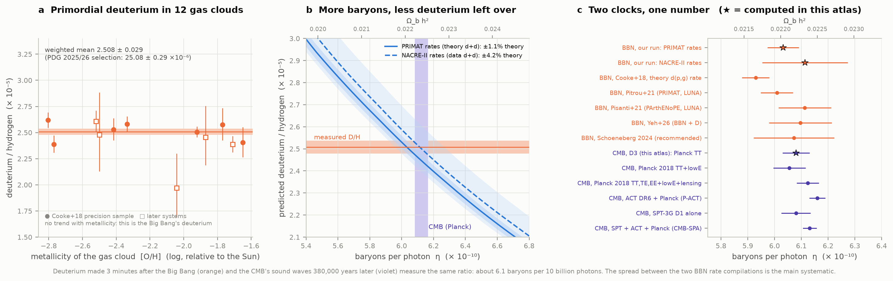
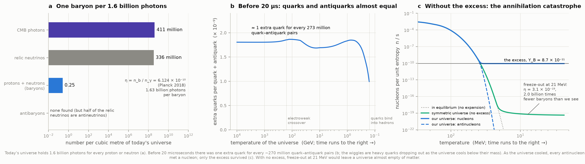
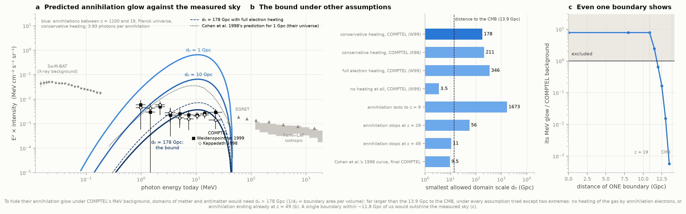
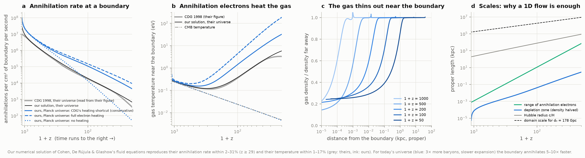
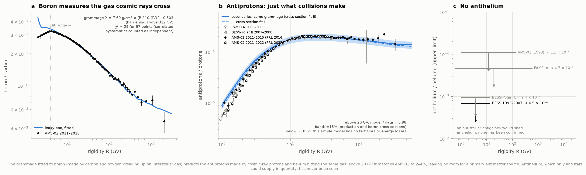
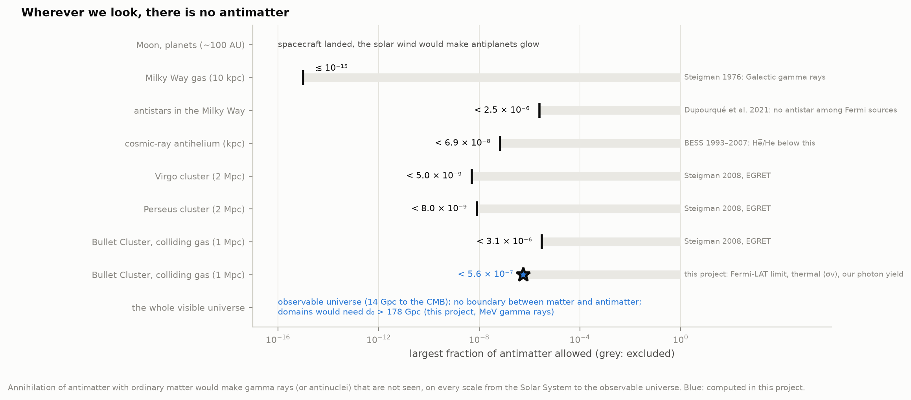
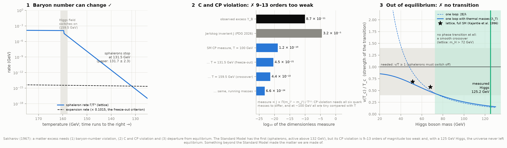

# P5 — Where did the antimatter go?

**The laws of physics treat matter and antimatter almost identically, so the Big Bang should have made equal amounts of each. Yet everything we see is matter. How do we know there is no antimatter out there, how precisely do we know how much matter survived, and why can't the Standard Model of particle physics explain it?**

This project follows the evidence from four directions.

- **How much survived.** Two independent "clocks" give the baryon-to-photon ratio η: the deuterium made in the first three minutes, and the sound waves in the cosmic microwave background (CMB) 380,000 years later. We run a nucleosynthesis code ourselves and compare it with the CMB.
- **Whether antimatter is hiding anywhere.** We redo Cohen, De Rújula & Glashow's 1998 calculation of the gamma rays that matter–antimatter boundaries would have filled the sky with. That means our own numerical solution of their fluid equations, checked against curves read exactly from their paper's figures.
- **What cosmic rays carry.** One "leaky box" model, fitted to boron, predicts the antiprotons that collisions should make. We compare it with AMS-02 on the International Space Station.
- **Why the Standard Model fails.** We check Sakharov's three conditions against lattice simulations and the measured quark mixing.

**The answer:** one baryon survived for every 1.6 billion photons. Deuterium says η = (6.03 ± 0.06) × 10⁻¹⁰, or (6.11 ± 0.16) × 10⁻¹⁰ with the other set of nuclear reaction rates. The CMB says (6.08–6.16) × 10⁻¹⁰. The two clocks agree within 0.1–1.9σ, and the spread comes mainly from those reaction rates. Before the quarks bound into protons there was one extra quark for every ~270 million quark–antiquark pairs.

There is no sign of antimatter anywhere:
- **Domains.** Matter and antimatter regions would have to be larger than d₀ ≈ 180 Gpc to hide their annihilation glow under the measured MeV gamma-ray background. That is far beyond the 14 Gpc to the CMB, and a single boundary anywhere within ~11.8 Gpc of us would outshine the sky.
- **Antiprotons.** Cosmic-ray antiprotons are exactly what collisions make (prediction / AMS-02 = 0.96–0.99 above 20 GV).
- **Bullet Cluster.** Its colliding gas holds less than 6 × 10⁻⁷ antimatter, 5.5 times tighter than the 2008 limit.

And the Standard Model cannot have made the excess. Its CP violation is 9–13 orders of magnitude too weak at the electroweak temperature. With a 125 GeV Higgs boson the universe never left thermal equilibrium (lattice: a smooth crossover, not a phase transition). Something beyond the Standard Model made the matter we are made of.

There is also an **interactive page**, [`figures/antimatter_domain_explorer.html`](figures/antimatter_domain_explorer.html). It works offline: drag the size of matter–antimatter domains, switch the heating model and the epoch when annihilation stops, and watch the predicted glow rise above or sink below the measured MeV sky.

---

## Results

### 1. One number, two clocks

How many baryons (protons and neutrons) are there per photon? The deuterium left over from the first minutes measures it, because the more baryons there were, the more completely deuterium burned on into helium. D/H falls roughly as η⁻¹·⁶⁴. The CMB measures the same density through the height of its acoustic peaks.

**Measured primordial deuterium:** 12 near-pristine gas clouds seen against distant quasars (the PDG 2025/26 selection) give D/H = (2.508 ± 0.029) × 10⁻⁵. Our weighted mean reproduces the PDG's 25.08 ± 0.29 × 10⁻⁶, and the 7-cloud "precision sample" reproduces Cooke et al.'s 2.527 ± 0.030. There is no trend with the clouds' metallicity: this is the Big Bang's deuterium, not a stellar product (Fig. 1a).

**Predicted deuterium:** we ran the nucleosynthesis code PRyMordial ourselves over η = 4–8 × 10⁻¹⁰. We used its two compilations of nuclear reaction rates, each with 60 Monte Carlo draws of the 12 key rates and the neutron lifetime.

| | PRIMAT rates (theory-based d + d) | NACRE-II rates (data-based d + d) |
|---|---|---|
| D/H at Planck's η | 2.447 × 10⁻⁵ (published: 2.442–2.444) | 2.500 × 10⁻⁵ |
| theory error on D/H | 1.1% | 4.2% (published: ~4%) |
| **η from the 12 clouds** | **(6.03 ± 0.06) × 10⁻¹⁰** | **(6.11 ± 0.16) × 10⁻¹⁰** |
| Ω_b h² | 0.02204 ± 0.00022 | 0.02233 ± 0.00058 |
| Ω_b h² from Cooke's 7 clouds | 0.02194 ± 0.00022 (Pitrou et al. 2021: 0.02195 ± 0.00022) | 0.02223 ± 0.00058 |

**The CMB:**

| CMB measurement | η (× 10⁻¹⁰) | vs BBN with PRIMAT | vs BBN with NACRE-II |
|---|---|---|---|
| D3 in this atlas (Planck temperature spectrum) | 6.080 ± 0.051 | 0.6σ | 0.2σ |
| Planck 2018 TT,TE,EE+lowE+lensing | 6.124 ± 0.041 | 1.3σ | 0.1σ |
| ACT DR6 + Planck | 6.159 ± 0.030 | 1.9σ | 0.3σ |
| SPT-3G D1 alone | 6.080 ± 0.055 | 0.6σ | 0.2σ |
| SPT + ACT + Planck | 6.131 ± 0.026 | 1.5σ | 0.1σ |

Two epochs, three minutes and 380,000 years after the Big Bang, give one number. The residual 1–2σ pull between PRIMAT-rate BBN and the latest CMB is the known "deuterium tension". It is entirely a question of the d + d reaction rates, which our two runs bracket (Fig. 1c).

### 2. The asymmetry in numbers

- **Today:** 410.7 CMB photons per cm³ against 0.2515 baryons per m³. That is η = 6.124 × 10⁻¹⁰, or 1.63 billion photons per baryon. The 336 relic neutrinos per cm³ are half antineutrinos, unless there is a large lepton asymmetry: the one kind of antimatter the universe still holds in bulk (Fig. 2a).
- **Before the quarks bound into protons** (above ~0.16 GeV, the first ~20 µs; P2's calendar puts the crossover at 19.5 µs): the conserved quantity is baryon number per unit entropy, Y_B = 8.65 × 10⁻¹¹. Combined with the Standard Model's entropy (Saikawa & Shirai's g*s(T)) and the thermal quark densities, the excess per quark was 1.83 × 10⁻⁹ from 1 GeV to 10 TeV. **That is one extra quark for every ~270 million quark–antiquark pairs** (Fig. 2b). Photons per baryon were then only ~60 million; the annihilations themselves made most of today's photons.
- **The annihilation catastrophe:** what if there had been no excess? We solved the freeze-out equation for nucleons and antinucleons with the measured annihilation cross-section, β σ_ann ≈ 44 mb (OBELIX at CERN's LEAR).
  - A symmetric universe annihilates until T = 21 MeV and is left with η = 3.1 × 10⁻¹⁹ (2.6–4.1 × 10⁻¹⁹ for ±25% in the cross-section), **2 billion times less matter than we see**: no stars, no planets.
  - In our universe the antinucleons were as common as nucleons down to 50 MeV, 76% as common at 40 MeV, 6 × 10⁻⁶ at 30 MeV and 7 × 10⁻¹⁹ at 20 MeV. Antimatter disappeared in about a millisecond (Fig. 2c).

### 3. No antimatter domains anywhere we can see

Could the universe be a patchwork of matter and antimatter regions, as symmetric overall as the laws of physics? Cohen, De Rújula & Glashow (1998, "CDG") showed that after recombination the regions must touch, because the CMB is too smooth for empty gaps between them. Gas then flows into every boundary and annihilates.

- **The photons:** each annihilation makes ~5 pions. The neutral ones decay into gamma rays peaking at 70 MeV, and those photons, redshifted by a factor of 20–1100, would fill today's sky at ~1–45 MeV.
- **The electrons:** the charged pions decay into electrons and positrons. They heat the gas near the boundary, which then flows in faster and annihilates faster.

**Our reproduction of CDG** (Fig. 3, with their curves read exactly from the vector PostScript in their arXiv source):

| Quantity, CDG's universe (Ω = 1, h = 0.75, η = 2 × 10⁻¹⁰) | Ours vs theirs |
|---|---|
| Annihilation rate J(y), our 1D fluid solution | within 2–31% for 1 + z ≥ 30 (1.9× at z = 19.5) |
| Gas temperature T(y) | within 0–17% for 1 + z ≥ 30 |
| Electron range, energy-loss coefficients | 0.716 y⁴ and 4.4–5.2 y³ eV/Mpc (theirs 0.7 and 5.5) |
| Today's spectrum from their J(y), through our photon yield and transport | within 3–9% from 0.3 to 10 MeV |

**Today's universe** (Planck 2018: 3× more baryons, half the expansion rate at those epochs): the boundary annihilates 6× faster at z = 49 (2.9 × 10⁴ annihilations per cm² per s) and the gas near it reaches 6 eV at z = 49 and 31 eV at z = 19.5 (CDG's conservative heating prescription). Their sky glow against the measured MeV background (Fig. 4):

| Assumptions | Smallest allowed domain scale d₀ |
|---|---|
| **Conservative heating (CDG's shortcut), COMPTEL (Weidenspointner 1999), annihilation counted for 1100 > 1 + z > 20** | **178 Gpc** |
| same, COMPTEL as analysed by Kappadath 1998 | 211 Gpc |
| full electron heating (CDG's own deposition integral) | 346 Gpc |
| no heating of the gas at all | 3.5 Gpc |
| annihilation lasts until z = 9 / stops at z = 29 / stops at z = 49 | 1673 / 56 / 11 Gpc |
| CDG's own 1998 prediction, against the final COMPTEL data | 9.5 Gpc |

d₀ is CDG's measure: 1/d₀ is the boundary area per unit volume. Random cubic domains of side a have d₀ = 2a/3.

- **The headline: d₀ > 178 Gpc**, 13 times the 13.9 Gpc distance to the CMB. The formal bound is beyond the visible universe, so "many domains" stops being the right picture.
- **The cleaner statement concerns one flat boundary:** a single sheet anywhere within ~11.8 Gpc of us (closer than z ≈ 36) would glow brighter than COMPTEL's MeV background, 7.8 times brighter for any sheet closer than 10.9 Gpc (Fig. 4c).
- **Only extreme assumptions rescue domains:** no heating of the gas by annihilation electrons (implausible, since their energy has to end up in the gas somewhere; CDG showed magnetic fields can only change where), or all annihilation ending by z ≈ 49.
- **How sensitive the test is:** for d₀ = 1 Gpc, the annihilations between z = 1100 and 19 would consume only 0.009% of all matter; at the bound, 5 × 10⁻⁷. The MeV sky is a very sensitive annihilation detector.
- **The modern bound is 19× CDG's own.** Their 1998 curve, held against the final COMPTEL data, already requires 9.5 Gpc (they quoted ≳ 1 Gpc against preliminary data). About 3× more comes from η, ~4× from the slower expansion (the glow scales as J/H ∝ 1/H²), and ~1.5× from details of the flow and the photon yield.

### 4. Antimatter in cosmic rays: made in collisions, not left over

AMS-02 counts one antiproton for every ~5,500 protons at high energy: (1.81 ± 0.04) × 10⁻⁴ above 60 GV. Cosmic-ray protons hitting interstellar gas make antiprotons, so how many are expected?

- **The gas column, from boron.** Boron is almost absent from stars, so cosmic-ray boron comes from carbon, nitrogen and oxygen breaking up on the gas. Our leaky-box fit to AMS-02's boron/carbon ratio gives the grammage (the gas column cosmic rays cross before escaping the Galaxy):
  - **X(R) = 7.60 ± 0.06 g/cm² × (R / 10 GV)^−0.503±0.005**, with the hardening above 312 GV seen by AMS (χ² = 29 for 57 points).
  - That is 2.4 g/cm² at 100 GV and 1.1 at 1 TV (a diffusion model fitted to AMS: 2.1 and 0.6).
- **The antiprotons, from the same gas.** Using the measured proton and helium spectra and the published production cross-sections (Korsmeier, Donato & di Mauro 2018, with antineutrons, antihyperons and helium), with no new free parameter:
  - **prediction / AMS-02 = 0.96–0.99 above 20 GV** (both data releases, both cross-section fits);
  - 0.96–0.98 at 10–20 GV and 1.03–1.12 at 3–10 GV;
  - 1.14–1.44 below 3 GV, where this simple model has no tertiary antiprotons, energy losses or reacceleration (Fig. 5b).
- **Antihelium.** Only antistars could supply it in quantity, and it has never been confirmed. The best limit is He̅/He < 6.9 × 10⁻⁸ (BESS 1993–2007, 1–14 GV; Fig. 5c).

### 5. Galaxy clusters: the Bullet Cluster, updated

In colliding clusters, any antimatter mixed into the hot gas would annihilate. Steigman (2008) compared the gamma rays this would make with the gas's X-rays and found f < 3 × 10⁻⁶ using EGRET; his formula reproduces at 3.2 × 10⁻⁶. We redid it with:
- the Fermi-LAT upper limit for 1ES 0657−558, < 2.75 × 10⁻⁹ photons cm⁻² s⁻¹ at 0.2–100 GeV (95%; Ackermann et al. 2010);
- our photon yield, 0.97 photons per annihilation in the redshifted LAT band;
- the thermal annihilation rate at kT = 14.1 keV, ⟨σv⟩ = 8.9 × 10⁻¹⁵ cm³/s. That is the OBELIX cross-section enhanced 6.7× by the Coulomb attraction between proton and antiproton.

The result is **f < 5.6 × 10⁻⁷** with Steigman's X-ray flux, or 2.6 × 10⁻⁷ with F(2–10 keV) ≈ 1 × 10⁻¹¹ erg cm⁻² s⁻¹. Fig. 7 collects this with the limits on other scales.

### 6. Why the Standard Model can't do it

Sakharov (1967) showed that a symmetric start can only end in a matter excess with **(1)** baryon-number violation, **(2)** C and CP violation and **(3)** a departure from thermal equilibrium (Fig. 6).

1. **Baryon number changes: yes.** The electroweak "sphaleron" transitions change baryon and lepton number together. With the lattice rate of D'Onofrio, Rummukainen & Tranberg (2014) against the expansion rate, they stop at T* = 131.5 GeV (the paper: 131.7 ± 2.3 GeV).
2. **CP violation: 9–13 orders of magnitude too weak.**
   - The CKM matrix's CP phase is measured. From the PDG 2026 Wolfenstein parameters we get the Jarlskog invariant J = 3.158 × 10⁻⁵ (PDG: 3.16 × 10⁻⁵).
   - But CP violation requires all six quark masses to differ, and at the electroweak temperature they are all tiny compared with T. Jarlskog's measure J Π(m_i² − m_j²)/T¹² is 1.2 × 10⁻¹⁹ at 100 GeV, 4.5 × 10⁻²¹ at sphaleron freeze-out and 4.4 × 10⁻²² at the crossover. With masses run to the electroweak scale it is 6.6 × 10⁻²⁴.
   - The excess to explain is Y_B = 8.7 × 10⁻¹¹.
3. **Out of equilibrium: no.**
   - At 160 GeV the expansion rate is H ≈ 2 × 10⁻¹⁶ T/ħ, and even weak interactions (rate ~α_W² T) run ~10¹² times faster. Everything stays in equilibrium unless a violent first-order phase transition, with bubbles of the new phase, intervenes.
   - Sphalerons must then switch off inside the bubbles, which needs v(T_c)/T_c ≳ 1. The one-loop estimate gives 0.17 for a 125 GeV Higgs. Its simplest form, 2E/λ, reaches 1 only for m_H ≲ 48 GeV, and with thermal corrections never. Lattice simulations show the transition is not even first order above m_H ≈ 72 GeV: it is a smooth crossover at 159.5 ± 1.5 GeV.

Something beyond the Standard Model made the matter excess. Candidates include leptogenesis by heavy neutrinos (needing masses ≳ 10⁹ GeV; P3), an extended Higgs sector, or new CP-violating particles. This project shows what the data require, not which model is right.

---

## Background, in brief

- **Antimatter** particles have the same mass and opposite charges. A proton and an antiproton annihilate into pions in ~10⁻²³ s, and those decay into gamma rays (about 3.9 photons per annihilation, 188 MeV on average), electron–positron pairs and neutrinos. Antihydrogen falls down, not up: ALPHA-g measured (0.75 ± 0.13 ± 0.16) g in 2023. The asymmetry is not about gravity.
- **η and Ω_b h²** are the same quantity in two units: η₁₀ = 10¹⁰ n_b/n_γ = 273.75 Ω_b h² (for Y_p = 0.245 and T₀ = 2.7255 K). The conversion uses the real mean mass per baryon, 1.0061 atomic mass units, from the atomic masses of hydrogen and helium-4 (electrons included).
- **Big Bang nucleosynthesis.** At ~1 s, neutrons and protons stop converting into each other. At ~3 minutes, deuterium survives the photon bath and almost all neutrons end up in helium-4. Deuterium is what failed to burn, which makes it the most sensitive baryometer. Its prediction hinges on the d(p,γ)³He rate (measured by LUNA in 2020) and on the d + d rates, where compilations differ by ~2% in D/H.
- **Sakharov's conditions.** In thermal equilibrium, particles and antiparticles are equally abundant whatever the laws are. An excess can only grow if processes change baryon number, prefer matter over antimatter (C and CP violation), and run out of equilibrium so that the reverse reactions can't undo the excess.
- **Leaky box.** At GeV energies cosmic rays stay in the Galaxy for ~10–20 Myr, crossing ~10 g/cm² of gas (less at higher rigidity), before leaking out. Secondary-to-primary ratios such as B/C measure that column. The same column sets how many secondary antiprotons there should be.

## Method

- `baryons.py`: photon and baryon densities, η ↔ Ω_b h² with atomic masses, and the quark excess from Saikawa & Shirai's g*s(T) with Fermi–Dirac quark densities. Also the nucleon–antinucleon freeze-out equation (stiff; Radau with an analytic Jacobian).
- `bbn.py`, `prym_runner.py`: PRyMordial (pinned commit, 63-reaction network) in isolated subprocesses. It runs a grid of 21 η values and 60-draw Monte Carlos for each rate set. η comes from a likelihood in ln(D/H) with the theory error added in quadrature.
- `domains.py`: the boundary physics.
  - **The flow:** a 1D finite-volume solution of CDG's fluid equations in comoving coordinates. It uses HLLC fluxes, an exact vacuum-sink boundary (the matter–antimatter interface, where each fluid sees vacuum; at rest this gives the (3/4)⁴ ρ c rarefaction flux), and Compton drag and Compton cooling on the CMB, integrated exactly over each step together with the hydrodynamic force. That lets the stiff, diffusive early regime relax to the correct terminal velocity.
  - **Heating:** by annihilation electrons, with their CMB-Compton range and Coulomb deposition (CDG Appendix A), either CDG's conservative shortcut or the full angle-averaged integral.
  - **The photon spectrum:** n-pion phase space (Raubold–Lynch) weighted by the Crystal Barrel channel fractions, π⁰ → γγ, and normalised to the measured 3.93 photons per annihilation.
  - **Transport to today:** CDG's eq. 16 with Klein–Nishina, Bethe–Heitler and triplet absorption. A single planar boundary replaces 1/d₀ with 1/(2r).
  - `cdg98.py` reads CDG's published curves from their PostScript: XMgr tick calibration, and Mathematica scaling lines with page matrices from Ghostscript.
- `cosmic_rays.py`, `pbar_production.py`: force-field demodulation of the AMS-02 spectra.
  - **Boron:** production from C, N, O, Ne, Mg and Si (Reinert & Winkler 2018, ghost nuclei included, Ferrando-type helium factors). Destruction uses Letaw's inelastic cross-sections minus ¹¹B → ¹⁰B.
  - **Antiprotons:** the Korsmeier et al. 2018 production cross-section, integrated over the lab angle on a logarithmic grid. Annihilation losses follow Tan & Ng.
- `analysis.py` caches every step. `figures.py` makes the seven figures and `test_physics.py` runs 16 self-checks.

## Validation

- **CDG 1998 reproduced:** annihilation rate, temperature, electron range and the gamma-ray spectrum (Section 3 table). Our solution is unchanged at 1.5× the cells and half the smallest cell.
- **Photon yield:** our phase-space spectrum, built only from measured channel fractions, matches the measured inclusive spectrum (Backenstoss et al. 1983, digitised) within 1–4% from 30 to 500 MeV. It also matches the median energy (152 MeV) and the fractions above 100 MeV (68%) and 200 MeV (37%).
- **BBN:** PRyMordial reproduces published D/H and Ω_b h² values (Section 1 table). Our D/H means reproduce the PDG's and Cooke et al.'s exactly.
- **Antiproton production:** our implementation reproduces Korsmeier et al.'s Fig. 4 at T_p = 20 GeV (1.30 × 10⁻³³ m²/GeV at 2 GeV, 1.0 × 10⁻³⁵ at 10 GeV) and NA49's 0.04 antiprotons per pp collision at 158 GeV/c. Our boron cross-sections reproduce Reinert & Winkler's Table 3 (C → B 68.6 mb at 10 GeV/n).
- **Sakharov numbers:** the CKM J and the sphaleron freeze-out temperature agree with the PDG and the lattice paper.
- **Reproducible and offline:** a forced recompute reproduced every number in `data/results.json` exactly. From the caches, `run.py --check` takes 28 s and was verified inside a network namespace with no connectivity.

## Data and credits

| Data | Source | Size |
|---|---|---|
| AMS-02 p̄, p̄/p, p, He, C, N, O, Ne, Mg, Si fluxes and B/C; PAMELA, BESS p̄/p; antihelium limits | Cosmic-Ray DataBase (Maurin et al. 2014, 2020, 2023), lpsc.in2p3.fr/crdb | 0.5 MB |
| Fermi-LAT isotropic gamma-ray background, foreground models A–C (Ackermann et al. 2015) | VizieR J/ApJ/799/86 | 20 kB |
| COMPTEL MeV background (Weidenspointner 1999 thesis Table 6.6; Kappadath 1998 thesis Table VII.2), EGRET (Strong et al. 2004), Swift-BAT (Ajello et al. 2008) | typed from the primary tables in `literature.py` | — |
| Quasar D/H (12 systems), CMB Ω_b h², CKM, quark masses, lattice electroweak results | typed from the primary papers in `literature.py` | — |
| p̄p total and elastic cross-sections | PDG hadronic cross-section files (rpp2022) | 60 kB |
| Inclusive photon spectrum of p̄p annihilation (Backenstoss et al. 1983), validation only | digitised from von Ballmoos 2014 (arXiv:1401.7258) Fig. 1, 16 points in `literature.py` | — |
| Standard Model g*(T) (Saikawa & Shirai 2018) | member.ipmu.jp, hard-linked from P2's copy | 0.5 MB |
| Cohen, De Rújula & Glashow 1998 figures | arXiv:astro-ph/9707087 source | 0.2 MB |
| PRyMordial (Burns, Tait & Valli 2024) | github.com/vallima/PRyMordial at commit 725d8a8 | 1.7 MB |
| D3's Planck temperature-spectrum fit | the atlas's `09-planck-cmb/data/results.json` | — |

Every downloaded file's URL, size, SHA-256 and retrieval time is in `data/manifest.json`. Other sources used as inputs, all listed in `literature.py`:
- **Annihilation at rest:** channel fractions from Klempt, Batty & Richard 2005 (Phys. Rep. 413, 197, Table 7); OBELIX β σ_ann via Carbonell, Protasov & Zenoni 1997.
- **Production cross-sections:** Korsmeier, Donato & di Mauro 2018 (PRD 97, 103019); Reinert & Winkler 2018 (JCAP 01, 055); Letaw et al. 1983; Moskalenko et al. 2002.
- **Bullet Cluster:** Ackermann et al. 2010 (ApJL 717, L71) for the Fermi-LAT limit; Steigman 2008 (JCAP 10, 001).
- **Electroweak and lattice:** D'Onofrio, Rummukainen & Tranberg 2014; D'Onofrio & Rummukainen 2016; Kajantie et al. 1996; Csikor, Fodor & Heitger 1999; Dine et al. 1992.
- **Particle data and BBN literature:** the PDG 2026 CKM review and quark masses; Huang & Zhou 2021 running masses; the BBN literature values in Fig. 1c.

## Caveats and deviations from the plan

- **K1 (nucleosynthesis) was not yet built**, so this project runs PRyMordial itself. K1 can reuse `bbn.py`.
- **The domain bound rests on CDG's assumptions:**
  - matter and antimatter domains touch from recombination on;
  - annihilation is counted only between z = 1100 and 19 (later, structure formation could change it);
  - the gas stays fully ionised;
  - our model does not heat gas beyond the electrons' range (CDG add ~0.3 eV of UV heating there), which shows as a small pressure jump at the edge of the heated zone (Fig. 3c).

  The result depends most on when annihilation stops (Fig. 4b). An early end at z ≈ 49, or no heating at all, would bring d₀ down to ~4–11 Gpc. The measured MeV background is treated as an upper bound on the annihilation glow (2σ, per band); subtracting known sources would only tighten it.
- **Fermi-LAT alone cannot test domains.** The glow from z > 19 sits at 1–45 MeV, so COMPTEL's 0.8–30 MeV data do the work; the plan named only Fermi's background. COMPTEL's points include Galactic emission not subtracted, which is conservative.
- **The leaky box is the "simple estimate" the plan asked for:** no tertiaries, energy losses, reacceleration or convection. The ±16% band covers only the cross-sections. The claimed antiproton excess at 10–20 GV (debated in the literature) cannot be tested at this precision.
- **The Bullet Cluster limit** uses one published Fermi-LAT flux limit (computed for an E⁻² spectrum, not the annihilation spectrum) and a single-temperature gas. A dedicated Pass 8 analysis with an annihilation template would be better. Steigman's X-ray flux (4.7 × 10⁻¹²) does not appear in the paper he cites; the published luminosities imply ~1 × 10⁻¹¹, which would tighten the limit 2×.
- **ALPHA-g's antihydrogen data are not public**, so their gravity result is quoted, not reanalysed.
- **The plan's "one quark in a billion" is corrected:** above 1 GeV it was one extra quark per ~270 million quark–antiquark pairs (1.8 × 10⁻⁹ per quark). The billion belongs to photons per baryon today (1.6 billion).
- **"Suppressed to ~10⁻²⁰"** depends on the temperature and on which quark masses are used: 1 × 10⁻¹⁹ at 100 GeV, down to 7 × 10⁻²⁴ at the crossover with masses run to that scale. Nine to thirteen orders of magnitude short either way.
- **Found along the way:**
  - **A typo in Korsmeier et al. (2018).** Their eq. 14 prints (10 − √s)² in the exponent of the low-energy factor of their Param. II. Only Winkler's original first power reproduces their own Fig. 4. The square gives a non-monotonic antiproton multiplicity near threshold and a 3× bump in the Galactic source term at 10 GeV, which would show as a spurious 2.5× excess in p̄/p at 9 GV. We use the first power, which agrees with their independent Param. I to 1–12%.
  - **CDG's Fig. 4** was assembled in a drawing program from two copies of one Mathematica curve. The "1000 Mpc" curve is the 20 Mpc curve shifted 75 pt down, which is ×1/38 on the drawn axes rather than the ×1/50 their text implies. We use their computed values with exact 1/d₀ scaling.
  - **CDG's heating shortcut** (a = 10 in ⟨dE/dl⟩ = a y³ eV/Mpc) is 2.2–3.8 times below what their own deposition formula gives inside the depletion zone. Their bound was conservative on that count too.
- **Download ~3 MB** (the plan: < 5 MB), 20 MB on disk including the unpacked code.

## Running it

    python fetch_data.py      # ~3 MB once (CRDB, VizieR, PDG, arXiv, PRyMordial)
    python run.py             # analysis (cached steps reused), 7 figures, the interactive page, summary
    python run.py --force     # recompute everything: 34 min at load ~30 (BBN 15, fluid runs 18)
    python run.py --check     # also run the 16 self-checks

| File | Role |
|---|---|
| `config.py` | paths, data sources, constants, the adopted cosmology |
| `fetch_data.py` | downloads, manifest, loaders (CRDB, VizieR, PDG) |
| `literature.py` | published tables and values typed from the primary sources |
| `baryons.py` | η, Ω_b h², the quark excess, nucleon freeze-out |
| `bbn.py`, `prym_runner.py` | deuterium from PRyMordial |
| `domains.py`, `cdg98.py` | matter–antimatter boundaries, the gamma-ray glow, CDG's figures |
| `cosmic_rays.py`, `pbar_production.py` | leaky box, boron, antiprotons |
| `sakharov.py` | CKM, Jarlskog's measure, sphalerons, transition strength |
| `analysis.py` | every result, cached in `data/derived/` and `data/results.json` |
| `figures.py`, `plotstyle.py` | the seven figures |
| `explorer.py`, `explorer_template.html` | the interactive domain page |
| `test_physics.py` | the self-checks |
