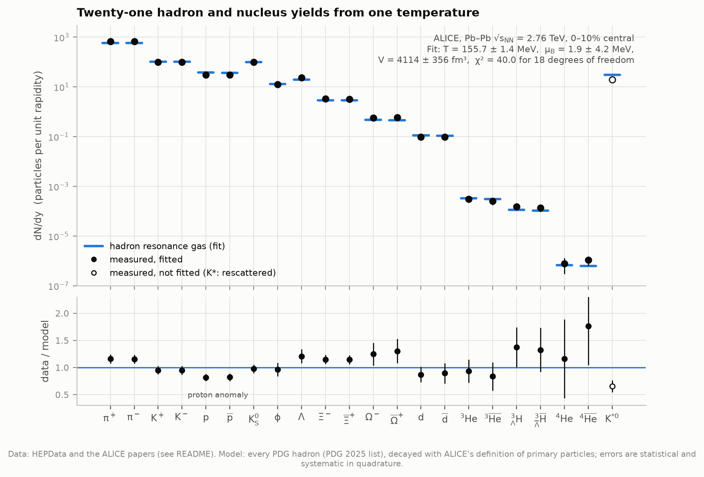
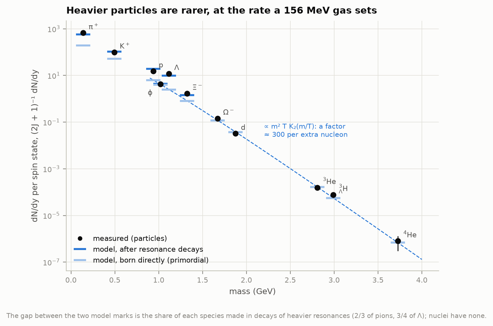
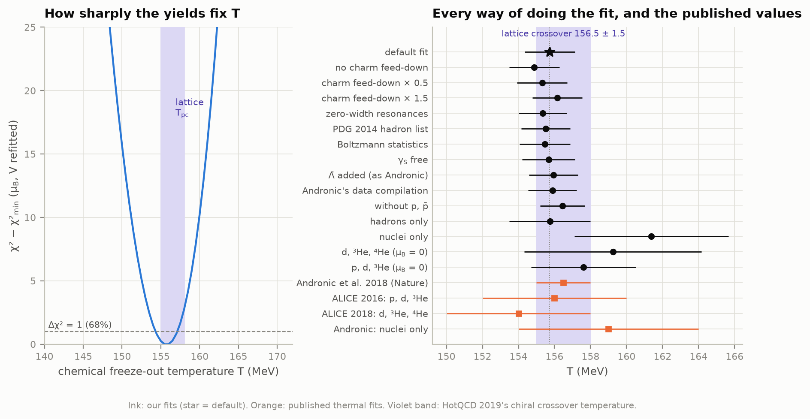
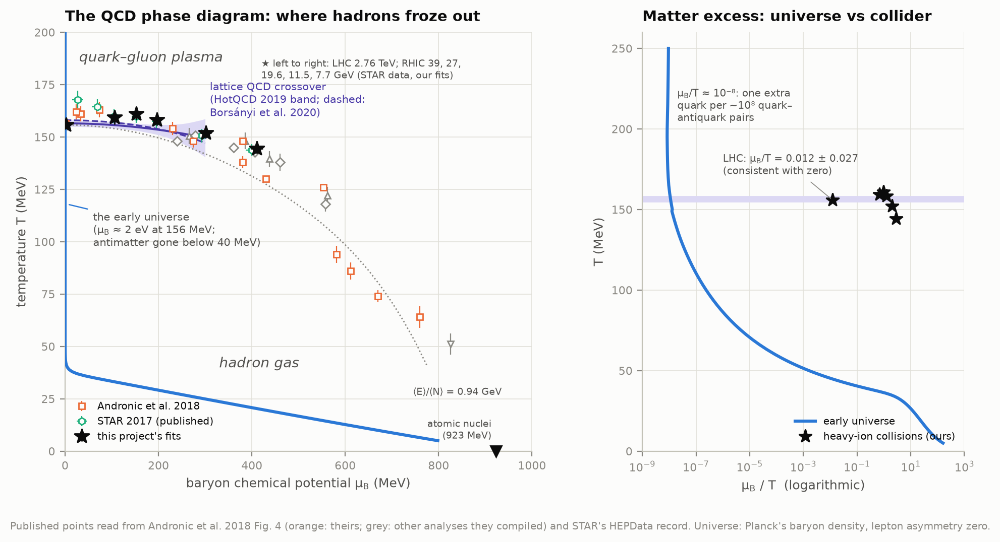
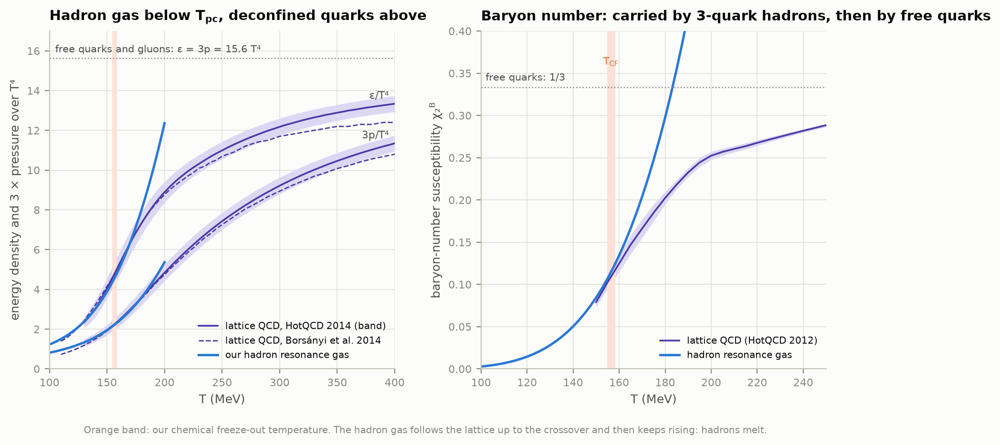
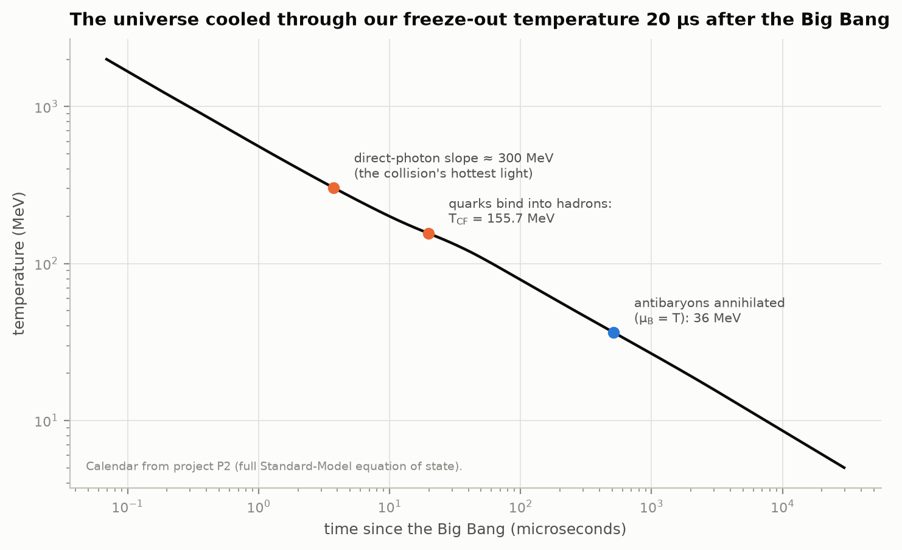
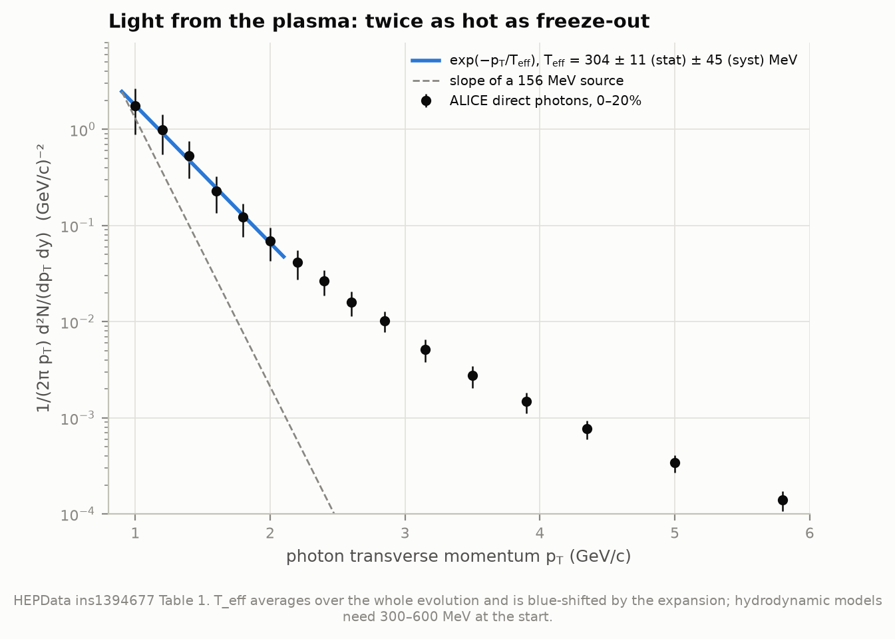
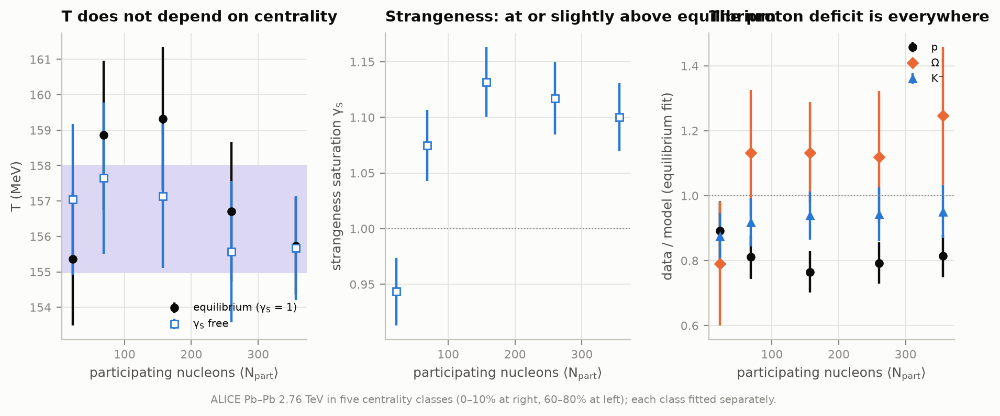
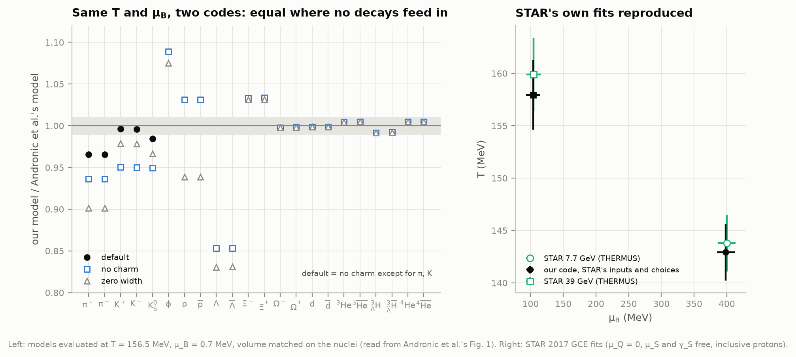

# P6 — Recreating the first microseconds: the quark–gluon plasma

**About ten microseconds after the Big Bang, the whole universe was a plasma of free quarks and
gluons at nearly two trillion kelvin. When it cooled, the quarks bound into protons, neutrons and
pions. At what temperature did that happen, and can we measure it in a laboratory?**

The Large Hadron Collider recreates that plasma by smashing lead nuclei together. Each central
collision leaves a fireball a few times bigger than a nucleus, about 10⁻²³ s old when it
breaks up into hadrons. ALICE counted what comes out in one unit of rapidity: pions by the
hundreds, protons by the dozen, an Ω⁻ baryon in every second collision, and one antihelium-4
nucleus in a million collisions. This project
fits those counts with a gas of every known hadron. A single temperature has to explain all of
them.

**The answer: T = 155.7 ± 1.4 (fit) ± 0.7 (model) MeV**, or 1.81 × 10¹² K. That is
where lattice QCD puts the crossover from quarks to hadrons, 156.5 ± 1.5 MeV (HotQCD 2019).
- Twenty-one yields spanning nine orders of magnitude, from 670 π⁺ to 8 × 10⁻⁷ ⁴He per unit of
  rapidity, fit with three numbers: the temperature, the baryon chemical potential
  μ_B = 1.9 ± 4.2 MeV (matter and antimatter in equal amounts, as in the early universe) and the
  volume.
- Andronic, Braun-Munzinger, Redlich & Stachel (2018, *Nature*) found 156.5 ± 1.5 MeV. Our code
  on their exact data gives 155.9 ± 1.3.
- The universe was at this temperature **19.8 ± 0.5 microseconds** after the Big Bang (project
  P2's calendar).

There is an **interactive page**, [`figures/freezeout_thermometer.html`](figures/freezeout_thermometer.html):
move the temperature and μ_B, and every yield is recomputed in your browser from the full gas of
459 hadrons and nuclei. You can also fit the data yourself, switch to five lower-energy
collisions from RHIC, or click anywhere on the phase diagram. It works offline. It is also
published as a private artifact: https://claude.ai/artifact/KpeVUJhA28tZCzSFFqfDK6.

---

## Results

### The freeze-out temperature

ALICE, Pb–Pb collisions at √s_NN = 2.76 TeV, 10% most central. Errors are 68%. The volume is per
unit of rapidity at mid-rapidity, the slice of the fireball moving slowly along the beam.

| | T (MeV) | μ_B (MeV) | V (fm³) | χ² / dof |
|---|---|---|---|---|
| **This project** | **155.7 ± 1.4 ± 0.7** | **1.9 ± 4.2** | 4,114 ± 356 point-like; **5,440 ± 470** with Andronic's excluded volume | 40.0 / 18 |
| Our code on Andronic et al.'s data compilation | 155.9 ± 1.3 | 0.8 ± 4.0 | 5,470 ± 460 | 43.2 / 19 |
| Andronic et al. 2018 (*Nature* 561, 321) | 156.5 ± 1.5 | 0.7 ± 3.8 | 5,280 ± 410 | |
| Lattice QCD crossover, HotQCD 2019 | 156.5 ± 1.5 | | | |
| Lattice QCD crossover, Borsányi et al. 2020 | 158.0 ± 0.6 | | | |

- **The first error is the fit's; the second is the model's.** The model error is the spread
  from using the 2014 hadron list instead of the 2025 one (−0.2 MeV), zero-width resonances
  (−0.4), Boltzmann statistics instead of quantum statistics (−0.3) and halving or
  increasing the charm contribution by half (±0.4), added in quadrature.
- **What closes the gap to Andronic et al.** Their published data set differs from ours in three
  small ways (+0.2 MeV), and we add pions and kaons from charm decays as they did (+0.9 MeV). At
  their own best-fit point, our model and theirs give the same Ω, deuteron, ³He and ⁴He yields
  to < 1%. These are particles that nothing heavier decays into, so the thermal physics is
  identical. Where heavier resonances feed in we differ by 3–15%: our Λ is 15% lower, our φ 9%
  higher. These differences, from the hadron list and the decay tables, account for the last
  0.6 MeV, well inside their own "at most 3%" model uncertainty (Figure 9).
- **The volume.** With point-like hadrons the fireball slice is 4,100 fm³, 2.7 times the volume of
  a lead nucleus (radius 7.1 fm). Andronic et al. give every hadron a
  radius of 0.3 fm, which lowers all densities by the same factor (0.756) and so raises the
  volume to 5,440 fm³ without moving T or μ_B. Their 5,280 ± 410 fm³ uses that convention.
- **The gas at freeze-out**: 0.37 hadrons per fm³ (one per 2.7 fm³, about the volume of a proton),
  energy density 0.343 GeV/fm³ (2.3 times the inside of a nucleus), 0.94 GeV of energy per
  hadron, entropy s/T³ = 5.2. It is 38% pions, 14% kaons, 3% nucleons and 40% short-lived
  resonances.

### What the fit gets wrong

- **The proton anomaly.** Protons and antiprotons sit 18% below the model (−2.8σ and −2.7σ;
  Andronic et al.: 2.7σ), at every centrality (Figure 7). Without them T = 156.4 ± 1.2 MeV
  and χ² drops from 40 to 19 for 16 degrees of freedom. Proposed explanations include
  baryon–antibaryon annihilation after freeze-out and pion–nucleon interactions the ideal gas
  leaves out; neither is settled.
- **Strange baryons run 15–30% high** (Λ +1.7σ, Ξ +1.7σ, Ω +1.2σ). Letting strangeness
  float gives γ_S = 1.10 ± 0.03: slightly more strangeness than equilibrium, not the
  undersaturation seen in proton collisions.
- **K\*(892)⁰ is 35% below the model (−3.1σ)**, as expected. It lives only 4 fm/c, so many decay
  inside the fireball, and their pions and kaons scatter away from the K\* mass. It was left out of
  the fit. φ(1020) lives 46 fm/c and fits (0.96).
- **Two-thirds of all pions were never thermal pions.** 67% come from decays of ρ, ω, K\*, Δ
  and hundreds of heavier resonances (Andronic et al.: 70%), and so do 75% of Λ. Including them is
  most of what the model does (Figure 2).

### Light nuclei: snowballs in hell

A deuteron is held together by 2.2 MeV; the hypertriton's Λ by 0.13 MeV. Yet both come out at
exactly the rate a 156 MeV gas predicts, where the typical collision energy is 70 times their
binding.

| Nuclei used | T (MeV), this project | Published |
|---|---|---|
| d, ³He, hypertriton, ⁴He and antinuclei | 161.4 ± 4.3 | Andronic et al.: 159 ± 5 |
| d, ³He, ⁴He and antinuclei (μ_B = 0) | 159.3 ± 4.9 | ALICE 2018: 154 ± 4 |
| p, d, ³He and antiparticles (μ_B = 0) | 157.6 ± 2.9 | ALICE 2016: 156 ± 4 (χ²/ndf 0.4; ours 0.1) |

Each extra nucleon costs a factor of about 300 in yield: the Boltzmann price e^(−m_N/T) ≈ 1/400 of
one more nucleon's mass at 156 MeV, partly offset by the heavier nucleus's larger phase space.
The nuclei line up on that slope with no help from decays (Figure 2). Why such fragile objects
remember the hadronization temperature is still debated. Two main ideas compete: compact multi-quark
states that survive, and coalescence of nucleons that happens to mimic thermal yields.

### How sharply the yields fix T

Every reasonable way of doing the fit lands between 154.9 and 156.5 MeV. Only the nuclei-only
fits, with 3–5 MeV errors, sit higher. All are consistent with lattice QCD's crossover.

### The QCD phase diagram, and where the universe crossed it

- **Our own fits at six energies.** The LHC point plus STAR's Au+Au collisions at 39, 27, 19.6,
  11.5 and 7.7 GeV, from STAR's published π, K, p, Λ and Ξ yields: T = 159.4, 161.0, 158.3,
  152.0, 144.4 MeV (± 2.3–3.3) at μ_B = 106, 152, 197, 302, 410 MeV (± 8–13). Lower collision
  energies stop more of the colliding nuclei's baryons, so μ_B rises. As far as the lattice
  expansion reaches (μ_B ≈ 300 MeV, extrapolated to 410), freeze-out sits on the crossover line
  within errors; the published fits at still lower energies fall away to 50–130 MeV.
- **STAR's own fits are reproduced.** Running our code with STAR's own inputs and choices (μ_Q = 0,
  μ_S and γ_S free, inclusive protons), we get 142.9 ± 2.7 MeV and 398 ± 14 MeV at 7.7 GeV and
  157.9 ± 3.3 and 104 ± 11 at 39 GeV. STAR got 143.8 ± 2.7 / 400 ± 13 and 159.9 ± 3.5 /
  105 ± 11. Our model yields are within 2% of their THERMUS code's (Figure 9).
- **The published points** (Andronic et al.'s own fits from SIS to the LHC, the other analyses they
  compiled, and STAR's) were read back from the vector figure in their arXiv source. The axes are
  calibrated on the tick marks to 0.09 MeV, and STAR's seven points agree with STAR's own HEPData
  numbers to 0.4 MeV. The other groups are not identified by colour in that figure, so we show
  them together as "other analyses".
- **The freeze-out line** of constant energy per hadron through our LHC point (0.94 GeV;
  Cleymans & Redlich proposed ≈ 1 GeV) follows the points roughly, down to the lowest energies.
- **The early universe** went straight down the μ_B ≈ 0 edge. With Planck's baryon density
  (η = 6.13 × 10⁻¹⁰, one baryon per 1.2 × 10¹⁰ units of entropy), μ_B/T = 1.1 × 10⁻⁸ at the
  crossover: μ_B ≈ 2 eV. That is one extra quark for every ~10⁸ quark–antiquark pairs, compared with
  μ_B/T = 0.012 ± 0.027 at the LHC. Only when antibaryons annihilated did μ_B climb. That happened
  at 36 MeV (μ_B = T), 0.52 ms after the Big Bang, after which μ_B rose toward the nucleon mass
  (800 MeV at 5 MeV). An unmeasured lepton asymmetry as large as the baryon one changes μ_B/T by
  6% (1.18 × 10⁻⁸ for the sphaleron value l = −51/28 b).

### The equation of state: hadrons below, quarks above

- **Below the crossover our hadron gas is lattice QCD.** Its pressure stays within 0.1σ of
  HotQCD 2014 up to 150 MeV. Energy density and entropy stay within 1σ up to 180–185 MeV.
- **Then it fails.** The gas keeps adding heavier hadrons, and its energy density shoots past
  the lattice; lattice QCD flattens at 75–85% of the free quark–gluon value
  (ε = 3p = 15.6 T⁴ for massless u, d, s quarks and gluons). The baryon-number susceptibility
  shows it most clearly. It measures how easily baryon number fluctuates. In the hadron gas only
  three-quark objects carry baryon number, so it grows like e^(−m_N/T). Above the crossover
  quarks carry 1/3 each, and the lattice flattens toward the free-quark value of 1/3.
  The two part company just above T_pc.
- At 156.5 MeV the gas has ε = 0.356 GeV/fm³. HotQCD 2019 quotes 0.42 ± 0.06 for the lattice.

### When did the universe do this?

| | T | Time after the Big Bang |
|---|---|---|
| Direct-photon slope (below) | 304 MeV | 3.7 µs |
| Lattice crossover T_pc | 156.5 MeV | 19.5 µs |
| **Our freeze-out temperature** | **155.7 ± 1.4 MeV** | **19.8 ± 0.5 µs** |
| Antibaryons annihilated (μ_B = T) | 36 MeV | 0.52 ms |

The times are from project P2's calendar (its full Standard-Model equation of state). Our own
Friedmann integration (lattice QCD, our hadron gas, leptons and photons) gives 19.9 µs, 0.7% later.

### The plasma was hotter: thermal photons

Photons leave the fireball without scattering, so they report the temperature of the moment they
were emitted. ALICE's direct-photon spectrum in 0–20% collisions falls as exp(−p_T/T_eff) between
0.9 and 2.1 GeV/c with **T_eff = 304 ± 11 (stat) ± 45 (syst) MeV** in our fit. ALICE quotes
304 ± 11 ± 40 MeV without subtracting the prompt photons from the initial collisions, and
297 ± 12 ± 41 MeV with them subtracted. T_eff averages over the whole history and is blue-shifted
by the expansion. Hydrodynamic models that reproduce it start at 300–600 MeV. Either way, the
fireball began about twice as hot as freeze-out, like the universe 3.7 µs after the Big Bang.

### Centrality: the same temperature everywhere

| Centrality | ⟨N_part⟩ | T (MeV) | γ_S | p data/model |
|---|---|---|---|---|
| 0–10% | 356 | 155.7 ± 1.4 | 1.10 ± 0.03 | 0.81 |
| 10–20% | 260 | 156.7 ± 2.0 | 1.12 ± 0.03 | 0.79 |
| 20–40% | 157 | 159.3 ± 2.0 | 1.13 ± 0.03 | 0.77 |
| 40–60% | 69 | 158.9 ± 2.1 | 1.08 ± 0.03 | 0.81 |
| 60–80% | 22.5 | 155.4 ± 1.9 | 0.94 ± 0.03 | 0.89 |

The temperature does not change from central to peripheral collisions, and neither does the proton
deficit. Strangeness falls below equilibrium (γ_S < 1) only in the most peripheral class, where
the fireball is small enough that exact strangeness conservation begins to bite.

---

## Background, in brief

**Quarks and confinement.** Protons, neutrons and pions are made of quarks held together by gluons.
The force between quarks does not weaken with distance, so a single quark is never seen alone:
quarks are *confined* in hadrons. Heat hadrons enough, and they overlap and dissolve into a soup
of quarks and gluons. Lattice QCD (computer simulations of the theory of the strong force) shows
the change is a smooth *crossover*, not a sharp phase transition, centred near 156 MeV.
1 MeV corresponds to 1.16 × 10¹⁰ K.

**The hadron resonance gas.** Below the crossover, the thermodynamics of QCD matches a simple
model to within a few per cent: an ideal gas of every hadron, stable or not. Each species
contributes a thermal density
n = g/(2π²) ∫ p² dp / (exp((E − μ)/T) ± 1), roughly ∝ (2J + 1) m² T K₂(m/T) e^(μ/T).
Short-lived resonances (the ρ, Δ, K\* ...) stand in for the attraction between the stable
hadrons. After the fireball breaks up, they decay, and their daughters are counted with the
stable particles. This *feed-down* has to follow each experiment's definitions: ALICE counts
protons from Δ decays but not from Λ decays (a weak decay, ~8 cm away), while STAR's
lower-energy protons include them.

**Chemical potentials.** μ_B measures the excess of baryons over antibaryons. Each hadron's yield
carries a factor e^(Bμ_B/T), so p̄/p ≈ e^(−2μ_B/T). At the LHC the colliding nuclei's protons
and neutrons fly on along the beam, and the mid-rapidity fireball holds almost equal matter and
antimatter. Net strangeness is zero, because the nuclei had none, and the charge-to-baryon ratio
is lead's, 82/208. These two conditions fix the strangeness and charge chemical potentials.

**Rapidity and dN/dy.** Rapidity is the relativist's measure of velocity along the beam.
Yields are quoted per unit rapidity at mid-rapidity, and the fitted volume is the volume of that
slice.

**Freeze-out.** Chemical freeze-out is when the particle *species* stop changing. Momenta keep
changing a little longer, until kinetic freeze-out at ~100 MeV. The yields record the first, and
that is what this fit measures.

---

## Method

1. **Hadron list** (`hadrons.py`): Thermal-FIST's tables of the PDG 2025 hadrons (248 states, 444
   with antiparticles) plus light nuclei (d, t, ³He, ⁴He, hypertriton and others): 459 species,
   with every decay channel. Feed-down is a matrix built by recursion through the decay chains,
   which conserves baryon number and charge exactly. Two conventions are used: strong + electromagnetic
   decays (ALICE's primary particles; Σ⁰ → Λγ included, weak decays excluded) and, for STAR's inclusive
   protons, strange-baryon weak decays as well. Measured resonances (φ, K\*) are counted
   before their own decay.
2. **The gas** (`hrg.py`): exact Bose–Einstein/Fermi–Dirac momentum integrals by 64-point
   Gauss–Laguerre quadrature (equal to the Bessel-function series to 10⁻⁹, 12 times faster).
   Resonance widths use a relativistic Breit–Wigner over [max(threshold, m − 2Γ), m + 2Γ]
   (10 nodes, as Thermal-FIST's standard "BWTwoGamma"), which gives 4,212 mass points in all.
   μ_S and μ_Q are solved by Newton iteration on the exact susceptibility matrix. The
   excluded-volume conversion uses the diagonal van der Waals model with r₀ = 0.3 fm.
3. **Charm** (`hadrons.charm_feeddown_per_pair`): D, D_s, Λ_c ... populated thermally and decayed
   with Thermal-FIST's charm tables give 1.75 π⁺ and 0.48 K⁺ per charm–anticharm pair. We assume
   10 ± 5 pairs per unit rapidity in 0–10% (ALICE's 4.8 mb pp cross-section, ~1/8 at
   mid-rapidity, T_AA = 23.4 mb⁻¹, shadowing ~0.75), scaled with N_part^(4/3) to other centralities. This adds 17.5
   pions and 4.8 kaons of each charge.
4. **Fit** (`thermal_fit.py`): χ² with statistical and systematic errors in quadrature,
   minimised over T, μ_B and V with MINUIT (MINOS errors for T: −1.40/+1.37 MeV). Profile scans
   refit μ_B and V at each T.
5. **Data compilation** (`datasets.py`): yields from the HEPData records; nuclei and ⁴He parsed
   from the papers' TeX; 0–10% built from the 0–5% and 5–10% classes (statistical errors in
   quadrature, systematic errors averaged); ³He carried from 0–20% to 0–10% with the
   deuteron's centrality dependence, as ALICE did; the hypertriton divided by ALICE's assumed
   25% branching ratio.
6. **Published figures read back** (`figparse.py`): Andronic et al.'s Figures 1 and 4 converted
   from their vector PDFs to SVG and calibrated on their own tick marks.
7. **Lattice QCD** (`lattice.py`): HotQCD 2014's Table I and smooth ansatz, the Wuppertal–Budapest
   2014 ancillary table, and HotQCD 2012's susceptibilities, all parsed from the arXiv sources.
   The crossover lines of HotQCD 2019 and Borsányi et al. 2020 are drawn only where the
   expansion holds (μ_B ≤ 300 MeV).
8. **The universe** (`universe.py`): ages from P2's calendar, cross-checked by our own Friedmann
   integration. μ_B is solved from n_B/s = 8.66 × 10⁻¹¹: a 6×6 linear system (B, Q, S, three
   lepton flavours) with lattice susceptibilities above 150 MeV, and the exact nonlinear hadron
   gas below.
9. **Photons** (`photons.py`): exponential fit to HEPData's spectrum. The systematic error is the
   extra width when systematic errors are added in quadrature. A full ±1σ linear tilt of the
   spectrum would give ±90 MeV, which ALICE's partly correlated errors do not imply.

## Validation

`python test_physics.py` runs 18 checks, all passing. They cover:

- the quadrature against exact Bessel series (1 × 10⁻⁹) and the Boltzmann limit;
- charge conservation along every decay chain (both lists);
- the conservation-law solver;
- the excluded volume as a common factor;
- the pion decay fraction;
- the hadron gas against lattice pressure below 150 MeV, and HotQCD's ansatz against its table;
- the read-back Fig. 1 data against the Thermal-FIST compilation (0.03%);
- STAR's points read from Fig. 4 against HEPData (0.4 MeV);
- the thermal densities against Andronic's model (< 1% for Ω and nuclei);
- Andronic's fit (within 0.5σ in T, μ_B and V) and STAR's two fits (within 1σ);
- ALICE's photon slope (304 ± 11);
- the universe's age against P2 (0.7%), η, the charm multiplicities and the yield compilation.

The interactive page runs its own JavaScript copy of the model. Driven headless with Playwright,
its yields equal Python's to 5 × 10⁻¹² for all six datasets. Its Fit button finds 155.7 / 1.9 MeV
for ALICE (starting from 140 MeV) and 144.4 / 410.4 MeV for STAR at 7.7 GeV, the Python results.

---

## Data and credits

| Data | Source | Size |
|---|---|---|
| π, K, p yields vs centrality (ALICE, Abelev et al. 2013, PRC 88, 044910) | HEPData ins1222333 v1 | 39 kB |
| K⁰_S and Λ (ALICE, Abelev et al. 2013, PRL 111, 222301) | HEPData ins1243863 v1 | 10 kB |
| Ξ and Ω (ALICE, Abelev et al. 2014, PLB 728, 216) | HEPData ins1243865 v1 | 7 kB |
| K\*(892)⁰ and φ(1020) (ALICE, Abelev et al. 2015, PRC 91, 024609) | HEPData ins1288320 v1 | 9 kB |
| Light nuclei (ALICE, Adam et al. 2016, PRC 93, 024917) | HEPData ins1380491 v2 + the paper's Tables III–IV (arXiv:1506.08951) | 1.2 MB |
| Hypertriton (ALICE, Adam et al. 2016, PLB 754, 360) | HEPData ins1380234 v1 | 2 kB |
| ⁴He and anti-⁴He (ALICE, Acharya et al. 2018, NPA 971, 1) | the paper's abstract (arXiv:1710.07531) | 0.3 MB |
| Direct photons (ALICE, Adam et al. 2016, PLB 754, 235) | HEPData ins1394677 v1 + paper (arXiv:1509.07324) | 0.5 MB |
| STAR beam-energy scan: π, K, p and the GCE fits (Adamczyk et al. 2017, PRC 96, 044904) | HEPData ins1510593 v1 + paper (arXiv:1701.07065) | 1.3 MB |
| STAR strange hadrons (Adam et al. 2020, PRC 102, 034909) | HEPData ins1738953 v2 | 63 kB |
| Andronic, Braun-Munzinger, Redlich & Stachel 2018 (*Nature* 561, 321) | arXiv:1710.09425 source (text and vector figures) | 0.1 MB |
| Lattice QCD: HotQCD 2012 (PRD 86, 034509), 2014 (PRD 90, 094503), 2019 (PLB 795, 15); Borsányi et al. 2014 (PLB 730, 99), 2020 (PRL 125, 052001) | arXiv sources 1203.0784, 1407.6387, 1812.08235, 1309.5258 (ancillary file), 2002.02821 | 3.6 MB |
| Hadron lists and decays (Vovchenko & Stoecker 2019, CPC 244, 295) | github.com/vlvovch/Thermal-FIST, commit 4086191 (PDG 2025, PDG 2014, charm) | 0.5 MB |
| ALICE pp charm cross-section (JHEP 07 (2012) 191) | used for the charm estimate | — |
| Planck 2018 ω_b (A&A 641, A6, Table 2) | in `config.py` | — |
| The universe's calendar | project P2, `68-thermal-history/data/derived/curves.npz` | — |

About 9 MB in all. Every file's URL, size, SHA-256 and retrieval time is in `data/manifest.json`.
HEPData sits behind Cloudflare, which challenges browser user agents and refuses Python's
default one; `fetch_data.py` sends a plain `python-requests` user agent.

## Caveats and deviations from the plan

- **The photon number.** The plan quoted "T_eff = 304 ± 51 MeV". ALICE's headline value is
  297 ± 12 (stat) ± 41 (syst) MeV, after subtracting prompt photons from the initial collisions;
  304 ± 11 ± 40 is without that subtraction, and 51 is the two errors added linearly. We reproduce
  the unsubtracted 304 ± 11, since the prompt-photon calculation is not public.
- **Λ̄ was never published separately.** ALICE states that Λ̄/K⁰_S equals Λ/K⁰_S. Andronic et al.
  (and Thermal-FIST's compilation) still list a Λ̄ point (24.27), so we leave it out of the default
  fit; adding it moves T by +0.2 MeV.
- **Two compilation differences.** Andronic et al.'s data equal Thermal-FIST's ALICE file to
  four digits, which uses the papers' rounded K⁰_S (100 vs HEPData's 98.15) and p = 31.5
  (the paper's 0–5% and 5–10% values, 34 and 28, average to 31.0). We use HEPData's unrounded values.
- **Charm is an estimate.** No pT-integrated D-meson yield exists for 0–10% Pb–Pb at 2.76 TeV,
  so the ten charm pairs per unit rapidity are built from the pp cross-section. They move T by
  +0.9 MeV; ±50% gives ±0.4 MeV, included in the model error.
- **What the ideal gas leaves out.** It has no repulsion between hadrons (except through the
  optional excluded volume), no canonical strangeness suppression in small systems, and no
  interactions beyond resonances: the S-matrix corrections that lower the proton yield are not
  modelled. The proton anomaly and the 40/18 χ² are partly this.
- **The published freeze-out points of "other analyses"** are not labelled by colour in
  Andronic et al.'s figure, so we do not attribute them to individual papers. A lone marker at
  (21 MeV, 100 MeV) that matches no analysis is treated as a legend symbol and dropped.
- **Lepton asymmetry.** The universe's μ_B assumes the lepton asymmetry is zero (or the sphaleron
  value). It is unmeasured, and a lepton asymmetry far larger than the baryon one, still allowed
  by nucleosynthesis and the CMB, would push the universe's path toward larger μ_B (Wygas,
  Oldengott, Bödeker & Schwarz 2018, PRL 121, 201302). This is not modelled.
- **Found along the way.** HotQCD 2019 quotes an entropy density of 3.7 ± 0.5 fm⁻³ at T_pc
  (from Bazavov et al. 2017). HotQCD's own 2014 table gives s/T³ = 5.5 there, which is 2.7 fm⁻³, 1.9σ
  lower; 3.7 fm⁻³ is reached only near 163 MeV. We use neither number in any fit.
- **The 2.76 TeV run.** ALICE has since measured Pb–Pb at 5.02 TeV, with similar results
  (not fitted here).

## Running it

    python fetch_data.py      # ~9 MB once
    python run.py             # analysis (cached steps reused), 9 figures, the interactive page
    python run.py --force     # recompute everything: ~5 min
    python run.py --check     # also run the 18 self-checks

After the first fetch everything runs offline (verified inside a network namespace with no
connectivity). `node tools/check_explorer.js <playwright> <outdir>` drives the interactive page in
headless Chromium.

| File | Role |
|---|---|
| `config.py` | paths, sources, constants, published values |
| `fetch_data.py` | downloads, manifest |
| `datasets.py` | the measured yields (ALICE, STAR) |
| `hadrons.py` | hadron lists, decay chains, feed-down, charm decays |
| `hrg.py` | the hadron resonance gas: densities, conservation laws, excluded volume |
| `thermal_fit.py` | the fits and T profiles |
| `figparse.py` | reading Andronic et al.'s vector figures |
| `lattice.py` | lattice QCD tables, ansatz and crossover lines |
| `universe.py` | the early universe's age and baryon chemical potential |
| `photons.py` | the direct-photon slope |
| `analysis.py` | every result, cached in `data/derived/` |
| `figures.py`, `plotstyle.py` | the nine figures |
| `explorer.py`, `explorer_template.html` | the interactive page |
| `test_physics.py` | the self-checks |
