# P7 — The Higgs field switches on: Higgs bosons in CMS open data

**About 10⁻¹¹ seconds after the Big Bang the Higgs field settled into the value it has today, and
the W and Z bosons, the quarks and the electron got their masses. Can we find its particle, the
Higgs boson, ourselves in CMS's public 2012 data? Can we see the particle zoo as bumps in a mass
spectrum? And what do the measured Higgs and top-quark masses say about the stability of the
vacuum we live in?**

This project downloads 15 GB of real proton–proton collisions recorded by the CMS detector at the
LHC in 2012, with the matching simulation. It rebuilds the muon-pair spectrum and measures nine
particle masses from it. It then replicates the CMS four-lepton outreach analysis bin by bin,
finds and removes a double count in it, and searches for the Higgs boson with its own selection
and statistics. On the theory side it matches the Standard Model's couplings to the measured
masses and runs them up to the Planck scale with three-loop equations, checked against Buttazzo
et al. (2013) and against SMDR, an independent state-of-the-art code. From that it draws the phase
diagram of our vacuum, estimates how long it will last, and places the moment the Higgs field
switched on on P2's calendar of the first second.

**The answers:**

- **The particle zoo.** 24.1 million opposite-charge muon pairs out of 61.5 million events. The
  cut flow is identical to the one ROOT's own tutorial prints for these files. Nine particles show
  up as bumps, from the η meson (548 MeV) to the Z boson (91 GeV). Fitting them shows that the
  outreach files carry *uncalibrated* momenta: φ, J/ψ, ψ(2S) and the three ϒ come out 0.9–1.3 per
  mille light, and Z → μμ 0.16% light relative to the simulation. Electrons are 0.43% (barrel) to
  1.0% (endcap) heavy.
- **The photon and the Z interfere.** The forward–backward asymmetry of the muon pairs changes
  sign near the Z. Above 110 GeV it follows the leading-order electroweak prediction with one
  dilution factor (χ² = 22/19 for pairs with |y| > 1).
- **The published Higgs analysis, reproduced exactly.** Our re-implementation matches all 9 plots
  of the CMS outreach analysis (record 12360) in every one of their 36 bins. The data match
  exactly and the simulation to 10⁻⁵ events, quirks included: the original C++ keeps the best Z
  mass in an `int`.
- **…and a double count found in it.** The 2e2μ data are the sum of two data streams, and 54 of
  the 94 collisions in that channel are in both. Six of them fall in the published plot, three of
  them in the two bins at 122–128 GeV. The published histogram implies a **4.3σ** excess; with
  each collision counted once it is **3.1σ**.
- **Our Higgs boson.** Our own selection keeps any number of leptons, removes duplicates and
  calibrates the lepton momenta on the Z peaks. It also adds the background the outreach analysis
  ignores (misidentified leptons, estimated from same-sign data). It finds 12 events between
  121.5 and 130.5 GeV, where 3.7 ZZ and 6.7 Higgs events are expected. The fit gives:
  **m_H = 125.08 +1.10 −2.77 (stat) ± 0.12 (syst) GeV** (PDG 2026: 125.13 ± 0.11) and a signal
  strength **μ = 0.81 +0.48 −0.39**. The excess has a local significance of **2.5σ** at the known
  mass (2.51σ from 20,000 pseudo-experiments), where a Standard Model Higgs gives 3.0σ on average.
  The global significance for a blind search over 110–160 GeV is 1.1σ.
- **The Higgs potential.** v = 246.22 GeV from the Fermi constant, λ = 0.1291 and μ = 88.5 GeV
  from the Higgs mass. The vacuum sits (104 GeV)⁴ below the top of the "Mexican hat", which is
  4.7 × 10⁵⁴ times the dark-energy density. The measured couplings of W, Z, t, b, τ and μ to the
  Higgs boson (ATLAS) are proportional to their masses, as they should be.
- **The running couplings.** Our matching reproduces Buttazzo et al.'s table of couplings at the
  top mass to 10⁻⁵, and our three-loop running reproduces their Planck-scale values
  (λ(M_Pl) = −0.01435; they give −0.0143). SMDR's own running agrees with ours to 10⁻⁵. With PDG
  2026 masses, **λ turns negative above 4.9 × 10¹⁰ GeV** and reaches −0.0105 at 3.8 × 10¹⁷ GeV.
  One-loop running would have put the zero at 2.4 × 10⁸ GeV.
- **Our vacuum is metastable.** It would be absolutely stable up to the Planck mass only if
  **M_t < 171.05 GeV**. The measured 172.60 ± 0.27 GeV is **3.3σ** above that (2.2σ if the
  collider top mass may differ from the pole mass by 0.5 GeV). At leading order, the chance that
  a bubble of the true vacuum has already formed somewhere in our past light cone is **10⁻⁸⁵²**.
  The "lifetime" (Γ/V)^−¼ is 10²²³ years. Andreassen et al. found 10¹⁶¹ years for the heavier
  2017 top mass; our leading-order estimate at their inputs gives 10¹⁵³.
- **On P2's calendar.** The Higgs field switched on in a smooth crossover at 159.6 ± 1.5 GeV,
  **9.4 picoseconds** after the Big Bang (lattice: D'Onofrio & Rummukainen 2016). The processes
  that could still change the number of baryons froze at 13.8 ps. Half of the top quarks, Higgs
  bosons, Z and W bosons were gone by 60, 97, 187 and 242 ps.

**Found along the way:**

1. The double count in the published outreach analysis.
2. Its `auto best_mass = -1;` pairing quirk: an `int` truncates each Z candidate's mass. It
   moves one data event in the 4μ Z₁/Z₂ plots and up to 0.11 simulated events per bin, and the
   published plots contain it.
3. A typo in Buttazzo et al.'s one-loop g_Y threshold: their printed `36 M_W²/(M_Z²−M_W²)` must be
   `36 M_W⁴/(…)` to reproduce their own table.
4. Buttazzo et al.'s fit for the strong coupling at the top mass gives g₃(M_t) = 1.1666 (for
   α_s = 0.1184). That is 0.0018 above both our own four-loop QCD running and SMDR. Their TeX
   source still carries the older value, 1.1645, commented out, and it agrees with ours.
5. Their quoted stability bound, M_t < 171.53 GeV, disagrees with their own stability formula,
   which gives 171.12 GeV. We find 171.14 GeV.
6. The "≈ 0.15/H₀⁴" space-time volume of our past light cone, quoted by Buttazzo et al. and
   repeated by Andreassen et al., is 0.123/H₀⁴ for Planck 2018 cosmology. We checked this two
   independent ways, and the closed-form matter-era value is reproduced.
7. The lepton momentum scales of the outreach files, quantified above.

## Results

### 1. The particle zoo in one plot

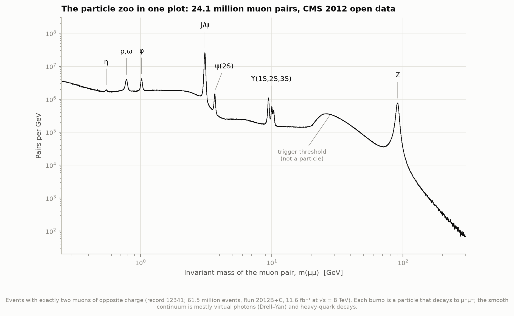

Any particle that can decay into a muon and an antimuon leaves a bump in the distribution of the
pair's **invariant mass**. That is the energy of the pair in its own rest frame,
m = √((E₁+E₂)² − |p₁+p₂|²) with c = 1, and it equals the mass of the particle that decayed into
them. The selection is the one in CMS's example (record 12342): events with exactly two muons, of
opposite charge. Our cut flow, 61,540,413 → 31,104,343 → 24,067,843, is identical to the output
ROOT's tutorial `df102_NanoAODDimuonAnalysis` prints for the same file. The bump at ~30 GeV is not a
particle: it is where the trigger (the electronics that decided which collisions to record)
starts accepting pairs.

Every bump is a particle the early universe made and lost as it cooled (project P2): mesons
(quark–antiquark pairs: η, ρ, ω, φ; charm–anticharm J/ψ and ψ(2S); bottom–antibottom ϒ) and the Z
boson, one of the three particles that get their mass from the Higgs field.

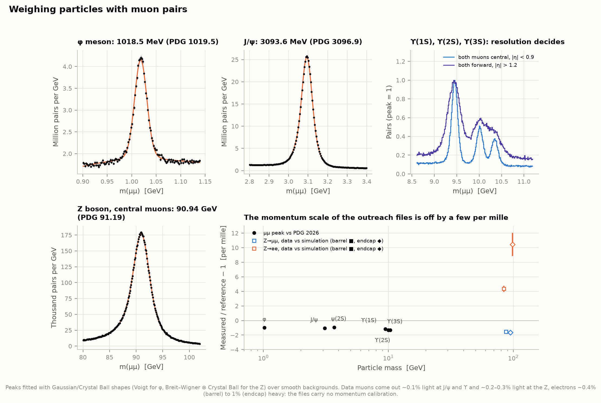

| Particle | Our fit | PDG 2026 | Fit / PDG − 1 |
|---|---|---|---|
| η | 547.88 ± 0.53 MeV | 547.862 | +0.04 ± 0.96 ‰ |
| φ | 1018.46 ± 0.10 MeV | 1019.46 | −0.98 ± 0.09 ‰ |
| J/ψ | 3093.63 ± 0.04 MeV | 3096.900 | −1.06 ± 0.01 ‰ |
| ψ(2S) | 3682.69 ± 0.29 MeV | 3686.097 | −0.92 ± 0.08 ‰ |
| ϒ(1S) | 9449.51 ± 0.39 MeV | 9460.40 | −1.15 ± 0.04 ‰ |
| ϒ(2S) | 10010.28 ± 0.64 MeV | 10023.4 | −1.31 ± 0.06 ‰ |
| ϒ(3S) | 10341.59 ± 0.81 MeV | 10355.1 | −1.31 ± 0.08 ‰ |
| Z (central muons, Γ fixed) | 90.940 ± 0.005 GeV | 91.1879 | −2.7 ‰ |

(Errors are statistical only. The ρ/ω peak is fitted as ω over a broad ρ: 781.03 MeV against
782.66, a fit that does not model the ρ–ω interference.)

The statistical precision is far better than the agreement. The masses come out 1 per mille light
at low mass and 2.7 per mille at the Z. These files contain the muon momenta as reconstructed in
2012, without the calibration CMS applies in its own analyses (the "Rochester" corrections). To
separate that from the Z line shape (the Z's natural width, radiation of photons, the falling
parton luminosity), we fit the same model to Z bosons in the data and in the simulation, which
has the same line shape. **Data/simulation: muons 0.154 ± 0.027% light (barrel), 0.164 ± 0.045%
(endcap); electrons 0.43 ± 0.04% heavy (barrel), 1.04 ± 0.16% (endcap).** Electrons are also 11%
worse resolved in data. These numbers become the lepton calibration of our Higgs search. With
the width left free, the central-muon Z peak gives Γ_Z = 2.64 ± 0.01 GeV (PDG 2.4955). The fit
cannot separate the width cleanly from resolution tails, so this is indicative only.

The ϒ panel shows why detectors are built the way they are. Muons crossing the central barrel
(|η| < 0.9) are measured well enough to separate the three ϒ states, 563 and 895 MeV apart; in the
forward endcaps they merge.

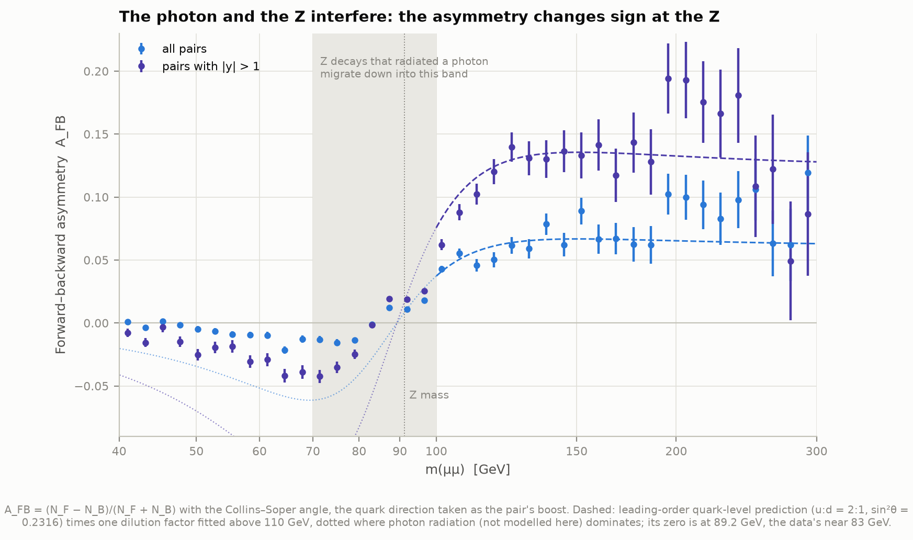

**The photon and the Z interfere.** Muon pairs from quark–antiquark annihilation can be made via
a virtual photon or via a Z. The two amplitudes interfere, and since the Z couples differently to
left- and right-handed particles, the negative muon prefers to go forward or backward depending on
the mass. Below the Z the asymmetry is negative, above it positive. This interference exists only
because the Higgs field mixes the weak and hypercharge fields into the photon and the Z. In
proton–proton collisions the quark direction must be guessed (from the pair's boost), which dilutes
the asymmetry. One dilution factor per rapidity range (0.100 ± 0.004 overall, 0.203 ± 0.006 for
|y| > 1) fitted above 110 GeV turns the quark-level prediction into the measured curve (χ² 37/19
and 22/19). Below the peak the data cross zero near 83 GeV rather than at the quark-level 89.2 GeV.
That region fills with Z decays that lost energy to photon radiation and carry the Z peak's
asymmetry down with them; we do not model that radiation.

### 2. Find the Higgs yourself

A Higgs boson decays to two Z bosons 2.6% of the time (one of them off its mass shell), and each
Z to an electron or muon pair 6.7% of the time. Four leptons whose combined invariant mass is
125 GeV are the cleanest Higgs signature there is. The main background is the direct production of
Z pairs (and of a single Z that radiates a second lepton pair, which makes the peak at 91 GeV).

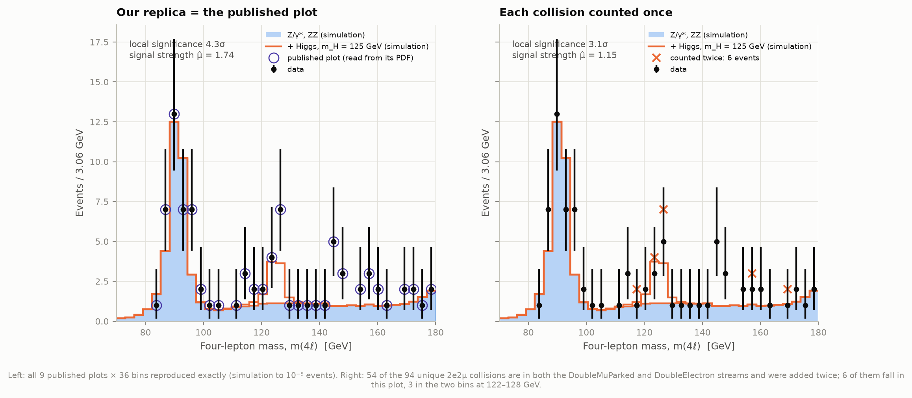

**Replica.** `events.py` re-implements the outreach analysis's `skim.cxx` in Python and runs it
over the 12.2 GB of data and the simulation. The published plots are ROOT PDFs with vector
graphics, so `outreach_plots.py` reads them back exactly: every bin of the data, the background
and the signal. The result: all 9 plots × 36 bins identical. The data agree count for count, and
the simulation to 10⁻⁵ events (one simulated event, weight 0.002, sits on a bin edge in one plot).
That includes a quirk of the C++: `auto best_mass = -1;` makes the "best mass so far" an `int`,
so when pairing four same-flavour leptons each candidate's mass is truncated before the next is
compared. With true masses one data event moves between bins of the 4μ Z₁ and Z₂ plots, so the
published plots contain the truncation.

**The double count.** In 2012 CMS sorted collisions into primary datasets by trigger: DoubleMuParked
for events with two muons, DoubleElectron for two electrons. A 2e2μ event can fire both and is then
stored in both. The outreach analysis adds the 2e2μ events of both streams. Of the 148 entries,
only 94 are different collisions (same run, luminosity block, event number and mass). 54 are
counted twice, 6 of them in the 70–180 GeV plot (116.2, 124.6, 126.3, 126.5, 157.9 and 169.9 GeV),
and 3 of those in the two bins that make the published Higgs peak. A binned fit to the published
histogram gives a signal strength of 1.74 and a local significance of 4.3σ. With each collision
counted once: 1.15 and 3.1σ.

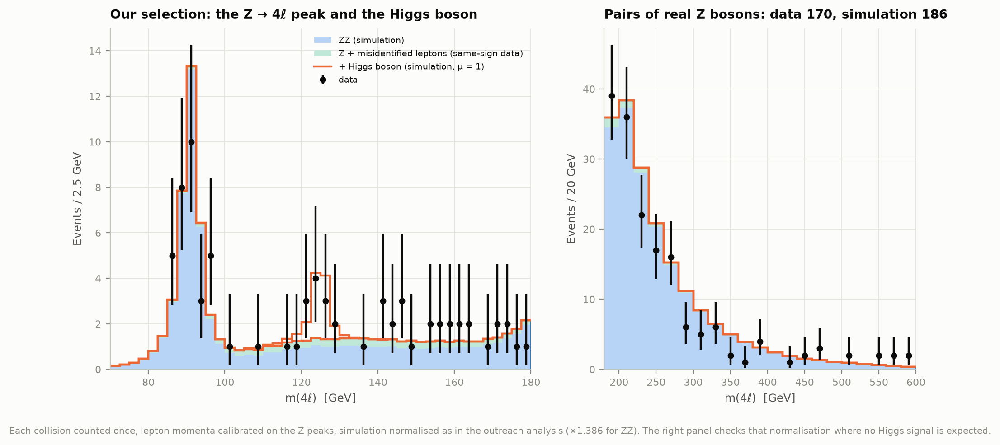

**Our selection** follows the CMS 2012 discovery paper more closely:

- every event with at least four identified leptons is considered (the outreach code demands
  exactly four of a kind);
- Z₁ is the opposite-charge, same-flavour pair closest to the Z mass (40–120 GeV), and Z₂ the
  remaining pair with the largest transverse momentum (12–120 GeV);
- one lepton has more than 20 GeV of transverse momentum and another more than 10;
- every opposite-charge pair is heavier than 4 GeV;
- 4μ events come from the muon stream, 4e from the electron stream, and 2e2μ from both, once.

Lepton momenta in data are scaled by the Z-peak calibration above. With the outreach analysis's
normalisation of the simulation (luminosity × cross-section, ×1.386 for ZZ) we expect 68.3 ZZ and
8.1 Higgs events between 70 and 180 GeV and see 74. Above 180 GeV, where real Z pairs dominate and
no Higgs signal is expected, we see 170 events against 186 simulated (data/simulation
0.91 ± 0.07). That is a check of the 1.386 factor that the outreach analysis does not make.

**The background the outreach analysis neglects.** Some "leptons" are misidentified jets or come
from heavy-quark decays, in events with a Z and jets or with top quarks ("Z+X"). Real ZZ and Higgs
decays always give two opposite-charge pairs. So we count events whose second pair has the *same*
charge: 19 in data, against 3.9 from ZZ and Higgs in the simulation. Assuming fakes come with
either sign equally often (±50%), Z+X adds 6.6 events between 105 and 160 GeV, mostly in 2e2μ
(Z → μμ plus two fake electrons). The lepton identification in these files is minimal (isolation
and impact parameter only), so this background is larger than in CMS's own analysis.

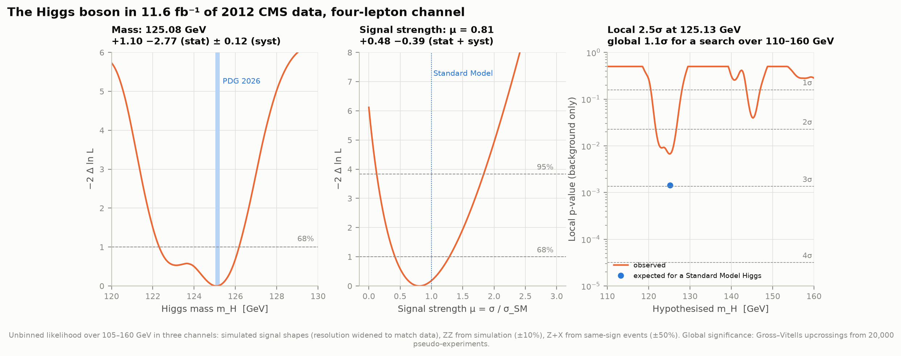

**The fit** (`higgsfit.py`) is an unbinned likelihood over 105–160 GeV in the three channels:

- **Signal shape:** a double-sided Crystal Ball fitted to the simulated Higgs boson in each
  channel. It is slid to the trial mass and widened by the measured data/simulation resolution
  ratio (1.11 for 4e, 1.06 for 2e2μ).
- **Backgrounds:** ZZ from the simulation (±10%) and Z+X from same-sign data (±50%).

The test statistic is the profile-likelihood ratio q₀ (Cowan, Cranmer, Gross & Vitells 2011).

| | Value |
|---|---|
| Higgs mass | **125.08 +1.10 −2.77 (stat) ± 0.12 (syst) GeV** |
| systematics | muon scale ±0.08, electron scale ±0.07, resolution ±0.06 GeV |
| PDG 2026 | 125.13 ± 0.11 GeV |
| signal strength μ | 0.81 +0.48 −0.39 |
| local significance at 125.13 GeV | 2.47σ (asymptotic), 2.51σ (20,000 pseudo-experiments) |
| expected for a Standard Model Higgs | 3.0σ (median of 2,000 signal pseudo-experiments) |
| global significance, 110–160 GeV | 1.07σ (Gross–Vitells upcrossings, 1.75 per pseudo-experiment) |
| Z → 4ℓ peak, data vs simulation | −0.6 ± 0.55%: the four-lepton mass scale agrees within 1σ |

The mass interval is lopsided because three events at 121–122 GeV pull a shoulder into the
likelihood. The CMS discovery paper (2012) saw 3.2σ in this channel with comparable data (5.1 fb⁻¹
at 7 TeV and 5.3 fb⁻¹ at 8 TeV), with a better lepton identification and a kinematic discriminant
we do not have.

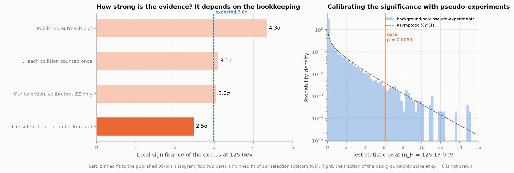

What the significance depends on is the bookkeeping: 4.3σ → 3.1σ (duplicates) → 3.0σ (our
selection, calibration) → 2.5σ (Z+X). The pseudo-experiments confirm the asymptotic formula
(p = 0.0061 from toys, 0.0067 asymptotic). With 11.6 fb⁻¹ and simple lepton identification,
2.5σ is a typical outcome for a real Standard Model Higgs boson, and the measured mass agrees with
the world average to 0.05 GeV.

### 3. The Higgs potential and the masses it gives

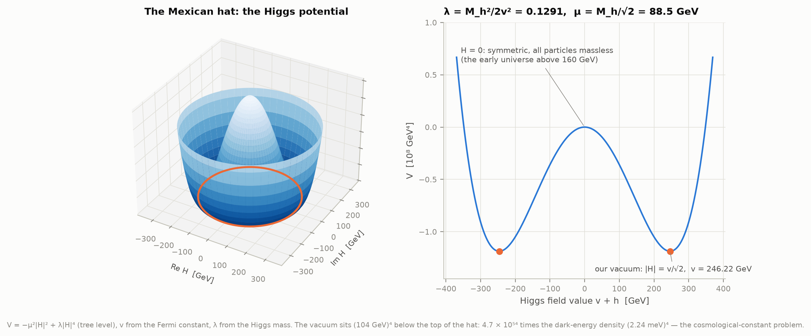

The Higgs field is a doublet H with potential V = −μ²|H|² + λ|H|⁴, the "Mexican hat". Its
lowest points lie on a circle |H| = v/√2 away from H = 0. The Fermi constant of muon decay fixes
v = (√2 G_F)^−½ = 246.22 GeV; the Higgs mass, the curvature at the bottom, fixes λ = M_h²/2v² =
0.1291 and μ = M_h/√2 = 88.5 GeV (tree level). In the hot early universe, above ~160 GeV, the
minimum was at H = 0 and every particle was massless. At the minimum the potential sits
(104 GeV)⁴ below its value at H = 0: an energy density 4.7 × 10⁵⁴ times the dark energy the
universe actually has, (2.24 meV)⁴ (Planck 2018). Why the vacuum energy is so small is one of the
deepest open problems in physics: the cosmological-constant problem.

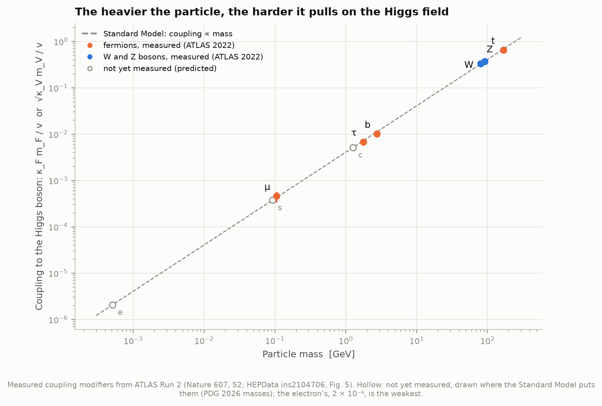

Particles get their mass by interacting with the field's constant value: m_W = gv/2,
m_Z = √(g² + g′²) v/2, and m_f = y_f v/√2 for each fermion. So a particle's coupling to the
Higgs boson is proportional to its mass. ATLAS's ten-year summary (Nature 607, 52, 2022; HEPData)
measured six couplings over three orders of magnitude, from the muon to the top quark, and all
of them follow the line. The top quark's Yukawa coupling is 0.99, essentially 1, a fact that
drives the next section.

### 4. Running couplings and the fate of the vacuum

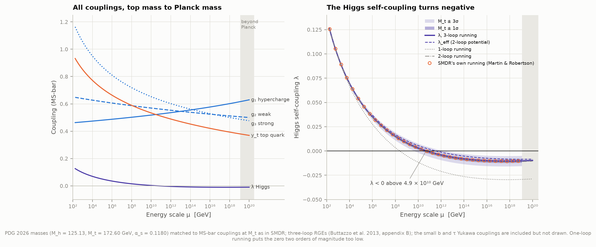

**Couplings run.** Quantum fluctuations screen or anti-screen every charge, so the strength of an
interaction depends on the energy at which it is probed. The renormalization group equations
(RGEs) give how. `rge.py` implements them at one, two and three loops for all the sizeable Standard
Model couplings, transcribed from the appendix of Buttazzo et al. (2013), plus the four-loop QCD
term for g₃. The starting values at μ = M_t come from the measured masses: tree level, the
analytic one-loop corrections and the numerical two-loop corrections of the same paper, plus the
three-loop QCD term for y_t. For our headline numbers they are shifted onto SMDR's values (Martin &
Robertson 2019, version 1.3, built here from source). SMDR includes the four-loop QCD relation
between the top quark's pole and MS-bar masses; it lowers y_t by 0.0009 and g₃ by 0.0017.

**The Higgs self-coupling λ** is dragged down by the top quark (−6y_t⁴ in its β function). It
turns negative above 4.9 × 10¹⁰ GeV (3.6 × 10¹⁰ with the 2013-era matching) and reaches a minimum
of −0.0105 at 3.8 × 10¹⁷ GeV, where its β function vanishes. The effective potential (two loops,
Landau gauge) turns negative at 3.5 × 10¹¹ GeV, and its barrier is (2.6 × 10¹⁰ GeV)⁴ high. One-loop
running would have put λ's zero at 2.4 × 10⁸ GeV and two-loop at 3.5 × 10¹⁰. The answer converges
only at two to three loops, as the spec warned.

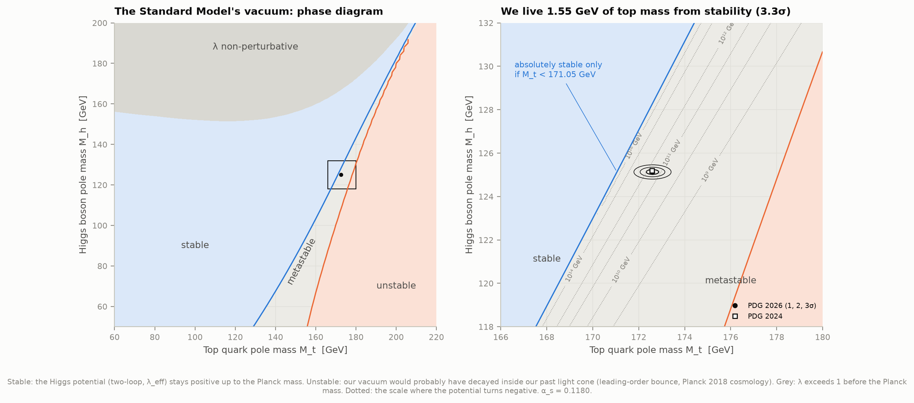

**Stable, metastable or unstable?** If λ turns negative, the Higgs potential has a deeper minimum
at enormous field values, and our vacuum is only a false vacuum. Quantum tunnelling can then
nucleate a bubble of the true vacuum, which would expand at the speed of light. The vacuum is
**stable** if the potential stays above our vacuum's up to the Planck mass. It is **unstable** if
a bubble should already have formed in our past light cone. In between it is **metastable**. The
tunnelling rate per unit volume is ~μ⁴ e^−S with the bounce action S = 8π²/(3|λ(μ)|) (Coleman
1977; Isidori, Ridolfi & Strumia 2001), maximised over the bubble size 1/μ.

- **Stability needs M_t < 171.05 GeV** at the measured Higgs mass and α_s. The measured top mass is
  1.55 GeV higher: **3.3σ**, combining 0.27 (top mass), 0.35 (α_s), 0.05 (Higgs mass), 0.07
  (matching scheme) and 0.15 GeV (higher orders, Buttazzo et al.). The top mass measured at
  colliders is calibrated on simulations, and its relation to the pole mass used here is uncertain
  by a few hundred MeV; with 0.5 GeV for that, 2.2σ.
- **At leading order our vacuum has decayed with probability 10⁻⁸⁵²** inside our past light cone
  (its space-time volume is 0.123/H₀⁴).
- Andreassen, Frost & Schwartz (2018) define the lifetime as (Γ/V)^−¼. For us that is
  **10²²³ years**; if the universe's future is dominated by dark energy, the expected time to
  decay in our horizon is 10⁸⁶¹ years (Buttazzo et al.'s eq. 6.6).
- **These numbers depend steeply on the top mass.** With Andreassen et al.'s 2017 inputs
  (M_t = 173.1 GeV) our leading-order rate is 10⁻⁷⁴⁰ GeV⁴. They find 10⁻⁷⁷³ at next-to-leading
  order, a lifetime of 10¹⁶¹ instead of our 10¹⁵³ years: the fluctuation determinants they compute
  are worth 10⁻¹⁵ in the rate.
- "Metastable" assumes that no new particles or forces appear below the Planck scale.

**Interactive:** [figures/vacuum_explorer.html](figures/vacuum_explorer.html) reruns the three-loop
equations in the browser as you move M_t, M_h and α_s. Its β functions are generated from
`rge.betas` and checked against it to machine precision. The same page is published as a private
artifact: https://claude.ai/artifact/71XJ3eTfx3efdrJnMkvSRo (from `data/derived/vacuum_explorer_artifact.html`,
which `explorer.py` rewrites).

### 5. On P2's calendar

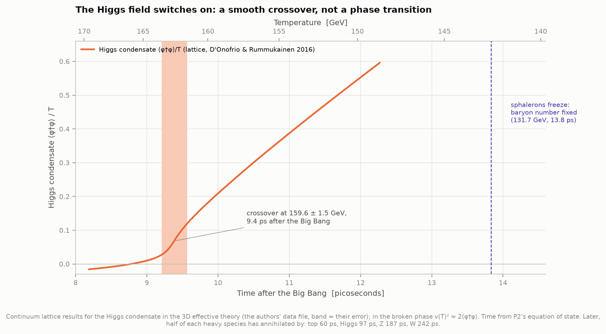

Lattice simulations of the Standard Model at high temperature (D'Onofrio & Rummukainen 2016, whose
data file we read) show the Higgs condensate growing smoothly as the universe cooled through
159.6 ± 1.5 GeV. The 125 GeV Higgs is too heavy for a sharp phase transition, so this was a
crossover. P2's equation of state turns that into **9.4 picoseconds** after the Big Bang. From
then on W, Z, quarks and charged leptons had mass and the weak force was short-ranged. Sphalerons,
the thermal processes that convert baryons into leptons, stopped at 131.7 ± 2.3 GeV (13.8 ps),
fixing the number of baryons (project P5). Over the next few hundred picoseconds the heaviest
particles annihilated: half of the top quarks were gone by 60 ps, the Higgs bosons by 97 ps, the
Z by 187 ps and the W by 242 ps. The collisions analysed here, at 8 TeV, briefly recreate
energies the whole universe had before this epoch.

## Background, in brief

**Invariant mass.** For particles with energies Eᵢ and momenta pᵢ, M² = (ΣE)² − |Σp|² is the
same in every frame; for decay products it is the parent's mass. Detectors measure transverse
momentum p_T, pseudorapidity η (a polar angle: η = −ln tan(θ/2)) and azimuth φ, so
p_x = p_T cos φ, p_y = p_T sin φ, p_z = p_T sinh η.

**Significance.** A local p-value is the probability that background alone fluctuates at least
as far as the data at one mass; "Nσ" is that probability expressed as a Gaussian tail. Searching
many masses raises the chance of a fluctuation somewhere (the look-elsewhere effect), which the
global p-value accounts for. Particle physicists ask 5σ for a discovery.

**MS-bar couplings.** Couplings defined in the modified minimal-subtraction scheme at a
renormalisation scale μ. They are not directly measurable, but are related to measurable masses
by calculable "matching" corrections, and their μ dependence is given by the RGEs.

**The Planck mass**, M_Pl = 1.22 × 10¹⁹ GeV, is where gravity becomes as strong as the other forces;
nobody knows what physics is there, so extrapolations stop at it.

## Method

| Step | Module | What it does |
|---|---|---|
| Download | `fetch_data.py` | 9 CMS files by parallel HTTPS byte ranges, resumable, verified against CERN's adler32 checksums; outreach code and published plots; papers' sources; HEPData; SMDR (compiled with `-std=gnu17`) |
| Events | `events.py` | dimuon pass, dielectron pass (Z → ee), the outreach replica (with and without its `int` quirk), and a good-lepton skim |
| Published plots | `outreach_plots.py` | reads the 12 ROOT PDFs back into numbers through their axis ticks |
| Dimuon | `dimuon.py` | spectrum, resonance fits (binned Poisson likelihood, Crystal Ball / Voigt / Breit–Wigner ⊗ Crystal Ball), A_FB |
| Calibration | `calibration.py` | Z peaks in data and simulation, per flavour and detector region → momentum scales |
| Selection | `fourlepton.py` | our four-lepton selection, duplicates removed, same-sign control region |
| Statistics | `higgsfit.py`, `higgs_search.py` | likelihood, profiles, scans, pseudo-experiments, look-elsewhere effect, systematics, the step-by-step comparison |
| Theory | `rge.py`, `stability.py` | matching, 1–3-loop RGEs, effective potential, stability bound, decay, phase diagram, SMDR comparison |
| Potential, calendar | `electroweak.py` | Higgs potential numbers, couplings vs mass, lattice condensate, P2's time–temperature table |
| Outputs | `figures.py`, `explorer.py`, `run.py` | 12 figures, the interactive explorer, `data/results.json` |

## Validation

| Check | Ours | Reference |
|---|---|---|
| dimuon cut flow | 61,540,413 → 31,104,343 → 24,067,843 | ROOT tutorial df102: identical |
| outreach replica, 9 plots × 36 bins | data identical, simulation ≤ 10⁻⁴ (one event on a bin edge: 0.002) | CMS record 12360 plots |
| couplings at M_t, LO/NLO/NNLO | λ 0.12918/0.12775/0.12605, y_t 0.99561/0.95113/0.94018 (0.93690 with 3-loop QCD), g₂ 0.65295/0.64754/0.64780, g_Y 0.34971/0.35939/0.35829 | Buttazzo et al. table 3 |
| couplings at M_Pl (their inputs) | λ −0.01435, y_t 0.3825, g₁ 0.6153, g₂ 0.5055, g₃ 0.4873 | −0.0143, 0.3825, 0.6154, 0.5055, 0.4873 |
| instability scales (their inputs) | log₁₀ Λ_V = 9.50, Λ_λ/Λ_V = 1.97, Λ_I/Λ_V = 12.7 | 9.5, ≈ 2, ≈ 13 |
| stability bound (their inputs) | 171.14 GeV | their eq. 4.2: 171.12 (text: 171.53) |
| λ, y_t, g, g′ at μ* (AFS inputs) | −0.0141 at 2.95 × 10¹⁷; 0.4026, 0.5153, 0.4599 | −0.0138 at 3.11 × 10¹⁷; 0.402, 0.515, 0.460 |
| running from SMDR's couplings | λ(M_Pl) = −0.01020 | SMDR's own: −0.01019 |
| JavaScript RGEs (explorer) | identical to Python (difference 0.0) | `rge.betas` |
| light-cone volume, matter era | 16π/1485 reproduced to 2 × 10⁻⁵ | closed form (Buttazzo et al. eq. 6.5) |
| significance | toys 2.51σ vs asymptotic 2.47σ | Wilks/Cowan et al. |

`python test_physics.py` runs 13 self-tests of these.

## Data and credits

- **CMS Collaboration (2019–2021), CERN Open Data portal**, reduced NanoAOD by Stefan Wunsch,
  CC0: DoubleMuParked Run2012B+C (record 12341, doi:10.7483/OPENDATA.CMS.LVG5.QT81); the Higgs
  analysis datasets 12361 (doi:10.7483/OPENDATA.CMS.8FLU.UIQJ), 12362
  (doi:10.7483/OPENDATA.CMS.FBFX.VI9P), 12363–12368. Outreach analyses: Higgs to four leptons,
  record 12360 (doi:10.7483/OPENDATA.CMS.F7HD.P3K4, GPL-3.0); dimuon spectrum, record 12342
  (doi:10.7483/OPENDATA.CMS.AAR1.4NZQ).
- **CMS Collaboration (2012)**, Phys. Lett. B 716, 30: the discovery paper this analysis follows.
- **Particle Data Group (2026)**, Review of Particle Physics: masses (via the `particle` package's
  2026 table), G_F and α_s(M_Z) (physical-constants table).
- **Buttazzo, Degrassi, Giardino, Giudice, Sala, Salvio & Strumia (2013)**, JHEP 12, 089
  (arXiv:1307.3536v4): RGEs, matching, effective potential, vacuum decay.
- **Martin & Robertson (2019)**, Phys. Rev. D 100, 073004 (arXiv:1907.02500): SMDR, code version
  1.3 (GPL).
- **Andreassen, Frost & Schwartz (2018)**, Phys. Rev. D 97, 056006 (arXiv:1707.08124v4).
- **D'Onofrio & Rummukainen (2016)**, Phys. Rev. D 93, 025003 (arXiv:1508.07161), and their data
  file; **D'Onofrio, Rummukainen & Tranberg (2014)**, PRL 113, 141602 (sphaleron freeze-out).
- **ATLAS Collaboration (2022)**, Nature 607, 52 (HEPData ins2104706).
- **Cowan, Cranmer, Gross & Vitells (2011)**, Eur. Phys. J. C 71, 1554; **Gross & Vitells (2010)**,
  Eur. Phys. J. C 70, 525.
- **Planck Collaboration (2020)**, A&A 641, A6 (H₀ = 67.36, Ω_Λ = 0.6847).
- **Ellis, Stirling & Webber**, *QCD and Collider Physics* (leading-order A_FB).
- Project **P2** (`68-thermal-history`) for time against temperature.
- Tools: uproot, awkward, numpy, scipy, iminuit, matplotlib, particle.

## Caveats and deviations from the plan

- **Inputs are PDG 2026**, not the spec's PDG 2024 (M_h 125.13 ± 0.11 instead of 125.20,
  M_t 172.60 ± 0.27 instead of 172.57 ± 0.29). Both are run; the 2024 point is on the phase diagram.
- **"Apply lepton efficiencies as in the example code":** the example code applies none, only a
  global normalisation (luminosity × cross-section/events, ×1.386 for ZZ). We checked that
  normalisation in the on-shell ZZ region (0.91 ± 0.07) instead, and we calibrate the lepton
  momentum scales, which the example does not do.
- **Minimal lepton identification.** The files carry no electron or muon identification flags
  beyond isolation and impact parameter. That makes the misidentified-lepton background larger
  than in CMS's analysis, and it is estimated with a simple same-sign method (opposite/same-sign
  ratio 1 ± 0.5). Raising the ratio to 1.5 lowers the significance to 2.3σ.
- **No trigger information** in the files. The simulation is not trigger-matched; for four-lepton
  events the trigger efficiency is close to 100%.
- **The significance is indicative.** There is no event-by-event mass resolution, no kinematic
  discriminant, and no theory uncertainties on the signal. The data are 11.6 fb⁻¹ of 8 TeV
  collisions only.
- **Momentum calibration from Z bosons only.** The data/simulation scale is measured on Z → ℓℓ.
  The Higgs's leptons are softer, and the J/ψ and ϒ show the muon scale offset is smaller there
  (0.1% against PDG). We assign the calibration's uncertainty plus 0.1% as a systematic.
- **Matching** uses Buttazzo et al.'s published two-loop fits around their inputs, with offsets to
  SMDR at the measured point; far from the measured masses (the wide phase diagram) the boundaries
  are qualitative. The phase-diagram stability border uses the two-loop effective potential, and
  the explorer page uses λ itself (0.06–0.07 GeV apart).
- **Vacuum decay is leading order** (tree-level bounce action, prefactor μ⁴). Andreassen et al.'s
  full calculation differs by ~10¹⁵ in the rate. Gravitational corrections, which lengthen the
  lifetime, are not included.
- **The forward–backward asymmetry** below 100 GeV is shaped by photon radiation, which is not
  modelled; only the region above 110 GeV is compared with theory.
- **Download** is 15.0 GB (the spec said ~2–13 GB). Streaming only the needed branches would save
  only ~20%, so we keep whole files, which can be checked against CERN's checksums.

## Running it

```bash
cd astrophysics/73-higgs-boson
python fetch_data.py        # 15 GB of CMS data + literature + SMDR build (~40 min at 6–10 MB/s)
python run.py               # first run ~30 min (event passes, 20,000 pseudo-experiments, grids)
python run.py --offline     # afterwards, from the caches in data/ (~3 min)
python explorer.py          # the interactive page
python test_physics.py      # 13 self-tests
```

Needs the shared `.venv` with `uproot`, `awkward`, `iminuit`, `particle`, scipy and matplotlib,
plus gcc and make for the optional SMDR cross-check (without them the 2013-era matching is used).
`data/` (raw files, caches, SMDR) is git-ignored.
